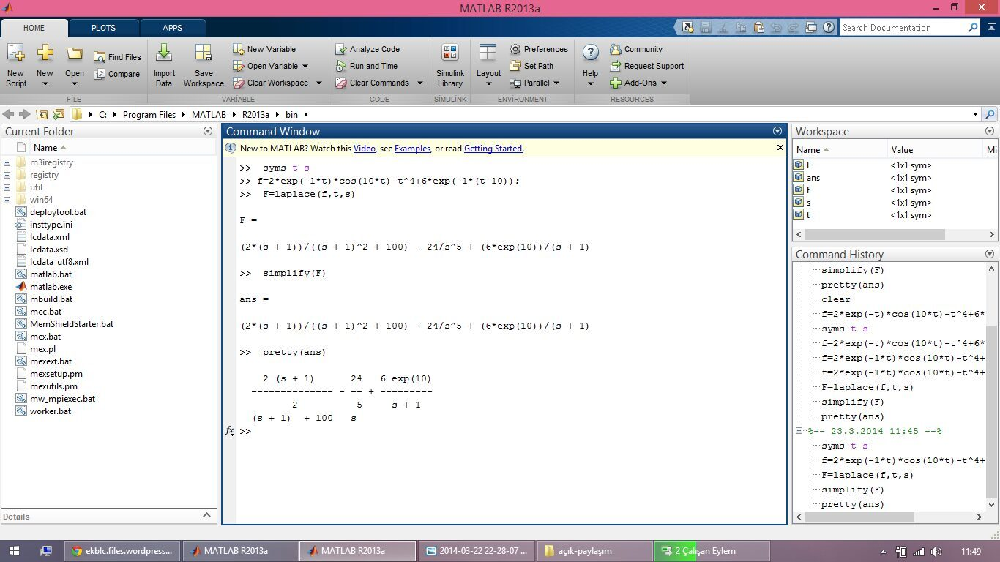
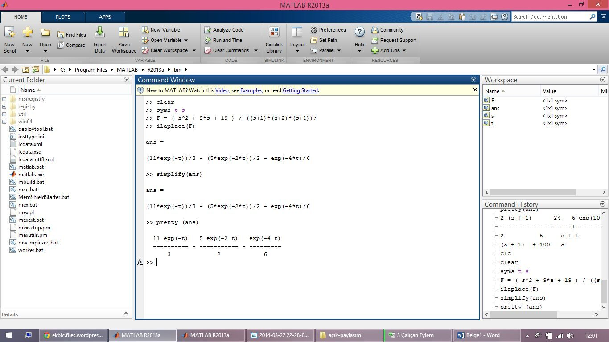

Bu yazı, Başkent Üniversitesi **EEM 308 Sinyaller ve Sistemler II** dersinde 2013 ve 2014 bahar dönemlerinde verilen ödevleri bir araya getiriyor:

- **2013:** Bölümün resmî ödev formuyla verilen *Ödev Nu. 1* (Laplace dönüşümü, teslim 8 Mart 2013) ve *Ödev Nu. 2* (z-dönüşümü, teslim 29 Mart 2013); ikisi de 28 Şubat 2013 tarihli.
- **2014:** Elle yazılmış dört kısa ödev (Ödev-1…4, Mart 2014) ve dönem sonuna doğru verilen, MATLAB ağırlıklı yedi soruluk "EEM 308 Ödev" (teslim tarihi: EEM 308 finalinin yapıldığı gün).

2014 ödevleri için bir öğrencinin el yazısı çözüm fotoğrafları ve MATLAB ekran görüntüleri de vardı; bunlardan çıkan sonuçlar aşağıda notlarla birlikte aktarıldı (çözümlerde ad veya numara yok; belge özellikleri temizlendi). Fotoğraflar arşivde saklanıyor, yayınlanmıyor; ödev belgeleri ve MATLAB çözümü yazının sonunda ZIP olarak indirilebilir.

## 2013 – Ödev 1: Laplace dönüşümü

**Soru 1:** s-uzayında tanımı verilen fonksiyonun zaman uzayındaki x(t) tanımını ters Laplace dönüşümünü kullanarak bulunuz.

X(s) = (5s + 13) / (s(s² + 4s + 13)); yakınsama bölgesi: Re(s) > 0

**Soru 2:** Aynı şekilde x(t)'yi bulunuz.

X(s) = (s² + 6s + 7) / (s² + 3s + 2); yakınsama bölgesi: Re(s) > −1

**Soru 3:** Aşağıdaki devre için Laplace dönüşüm yöntemini kullanarak V_c(t) gerilimini bulunuz.


**Soru 4:** Zaman uzayında dinamiği verilen sistemin, giriş x(t) ve çıkış y(t) olmak üzere, giriş-çıkış ilişkisini veren s-uzayındaki transfer fonksiyonunu H(s) bulunuz. Başlangıç koşulları sıfırdır.

d²y(t)/dt² + 10 dy/dt + 5y(t) = x(t)

Ödev kâğıdının sonunda x(t) → [h(t)] → y(t) ve X(s) → [H(s)] → Y(s) blok gösterimleri yer alıyor.

## 2013 – Ödev 2: z-dönüşümüyle sistem tepkesi

**Soru 1:** Ayrık zamanlı doğrusal zamanla değişmeyen bir sisteme giriş sinyali olarak x[n] = aⁿ uygulanmaktadır. Sistemin dürtü tepkesinin h[n] = a⁻ⁿ u[−n] olduğu bilinmektedir. z-dönüşümü yöntemini kullanarak sistemin tepkesi y[n]'i bulunuz. (Not: 0 < a < 1)

## 2014 – Ödev 1–4

**Ödev-1** (MATLAB: `laplace`, `ilaplace`, `syms`, `residue`): f(t) = 2e⁻ᵗ cos 10t − t⁴ + 6e^{−(t−10)} fonksiyonunun Laplace dönüşümünü bulunuz.

**Ödev-2:** F(s) = (s² + 9s + 19) / ((s + 1)(s + 2)(s + 4)) ise f(t) = ?

**Ödev-3:** y‴(t) + 4y″(t) + 6y′(t) + 4y(t) = 0, ẏ(0) = 0, ÿ(0) = −1. Y(s)'yi elle bulunuz.

**Ödev-4:** Seri bağlı e(t) kaynağı, R, L ve C'den oluşan devrede e(t) = −2v(t), R = 1 Ω, L = 0,5 H, C = 0,2 F, v(0) = 5 V, v̇(0) = 0. v(t)'nin t'ye göre değişimini çiziniz; v(t) = ?

### Öğrenci çözümünden sonuçlar

**Ödev-1 (MATLAB):**

```matlab
syms t s
f = 2*exp(-1*t)*cos(10*t) - t^4 + 6*exp(-1*(t-10));
F = laplace(f, t, s)
simplify(F)
pretty(ans)
```

```
F =
(2*(s + 1))/((s + 1)^2 + 100) - 24/s^5 + (6*exp(10))/(s + 1)
```

Yani F(s) = 2(s + 1)/((s + 1)² + 100) − 24/s⁵ + 6e¹⁰/(s + 1). Son terim, e^{−(t−10)} = e¹⁰·e⁻ᵗ yazılarak elde ediliyor.

**Ödev-2 (MATLAB):**

```matlab
clear
syms t s
F = ( s^2 + 9*s + 19 ) / ((s+1)*(s+2)*(s+4));
ilaplace(F)
```

```
ans =
(11*exp(-t))/3 - (5*exp(-2*t))/2 - exp(-4*t)/6
```

f(t) = (11/3)e⁻ᵗ − (5/2)e⁻²ᵗ − (1/6)e⁻⁴ᵗ, t ≥ 0. Elle kontrol: s = −1'deki kalıntı (1 − 9 + 19)/(1·3) = 11/3, s = −2'deki (4 − 18 + 19)/((−1)·2) = −5/2, s = −4'teki (16 − 36 + 19)/((−3)(−2)) = −1/6.





**Ödev-3 (elle):** Her terimin Laplace dönüşümü alınır:

[s³Y(s) − s²y(0) − sẏ(0) − ÿ(0)] + 4[s²Y(s) − sy(0) − ẏ(0)] + 6[sY(s) − y(0)] + 4Y(s) = 0

ẏ(0) = 0 ve ÿ(0) = −1 yerine konunca:

**Y(s) = (s²y(0) + 4s·y(0) + 6y(0) − 1) / (s³ + 4s² + 6s + 4)**

y(0) verilmediği için sonuç y(0)'a bağlı kalıyor; y(0) = 0 alınırsa Y(s) = −1/(s³ + 4s² + 6s + 4) olur.

*Not: Öğrencinin ilk sayfasında y(0) = 0 durumu için Y(s) = 1/(s³ + 4s² + 6s + 4) yazılmış; ÿ(0) = −1 olduğundan pay −1 olmalıdır. İkinci sayfadaki genel ifade (yukarıdaki) doğrudur. Payda s³ + 4s² + 6s + 4 = (s + 2)(s² + 2s + 2) şeklinde çarpanlarına ayrılır.*

**Ödev-4:** Öğrenci çözümünde e(t) = −2v(t) koşulu türevli bir ifade gibi yazılıp v(t) = (e(t) + 5)/(2s) sonucuna ulaşılmış; bu sonuç hatalı.

*Not: Seri devrede KVL: e(t) = R·i + L·di/dt + v, i = C·dv/dt. e = −2v konunca LC·v″ + RC·v′ + 3v = 0, yani 0,1v″ + 0,2v′ + 3v = 0 ⇒ v″ + 2v′ + 30v = 0. Karakteristik kökler s = −1 ± j√29. v(0) = 5, v̇(0) = 0 ile Laplace dönüşümünden V(s) = 5(s + 2)/(s² + 2s + 30) ve v(t) = 5e⁻ᵗ [cos(√29 t) + (1/√29) sin(√29 t)], t ≥ 0: genliği e⁻ᵗ ile sönen, açısal frekansı √29 ≈ 5,39 rad/s olan bir salınım.*

## 2014 – MATLAB ödevi (7 soru)

Puanları sorunun yanında daire içinde verilen ödev:

1. **(20)** Aşağıdaki transfer fonksiyonunu çarpım şeklinde ifade edin, kutup ve sıfırlarını çiziniz. Yakınsama bölgesini belirtiniz. H(z) = (2z⁴ + 16z³ + 44z² + 56z + 32) / (3z⁴ + 3z³ − 15z² + 18z − 12). İpucu: `tf2zp`, `zp2sos`, `zplane` (MATLAB'da çözülecek).
1. **(40)** Yukarıdaki transfer fonksiyonuna benzer, pay ve paydanın derecesi okul numaranızın son rakamı olacak şekilde rasyonel bir transfer fonksiyonu oluşturun; 1. soruda yaptıklarınızı bu fonksiyon için tekrarlayınız (son rakamı 0 olanlar 8 kullanmalı).
1. **(40)** Kutupları p₁ = −0,45, p₂ = 0,67, p₃ = 0,81 + j0,72 olan, sıfırları okul numaranızın 5., 6. ve 7. rakamları olan, K kazancı 2,2 olan sistemin transfer fonksiyonunu elde ediniz. Birim dürtü ve birim basamak cevaplarını çiziniz.
1. **(20)** z bölgesindeki G(z) = 18z³ / (18z³ + 3z² − 4z − 1) fonksiyonunu MATLAB kullanarak kısmi kesirlere ayırınız.
1. **(20)** X(e^{jω}) = (0,008 − 0,033e^{−jω} + 0,05e^{−j2ω} − 0,033e^{−j3ω} + 0,008e^{−j4ω}) / (1 + 2,37e^{−jω} + 2,7e^{−j2ω} + 1,6e^{−j3ω} + 0,41e^{−j4ω}) ayrık zaman Fourier dönüşümlü işaretin Bode genlik ve faz diyagramını çiziniz.
1. **(20)** H(z) = (z − 0,2) / (z²(z − 0,7)) ile verilen sistemin girişine x[n] = (0,9)ⁿ u[n] uygulanırsa y[n]'i elde ediniz (elde hesaplayınız).
1. **(40)** İki filtre kaskat bağlanmıştır. Birinci filtrenin birim dürtü çıkışı h₁[n] = 0,75δ[n] − 1,75δ[n−1] + 1,75δ[n−2] − 0,25δ[n−3], ikinci filtreninki h₂[n] = 0,25δ[n] + 0,25δ[n−1] + 0,25δ[n−2] + 0,25δ[n−3] ise: a) H₁(z) ve H₂(z)'yi bulun, sıfır ve kutuplarını MATLAB ile bulup ayrı ayrı alçak mı yüksek geçiren mi olduğunu bulunuz. b) H(z) = H₁(z)H₂(z)'yi elde ediniz; sıfır, kutup, genlik ve faz cevabını MATLAB'da çizdiriniz. Filtrenin alçak, yüksek, bant geçiren veya bant durduran süzgeç olup olmadığını belirtiniz.

### Bir öğrenci çözümünden MATLAB sonuçları

**Soru 1:**

```matlab
pay = [2 16 44 56 32];
payda = [3 3 -15 18 -12];
[z,p,k] = tf2zp(pay,payda)
zplane(pay,payda)
```

```
z =
  -4.0000
  -2.0000
  -1.0000 + 1.0000i
  -1.0000 - 1.0000i

p =
  -3.2361
   1.2361
   0.5000 + 0.8660i
   0.5000 - 0.8660i

k =
    0.6667
```

Çarpım biçiminde: H(z) = (2/3) · (z + 4)(z + 2)(z² + 2z + 2) / ((z² + 2z − 4)(z² − z + 1)). Kutuplar −1 ± √5 (≈ 1,2361 ve −3,2361) ile 0,5 ± j0,866 (birim çember üzerinde, e^{±jπ/3}).

*Not: Öğrenci çözümünde ROC yazılmamış. Kutupların en büyük genliği |−3,2361| olduğundan, sistem nedensel kabul edilirse ROC |z| > 3,2361'dir; bu ROC birim çemberi içermediği için nedensel sistem kararlı değildir.*

**Soru 4:**

```matlab
n = [18];
d = [18 3 -4 -1];
[r,p,k] = residue(n,d)
```

```
r =
    1.4400
   -1.4400
   -1.2000
p =
    0.5000
   -0.3333
   -0.3333
k =
     []
```

*Not: `residue(18, [18 3 -4 -1])` aslında 18/(18z³ + 3z² − 4z − 1) = G(z)/z³ ifadesini z'nin kuvvetlerinde açar: 1,44/(z − 0,5) − 1,44/(z + 1/3) − 1,2/(z + 1/3)². z⁻¹ cinsinden açılım için `residuez(18, [18 3 -4 -1])` kullanılmalıdır; bu durumda G(z) = 0,36/(1 − 0,5z⁻¹) + 0,24/(1 + ⅓z⁻¹) + 0,4/(1 + ⅓z⁻¹)² elde edilir (iki açılım da sayısal olarak doğrulandı).*

**Soru 5:** Çözümde `x = tf(pay,payda)` ve `bode(x), grid` kullanılmış.

*Not: Çözümdeki pay vektörü `[0.008 -0.033 0.05 -0.033 0.080]` yazılmış; soruda son katsayı 0,008'dir. Ayrıca `tf(pay,payda)` sürekli zamanlı (s) bir sistem oluşturur; ayrık zaman Fourier dönüşümü için `freqz(pay,payda)` ya da örnekleme süresi verilerek `tf(pay,payda,1,'Variable','z^-1')` kullanılmalıdır.*
