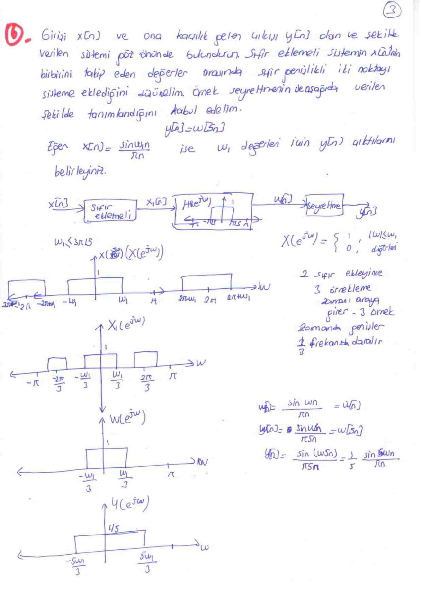

This post presents a three-page handwritten **"Examples"** note on sampling from Başkent University's **EEM 308 Signals and Systems II** course. The note was distributed together with the course's "Sampling" slides; most of the problems are based on chapter 7 of the textbook by Oppenheim & Willsky. The preparer's name does not appear in the document; the handwriting is the same as that of the quiz answer keys from the same semester. A PDF of the scanned note can be downloaded at the end of the post.

## Example 1: Bandlimit from the sampling frequency

**Question:** The sampling frequency of a signal x(t) is known to be ω_s = 10000π. For which values of ω is X(jω) = 0?

**Solution:** According to the Nyquist criterion, ω_s ≥ 2ω must hold; if X(jω) = 0 for |ω| > ω_s/2, the signal can be reconstructed. Therefore X(jω) = 0 must hold for **ω > 5000π**.

## Example 2: Nyquist rates

Find the Nyquist rates of the following functions.

**a)** x(t) = 1 + cos(2000πt) + sin(10000πt)

The highest frequency is ω_M = 10000π, so ω_N = 2ω_M = **20000π**.

**b)** x(t) = sin(4000πt)/(πt)

X(jω) is a rectangular function between −4000π and 4000π; ω_N = 2ω_M = **8000π**.

**c)** x(t) = (sin(4000πt)/(πt))²

x(t) = x₁(t)·x₂(t), with x₁ = x₂ = sin(4000πt)/(πt). Multiplication in time corresponds to convolution in frequency: X(jω) = (1/2π) X₁(jω) ∗ X₂(jω). The convolution of two rectangles of width ±4000π extends out to ±8000π; thus X(jω) = 0 for |ω| > 8000π, and ω_N = 2ω_M = **16000π**.

## Example 3: Sampling interval of a product signal

**Question:** x₁(t) and x₂(t) are multiplied to obtain w(t), and then w(t) is sampled with the impulse train p(t) = Σ δ(t − nT) to form w_p(t). If X₁(jω) = 0 for |ω| ≥ ω₁ and X₂(jω) = 0 for |ω| ≥ ω₂, determine the maximum sampling interval T such that w(t) can be recovered from w_p(t) using a lowpass filter.

**Solution:** Since the spectrum of the product is a convolution, W(jω) = 0 for |ω| > ω₁ + ω₂. The sampling frequency for w(t) must satisfy ω_s > 2(ω₁ + ω₂):

2π/T > 2(ω₁ + ω₂) ⇒ T < π/(ω₁ + ω₂), that is, **T_max = π/(ω₁ + ω₂)**.

## Example 4: Aliasing-free sampling interval in discrete time

**Question:** Suppose the approach g[n] = Σₖ x[n] δ[n − kN] is used for effective sampling of x[n]. Assuming X(e^{jω}) = 0 for 3π/7 ≤ |ω| ≤ π, determine the largest value of the sampling interval N, assuming there is no aliasing.

**Solution:** ω_M = 3π/7. To avoid aliasing, 2π/N ≥ 2ω_M = 6π/7 ⇒ N ≤ 7/3. Since N must be an integer, **N = 2**.

## Example 5: Frequency response of the h[2n] filter

**Question:** Over the frequency range −π ≤ ω ≤ π, let the ideal discrete-time band-stop filter be defined by

H(e^{jω}) = 1 (|ω| ≤ π/4 and |ω| ≥ 3π/4), 0 (otherwise)

Determine the frequency response of the filter whose unit impulse response is h[2n].

**Solution (from the note):** h_p[n] = h[2n] ⇒ H_p(e^{jω}) = H(e^{jω/2}). In the sketch, H_p(e^{jω}) is shown as a **lowpass** filter that equals 1 for |ω| ≤ π/2, 0 for π/2 < |ω| < 3π/2, and repeats with period 2π.

*Note: The full expression for decimation is H_p(e^{jω}) = ½[H(e^{jω/2}) + H(e^{j(ω−2π)/2})]; the formula in the note omits the second (aliased) term and the factor of ½. The result does not change for this filter, since both terms equal 1 in the band |ω| ≤ π/2 and both equal 0 for π/2 < |ω| ≤ π: h[2n] is an ideal lowpass filter with cutoff frequency π/2 and gain 1.*

![Spectrum sketches for Example 3, Example 4, and Example 5: the band-stop H(e^jω) and the Hp(e^jω) response of the h[2n] filter](s-02.jpg "Examples, page 2")

## Example 6: Zero insertion, filtering, and decimation

**Question:** Consider the system shown in the figure, with input x[n] and output y[n]. Suppose the zero-insertion system inserts two zero-amplitude points between successive values of x[n]. Suppose the sample decimation is defined as y[n] = w[5n]. If x[n] = sin(ω₁n)/(πn), determine the output y[n] for the values of ω₁.

System: x[n] → **zero insertion** (2 zeros between each sample) → x₁[n] → **H(e^{jω})** (ideal lowpass filter with cutoff frequency π/5 and gain 1) → w[n] → **decimation** → y[n].

**Solution (for ω₁ ≤ 3π/5):**

- X(e^{jω}) = 1 (|ω| ≤ ω₁), 0 (otherwise).
- Inserting 2 zeros puts 3 sampling instants in between: the signal expands by a factor of 3 in time, so its spectrum is compressed by a factor of 1/3 in frequency. X₁(e^{jω}) = X(e^{j3ω}): the bands are repeated around ±ω₁/3 and ±2π/3.
- Since ω₁/3 ≤ π/5, the filter passes the main band unchanged and rejects the copies around ±2π/3: W(e^{jω}) = 1 (|ω| ≤ ω₁/3), that is, w[n] = sin(ω₁n/3)/(πn).
- y[n] = w[5n]: the spectrum expands by a factor of 5 and is scaled by 1/5. Y(e^{jω}) = 1/5 (|ω| ≤ 5ω₁/3).

**y[n] = sin(5ω₁n/3) / (5πn) = (1/5) · sin(5ω₁n/3)/(πn)**

