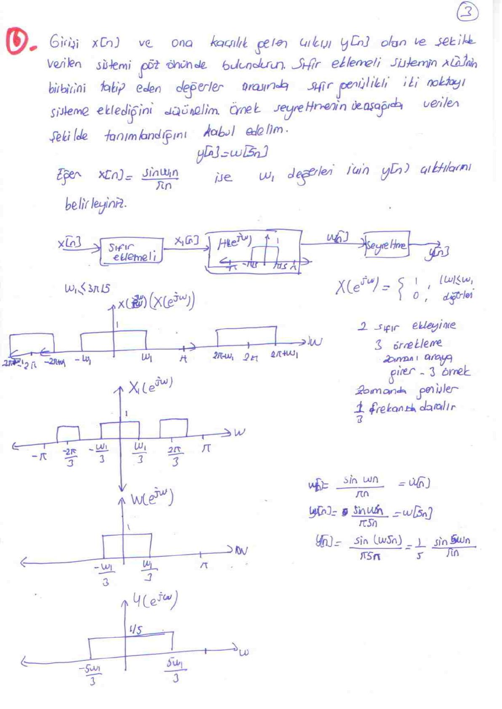

Bu yazı, Başkent Üniversitesi **EEM 308 Sinyaller ve Sistemler II** dersinin örnekleme konusuna ait üç sayfalık el yazısı **"Örnekler"** notunu aktarıyor. Not, dersin "Örnekleme" sunumuyla birlikte dağıtılmış; soruların çoğu ders kitabı Oppenheim & Willsky'nin 7. bölüm problemlerine dayanıyor. Hazırlayanın adı belgede yazmıyor; el yazısı aynı dönemin kısa sınav cevap anahtarlarıyla aynı. Taranmış notun PDF'i yazının sonunda indirilebilir.

## Örnek 1: Örnekleme frekansından bant sınırı

**Soru:** x(t) sinyalinin örnekleme frekansı ω_s = 10000π olduğu bilinmektedir. ω'nın hangi değeri için X(jω) = 0'dır?

**Çözüm:** Nyquist kriterine göre ω_s ≥ 2ω olmalıdır; |ω| > ω_s/2 için X(jω) = 0 ise işaret yeniden oluşturulabilir. Bu yüzden **ω > 5000π** için X(jω) = 0 olmalıdır.

## Örnek 2: Nyquist hızları

Aşağıdaki fonksiyonların Nyquist hızlarını bulunuz.

**a)** x(t) = 1 + cos(2000πt) + sin(10000πt)

En yüksek frekans ω_M = 10000π, dolayısıyla ω_N = 2ω_M = **20000π**.

**b)** x(t) = sin(4000πt)/(πt)

X(jω), −4000π ile 4000π arasında dikdörtgen bir fonksiyondur; ω_N = 2ω_M = **8000π**.

**c)** x(t) = (sin(4000πt)/(πt))²

x(t) = x₁(t)·x₂(t), x₁ = x₂ = sin(4000πt)/(πt). Zamanda çarpım frekansta konvolüsyondur: X(jω) = (1/2π) X₁(jω) ∗ X₂(jω). Genişliği ±4000π olan iki dikdörtgenin konvolüsyonu ±8000π'ye kadar uzanır; böylece |ω| > 8000π için X(jω) = 0 olur ve ω_N = 2ω_M = **16000π** bulunur.

## Örnek 3: Çarpım sinyalinin örnekleme aralığı

**Soru:** x₁(t) ve x₂(t) çarpılarak w(t) elde ediliyor, sonra w(t) p(t) = Σ δ(t − nT) dürtü katarıyla örneklenerek w_p(t) oluşturuluyor. X₁(jω) = 0 (|ω| ≥ ω₁) ve X₂(jω) = 0 (|ω| ≥ ω₂) ise, w(t)'nin w_p(t)'den alçak geçiren süzgeç kullanılarak elde edilebilmesi için T'nin en yüksek örnekleme aralığını belirleyin.

**Çözüm:** Çarpımın spektrumu konvolüsyon olduğundan W(jω) = 0, |ω| > ω₁ + ω₂. w(t)'nin örnekleme frekansı ω_s > 2(ω₁ + ω₂) olmalıdır:

2π/T > 2(ω₁ + ω₂) ⇒ T < π/(ω₁ + ω₂), yani **T_max = π/(ω₁ + ω₂)**.

## Örnek 4: Ayrık zamanda örtüşmesiz örnekleme aralığı

**Soru:** x[n]'in etkin örneklemesi için g[n] = Σₖ x[n] δ[n − kN] yaklaşımı kullanılmış olsun. 3π/7 ≤ |ω| ≤ π için X(e^{jω}) = 0 kabul edilirse, örtüşme olmayacağını varsayarak N örnekleme aralığının en büyük değerini belirleyiniz.

**Çözüm:** ω_M = 3π/7. Örtüşme olmaması için 2π/N ≥ 2ω_M = 6π/7 ⇒ N ≤ 7/3. N tam sayı olmak zorunda olduğundan **N = 2**.

## Örnek 5: h[2n] süzgecinin frekans yanıtı

**Soru:** −π ≤ ω ≤ π frekans aralığında ideal ayrık zaman bant söndüren (band-stop) süzgeç

H(e^{jω}) = 1 (|ω| ≤ π/4 ve |ω| ≥ 3π/4), 0 (diğer)

ile tanımlı olsun. Birim dürtü yanıtı h[2n] olan süzgecin frekans yanıtını belirleyin.

**Çözüm (nottaki):** h_p[n] = h[2n] ⇒ H_p(e^{jω}) = H(e^{jω/2}). Çizimde H_p(e^{jω}), |ω| ≤ π/2 için 1, π/2 < |ω| < 3π/2 için 0 olan ve 2π ile tekrarlayan bir **alçak geçiren** süzgeç olarak gösterilmiş.

*Not: Ondalıklamanın tam ifadesi H_p(e^{jω}) = ½[H(e^{jω/2}) + H(e^{j(ω−2π)/2})]'dir; nottaki formülde ikinci (örtüşen) terim ve ½ çarpanı yazılmamış. Bu süzgeçte |ω| ≤ π/2 bandında iki terim de 1, π/2 < |ω| ≤ π'de ikisi de 0 olduğu için sonuç değişmiyor: h[2n], kesim frekansı π/2 ve kazancı 1 olan ideal alçak geçiren süzgeçtir.*

![Örnek 3'ün spektrum çizimleri, Örnek 4 ve Örnek 5: bant söndüren H(e^jω) ve h[2n] süzgecinin Hp(e^jω) yanıtı](s-02.jpg "Örnekler, sayfa 2")

## Örnek 6: Sıfır ekleme, süzme ve seyreltme

**Soru:** Girişi x[n], çıkışı y[n] olan ve şekilde verilen sistemi göz önünde bulundurun. Sıfır eklemeli sistemin, x[n]'in birbirini takip eden değerleri arasına sıfır genlikli iki nokta eklediğini düşünelim. Örnek seyreltmenin y[n] = w[5n] şeklinde tanımlandığını kabul edelim. Eğer x[n] = sin(ω₁n)/(πn) ise ω₁ değerleri için y[n] çıktılarını belirleyiniz.

Sistem: x[n] → **sıfır ekleme** (her örnek arasına 2 sıfır) → x₁[n] → **H(e^{jω})** (kesim frekansı π/5, kazancı 1 olan ideal alçak geçiren süzgeç) → w[n] → **seyreltme** → y[n].

**Çözüm (ω₁ ≤ 3π/5 için):**

- X(e^{jω}) = 1 (|ω| ≤ ω₁), 0 (diğer).
- 2 sıfır eklenince 3 örnekleme zamanı araya girer: zamanda 3 kat genişleyen işaretin spektrumu frekansta 1/3 oranında daralır. X₁(e^{jω}) = X(e^{j3ω}): bantlar ±ω₁/3 ve ±2π/3 çevresinde tekrarlanır.
- ω₁/3 ≤ π/5 olduğundan süzgeç ana bandı olduğu gibi geçirir, ±2π/3 çevresindeki kopyaları atar: W(e^{jω}) = 1 (|ω| ≤ ω₁/3), yani w[n] = sin(ω₁n/3)/(πn).
- y[n] = w[5n]: spektrum 5 kat genişler ve 1/5 ile ölçeklenir. Y(e^{jω}) = 1/5 (|ω| ≤ 5ω₁/3).

**y[n] = sin(5ω₁n/3) / (5πn) = (1/5) · sin(5ω₁n/3)/(πn)**

