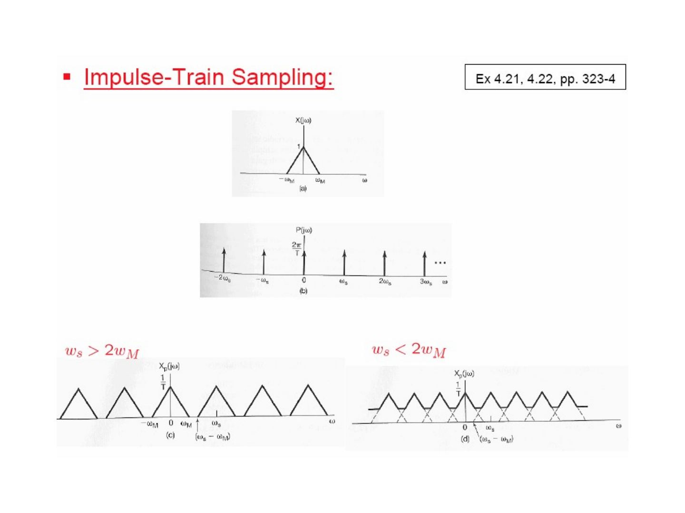
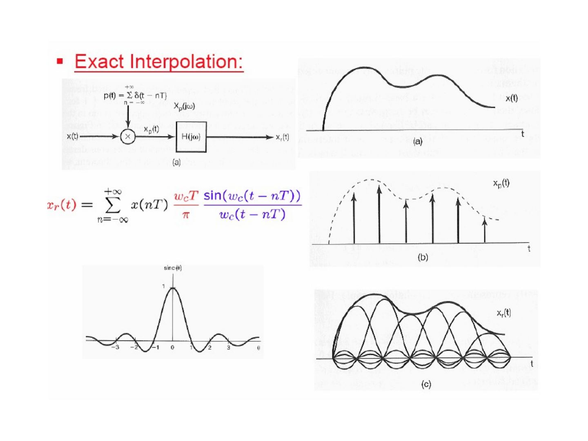
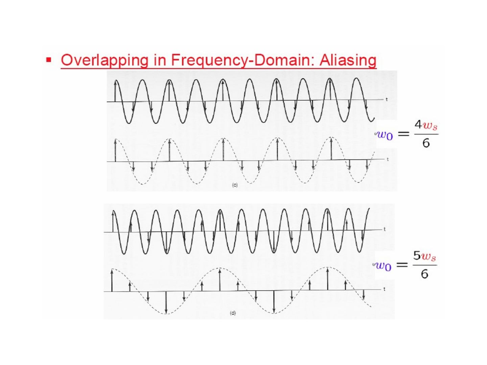
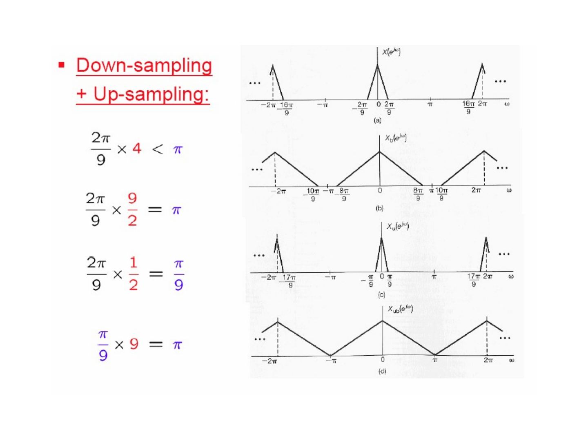

Bu yazı, Başkent Üniversitesi **EEM308 Sinyaller ve Sistemler II** dersinin arşiv klasöründe bulunan, yazarı slaytlarda belirtilmemiş İngilizce ders slaytlarından **"Sampling"** sunumudur (51 slayt; sonuncusu boş). Dosya son olarak 21 Temmuz 2009'da kaydedilmiş; PowerPoint dosyasının özelliklerinde yazar olarak *İsmail Avcıbaş* adı görünüyor, ancak slaytların tamamı başka bir ders sunumundan alınmış ekran görüntüleridir ve asıl hazırlayanın kim olduğu (kurum, hoca) slaytlarda yazmıyor. Kırmızı başlıklı, mavi vurgulu madde düzeni bir üniversitenin "Signals and Systems" ders slaytlarına benziyor; şekiller Oppenheim & Willsky'nin *Signals & Systems* kitabının 7. bölümünden (Sampling) alınmış ve slaytlarda kitabın 4. ve 5. bölümlerine sayfa göndermeleri var (ör. "Eq 4.70, p. 322", "Ex 4.21, p. 323"). Arşivde aynı konuda Selda Güney'in "Örnekleme" sunumu ayrı bir yazı olarak bulunuyor; bu yazı ondan bağımsız, 2009 tarihli başka bir slayt setidir. Slayt içeriği İngilizce olarak metne döküldü; gerekli birkaç şekil için slayt görselleri eklendi. Orijinal PowerPoint dosyası yazının sonunda indirilebilir.

*Bu içerik üçüncü taraf bir kaynağa aittir; arşiv ve nostalji amacıyla kaynak belirtilerek paylaşılmıştır. Hak sahibinin talebi hâlinde kaldırılır.*

Outline:

- Representation of a Continuous-Time Signal by Its Samples: The Sampling Theorem
- Reconstruction of a Signal from Its Samples Using Interpolation
- The Effect of Under-sampling: Aliasing
- Discrete-Time Processing of Continuous-Time Signals
- Sampling of Discrete-Time Signals

*Not: Slaytlardaki içindekiler listesinde "Representation of of a …" ve "Reconstruction of of a …" diye yinelenmiş "of" var; burada düzeltildi.*

## Representation of CT signals by its samples

Three different signals x₁(t) ≠ x₂(t) ≠ x₃(t) can take exactly the same values at the sampling instants: x₁(kT) = x₂(kT) = x₃(kT). So the samples alone do not determine a signal unless we restrict the class of signals — this is what the sampling theorem does.

## Impulse-train sampling

- p(t): sampling function
- T: sampling period
- ω_s = 2π/T: sampling frequency

x_p(t) = x(t) p(t), p(t) = Σ_{n=−∞}^{+∞} δ(t − nT) ⇒ x_p(t) = Σ_{n=−∞}^{+∞} x(nT) δ(t − nT)

From the multiplication property (Eq 4.70, p. 322):

X_p(jω) = (1/2π) ∫_{−∞}^{+∞} X(jθ) P(j(ω − θ)) dθ = (1/T) Σ_{k=−∞}^{+∞} X(j(ω − kω_s))

since x(t) ↔ X(jω) and p(t) ↔ P(jω) = (2π/T) Σ_{k=−∞}^{+∞} δ(ω − kω_s) (Ex 4.8, pp. 299–300; Ex 4.21, 4.22, pp. 323–4).

The spectrum of the sampled signal consists of copies of X(jω), scaled by 1/T, centred at every multiple of ω_s. If ω_s > 2ω_M the copies do not overlap; if ω_s < 2ω_M they overlap.

## The sampling theorem

Let x(t) be a band-limited signal with X(jω) = 0 for |ω| > ω_M. If

**ω_s > 2ω_M**, where ω_s = 2π/T,

then x(t) is uniquely determined by its samples x(nT), n = 0, ±1, ±2, …

- 2ω_M: **Nyquist rate**
- ω_M: **Nyquist frequency**

**Exact recovery by an ideal lowpass filter:** passing x_p(t) through an ideal lowpass filter H(jω) with gain T and cutoff ω_c, where ω_M < ω_c < (ω_s − ω_M), gives X_r(jω) = X(jω), i.e. x_r(t) = x(t).

## Sampling with zero-order hold

In practice the sampled value is held until the next sample: x(t) → zero-order hold → x₀(t), a staircase signal. This is equivalent to impulse-train sampling followed by a filter with impulse response h₀(t) = 1 for 0 < t < T (0 otherwise).

Using the rectangular pulse of Ex 4.4 (p. 293), x(t) = 1 for |t| < T₁ ↔ X(jω) = 2 sin(ωT₁)/ω, and the time-shift property x(t − t₀) ↔ e^{−jωt₀}X(jω) (Eq 4.27, p. 301):

H₀(jω) = e^{−jωT/2} [2 sin(ωT/2) / ω]

To recover x(t) from x₀(t), the zero-order hold is followed by a reconstruction filter H_r(jω) so that H(jω) = H₀(jω)H_r(jω) is the ideal lowpass filter:

⇒ H_r(jω) = e^{jωT/2} H(jω) / (2 sin(ωT/2)/ω)

|H_r(jω)| is 1 at ω = 0 and rises towards the band edges ±ω_s/2; its phase is linear, ωT/2, within the band.

## Reconstruction of a signal from its samples using interpolation

### Exact interpolation

x_p(t) = Σ x(nT) δ(t − nT), x_r(t) = x_p(t) ∗ h(t)

With the ideal lowpass filter with a magnitude of T, h(t) = T (ω_c/π) sin(ω_c t)/(ω_c t), and using x(t − t₀) = x(t) ∗ δ(t − t₀) (Ex 2.11, p. 110):

x_r(t) = Σ_{n=−∞}^{+∞} x(nT) h(t − nT) = Σ_{n=−∞}^{+∞} x(nT) (ω_c T/π) sin(ω_c(t − nT)) / (ω_c(t − nT))

Each sample is replaced by a shifted sinc pulse, and the sum of the sinc pulses reproduces x(t) exactly (band-limited interpolation).

### Ideal interpolating filter & the zero-order hold

Compared with the ideal interpolating filter (gain T for |ω| < ω_s/2), the zero-order hold H₀(jω) = e^{−jωT/2}[2 sin(ωT/2)/ω] is a much cruder lowpass filter: its magnitude is a sinc that is not flat in the passband and does not cut off at ω_s/2.

### Sampling & interpolation of images

The slide shows two photographs: the original image, its impulse-sampled version, the zero-order-hold reconstruction, and a zero-order hold with 4:1 finer sampling (the blocky appearance largely disappears).

### Higher-order holds

**First-order hold** (linear interpolation): h₁(t) is a triangle of height 1 from −T to T, so the samples are connected by straight lines.

h₁(t) = (1/T) h_sq(t) ∗ h_sq(t), where h_sq(t) is a unit rectangle on (−T/2, T/2), so

H₁(jω) = (1/T) [2 sin(ωT/2)/ω] × [2 sin(ωT/2)/ω] = (1/T) [sin(ωT/2) / (ω/2)]²

H₁(jω) is closer to the ideal interpolating filter than H₀(jω). On the test images, the first-order hold gives visibly smoother results than the zero-order hold.

## The effect of under-sampling: aliasing

### Overlapping in frequency domain

When ω_s < 2ω_M, the shifted copies of X(jω) in X_p(jω) overlap, and the lowpass filter can no longer separate the original spectrum: this is **aliasing**.

**Example — x(t) = cos(ω₀t):** X(jω) has impulses at ±ω₀. After sampling, the spectrum has impulses at ±ω₀, ω_s ± ω₀, −ω_s ± ω₀, … The reconstruction filter passes |ω| < ω_s/2.

- ω_s > 2ω₀: the impulses inside (−ω_s/2, ω_s/2) are still ±ω₀ ⇒ correct reconstruction.
- ω_s < 2ω₀: the impulses that fall inside (−ω_s/2, ω_s/2) are ±(ω_s − ω₀) ⇒ the reconstructed signal is cos((ω_s − ω₀)t): **aliasing**.

The time-domain example samples cos(ω₀t) with ω₀ = ω_s/6, 2ω_s/6, 4ω_s/6 and 5ω_s/6: for the first two the reconstruction is correct; for ω₀ = 4ω_s/6 and 5ω_s/6 the reconstructed signal is a lower-frequency cosine (at ω_s − ω₀ = 2ω_s/6 and ω_s/6).

### Strobe effect

A rotating disc with a marked line turns at ω₀ = 100 rad/sec and is illuminated by a strobe flashing at ω_s = 120 rad/sec. The sampled spectrum has components at ω = ±ω_s ± ω₀; the ones inside the band |ω| < ω_s/2 = 60 are **+20 and −20**, so the disc appears to rotate slowly at 20 rad/sec.

## Discrete-time processing of CT signals

x_c(t) → conversion to discrete time → x_d[n] → discrete-time system → y_d[n] → conversion to continuous time → y_c(t)

### C/D or A-to-D (ADC) and D/C or D-to-A (DAC)

x_c(t) → C/D conversion (T) → x_d[n] = x_c(nT) → discrete-time system → y_d[n] = y_c(nT) → D/C conversion (T) → y_c(t)

- C/D: continuous-to-discrete-time conversion
- A-to-D: analog-to-digital converter
- D/C: discrete-to-continuous-time conversion
- D-to-A: digital-to-analog converter

*Not: Slaytta "continous" diye yazılmış; doğrusu "continuous"tır.*

### C/D conversion

The C/D converter is modelled as impulse-train sampling, x_p(t) = Σ x_c(nT) δ(t − nT), followed by conversion of the impulse train to a discrete-time sequence. Using δ(t − t₀) ↔ e^{−jωt₀} (Table 4.2, p. 329) and Eq 7.3, 7.6 (p. 517):

X_p(jω) = Σ_{n=−∞}^{+∞} x_c(nT) e^{−jωnT} = (1/T) Σ_{k=−∞}^{+∞} X_c(j(ω − kω_s))

X_d(e^{jΩ}) = Σ_{n=−∞}^{+∞} x_d[n] e^{−jΩn} = Σ_{n=−∞}^{+∞} x_c(nT) e^{−jΩn}

⇒ **X_d(e^{jΩ}) = X_p(jΩ/T) = (1/T) Σ_{k=−∞}^{+∞} X_c(j(Ω/T − k 2π/T))**

So the DT spectrum is the sampled-signal spectrum with the frequency axis scaled by Ω = ωT: ω = ω_s corresponds to Ω = 2π. Sampling with T = T₁ or T = 2T₁ gives the same shape of X_d(e^{jΩ}) on the Ω axis but with different widths and heights 1/T.

![C/D dönüşümü: x_c(t), T = T₁ ve T = 2T₁ için x_p(t), x_d[n] ve spektrumlar X_c(jω), X_p(jω), X_d(e^jΩ)](s-34.jpg "C/D dönüşümünün frekans domeninde gösterimi")

### D/C conversion and the overall system

D/C conversion: y_d[n] → conversion of the discrete-time sequence to an impulse train y_p(t) → ideal lowpass filter (gain T, cutoff ω_s/2) → y_c(t).

Overall system: x_c(t) × p(t) → conversion of impulse train to sequence → H_d(e^{jΩ}) → conversion of sequence to impulse train → lowpass filter → y_c(t). Frequency-domain illustration: X_c(jω) → X_p(jω) → X_d(e^{jΩ}) → Y_d(e^{jΩ}) = H_d(e^{jΩ})X_d(e^{jΩ}) → Y_p(jω) = H_p(jω)X_p(jω) → Y_c(jω) = H_c(jω)X_c(jω).

### CT & DT frequency responses

If the input is band-limited and sampled above the Nyquist rate, the whole system is equivalent to a CT LTI system:

Y_c(jω) = X_c(jω) H_c(jω), H_c(jω) = H_d(e^{jωT}) for |ω| < ω_s/2, 0 for |ω| > ω_s/2 (with Ω = ωT).

### Digital differentiator (Ex 4.16, p. 317)

H_c(jω) = jω for |ω| < ω_c, 0 for |ω| > ω_c ⇒ H_d(e^{jΩ}) = j(Ω/T), |Ω| < π (with Ω = ωT, ω_s = 2ω_c)

|H_d(e^{jΩ})| is a 2π-periodic triangular (V-shaped) function and the phase is ±π/2.

### Half-sample delay (Ex 4.15, p. 317)

H_c(jω) = e^{−jωΔ} for |ω| < ω_c, 0 for |ω| > ω_c ⇒ H_d(e^{jΩ}) = e^{−jΩΔ/T}, |Ω| < π

|H_d(e^{jΩ})| = 1 and the phase is linear with slope −Δ/T (between −πΔ/T and πΔ/T). For Δ = T/2 this is a delay of half a sample.

The last part of this section shows the CT ideal lowpass filter h(t) ↔ H(jω) (C.T.F.T.) and its DT counterpart h[n] ↔ H(e^{jΩ}) (D.T.F.T.), related by ω_s = 2π/T and Ω = ωT.

## Sampling of discrete-time signals

### Impulse-train sampling

x_p[n] = x[n] if n = kN, 0 otherwise

x_p[n] = x[n] p[n] = Σ_{k=−∞}^{+∞} x[kN] δ[n − kN], with p[n] = Σ δ[n − kN]

X_p(e^{jω}) = (1/2π) ∫_{2π} P(e^{jθ}) X(e^{j(ω−θ)}) dθ, P(e^{jω}) = (2π/N) Σ_{k=−∞}^{+∞} δ(ω − kω_s), ω_s = 2π/N

⇒ **X_p(e^{jω}) = (1/N) Σ_{k=0}^{N−1} X(e^{j(ω − kω_s)})**

Without aliasing (ω_s > 2ω_M), x[n] is recovered exactly with an ideal lowpass filter of gain N and cutoff ω_s/2; with ω_s < 2ω_M the copies overlap.

### DT decimation & interpolation: down-sampling

Because x_p[n] is zero except at multiples of N, these zeros can be dropped: x_b[n] = x_p[nN] = x[nN] (**decimation**, down-sampling). Using the time-expansion property (Eq 5.45, p. 378):

X_b(e^{jω}) = X_p(e^{jω/N})

i.e. the spectrum is stretched by a factor of N (a component at ω_M moves to Nω_M).

![Ayrık zamanda ondalıklama: x[n], x_p[n], x_b[n] ve spektrumları X, X_p, X_b = X_p(e^{jω/N})](s-47.jpg "Alt örnekleme (ondalıklama)")

### Higher equivalent sampling rate: up-sampling

To go back, the decimated sequence x_b[n] is converted to a sampled sequence x_p[n] (zeros inserted between samples), and an ideal lowpass filter H(e^{jω}) interpolates the missing values to give x[n]. In the frequency domain the spectrum is compressed, and the lowpass filter (gain 2, cutoff π/2 in the figure, for up-sampling by 2) removes the extra copies.

### Down-sampling + up-sampling example

A DT signal whose spectrum occupies |ω| < 2π/9:

- 2π/9 × 4 < π: it could be down-sampled by 4 without aliasing,
- 2π/9 × 9/2 = π: the maximum possible down-sampling factor is 9/2,
- so first up-sample by 2 (2π/9 × 1/2 = π/9), then down-sample by 9 (π/9 × 9 = π): the net rate change is 9/2 and the spectrum fills the whole band (−π, π).

