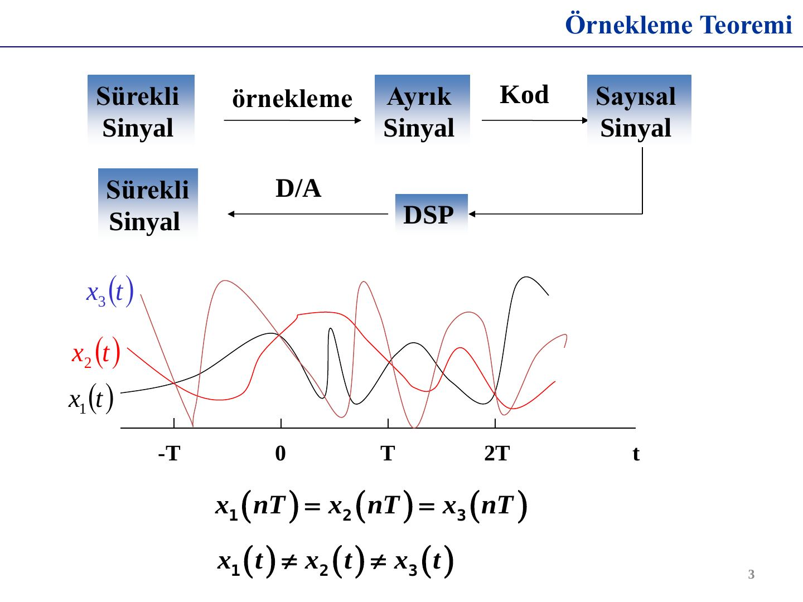
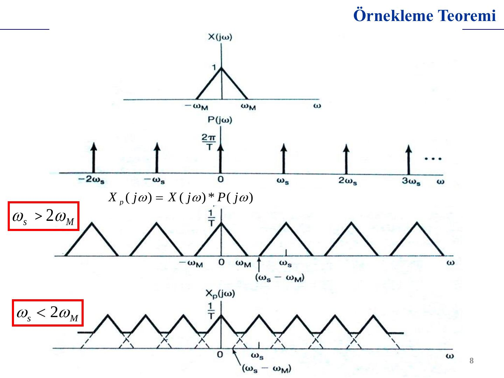
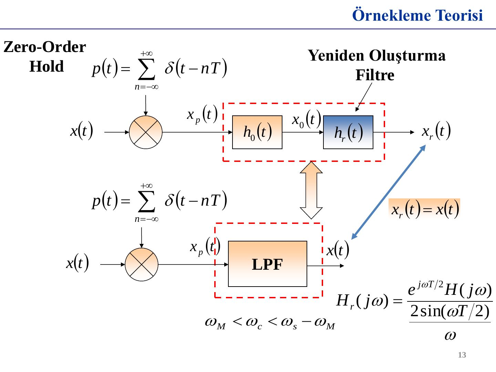
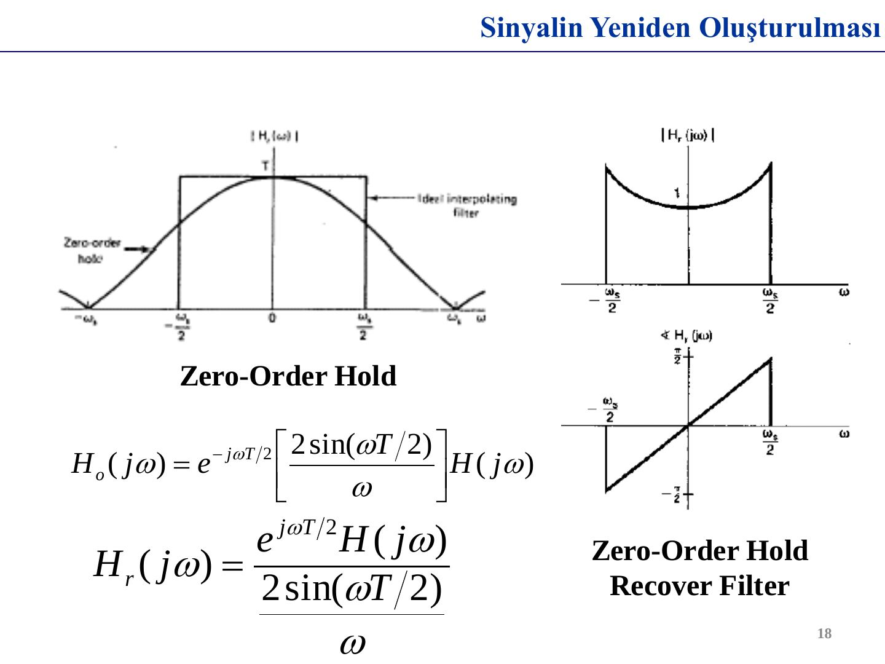
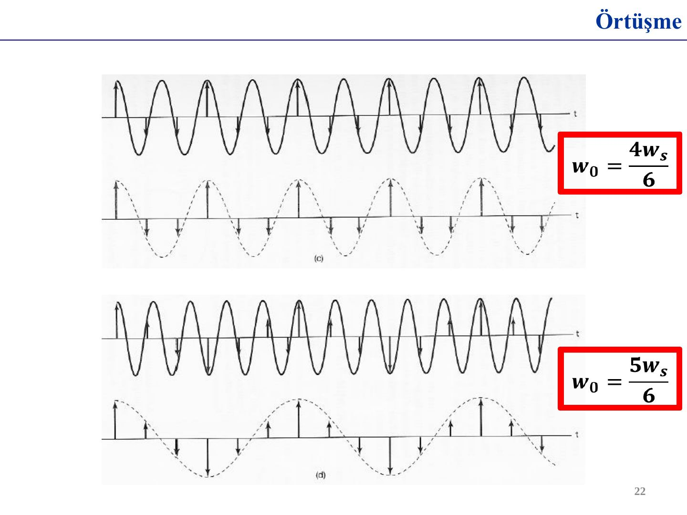
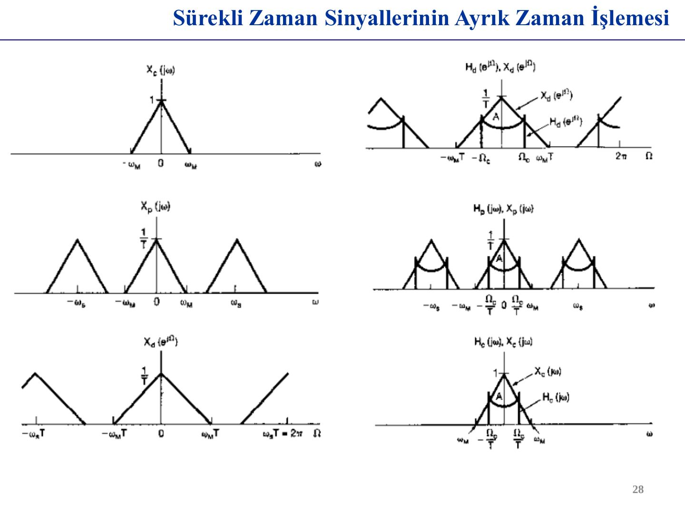
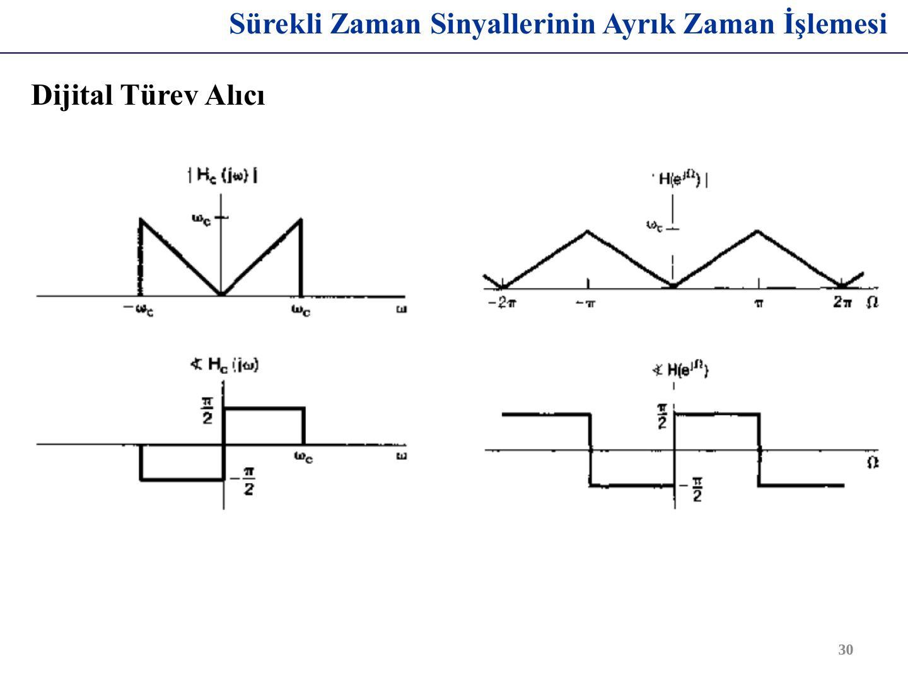
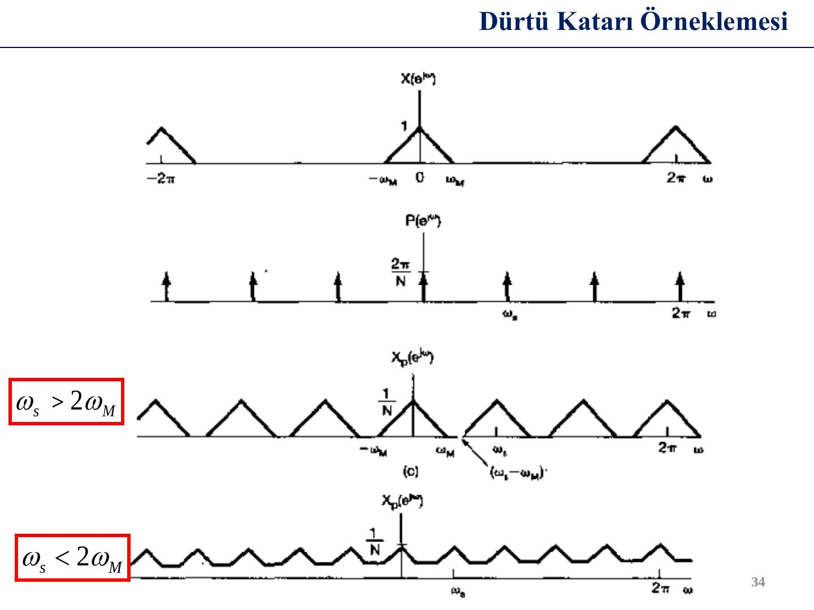
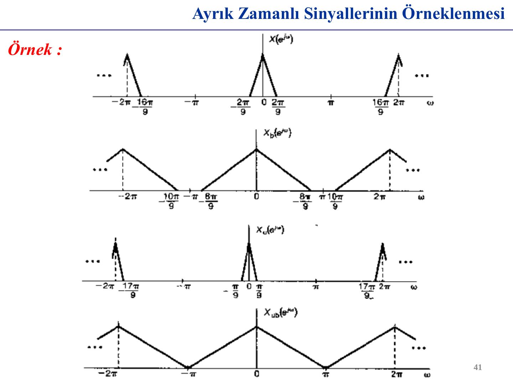

This post transcribes, as text, the 41-slide **"Sampling"** presentation used by **Asst. Prof. Dr. Selda Güney** in the Başkent University course **EEM 308 Signals and Systems II**. There was a version of the presentation dated 8 May 2014 and a current version dated 7 May 2015 with nearly identical content; the 2015 version is used here. Most of the figures are taken from the figures in Chapter 7 (Sampling) of Oppenheim & Willsky's *Signals & Systems*. The PDF of the presentation can be downloaded at the end of the post.

Contents of the presentation:

- The sampling theorem
- Reconstruction of a signal
- Aliasing
- Discrete-time processing of continuous-time signals
- Sampling of discrete-time signals

## Why sampling?

The digital signal processing chain: **continuous signal → (sampling) → discrete signal → (coding) → digital signal → DSP → (D/A) → continuous signal**. However, sampling alone does not determine the signal: different signals x₁(t), x₂(t), x₃(t) can take the same values at the same instants, that is, x₁(nT) = x₂(nT) = x₃(nT) while x₁(t) ≠ x₂(t) ≠ x₃(t). The sampling theorem states under what condition the samples determine the signal **uniquely**.

## 1.1 Impulse-train sampling

x(t) is multiplied by the periodic impulse train p(t):

p(t) = δ_T(t) = Σₙ δ(t − nT)

**In the time domain:**

x_p(t) = x(t)·p(t) = Σₙ x(nT) δ(t − nT)

**In the frequency domain:** Multiplication becomes convolution in frequency: X_p(jω) = (1/2π)[X(jω) ∗ P(jω)]. The Fourier transform of a periodic impulse train is again an impulse train:

P(jω) = (2π/T) Σₖ δ(ω − kω_s) = ω_s Σₖ δ(ω − kω_s), ω_s = 2π/T

Therefore:

**X_p(jω) = (1/T) Σₖ X(j(ω − kω_s))**

The spectrum of the sampled signal is the sum of copies of X(jω) shifted by multiples of ω_s and scaled by 1/T. If ω_s > 2ω_M, the copies do not overlap; if ω_s < 2ω_M, the copies overlap (alias).

### The sampling theorem

> Let x(t) be a **band-limited** signal with X(jω) = 0 for |ω| > ω_M. If ω_s > 2ω_M (ω_s = 2π/T), then x(t) is uniquely determined by its samples x(nT), n = 0, ±1, ±2, …

The value **2ω_M** is called the **Nyquist rate** (Nyquist frequency).

## 1.2 Sampling with a zero-order hold

Since generating narrow impulses is difficult in practice, a **zero-order hold** is used: each sample value is held constant until the next sampling instant. This is the convolution of x_p(t) with a rectangular pulse h₀(t) of width T and height 1:

x₀(t) = x_p(t) ∗ h₀(t) = Σₙ x(nT) h₀(t − nT)

H₀(jω) = e^{−jωT/2} [2 sin(ωT/2) / ω]

The **reconstruction filter** h_r(t), used to recover x(t) from x₀(t), must together with h₀(t) yield the ideal lowpass filter H(jω):

**H_r(jω) = e^{jωT/2} H(jω) / (2 sin(ωT/2) / ω)**, ω_M < ω_c < ω_s − ω_M

The magnitude of this filter, over the band ±ω_s/2, starts at 1 at the center and rises toward the edges, and its phase is linear (slope T/2).

## 2. Reconstruction of a signal

### Band-limited interpolation

x_p(t) is passed through an ideal lowpass filter with gain T and cutoff frequency ω_c (ω_M < ω_c < ω_s − ω_M). Since the impulse response of the filter is h(t) = T sin(ω_c t)/(πt):

x_r(t) = x_p(t) ∗ h(t) = Σₙ x(nT) h(t − nT) = Σₙ x(nT) · T sin[ω_c(t − nT)] / [π(t − nT)]

That is, the reconstructed signal is the sum of sinc functions placed at each sample. In the presentation, the same idea is compared across three types of interpolation: **ideal (band-limited) interpolation** (sinc), **zero-order hold** (staircase approximation), and **first-order hold** (a triangular pulse connecting the samples with straight line segments, i.e., linear interpolation).

## Aliasing

> If a signal is sampled at a rate (frequency) lower than the Nyquist rate, spectral aliasing occurs.

In the example in the presentation, the sinusoid x(t) = cos(ω₀t) is sampled for different values of ω₀ and reconstructed with an ideal lowpass filter:

| ω₀ | Reconstructed signal |
|---|---|
| ω_s/6 | cos(ω₀t): correct |
| 2ω_s/6 | cos(ω₀t): correct |
| 4ω_s/6 | cos((ω_s − ω₀)t) = cos(ω_s t/3): aliasing, lower frequency |
| 5ω_s/6 | cos((ω_s − ω₀)t) = cos(ω_s t/6): aliasing |

When ω₀ > ω_s/2, a cosine with frequency ω_s − ω₀ appears at the filter output.

## Discrete-time processing of continuous-time signals

A continuous-time signal is processed in three steps:

1. **C/D conversion** (continuous → discrete): x_d[n] = x_c(nT)
1. **Discrete-time system:** H_d(e^{jΩ}), output y_d[n]
1. **D/C conversion** (discrete → continuous): y_d[n] is converted to an impulse train and passed through an ideal lowpass filter with gain T and cutoff frequency ω_s/2; y_c(t) is obtained.

In C/D conversion, the spectrum of the discrete-time sequence is the frequency-scaled version of the spectrum of x_p(t): X_d(e^{jΩ}) = X_p(jΩ/T), that is, Ω = ωT. Copies that repeat every ω_s in continuous time repeat every 2π in discrete time.

If there is no aliasing, the whole system behaves like an equivalent continuous-time filter:

H_c(jω) = H_d(e^{jωT}) (|ω| < ω_s/2), and 0 otherwise.

### Digital differentiator

The continuous-time system that differentiates a band-limited signal is defined by H_c(jω) = jω (|ω| < ω_c); its magnitude is |ω| and its phase is ±π/2. Its discrete-time counterpart is H_d(e^{jΩ}) = jΩ/T for |Ω| < π.

### Half-sample delay

The system that delays a signal by Δ: H_c(jω) = e^{−jωΔ} (|ω| < ω_c). Its discrete counterpart is H_d(e^{jΩ}) = e^{−jΩΔ/T}. If Δ/T is not an integer (e.g., Δ = T/2), a "half-sample" delay appears undefined in discrete time; but for a band-limited signal its meaning is clear: y_c(t) = x_c(t − T/2) and y_d[n] = y_c(nT) = x_c((n − ½)T), that is, the values of the continuous signal between the samples.

## Sampling of discrete-time signals

### 1. Impulse-train sampling

The discrete-time x[n] is multiplied by p[n] = Σₖ δ[n − kN]: x_p[n] = x[n] if n is a multiple of N, and 0 otherwise. In the frequency domain:

X_p(e^{jω}) = (1/N) Σₖ X(e^{j(ω − kω_s)}), ω_s = 2π/N

As in continuous time, if ω_s > 2ω_M the copies do not overlap, and x[n] is exactly recovered from x_p[n] with an ideal lowpass filter of gain N and cutoff frequency ω_s/2; if ω_s < 2ω_M, aliasing occurs.

### 2. Discrete-time decimation and interpolation

**Decimation:** The zeros in x_p[n] are discarded to form the sequence x_b[n] = x_p[nN] = x[nN]. This expands the spectrum by a factor of N in frequency: X_b(e^{jω}) = X_p(e^{jω/N}). To avoid aliasing, the band of x[n] must be sufficiently narrow (Nω_M < π). For example, if a continuous signal has been sampled faster than necessary and then band-limited with a lowpass filter, the number of samples can be reduced by decimation.

**Interpolation (upsampling):** The reverse operation; N − 1 zeros are inserted between the samples of x_b[n] to obtain x_p[n], and this sequence is passed through an ideal lowpass filter to form x[n]. In the example in the presentation, N = 2: the spectrum X_p(e^{jω}) is passed through a filter with gain 2 that cuts off at ±π/2, and X(e^{jω}) with peak value 2A is obtained.

The presentation ends with an example: a sequence whose spectrum X(e^{jω}) occupies the band |ω| < 2π/9. This sequence can be decimated without aliasing by a factor of at most 4; the spectrum X_b(e^{jω}) expands to ±8π/9, still leaving room up to π. To reduce the number of samples further, the sequence is first interpolated by a factor of 2 (the band of X_u(e^{jω}) narrows to ±π/9), then decimated by a factor of 9; the resulting spectrum X_ub(e^{jω}) fills the entire interval (−π, π). Thus, an overall non-integer sampling-rate reduction by a factor of 9/2 is obtained.

