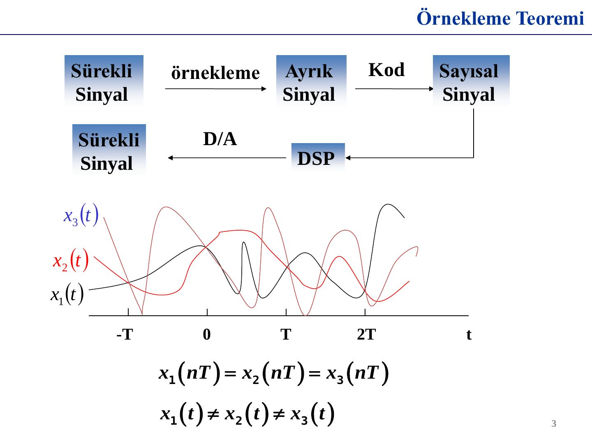
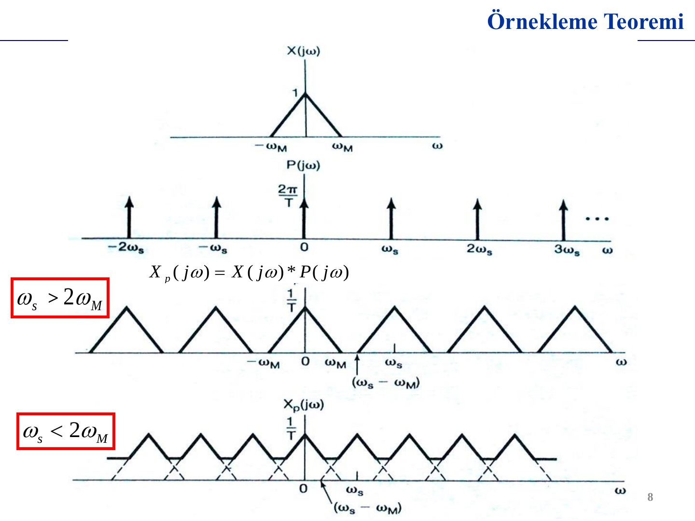
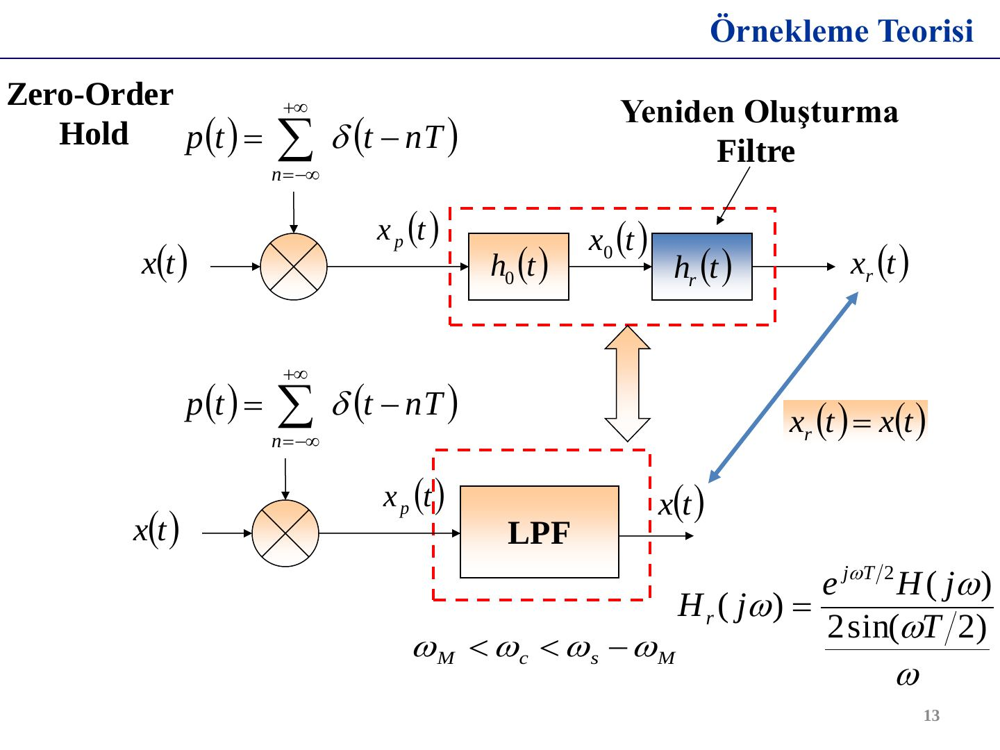
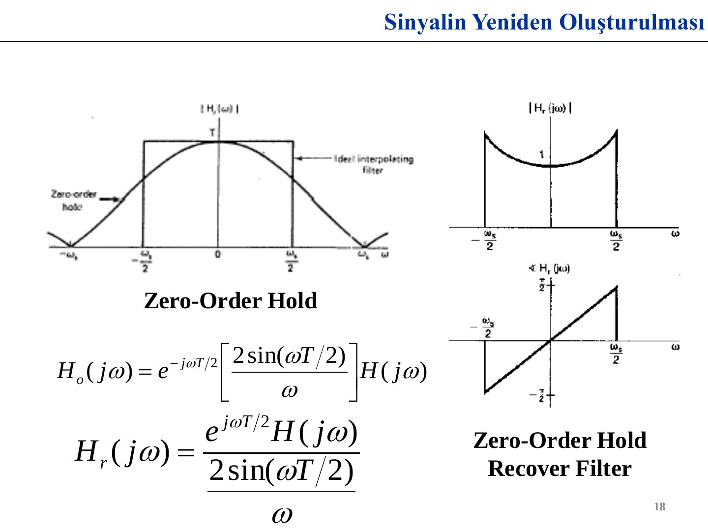
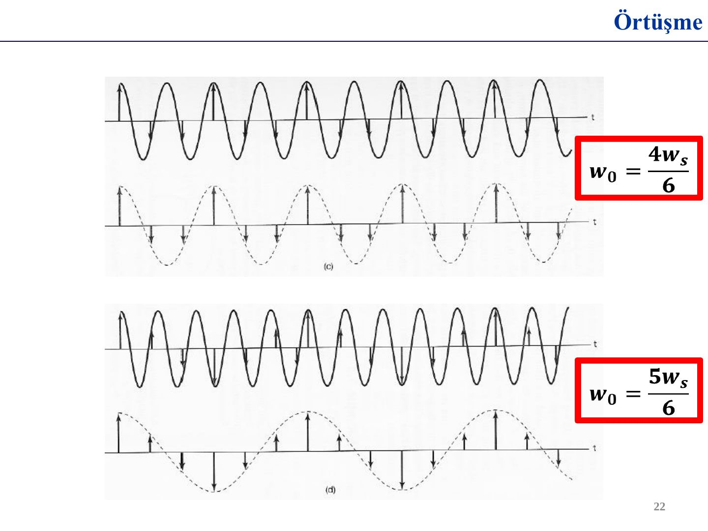
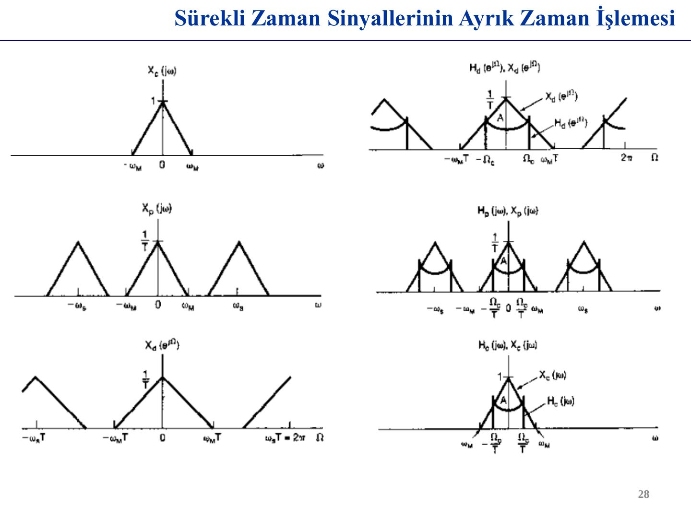
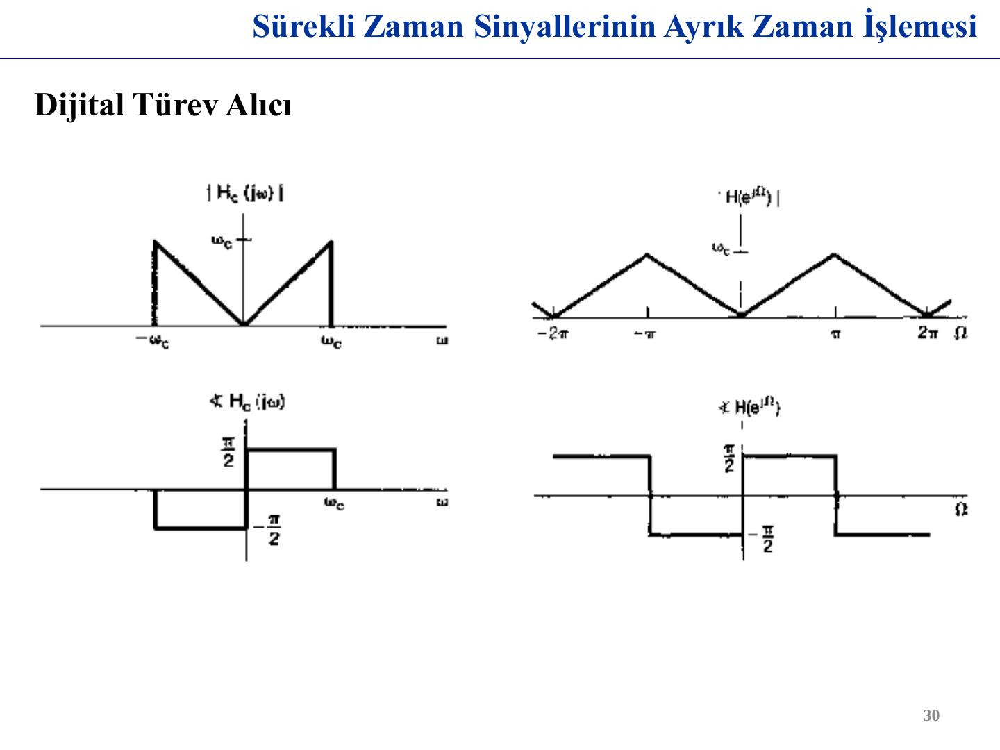
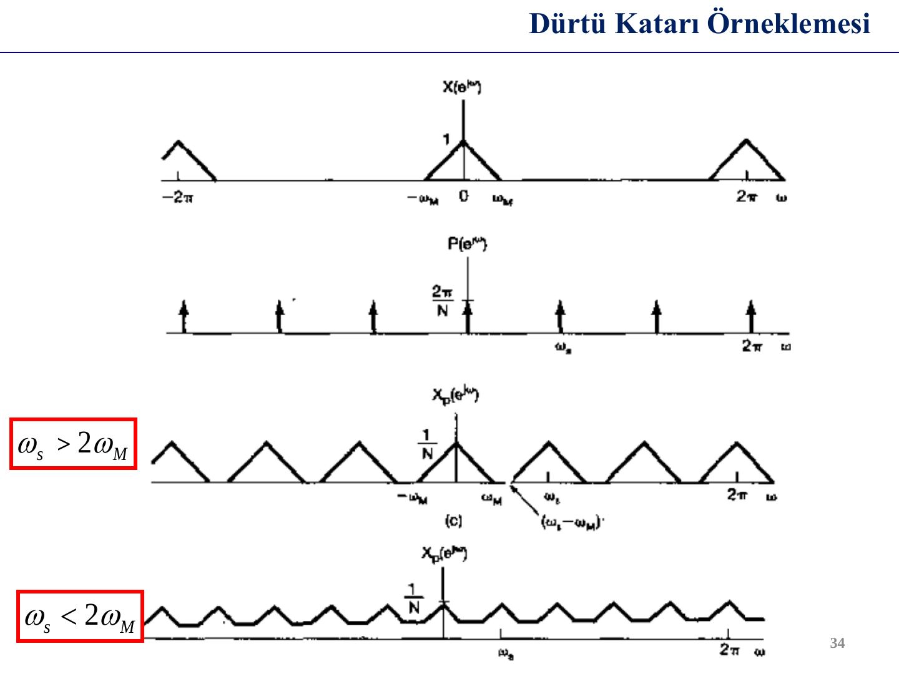
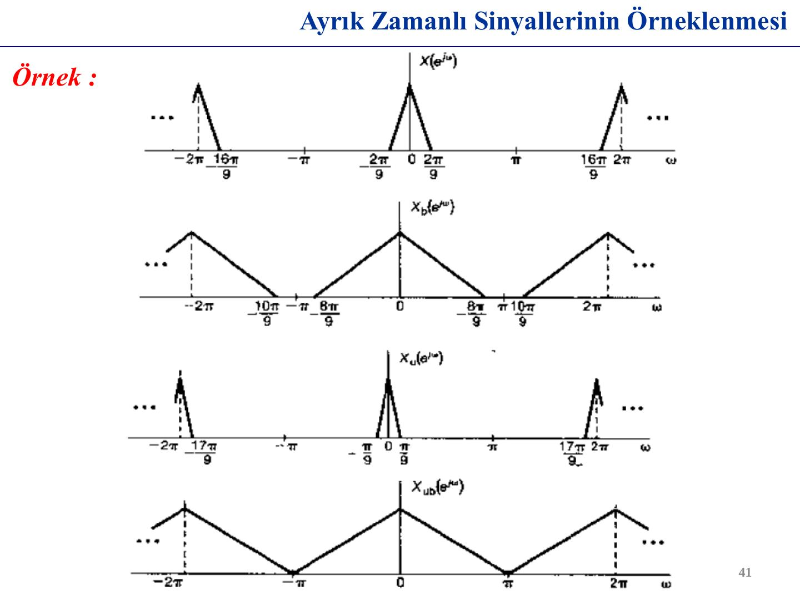

Bu yazı, Başkent Üniversitesi **EEM 308 Sinyaller ve Sistemler II** dersinde **Yrd. Doç. Dr. Selda Güney**'in kullandığı 41 slaytlık **"Örnekleme"** sunumunu metin olarak aktarıyor. Sunumun 8 Mayıs 2014 tarihli bir sürümü ve 7 Mayıs 2015 tarihli, neredeyse aynı içerikteki güncel sürümü vardı; burada 2015 sürümü esas alındı. Grafiklerin çoğu ders kitabı Oppenheim & Willsky'nin *Signals & Systems* kitabının 7. bölümündeki (Sampling) şekillerden alınmış. Sunumun PDF'i yazının sonunda indirilebilir.

Sunumun içeriği:

- Örnekleme teoremi
- Sinyalin yeniden oluşturulması
- Örtüşme (aliasing)
- Sürekli zaman sinyallerinin ayrık zaman işlemesi
- Ayrık zaman sinyallerinin örneklenmesi

## Neden örnekleme?

Sayısal işaret işleme zinciri: **sürekli sinyal → (örnekleme) → ayrık sinyal → (kod) → sayısal sinyal → DSP → (D/A) → sürekli sinyal**. Ancak örnekleme tek başına sinyali belirlemez: farklı x₁(t), x₂(t), x₃(t) sinyalleri aynı anlarda aynı değerleri alabilir, yani x₁(nT) = x₂(nT) = x₃(nT) iken x₁(t) ≠ x₂(t) ≠ x₃(t) olabilir. Örnekleme teoremi, hangi koşulda örneklerin sinyali **tek türlü** belirlediğini söyler.

## 1.1 Dürtü katarı örneklemesi

x(t), periyodik dürtü katarı p(t) ile çarpılır:

p(t) = δ_T(t) = Σₙ δ(t − nT)

**Zaman domeninde:**

x_p(t) = x(t)·p(t) = Σₙ x(nT) δ(t − nT)

**Frekans domeninde:** Çarpma, frekansta konvolüsyona dönüşür: X_p(jω) = (1/2π)[X(jω) ∗ P(jω)]. Periyodik dürtü katarının Fourier dönüşümü yine bir dürtü katarıdır:

P(jω) = (2π/T) Σₖ δ(ω − kω_s) = ω_s Σₖ δ(ω − kω_s), ω_s = 2π/T

Dolayısıyla:

**X_p(jω) = (1/T) Σₖ X(j(ω − kω_s))**

Örneklenmiş sinyalin spektrumu, X(jω)'nın ω_s aralıklarla ötelenmiş ve 1/T ile ölçeklenmiş kopyalarının toplamıdır. ω_s > 2ω_M ise kopyalar üst üste binmez; ω_s < 2ω_M ise kopyalar örtüşür.

### Örnekleme teoremi

> x(t), |ω| > ω_M için X(jω) = 0 olan **bant sınırlı** bir sinyal olsun. ω_s > 2ω_M (ω_s = 2π/T) ise x(t), x(nT), n = 0, ±1, ±2, … örnekleri tarafından tek türlü oluşturulabilir.

**2ω_M** değerine **Nyquist hızı** (Nyquist frekansı) denir.

## 1.2 Sıfırıncı dereceden tutmalı örnekleme

Pratikte dar dürtüler üretmek zor olduğu için **sıfırıncı dereceden tutma** (zero-order hold) kullanılır: her örnek değeri bir sonraki örnekleme anına kadar sabit tutulur. Bu, x_p(t)'nin genişliği T, yüksekliği 1 olan dikdörtgen h₀(t) darbesiyle konvolüsyonudur:

x₀(t) = x_p(t) ∗ h₀(t) = Σₙ x(nT) h₀(t − nT)

H₀(jω) = e^{−jωT/2} [2 sin(ωT/2) / ω]

x(t)'yi x₀(t)'den geri elde etmek için kullanılacak **yeniden oluşturma süzgeci** h_r(t), h₀(t) ile birlikte ideal alçak geçiren süzgeç H(jω)'yı vermelidir:

**H_r(jω) = e^{jωT/2} H(jω) / (2 sin(ωT/2) / ω)**, ω_M < ω_c < ω_s − ω_M

Bu süzgecin genliği ±ω_s/2 bandında ortada 1'den başlayıp kenarlara doğru yükselen, fazı ise doğrusal (eğim T/2) bir süzgeçtir.

## 2. Sinyalin yeniden oluşturulması

### Bant sınırlı ara değerleme

x_p(t), kazancı T ve kesim frekansı ω_c olan ideal alçak geçiren süzgeçten geçirilir (ω_M < ω_c < ω_s − ω_M). Süzgecin darbe yanıtı h(t) = T sin(ω_c t)/(πt) olduğundan:

x_r(t) = x_p(t) ∗ h(t) = Σₙ x(nT) h(t − nT) = Σₙ x(nT) · T sin[ω_c(t − nT)] / [π(t − nT)]

Yani yeniden oluşturulan sinyal, her örneğe yerleştirilmiş sinc fonksiyonlarının toplamıdır. Sunumda aynı fikir üç ara değerleme türüyle karşılaştırılıyor: **ideal (bant sınırlı) ara değerleme** (sinc), **sıfırıncı dereceden tutma** (merdiven biçimli yaklaşım) ve **birinci dereceden tutma** (first-order hold; örnekleri doğru parçalarıyla birleştiren üçgen darbe, doğrusal ara değerleme).

## Örtüşme (aliasing)

> Eğer bir sinyal Nyquist hızından (frekansından) daha düşük bir hızda örneklenirse, spektral örtüşme meydana gelir.

Sunumdaki örnekte x(t) = cos(ω₀t) sinüsü farklı ω₀ değerleri için örnekleniyor ve ideal alçak geçiren süzgeçle yeniden oluşturuluyor:

| ω₀ | Yeniden oluşturulan sinyal |
|---|---|
| ω_s/6 | cos(ω₀t): doğru |
| 2ω_s/6 | cos(ω₀t): doğru |
| 4ω_s/6 | cos((ω_s − ω₀)t) = cos(ω_s t/3): örtüşme, daha düşük frekans |
| 5ω_s/6 | cos((ω_s − ω₀)t) = cos(ω_s t/6): örtüşme |

ω₀ > ω_s/2 olduğunda süzgeç çıkışında ω_s − ω₀ frekanslı bir kosinüs görünür.

## Sürekli zaman sinyallerinin ayrık zaman işlemesi

Sürekli zamanlı bir sinyal üç adımda işlenir:

1. **C/D dönüşümü** (sürekli → ayrık): x_d[n] = x_c(nT)
1. **Ayrık zaman sistemi:** H_d(e^{jΩ}), çıkış y_d[n]
1. **D/C dönüşümü** (ayrık → sürekli): y_d[n] dürtü katarına çevrilir ve kazancı T, kesim frekansı ω_s/2 olan ideal alçak geçiren süzgeçten geçirilir; y_c(t) elde edilir.

C/D dönüşümünde ayrık zamanlı dizinin spektrumu, x_p(t)'nin spektrumunun frekans ekseninde ölçeklenmiş hâlidir: X_d(e^{jΩ}) = X_p(jΩ/T), yani Ω = ωT. Sürekli zamanda ω_s'de tekrarlayan kopyalar ayrık zamanda 2π'de tekrarlar.

Örtüşme yoksa tüm sistem, sürekli zamanlı eşdeğer bir süzgeç gibi davranır:

H_c(jω) = H_d(e^{jωT}) (|ω| < ω_s/2), aksi hâlde 0.

### Dijital türev alıcı

Bant sınırlı bir sinyalin türevini alan sürekli zamanlı sistem H_c(jω) = jω (|ω| < ω_c) ile tanımlanır; genliği |ω|, fazı ±π/2'dir. Ayrık zamandaki karşılığı, |Ω| < π için H_d(e^{jΩ}) = jΩ/T'dir.

### Yarı-örneklem gecikmesi

Sinyali Δ kadar geciktiren sistem: H_c(jω) = e^{−jωΔ} (|ω| < ω_c). Ayrık karşılığı H_d(e^{jΩ}) = e^{−jΩΔ/T}. Δ/T bir tam sayı değilse (ör. Δ = T/2), ayrık zamanda "yarım örnek" gecikme tanımsız gibi görünür; ama bant sınırlı sinyal için anlamı açıktır: y_c(t) = x_c(t − T/2) ve y_d[n] = y_c(nT) = x_c((n − ½)T), yani örnekler arasındaki sürekli sinyalin değerleri.

## Ayrık zaman sinyallerinin örneklenmesi

### 1. Dürtü katarı örneklemesi

Ayrık zamanlı x[n], p[n] = Σₖ δ[n − kN] ile çarpılır: x_p[n] = x[n] için n, N'nin katıysa, aksi hâlde 0. Frekans domeninde:

X_p(e^{jω}) = (1/N) Σₖ X(e^{j(ω − kω_s)}), ω_s = 2π/N

Sürekli zamandaki gibi, ω_s > 2ω_M ise kopyalar örtüşmez ve x[n], kazancı N ve kesim frekansı ω_s/2 olan ideal alçak geçiren süzgeçle x_p[n]'den tam olarak geri elde edilir; ω_s < 2ω_M ise örtüşme olur.

### 2. Ayrık zamanlı ondalıklama ve ara değerleme

**Ondalıklama (decimation):** x_p[n]'deki sıfırlar atılarak x_b[n] = x_p[nN] = x[nN] dizisi oluşturulur. Bu, spektrumu frekansta N kat genişletir: X_b(e^{jω}) = X_p(e^{jω/N}). Örtüşme olmaması için x[n]'in bandı yeterince dar olmalıdır (Nω_M < π). Örneğin bir sürekli sinyal gereğinden hızlı örneklenmiş ve ardından alçak geçiren süzgeçle bandı daraltılmışsa, örnek sayısı ondalıklamayla azaltılabilir.

**Ara değerleme (interpolation, upsampling):** Ters işlem; x_b[n]'nin örnekleri arasına N − 1 sıfır eklenerek x_p[n] elde edilir ve bu dizi ideal alçak geçiren süzgeçten geçirilerek x[n] oluşturulur. Sunumdaki örnekte N = 2: X_p(e^{jω}) spektrumu ±π/2'de kesilen, kazancı 2 olan süzgeçten geçirilir ve tepe değeri 2A olan X(e^{jω}) elde edilir.

Sunum bir örnekle bitiyor: X(e^{jω}) spektrumu |ω| < 2π/9 bandında olan bir dizi. Bu dizi örtüşmesiz olarak en fazla 4 kat ondalıklanabilir; X_b(e^{jω}) spektrumu ±8π/9'a kadar genişler, π'ye kadar hâlâ boşluk kalır. Örnek sayısını daha da azaltmak için dizi önce 2 kat ara değerlenir (X_u(e^{jω}) bandı ±π/9'a daralır), ardından 9 kat ondalıklanır; sonuçtaki X_ub(e^{jω}) spektrumu tüm (−π, π) aralığını doldurur. Böylece toplamda 9/2 oranında, tam sayı olmayan bir örnekleme hızı azaltması elde edilir.

