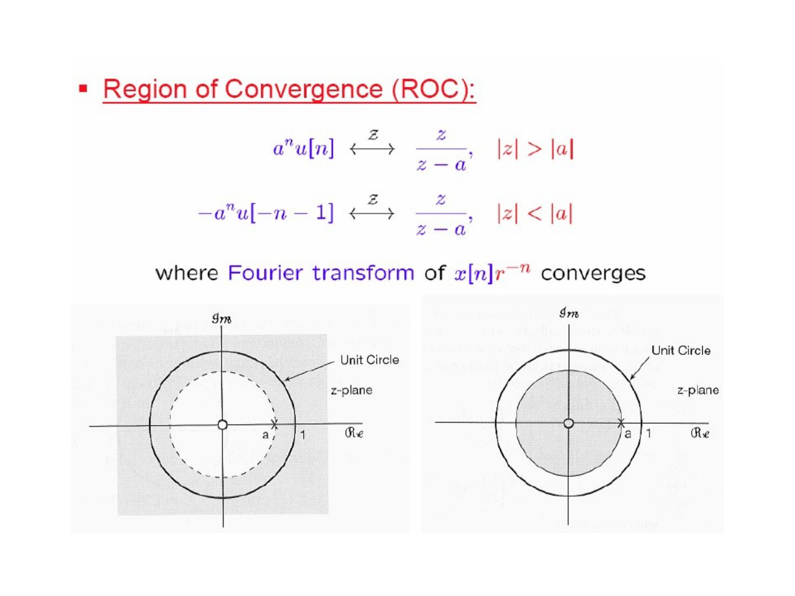
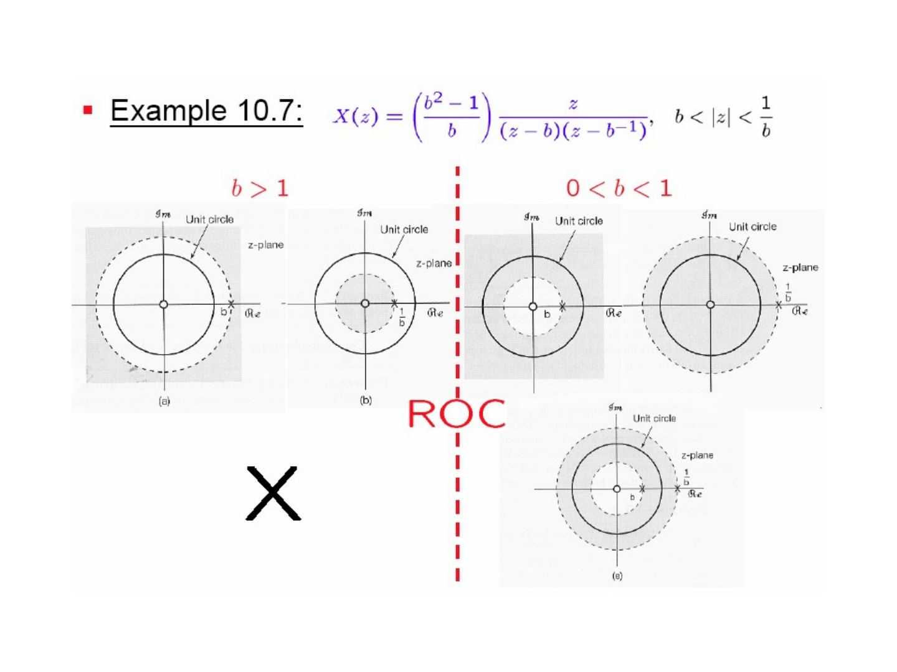
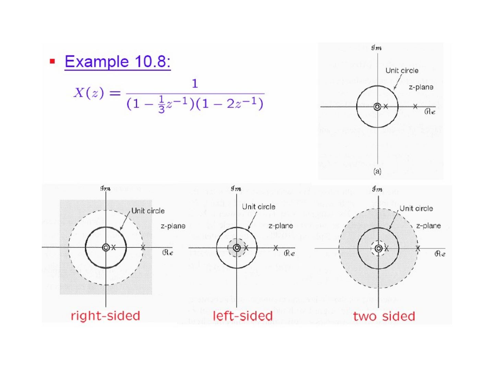
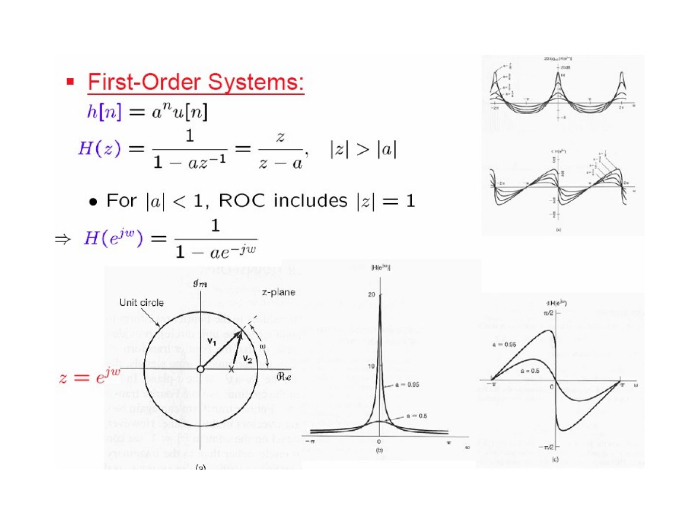
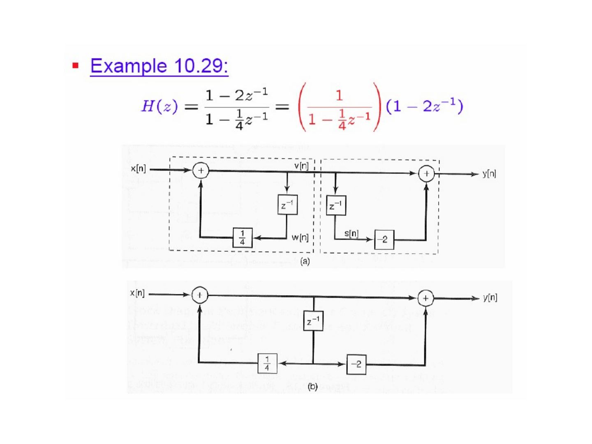
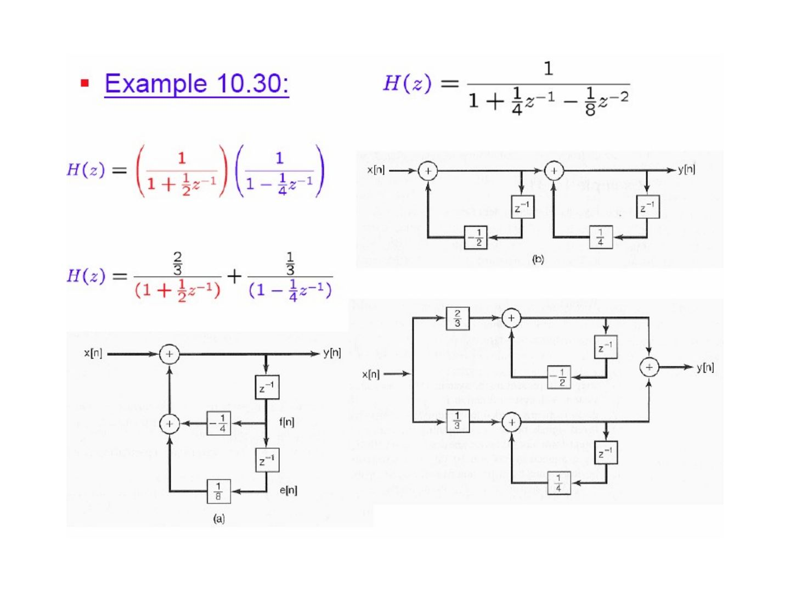

Bu yazı, Başkent Üniversitesi **EEM308 Sinyaller ve Sistemler II** dersinin arşiv klasöründe bulunan, yazarı slaytlarda belirtilmemiş İngilizce ders slaytlarından **"Chapter X – Z Transform"** sunumudur (66 slayt). Dosya son olarak 21 Temmuz 2009'da kaydedilmiş; PowerPoint dosyasının özelliklerinde yazar olarak *İsmail Avcıbaş* adı görünüyor, ancak slaytların tamamı başka bir ders sunumundan alınmış ekran görüntüleridir ve asıl hazırlayanın kim olduğu (kurum, hoca) slaytlarda yazmıyor. Kırmızı başlıklı, mavi vurgulu madde düzeni bir üniversitenin "Signals and Systems" ders slaytlarına benziyor; bölüm ve örnek numaraları (Example 10.1 … 10.33, Table 10.1–10.3) ile şekiller Oppenheim & Willsky'nin *Signals & Systems* kitabının 10. bölümünü izliyor. Slayt içeriği İngilizce olarak metne döküldü; gerekli birkaç şekil için slayt görselleri eklendi. Orijinal PowerPoint dosyası yazının sonunda indirilebilir.

*Bu içerik üçüncü taraf bir kaynağa aittir; arşiv ve nostalji amacıyla kaynak belirtilerek paylaşılmıştır. Hak sahibinin talebi hâlinde kaldırılır.*

Outline:

- The z-Transform
- The Region of Convergence for z-Transforms
- The Inverse z-Transform
- Geometric Evaluation of the Fourier Transform
- Properties of the z-Transform
- Some Common z-Transform Pairs
- Analysis & Characterization of LTI Systems Using the z-Transforms
- System Function Algebra and Block Diagram Representations
- The Unilateral z-Transform

## The z-transform

### The z-transform of a general signal x[n]

- With z = e^{jω}: X(e^{jω}) ≜ Σ_{n=−∞}^{+∞} x[n] e^{−jωn}, x[n] ↔ X(e^{jω}), X(e^{jω}) = F{x[n]}, x[n] = F⁻¹{X(e^{jω})}
- With z = re^{jω}: X(z) ≜ Σ_{n=−∞}^{+∞} x[n] z^{−n}, x[n] ↔ X(z), X(z) = Z{x[n]}, x[n] = Z⁻¹{X(z)}

X(z)|_{z=e^{jω}} = Z{x[n]}|_{z=e^{jω}} = F{x[n]} = X(e^{jω})

### z-transform & Fourier transform

X(re^{jω}) = Σ_{n=−∞}^{+∞} x[n] (re^{jω})^{−n} = Σ_{n=−∞}^{+∞} {x[n] r^{−n}} e^{−jωn} = F{x[n] r^{−n}}

So the z-transform is the Fourier transform of x[n] multiplied by the real exponential r^{−n}; on the unit circle z = e^{jω} (r = 1) it reduces to the Fourier transform.

### Example 10.1: x[n] = aⁿu[n]

X(e^{jω}) = Σ aⁿ u[n] e^{−jωn} = Σ_{n=0}^{∞} (ae^{−jω})ⁿ = 1 / (1 − ae^{−jω})

X(z) = Σ aⁿ u[n] z^{−n} = Σ_{n=0}^{∞} (az^{−1})ⁿ = 1/(1 − az^{−1}) = z/(z − a), for |az^{−1}| < 1, i.e. **|z| > |a|**

- For |a| > 1 the ROC does not include the unit circle and F{aⁿu[n]} does not converge.

### Example 10.2: x[n] = −aⁿu[−n − 1]

X(z) = −Σ aⁿ u[−n − 1] z^{−n} = −Σ_{n=−∞}^{−1} aⁿ z^{−n} = −Σ_{n=1}^{∞} a^{−n} zⁿ = 1 − Σ_{n=0}^{∞} (a^{−1}z)ⁿ

= 1 − 1/(1 − a^{−1}z) = 1/(1 − az^{−1}) = z/(z − a), for |a^{−1}z| < 1, i.e. **|z| < |a|**

### Region of convergence (ROC)

- aⁿu[n] ↔ z/(z − a), |z| > |a|
- −aⁿu[−n − 1] ↔ z/(z − a), |z| < |a|

The algebraic expression is the same; the two signals differ only in the ROC — the set of z = re^{jω} where the Fourier transform of x[n]r^{−n} converges.

### Example 10.3

x[n] = 7(1/3)ⁿ u[n] − 6(1/2)ⁿ u[n]

X(z) = 7 Σ (1/3)ⁿ u[n] z^{−n} − 6 Σ (1/2)ⁿ u[n] z^{−n} = 7/(1 − ⅓z^{−1}) − 6/(1 − ½z^{−1})

- 7(1/3)ⁿ u[n] ↔ 7/(1 − ⅓z^{−1}), |z| > 1/3
- 6(1/2)ⁿ u[n] ↔ 6/(1 − ½z^{−1}), |z| > 1/2

⇒ X(z) = z(z − 3/2) / ((z − 1/3)(z − 1/2)), |z| > 1/2 (the intersection of the two ROCs).

### Example 10.4

(1/3)ⁿ sin(πn/4) u[n] ↔ (1/(3√2)) z / ((z − ⅓e^{jπ/4})(z − ⅓e^{−jπ/4})), |z| > 1/3

since sin(πn/4) = (1/2j)(e^{jπn/4} − e^{−jπn/4}), so (1/3)ⁿ sin(πn/4) = (1/2j)[(⅓e^{jπ/4})ⁿ − (⅓e^{−jπ/4})ⁿ], and (⅓e^{jπ/4})ⁿ u[n] ↔ z/(z − ⅓e^{jπ/4}), |z| > 1/3 (from aⁿu[n] ↔ z/(z − a), |z| > |a|).

## Properties of the ROC

1. The ROC of X(z) consists of a **ring** in the z-plane centered about the origin.
1. The ROC does **not** contain any poles.
1. If x[n] is of **finite duration**, then the ROC is the entire z-plane, except possibly z = 0 and/or z = ∞. X(z) = Σ_{n=N₁}^{N₂} x[n] z^{−n} is bounded; however, as |z| → 0, |z|^N → ∞ if N is negative, and as |z| → ∞, |z|^N → ∞ if N is positive.
1. If x[n] is a **right-sided** sequence, and if the circle |z| = r₀ is in the ROC, then all finite values of z for which |z| > r₀ will also be in the ROC: for r₁ > r₀, r₁^{−n} < r₀^{−n} (n > 0), so Σ_{n=N₁}^{∞} |x[n] r₁^{−n}| < Σ_{n=N₁}^{∞} |x[n] r₀^{−n}| < ∞.
1. If x[n] is a **left-sided** sequence, and if the circle |z| = r₀ is in the ROC, then all values of z for which 0 < |z| < r₀ will also be in the ROC.
1. If x[n] is **two-sided**, and if the circle |z| = r₀ is in the ROC, then the ROC will consist of a ring in the z-plane that includes the circle |z| = r₀.
1. If the z-transform X(z) of x[n] is **rational**, then its ROC is bounded by poles or extends to ∞.
1. If X(z) is rational: if x[n] is right-sided, then the ROC is the region in the z-plane **outside the outermost pole**, i.e. outside the circle of radius equal to the largest magnitude of the poles of X(z). Furthermore, if x[n] is **causal**, then the ROC also includes z = ∞ (X(z) = Σ_{n=0}^{∞} x[n](1/z)ⁿ).
1. If X(z) is rational and x[n] is left-sided, then the ROC is the region **inside the innermost pole**, i.e. inside the circle of radius equal to the smallest magnitude of the poles of X(z) other than any at z = 0, and extending inward and possibly including z = 0. In particular, if x[n] is **anti-causal** (left-sided and = 0 for n > 0), then the ROC also includes z = 0.

### Example 10.7: x[n] = b^{|n|}, b > 0

x[n] = bⁿu[n] + b^{−n}u[−n − 1]

X(z) = 1/(1 − bz^{−1}) − 1/(1 − b^{−1}z^{−1}) = ((b² − 1)/b) · z / ((z − b)(z − b^{−1})), b < |z| < 1/b

- For b > 1 the two ROCs |z| > b and |z| < 1/b do not overlap, so x[n] has **no** z-transform.
- For 0 < b < 1 the ROC is the ring b < |z| < 1/b.

### Example 10.8

X(z) = 1 / ((1 − ⅓z^{−1})(1 − 2z^{−1}))

With poles at 1/3 and 2, three ROCs are possible: |z| > 2 (right-sided), |z| < 1/3 (left-sided) and 1/3 < |z| < 2 (two-sided).

## The inverse z-transform

### By the use of contour integration

X(re^{jω}) = F{x[n] r^{−n}} for all z = re^{jω} in the ROC ⇒ x[n] r^{−n} = F⁻¹{X(re^{jω})}

x[n] = rⁿ F⁻¹{X(re^{jω})} = rⁿ (1/2π) ∫_{2π} X(re^{jω}) e^{jωn} dω = (1/2π) ∫_{2π} X(re^{jω}) (re^{jω})ⁿ dω

With z = re^{jω}, dz = jre^{jω} dω = jz dω:

**x[n] = (1/2πj) ∮ X(z) z^{n−1} dz**

### By the technique of partial fraction expansion

X(z) = A₁/(1 − a₁z^{−1}) + A₂/(1 − a₂z^{−1}) + … + A_m/(1 − a_m z^{−1})

x[n] = A₁a₁ⁿu[n] − A₂a₂ⁿu[−n − 1] + … + x_m[n]

(the first term if the ROC is outside z = a₁, the second if the ROC is inside z = a₂).

### Example 10.9

X(z) = (3 − (5/6)z^{−1}) / ((1 − ¼z^{−1})(1 − ⅓z^{−1})), |z| > 1/3

X(z) = 1/(1 − ¼z^{−1}) + 2/(1 − ⅓z^{−1})

- (1/4)ⁿ u[n] ↔ 1/(1 − ¼z^{−1}), |z| > 1/4
- 2(1/3)ⁿ u[n] ↔ 2/(1 − ⅓z^{−1}), |z| > 1/3

⇒ x[n] = (1/4)ⁿ u[n] + 2(1/3)ⁿ u[n]

### Examples 10.9, 10.10, 10.11: the same X(z) with different ROCs

| Term | \|z\| < 1/4 | 1/4 < \|z\| < 1/3 | 1/3 < \|z\| |
|---|---|---|---|
| 1/(1 − ¼z^{−1}) | −(1/4)ⁿ u[−n − 1] | (1/4)ⁿ u[n] | (1/4)ⁿ u[n] |
| 1/(1 − ⅓z^{−1}) | −(1/3)ⁿ u[−n − 1] | −(1/3)ⁿ u[−n − 1] | (1/3)ⁿ u[n] |

## Geometric evaluation of the Fourier transform

### First-order systems

h[n] = aⁿu[n], H(z) = 1/(1 − az^{−1}) = z/(z − a), |z| > |a|

- For |a| < 1 the ROC includes |z| = 1 ⇒ H(e^{jω}) = 1/(1 − ae^{−jω})

On the unit circle, |H(e^{jω})| is the ratio of the length of the vector v₁ from the zero (origin) to e^{jω} and the vector v₂ from the pole a to e^{jω}; the phase is the difference of their angles. The figure shows |H(e^{jω})| and ∠H(e^{jω}) for a = 0.95 and a = 0.5.

### Second-order systems

H(z) = 1 / (1 − 2r cos θ z^{−1} + r² z^{−2}) = z² / ((z − p₁)(z − p₂))

poles: p₁ = re^{jθ}, p₂ = re^{−jθ}; zeros: z₁ = z₂ = 0. The magnitude response has peaks near ω = ±θ, sharper as r → 1 (figure: r = 0.95 and r = 0.75).

*Not: Slaytta bu sistemin ROC'si "|z| > |a|" yazılmış (birinci dereceden sistemden kopyalanmış); nedensel ikinci dereceden sistem için doğrusu |z| > r'dir.*

## Properties of the z-transform

Throughout, X(z) = Σ_{n=−∞}^{+∞} x[n] z^{−n}, x[n] = (1/2πj) ∮ X(z) z^{n−1} dz, x[n] ↔ X(z) with ROC = R.

- **Linearity:** a x₁[n] + b x₂[n] ↔ a X₁(z) + b X₂(z), with ROC containing R₁ ∩ R₂
- **Time shifting:** x[n − n₀] ↔ z^{−n₀} X(z), ROC = R except for the possible addition or deletion of the origin or infinity
- **Scaling in the z-domain:** z₀ⁿ x[n] ↔ X(z/z₀), ROC = |z₀|R; in particular e^{jω₀n} x[n] ↔ X(e^{−jω₀}z), ROC = R (the pole-zero pattern is rotated by ω₀)
- **Time reversal:** x[−n] ↔ X(1/z), ROC = 1/R
- **Time expansion:** x_(k)[n] = x[n/k] if n = k·m (k is a constant, m a new time variable), 0 otherwise; x_(k)[n] ↔ X(z^k), ROC = R^{1/k}
- **Conjugation:** x*[n] ↔ X*(z*), ROC = R
- **Convolution:** x₁[n] ∗ x₂[n] ↔ X₁(z) X₂(z), with ROC containing R₁ ∩ R₂ (R₁ ∩ R₂ may be larger if pole-zero cancellation occurs in the product)
- **Differentiation in the z-domain:** n x[n] ↔ −z dX(z)/dz, ROC = R
- **The initial-value theorem:** if x[n] = 0 for n < 0, then x[0] = lim_{z→∞} X(z), since X(z) = x[0] + x[1]z^{−1} + x[2]z^{−2} + …

Table 10.1 (properties of the z-transform) also lists the first difference x[n] − x[n − 1] ↔ (1 − z^{−1})X(z) (ROC: at least R ∩ {|z| > 0}), the accumulation Σ_{k=−∞}^{n} x[k] ↔ X(z)/(1 − z^{−1}) (ROC: at least R ∩ {|z| > 1}) and aⁿx[n] ↔ X(a^{−1}z) (scaled ROC |a|R).

## Some common z-transform pairs (Table 10.2)

| # | Signal | Transform | ROC |
|---|---|---|---|
| 1 | δ[n] | 1 | All z |
| 2 | u[n] | 1/(1 − z^{−1}) | \|z\| > 1 |
| 3 | −u[−n − 1] | 1/(1 − z^{−1}) | \|z\| < 1 |
| 4 | δ[n − m] | z^{−m} | All z, except 0 (if m > 0) or ∞ (if m < 0) |
| 5 | αⁿu[n] | 1/(1 − αz^{−1}) | \|z\| > \|α\| |
| 6 | −αⁿu[−n − 1] | 1/(1 − αz^{−1}) | \|z\| < \|α\| |
| 7 | nαⁿu[n] | αz^{−1}/(1 − αz^{−1})² | \|z\| > \|α\| |
| 8 | −nαⁿu[−n − 1] | αz^{−1}/(1 − αz^{−1})² | \|z\| < \|α\| |
| 9 | [cos ω₀n] u[n] | (1 − [cos ω₀]z^{−1}) / (1 − [2cos ω₀]z^{−1} + z^{−2}) | \|z\| > 1 |
| 10 | [sin ω₀n] u[n] | [sin ω₀]z^{−1} / (1 − [2cos ω₀]z^{−1} + z^{−2}) | \|z\| > 1 |
| 11 | [rⁿ cos ω₀n] u[n] | (1 − [r cos ω₀]z^{−1}) / (1 − [2r cos ω₀]z^{−1} + r²z^{−2}) | \|z\| > r |
| 12 | [rⁿ sin ω₀n] u[n] | [r sin ω₀]z^{−1} / (1 − [2r cos ω₀]z^{−1} + r²z^{−2}) | \|z\| > r |

## Analysis & characterization of LTI systems using the z-transform

X(z) → LTI system → Y(z) = H(z) X(z), where H(z) = Z{h[n]} is the **system function** or **transfer function**.

### Causality

- For a causal LTI system, h[n] = 0 for n < 0, and thus h[n] is right-sided.
- A DT LTI system is causal **if and only if** the ROC of the system function H(z) is the exterior of a circle in the z-plane, **including infinity**.
- A DT LTI system with a rational H(z) is causal if and only if (a) the ROC is the exterior of a circle outside the outermost pole, and infinity is in the ROC; and (b) the order of the numerator ≤ the order of the denominator, when H(z) = (b₀z^M + b₁z^{M−1} + … + b_M) / (a₀z^N + a₁z^{N−1} + … + a_N) = Y(z)/X(z), i.e. y[n + N] + … = x[n + M] + …

### Example 10.21

H(z) = 1/(1 − ½z^{−1}) + 1/(1 − 2z^{−1}), |z| > 2

- ROC: the exterior of a circle outside the outermost pole ⇒ the impulse response is right-sided
- H(z) = (2 − (5/2)z^{−1}) / ((1 − ½z^{−1})(1 − 2z^{−1})) = 2z(z − 5/4) / ((z − ½)(z − 2)) = (2z² − (5/2)z) / (z² − (5/2)z + 1)
- deg of numerator = deg of denominator ⇒ the system is **causal**: h[n] = [(1/2)ⁿ + 2ⁿ] u[n], h[n] = 0 for n < 0

### Stability

- A DT LTI system is stable **if and only if** the ROC of H(z) includes the unit circle (|z| = 1).
- A causal LTI system with rational H(z) is stable **if and only if** all of the poles of H(z) lie inside the unit circle, i.e. all poles have magnitude < 1.

### Example 10.22

For the same H(z) = 1/(1 − ½z^{−1}) + 1/(1 − 2z^{−1}):

- ROC |z| > 2: the ROC does not include the unit circle ⇒ **not stable**; h[n] = [(1/2)ⁿ + 2ⁿ] u[n] → ∞ as n → ∞.
- ROC 1/2 < |z| < 2: h[n] = (1/2)ⁿ u[n] − 2ⁿ u[−n − 1] ⇒ not causal, but stable.
- ROC |z| < 1/2: h[n] = −[(1/2)ⁿ + 2ⁿ] u[−n − 1] ⇒ neither causal nor stable.

### Example 10.24

H(z) = 1 / (1 − (2r cos θ)z^{−1} + r²z^{−2}) = z² / (z² − (2r cos θ)z + r²) ⇒ poles z₁ = re^{jθ}, z₂ = re^{−jθ}. If the system is causal (|z| > r): r < 1 ⇒ stable, r > 1 ⇒ unstable.

### LTI systems described by linear constant-coefficient difference equations

a₀y[n] + a₁y[n − 1] + … + a_N y[n − N] = b₀x[n] + b₁x[n − 1] + … + b_M x[n − M]

Σ_{k=0}^{N} a_k y[n − k] = Σ_{k=0}^{M} b_k x[n − k]

Taking the z-transform and using x[n − n₀] ↔ z^{−n₀}X(z):

Σ_{k=0}^{N} a_k z^{−k} Y(z) = Σ_{k=0}^{M} b_k z^{−k} X(z)

⇒ H(z) = Y(z)/X(z) = Σ_{k=0}^{M} b_k z^{−k} / Σ_{k=0}^{N} a_k z^{−k} = (b₀ + b₁z^{−1} + … + b_M z^{−M}) / (a₀ + a₁z^{−1} + … + a_N z^{−N})

= (b₀z^N + b₁z^{N−1} + … + b_M z^{N−M}) / (a₀z^N + a₁z^{N−1} + … + a_N) — the numerator gives the zeros, the denominator the poles.

### Example 10.25

y[n] − ½y[n − 1] = x[n] + ⅓x[n − 1] ⇒ Y(z) − ½z^{−1}Y(z) = X(z) + ⅓z^{−1}X(z)

H(z) = (1 + ⅓z^{−1}) / (1 − ½z^{−1}) = 1/(1 − ½z^{−1}) + ⅓z^{−1}/(1 − ½z^{−1}) = (z + ⅓)/(z − ½)

- If ROC = {|z| > 1/2}: h[n] is right-sided, h[n] = (1/2)ⁿ u[n] + ⅓(1/2)^{n−1} u[n − 1]
- If ROC = {|z| < 1/2}: h[n] is left-sided, h[n] = −(1/2)ⁿ u[−n − 1] − ⅓(1/2)^{n−1} u[−n]

## System function algebra and block diagram representations

- **Parallel interconnection:** h[n] = h₁[n] + h₂[n], H(z) = H₁(z) + H₂(z)
- **Series interconnection:** h[n] = h₁[n] ∗ h₂[n], H(z) = H₁(z) H₂(z)
- **Feedback interconnection:** Y = H₁E, Z = H₂Y, E = X − Z ⇒ H(z) = H₁(z) / (1 + H₁(z)H₂(z))

### Example 10.28

Consider a causal LTI system with H(z) = 1/(1 − ¼z^{−1}) ⇒ y[n] − ¼y[n − 1] = x[n] ⇒ y[n] = ¼y[n − 1] + x[n]. The block diagram uses a unit delay, w[n] = y[n − 1], fed back with gain 1/4.

### Example 10.29

H(z) = Y(z)/X(z) = (1 − 2z^{−1}) / (1 − ¼z^{−1}) = (1/(1 − ¼z^{−1})) (1 − 2z^{−1})

Y(z) = (1 − 2z^{−1}) V(z), V(z) = (1/(1 − ¼z^{−1})) X(z)

The system is realised as a cascade: a recursive part (feedback with gain 1/4 through z^{−1}) producing v[n], followed by a non-recursive part y[n] = v[n] − 2v[n − 1]. Since both parts delay the same signal v[n], the two delays can be merged into one (direct form).

### Example 10.30

H(z) = 1 / ((1 + ½z^{−1})(1 − ¼z^{−1})) = 1 / (1 + ¼z^{−1} − ⅛z^{−2})

⇒ y[n] + ¼y[n − 1] − ⅛y[n − 2] = x[n] ⇒ y[n] = −¼y[n − 1] + ⅛y[n − 2] + x[n], with f[n] = y[n − 1] and e[n] = f[n − 1] = y[n − 2].

Three realisations: (a) direct form with two delays and gains −1/4, 1/8; (b) cascade H(z) = (1/(1 + ½z^{−1})) (1/(1 − ¼z^{−1})) with gains −1/2 and 1/4; (c) parallel H(z) = (2/3)/(1 + ½z^{−1}) + (1/3)/(1 − ¼z^{−1}).

## The unilateral z-transform

- **Bilateral zT:** X(z) ≜ Σ_{n=−∞}^{+∞} x[n] z^{−n}; x[n] ↔ X(z), X(z) = Z{x[n]}, x[n] = Z⁻¹{X(z)}
- **Unilateral zT** (for causal systems with nonzero initial conditions): 𝒳(z) ≜ Σ_{n=0}^{+∞} x[n] z^{−n}; x[n] ↔ 𝒳(z) (UZ), 𝒳(z) = UZ{x[n]}, x[n] = UZ⁻¹{𝒳(z)}; ROC: exterior of a circle

*Not: Slayt başlığında "The Unilateral z-Transform of x(t)" yazıyor; ayrık zamanlı bir dizi söz konusu olduğundan doğrusu x[n]'dir.*

### Example 10.33: x[n] = a^{n+1} u[n + 1]

- Since x[−1] = 1 ≠ 0, X(z) ≠ 𝒳(z).
- Bilateral transform: X(z) = z/(1 − az^{−1}), |z| > |a|
- Unilateral transform: 𝒳(z) = Σ_{n=0}^{+∞} x[n] z^{−n} = Σ_{n=0}^{+∞} a^{n+1} z^{−n} = a/(1 − az^{−1}), |z| > |a|

### Table 10.3: properties of the unilateral z-transform (differences highlighted on the slide)

- Time delay: x[n − 1] ↔ z^{−1}𝒳(z) + x[−1]
- Time advance: x[n + 1] ↔ z𝒳(z) − z x[0]
- Convolution: x₁[n] ∗ x₂[n] ↔ 𝒳₁(z)𝒳₂(z), assuming x₁[n] = x₂[n] ≡ 0 for n < 0
- First difference: x[n] − x[n − 1] ↔ (1 − z^{−1})𝒳(z) − x[−1]
- The others (linearity, scaling in the z-domain, time expansion, conjugation, accumulation, differentiation in the z-domain, initial-value theorem) are the same as for the bilateral transform.

## Summary

The chapter covered: the z-transform; the ROC for z-T; the inverse z-T; geometric evaluation of the FT; properties of the z-T (linearity, time shifting, shifting in the z-domain, time reversal, time expansion, conjugation, convolution, first difference, accumulation, differentiation in the z-domain, initial-value theorem); some common z-T pairs; analysis & characterization of LTI systems using the z-T; system function algebra and block diagram representations; the unilateral z-T.

The last slide places the chapter in the course map: Introduction (Chap 1), LTI & Convolution (Chap 2); for bounded/convergent signals the Fourier series FS (periodic, CT and DT, Chap 3) and Fourier transform FT (aperiodic, CT Chap 4, DT Chap 5); for unbounded/non-convergent signals the Laplace transform LT (CT, Chap 9) and the z-transform zT (DT, Chap 10); applications: Time-Frequency (Chap 6), CT-DT (Chap 7), Communication (Chap 8), Control (Chap 11).
