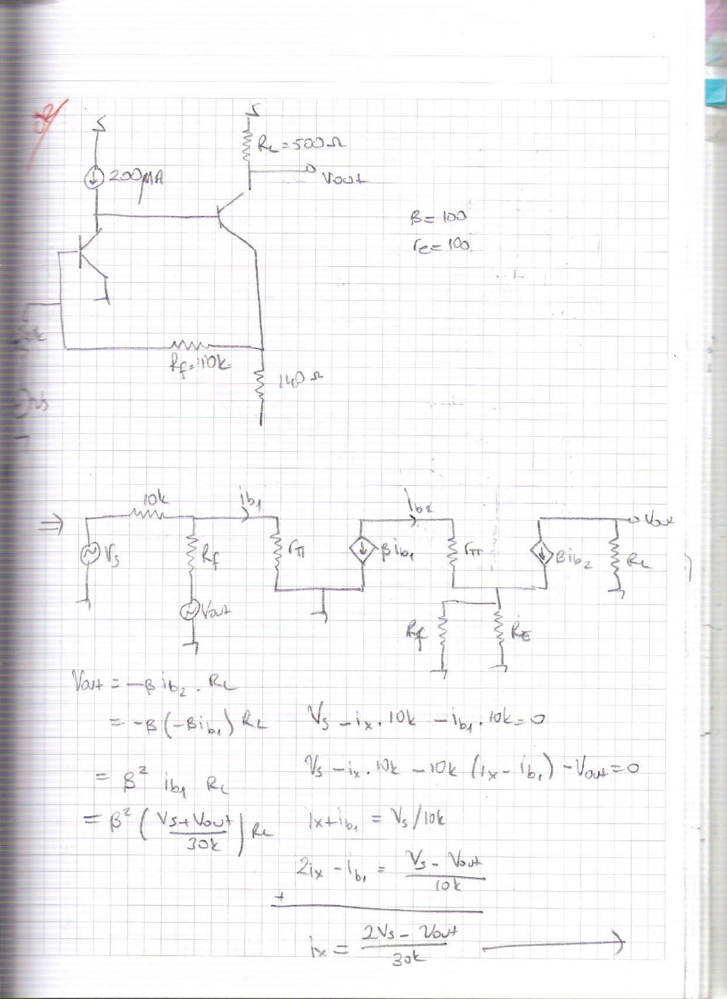
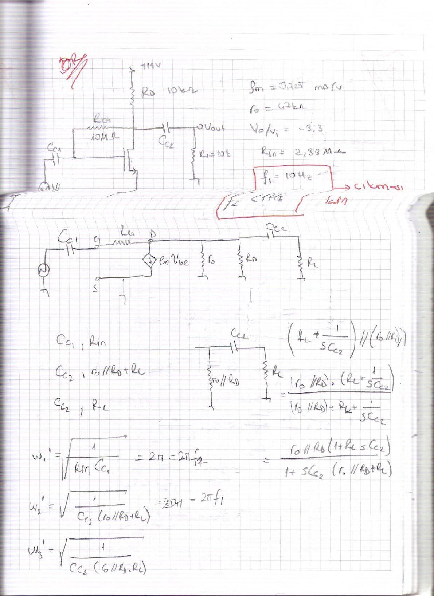
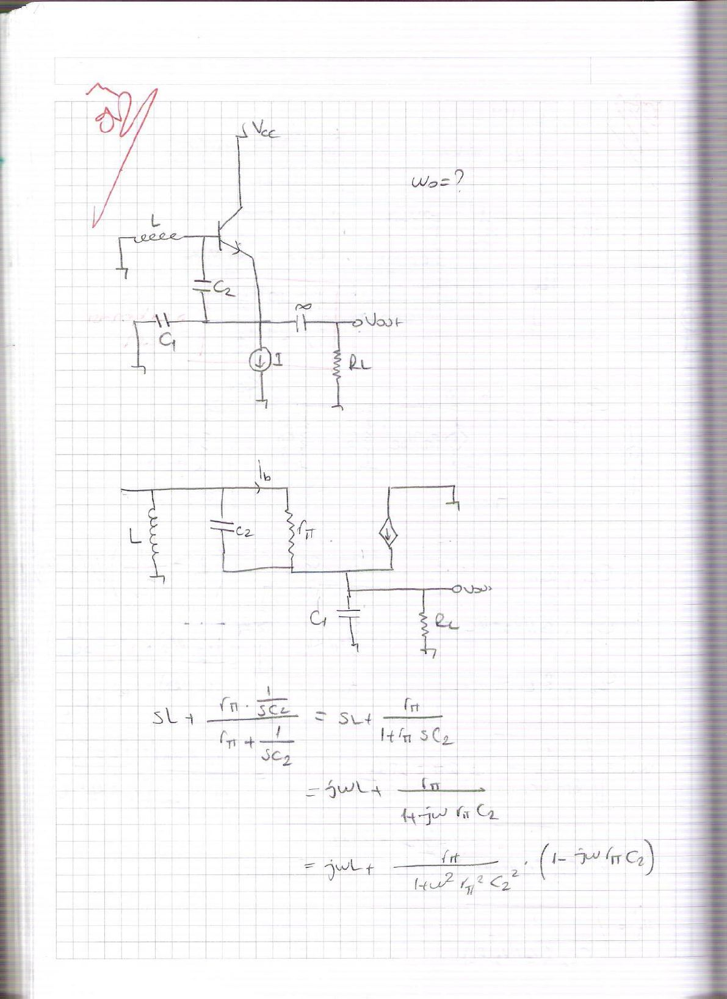
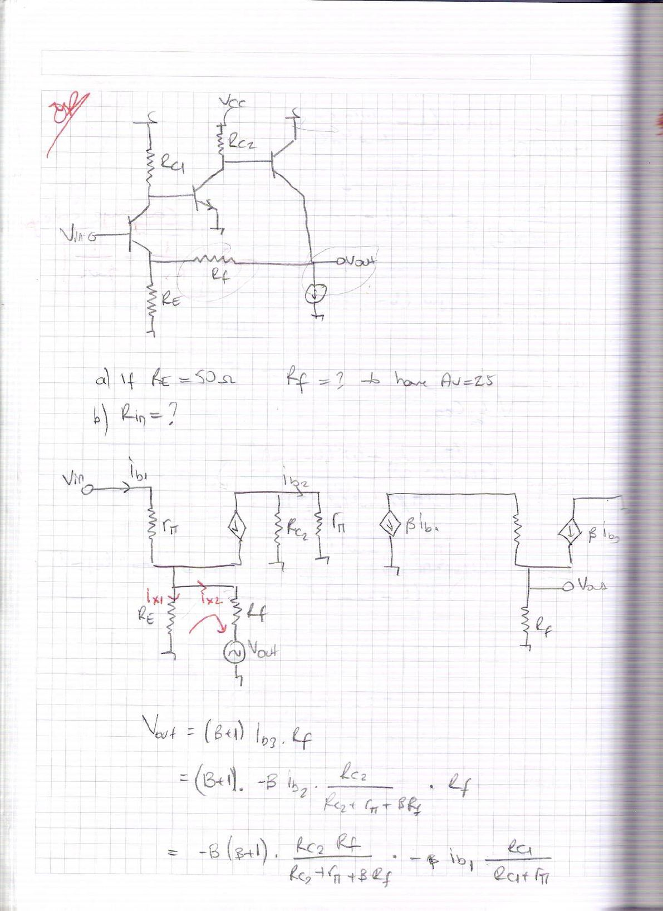

This post presents **a handwritten study note** from seven scanned pages, scanned on January 5, 2012. Although the files were stored in an EEM 308 folder, the topics (feedback amplifiers, frequency response, oscillators) belong to the **EEM 311 Electronics II** course; the date also coincides with the final exam of the fall semester. The corners of the pages have short red-pen notes such as question marks, "will be on the exam," and "try to convert"; these are most likely example problems solved before the final. It is unclear who wrote the note; there is no name or number on the pages. The headings, main formulas, and results are given below as text; all of the scanned pages can be downloaded as a PDF at the end of the post.

## Problem 1: Two-transistor feedback amplifier with a current source

Circuit: The collector of the first transistor is fed by a 200 μA current source and connected to the base of the second transistor; the second transistor has **R_C = 500 Ω** at its collector, where V_out is taken, and **140 Ω** at its emitter; a **R_f = 10 kΩ** feedback resistor runs from the emitter to the input. β = 100, r_e = 100 (as written in the note). In the small-signal equivalent, the source is connected to the input through 10 kΩ, and the feedback resistor R_f is modeled as a source dependent on V_out.

Solution steps in the note:

V_out = −β i_b2 R_C = −β(−β i_b1) R_C = β² i_b1 R_C

From the equations V_s − i_x·10k − i_b1·10k = 0 and V_s − i_x·10k − 10k(i_x − i_b1) − V_out = 0:

i_x = (2V_s − V_out)/30k, i_b1 = V_s/10k − (2V_s − V_out)/30k = (V_s + V_out)/30k

Substituting this expression into V_out = β² i_b1 R_C gives

**A_v = (β² R_C/30k) / (1 − β² R_C/30k) = 5·10⁶ / (30·10³ − 5·10⁶) ≈ −1**

For the input resistance, using a test source: **R_in = V_s / i_x = V_s / (3V_s/30k) = 10 kΩ**.

*Note: The small-signal model used in this solution is crude; the "3V_s/30k" step in the R_in calculation is also obtained by taking V_out = −V_s in the expression i_x = (2V_s − V_out)/30k (from the result A_v ≈ −1). The results are transcribed as written in the note.*

## Problem 2: Lower cutoff frequencies of a MOSFET common-source amplifier

Circuit: (the supply voltage is illegible) **R_D = 10 kΩ**, an **R_G = 10 MΩ** feedback resistor from drain to gate, an input coupling capacitor C_C1, an output coupling capacitor C_C2, and a **R_L = 10 kΩ** load. Given: **g_m = 0.725 mA/V**, **r_o = 47 kΩ**, **V_o/V_i = −3.3**, **R_in = 2.33 MΩ**. The conditions boxed in red pen: **f₁ = 10 Hz** (with the note "will be on the exam" next to it) and **f₂ < 1 Hz**; that is, the coupling capacitors are to be chosen according to these cutoff frequencies.

Resistance seen by each capacitor using the short-circuit time constant method:

- C_C1 → R_in
- C_C2 → (r_o ∥ R_D) + R_L

Impedance at the output node: (R_L + 1/(sC_C2)) ∥ (r_o ∥ R_D) = (r_o ∥ R_D)(1 + sR_L C_C2) / (1 + sC_C2((r_o ∥ R_D) + R_L))

Cutoff frequencies:

ω₁ = 1/(R_in C_C1) = 2πf₂ and ω₂ = 1/(C_C2((r_o ∥ R_D) + R_L)) = 2π·10 = 2πf₁

*Note: In the note these expressions are written under a square root (ω = √(1/(RC))); for a single-pole RC circuit the cutoff frequency is ω = 1/(RC), without the square root.*

## Problem 3: Oscillation frequency of an inductive BJT oscillator

Circuit: A BJT oscillator whose base is connected to ground through an inductance L, with C₂ between base and emitter and C₁ between emitter and ground, the emitter fed by a current source I, and the output taken to R_L through a large coupling capacitor (a Colpitts-like structure). Asked: **ω₀ = ?**

In the small-signal equivalent, the impedance of the branch formed by L, C₂, and r_π is:

sL + (r_π · 1/(sC₂)) / (r_π + 1/(sC₂)) = sL + r_π/(1 + s r_π C₂)
= jωL + r_π (1 − jω r_π C₂) / (1 + ω² r_π² C₂²)
= r_π/(1 + ω² r_π² C₂²) + jω (L − r_π² C₂/(1 + ω² r_π² C₂²))

This series R–L form (red note: "try to convert") is converted to the parallel equivalent, 1/(1/R_x + 1/(jωL_x)):

R_eq = [r_π²/(1 + ω² r_π² C₂²)² + ω²(L − …)²] / [r_π/(1 + ω² r_π² C₂²)]

L_eq = [r_π²/(1 + ω² r_π² C₂²)² + ω²(L − …)²] / [ω(L − …)]

Oscillation conditions: **ω₀ = 1/√(L_eq C_eq)** and the gain condition **β(R_eq ∥ R_L) = 1** (as written in the note).

## Problem 4: R_f for A_v = 25 in a three-transistor feedback amplifier

Circuit: A common-emitter first stage (R_C1, with R_E in the emitter), a common-emitter second stage (R_C2), and an emitter-follower output stage loaded by a current source; an **R_f** feedback resistor runs from the output to the emitter of the first stage.

- **a)** If R_E = 50 Ω, R_f = ? to have A_v = 25
- **b)** R_in = ?

The output in the note's solution:

V_out = (β + 1) i_b3 R_f = −β(β + 1) · R_C2 R_f / (R_C2 + r_π + βR_f) · i_b2, i_b2 = −β i_b1 · R_C1/(R_C1 + r_π)

For the feedback network on the input side, with currents i_x1 (through R_E) and i_x2 (through R_f):

V_in = i_b1 r_π + i_x1 R_E, i_x1 + i_x2 = (β + 1) i_b1, R_f i_x2 − R_E i_x1 = V_out

i_x2 = (V_out + (β + 1) i_b1 R_E)/(R_f + R_E), i_x1 = ((β + 1) i_b1 R_f − V_out)/(R_f + R_E)

Substituting V_out = 25 V_in, the input resistance is:

**R_in = [r_π + (β + 1)R_f/(R_f + R_E)] / [1 − 25/(R_f + R_E)]**

For the output resistance, i_x = i_out + i_e3 and V_out = R_f(i_out + (β + 1) i_b3) are written using the definition R_out = V_out/I_out; the calculation is not completed in the note.

*Note: In the V_in expression on page 7, the R_E factor appears to be dropped in some terms (i_x1 seems to be written instead of i_x1 R_E); the R_in result is therefore dimensionally inconsistent (the 25/(R_f + R_E) term in the denominator). The correct form should be V_in = i_b1 r_π + R_E·((β + 1) i_b1 R_f − V_out)/(R_f + R_E).*
