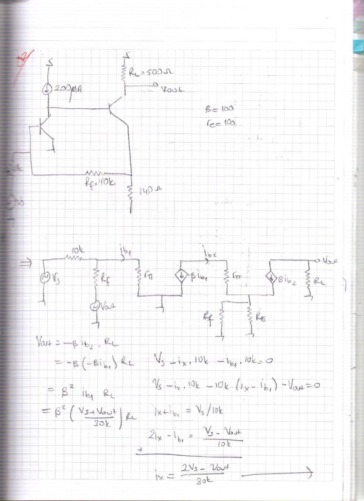
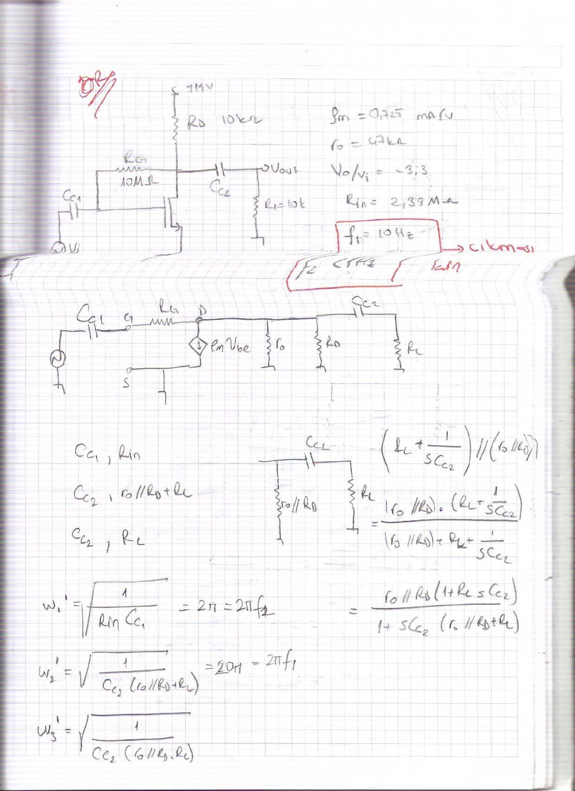
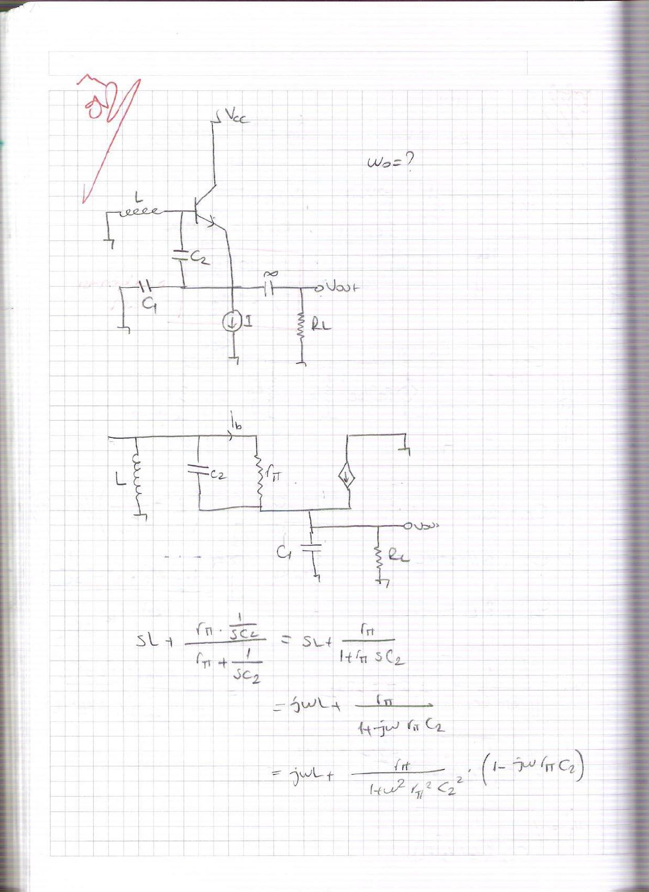
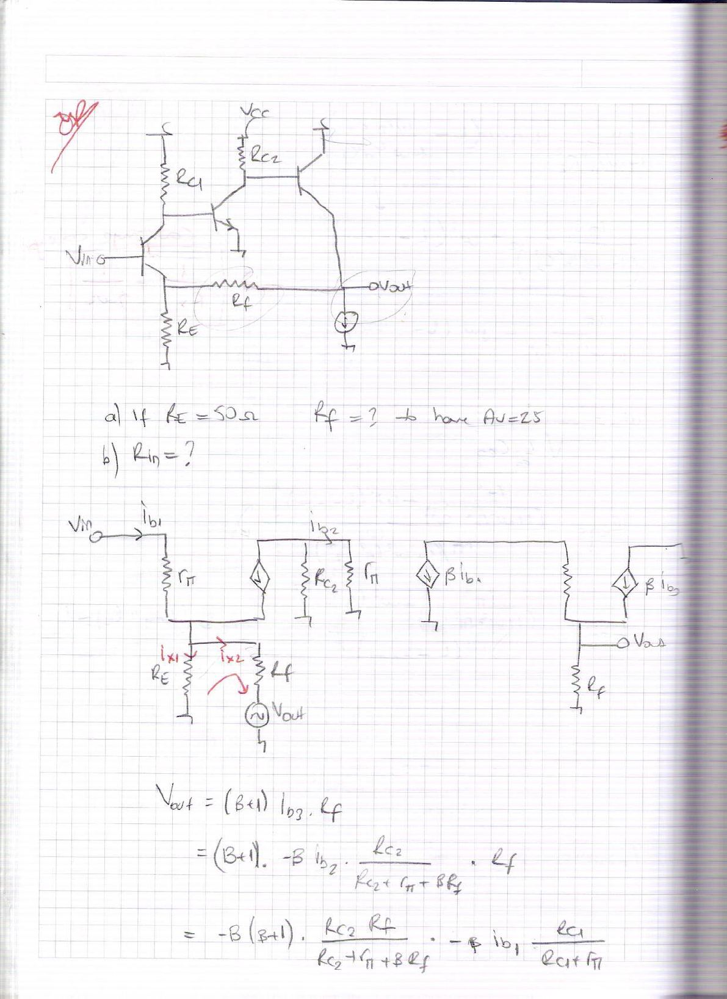

Bu yazı, 5 Ocak 2012'de taranmış yedi sayfalık **el yazısı bir çalışma notunu** aktarıyor. Dosyalar EEM 308 klasöründe saklanmış olsa da konular (geri beslemeli yükselteçler, frekans cevabı, osilatörler) **EEM 311 Elektronik II** dersine ait; tarih de dersin güz dönemi finaline denk geliyor. Sayfaların köşelerinde kırmızı kalemle soru işaretleri ve "çıkması", "çevirmeye çalış" gibi kısa notlar var; büyük olasılıkla final öncesi çözülen örnek sorular. Notu kimin yazdığı belli değil; sayfalarda ad veya numara yok. Başlıklar, ana formüller ve sonuçlar aşağıda metin olarak verildi; taranmış sayfaların tamamı yazının sonunda PDF olarak indirilebilir.

## Soru 1: Akım kaynaklı geri beslemeli iki transistörlü yükselteç

Devre: Birinci transistörün kolektörü 200 μA akım kaynağıyla beslenip ikinci transistörün bazına bağlı; ikinci transistörün kolektöründe **R_C = 500 Ω** ve çıkış V_out, emetöründe **140 Ω**; emetörden girişe **R_f = 10 kΩ** geri besleme direnci. β = 100, r_e = 100 (notta böyle). Küçük sinyal eşdeğerinde kaynak 10 kΩ üzerinden girişe bağlanıyor; geri besleme direnci R_f, V_out'a bağlı bir kaynak gibi modellenmiş.

Notun çözüm adımları:

V_out = −β i_b2 R_C = −β(−β i_b1) R_C = β² i_b1 R_C

V_s − i_x·10k − i_b1·10k = 0 ve V_s − i_x·10k − 10k(i_x − i_b1) − V_out = 0 denklemlerinden

i_x = (2V_s − V_out)/30k, i_b1 = V_s/10k − (2V_s − V_out)/30k = (V_s + V_out)/30k

Bu ifade V_out = β² i_b1 R_C'ye yerleştirilince

**A_v = (β² R_C/30k) / (1 − β² R_C/30k) = 5·10⁶ / (30·10³ − 5·10⁶) ≈ −1**

Giriş direnci için test kaynağıyla: **R_in = V_s / i_x = V_s / (3V_s/30k) = 10 kΩ**.

*Not: Bu çözümde kullanılan küçük sinyal modeli kaba; R_in hesabındaki "3V_s/30k" adımı da i_x = (2V_s − V_out)/30k ifadesinde V_out = −V_s alınarak elde ediliyor (A_v ≈ −1 sonucundan). Sonuçlar notta yazıldığı gibi aktarıldı.*

## Soru 2: MOSFET ortak kaynaklı yükseltecin alt kesim frekansları

Devre: (besleme gerilimi okunmuyor) **R_D = 10 kΩ**, savaktan kapıya **R_G = 10 MΩ** geri besleme direnci, giriş kuplaj kondansatörü C_C1, çıkış kuplaj kondansatörü C_C2 ve **R_L = 10 kΩ** yük. Verilenler: **g_m = 0,725 mA/V**, **r_o = 47 kΩ**, **V_o/V_i = −3,3**, **R_in = 2,33 MΩ**. Kırmızı kalemle kutu içine alınmış koşullar: **f₁ = 10 Hz** (yanında "çıkması" notu) ve **f₂ < 1 Hz**; yani kuplaj kondansatörleri bu kesim frekanslarına göre seçilecek.

Kısa devre zaman sabiti yöntemiyle her kondansatörün gördüğü direnç:

- C_C1 → R_in
- C_C2 → (r_o ∥ R_D) + R_L

Çıkış düğümündeki empedans: (R_L + 1/(sC_C2)) ∥ (r_o ∥ R_D) = (r_o ∥ R_D)(1 + sR_L C_C2) / (1 + sC_C2((r_o ∥ R_D) + R_L))

Kesim frekansları:

ω₁ = 1/(R_in C_C1) = 2πf₂ ve ω₂ = 1/(C_C2((r_o ∥ R_D) + R_L)) = 2π·10 = 2πf₁

*Not: Notta bu ifadeler karekök içinde yazılmış (ω = √(1/(RC))); tek kutuplu RC devresinde kesim frekansı karekök olmadan ω = 1/(RC)'dir.*

## Soru 3: Endüktanslı BJT osilatörünün salınım frekansı

Devre: Bazı L endüktansıyla toprağa bağlı, baz–emetör arasında C₂, emetör–toprak arasında C₁ bulunan, emetörü I akım kaynağıyla beslenen ve çıkışı büyük bir kuplaj kondansatörüyle R_L'ye alınan BJT osilatörü (Colpitts benzeri yapı). İstenen: **ω₀ = ?**

Küçük sinyal eşdeğerinde L, C₂ ve r_π'nin oluşturduğu kolun empedansı:

sL + (r_π · 1/(sC₂)) / (r_π + 1/(sC₂)) = sL + r_π/(1 + s r_π C₂)
= jωL + r_π (1 − jω r_π C₂) / (1 + ω² r_π² C₂²)
= r_π/(1 + ω² r_π² C₂²) + jω (L − r_π² C₂/(1 + ω² r_π² C₂²))

Bu seri R–L biçimi (kırmızı not: "çevirmeye çalış") paralel eşdeğere, 1/(1/R_x + 1/(jωL_x)), çevriliyor:

R_eq = [r_π²/(1 + ω² r_π² C₂²)² + ω²(L − …)²] / [r_π/(1 + ω² r_π² C₂²)]

L_eq = [r_π²/(1 + ω² r_π² C₂²)² + ω²(L − …)²] / [ω(L − …)]

Salınım koşulları: **ω₀ = 1/√(L_eq C_eq)** ve kazanç koşulu **β(R_eq ∥ R_L) = 1** (notta böyle).

## Soru 4: Üç transistörlü geri beslemeli yükselteçte Av = 25 için Rf

Devre: Ortak emetörlü birinci kat (R_C1, emetörde R_E), ortak emetörlü ikinci kat (R_C2) ve akım kaynağıyla yüklenmiş emetör izleyici çıkış katı; çıkıştan birinci katın emetörüne **R_f** geri besleme direnci.

- **a)** If R_E = 50 Ω, R_f = ? to have A_v = 25
- **b)** R_in = ?

Notun çözümünde çıkış:

V_out = (β + 1) i_b3 R_f = −β(β + 1) · R_C2 R_f / (R_C2 + r_π + βR_f) · i_b2, i_b2 = −β i_b1 · R_C1/(R_C1 + r_π)

Giriş tarafında geri besleme ağı için i_x1 (R_E'den) ve i_x2 (R_f'den) akımlarıyla:

V_in = i_b1 r_π + i_x1 R_E, i_x1 + i_x2 = (β + 1) i_b1, R_f i_x2 − R_E i_x1 = V_out

i_x2 = (V_out + (β + 1) i_b1 R_E)/(R_f + R_E), i_x1 = ((β + 1) i_b1 R_f − V_out)/(R_f + R_E)

V_out = 25 V_in koyularak giriş direnci:

**R_in = [r_π + (β + 1)R_f/(R_f + R_E)] / [1 − 25/(R_f + R_E)]**

Çıkış direnci için R_out = V_out/I_out tanımıyla i_x = i_out + i_e3 ve V_out = R_f(i_out + (β + 1) i_b3) yazılıyor; hesap notta tamamlanmamış.

*Not: Sayfa 7'deki V_in ifadesinde R_E çarpanı bazı terimlerde düşmüş görünüyor (i_x1 R_E yerine i_x1 yazılmış gibi); R_in sonucu bu yüzden boyutsal olarak tutarsız (paydadaki 25/(R_f + R_E) terimi). Doğru biçimde V_in = i_b1 r_π + R_E·((β + 1) i_b1 R_f − V_out)/(R_f + R_E) olmalıdır.*
