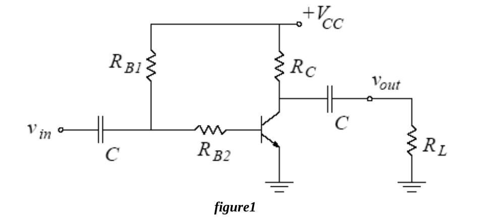
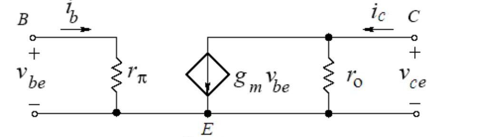
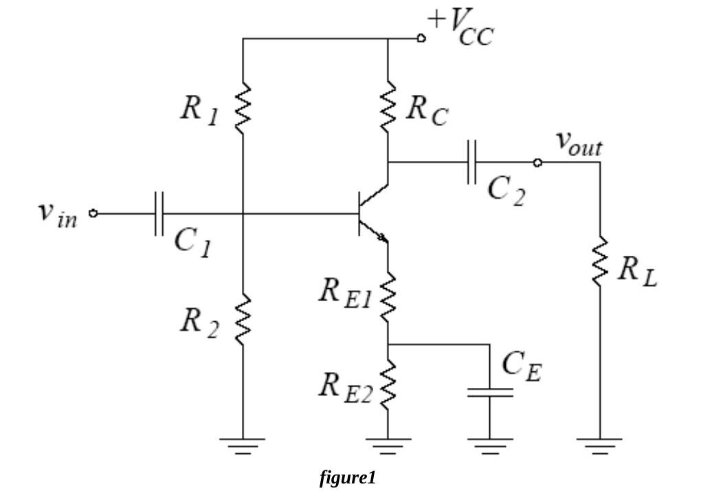
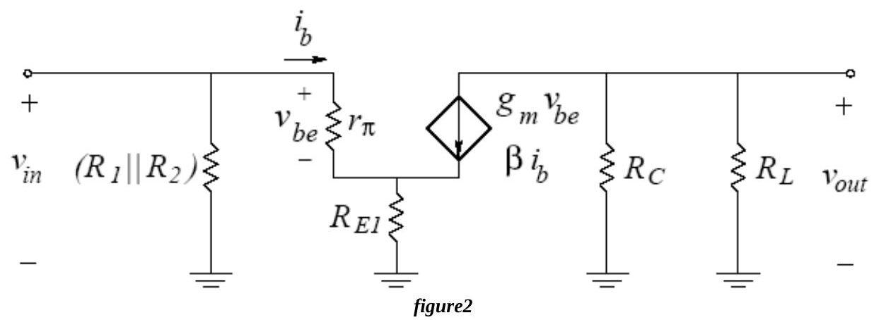
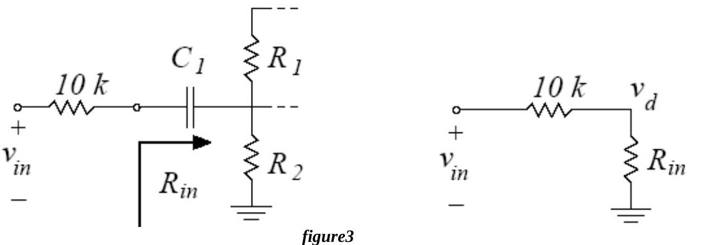

Bu yazı, Başkent Üniversitesi Elektrik-Elektronik Mühendisliği **EEM311 Elektronik II** laboratuvarının ilk iki deney föyünü içeriyor: **Experiment I: Single Stage BJT Amplifier** ve **Experiment II: Single Stage BJT Amplifier Design**. Föyler 2010 güz döneminde dağıtılmış (sayfa altlarında dersin web adresi *www.baskent.edu.tr/~ozparlak* yazıyor). Föyler İngilizce olduğu için metin de İngilizce aktarıldı; devre şemaları föylerden alınan görsellerle verildi. Orijinal PDF'ler yazının sonunda ZIP olarak indirilebilir.

## Experiment I: Single Stage BJT Amplifier

**Aim:** The aim of the experiment is to investigate the single stage BJT (Bipolar Junction Transistor) amplifier.

### Theory

The *npn* transistor is connected in a common emitter configuration, shown in Fig.1. The input and output voltage signals are coupled to and from the amplifier with the use of coupling capacitors. The base resistors R_B1 and R_B2 bias the transistor to a Q-point. The collector resistor R_C converts the output current to an output voltage signal. The amplifier output drives a load with resistance R_L. The simple biasing scheme used in this circuit leaves the Q-point sensitive to changes in the β value of the transistor.

The small-signal model for the BJT is shown in Fig.2.

- Small-signal input resistance (set by the DC base current): rπ = n·V_T / I_BQ, where n is the emission coefficient.
- Small-signal output resistance (set by the DC collector current): r_o = (V_A + V_CE) / I_CQ ≅ V_A / I_CQ, where V_A is the Early voltage.
- Small-signal transconductance: g_m = I_CQ / (n·V_T). At room temperature V_T ≈ 25 mV.

*Not: Föyde formül "ro = VA + VCE / ICQ" biçiminde, parantezsiz yazılmış; doğrusu (V_A + V_CE)/I_CQ'dur.*

### Preliminary work

Review sections 13.1, 13.2, 13.5 and 13.6 of the course book. In the laboratory you will construct the circuit in Fig.1 using the transistor **BC238B** and the following values:

| V_CC | R_B1 | R_B2 | R_C | R_L | C |
|---|---|---|---|---|---|
| 15 V | 470 kΩ | 1.8 kΩ | 1 kΩ | 100 kΩ | 10 µF |

The BC238B has 200 < β < 320, V_CE(SAT) = 0.2 V, V_BE(ON) = 0.6 V and V_A = 100 V. Use V_T = 25 mV and the emission coefficient n = 1, even though BC238B transistors may exhibit an emission coefficient in the range 1 ≤ n ≤ 2 (the BC238B datasheet is on the course web page). Pinout (Fig.3 in the sheet): 1 – collector, 2 – base, 3 – emitter.

For each β value (β = 200, β = 250, β = 320) do steps 1 through 4:

1. Analyze the DC circuit to determine the Q-point. Find I_BQ, I_CQ and V_CEQ.
1. Draw the load line and the transistor i_C–v_CE characteristics on graph paper and indicate the Q-point (a separate graph for each β value).
1. Calculate the peak-to-peak maximum undistorted voltage swing at the output.
1. Draw the small-signal AC equivalent model of the amplifier assuming that the capacitors are short circuits at the operating frequency. Calculate rπ, r_o, g_m and the voltage gain A_v = v_out / v_in.
1. Simulate the amplifier circuit using **PSPICE**. The BC238B model is in the EEM311.LIB library in deney1.zip; save EEM311.lib and EEM311.olb in your directory and add the library path and file name under the *Libraries* tab of the simulation profile (see PSpiceDocument.pdf, section 4, "Using and Adding Vendor Libraries", or "how to add an include file.doc"). First do a **Bias Point** analysis to determine V_CQ, V_EQ, I_BQ, I_CQ, I_EQ. Next do a **Time Domain** analysis with a 2 mV peak-to-peak, 1 kHz sine input and determine the input and output voltages and the voltage gain. Repeat with input amplitudes of 20 mV, 140 mV and 500 mV, note the changes in the output waveform and comment on the results.

Summarize the simulation results in table form and hand them in together with the calculations and the simulation print-outs. Label each graph clearly.

### Experimental work

Before constructing the circuit, verify the resistor values with a multimeter; all resistors should be within 2% of their marked values so that the current measurements are accurate. Construct the amplifier with the values above.

1. Measure and record I_BQ, I_CQ and V_CEQ and compare them with your calculations. Draw the load line and indicate the Q-point.
1. Using these measurements, determine the β of your transistor.
1. **Measure rπ:** R_B2 and rπ form a voltage divider in the AC circuit. Apply a 1 kHz, 40 mV peak-to-peak sine, measure v_be and determine rπ. Compare with your calculations and determine the emission coefficient n.
1. **Measure r_o:** R_C, R_L and r_o are in parallel. Apply a 1 kHz, 20 mV peak-to-peak sine, measure v_out and determine r_o from r_o ∥ R_C ∥ R_L = v_out / (g_m·v_be). Compare with your calculations and determine the Early voltage V_A.
1. With the measured β and n of your transistor, calculate the voltage gain of the amplifier.
1. Apply a 1 kHz, 2 mV peak-to-peak sine, observe the input and output waveforms on the oscilloscope, measure the voltage gain and compare it with the previous part.
1. Gradually increase the input amplitude and find the onset of distortion at the output. Measure v_be at this point and compare it with V_T.
1. Increase the input further and find the onset of clipping. Measure the peak-to-peak maximum undistorted (here "undistorted" really means "unclipped") output swing and comment on how it is related to the location of the Q-point on the load line.
1. Record the output waveform for input amplitudes of 20 mV, 140 mV and 500 mV peak-to-peak and mark any distortion or clipping on each plot.

**Instruments:** breadboard, oscilloscope, signal generator, multimeter, DC power supply. **Components:** 1 × BC238B, 100 kΩ, 1 kΩ, 1.8 kΩ, 470 kΩ, 2 × 10 µF.

The last page of the sheet is a results form (I_BQ, I_CQ, V_CEQ, v_be, v_out, v_out,undistorted for parts 1–9, student name and signature).

## Experiment II: Single Stage BJT Amplifier Design

**Aim:** The aim of this experiment is to design and construct a single-stage bipolar junction transistor (BJT) amplifier.

### Theory

The *npn* transistor is again in common emitter configuration (Fig.1). The input and output signals are coupled with C1 and C2. The biasing network R1–R2 sets the DC Q-point, and the emitter resistor R_E = R_E1 + R_E2 provides bias stability against variations in β. The output is connected to a load R_L. The second emitter resistor R_E2 is bypassed with a capacitor C_E to increase the voltage gain, while a small emitter resistance R_E1 is left in the AC circuit.

It is assumed that r_o = ∞ and that all capacitors are short circuits at the operating frequency; rπ = n·V_T / I_BQ and g_m = I_CQ / (n·V_T).

Because of C_E and the output coupling capacitor C2, the **AC load line differs from the DC load line**. In designing the bias network the Q-point should be set at the center of the AC load line for maximum symmetrical output swing, leaving some safety margin for the maximum peak-to-peak undistorted (unclipped) output swing.

The unbypassed emitter resistor R_E1 serves three functions:

1. **Adjusting the voltage gain:** with R_E1 = 0 the gain is as high as it can be for this circuit; a nonzero R_E1 lowers it to the desired value.
1. **Stability against variations in rπ due to the emission coefficient n:** n varies from transistor to transistor much like β, which changes rπ and thus the gain and input resistance. If rπ ≪ (β+1)·R_E1, the gain and the input resistance are not influenced by changes in n.
1. **Linear operation for larger inputs:** with R_E1 = 0 the input must be much smaller than V_T, since exp(v_be/V_T) ≈ 1 + v_be/V_T only holds for v_be ≪ V_T. If rπ ≪ (β+1)·R_E1, the base current is mainly determined by the linear resistance (β+1)·R_E1 rather than the nonlinear i–v curve approximated by rπ.

### Preliminary work

Review sections 13.6.3, 13.8, 13.10.1 and 13.10.3 of the course book. Design a single stage BJT amplifier with the topology of Fig.1 using the BC238B (200 < β < 320, V_CE(SAT) = 0.2 V, V_BE(ON) = 0.6 V, n = 1, r_o = ∞) with:

| V_CC | R_L | C1 | C2 | C_E |
|---|---|---|---|---|
| 15 V | 3.3 kΩ | 10 µF | 10 µF | 100 µF |

1. Determine R1, R2, R_C, R_E1 and R_E2 (standard resistor values only) to meet the requirements below. Show all your work.

| Requirement | min | max |
|---|---|---|
| Voltage gain A_v | 22 dB | 24 dB |
| Input resistance R_in | 5 kΩ | |
| Peak-to-peak undistorted output swing | 6 V | |
| I_CQ variation with β | | 3% |
| A_v,dB variation with β (200–320) | | 0.5 dB |
| A_v,dB variation with n (1–2) | | 1 dB |

The design should make the Q-point and the gain insensitive to β: for β between 200 and 320, I_CQ must not change more than 3% and A_v not more than 0.5 dB; for n between 1 and 2, A_v must not change more than 1.0 dB. The slope of the AC load line also depends on R_E1, but R_E1 is usually small and can be neglected at the design stage.

1. For β = 200, 250 and 320 (n = 1.4), find I_BQ, I_CQ, V_CEQ, rπ, R_in, A_v (linear and dB) and the peak-to-peak undistorted output swing.
1. For n = 1 and n = 2 (β = 250), find rπ, R_in and A_v (linear and dB).

### Experimental work

Verify the resistor values (within 2%) and keep the oscilloscope **DC-coupled** so that asymmetric waveforms are easy to notice.

1. **Q-point:** before connecting the signal generator, measure I_CQ and V_CEQ, compare with the calculations and calculate the maximum peak-to-peak unclipped output swing to expect.
1. **Voltage gain:** apply a 5 kHz, 100 mV peak-to-peak sine, observe v_in and v_out and compare the gain with the preliminary work.
1. Keeping the output distortion free, change the amplitude while watching V_o/V_i in the **X-Y mode** of the oscilloscope. Is the response linear for small signals? Measure the peak-to-peak output voltage where linearity breaks down.
1. **Maximum unclipped swing:** switch the generator to a triangular wave (clipping is easier to see), increase the amplitude to the onset of clipping and measure the peak-to-peak output. Compare with the calculations and relate it to the Q-point on the AC load line.
1. **Input resistance:** connect a 10 kΩ resistor between the generator and the amplifier input so that it forms a voltage divider with R_in (Fig.3). With a 100 mV peak-to-peak input, measure v_in and v_d and deduce R_in.

**Instruments:** breadboard, oscilloscope, signal generator, multimeter, DC power supply. **Components:** 1 × BC238B, 3.3 kΩ, 2 × 10 µF, 100 µF, 50 kΩ potentiometer (plus the designed resistors). The sheet ends with a results form for parts 1–5.
