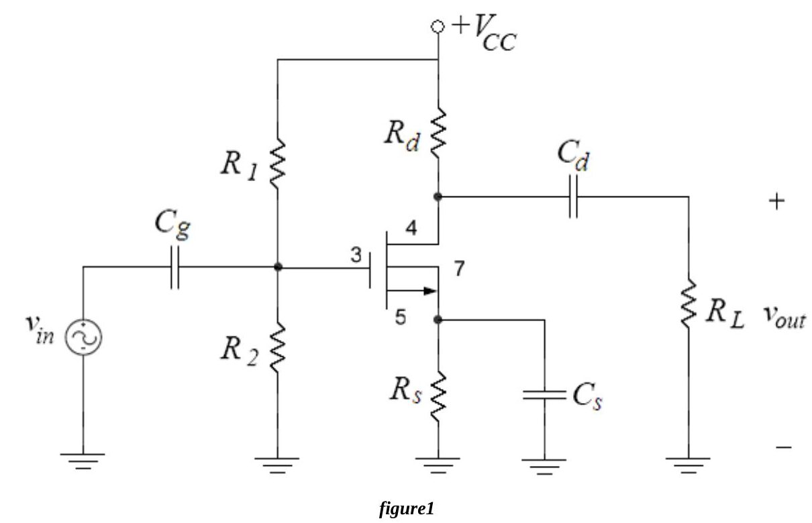
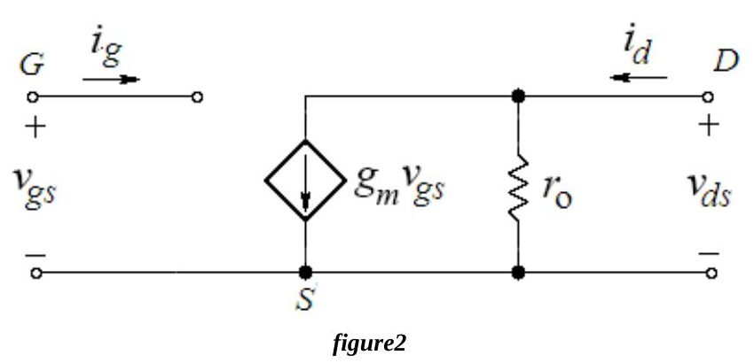
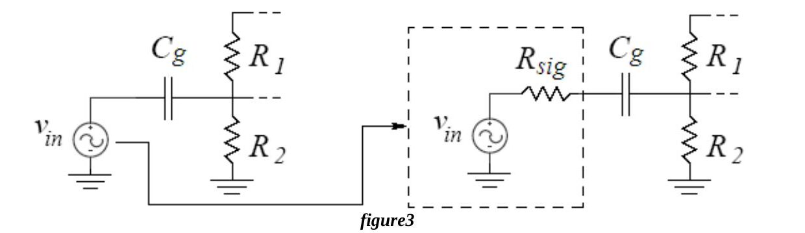
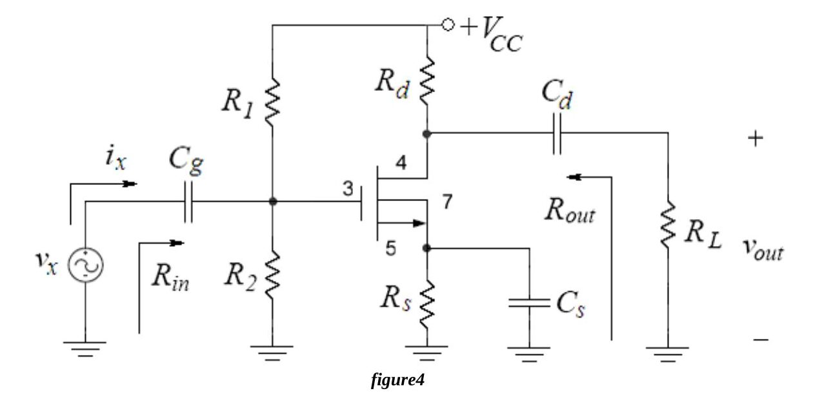
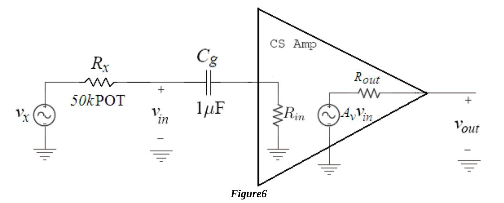
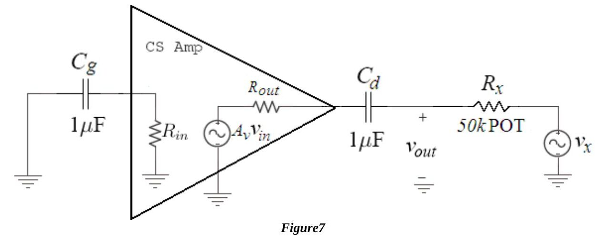
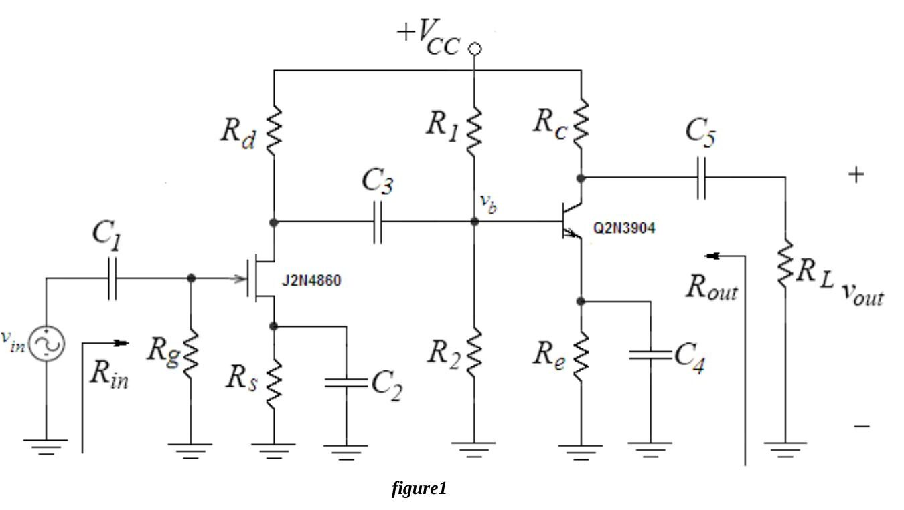

Bu yazı, Başkent Üniversitesi Elektrik-Elektronik Mühendisliği **EEM311 Elektronik II** laboratuvarının 2010 güz dönemi föylerinden ikisini içeriyor: **Experiment III: Single Stage MOSFET Amplifier** ve **Experiment IV: Two Stage Amplifier Circuit**. Föyler İngilizce olduğu için metin de İngilizce aktarıldı; devre şemaları föylerden alınan görsellerle verildi. Orijinal PDF'ler yazının sonunda ZIP olarak indirilebilir.

## Experiment III: Single Stage MOSFET Amplifier

**Aim:** The aim of the experiment is to investigate the single stage MOSFET amplifier.

### Theory

The common-source amplifier with an NMOS transistor is shown in Figure 1. The input and output signals are coupled with coupling capacitors. The biasing is done by fixing the gate voltage with a voltage divider and by using a source resistor R_S. The source resistor gives negative feedback and stabilizes the bias current against temperature variations and transistor characteristics.

One of the most important characteristics of a transistor is its **transconductance** g_m, a measure of how much the output current varies when the input voltage v_gs changes:

g_m = ∂i_D/∂v_GS = k_n′(W/L)(V_GS − V_t) = √(2·I_D·k_n′·W/L) = 2·I_D / (V_GS − V_t)

so the transconductance depends on the bias current I_D. The **small signal output resistance** is the Early voltage V_A = 1/λ over the bias current:

r_o = V_A / I_D = 1 / (λ·I_D)

The **amplification factor** μ_f is the product of g_m and r_o:

μ_f = g_m·r_o = 2 / (λ(V_GS − V_t)) = (1/λ)·√(2k_n / I_D)

so the amplification factor decreases as the operating current increases.

**Voltage gain.** The overall gain of the common source amplifier in Fig.1 is

A_v = v_out / v_in = −g_m (R_D ∥ R_L ∥ r_o)

If the signal source has an internal resistance R_sig (Fig.3), the overall gain becomes

A_v = −[R_G / (R_G + R_sig)]·g_m (R_D ∥ R_L ∥ r_o)

The internal resistance forms a voltage divider with R_G = R1 ∥ R2, which attenuates the input signal; this is why R1 ∥ R2 should be kept large compared with R_sig.

**Input and output impedances.** By hand, impedances are found by applying a test voltage v_x and finding the resulting current i_x (R_in = v_x / i_x), or by applying a test current and finding the voltage. Capacitors are taken as short circuits, DC supplies as AC ground and transistors are replaced by their small-signal models. When solving for the output impedance, the point where the input source was connected must be set to AC ground.

For Fig.1, R_in = R_G = R1 ∥ R2 and R_out = R_D ∥ r_o. A voltage amplifier should have a large input impedance and a small output impedance. The common source amplifier has a large input impedance, but its output impedance is also large, so connecting a load R_L reduces the output voltage and the gain. To obtain a small output impedance, a common-drain (source follower) stage can be added after the common-source amplifier.

**Knowledge.** Most MOSFET amplifiers today are fabricated on integrated circuits, where resistors are hard to make and may have tolerances as bad as 10–20%. In this experiment resistors are used for biasing and setting the gain, but in modern MOSFET technology MOSFET devices themselves are used as resistors and to set bias conditions. "So, try to discover something ☺."

### Preliminary work

Review sections 13.7, 13.8, 13.9, 13.10.2 and 13.10.4 of the course book. Design a single stage MOSFET amplifier with the topology of Fig.1 using one of the NMOS transistors of the **CD4007** chip, with:

| V_CC | R_L | C_g | C_d | C_s |
|---|---|---|---|---|
| 15 V | 10 kΩ | 1 µF | 1 µF | 10 µF |

The NMOS has µ₀C_ox = 166.67 µA/V², W/L = 3 and V_T = 1.45 V; assume V_A = 100 V. (These µ₀C_ox(W/L) and V_T values were found from measured data on the CD4007 by Dr. David M. Binkley, Clark Hopper and Harold Hearne of the University of North Carolina at Charlotte. The CD4007C datasheet is on the course web page.)

Find R1, R2, R_D and R_S so that the MOSFET is biased with I_DS ≈ 75 µA, V_GS = 2 V, a V_D that allows maximum signal swing and a V_S that gives these bias conditions. Make sure the MOSFET is in saturation (use only standard resistor values ≤ 100 kΩ).

1. With the capacitors as short circuits: a) draw the small signal AC equivalent of the circuit; b) calculate g_m, r_o and μ_f; c) find the voltage gain A_v = v_out / v_in; d) find R_in and R_out with the test source method; e) calculate the largest v_in that does not violate the small-signal assumption and the corresponding peak-to-peak undistorted output swing; f) calculate the peak-to-peak maximum (unclipped) output swing.
1. Verify the design with **PSpice** using the CD4007.LIB library from deney3.zip (transistors *nnmos* and *ppmos*; add the library path under the *Libraries* tab): a) draw Fig.1 without R_L and C_d; b) run a BIAS simulation, find the node voltages and I_D and compare them with part 1; c) run a transient simulation with a 1 kHz, 50 mV sine, first without and then with R_L = 10 kΩ, find the gain in both cases and compare with your hand calculations; d) summarize the results in a table and hand them in with the calculations and labelled print-outs.

*Not: Verilen değerlerle I_D = ½·166.67 µA/V²·3·(2 − 1.45)² ≈ 75.6 µA çıkıyor; yani föydeki 75 µA ve V_GS = 2 V hedefleri kendi içinde tutarlı.*

### Experimental work

The **CD4007** array contains three NMOS and three PMOS transistors. The substrates of all NMOS transistors are connected to V_SS (pin 7) and all PMOS substrates to V_DD (pin 14): pin 7 must go to the most negative supply (or the source) and pin 14 to the most positive supply. Do not connect the array to circuits with the power on, and do not apply input signals before pins 7 and 14 are connected, otherwise transients may damage the device. Transistor characteristics vary considerably from chip to chip. MOSFETs are very sensitive to electrostatic discharge: ground yourself before picking up the chip and do not touch the pins. Use jumper wires as short as possible.

Before construction, check the resistors (within 2%), set V_CC = 15 V and the generator to about 50 mVp-p at 1 kHz. Always turn on the DC supply before the AC signal, and turn off the AC signal before the DC supply.

1. Measure V_G, V_D and V_S, calculate I_DS from them and compare with the preliminary work.
1. a) Measure the voltage gain. b) Remove C_d and R_L and measure the open circuit gain (note the DC level added to the output); discuss the effect of R_L. c) Put back C_d and R_L, remove the bypass capacitor C_S and measure the gain again; note the strong effect of removing the capacitor.
1. Reconstruct Fig.1 and increase the input amplitude. When does the output start to distort? What is the maximum output swing before considerable distortion?
1. Measure **R_in** with the setup of Fig.6 (v_x = 50 mVp-p at 1 kHz through a 50 kΩ potentiometer R_x): measure v_in, relate v_x and v_in, and solve for R_in.
1. Measure **R_out** with the setup of Fig.7 (the test source drives the output through R_x, R_L disconnected): measure v_out, relate v_out and v_x, and solve for R_out.
1. Compare R_in and R_out at 1 kHz with the preliminary work.

**Instruments:** breadboard, oscilloscope, signal generator, multimeter, DC power supply. **Components:** CD4007C chip, 10 kΩ, 2 × 1 µF, 10 µF, 50 kΩ potentiometer. The sheet ends with a results form.

## Experiment IV: Two Stage Amplifier Circuit

**Aim:** The aim of the experiment is to investigate the two stage amplifier circuit.

### Theory

In most situations single transistor amplifiers cannot meet all the given specifications; a combination of voltage gain, input resistance and output resistance cannot be met simultaneously. Multistage amplifiers are made of single transistor amplifiers connected in cascade. The first stage usually provides a high input impedance to minimize loading of the source (transducer), the middle stages provide most of the voltage gain, and the final stage provides a low output impedance to prevent loss of gain and to supply the current required by the load.

The loading effect of the next stage must be considered, since its input impedance is the load of the current stage; therefore the AC analysis of a multistage amplifier usually starts with the final stage. Stages are coupled either by capacitors or directly. Capacitor coupling is most often used for AC signals: the capacitor blocks the DC voltages between stages so that the bias point of each stage is not upset.

The **JFET CS – BJT CE cascade** in Fig.1 is a good multistage configuration. The JFET CS amplifier usually has a gain below 10, but because of its high input impedance and low noise the JFET is often used as the first stage to pick up weak signals. The BJT CE amplifier forms the second stage and provides a high voltage gain. The total gain is the product of the stage gains:

A_v,overall = A_v,first stage × A_v,second stage

### Preliminary work

Review sections 4.12, 13.7.6 and 15.1–15.2 of the course book. The circuit of Fig.1 is built with a **2N3904** and a **2N4860** and the following values:

| V_CC | R_L | C1 = C5 | C2 = C4 | C3 |
|---|---|---|---|---|
| 12 V | 100 kΩ | 10 µF | 100 µF | 22 µF |

| R_g | R_d | R_s | R1 | R2 | R_c | R_e |
|---|---|---|---|---|---|---|
| 1 MΩ | 1 kΩ | 330 Ω | 30 kΩ | 47 kΩ | 1 kΩ | 2.2 kΩ |

*Not: Föydeki tabloda 22 µF'lık kapasitör de "C2" diye yazılmış; C2 ve C4 zaten 100 µF olduğundan bunun şekildeki kuplaj kapasitörü C3 olduğu anlaşılıyor.*

Assume the 2N3904 has β = 100, V_BE(ON) = 0.7 V, V_A = 100 V and n = 1. The 2N4860 is an n-channel JFET with typical V_p = −3 V and I_DSS = 50 mA (datasheets on the course web page).

1. DC analysis: a) find the Q-point of the JFET (I_D, V_DS) and its operating region; b) find the Q-point of the BJT (I_C, V_CE) and its operating region.
1. AC analysis: a) draw the small signal AC equivalent; b) find the gain of each stage and A_v,overall; c) find R_in and R_out; d) calculate the largest v_in that does not violate the small signal assumption; e) calculate the peak-to-peak maximum undistorted output swing.
1. Simulate the circuit with PSpice (J2N4860 from JFET.LIB, Q2N3904 from BIPOLAR.LIB): run a BIAS simulation for V_D, V_G, V_S, V_B, V_C, V_E and I_D, I_C, I_E, I_B; then a transient simulation with a 1 kHz, 0.1 mV peak sine, find v_in, v_out and v_b and the first stage, second stage and overall gains. Summarize the results in a table with labelled print-outs.

*Not: Föyün simülasyon maddesi "Simulate the current mirror using PSPICE" diye başlıyor; bu, akım aynası deneyinden kalmış bir kopyalama hatası, simüle edilecek devre Fig.1'deki iki katlı yükselteç.*

### Experimental work

Check the resistors (within 2%), set V_CC = 12 V and the generator to about 1 mV peak at 1 kHz, then build the circuit.

1. Ground v_in. Measure V_G, V_D, V_S, V_B, V_C and V_E, calculate I_D and I_C and compare with the preliminary work.
1. Apply a 0.1 mV peak, 1 kHz input at the JFET gate, obtained with a voltage divider (R1 = 8.2 kΩ, R2 = 1 kΩ, Fig.4). Observe v_in, v_out and v_b and calculate the first stage, second stage and overall gains.
1. Increase the input amplitude to the onset of distortion and measure the peak-to-peak maximum undistorted output swing.
1. Measure R_in with the method of the previous experiment (R_x = 500 kΩ).
1. Measure R_out with the method of the previous experiment (R_x = 1 kΩ).
1. Compare R_in and R_out at 1 kHz with the preliminary work.

**Instruments:** breadboard, oscilloscope, signal generator, multimeter, DC power supply. **Components:** 2N4860, 2N3904, 4 × 1 kΩ, 1 MΩ, 100 kΩ, 500 kΩ, 8.2 kΩ, 30 kΩ, 47 kΩ, 2.2 kΩ, 330 Ω, 2 × 10 µF, 2 × 100 µF, 22 µF. The sheet ends with a results form.
