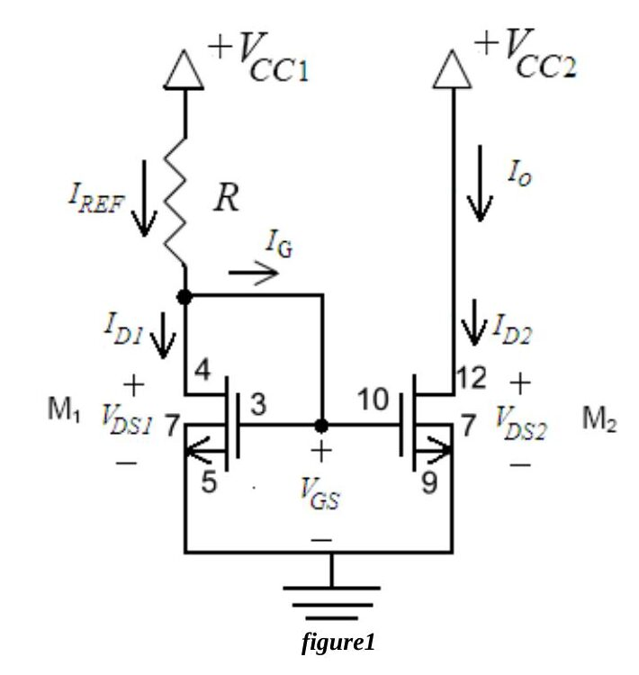
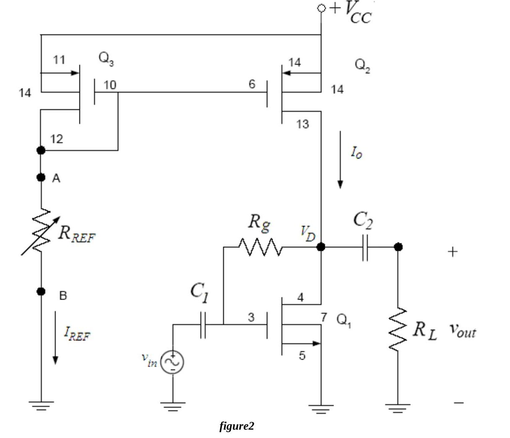
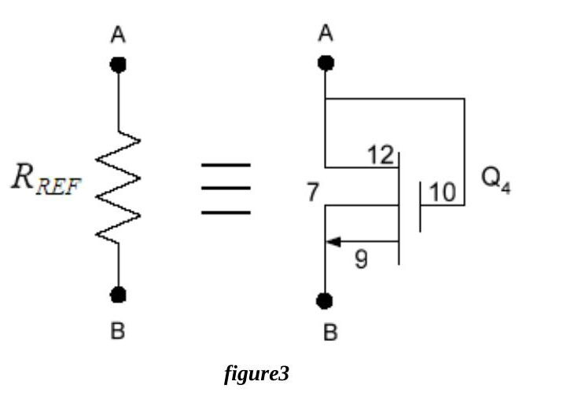

Bu yazı, Başkent Üniversitesi Elektrik-Elektronik Mühendisliği **EEM311 Elektronik II** laboratuvarının 2010 güz dönemi föylerinden ikisini içeriyor: **Experiment V: MOSFET Current Mirror** ve **Experiment VI: CMOS Common-Source Amplifier with an Active Load**. İki deney de CD4007 MOSFET dizisiyle yapılıyor ve ikincisi birincide kurulan akım aynasını yük olarak kullanıyor. Föyler İngilizce olduğu için metin de İngilizce aktarıldı; devre şemaları föylerden alınan görsellerle verildi. Orijinal PDF'ler yazının sonunda ZIP olarak indirilebilir.

## Experiment V: MOSFET Current Mirror

**Aim:** The aim of this experiment is to observe the characteristics of the current mirror and to understand where this current source is used.

### Theory

The current mirror is a fundamental building block in electronic circuit design. The strategy is to set a desired current I_REF on one side and have that current mirrored through another transistor. **Current mirrors are used so that a specific current can be set without disturbing the circuitry biased by this current source.**

The analysis starts by remembering that the gate currents of both MOSFETs are zero. I_REF equals the drain current of M1 and I_o the drain current of M2. Since M1 and M2 have exactly the same V_GS, they conduct almost the same drain current, hence I_REF ≈ I_o. This assumes the transistors are **matched**, i.e. all their parameters (µ_n, C_ox, W/L, ...) are equal.

M1 is a **diode-connected** transistor, which guarantees that it operates in saturation as long as the gate voltage is at least a threshold voltage above ground. R is chosen to establish the desired reference current in M1, and M2 mirrors this current since both have the same V_GS − V_t.

- V_CC1 − I_REF·R = V_GS
- Reference current: I_D1 = I_REF = ½·µ_n·C_ox·(W/L)·(V_GS − V_t)²·(1 + λV_DS1), where V_DS1 = V_GS
- Output current: I_D2 = I_o = ½·µ_n·C_ox·(W/L)·(V_GS − V_t)²·(1 + λV_DS2)
- For matched devices: I_o = I_REF·(1 + λV_DS2)/(1 + λV_DS1) ≅ I_REF

For equal V_DS the output current is identical to the reference current. **Unfortunately, in most circuit applications V_DS1 ≠ V_DS2, so a slight mismatch exists between the output and reference currents.**

In IC design the reference current can also be scaled by giving M2 a larger aspect ratio W/L. If (W/L)₂ is 5 times (W/L)₁:

I_o = I_REF·[(W/L)₂/(W/L)₁]·(1 + λV_DS2)/(1 + λV_DS1) = 5·I_REF·(1 + λV_DS2)/(1 + λV_DS1) ≅ 5·I_REF

**Output resistance.** I_o varies with v_DS, so the current source appears to have a resistive component, the **output resistance** of the mirror:

R_o = (∂v_O/∂i_O) at the Q-point = (1 + λV_DS)/(λ·I_o), where v_O = v_DS2 and i_O = I_o.

### Preliminary work

Review section 4.10 of the textbook. Build Fig.1 with the **CD4007** and V_CC1 = 5 V, V_CC2 = 5 V, R = 1 kΩ. The NMOS has µ₀C_ox = 166.67 µA/V², W/L = 3, V_T = 1.45 V and V_A = 1/λ = 100 V (values measured on the CD4007 by Dr. David M. Binkley, Clark Hopper and Harold Hearne, University of North Carolina at Charlotte).

1. DC analysis of Fig.1: a) find the Q-points of the NMOS transistors (I_D, V_DS) and their operating regions; b) find I_REF and I_o; c) find the output resistance.
1. Simulate the mirror in **PSpice** with the CD4007.LIB library: a) draw Fig.1; b) run a BIAS simulation and find the node voltages, the drain currents of both transistors, I_REF and I_o, and compare with part 1; c) run a **DC Sweep** of V_CC2 from 0 V to 8 V and plot I_o and I_REF on the same graph, commenting on how I_o changes with V_CC2 (= V_DS2); d) summarize the results in a table with labelled print-outs.

### Experimental work

The CD4007 contains three NMOS and three PMOS transistors. All NMOS substrates are tied to V_SS (pin 7) and all PMOS substrates to V_DD (pin 14); pin 7 must go to the most negative supply (or the source) and pin 14 to the most positive supply. Do not connect the array with the power on, and do not apply signals before pins 7 and 14 are connected. Characteristics vary from chip to chip. Ground yourself before handling the chip (electrostatic discharge), do not touch the pins and keep the jumper wires short. Check the resistors (within 2%) and set V_CC1 = V_CC2 = 5 V.

1. Measure the voltages and currents calculated in the preliminary work: V_D1, V_G1, I_D1, I_REF for M1 and V_D2, V_G2, I_D2, I_o for M2.
1. Measure I_o while changing V_CC2 (= V_DS2) from 0 V to 8 V (0 to 4 V in 0.25 V steps, then 4.5, 5, 5.5, 6, 6.5, 7 and 8 V) and draw I_o–V_CC2 on graph paper. Why does the output current decrease with decreasing output voltage at small voltages? (Hint: in which region is the MOSFET?)
1. **Estimate the output resistance:** set V_CC2 to 4 V and then 6 V, record the supply voltage and output current each time and compute R_o = Δv_O/Δi_O. What does this resistance represent?

**Instruments:** breadboard, multimeter, DC power supply. **Components:** CD4007C chip, 1 kΩ. The results form at the end also asks for the student's name and number.

*Not: Föyün ölçüm tablosunda ikinci sütun da "VG1, ID1" diye yazılmış; M2'ye ait olduğu için burada V_G2, I_D2 olarak aktarıldı.*

## Experiment VI: CMOS Common-Source Amplifier with an Active Load

**Aim:** The aim of this experiment is to analyze the CMOS common-source (CS) amplifier with an active load.

### Theory

The amplifying transistor is still the NMOS, but the load resistor R_D is replaced by a current source, as in Fig.1(a). This is called an **active load**. Its advantages are:

1. a larger resistance (the output resistance r_o) and thus a larger amplification;
1. no resistor is needed, which is particularly important for integrated circuits where large resistors are hard to make and occupy a large area.

The resistor R_G sets the gate voltage V_G and is kept very large so as not to load the input source. The current source can be implemented with a **PMOS current mirror**, Fig.1(b).

Replacing the current source by the current mirror gives the complete amplifier with active load in Fig.2; a load resistor R_L and a coupling capacitor C2 are also added.

### Preliminary work

Build Fig.2 with the **CD4007** and:

| V_CC | R_L | R_g | C1 | C2 |
|---|---|---|---|---|
| 15 V | 100 kΩ | 1 MΩ | 10 µF | 10 µF |

The NMOS has µ₀C_ox = 166.67 µA/V², W/L = 3, V_T = 1.45 V; the PMOS has µ₀C_ox = 166.67 µA/V², W/L = 3, V_T = −1.3 V; for both V_A = 1/λ = 100 V.

1. Find R_REF so that the DC value of I_REF is 0.6 mA.
1. Find the Q-point of the NMOS transistor (I_D, V_DS) and its operating region.
1. Draw the small signal AC equivalent of Fig.2.
1. Derive the overall voltage gain A_v = v_out/v_in of the CS amplifier in Fig.2 and find its value (show all your work).
1. Find the input impedance R_in.
1. Simulate the circuit with PSpice (CD4007.LIB; note that MΩ is written *Meg* in PSpice): a) draw Fig.2; b) run a BIAS simulation and find I_REF, I_o, V_D, V_G and I_D of the NMOS, and compare with the preliminary work; c) run a transient simulation with a 5 kHz, 50 mV peak-to-peak sine and find the gain; d) replace R_REF with an NMOS transistor Q4 between points A and B (Fig.3 below) and repeat b and c; e) what are the consequences of emulating R_REF with the NMOS transistor? f) summarize the results in a table with labelled print-outs.

### Experimental work

The same CD4007 precautions apply (pin 7 to the most negative, pin 14 to the most positive supply; no signals before these are connected; ESD care; short jumpers). Check the resistors, set V_CC = 15 V and the generator to about 50 mV peak-to-peak at 5 kHz. Always turn on the DC supply before the AC signal and turn off the AC signal first.

1. Adjust the potentiometer R_REF so that I_REF ≈ 0.6 mA and record R_REF. What is the corresponding output current I_o (the NMOS drain current)? Measure V_A, V_G and V_D and compare with the preliminary work.
1. Measure the voltage gain. Are the input and output waveforms out of phase? Explain.
1. Measure R_in with the method of Experiment 3 (R_x = 100 kΩ potentiometer).
1. Discuss the advantages of an active load over a resistive load in the CS amplifier.

**Instruments:** breadboard, oscilloscope, signal generator, multimeter, DC power supply. **Components:** CD4007, 1 MΩ, 100 kΩ, 50 kΩ and 100 kΩ potentiometers, 2 × 10 µF. The sheet ends with a results form.
