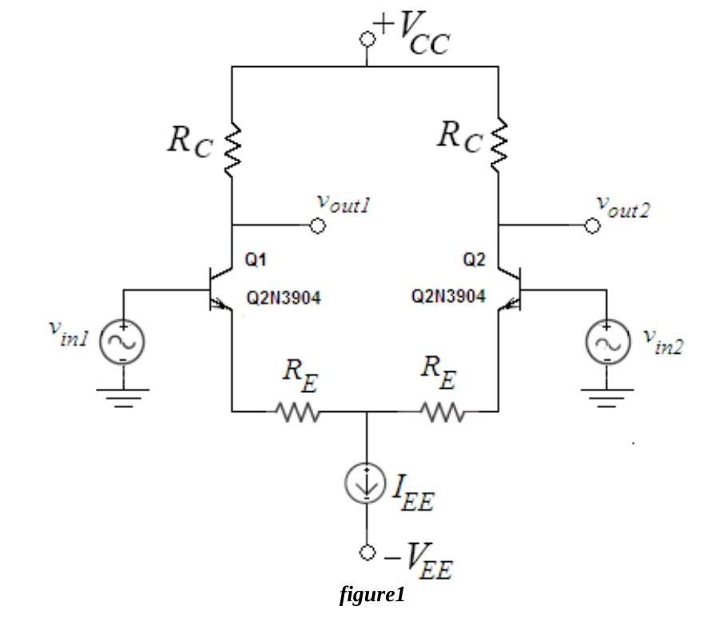
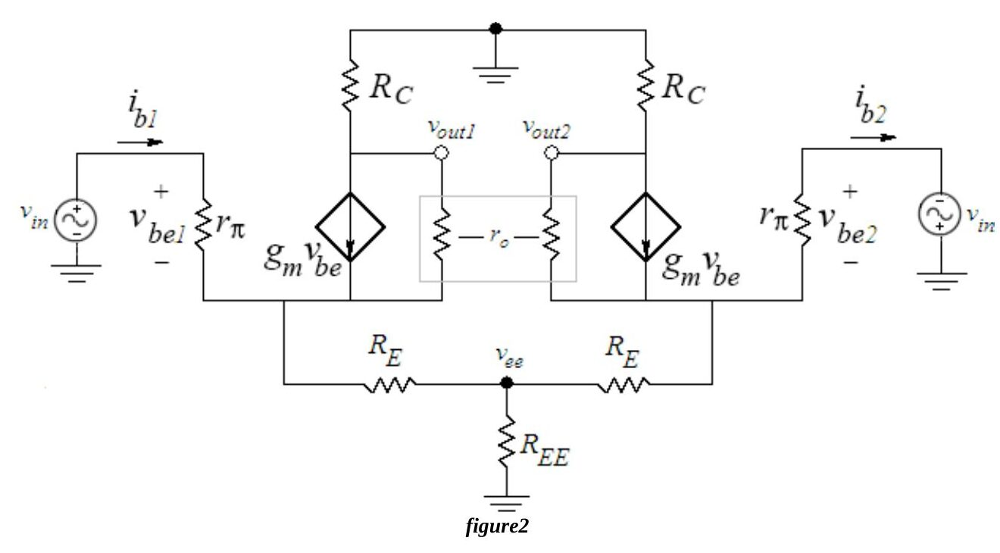
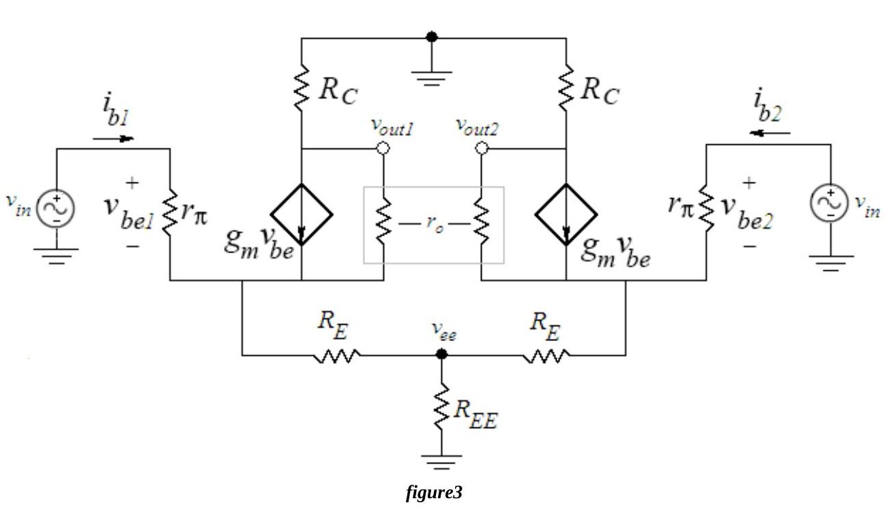
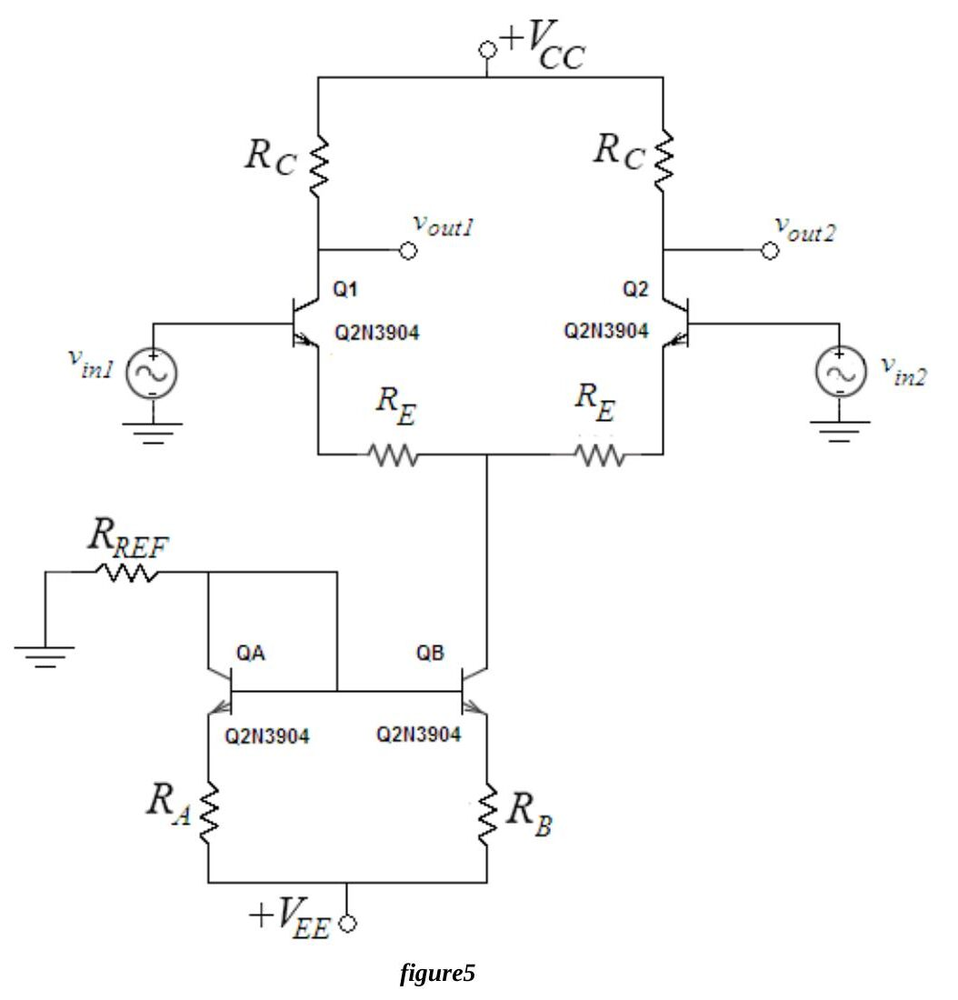
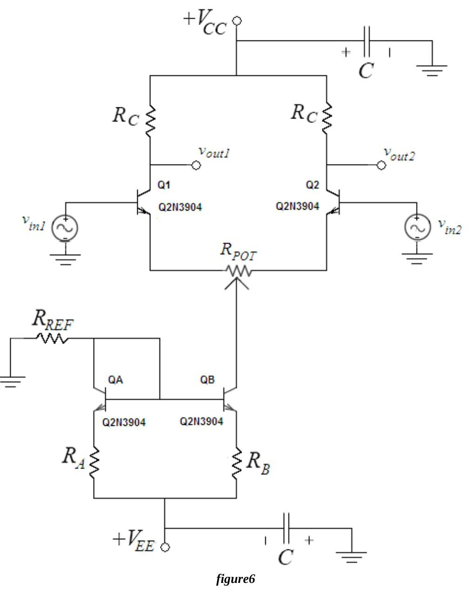
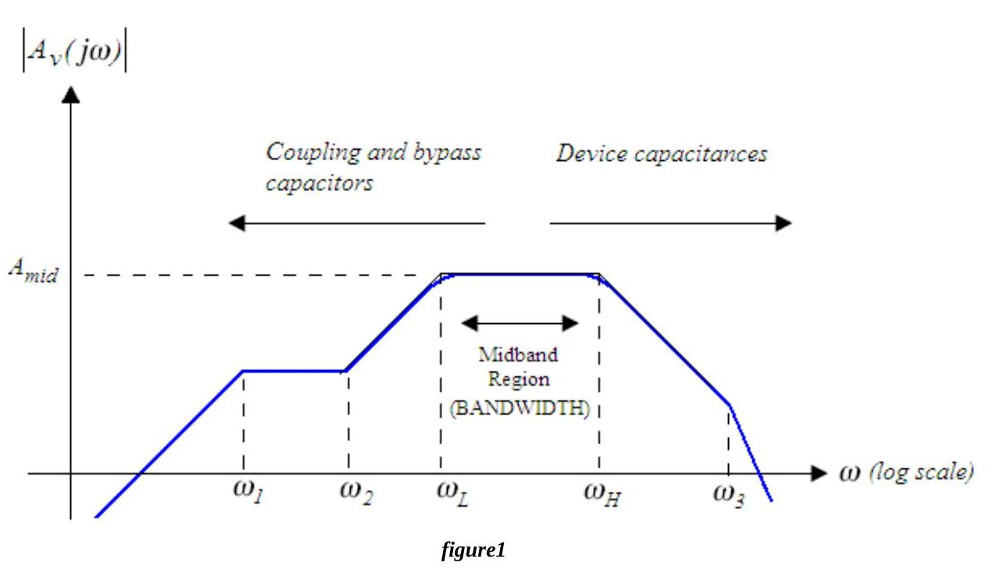
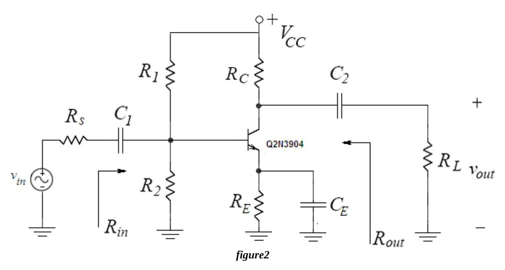
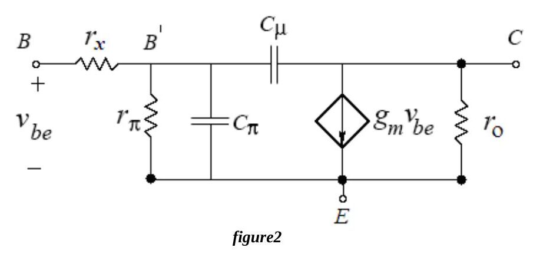
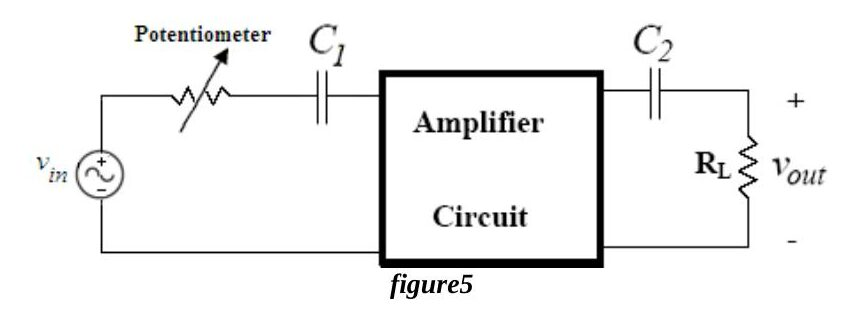
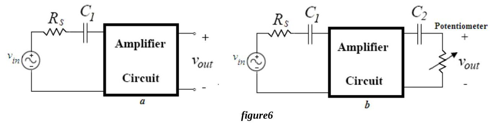

Bu yazı, Başkent Üniversitesi Elektrik-Elektronik Mühendisliği **EEM311 Elektronik II** laboratuvarının 2010 güz dönemi föylerinden son ikisini içeriyor: **Experiment VII: BJT Differential Pair Amplifier** ve **Experiment VIII: Frequency Response of Common Emitter Amplifier**. Föyler İngilizce olduğu için metin de İngilizce aktarıldı; devre şemaları föylerden alınan görsellerle, formüller düz metin olarak verildi. Orijinal PDF'ler yazının sonunda ZIP olarak indirilebilir.

## Experiment VII: BJT Differential Pair Amplifier

**Aim:** The aim of this experiment is to familiarize the student with the biasing and operation of a BJT differential pair amplifier.

### Theory

The basic BJT differential pair in Fig.1 consists of a pair of transistors coupled at the emitters to a current source, with equal resistances in each collector and signal sources at each base. Differential amplifiers generate an output signal proportional to the difference between two independent input signals. The differential amplifier is the first stage of all operational amplifiers and many other analog integrated circuits.

**DC analysis.** The operating current I_EE is set with a current mirror. Since the emitters of Q1 and Q2 are connected through equal resistors and their bases are grounded at DC (v_in1 = v_in2 = 0), V_BE is the same for both transistors; therefore I_C1 = I_C2 ≈ I_EE/2, and both have the same rπ = β₀·V_T/I_C, g_m = I_C/V_T and r_o = V_A/I_C. In the active region the collector current does not depend on R_C, only on V_BE (and thus I_B).

**AC analysis.** The following terms apply to any differential amplifier:

- Differential mode input: v_idm = v_in1 − v_in2
- Common mode input: v_icm = (v_in1 + v_in2)/2
- Differential mode output: v_odm = v_out1 − v_out2
- Common mode output: v_ocm = (v_out1 + v_out2)/2

**Pure differential mode.** If −v_in2 = v_in1 = v_in, the common mode input is zero. For a purely differential input the voltage at the node v_ee is zero, so i_b2 = i_b1 = i_b and −v_be2 = v_be1 = v_be.

Assuming r_o ≫ R_C:

- v_out1 = −g_m·v_be1·R_C = −g_m·i_b·rπ·R_C and v_out2 = −g_m·v_be2·R_C = g_m·i_b·rπ·R_C
- i_b1 = i_b2 = i_b = v_in / [rπ(1 + g_m·R_E)]
- Differential mode gain, differential output: A_vdm-diff = v_odm/v_idm = (v_out1 − v_out2)/(v_in1 − v_in2) = −g_m·R_C / (1 + g_m·R_E)
- Single-ended differential mode gain: A_vdm-se1 = v_out1/v_idm = −g_m·R_C / [2(1 + g_m·R_E)] or A_vdm-se2 = v_out2/v_idm = g_m·R_C / [2(1 + g_m·R_E)], depending on which output is used.
- Differential mode input resistance (seen between the two bases): R_idm = v_idm / i_b1

**Pure common mode.** If v_in2 = v_in1 = v_in, the differential input is zero. Both halves are then completely symmetrical: i_b2 = i_b1 = i_b and v_be2 = v_be1 = v_be.

- v_out1 = v_out2 = −g_m·v_be·R_C = −g_m·i_b·rπ·R_C
- i_b1 = i_b2 = i_b = v_in / [rπ(1 + g_m·R_E + 2g_m·R_EE)]
- Since the outputs are equal, the common mode gain for differential output is zero: A_vcm-diff = (v_out1 − v_out2)/v_icm = 0
- The single-ended common mode gain is not zero and equal at both outputs: A_vcm-se1 = A_vcm-se2 = −g_m·R_C / (1 + g_m·R_E + 2g_m·R_EE)

R_EE is the incremental resistance of the current source I_EE, ideally infinite but finite in practical circuits.

*Not: Föyde ortak mod baz akımı ilk geçtiği yerde paydada "g_m·R_EE" olarak yazılmış; iki yarımın akımı R_EE üzerinden birlikte aktığı için doğrusu 2g_m·R_EE'dir (föy de bir sonraki kazanç ifadesinde 2g_m·R_EE kullanıyor).*

**Common-Mode Rejection Ratio (CMRR)** is the figure of merit of a differential amplifier. For single-ended outputs:

CMRR = A_vdm-se / A_vcm-se = (1 + g_m·R_E + 2g_m·R_EE) / [2(1 + g_m·R_E)] = (1/g_m + R_E + 2R_EE) / [2(1/g_m + R_E)] ≅ R_EE / (1/g_m + R_E), since 2R_EE ≫ 1/g_m + R_E.

If the output is taken differentially, CMRR = A_vdm-diff / A_vcm-diff = ∞.

The function of a differential amplifier is to enhance the difference between the inputs and to suppress the common mode component, which is used to attenuate unwanted signals such as noise picked up on a coaxial or audio cable. A good differential amplifier has a CMRR as large as possible (a common mode gain as small as possible). The common mode input resistance is determined by the total signal current supplied by the common mode source: R_icm = v_icm / (2i_b).

### Preliminary work

Review sections 5.13 and 15.3.1–15.3.9 of the course book. Design the differential amplifier of Fig.5 with **2N3904** transistors (β = 100, V_BE(ON) = 0.7 V, V_A = 100 V, n = 1) and V_CC = 15 V, V_EE = −15 V, R_A = R_B = 2.2 kΩ, R_E = 250 Ω.

1. Find R_REF and R_C (standard values) so that I_CQA,B ≈ 2 mA and V_CE1,2 = 6 V, assuming I_CQ1,2 = 0.5·I_CQA,B, matched transistors in the active region.
1. Using the theory, find for Fig.5: a) A_vdm-diff; b) A_vdm-se1 and A_vdm-se2; c) A_vcm-se1; d) CMRR.
1. Derive equations for R_idm and R_icm and find their values.
1. Verify the design in PSpice (2N3904 from bipolar.lib): a) build Fig.5 with both inputs grounded; b) run a BIAS simulation for V_CE1, V_CE2, I_CQ1, I_CQ2, I_CQA, I_CQB and redesign if necessary; c) run transient simulations with v_in1 = 50 mV and v_in2 = −50 mV at 1 kHz (find v_out1, v_out2, v_odm, v_idm and A_vdm-diff, A_vdm-se1, A_vdm-se2), then with 4 V at 1 kHz on both bases (find v_out1, v_out2, v_icm and A_vcm-se1, A_vcm-se2); d) summarize the results in a table with labelled print-outs.
1. Read the experiment.

### Experimental work

Check the resistors (within 2%). **The oscilloscope channels should be AC coupled for the entire experiment.** Build Fig.6 with the calculated R_C and R_REF (a 10 kΩ potentiometer for R_REF) and V_CC = 15 V, V_EE = −15 V, R_A = R_B = 2.2 kΩ, C = 100 µF, R_POT = 500 Ω. The bypass capacitors reduce noise.

1. Ground both inputs and measure I_CQA, I_CQB, V_CE1 and V_CE2. If V_CE1,2 is not about 6 V while I_CQA,B = 2 mA and V_BE1,2 ≈ 0.7 V, adjust R_POT until V_CE1,2 ≈ 6 V; because of differences in R_C and β, the potentiometer is needed to balance the pair. Record the bias values, take out R_POT for a moment and measure the resistance on each side; also record I_CQ1,2 and V_C1,2.
1. Apply 100 mVp-p at 1 kHz to the base of Q1 with v_in2 grounded. Measure v_out1 and v_out2, calculate the single-ended gains and note which output is in phase and which is out of phase with v_in1.
1. Apply the same signal to v_in2 with v_in1 grounded and repeat.
1. With the circuit of step 2, put v_out1 on channel 1 and v_out2 on channel 2 with equal volts/div settings and display CH1 − CH2 (with the *Math* menu on the Laboratory 2 scopes; on the Laboratory 1 scopes by inverting channel 2 and using *add* mode). Measure v_odm = v_out1 − v_out2 and calculate A_vdm-diff = v_odm / v_in.
1. Apply 8.0 Vp-p at 1 kHz to both inputs (common mode). Measure v_out1 and v_out2 and calculate A_vcm-se1 and A_vcm-se2.
1. From the single-ended common mode gain and the single-ended differential gain, calculate the CMRR and compare it with the preliminary work.
1. Did the calculated bias currents and voltages match the measurements? Were the resistances on the two sides of R_POT drastically different (more than 100 Ω apart)?
1. Did the gains at 1 kHz match the preliminary work? Note any differences.

*Not: Föyde 2. adımda "at the base of Q", 3. adımda "connect ... to vin2 and ground vin2" yazıyor; bağlamdan doğrusunun sırasıyla Q1'in bazı ve "v_in1'i topraklayın" olduğu anlaşılıyor, öyle aktarıldı.*

**Instruments:** breadboard, oscilloscope, signal generator, multimeter, DC power supply. **Components:** 4 × 2N3904, 2 × 2.2 kΩ, 500 Ω and 10 kΩ potentiometers, 2 × 100 µF. The sheet ends with a results form.

## Experiment VIII: Frequency Response of Common Emitter Amplifier

**Aim:** The aim of this experiment is to study the frequency response of a common emitter amplifier stage.

### Theory

All amplifiers typically have a frequency response like Fig.1. The low cut-off frequency (ω_L) is usually determined by the coupling and bypass capacitors, the high limit (ω_H) by the internal capacitances of the transistor. The difference between the high and low cut-off frequencies is the **bandwidth**.

**Low frequency response.** At low frequencies the response is limited by the external capacitors. Without coupling or bypass capacitors the response would extend down to DC, but these capacitors are needed to isolate the DC bias point from the outside world. The common emitter stage of Fig.2 has three: the coupling capacitors C1, C2 and the emitter bypass capacitor C_E.

Below midband the impedances of C1, C2 and C_E increase: the coupling capacitors drop more of the signal, and the bypass capacitor starts to "open up", causing increased series-series feedback and a reduction of the gain.

The **short circuit time constant method** relates C1, C2 and C_E to the low cut-off frequency without finding all poles and zeros exactly, and shows which capacitors dominate:

f_L = ω_L/2π ≈ (1/2π)·Σ (1 / (R_is·C_i)), i = 1 … n_c

where n_c is the number of coupling and bypass capacitors and R_is is the resistance facing capacitor C_i with all other coupling and bypass capacitors shorted and the input signal set to zero. R_is·C_i is the short circuit time constant of C_i.

**High frequency response.** At high frequencies the response is limited by the internal capacitances of the transistor, the most significant being C_π (base–emitter) and C_μ (base–collector). The complete hybrid-π model is shown below.

At low frequencies these capacitances have very large impedances and can be neglected; at high frequencies they short out and the transistor stops amplifying. The **open circuit time constant method** gives

f_H = ω_H/2π ≈ (1/2π)·1 / Σ (R_io·C_i), i = 1 … n_c

where R_io is the resistance facing the internal capacitance C_i with all other internal capacitances open-circuited and the input set to zero.

*Not: Föyde f_H formülü de f_L ile aynı biçimde, ters zaman sabitlerinin toplamı olarak yazılmış. Açık devre zaman sabiti yönteminde zaman sabitleri toplanır ve f_H ≈ 1/(2π·ΣR_io·C_i) olur; burada bu doğru biçim verildi.*

The base resistance r_x completes the basic hybrid-π model: the base current enters through the external base contact and traverses a high resistance region before reaching the active area; r_x models the voltage drop between the external and internal base nodes (B and B′).

### Preliminary work

Review sections 17.1–17.9 of the course book. Analyze Fig.2 with a **2N3904** (β = 100, V_BE(ON) = 0.7 V, V_A = 100 V, r_x = 100 Ω, C_π = 13.9 pF, C_μ = 8 pF, n = 1, V_T = 25 mV) and:

| V_CC | R1 | R2 | R_C | R_E | R_s | R_L | C1 | C2 | C_E |
|---|---|---|---|---|---|---|---|---|---|
| 12 V | 8.2 kΩ | 3.9 kΩ | 6.3 kΩ | 3.3 kΩ | 3 kΩ | 3.9 kΩ | 10 µF | 1 µF | 100 µF |

*Not: Tabloda R_C = 6.3 kΩ yazıyor, föyün sonundaki malzeme listesinde ise 6.2 kΩ var; 6.3 kΩ standart bir değer olmadığından laboratuvarda 6.2 kΩ kullanıldığı anlaşılıyor.*

1. Analyze the DC circuit to find the Q-point (I_CQ, V_CEQ) and I_BQ.
1. With the hybrid-π model and all capacitors shorted, find R_in, R_out and the midband gain A_v-mid = v_out/v_in (do not neglect r_x and r_o). In what case (I_BQ ≪ ?) does r_x have a negligible effect on A_v-mid and R_in?
1. Find the short circuit time constants of all external capacitors (draw the circuits used for the resistance seen by each) and the low cut-off frequency.
1. Find the open circuit time constants of the internal capacitances and the high cut-off frequency.
1. Find the bandwidth.
1. Simulate in PSpice (Q2N3904 from bipolar.lib): a) Bias Point analysis for V_CE, I_BQ, I_CQ; b) Time Domain analysis with v_s = 20 mV peak-to-peak at 1 kHz for v_in, v_out and the gain; c) AC sweep with ACMAG = 1 V to obtain A_v versus frequency and mark the cut-off frequencies at 0.707·A_v-mid; d) remove C_E, repeat b and c and comment; e) summarize the results in a table with labelled print-outs.
1. Read the experiment.

### Experimental work

Check the resistors (within 2%), set V_CC = 12 V and the generator to about 20 mV peak-to-peak at 1 kHz, and build the circuit.

1. Measure I_BQ, I_CQ and V_CEQ and compare them with your calculations.
1. Apply v_in = 20 mVp-p at 1 kHz, observe v_in and v_out and measure A_v-mid.
1. a) Measure f_H and f_L. b) Vary the frequency (30, 40, 50, 80, 150, 200, 250, 300, 500 Hz; 1, 10, 20, 60, 120, 200, 500, 750 kHz; 1, 1.3, 1.5 MHz), measure v_out and plot the frequency response with a logarithmic x axis (e.g. in Excel).
1. Remove C_E: a) measure A_v-mid at 1 kHz and compare with PSpice; b) measure f_H and f_L; c) comment on the changes in midband gain and cut-off frequencies (gain–bandwidth trade-off).
1. Measure the input resistance (R_POT = 5 kΩ).
1. Measure the output resistance (R_POT = 10 kΩ).

**Measuring the cut-off frequencies.** Drive the amplifier with a midband frequency and an input level that gives an undistorted output, and measure the output peak V_p. Without changing the input level, vary the frequency until the output drops to 0.707·V_p and read the frequency; there are two such frequencies.

**Measuring the input resistance.** Disconnect R_s and insert a potentiometer in series with the input (Fig.5). Start with the potentiometer at 0 Ω, measure the output peak at a midband frequency, then increase the potentiometer until the output drops to half. The input resistance equals the potentiometer resistance.

**Measuring the output resistance.** Disconnect the load and measure the open circuit output peak (oscilloscope AC coupled), Fig.6(a). Then connect a potentiometer across the output, Fig.6(b), and adjust it until the output drops to half. The output resistance equals the potentiometer resistance.

**Instruments:** breadboard, oscilloscope, signal generator, multimeter, DC power supply. **Components:** 2N3904, 2 × 3.9 kΩ, 3 kΩ, 8.2 kΩ, 3.3 kΩ, 6.2 kΩ, 10 kΩ and 5 kΩ potentiometers, 1 µF, 10 µF, 100 µF. The sheet ends with a results form.
