This post was prepared from scanned pages of handwritten lecture notes for the **amplifier frequency response** topic of the **EEM311 Electronics II** course at Başkent University. The notes have no author name or date. Headings, definitions, formulas, and results were transcribed into text; page images were added for the graphs, Bode diagrams, and circuit schematics. All of the scanned pages can be downloaded as a PDF at the end of the post.

## Decibel

The decibel is based on the logarithmic relationship between power levels and audio (sound) levels. For example, if the power level increases from 4 W to 16 W, this does not mean the sound level increases by a factor of 4; the sound level increases logarithmically. That is, for the example above the sound level increases as (4² = 16), which is written as: log₄ 16 = 2.

The bel is defined in terms of the power levels P₁ and P₂ as follows:

- **G = log₁₀ (P₂/P₁)** [bel]

Since the bel is a very large unit of measurement, the decibel (dB) is used in practice; the decibel ratio is a measure of the difference in magnitude between two power levels. 10 dB = 1 bel:

- **G_dB = 10 log₁₀ (P₂/P₁)** [dB]

For a given output power (P₂), a reference power level (P₁) is chosen. This standard level is 1 mW, and the resistance associated with this power level is 600 Ω (the characteristic impedance of transmission lines). Because of this reference level, the dB symbol is written as dBm:

- **G_dBm = 10 log₁₀ (P₂ / 1 mW) |₆₀₀ Ω** [dBm]

In terms of voltage (across the same R):

- G_dB = 10 log₁₀ (P₂/P₁) = 10 log₁₀ ((V₂²/R)/(V₁²/R)) = 10 log₁₀ (V₂/V₁)² = **20 log₁₀ (V₂/V₁)**

For example, for a cascaded system with gain |A_vT| = |A_v1| · |A_v2| · |A_v3| ⋯ |A_vn|:

- G_dB = 20 log₁₀ |A_vT| = 20 log₁₀ |A_v1| + 20 log₁₀ |A_v2| + ⋯
- **G_dB = G_dB1 + G_dB2 + G_dB3 + ⋯ + G_dBn**

| Voltage gain V_o/V_i | dB level |
|---|---|
| 0.5 | −6 |
| 0.707 | −3 |
| 1 | 0 |
| 2 | 6 |
| 10 | 20 |
| 100 | 40 |
| 1000 | 60 |

Logarithm reminder: if a = bˣ then x = log_b a. The common (base-10) logarithm is x = log₁₀ a; the natural logarithm is y = logₑ a.

**Example 1:** A 10 Ω load is connected to the output of an amplifier with an output power of 40 W. a) If the power gain is 25 dB, what must the input power be for full output power? b) If the voltage gain is 40 dB, what is the input voltage for full output power?

**Example 2:** An amplifier has an input power of 10000 W for a 1000 V input. If the output power is 500 W with an output impedance of 20 Ω, find a) the power gain in decibels, b) the voltage gain in decibels.

*Note: The notes do not include solutions to these two examples. Example 1: a) P_i = 40 W / 10^2.5 ≈ 126.5 mW; b) V_o = √(40 W · 10 Ω) = 20 V (rms), A_v = 10^(40/20) = 100, V_i = 0.2 V. Example 2 (taking the values as given in the notes): a) G_p = 10 log (500/10000) ≈ −13 dB; b) V_o = √(500 · 20) = 100 V, G_v = 20 log (100/1000) = −20 dB.*

## Examining the General Frequency Behavior

In the response of single-stage or multistage amplifiers, the frequency of the applied signal has a definite effect. While this effect is negligible for mid-frequency values, at low and high frequencies the capacitive elements of the circuit affect the gain.

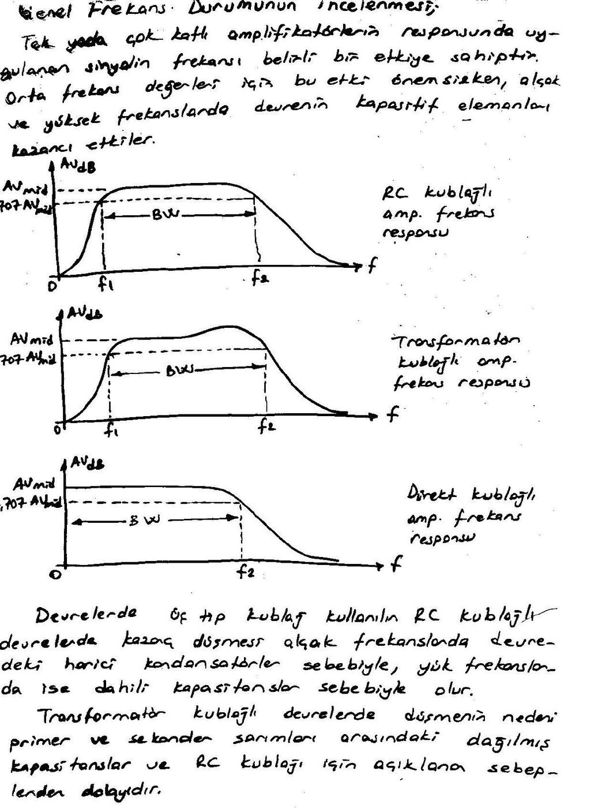

- In **RC-coupled** circuits, the gain drop at low frequencies is caused by the external capacitors in the circuit, and at high frequencies by the internal capacitances.
- In **transformer-coupled** circuits, the drop is caused by the distributed capacitances between the primary and secondary windings, in addition to the causes described for RC coupling.
- In a **direct-coupled** amplifier, since there are no coupling capacitors that would cause a gain drop at low frequencies, there is no gain drop at these frequencies. At high frequencies, the gain drops because of the internal capacitors.

For logarithmic plotting, the curve can be normalized. In this case the gain at each frequency is divided by the mid-band gain. The level obtained at the half-power points is 0.707 = 1/√2.

- **|A_v / A_v,mid|_dB = 20 log₁₀ (A_v / A_v,mid)**
- At mid-band frequencies, A_v = A_v,mid → 20 log 1 = 0 dB
- At the cutoff frequencies, A_v = 0.707 A_v,mid → 20 log (1/√2) = −3 dB

The capacitive effects of amplifiers cause a phase shift between the input and output signals. For example, in a common-emitter or common-source amplifier, the 180° phase difference present at mid-band frequencies rises above 180° at low frequencies (toward 270°) and falls below 180° at high frequencies (toward 90°).

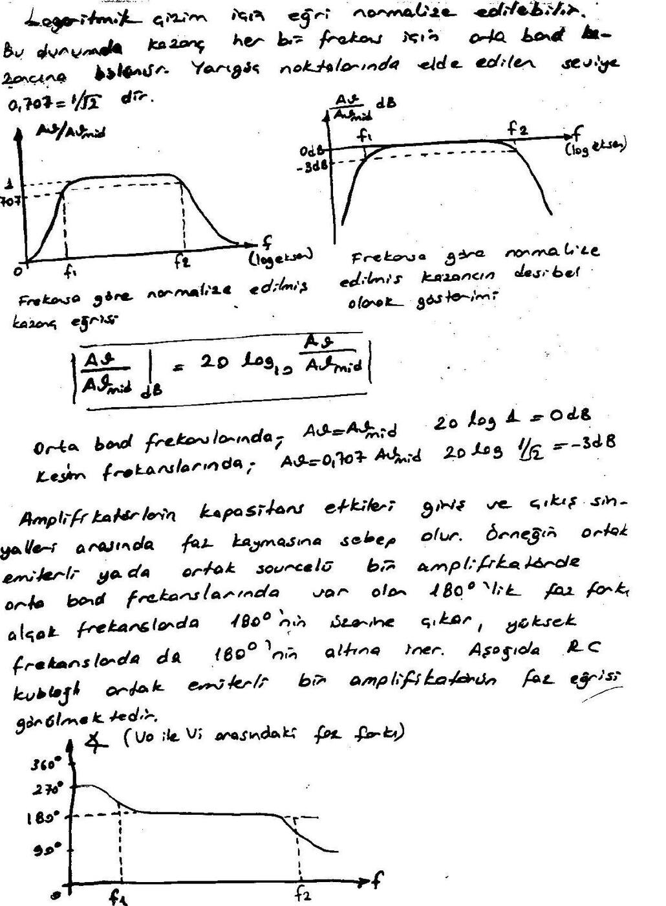

### Mid-band gain, cutoff frequencies, and bandwidth

In amplifiers, the highest gain is obtained at the mid-band level and is called **A_v,mid**. The limits of the high-gain region are fixed by the gains at the level 0.707 · A_v,mid. These frequencies, corresponding to f₁ and f₂, are called the **corner, cutoff, band, break, or half-power (HP) frequencies**.

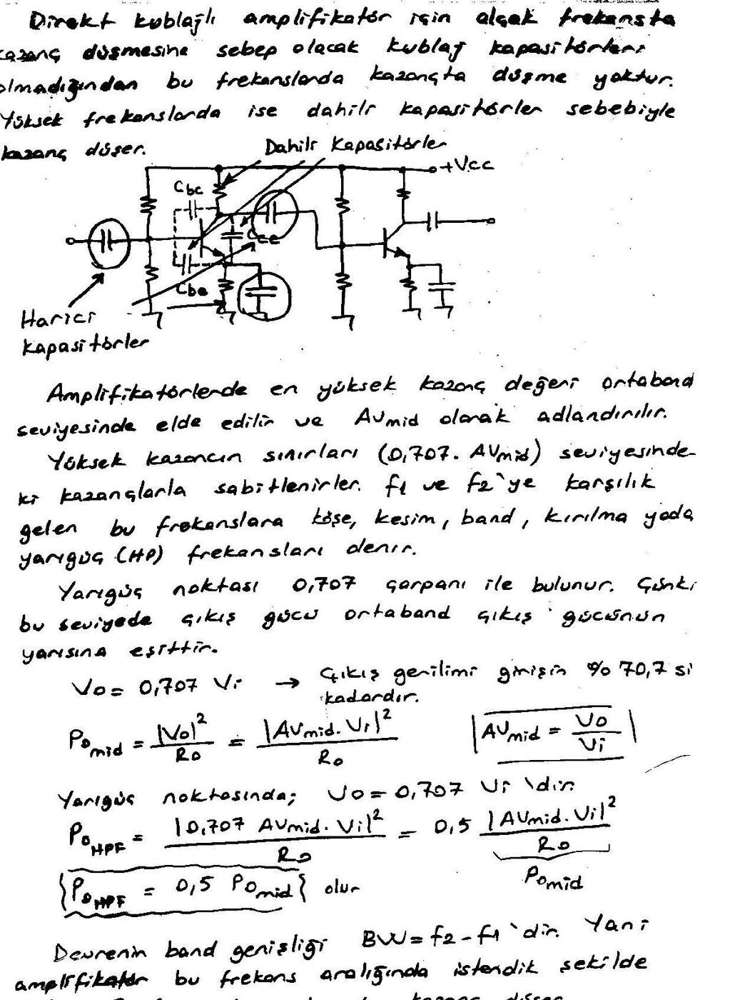

The half-power point is found with the factor 0.707 because at this level the output power equals half of the mid-band output power:

- P_o,mid = |V_o|² / R_o = |A_v,mid · V_i|² / R_o (A_v,mid = V_o/V_i)
- At the half-power point: P_o,HPF = |0.707 A_v,mid · V_i|² / R_o = 0.5 |A_v,mid · V_i|² / R_o
- **P_o,HPF = 0.5 P_o,mid**

The bandwidth of the circuit is **BW = f₂ − f₁**. That is, the amplifier operates as desired within this frequency range.

*Note: For the half-power point, the notes say "V_o = 0.707 V_i, the output voltage is 70.7% of the input." What is meant is that the output voltage drops to 0.707 times its mid-band value (V_o = 0.707 · A_v,mid · V_i); the power relation below is written accordingly.*

## Low-Frequency Analysis

In a circuit consisting of a series C and a parallel R, X_C = 1/(2πfC). At very high frequency X_C ≅ 0 (the capacitor is a short circuit), and at f ≅ 0, X_C → ∞ (open circuit).

- V_o = R·V_i / (R + jX_C) → |V_o| = R·V_i / √(R² + X_C²)
- If X_C = R, then V_o = R·V_i / √(R² + R²) = V_i/√2 → **A_v = V_o/V_i = 1/√2 = 0.707** (half-power point)
- In this case X_C = 1/(2πf₁C) = R → **f₁ = 1/(2πRC)** (low-frequency cutoff frequency, or lower cutoff frequency)
- In logarithmic form: G_v = 20 log₁₀ (1/√2) = −3 dB (half-power point); G_v = 20 log₁₀ 1 = 0 dB (mid-band)

If the gain equation is expressed using the frequency f₁:

- A_v = V_o/V_i = R/(R − jX_C) = 1/(1 − j(X_C/R)) = 1/(1 − j(1/ωCR))
- **A_v = 1 / (1 − j(1/(2πfRC)))**, and since f₁ = 1/(2πRC), **A_v = 1 / (1 − j(f₁/f))**

The magnitude and phase of this gain are:

- **A_v = 1 / √(1 + (f₁/f)²) ∠ tan⁻¹(f₁/f)**
- If f = f₁ then A_v = 1/√2 = 0.707 → −3 dB

The gain in dB, in logarithmic form:

- A_v,dB = 20 log₁₀ (1/√(1 + (f₁/f)²)) = −½ · 20 log₁₀ [1 + (f₁/f)²]
- **A_v,dB = −10 log₁₀ [1 + (f₁/f)²]**
- If f ≪ f₁ or (f₁/f)² ≫ 1: A_v,dB = −10 log₁₀ (f₁/f)² = **−20 log (f₁/f)**

Using this equation without worrying about the f ≪ f₁ condition, we get:

| f | f₁/f | −20 log₁₀ (f₁/f) |
|---|---|---|
| f₁ | 1 | 0 dB |
| f₁/2 | 2 | −6 dB |
| f₁/4 | 4 | −12 dB |
| f₁/10 | 10 | −20 dB |
| f₁/100 | 100 | −40 dB |

That is, for every tenfold decrease in frequency, the gain drops by 20 dB (**−20 dB/decade**).

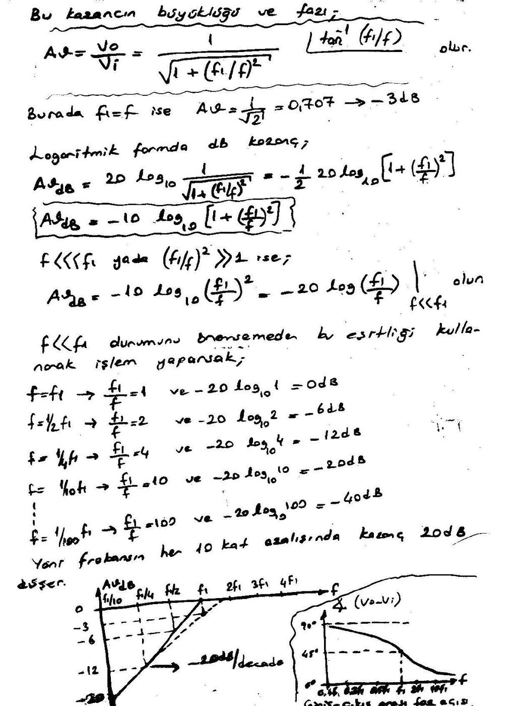

The phase angle between input and output: **θ = tan⁻¹ (f₁/f)**

- For f ≪ f₁, θ → 90°; if f₁ = 100f then θ = 89.4°
- If f₁ = f then θ = 45°
- For f ≫ f₁, θ → 0°; if f = 100f₁ then θ = 0.573°

## Low-Frequency Response of BJT Amplifiers

In a common-emitter circuit with voltage-divider bias, the capacitors C_i (input), C_o (output), and C_E (emitter bypass) cause the gain to drop at low frequencies. For the RC analysis, the approximate equivalent resistance (R) seen by each capacitor must be found.

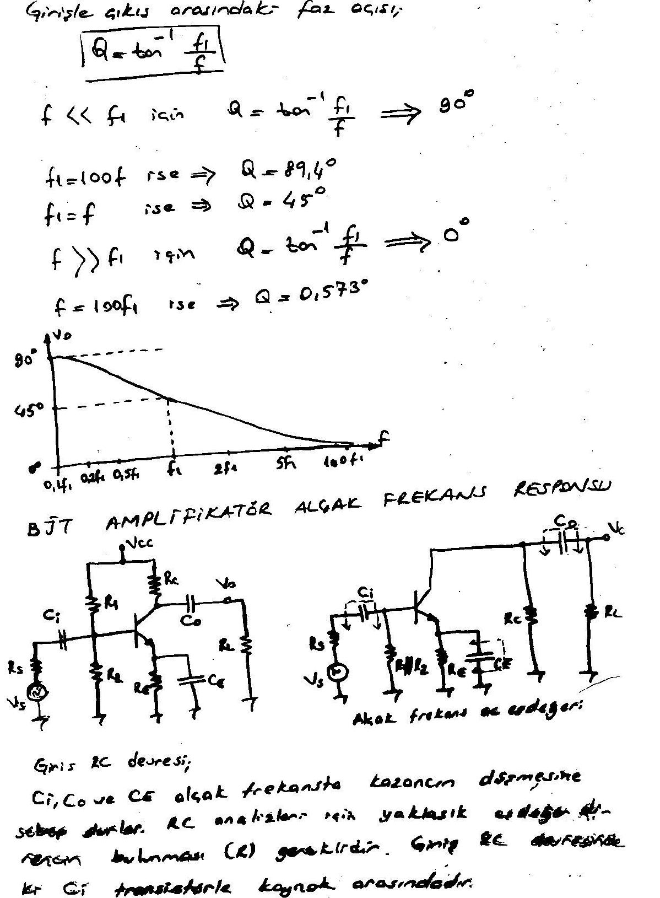

**Input RC circuit:** C_i lies between the transistor and the source. In the input RC connection, the equivalent resistance seen by the capacitor is R_s + R_i:

- R_i = R1 // R2 // h_ie
- At mid-band, V_i = V_s·R_i / (R_s + R_i); at low frequency, V_i = R_i·V_s / √((R_s + R_i)² + X_C²)
- X_Ci = R_s + R_i → **f_Ci = 1 / (2π(R_s + R_i)C_i)**

**Output RC circuit:** The total series resistance is R_o + R_L. If r_o = 1/h_oe is not neglected, R_o = r_o // R_C.

- **f_Co = 1 / (2π(R_o + R_L)C_o)**

**Emitter RC circuit:** The effect of C_E on the gain is very large. When the ac current is not to affect the dc voltage across R_E, the bypass capacitor C_E is connected here. This prevents the gain from dropping.

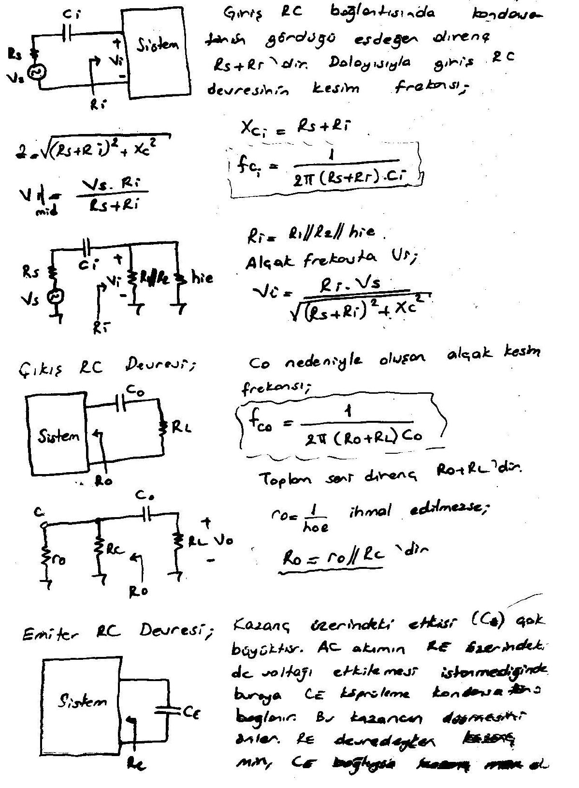

- **f_CE = 1 / (2π R_e C_E)**
- R_out = r_e + R_th/β = (h_ie + R_th)/h_fe, R_th = R_s // R1 // R2
- **R_e = R_out // R_E = (r_e + R_th/β) // R_E**
- Effect of R_E on the gain: with C_E shorted, A_v = −h_fe R_C / h_ie; with the effect of R_E, A_v = −h_fe R_C / (h_ie + h_fe R_E) = −R_C / (r_e + R_E)

**Note (from the source):** When examining the effect of each capacitor on the circuit, the others are assumed to be short circuits, as at mid-band frequencies.

### Total low-frequency response

Each of the three RC circuits has a cutoff frequency. These need not be equal. The one with the larger value at low frequency is the **dominant lower cutoff frequency** of the circuit; that is, it is the frequency at which the amplifier's gain drop begins. Each RC circuit causes a gain drop of 20 dB/decade; below the cutoff frequencies the slope becomes 20, 40, and 60 dB/decade, respectively.

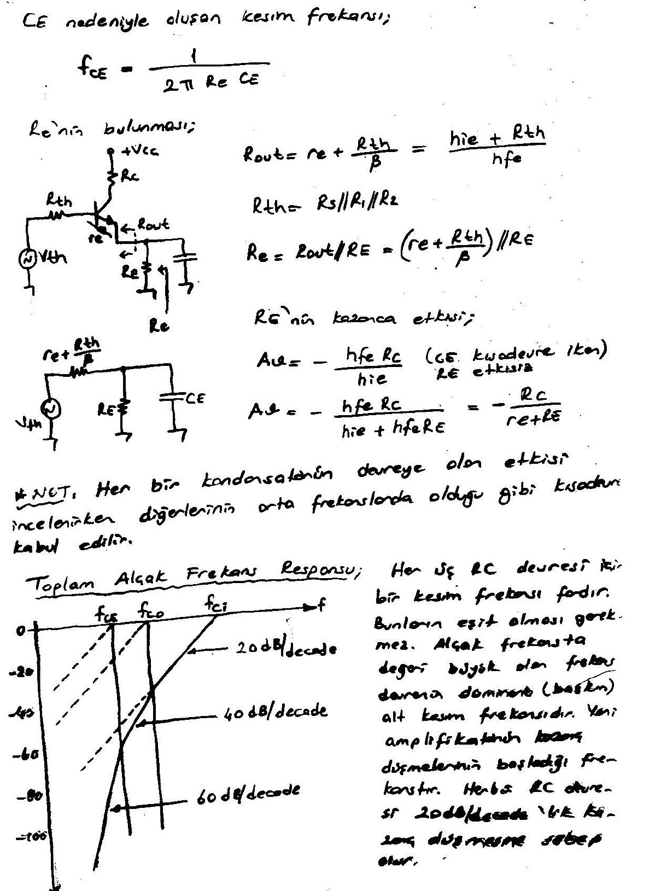

**Example:** Find the lower cutoff frequency of the circuit below and sketch the Bode diagram (frequency response curve). A_v,mid = ? Circuit: V_CC = 20 V, R1 = 40 kΩ, R2 = 10 kΩ, R_C = 4 kΩ, R_E = 2 kΩ, C_E = 20 µF, R_s = 1 kΩ, C_i = 10 µF, C_o = 1 µF, R_L = 2.2 kΩ, h_fe = 100, r_o = ∞. (No solution in the notes.)

## Low-Frequency Response of JFET Amplifiers

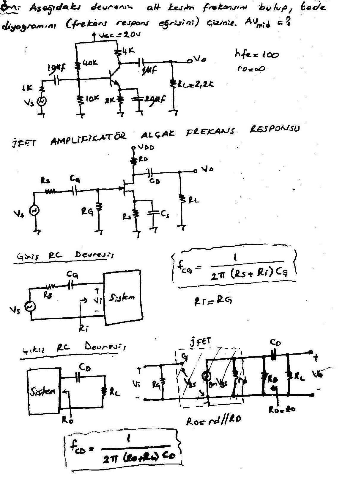

- **Input RC circuit:** **f_CG = 1 / (2π(R_s + R_i)C_G)**, R_i = R_G
- **Output RC circuit:** R_o = r_d // R_D; **f_CD = 1 / (2π(R_o + R_L)C_D)**
- **Source RC circuit:** **f_CS = 1 / (2π R_eq C_S)**, R_eq = R_S / [1 + R_S(1 + g_m r_d)/(r_d + R_D // R_L)]; if r_d = ∞, **R_eq = R_S // (1/g_m)**

*Note: In the expression for R_eq, the fraction bar is written ambiguously in the notes; the standard form is given here.*

**Example:** R_sig = 10 kΩ, C_G = 0.01 µF, R_G = 1 MΩ, R_D = 4.7 kΩ, C_D = 0.5 µF, R_L = 2.2 kΩ, R_S = 1 kΩ, C_S = 2 µF, g_m = 2 mS. a) Find the lower cutoff frequency of the circuit and sketch the Bode diagram. b) Find the mid-band gain of the circuit. (No solution in the notes.)

## Miller Effect Capacitance

For inverting amplifiers (those with −A_v), the input and output capacitance increases with the interelectrode capacitance of the circuit element and with the circuit gain. This capacitance is defined as the feedback capacitance C_f.

On the input side: I_i = I₁ + I₂, I_i = V_i/Z_i, I₁ = V_i/R_i, I₂ = (V_i − V_o)/X_Cf = (V_i − A_v V_i)/X_Cf = (1 − A_v)V_i / X_Cf

- 1/Z_i = 1/R_i + 1/(X_Cf/(1 − A_v)) = 1/R_i + 1/X_CM
- X_CM = X_Cf/(1 − A_v) = 1/(ω(1 − A_v)C_f)
- **Miller effect input capacitance: C_Mi = (1 − A_v) C_f**

According to this expression, for every inverting amplifier the input capacitance increases with the Miller effect capacitance, which depends on the amplifier gain, and with the interelectrode capacitance present between the input and output terminals of the active circuit element (transistor).

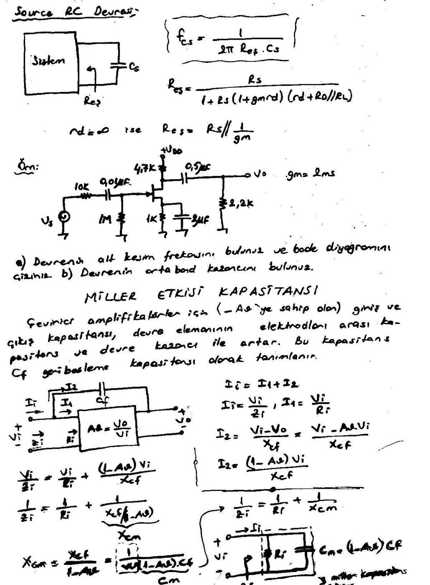

Miller effect at the output: I_o = I₁ + I₂, I₁ = V_o/R_o, I₂ = (V_o − V_i)/X_Cf. Since R_o is large, if I₁ is neglected, I_o ≅ I₂ = (V_o − V_i)/X_Cf.

- I_o = (V_o − V_o/A_v)/X_Cf = V_o(1 − 1/A_v)/X_Cf
- V_o/I_o = X_Cf / (1 − 1/A_v) = 1/(ωC_f(1 − 1/A_v)) = 1/(ωC_Mo)
- **Miller effect output capacitance: C_Mo = (1 − 1/A_v) · C_f**

## High-Frequency Response of BJT Amplifiers

In the high-frequency response, the circuit capacitance and h_fe factors are present at the −3 dB point. For a low-pass structure consisting of a series R and a parallel C (f₂: upper cutoff frequency):

- **A_v = 1 / (1 + j(f/f₂)) = 1/√(1 + (f/f₂)²) ∠θ**

Since C_bc is the capacitance between the input and output, its effect on the input and output is expressed as C_Mi and C_Mo. C_wi is the wiring capacitance and C_wo is the output wiring (stray) capacitance. C_i includes C_wi, C_be, and the Miller capacitance C_Mi; C_o includes C_wo, C_ce, and the Miller capacitance C_Mo. Except in special applications, C_ce is not taken into account.

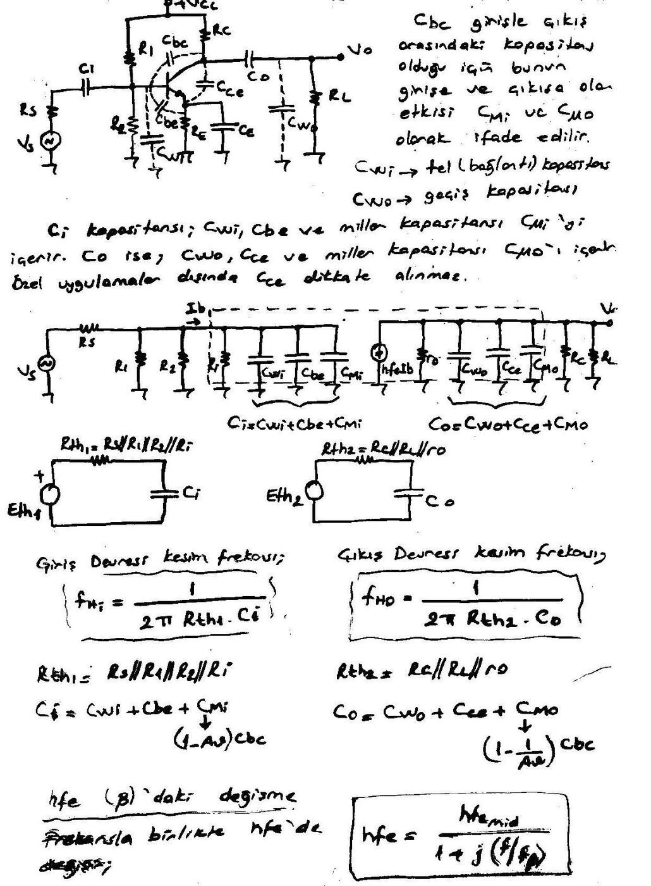

| | Input circuit | Output circuit |
|---|---|---|
| Thevenin resistance | R_th1 = R_s // R1 // R2 // R_i | R_th2 = R_C // R_L // r_o |
| Capacitance | C_i = C_wi + C_be + C_Mi, C_Mi = (1 − A_v)C_bc | C_o = C_wo + C_ce + C_Mo, C_Mo = (1 − 1/A_v)C_bc |
| Cutoff frequency | **f_Hi = 1 / (2π R_th1 C_i)** | **f_Ho = 1 / (2π R_th2 C_o)** |

### Variation in h_fe (β)

h_fe also varies with frequency: **h_fe = h_fe,mid / (1 + j(f/f_β))**

f_β is found through the parameters of the **"hybrid π"** or **"Giacoletto"** model, which is used to represent the transistor as well as possible in the high-frequency region. The model contains r_bb' (base contact + base bulk + base spreading resistance), r_b'e = 1/g_b'e, C_b'e, r_b'c and C_b'c, r_ce = 1/h_oe, and the current source g_m·V_b'e ≅ h_fe,mid·I_b'. The resistances r_b'e, r_ce, and r_b'c are the resistances seen between the terminals when the device operates in the active region; the same applies to C_b'c and C_b'e.

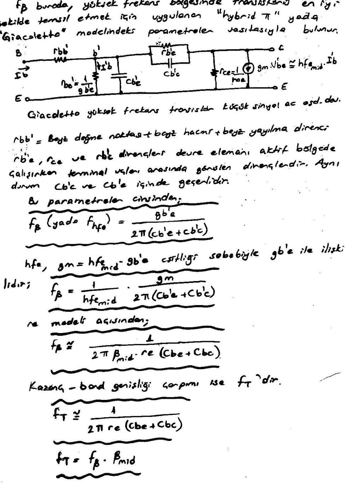

- In terms of these parameters: **f_β (or f_hfe) = g_b'e / (2π(C_b'e + C_b'c))**
- h_fe is related to g_b'e through the equality g_m = h_fe,mid · g_b'e: **f_β = (1/h_fe,mid) · g_m / (2π(C_b'e + C_b'c))**
- In terms of the r_e model: **f_β ≅ 1 / (2π β_mid r_e (C_be + C_bc))**
- The gain-bandwidth product is f_T: **f_T ≅ 1 / (2π r_e (C_be + C_bc))**, **f_T = f_β · β_mid**

## High-Frequency Response of FET Amplifiers

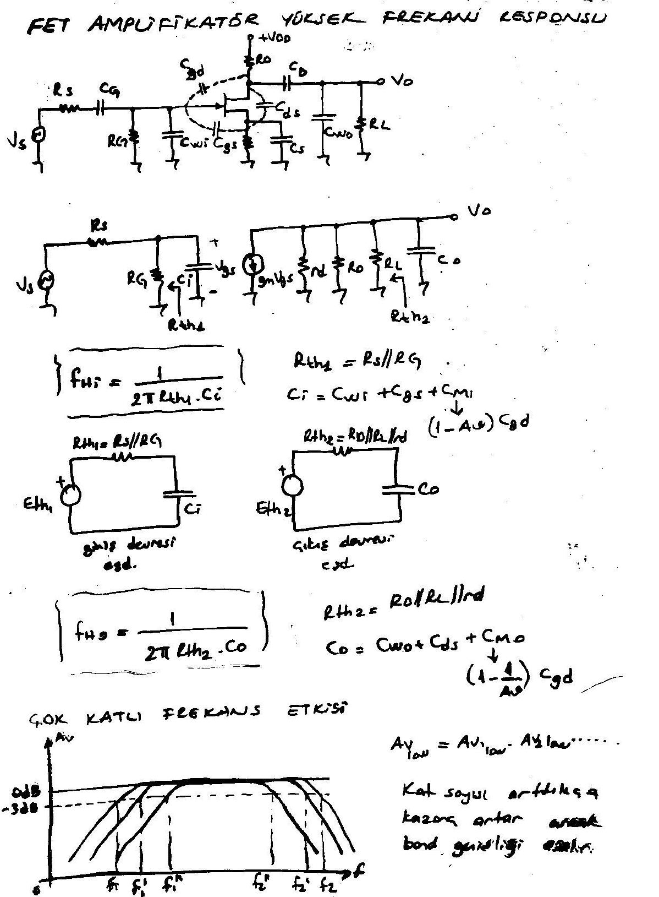

| | Input circuit | Output circuit |
|---|---|---|
| Thevenin resistance | R_th1 = R_s // R_G | R_th2 = R_D // R_L // r_d |
| Capacitance | C_i = C_wi + C_gs + C_Mi, C_Mi = (1 − A_v)C_gd | C_o = C_wo + C_ds + C_Mo, C_Mo = (1 − 1/A_v)C_gd |
| Cutoff frequency | **f_Hi = 1 / (2π R_th1 C_i)** | **f_Ho = 1 / (2π R_th2 C_o)** |

## Multistage Frequency Effect

A_v,low = A_v1,low · A_v2,low ⋯ As the number of stages increases, the gain increases but the bandwidth decreases (the lower cutoff frequency rises: f₁ < f₁' < f₁''; the upper cutoff frequency falls: f₂ > f₂' > f₂'').

## Total High-Frequency Response

Of the two cutoff frequencies present at high frequency, the lower one is **dominant**. In the ideal Bode diagram, the plot can be drawn without knowing which of f_c,input and f_c,output is smaller: from the first break (cutoff) frequency onward the gain falls with a slope of −20 dB/decade, and from the second break frequency onward it falls with a slope of −40 dB/decade. In the actual Bode diagram, on the other hand, the −3 dB gain drop at the cutoff frequencies is visible.

### Total amplifier response

Of the three cutoff frequencies at low frequency, the largest is the effective one, and of the two cutoff frequencies at high frequency, the smaller is the effective one:

- **BW = f_H2 − f_L3** (that is, BW = f_cH − f_cL = f_H − f_L)

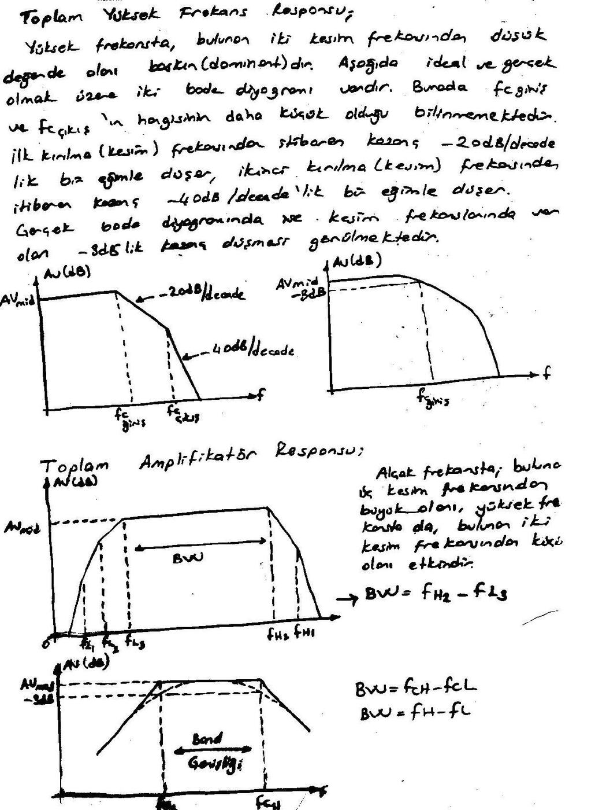

If we assume f_cH ≫ f_cL, then **BW = f_cH − f_cL ≅ f_cH**. The frequency at which the gain falls to 0 dB is f_T:

- **f_T = A_v,mid · BW = A_v,mid · f_cH**

### Example: total frequency response

Find the total amplifier frequency response of the circuits below and sketch their Bode diagrams. (No solutions in the notes.)

1. BJT: V_CC = +9 V, R1 = 12 kΩ, R2 = 5 kΩ, R_C = 200 Ω, R_E = 100 Ω, C_E = 10 µF, C_i = 1 µF, C_o = 1 µF, R_L = 600 Ω; h_fe = 125, r_o = ∞, C_be = 25 pF, C_bc = 10 pF, C_ce = 1 pF, C_wi = 6 pF, C_wo = 8 pF.
1. JFET: V_DD = +10 V (can also be read as +12 V in the handwriting), R_sig = 10 kΩ, C_G = 0.01 µF, R_G = 1 MΩ, R_D = 4.7 kΩ, C_D = 0.5 µF, R_S = 1 kΩ, C_S = 2 µF, R_L; g_m = 2 mS, C_gd = 2 pF, C_gs = 4 pF, C_ds = 0.5 pF, C_wi = 5 pF, C_wo = 6 pF.

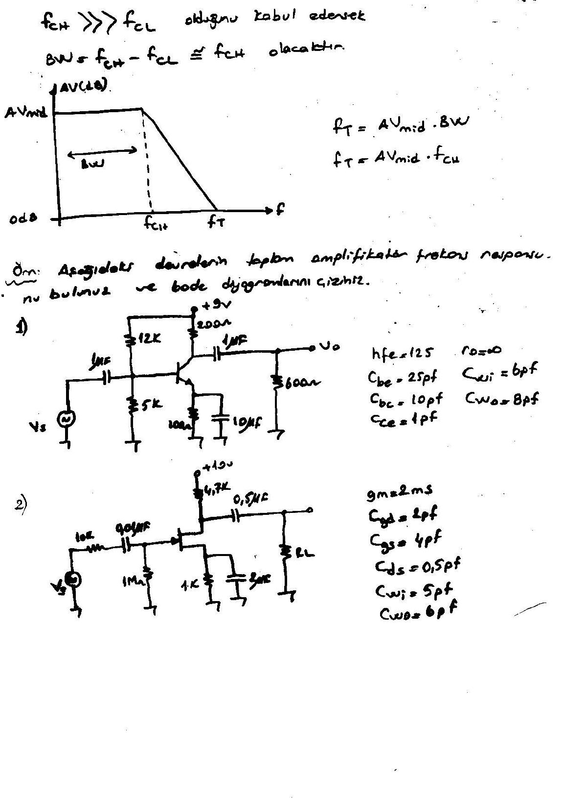
