Bu yazı, Başkent Üniversitesi **EEM311 Elektronik II** dersinin **amplifikatör frekans cevabı (frekans responsu)** konusunu anlatan el yazısı ders notlarının taranmış sayfalarından hazırlandı. Notlarda yazar adı ve tarih yok. Başlıklar, tanımlar, formüller ve sonuçlar metne aktarıldı; grafikler, Bode diyagramları ve devre şemaları için ilgili sayfa görselleri eklendi. Taranmış sayfaların tamamı PDF olarak yazının sonunda indirilebilir.

## Desibel

Desibel teriminin temelinde logaritmik temelle ilişkili olan güç ve odyo (ses) seviyeleri mevcuttur. Örneğin güç seviyesi 4 W'tan 16 W'a kadar artıyorsa bu durum ses seviyesinin de 4 kat artması anlamına gelmez; sesin seviyesi logaritmik olarak artar. Yani yukarıdaki örnek için ses seviyesi (4² = 16) şeklinde artacaktır ve şöyle gösterilir: log₄ 16 = 2.

Bel, P₁ ve P₂ güç seviyeleri ile ilişkili olarak şu şekilde tanımlanmıştır:

- **G = log₁₀ (P₂/P₁)** [bel]

Bel çok büyük bir ölçme birimi olduğu için pratikte desibel (dB) ifadesi kullanılır; desibel oranı iki güç seviyesi arasındaki büyüklük farkının bir ölçüsüdür. 10 dB = 1 bel:

- **G_dB = 10 log₁₀ (P₂/P₁)** [dB]

Belirli bir çıkış gücü (P₂) için bir referans güç seviyesi (P₁) alınır. Bu standart seviye 1 mW'tır ve bu güç seviyesi ile ilişkili direnç 600 Ω'dur (transmisyon hatlarının karakteristik empedans değeri). Bu referans seviyesinden dolayı dB sembolü dBm olarak gösterilir:

- **G_dBm = 10 log₁₀ (P₂ / 1 mW) |₆₀₀ Ω** [dBm]

Gerilim cinsinden (aynı R üzerinde):

- G_dB = 10 log₁₀ (P₂/P₁) = 10 log₁₀ ((V₂²/R)/(V₁²/R)) = 10 log₁₀ (V₂/V₁)² = **20 log₁₀ (V₂/V₁)**

Örneğin kaskat bağlı bir sistem için kazanç |A_vT| = |A_v1| · |A_v2| · |A_v3| ⋯ |A_vn| ise:

- G_dB = 20 log₁₀ |A_vT| = 20 log₁₀ |A_v1| + 20 log₁₀ |A_v2| + ⋯
- **G_dB = G_dB1 + G_dB2 + G_dB3 + ⋯ + G_dBn**

| Voltaj kazancı V_o/V_i | dB seviyesi |
|---|---|
| 0,5 | −6 |
| 0,707 | −3 |
| 1 | 0 |
| 2 | 6 |
| 10 | 20 |
| 100 | 40 |
| 1000 | 60 |

Logaritma hatırlatması: a = bˣ ise x = log_b a. Genel (onluk) logaritma x = log₁₀ a; doğal logaritma y = logₑ a.

**Örnek 1:** 40 W'lık çıkış gücüne sahip bir yükseltecin çıkışına 10 Ω'luk bir yük bağlanmıştır. a) Güç kazancı 25 dB ise tam çıkış gücü için giriş gücü ne olmalıdır? b) Voltaj kazancı 40 dB ise tam çıkış gücü için giriş voltajı nedir?

**Örnek 2:** Bir yükseltecin 1000 V'luk giriş için giriş gücü 10000 W'tır. Çıkış empedansı 20 Ω iken çıkış gücü 500 W olduğuna göre a) desibel olarak güç kazancını, b) desibel olarak voltaj kazancını bulunuz.

*Not: Notta bu iki örneğin çözümü yok. Örnek 1: a) P_i = 40 W / 10^2,5 ≈ 126,5 mW; b) V_o = √(40 W · 10 Ω) = 20 V (rms), A_v = 10^(40/20) = 100, V_i = 0,2 V. Örnek 2 (değerler nottaki gibi alınırsa): a) G_p = 10 log (500/10000) ≈ −13 dB; b) V_o = √(500 · 20) = 100 V, G_v = 20 log (100/1000) = −20 dB.*

## Genel frekans durumunun incelenmesi

Tek ya da çok katlı amplifikatörlerin cevabında uygulanan sinyalin frekansı belirli bir etkiye sahiptir. Orta frekans değerleri için bu etki önemsizken, alçak ve yüksek frekanslarda devrenin kapasitif elemanları kazancı etkiler.

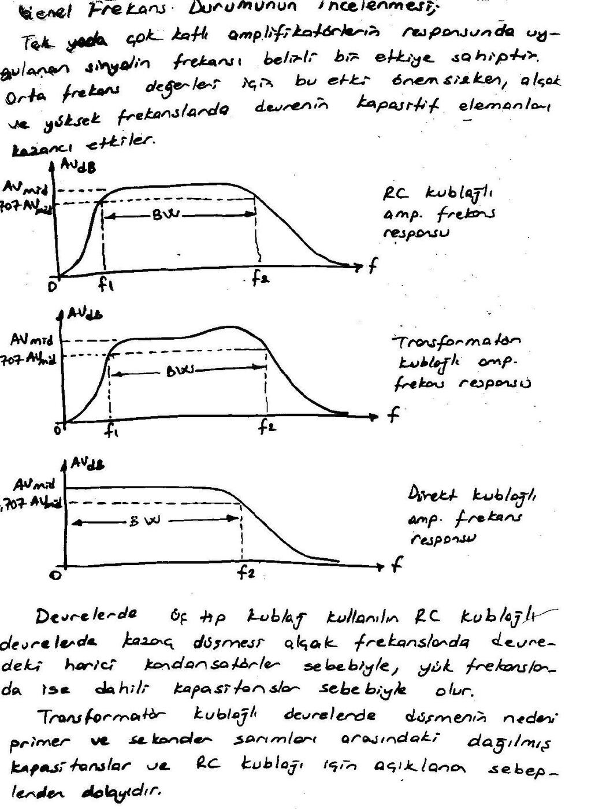

- **RC kuplajlı** devrelerde kazanç düşmesi alçak frekanslarda devredeki harici kondansatörler sebebiyle, yüksek frekanslarda ise dahili kapasitanslar sebebiyle olur.
- **Transformatör kuplajlı** devrelerde düşmenin nedeni primer ve sekonder sarımları arasındaki dağılmış kapasitanslar ve RC kuplajı için açıklanan sebeplerdir.
- **Direkt kuplajlı** amplifikatör için alçak frekansta kazanç düşmesine sebep olacak kuplaj kapasitörleri olmadığından bu frekanslarda kazançta düşme yoktur. Yüksek frekanslarda ise dahili kapasitörler sebebiyle kazanç düşer.

Logaritmik çizim için eğri normalize edilebilir. Bu durumda kazanç her bir frekans için orta band kazancına bölünür. Yarı güç noktalarında elde edilen seviye 0,707 = 1/√2'dir.

- **|A_v / A_v,mid|_dB = 20 log₁₀ (A_v / A_v,mid)**
- Orta band frekanslarında A_v = A_v,mid → 20 log 1 = 0 dB
- Kesim frekanslarında A_v = 0,707 A_v,mid → 20 log (1/√2) = −3 dB

Amplifikatörlerin kapasitans etkileri giriş ve çıkış sinyalleri arasında faz kaymasına sebep olur. Örneğin ortak emiterli ya da ortak sourcelu bir amplifikatörde orta band frekanslarında var olan 180°'lik faz farkı, alçak frekanslarda 180°'nin üzerine çıkar (270°'ye doğru), yüksek frekanslarda da 180°'nin altına iner (90°'ye doğru).

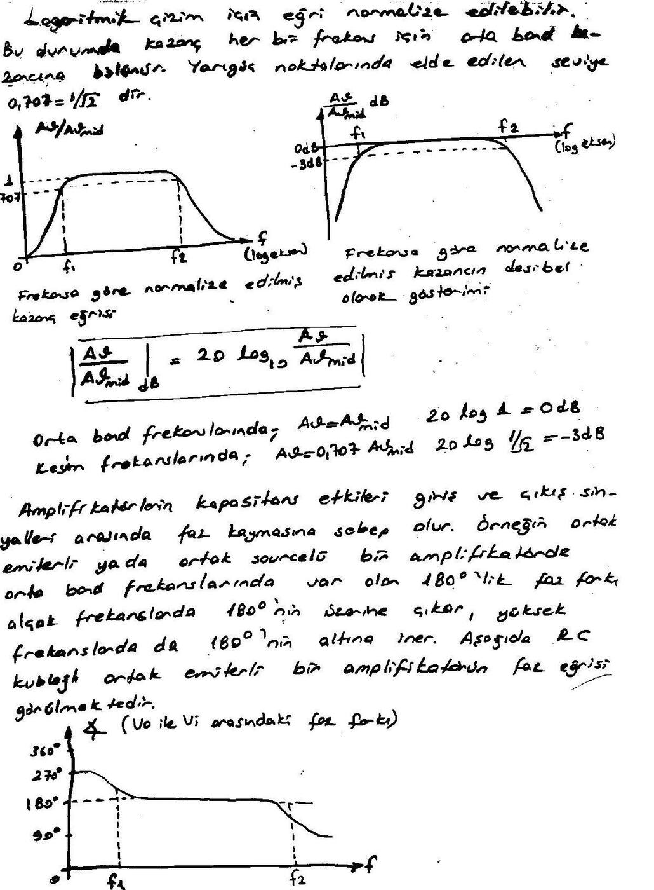

### Orta band kazancı, kesim frekansları ve bant genişliği

Amplifikatörlerde en yüksek kazanç değeri orta band seviyesinde elde edilir ve **A_v,mid** olarak adlandırılır. Yüksek kazancın sınırları 0,707 · A_v,mid seviyesindeki kazançlarla sabitlenir. f₁ ve f₂'ye karşılık gelen bu frekanslara **köşe, kesim, band, kırılma ya da yarı güç (HP) frekansları** denir.

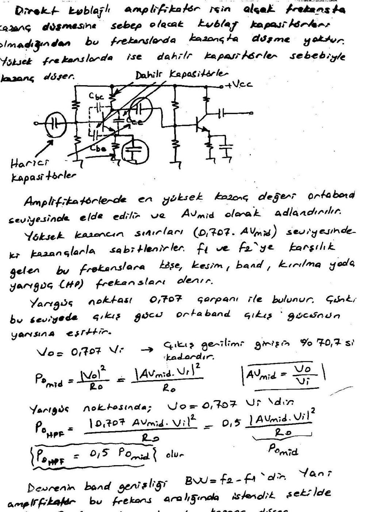

Yarı güç noktası 0,707 çarpanı ile bulunur, çünkü bu seviyede çıkış gücü orta band çıkış gücünün yarısına eşittir:

- P_o,mid = |V_o|² / R_o = |A_v,mid · V_i|² / R_o (A_v,mid = V_o/V_i)
- Yarı güç noktasında: P_o,HPF = |0,707 A_v,mid · V_i|² / R_o = 0,5 |A_v,mid · V_i|² / R_o
- **P_o,HPF = 0,5 P_o,mid**

Devrenin band genişliği **BW = f₂ − f₁**'dir. Yani amplifikatör bu frekans aralığında istendiği şekilde çalışır.

*Not: Notta yarı güç noktası için "V_o = 0,707 V_i, çıkış gerilimi girişin %70,7'si kadardır" yazıyor. Kastedilen, çıkış geriliminin orta band değerinin 0,707 katına düşmesidir (V_o = 0,707 · A_v,mid · V_i); alttaki güç bağıntısı da buna göre yazılmıştır.*

## Alçak frekans analizleri

Seri C, paralel R'den oluşan devrede X_C = 1/(2πfC). Çok yüksek frekansta X_C ≅ 0 (kondansatör kısa devre), f ≅ 0'da X_C → ∞ (açık devre) olur.

- V_o = R·V_i / (R + jX_C) → |V_o| = R·V_i / √(R² + X_C²)
- X_C = R ise V_o = R·V_i / √(R² + R²) = V_i/√2 → **A_v = V_o/V_i = 1/√2 = 0,707** (yarı güç noktası)
- Bu durumda X_C = 1/(2πf₁C) = R → **f₁ = 1/(2πRC)** (alçak frekans kesim frekansı ya da alt kesim frekansı)
- Logaritmik olarak: G_v = 20 log₁₀ (1/√2) = −3 dB (yarı güç noktası); G_v = 20 log₁₀ 1 = 0 dB (orta band)

Kazanç eşitliği f₁ frekansı kullanılarak ifade edilirse:

- A_v = V_o/V_i = R/(R − jX_C) = 1/(1 − j(X_C/R)) = 1/(1 − j(1/ωCR))
- **A_v = 1 / (1 − j(1/(2πfRC)))**, f₁ = 1/(2πRC) olduğuna göre **A_v = 1 / (1 − j(f₁/f))**

Bu kazancın büyüklüğü ve fazı:

- **A_v = 1 / √(1 + (f₁/f)²) ∠ tan⁻¹(f₁/f)**
- f = f₁ ise A_v = 1/√2 = 0,707 → −3 dB

Logaritmik formda dB kazanç:

- A_v,dB = 20 log₁₀ (1/√(1 + (f₁/f)²)) = −½ · 20 log₁₀ [1 + (f₁/f)²]
- **A_v,dB = −10 log₁₀ [1 + (f₁/f)²]**
- f ≪ f₁ ya da (f₁/f)² ≫ 1 ise: A_v,dB = −10 log₁₀ (f₁/f)² = **−20 log (f₁/f)**

f ≪ f₁ durumunu önemsemeden bu eşitliği kullanarak işlem yaparsak:

| f | f₁/f | −20 log₁₀ (f₁/f) |
|---|---|---|
| f₁ | 1 | 0 dB |
| f₁/2 | 2 | −6 dB |
| f₁/4 | 4 | −12 dB |
| f₁/10 | 10 | −20 dB |
| f₁/100 | 100 | −40 dB |

Yani frekansın her 10 kat azalışında kazanç 20 dB düşer (**−20 dB/decade**).

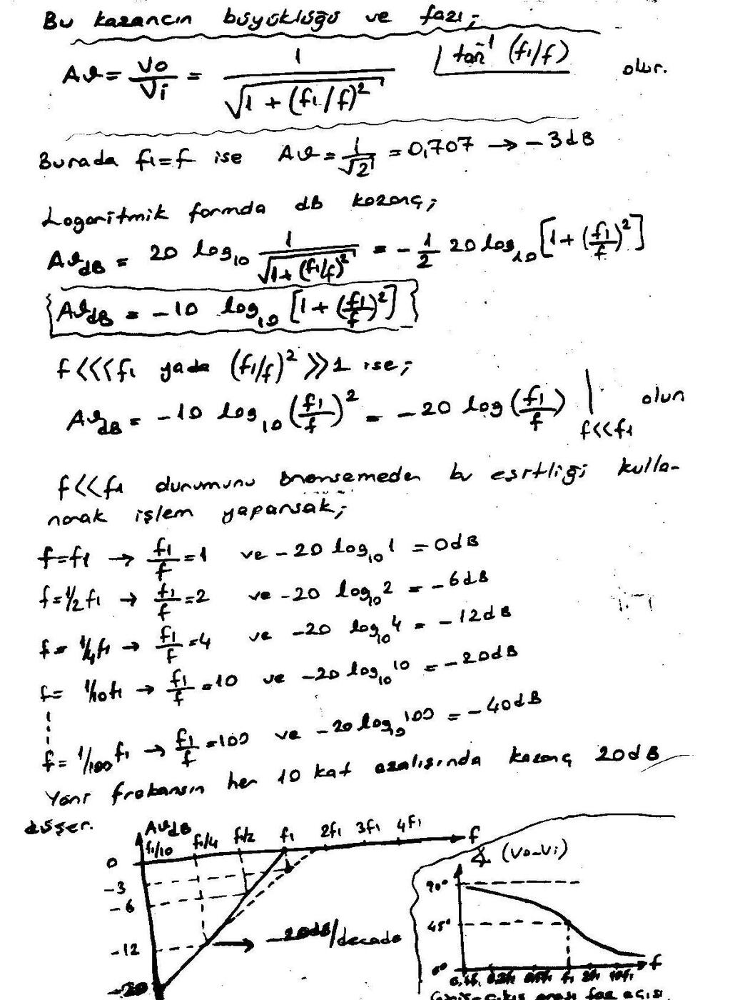

Girişle çıkış arasındaki faz açısı: **θ = tan⁻¹ (f₁/f)**

- f ≪ f₁ için θ → 90°; f₁ = 100f ise θ = 89,4°
- f₁ = f ise θ = 45°
- f ≫ f₁ için θ → 0°; f = 100f₁ ise θ = 0,573°

## BJT amplifikatör alçak frekans cevabı

Gerilim bölücü polarmalı ortak emiterli devrede C_i (giriş), C_o (çıkış) ve C_E (emiter köprüleme) kondansatörleri alçak frekansta kazancın düşmesine sebep olurlar. RC analizleri için her kondansatörün gördüğü yaklaşık eşdeğer direncin (R) bulunması gereklidir.

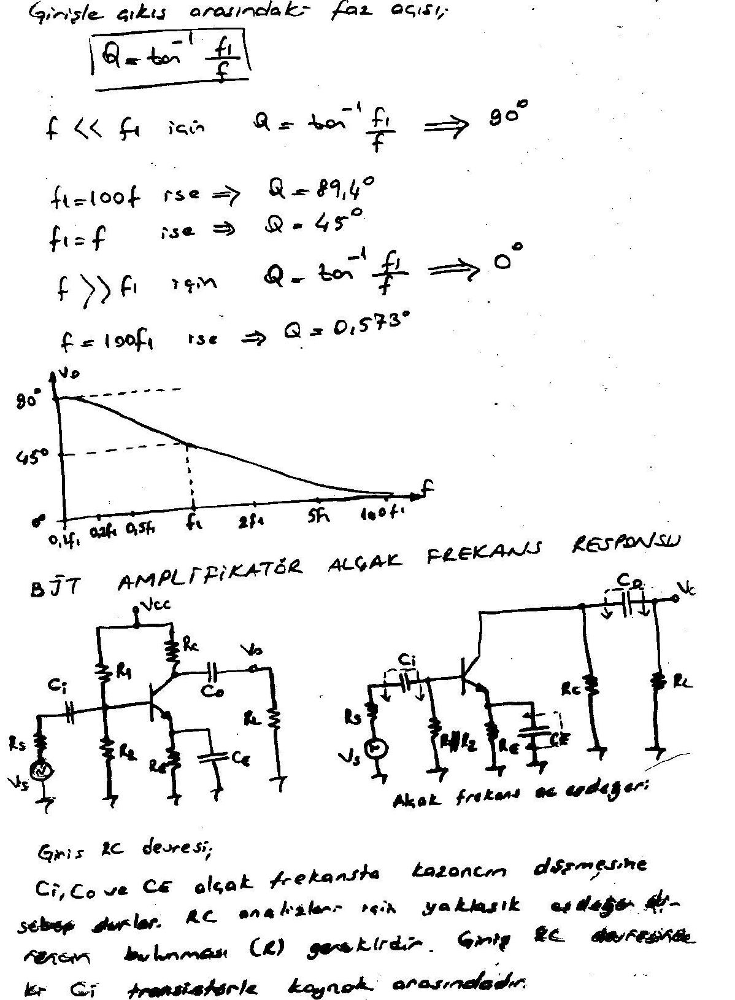

**Giriş RC devresi:** C_i transistörle kaynak arasındadır. Giriş RC bağlantısında kondansatörün gördüğü eşdeğer direnç R_s + R_i'dir:

- R_i = R1 // R2 // h_ie
- Orta bantta V_i = V_s·R_i / (R_s + R_i); alçak frekansta V_i = R_i·V_s / √((R_s + R_i)² + X_C²)
- X_Ci = R_s + R_i → **f_Ci = 1 / (2π(R_s + R_i)C_i)**

**Çıkış RC devresi:** Toplam seri direnç R_o + R_L'dir. r_o = 1/h_oe ihmal edilmezse R_o = r_o // R_C'dir.

- **f_Co = 1 / (2π(R_o + R_L)C_o)**

**Emiter RC devresi:** C_E'nin kazanç üzerindeki etkisi çok büyüktür. AC akımın R_E üzerindeki dc voltajı etkilemesi istenmediğinde buraya C_E köprüleme kondansatörü bağlanır. Bu, kazancın düşmesini önler.

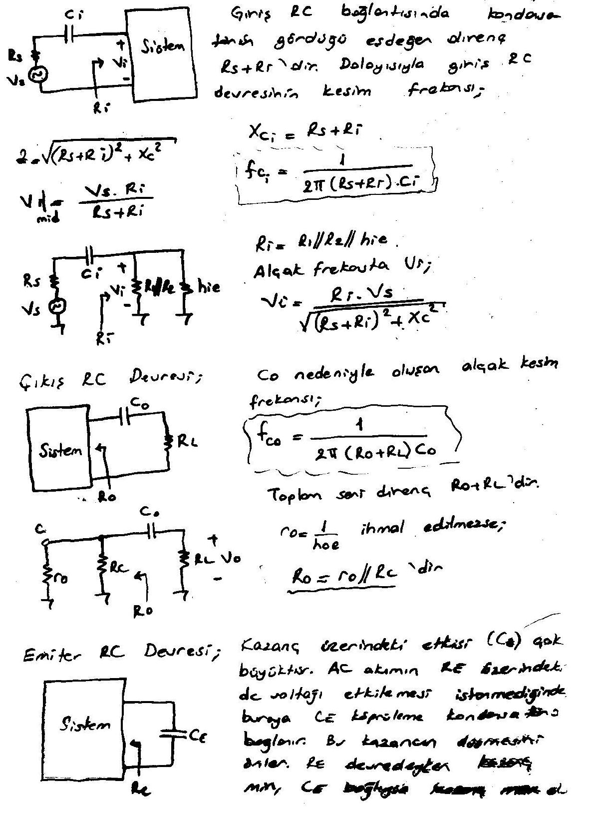

- **f_CE = 1 / (2π R_e C_E)**
- R_out = r_e + R_th/β = (h_ie + R_th)/h_fe, R_th = R_s // R1 // R2
- **R_e = R_out // R_E = (r_e + R_th/β) // R_E**
- R_E'nin kazanca etkisi: C_E kısa devre iken A_v = −h_fe R_C / h_ie; R_E etkisiyle A_v = −h_fe R_C / (h_ie + h_fe R_E) = −R_C / (r_e + R_E)

**Not (kaynakta):** Her bir kondansatörün devreye olan etkisi incelenirken, diğerlerinin orta frekanslarda olduğu gibi kısa devre olduğu kabul edilir.

### Toplam alçak frekans cevabı

Her üç RC devresi için birer kesim frekansı vardır. Bunların eşit olması gerekmez. Alçak frekansta değeri büyük olan frekans devrenin **dominant (baskın) alt kesim frekansıdır**; yani amplifikatörün kazanç düşmelerinin başladığı frekanstır. Her bir RC devresi 20 dB/decade'lik kazanç düşmesine sebep olur; kesim frekanslarının altında eğim sırasıyla 20, 40 ve 60 dB/decade olur.

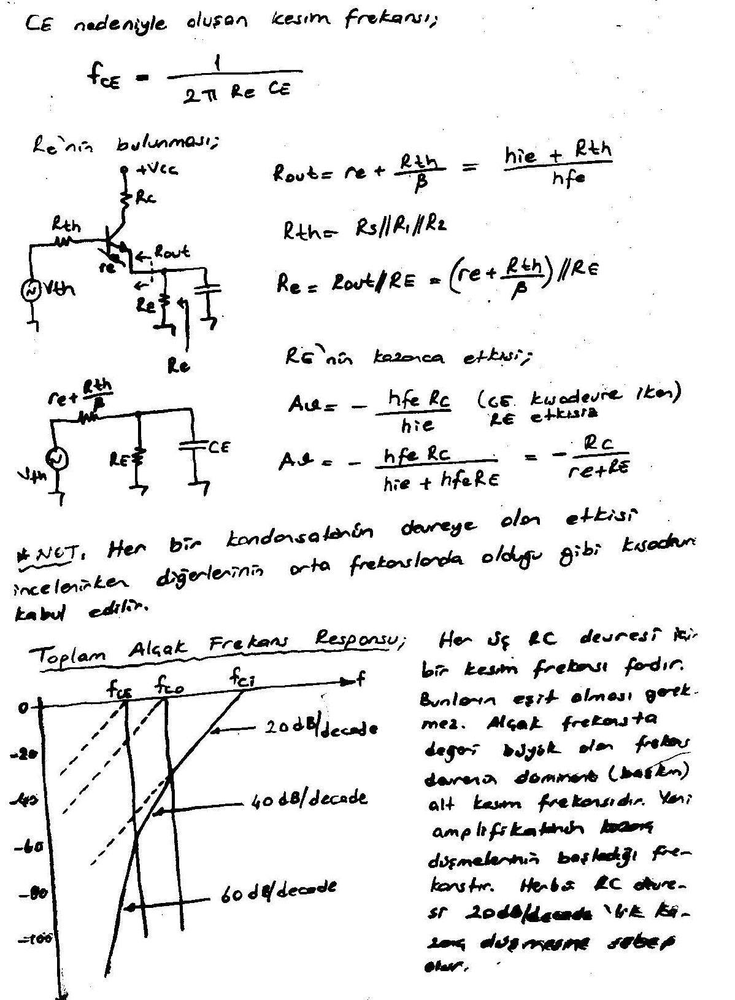

**Örnek:** Aşağıdaki devrenin alt kesim frekansını bulup Bode diyagramını (frekans cevabı eğrisini) çiziniz. A_v,mid = ? Devre: V_CC = 20 V, R1 = 40 kΩ, R2 = 10 kΩ, R_C = 4 kΩ, R_E = 2 kΩ, C_E = 20 µF, R_s = 1 kΩ, C_i = 10 µF, C_o = 1 µF, R_L = 2,2 kΩ, h_fe = 100, r_o = ∞. (Notta çözüm yok.)

## JFET amplifikatör alçak frekans cevabı

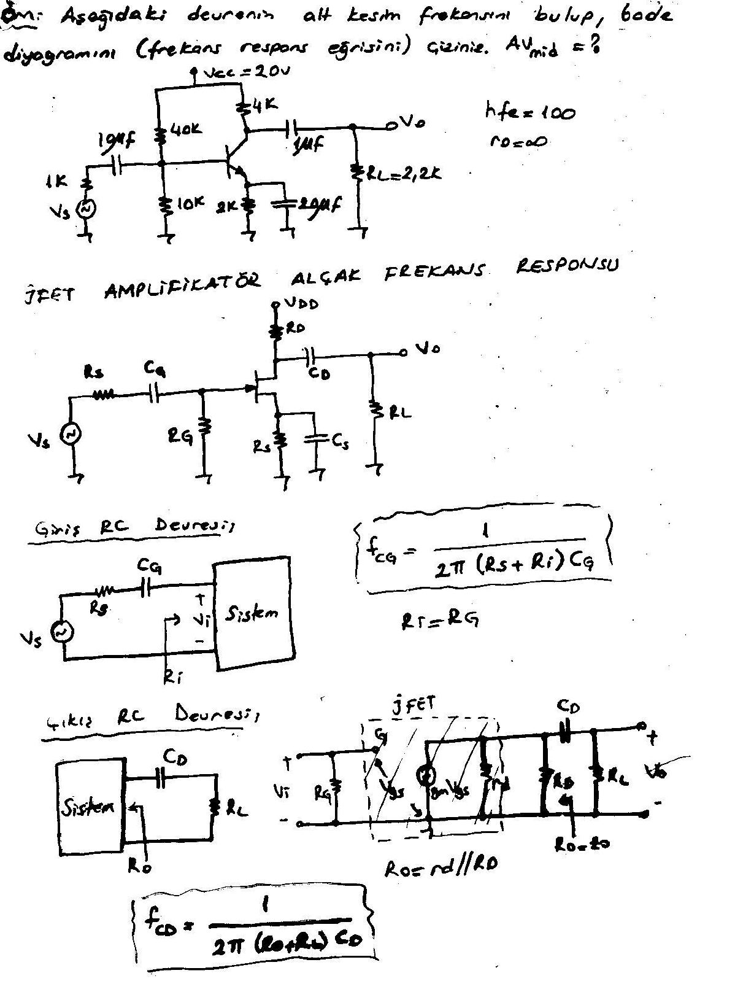

- **Giriş RC devresi:** **f_CG = 1 / (2π(R_s + R_i)C_G)**, R_i = R_G
- **Çıkış RC devresi:** R_o = r_d // R_D; **f_CD = 1 / (2π(R_o + R_L)C_D)**
- **Source RC devresi:** **f_CS = 1 / (2π R_eq C_S)**, R_eq = R_S / [1 + R_S(1 + g_m r_d)/(r_d + R_D // R_L)]; r_d = ∞ ise **R_eq = R_S // (1/g_m)**

*Not: R_eq ifadesinde notta bölme çizgisi belirsiz yazılmış; burada standart biçimi verildi.*

**Örnek:** R_sig = 10 kΩ, C_G = 0,01 µF, R_G = 1 MΩ, R_D = 4,7 kΩ, C_D = 0,5 µF, R_L = 2,2 kΩ, R_S = 1 kΩ, C_S = 2 µF, g_m = 2 mS. a) Devrenin alt kesim frekansını bulunuz ve Bode diyagramını çiziniz. b) Devrenin orta band kazancını bulunuz. (Notta çözüm yok.)

## Miller etkisi kapasitansı

Çevirici amplifikatörler için (−A_v'ye sahip olan) giriş ve çıkış kapasitansı, devre elemanının elektrotları arası kapasitans ve devre kazancı ile artar. Bu kapasitans C_f geri besleme kapasitansı olarak tanımlanır.

Giriş tarafında: I_i = I₁ + I₂, I_i = V_i/Z_i, I₁ = V_i/R_i, I₂ = (V_i − V_o)/X_Cf = (V_i − A_v V_i)/X_Cf = (1 − A_v)V_i / X_Cf

- 1/Z_i = 1/R_i + 1/(X_Cf/(1 − A_v)) = 1/R_i + 1/X_CM
- X_CM = X_Cf/(1 − A_v) = 1/(ω(1 − A_v)C_f)
- **Miller etkisi giriş kapasitansı: C_Mi = (1 − A_v) C_f**

Bu ifadeye göre her çevirici amplifikatör için giriş kapasitansı, yükselteç kazancına duyarlı Miller etkisi kapasitansı ve aktif devre elemanının (transistör) giriş ve çıkış terminalleri arasında mevcut olan elektrotlar arası kapasitansıyla artar.

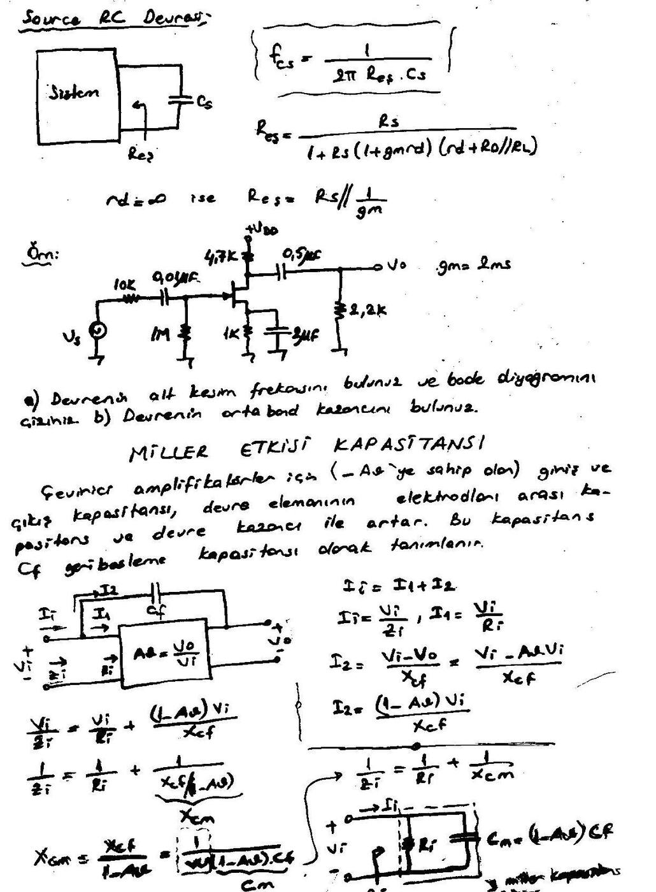

Çıkıştaki Miller etkisi: I_o = I₁ + I₂, I₁ = V_o/R_o, I₂ = (V_o − V_i)/X_Cf. R_o büyük olduğundan I₁ ihmal edilirse I_o ≅ I₂ = (V_o − V_i)/X_Cf olur.

- I_o = (V_o − V_o/A_v)/X_Cf = V_o(1 − 1/A_v)/X_Cf
- V_o/I_o = X_Cf / (1 − 1/A_v) = 1/(ωC_f(1 − 1/A_v)) = 1/(ωC_Mo)
- **Miller etkisi çıkış kapasitansı: C_Mo = (1 − 1/A_v) · C_f**

## BJT amplifikatör yüksek frekans cevabı

Yüksek frekans cevabında −3 dB noktasında devre kapasitansı ve h_fe faktörleri mevcuttur. Seri R, paralel C'den oluşan alçak geçiren yapı için (f₂: üst kesim frekansı):

- **A_v = 1 / (1 + j(f/f₂)) = 1/√(1 + (f/f₂)²) ∠θ**

C_bc giriş ile çıkış arasındaki kapasitans olduğu için bunun girişe ve çıkışa olan etkisi C_Mi ve C_Mo olarak ifade edilir. C_wi tel (bağlantı) kapasitansı, C_wo geçiş kapasitansıdır. C_i kapasitansı C_wi, C_be ve Miller kapasitansı C_Mi'yi içerir; C_o ise C_wo, C_ce ve Miller kapasitansı C_Mo'yu içerir. Özel uygulamalar dışında C_ce dikkate alınmaz.

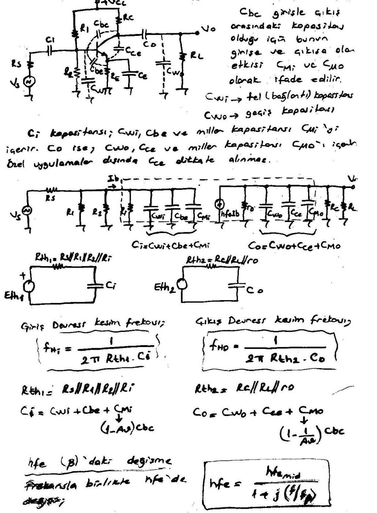

| | Giriş devresi | Çıkış devresi |
|---|---|---|
| Thevenin direnci | R_th1 = R_s // R1 // R2 // R_i | R_th2 = R_C // R_L // r_o |
| Kapasitans | C_i = C_wi + C_be + C_Mi, C_Mi = (1 − A_v)C_bc | C_o = C_wo + C_ce + C_Mo, C_Mo = (1 − 1/A_v)C_bc |
| Kesim frekansı | **f_Hi = 1 / (2π R_th1 C_i)** | **f_Ho = 1 / (2π R_th2 C_o)** |

### h_fe (β)'daki değişme

Frekansla birlikte h_fe de değişir: **h_fe = h_fe,mid / (1 + j(f/f_β))**

f_β, yüksek frekans bölgesinde transistörü en iyi şekilde temsil etmek için uygulanan **"hybrid π"** ya da **"Giacoletto"** modelindeki parametreler vasıtasıyla bulunur. Modelde r_bb' (beyz değme noktası + beyz hacmi + beyz yayılma direnci), r_b'e = 1/g_b'e, C_b'e, r_b'c ile C_b'c, r_ce = 1/h_oe ve g_m·V_b'e ≅ h_fe,mid·I_b' akım kaynağı bulunur. r_b'e, r_ce ve r_b'c dirençleri devre elemanı aktif bölgede çalışırken terminal uçları arasında görülen dirençlerdir; aynı durum C_b'c ve C_b'e için de geçerlidir.

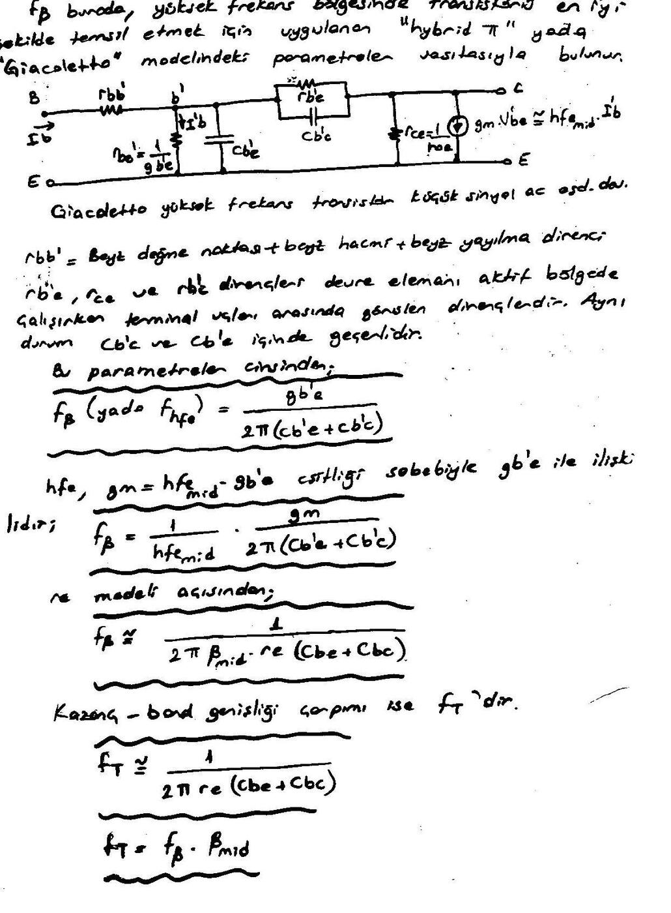

- Bu parametreler cinsinden: **f_β (ya da f_hfe) = g_b'e / (2π(C_b'e + C_b'c))**
- h_fe, g_m = h_fe,mid · g_b'e eşitliği sebebiyle g_b'e ile ilişkilidir: **f_β = (1/h_fe,mid) · g_m / (2π(C_b'e + C_b'c))**
- r_e modeli açısından: **f_β ≅ 1 / (2π β_mid r_e (C_be + C_bc))**
- Kazanç-band genişliği çarpımı f_T'dir: **f_T ≅ 1 / (2π r_e (C_be + C_bc))**, **f_T = f_β · β_mid**

## FET amplifikatör yüksek frekans cevabı

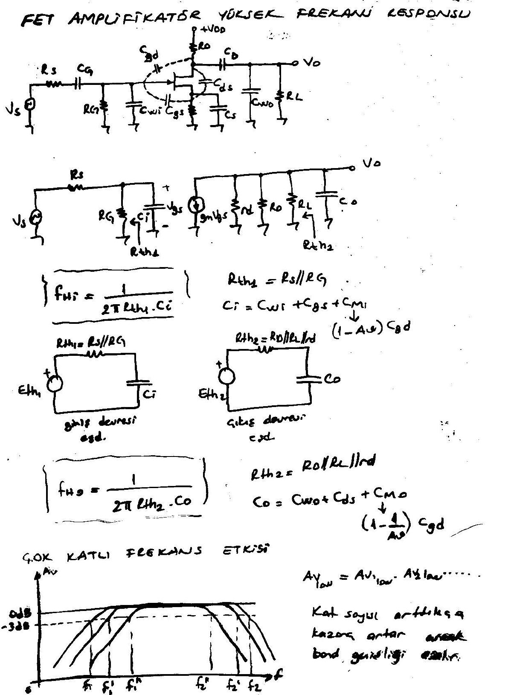

| | Giriş devresi | Çıkış devresi |
|---|---|---|
| Thevenin direnci | R_th1 = R_s // R_G | R_th2 = R_D // R_L // r_d |
| Kapasitans | C_i = C_wi + C_gs + C_Mi, C_Mi = (1 − A_v)C_gd | C_o = C_wo + C_ds + C_Mo, C_Mo = (1 − 1/A_v)C_gd |
| Kesim frekansı | **f_Hi = 1 / (2π R_th1 C_i)** | **f_Ho = 1 / (2π R_th2 C_o)** |

## Çok katlı frekans etkisi

A_v,low = A_v1,low · A_v2,low ⋯ Kat sayısı arttıkça kazanç artar ancak band genişliği azalır (alt kesim frekansı yükselir: f₁ < f₁' < f₁''; üst kesim frekansı düşer: f₂ > f₂' > f₂'').

## Toplam yüksek frekans cevabı

Yüksek frekansta bulunan iki kesim frekansından düşük değerde olanı **baskın (dominant)**'tır. İdeal Bode diyagramında, f_c,giriş ve f_c,çıkış'tan hangisinin daha küçük olduğu bilinmeden çizim yapılabilir: ilk kırılma (kesim) frekansından itibaren kazanç −20 dB/decade'lik bir eğimle düşer, ikinci kırılma frekansından itibaren −40 dB/decade'lik bir eğimle düşer. Gerçek Bode diyagramında ise kesim frekanslarında var olan −3 dB'lik kazanç düşmesi görülmektedir.

### Toplam amplifikatör cevabı

Alçak frekansta bulunan üç kesim frekansından büyük olanı, yüksek frekansta da bulunan iki kesim frekansından küçük olanı etkindir:

- **BW = f_H2 − f_L3** (yani BW = f_cH − f_cL = f_H − f_L)

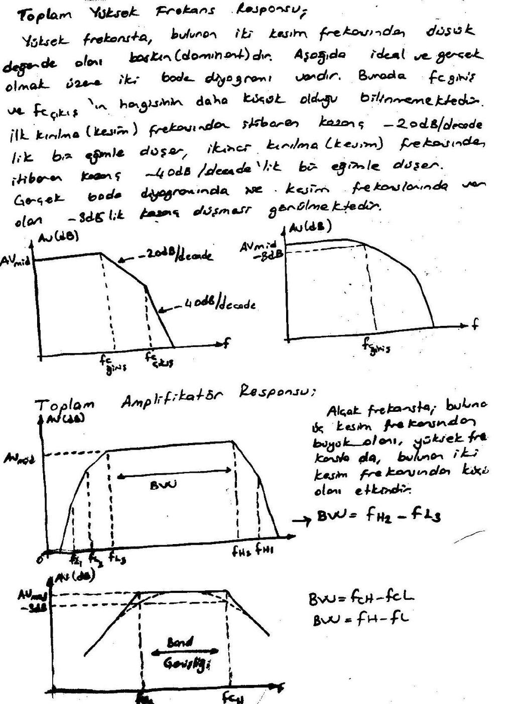

f_cH ≫ f_cL olduğunu kabul edersek **BW = f_cH − f_cL ≅ f_cH** olacaktır. Kazancın 0 dB'e düştüğü frekans f_T'dir:

- **f_T = A_v,mid · BW = A_v,mid · f_cH**

### Örnek: toplam frekans cevabı

Aşağıdaki devrelerin toplam amplifikatör frekans cevabını bulunuz ve Bode diyagramlarını çiziniz. (Notta çözüm yok.)

1. BJT: V_CC = +9 V, R1 = 12 kΩ, R2 = 5 kΩ, R_C = 200 Ω, R_E = 100 Ω, C_E = 10 µF, C_i = 1 µF, C_o = 1 µF, R_L = 600 Ω; h_fe = 125, r_o = ∞, C_be = 25 pF, C_bc = 10 pF, C_ce = 1 pF, C_wi = 6 pF, C_wo = 8 pF.
1. JFET: V_DD = +10 V (el yazısında +12 V olarak da okunabiliyor), R_sig = 10 kΩ, C_G = 0,01 µF, R_G = 1 MΩ, R_D = 4,7 kΩ, C_D = 0,5 µF, R_S = 1 kΩ, C_S = 2 µF, R_L; g_m = 2 mS, C_gd = 2 pF, C_gs = 4 pF, C_ds = 0,5 pF, C_wi = 5 pF, C_wo = 6 pF.

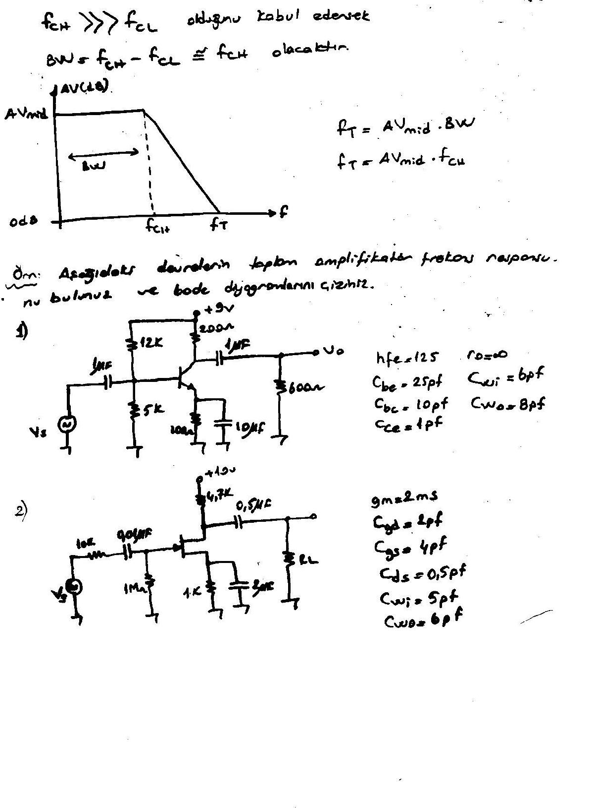
