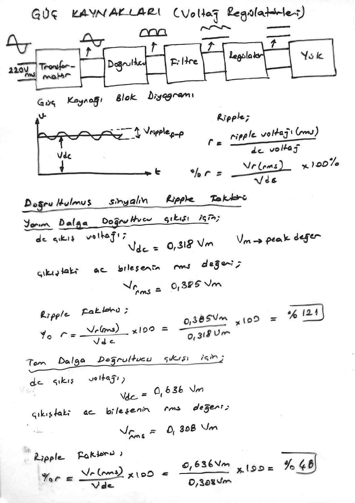
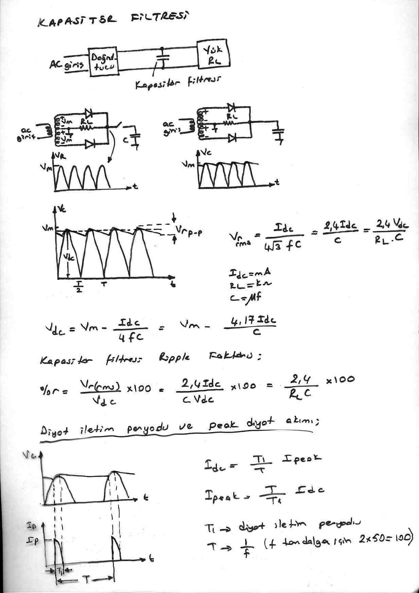
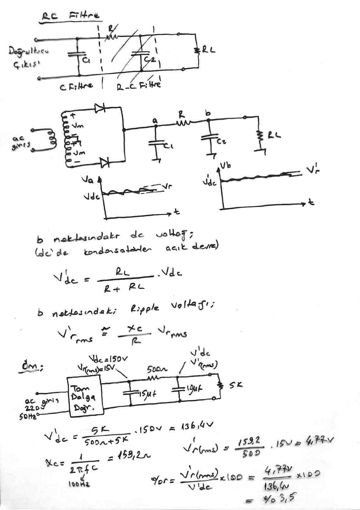
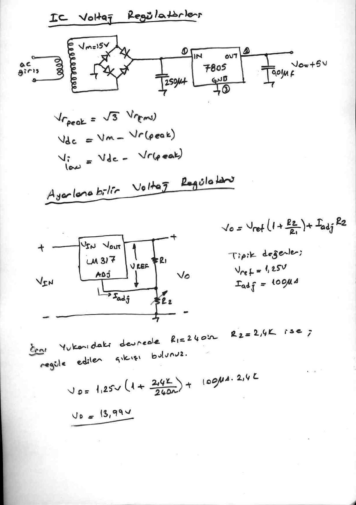

This post was prepared from the scanned pages of a four-page handwritten lecture note on **power supplies (voltage regulators)** from the **EEM311 Electronics II** course at Başkent University. The notes carry no author name or date. The formulas and examples have been transcribed into text; page images are included for the diagrams. The scanned pages can be downloaded as a PDF at the end of the post.

## Power supply block diagram

The 220 V (rms) mains voltage passes through the blocks **transformer → rectifier → filter → regulator → load** in sequence: the transformer steps the voltage down, the rectifier produces a unidirectional (pulsating) voltage, the filter converts it into a rippled dc, and the regulator delivers a constant dc output.

**Ripple:** The voltage at the filter output fluctuates with a peak-to-peak value V_r(p-p) around its average value V_dc.

- r = ripple voltage (rms) / dc voltage
- **%r = (V_r(rms) / V_dc) × 100%**

## Ripple factor of the rectified signal

**For the half-wave rectifier output** (V_m: peak value):

- dc output voltage: V_dc = 0.318 V_m
- rms value of the ac component at the output: V_r(rms) = 0.385 V_m
- Ripple factor: %r = (0.385 V_m / 0.318 V_m) × 100 = **121%**

**For the full-wave rectifier output:**

- dc output voltage: V_dc = 0.636 V_m
- rms value of the ac component at the output: V_r(rms) = 0.308 V_m
- Ripple factor: %r = V_r(rms)/V_dc × 100 = **48%**

*Note: In the notes, the fraction for the full-wave case is written inverted as "0.636 V_m / 0.308 V_m"; the correct form is 0.308 V_m / 0.636 V_m ≈ 0.48. The result (48%) is correct.*

## Capacitor filter

A capacitor is connected in parallel between the rectifier output and the load (R_L). In a full-wave rectifier with a center-tapped transformer, the output without a capacitor consists of pulses with peak V_m; once the capacitor is added, the output becomes a sawtooth-shaped voltage close to V_m, fluctuating by V_r(p-p).

- **V_r(rms) = I_dc / (4√3 f C) = 2.4 I_dc / C = 2.4 V_dc / (R_L C)** (I_dc in mA, R_L in kΩ, C in µF)
- **V_dc = V_m − I_dc / (4fC) = V_m − 4.17 I_dc / C**
- Ripple factor of the capacitor filter: **%r = V_r(rms)/V_dc × 100 = 2.4 I_dc / (C V_dc) × 100 = 2.4 / (R_L C) × 100**

*Note: The coefficients 2.4 and 4.17 are textbook constants calculated for a 60 Hz mains supply (120 Hz full-wave ripple). As stated at the end of the notes, for a 50 Hz mains supply (100 Hz full-wave ripple) the same formulas give V_r(rms) ≈ 1.44 I_dc / C and V_dc ≈ V_m − 2.5 I_dc / C.*

### Diode conduction period and peak diode current

The diode conducts only during the short time T₁ in which the capacitor recharges; during this time a high peak current (I_peak) flows.

- I_dc = (T₁/T) · I_peak → **I_peak = (T/T₁) · I_dc**
- T₁: diode conduction period; T = 1/f (f is 2 × 50 = 100 Hz for full-wave)

## RC filter

By adding an R–C2 section after the C filter (C1 – R – C2 – R_L), the ripple is reduced further. At point a there are V_dc and V_r; at point b there are V'_dc and a smaller V'_r.

- dc voltage at point b (capacitors are open circuits at dc): **V'_dc = R_L / (R + R_L) · V_dc**
- ripple voltage at point b: **V'_r(rms) ≅ (X_C / R) · V_r(rms)**

**Example:** At the output of a full-wave rectifier with a 220 V, 50 Hz ac input, V_dc = 150 V and V_r(rms) = 15 V. This is followed by an RC filter with C1 = 15 µF, R = 500 Ω, C2 = 10 µF, and R_L = 5 kΩ.

- V'_dc = 5k / (500 Ω + 5k) · 150 V = **136.4 V**
- X_C = 1/(2πfC) = 159.2 Ω (f = 100 Hz, C = 10 µF)
- V'_r(rms) = (159.2 / 500) · 15 V = **4.77 V**
- %r = V'_r(rms) / V'_dc × 100 = 4.77 V / 136.4 V × 100 = **3.5%**

## IC voltage regulators

In the example circuit, a transformer secondary with V_m = 15 V is connected to a bridge rectifier, then to a 250 µF filter capacitor and a **7805** fixed regulator (1: IN, 2: OUT, 3: GND); **V_o = +5 V** is obtained at the output with a 0.01 µF capacitor.

- V_r(peak) = √3 · V_r(rms)
- V_dc = V_m − V_r(peak)
- V_i(low) = V_dc − V_r(peak) (lowest value of the regulator input)

### Adjustable voltage regulator

In the **LM317** adjustable regulator, R1 is connected between V_OUT and the ADJ terminal, and the adjustable R2 between the ADJ terminal and ground:

- **V_o = V_ref (1 + R2/R1) + I_adj · R2**
- Typical values: V_ref = 1.25 V, I_adj = 100 µA

**Example:** In the circuit above, if R1 = 240 Ω and R2 = 2.4 kΩ, find the regulated output.

- V_o = 1.25 V (1 + 2.4k/240 Ω) + 100 µA · 2.4k = 13.75 V + 0.24 V = **13.99 V**

