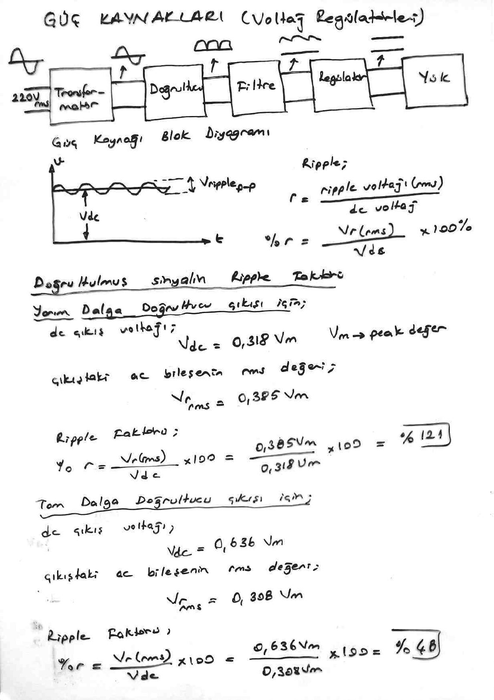
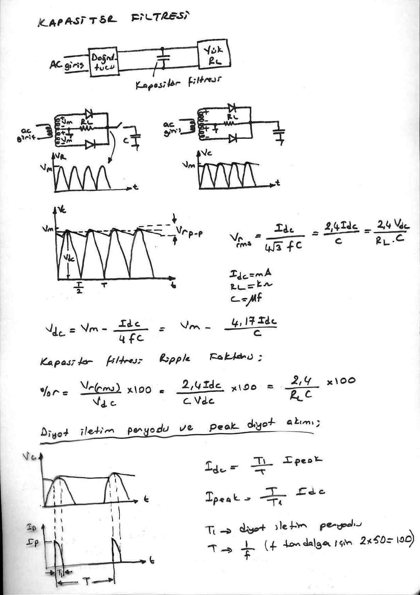
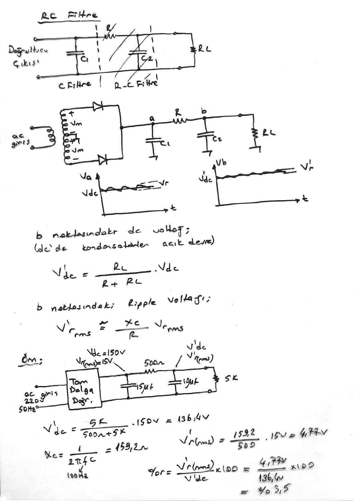
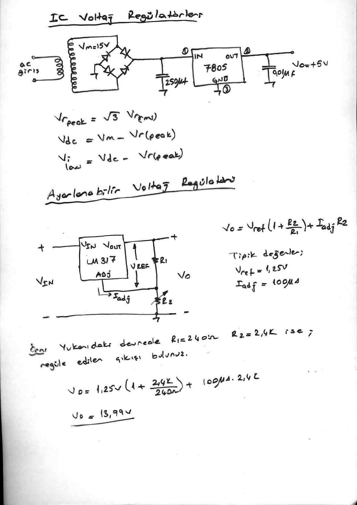

Bu yazı, Başkent Üniversitesi **EEM311 Elektronik II** dersinin **güç kaynakları (voltaj regülatörleri)** konusunu anlatan dört sayfalık el yazısı ders notunun taranmış sayfalarından hazırlandı. Notlarda yazar adı ve tarih yok. Formüller ve örnekler metne aktarıldı; şemalar için sayfa görselleri eklendi. Taranmış sayfalar PDF olarak yazının sonunda indirilebilir.

## Güç kaynağı blok diyagramı

220 V (rms) şebeke gerilimi sırasıyla **transformatör → doğrultucu → filtre → regülatör → yük** bloklarından geçer: transformatör gerilimi düşürür, doğrultucu tek yönlü (darbeli) gerilim üretir, filtre bunu dalgalı bir dc'ye çevirir, regülatör ise sabit dc çıkış verir.

**Ripple (dalgalılık):** Filtre çıkışındaki gerilim V_dc ortalama değeri etrafında V_r(p-p) tepeden tepeye dalgalanır.

- r = ripple voltajı (rms) / dc voltaj
- **%r = (V_r(rms) / V_dc) × 100%**

## Doğrultulmuş sinyalin ripple faktörü

**Yarım dalga doğrultucu çıkışı için** (V_m: tepe değer):

- dc çıkış voltajı: V_dc = 0,318 V_m
- Çıkıştaki ac bileşenin rms değeri: V_r(rms) = 0,385 V_m
- Ripple faktörü: %r = (0,385 V_m / 0,318 V_m) × 100 = **%121**

**Tam dalga doğrultucu çıkışı için:**

- dc çıkış voltajı: V_dc = 0,636 V_m
- Çıkıştaki ac bileşenin rms değeri: V_r(rms) = 0,308 V_m
- Ripple faktörü: %r = V_r(rms)/V_dc × 100 = **%48**

*Not: Notta tam dalga için kesir "0,636 V_m / 0,308 V_m" olarak ters yazılmış; doğrusu 0,308 V_m / 0,636 V_m ≈ 0,48'dir. Sonuç (%48) doğru.*

## Kapasitör filtresi

Doğrultucu çıkışı ile yük (R_L) arasına paralel bir kapasitör bağlanır. Orta uçlu transformatörlü tam dalga doğrultucuda kapasitörsüz çıkış V_m tepeli darbelerden oluşur; kapasitör takılınca çıkış V_m'ye yakın, testere dişi biçiminde dalgalanan (V_r(p-p)) bir gerilime dönüşür.

- **V_r(rms) = I_dc / (4√3 f C) = 2,4 I_dc / C = 2,4 V_dc / (R_L C)** (I_dc mA, R_L kΩ, C µF)
- **V_dc = V_m − I_dc / (4fC) = V_m − 4,17 I_dc / C**
- Kapasitör filtresi ripple faktörü: **%r = V_r(rms)/V_dc × 100 = 2,4 I_dc / (C V_dc) × 100 = 2,4 / (R_L C) × 100**

*Not: 2,4 ve 4,17 katsayıları 60 Hz şebeke (120 Hz tam dalga ripple) için hesaplanmış ders kitabı sabitleridir. Notun sonunda belirtildiği gibi 50 Hz şebekede (100 Hz tam dalga ripple) aynı formüller V_r(rms) ≈ 1,44 I_dc / C ve V_dc ≈ V_m − 2,5 I_dc / C verir.*

### Diyot iletim periyodu ve tepe diyot akımı

Diyot yalnızca kapasitörün yeniden şarj olduğu kısa T₁ süresinde iletir; bu sürede yüksek bir tepe akımı (I_peak) akar.

- I_dc = (T₁/T) · I_peak → **I_peak = (T/T₁) · I_dc**
- T₁: diyot iletim periyodu; T = 1/f (f, tam dalga için 2 × 50 = 100 Hz)

## RC filtre

C filtresinin ardına bir R–C2 bölümü eklenerek (C1 – R – C2 – R_L) ripple daha da azaltılır. a noktasında V_dc ve V_r, b noktasında V'_dc ve daha küçük V'_r bulunur.

- b noktasındaki dc voltaj (dc'de kondansatörler açık devre): **V'_dc = R_L / (R + R_L) · V_dc**
- b noktasındaki ripple voltajı: **V'_r(rms) ≅ (X_C / R) · V_r(rms)**

**Örnek:** 220 V, 50 Hz ac girişli tam dalga doğrultucunun çıkışında V_dc = 150 V, V_r(rms) = 15 V'tur. Ardından C1 = 15 µF, R = 500 Ω, C2 = 10 µF ve R_L = 5 kΩ'luk RC filtre vardır.

- V'_dc = 5k / (500 Ω + 5k) · 150 V = **136,4 V**
- X_C = 1/(2πfC) = 159,2 Ω (f = 100 Hz, C = 10 µF)
- V'_r(rms) = (159,2 / 500) · 15 V = **4,77 V**
- %r = V'_r(rms) / V'_dc × 100 = 4,77 V / 136,4 V × 100 = **%3,5**

## IC voltaj regülatörleri

Örnek devrede V_m = 15 V'luk transformatör sekonderi köprü doğrultucuya, ardından 250 µF filtre kapasitörüne ve **7805** sabit regülatörüne (1: IN, 2: OUT, 3: GND) bağlanır; çıkışta 0,01 µF kapasitörle **V_o = +5 V** elde edilir.

- V_r(peak) = √3 · V_r(rms)
- V_dc = V_m − V_r(peak)
- V_i(low) = V_dc − V_r(peak) (regülatör girişinin en düşük değeri)

### Ayarlanabilir voltaj regülatörü

**LM317** ayarlanabilir regülatöründe V_OUT ile ADJ ucu arasına R1, ADJ ucu ile toprak arasına ayarlı R2 bağlanır:

- **V_o = V_ref (1 + R2/R1) + I_adj · R2**
- Tipik değerler: V_ref = 1,25 V, I_adj = 100 µA

**Örnek:** Yukarıdaki devrede R1 = 240 Ω, R2 = 2,4 kΩ ise regüle edilen çıkışı bulunuz.

- V_o = 1,25 V (1 + 2,4k/240 Ω) + 100 µA · 2,4k = 13,75 V + 0,24 V = **13,99 V**

