This post was prepared from scanned pages of handwritten lecture notes on **power amplifiers** from the **EEM311 Electronics II** course at Başkent University. The notes carry no author name or date; the pages were found together in the course's slide/notes folder. Headings, definitions, formulas, and worked examples have been transcribed into text; page images are included for the circuit diagrams and graphs. All scanned pages can be downloaded as a PDF at the end of the post.

## Classes of power amplifiers

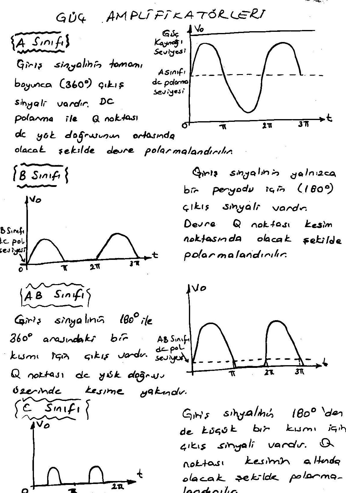

- **Class A:** There is an output signal for the entire input signal (360°). The circuit is biased with dc bias so that the Q point lies at the middle of the dc load line.
- **Class B:** There is an output signal for only one half of the input signal's period (180°). The circuit is biased so that the Q point is at the cutoff point.
- **Class AB:** There is an output for a portion of the input signal between 180° and 360°. The Q point is close to cutoff on the dc load line.
- **Class C:** There is an output signal for less than 180° of the input signal. The circuit is biased so that the Q point is below cutoff.
- **Class D:** A Class D amplifier operates and produces output only when a pulse signal is applied.

### Amplifier efficiency

The efficiency of power amplifiers increases from A to D. In other words, the longer the transistor conducts, the more power it dissipates, and so the lower the efficiency of the circuit (efficiency = output power / input power).

| | A | AB | B | C | D |
|---|---|---|---|---|---|
| Conduction angle | 360° | 180°–360° | 180° | Less than 180° | Pulse |
| Efficiency | 25%–50% | 25% (50%) – 78.5% | 78.5% | > 78.5% (*) | > 90% |

(*) Class C power amplifiers are generally not operated at very high power levels.

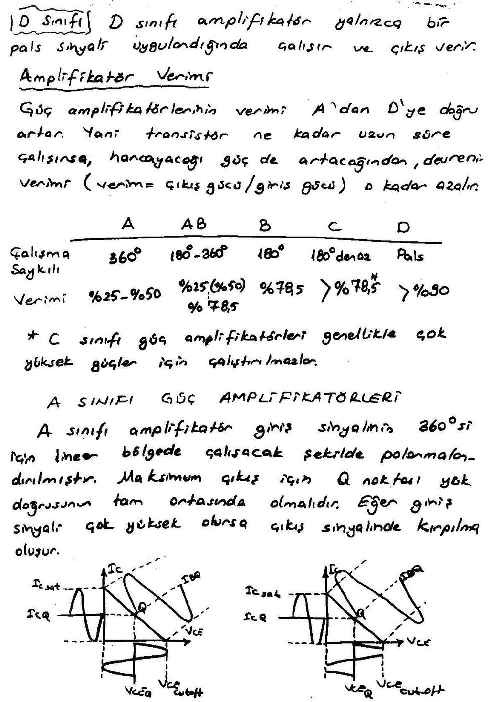

## Class A power amplifiers

A Class A amplifier is biased to operate in the linear region for the full 360° of the input signal. For maximum output, the Q point must be exactly at the middle of the load line. If the input signal is too large, clipping occurs in the output signal. (The two graphs on the page show the I_C and V_CE swing for a centered Q point, and the clipping that occurs when the Q point shifts.)

- **Quiescent power:** The power dissipated in the transistor when no ac signal is applied. The transistor's minimum power rating must be at least this value: **P_DQ = V_CEQ · I_CQ**
- **Input power:** The power delivered to the circuit by the dc voltage source: **P_i(dc) = V_CC · I_CC = V_CC · I_CQ**
- **Output power:** The ac power delivered by the circuit to the load:
  - P_o(ac) = V_CE(rms) · I_C(rms) → if the Q point is at the middle
  - P_o(ac) = I_C(rms)² · R_C → if the Q point is close to cutoff
  - P_o(ac) = V_CE(rms)² / R_C → if the Q point is close to saturation
- **Efficiency:** The ratio of the output power obtained from the amplifier to the input power applied: **%η = (P_o(ac) / P_i(dc)) · 100%**

### Maximum efficiency

For maximum efficiency, the Q point is exactly at the middle of the load line:

- max V_CE(p-p) = V_CC, max I_C(p-p) = V_CC / R_C
- max P_o(ac) = V_CC · (V_CC/R_C) / 8 = **V_CC² / (8R_C)**
- max P_i(dc) = V_CC · max I_C = V_CC · (V_CC/R_C)/2 = **V_CC² / (2R_C)**
- max %η = (max P_o(ac) / max P_i(ac)) × 100 → **max %η = 25%**

*Note: In the denominator of the last line, the notes write "P_i(ac)"; it should be the dc input power P_i(dc). The result (25%) is unchanged.*

### Example: Power and efficiency of a Class A amplifier

For the Class A power amplifier below, find a) the minimum transistor power, b) the ac output power, c) the efficiency. Circuit: V_CC = +24 V, R1 = 5 kΩ, R2 = 1 kΩ, R_C = 300 Ω, R_E = 100 Ω (bypassed by C_E), R_L = 300 Ω, C1 = 10 µF, C2 = 1 µF, C_E = 10 µF.

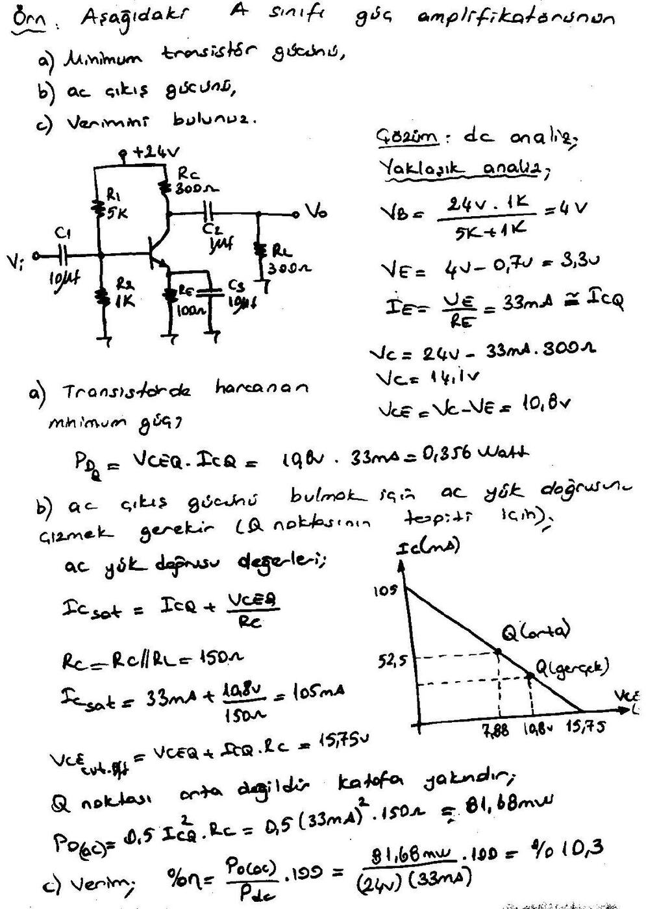

**Solution (dc analysis, approximate analysis):**

- V_B = 24 V · 1k / (5k + 1k) = 4 V
- V_E = 4 V − 0.7 V = 3.3 V
- I_E = V_E / R_E = 33 mA ≅ I_CQ
- V_C = 24 V − 33 mA · 300 Ω = 14.1 V
- V_CE = V_C − V_E = 10.8 V

a) Minimum power dissipated in the transistor: P_DQ = V_CEQ · I_CQ = 10.8 V · 33 mA = **0.356 W**

b) To find the ac output power, the ac load line is drawn (to locate the Q point):

- r_C = R_C // R_L = 150 Ω
- I_C(sat) = I_CQ + V_CEQ / r_C = 33 mA + 10.8 V / 150 Ω = 105 mA
- V_CE(cut-off) = V_CEQ + I_CQ · r_C = 15.75 V

The midpoint of the load line is 52.5 mA / 7.88 V; the actual Q point (33 mA, 10.8 V) is not at the middle but close to cutoff:

- P_o(ac) = 0.5 · I_CQ² · r_C = 0.5 · (33 mA)² · 150 Ω = **81.68 mW**

c) Efficiency: %η = P_o(ac) / P_dc · 100 = 81.68 mW / (24 V · 33 mA) · 100 = **10.3%**

### Transformer-coupled Class A

If the output of a Class A power amplifier is delivered to the load through a transformer, the efficiency can rise up to 50%.

- V₂/V₁ = I₁/I₂ = N₂/N₁, V₂ = V_o
- Load reflected to the primary: **R_L' = a² · R_L = (N₂/N₁)² · R_L**

*Note: With the definition a = N₁/N₂ (primary/secondary), the reflected load is R_L' = (N₁/N₂)² · R_L; the ratio is written inverted in the notes.*

## Class B power amplifiers

A Class B amplifier produces output for a 180° portion of the input signal. To obtain a complete sine wave at the output, **push-pull** circuits containing two transistors are used. One of them produces output for the positive alternation and the other for the negative alternation, and the outputs are combined across a load. Both transistors are biased with their Q points at cutoff and are of different types. Push-pull amplifiers can be built with a single or a dual voltage supply.

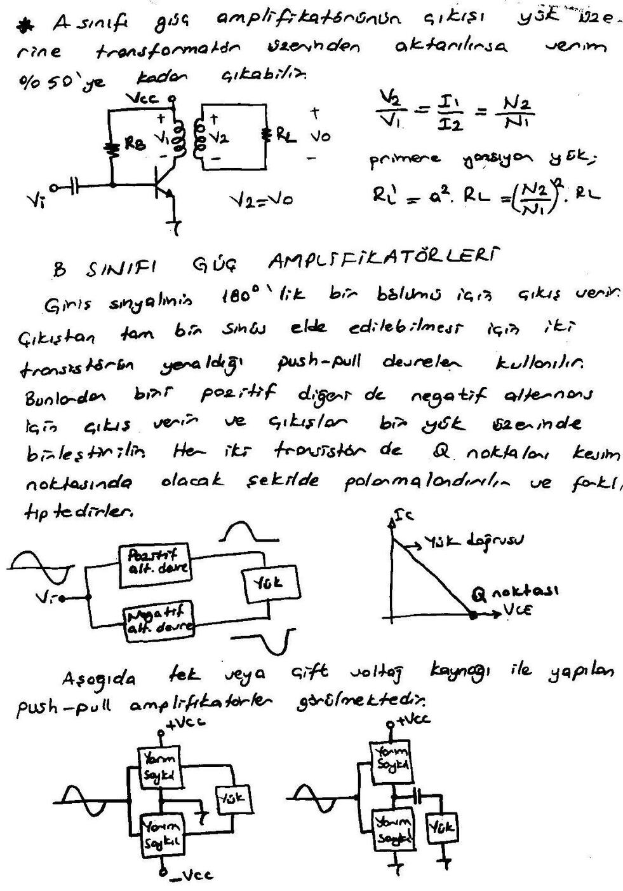

### Biasing of push-pull amplifiers and crossover distortion

If the transistors in a Class B push-pull amplifier are biased at cutoff, the ac input signal must exceed the V_BE voltages of the transistors in order to bring them into conduction. This appears as **distortion** on the output signal, because there is no output during these intervals (**crossover distortion**). To prevent this, the transistors must be biased slightly above cutoff. Two circuits are used for this: **voltage-divider bias** and the **diode-biased circuit**.

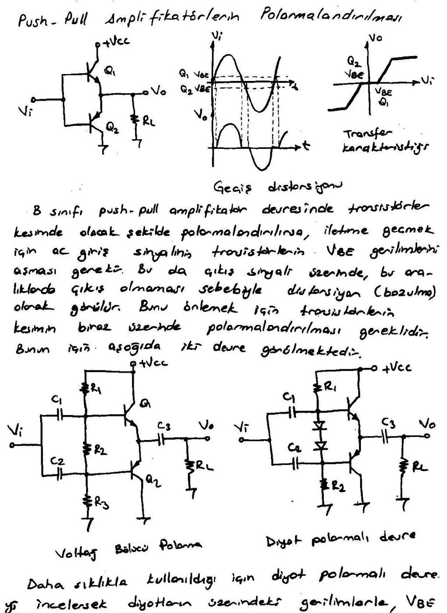

Examining the diode-biased circuit, since it is used more often, and assuming that the voltages across the diodes equal the V_BE voltages, **V_CEQ1 = V_CEQ2 = V_CC/2**. Considering that the transistors are biased close to cutoff, I_CQ ≅ 0.

**dc analysis:** R1 = R2 is chosen; V_A = V_CC/2. If the transistors are at cutoff (on the verge of conduction):

- I = (V_CC − 2V_d) / (R1 + R2)
- V_CEQ1 = V_CEQ2 = V_CC/2

**ac operation:** Each transistor conducts for one half cycle; the peak current in the load is I_C(sat) = V_CEQ / R_L.

**Maximum output power:**

- P_out = V_out(rms) · I_out(rms), V_out(rms) = 0.707 V_CEQ, I_out(rms) = 0.707 I_C(sat)
- **P_out = 0.5 · V_CEQ · I_C(sat)**
- With V_CEQ = V_CC/2, **P_out = 0.25 · V_CC · I_C(sat)**

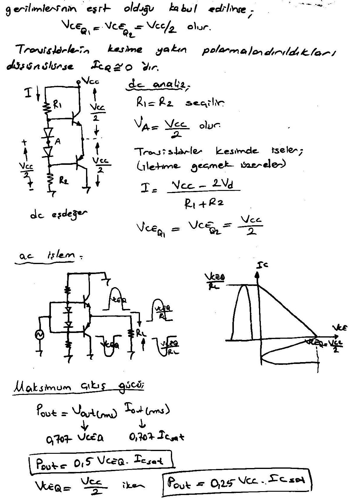

**dc input power:**

- P_dc = V_CC · I_CC, I_CC = I_C(sat) / π (average value)
- **P_dc = V_CC · I_C(sat) / π**

**Efficiency:** %η = (P_out / P_dc) · 100

**Maximum efficiency:** %η_max = (0.25 V_CC · I_C(sat)) / (V_CC · I_C(sat)/π) · 100 = 0.25π · 100 = **78.5%**

### Transformer-coupled push-pull circuit

If the bias point is chosen appropriately, Class AB operation is also possible. A transformer is connected at the output to match the impedance. Since both transistors are npn type, the input signals must have different phases; the input transformer provides this. However, using transformers leads to high cost, large size, and poor frequency response. Instead, push-pull circuits using a Darlington pair and a feedback pair, or dual-supply (V_CC1 = V_CC2, R1 = R2, R_E1 = R_E2) loudspeaker driver circuits, can be used.

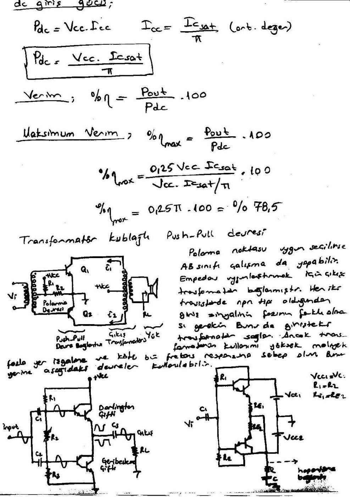

## Class C power amplifiers

A Class C amplifier is operated for an interval smaller than 180°; the Q point is below cutoff. The example circuit is biased below cutoff with a −V_BB source. For the transistor to conduct, the ac input signal must exceed V_BB + V_BE. That is, there is output only for the peak values of the input signal. Therefore, the transistor power loss is very low.

- Power dissipated by the transistor while conducting: **P_D(on) = V_CE(sat) · I_C(sat)**
- (Average) power dissipated over the signal period: **P_D(avg) = P_D(on) · t_on / T = (t_on / T) · V_CE(sat) · I_C(sat)**
- t_on: the time the transistor stays in conduction; T: the period of the input signal.

**Example:** A Class C amplifier is driven at 200 kHz. If the transistor conducts for 1 µs, with I_C(sat) = 100 mA and V_CE(sat) = 0.2 V, what is the average power dissipated by the transistor?

*Note: The notes do not contain a solution to this example. One finds T = 1/200 kHz = 5 µs, P_D(on) = 0.2 V · 100 mA = 20 mW, P_D(avg) = 20 mW · (1 µs / 5 µs) = 4 mW.*

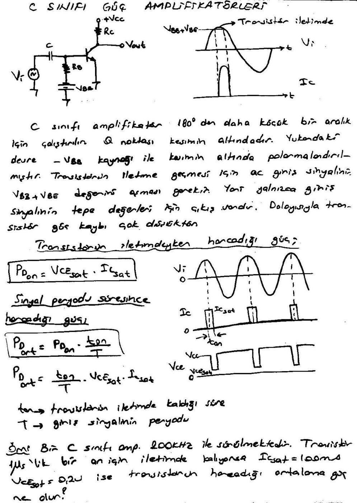

### Clamper bias

Instead of connecting a second source to the base to bias the transistor below cutoff, a clamper base bias formed by the base–emitter diode and capacitor C1 is used.

- C1 charges to V_p − 0.7 V as the input signal rises toward the positive peak.
- For the rest of the input signal, the capacitor is assumed not to discharge much. That is, the R1C1 time constant must be chosen very large so that the voltage across the capacitor does not change much. The base voltage swings around approximately −(V_p − 0.7 V).
- When the second positive alternation of the signal arrives, the input signal must exceed the capacitor voltage in order to bring the transistor into conduction. Thus the transistor operates only for the positive peaks of the input signal.

### Tank circuit

So that the output signal can be a complete sine wave, Class C amplifiers are used together with a **parallel resonant circuit (tank circuit)**. For the oscillations of the tank circuit to continue uninterrupted, the resonant frequency of the tank circuit must equal the frequency of the ac input signal of the circuit. Maximum output is obtained from the circuit in this case. The resonant frequency of the tank circuit is:

**f_r = 1 / (2π√(LC))**

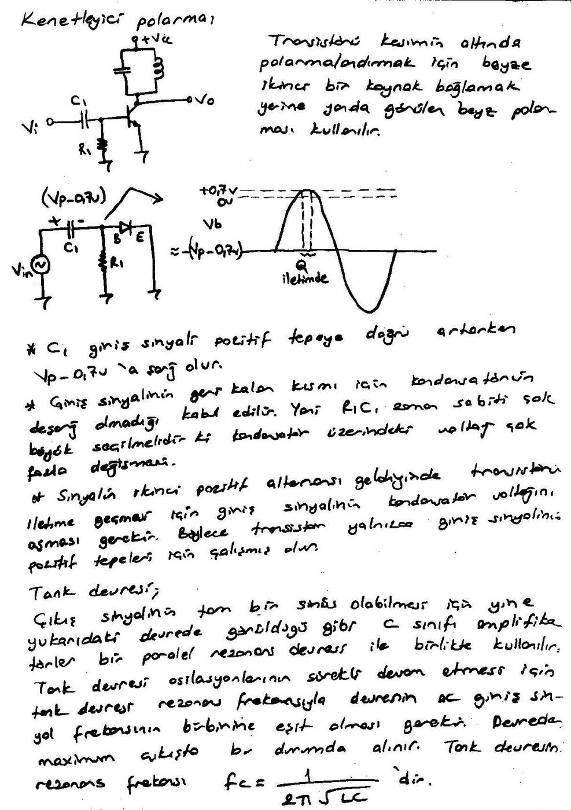

When the transistor conducts, the collector current pulse starts and sustains the oscillation of the tank circuit. Thus a complete sinusoidal signal is obtained at the output; the output swings between approximately +V_CC and −V_CC.

**Maximum output power:** The voltage across the tank circuit is approximately 2V_CC peak-to-peak.

- V_out(p-p) = 2V_CC, V_out(p) = V_CC, V_out(rms) = 0.707 V_CC
- **P_out = V_out(rms)² / R_c = 0.5 V_CC² / R_c** (R_c: tank circuit resistance)
- Total power: P_T = P_out + P_D(avg) = 0.5 V_CC² / R_c + (t_on/T) · V_CE(sat) · I_C(sat)
- Efficiency: %η = (P_out / P_T) · 100. If P_out ≫ P_D(avg), %η is approximately 100%.

**Example:** What is the efficiency of a Class C amplifier with P_D(avg) = 2 mW for V_CC = 24 V and R_c = 100 Ω?

- P_out = 0.5 V_CC² / R_c = 0.5 · 24² / 100 Ω = 2.88 W
- %η = 2.88 W / (2.88 W + 2 mW) · 100 = **99.93%**

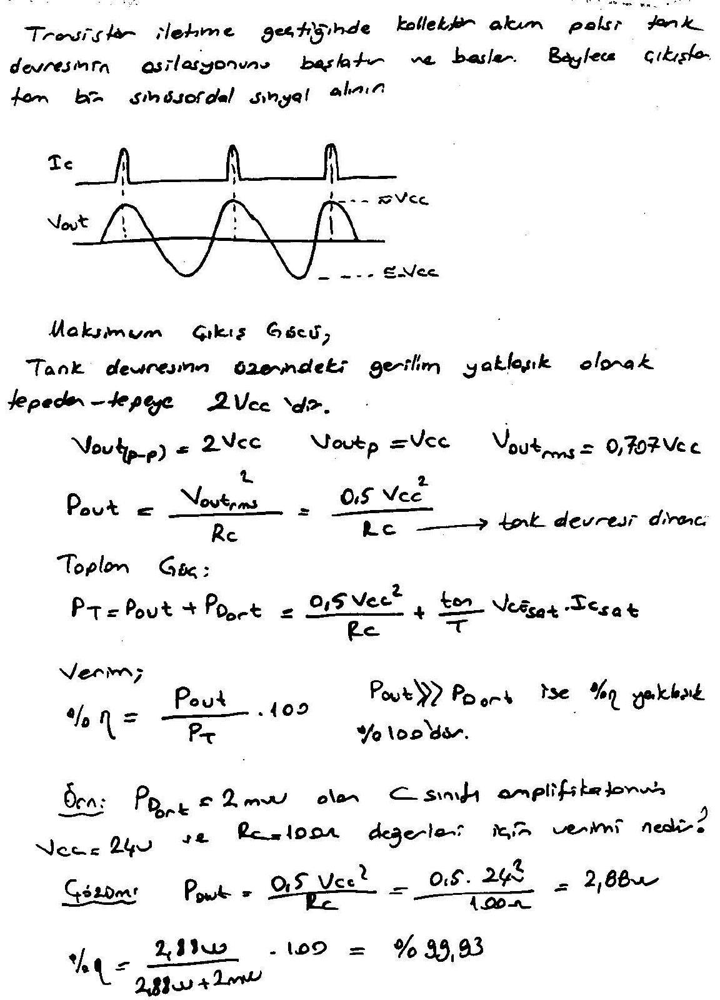

## Class D power amplifiers

Class D amplifiers are designed to operate with digital or pulse-type signals. Their efficiency is above 90%. In a Class D amplifier, the ac sinusoidal signal must first be converted into a pulse-type waveform, and the amplifier output must be converted back to its original form before being delivered to the load.

The input signal is compared with a sawtooth signal; the result is a digital waveform consisting of pulses that vary between 0 and +5 V, with widths that vary according to the input signal. Block diagram of a Class D amplifier: **sawtooth signal generator** and **V_i** → **comparator** → **amplifier** → **low-pass filter** (digital-to-sinusoidal conversion) → **V_o**; there is a **feedback** path from the output to the input.

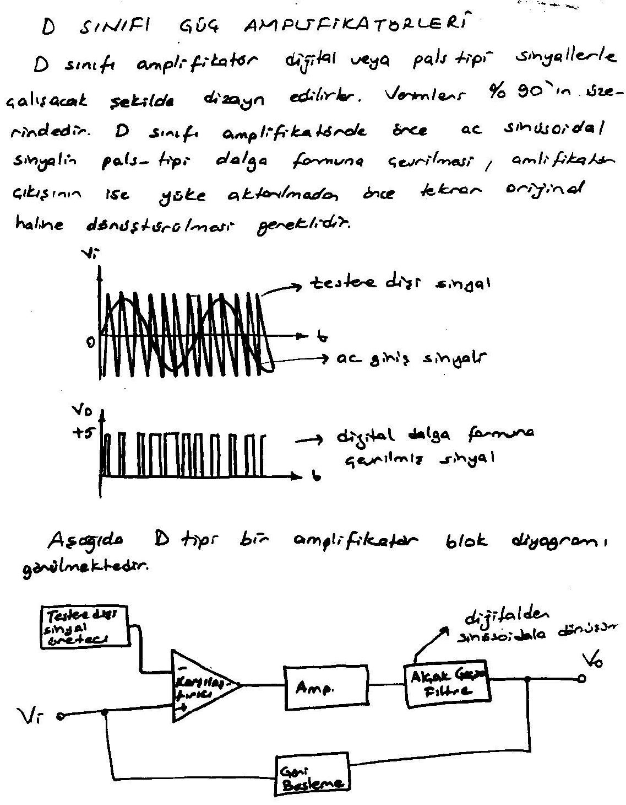

## Amplifier distortion

Any signal that varies over an interval of less than 360° has distortion. A sinusoidal signal varying positively and negatively over 360° has a single frequency, whereas a distorted signal has multiple frequency components, each with a different amplitude. These are called **harmonic components** or **harmonics**. For example, a signal that is originally 1000 Hz has, after distortion, a frequency component at 1000 Hz and harmonic components at 2 kHz, 3 kHz, 4 kHz, and so on. The original signal frequency (1 kHz) is called the **fundamental frequency**, and its integer multiples are called **harmonics**: the 2 kHz component is the second harmonic, and the 3 kHz component is the third harmonic.

**Harmonic distortion:** n-th harmonic distortion in % = **%D_n = (|A_n| / |A₁|) × 100%** (A₁: amplitude of the fundamental frequency, A_n: amplitude of the n-th frequency component)

**Total harmonic distortion:** **%THD = √(D₂² + D₃² + D₄² + …) × 100%**

**Example:** Calculate the percent harmonic distortions and the THD of a signal whose fundamental amplitude is 2.5 V, second harmonic amplitude is 0.25 V, third harmonic amplitude is 0.1 V, and fourth harmonic amplitude is 0.05 V.

- %D₂ = (0.25 V / 2.5 V) × 100 = 10%; D₃ = 4%; D₄ = 2%
- %THD = √(0.10² + 0.04² + 0.02²) × 100 = **10.95%**

### Power of a distorted signal

- Power produced by the fundamental frequency across the load resistance (R_C): P₁ = I₁² R_C / 2
- Total power produced by all harmonics: P = (I₁² + I₂² + I₃² + …) R_C / 2
- **P = (1 + D₂² + D₃² + …) I₁² R_C / 2 = (1 + THD²) P₁**

A distorted signal with harmonic components can be represented as the combination of the fundamental sinusoidal component V₁ sin ωt, the second harmonic −V₂ cos 2ωt, and the third harmonic V₃ sin 3ωt.

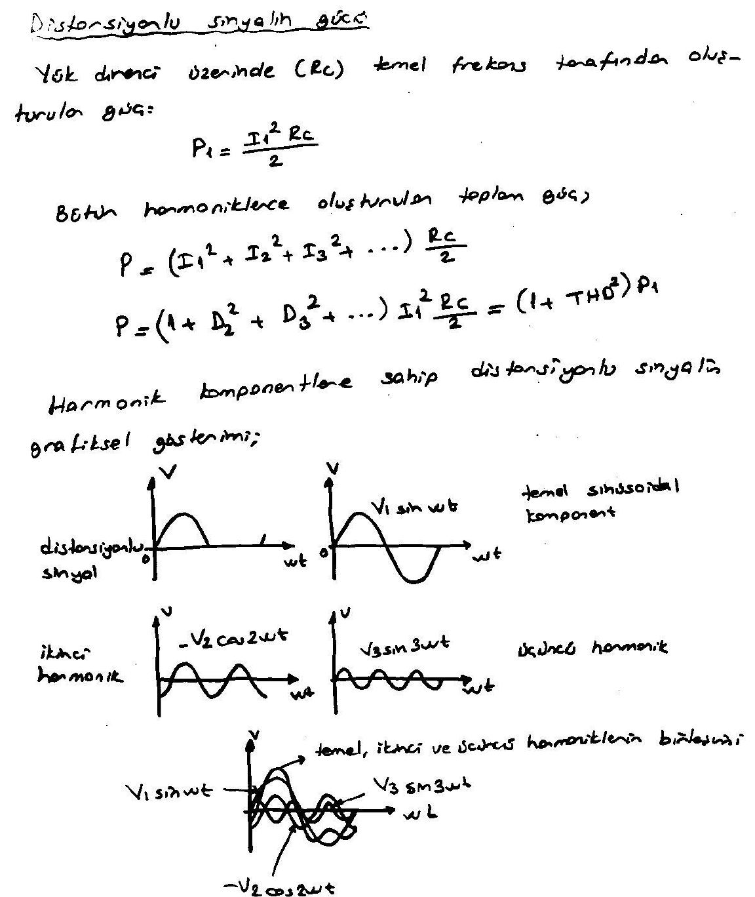

## Thermal effects in power transistors

As the transistor's temperature rises, the amount of power it can dissipate decreases. Typically the maximum junction temperature is 150–200 °C for silicon and 100–110 °C for germanium. The average power dissipation is **P_D = V_CE · I_C**. This power value is the power the transistor can dissipate at its room-temperature (25 °C) operating temperature; as the temperature increases, the power rating decreases:

**P_D(temp₁) = P_D(temp₀) − (temp₁ − temp₀) · (derating factor)**

**Example:** A transistor has a maximum power of 80 W at 25 °C. If the derating factor above 25 °C is 0.5 W/°C, find its power rating at 125 °C.

- P_D(125 °C) = P_D(25 °C) − (125 °C − 25 °C) · (0.5 W/°C) = 80 W − 50 W = **30 W**
