Bu yazı, Başkent Üniversitesi **EEM311 Elektronik II** dersinin **güç amplifikatörleri (güç yükselteçleri)** konusunu anlatan el yazısı ders notlarının taranmış sayfalarından hazırlandı. Notlarda yazar adı ve tarih yok; sayfalar dersin slayt/not klasöründe birlikte duruyordu. Başlıklar, tanımlar, formüller ve çözümlü örnekler metne aktarıldı; devre şemaları ve grafikler için ilgili sayfa görselleri eklendi. Taranmış sayfaların tamamı PDF olarak yazının sonunda indirilebilir.

## Güç amplifikatörlerinin sınıfları

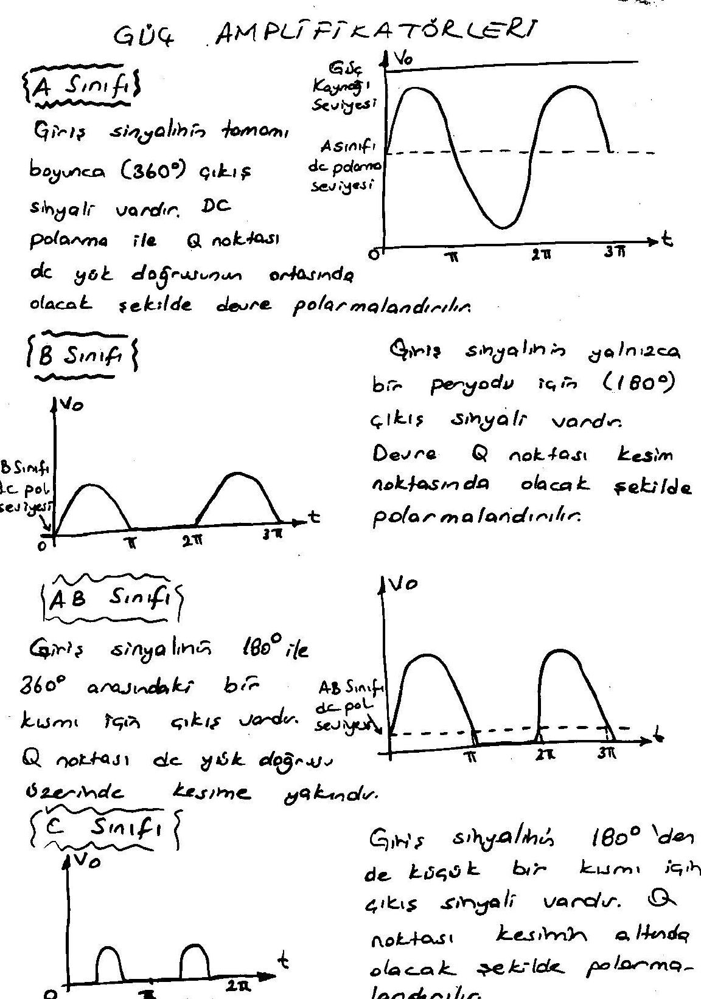

- **A sınıfı:** Giriş sinyalinin tamamı boyunca (360°) çıkış sinyali vardır. DC polarma ile Q noktası dc yük doğrusunun ortasında olacak şekilde devre polarmalandırılır.
- **B sınıfı:** Giriş sinyalinin yalnızca bir periyodu için (180°) çıkış sinyali vardır. Devre, Q noktası kesim noktasında olacak şekilde polarmalandırılır.
- **AB sınıfı:** Giriş sinyalinin 180° ile 360° arasındaki bir kısmı için çıkış vardır. Q noktası dc yük doğrusu üzerinde kesime yakındır.
- **C sınıfı:** Giriş sinyalinin 180°'den de küçük bir kısmı için çıkış sinyali vardır. Q noktası kesimin altında olacak şekilde polarmalandırılır.
- **D sınıfı:** D sınıfı amplifikatör yalnızca bir pals sinyali uygulandığında çalışır ve çıkış verir.

### Amplifikatör verimi

Güç amplifikatörlerinin verimi A'dan D'ye doğru artar. Yani transistör ne kadar uzun süre çalışırsa harcayacağı güç de artacağından, devrenin verimi (verim = çıkış gücü / giriş gücü) o kadar azalır.

| | A | AB | B | C | D |
|---|---|---|---|---|---|
| Çalışma saykılı | 360° | 180°–360° | 180° | 180°'den az | Pals |
| Verim | %25–%50 | %25 (%50) – %78,5 | %78,5 | > %78,5 (*) | > %90 |

(*) C sınıfı güç amplifikatörleri genellikle çok yüksek güçler için çalıştırılmazlar.

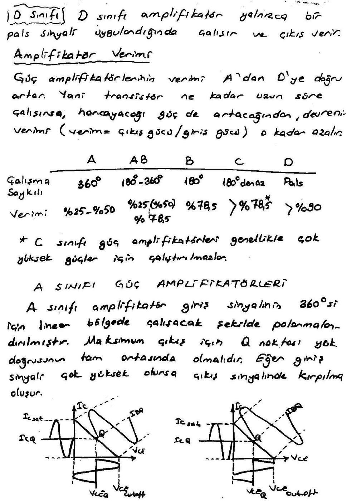

## A sınıfı güç amplifikatörleri

A sınıfı amplifikatör, giriş sinyalinin 360°'si için lineer bölgede çalışacak şekilde polarmalandırılmıştır. Maksimum çıkış için Q noktası yük doğrusunun tam ortasında olmalıdır. Eğer giriş sinyali çok yüksek olursa çıkış sinyalinde kırpılma oluşur. (Sayfadaki iki grafik, ortadaki Q noktası için I_C ve V_CE salınımını ve Q noktası kayınca oluşan kırpılmayı gösteriyor.)

- **Sükûnet gücü:** Herhangi bir ac sinyal uygulanmadığında transistörde harcanan güçtür. Transistörün minimum güç seviyesi en az bu kadar olmalıdır: **P_DQ = V_CEQ · I_CQ**
- **Giriş gücü:** DC voltaj kaynağının devreye verdiği güçtür: **P_i(dc) = V_CC · I_CC = V_CC · I_CQ**
- **Çıkış gücü:** Devrenin yüke aktardığı ac güçtür:
  - P_o(ac) = V_CE(rms) · I_C(rms) → Q noktası ortada ise
  - P_o(ac) = I_C(rms)² · R_C → Q noktası kesime yakın ise
  - P_o(ac) = V_CE(rms)² / R_C → Q noktası doyuma yakın ise
- **Verim:** Amplifikatörden alınan çıkış gücünün uygulanan giriş gücüne oranıdır: **%η = (P_o(ac) / P_i(dc)) · 100%**

### Maksimum verim

Maksimum verim için Q noktası yük doğrusunun tam ortasındadır:

- max V_CE(p-p) = V_CC, max I_C(p-p) = V_CC / R_C
- max P_o(ac) = V_CC · (V_CC/R_C) / 8 = **V_CC² / (8R_C)**
- max P_i(dc) = V_CC · max I_C = V_CC · (V_CC/R_C)/2 = **V_CC² / (2R_C)**
- max %η = (max P_o(ac) / max P_i(ac)) × 100 → **max %η = %25**

*Not: Son satırdaki paydada notta "P_i(ac)" yazıyor; doğrusu dc giriş gücü P_i(dc)'dir. Sonuç (%25) değişmez.*

### Örnek: A sınıfı amplifikatörün gücü ve verimi

Aşağıdaki A sınıfı güç amplifikatörünün a) minimum transistör gücünü, b) ac çıkış gücünü, c) verimini bulunuz. Devre: V_CC = +24 V, R1 = 5 kΩ, R2 = 1 kΩ, R_C = 300 Ω, R_E = 100 Ω (C_E ile köprülü), R_L = 300 Ω, C1 = 10 µF, C2 = 1 µF, C_E = 10 µF.

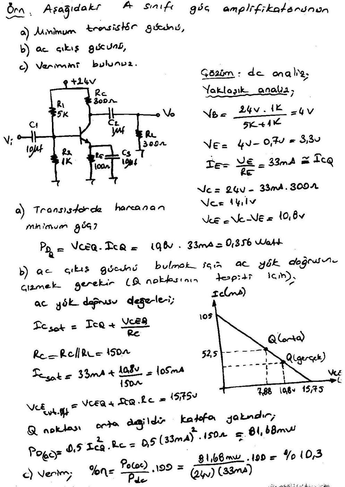

**Çözüm (dc analiz, yaklaşık analiz):**

- V_B = 24 V · 1k / (5k + 1k) = 4 V
- V_E = 4 V − 0,7 V = 3,3 V
- I_E = V_E / R_E = 33 mA ≅ I_CQ
- V_C = 24 V − 33 mA · 300 Ω = 14,1 V
- V_CE = V_C − V_E = 10,8 V

a) Transistörde harcanan minimum güç: P_DQ = V_CEQ · I_CQ = 10,8 V · 33 mA = **0,356 W**

b) ac çıkış gücünü bulmak için ac yük doğrusu çizilir (Q noktasının tespiti için):

- r_C = R_C // R_L = 150 Ω
- I_C(sat) = I_CQ + V_CEQ / r_C = 33 mA + 10,8 V / 150 Ω = 105 mA
- V_CE(cut-off) = V_CEQ + I_CQ · r_C = 15,75 V

Yük doğrusunun ortası 52,5 mA / 7,88 V'tur; gerçek Q noktası (33 mA, 10,8 V) ortada değildir, kesime yakındır:

- P_o(ac) = 0,5 · I_CQ² · r_C = 0,5 · (33 mA)² · 150 Ω = **81,68 mW**

c) Verim: %η = P_o(ac) / P_dc · 100 = 81,68 mW / (24 V · 33 mA) · 100 = **%10,3**

### Transformatör kuplajlı A sınıfı

A sınıfı güç amplifikatörünün çıkışı yük üzerine transformatör üzerinden aktarılırsa verim %50'ye kadar çıkabilir.

- V₂/V₁ = I₁/I₂ = N₂/N₁, V₂ = V_o
- Primere yansıyan yük: **R_L' = a² · R_L = (N₂/N₁)² · R_L**

*Not: a = N₁/N₂ (primer/sekonder) tanımıyla yansıyan yük R_L' = (N₁/N₂)² · R_L olur; notta oran ters yazılmış.*

## B sınıfı güç amplifikatörleri

Giriş sinyalinin 180°'lik bir bölümü için çıkış verir. Çıkıştan tam bir sinüs elde edilebilmesi için iki transistörün yer aldığı **push-pull** devreler kullanılır. Bunlardan biri pozitif, diğeri de negatif alternans için çıkış verir ve çıkışlar bir yük üzerinde birleştirilir. Her iki transistör de Q noktaları kesim noktasında olacak şekilde polarmalandırılır ve farklı tiptedirler. Push-pull amplifikatörler tek veya çift voltaj kaynağı ile yapılabilir.

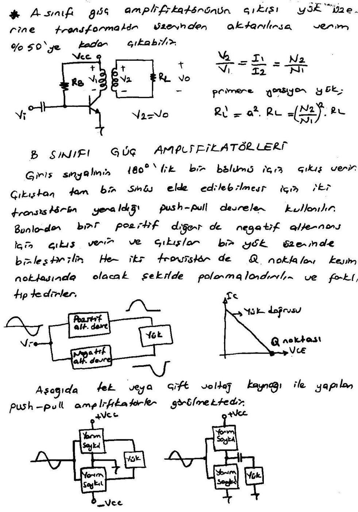

### Push-pull amplifikatörlerin polarmalandırılması ve geçiş distorsiyonu

B sınıfı push-pull amplifikatör devresinde transistörler kesimde olacak şekilde polarmalandırılırsa, iletime geçmek için ac giriş sinyalinin transistörlerin V_BE gerilimlerini aşması gerekir. Bu da çıkış sinyali üzerinde, bu aralıklarda çıkış olmaması sebebiyle **distorsiyon (bozulma)** olarak görülür (**geçiş distorsiyonu**). Bunu önlemek için transistörlerin kesimin biraz üzerinde polarmalandırılması gereklidir. Bunun için iki devre kullanılır: **voltaj bölücü polarma** ve **diyot polarmalı devre**.

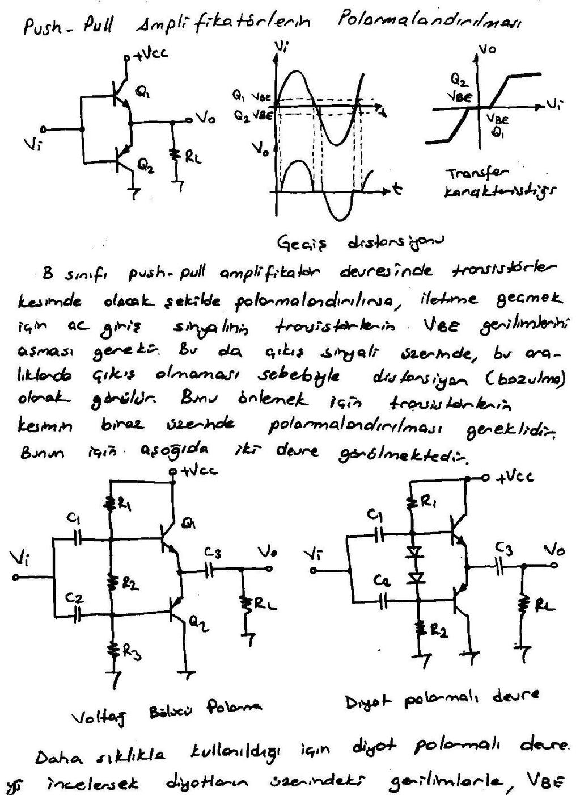

Daha sıklıkla kullanıldığı için diyot polarmalı devreyi incelersek, diyotların üzerindeki gerilimlerle V_BE gerilimlerinin eşit olduğu kabul edilirse **V_CEQ1 = V_CEQ2 = V_CC/2** olur. Transistörlerin kesime yakın polarmalandırıldıkları düşünülürse I_CQ ≅ 0'dır.

**dc analiz:** R1 = R2 seçilir; V_A = V_CC/2 olur. Transistörler kesimde iseler (iletime geçmek üzereler):

- I = (V_CC − 2V_d) / (R1 + R2)
- V_CEQ1 = V_CEQ2 = V_CC/2

**ac işlem:** Her transistör bir yarım saykıl iletir; yük üzerinde tepe akımı I_C(sat) = V_CEQ / R_L olur.

**Maksimum çıkış gücü:**

- P_out = V_out(rms) · I_out(rms), V_out(rms) = 0,707 V_CEQ, I_out(rms) = 0,707 I_C(sat)
- **P_out = 0,5 · V_CEQ · I_C(sat)**
- V_CEQ = V_CC/2 iken **P_out = 0,25 · V_CC · I_C(sat)**

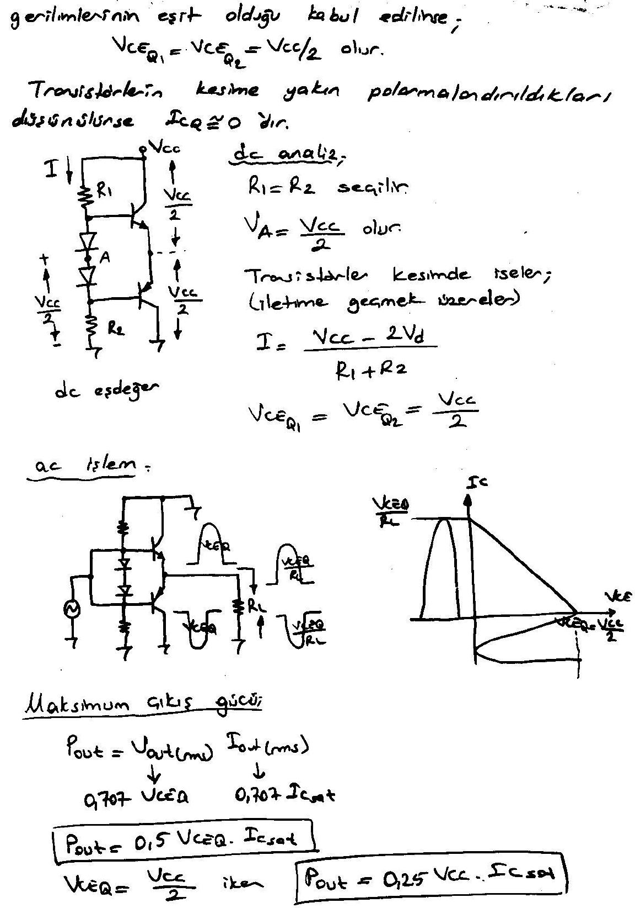

**dc giriş gücü:**

- P_dc = V_CC · I_CC, I_CC = I_C(sat) / π (ortalama değer)
- **P_dc = V_CC · I_C(sat) / π**

**Verim:** %η = (P_out / P_dc) · 100

**Maksimum verim:** %η_max = (0,25 V_CC · I_C(sat)) / (V_CC · I_C(sat)/π) · 100 = 0,25π · 100 = **%78,5**

### Transformatör kuplajlı push-pull devresi

Polarma noktası uygun seçilirse AB sınıfı çalışma da yapabilir. Empedansı uygunlaştırmak için çıkışa transformatör bağlanmıştır. Her iki transistör de npn tipi olduğundan giriş sinyalinin fazının farklı olması gerekir; bunu da giriş transformatörü sağlar. Ancak transformatörün kullanımı yüksek maliyet, fazla yer işgali ve kötü bir frekans cevabına sebep olur. Bunun yerine Darlington çifti ve geri beslemeli çift kullanan push-pull devreler ya da çift kaynaklı (V_CC1 = V_CC2, R1 = R2, R_E1 = R_E2) hoparlör sürücü devreleri kullanılabilir.

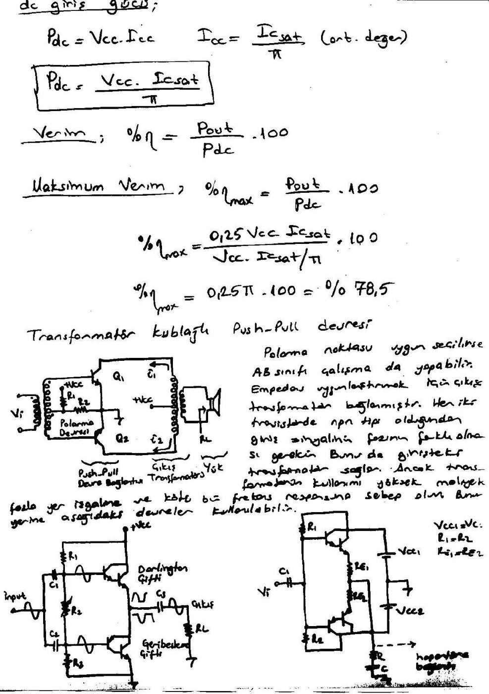

## C sınıfı güç amplifikatörleri

C sınıfı amplifikatör 180°'den daha küçük bir aralık için çalıştırılır; Q noktası kesimin altındadır. Örnek devre −V_BB kaynağı ile kesimin altında polarmalandırılmıştır. Transistörün iletime geçmesi için ac giriş sinyalinin V_BB + V_BE değerini aşması gerekir. Yani yalnızca giriş sinyalinin tepe değerleri için çıkış vardır. Dolayısıyla transistör güç kaybı çok düşüktür.

- Transistörün iletimdeyken harcadığı güç: **P_D(on) = V_CE(sat) · I_C(sat)**
- Sinyal periyodu süresince harcadığı (ortalama) güç: **P_D(ort) = P_D(on) · t_on / T = (t_on / T) · V_CE(sat) · I_C(sat)**
- t_on: transistörün iletimde kaldığı süre; T: giriş sinyalinin periyodu.

**Örnek:** Bir C sınıfı amplifikatör 200 kHz ile sürülmektedir. Transistör 1 µs'lik bir an için iletimde kalıyorsa, I_C(sat) = 100 mA, V_CE(sat) = 0,2 V ise transistörün harcadığı ortalama güç ne olur?

*Not: Notta bu örneğin çözümü yok. T = 1/200 kHz = 5 µs, P_D(on) = 0,2 V · 100 mA = 20 mW, P_D(ort) = 20 mW · (1 µs / 5 µs) = 4 mW bulunur.*

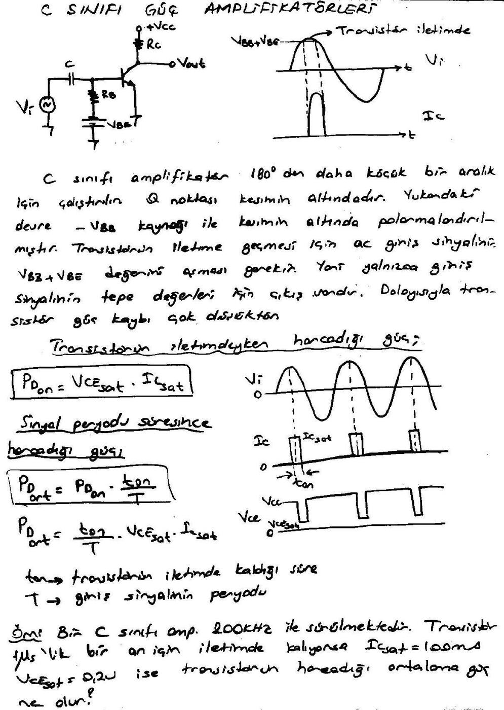

### Kenetleyici polarma

Transistörü kesimin altında polarmalandırmak için beyze ikinci bir kaynak bağlamak yerine, beyz–emiter diyotu ile C1 kondansatörünün oluşturduğu kenetleyici (clamper) beyz polarması kullanılır.

- C1, giriş sinyali pozitif tepeye doğru artarken V_p − 0,7 V'a şarj olur.
- Giriş sinyalinin geri kalan kısmı için kondansatörün çok deşarj olmadığı kabul edilir. Yani R1C1 zaman sabiti çok büyük seçilmelidir ki kondansatör üzerindeki voltaj çok fazla değişmesin. Beyz gerilimi yaklaşık −(V_p − 0,7 V) etrafında salınır.
- Sinyalin ikinci pozitif alternansı geldiğinde transistörü iletime geçirmek için giriş sinyalinin kondansatör voltajını aşması gerekir. Böylece transistör yalnızca giriş sinyalinin pozitif tepeleri için çalışmış olur.

### Tank devresi

Çıkış sinyalinin tam bir sinüs olabilmesi için C sınıfı amplifikatörler bir **paralel rezonans devresi (tank devresi)** ile birlikte kullanılır. Tank devresi osilasyonlarının sürekli devam etmesi için tank devresi rezonans frekansıyla devrenin ac giriş sinyal frekansının birbirine eşit olması gerekir. Devreden maksimum çıkış bu durumda alınır. Tank devresinin rezonans frekansı:

**f_r = 1 / (2π√(LC))**

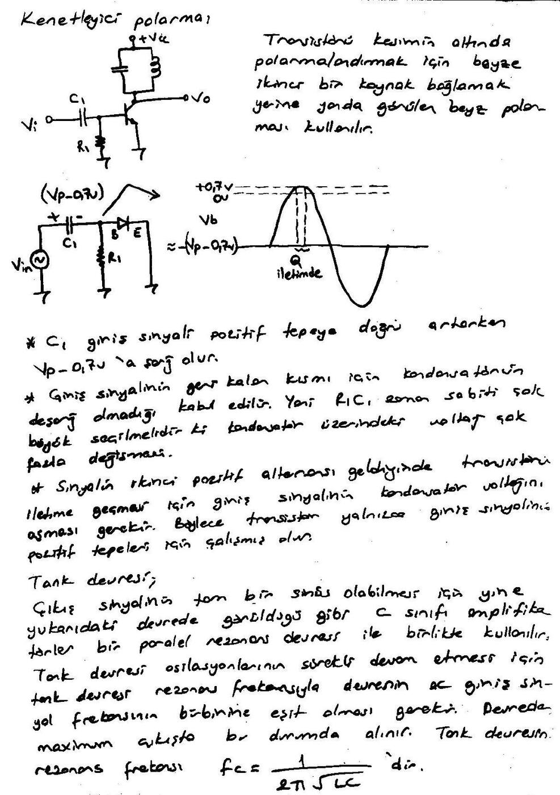

Transistör iletime geçtiğinde kollektör akım palsı tank devresinin osilasyonunu başlatır ve besler. Böylece çıkışta tam bir sinüsoidal sinyal alınır; çıkış yaklaşık +V_CC ile −V_CC arasında salınır.

**Maksimum çıkış gücü:** Tank devresinin üzerindeki gerilim yaklaşık olarak tepeden tepeye 2V_CC'dir.

- V_out(p-p) = 2V_CC, V_out(p) = V_CC, V_out(rms) = 0,707 V_CC
- **P_out = V_out(rms)² / R_c = 0,5 V_CC² / R_c** (R_c: tank devresi direnci)
- Toplam güç: P_T = P_out + P_D(ort) = 0,5 V_CC² / R_c + (t_on/T) · V_CE(sat) · I_C(sat)
- Verim: %η = (P_out / P_T) · 100. P_out ≫ P_D(ort) ise %η yaklaşık %100'dür.

**Örnek:** P_D(ort) = 2 mW olan C sınıfı amplifikatörün V_CC = 24 V ve R_c = 100 Ω değerleri için verimi nedir?

- P_out = 0,5 V_CC² / R_c = 0,5 · 24² / 100 Ω = 2,88 W
- %η = 2,88 W / (2,88 W + 2 mW) · 100 = **%99,93**

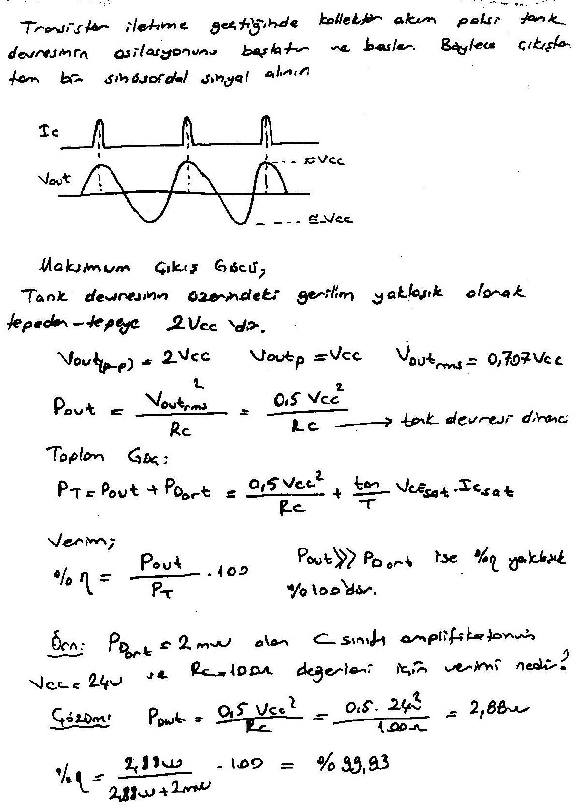

## D sınıfı güç amplifikatörleri

D sınıfı amplifikatörler dijital veya pals tipi sinyallerle çalışacak şekilde dizayn edilirler. Verimleri %90'ın üzerindedir. D sınıfı amplifikatörde önce ac sinüsoidal sinyalin pals tipi dalga formuna çevrilmesi, amplifikatör çıkışının ise yüke aktarılmadan önce tekrar orijinal hâline dönüştürülmesi gereklidir.

Giriş sinyali bir testere dişi sinyalle karşılaştırılır; sonuç, 0 ile +5 V arasında değişen, genişliği giriş sinyaline göre değişen palslerden oluşan dijital dalga formudur. D tipi bir amplifikatörün blok diyagramı: **testere dişi sinyal üreteci** ve **V_i** → **karşılaştırıcı** → **amplifikatör** → **alçak geçiren filtre** (dijitalden sinüsoidale dönüşüm) → **V_o**; çıkıştan girişe bir **geri besleme** yolu vardır.

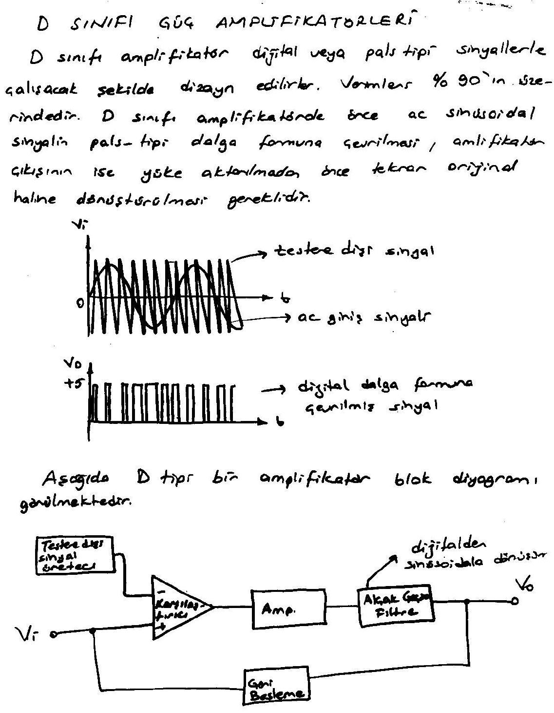

## Amplifikatör distorsiyonu

Herhangi bir sinyal 360°'den daha az bir aralık için değişiyorsa distorsiyona sahiptir. 360° için pozitif ve negatif olarak değişen bir sinüsoidal sinyal tek bir frekansa sahipken, distorsiyonlu sinyal her biri farklı genlik değerlerine sahip birden fazla frekans bileşenine sahiptir. Bunlara **harmonik elemanlar** ya da **harmonikler** denir. Örneğin orijinal olarak 1000 Hz olan bir sinyal distorsiyondan sonra 1000 Hz'lik bir frekans komponentine ve 2 kHz, 3 kHz, 4 kHz, … gibi harmonik komponentlerine sahiptir. Orijinal sinyal frekansına (1 kHz) **temel frekans**, bunun tam sayı katlarına **harmonikler** denir: 2 kHz'lik komponent ikinci harmonik, 3 kHz'lik komponent üçüncü harmoniktir.

**Harmonik distorsiyon:** %n. harmonik distorsiyon = **%D_n = (|A_n| / |A₁|) × 100%** (A₁: temel frekansın genliği, A_n: n. frekans komponentinin genliği)

**Toplam harmonik distorsiyon:** **%THD = √(D₂² + D₃² + D₄² + …) × 100%**

**Örnek:** Temel genliği 2,5 V, ikinci harmonik genliği 0,25 V, üçüncü harmonik genliği 0,1 V, dördüncü harmonik genliği 0,05 V olan sinyalin % harmonik distorsiyonlarını ve THD'sini hesaplayınız.

- %D₂ = (0,25 V / 2,5 V) × 100 = %10; D₃ = %4; D₄ = %2
- %THD = √(0,10² + 0,04² + 0,02²) × 100 = **%10,95**

### Distorsiyonlu sinyalin gücü

- Yük direnci (R_C) üzerinde temel frekans tarafından oluşturulan güç: P₁ = I₁² R_C / 2
- Bütün harmoniklerce oluşturulan toplam güç: P = (I₁² + I₂² + I₃² + …) R_C / 2
- **P = (1 + D₂² + D₃² + …) I₁² R_C / 2 = (1 + THD²) P₁**

Harmonik komponentlere sahip distorsiyonlu sinyal; temel sinüsoidal komponent V₁ sin ωt, ikinci harmonik −V₂ cos 2ωt ve üçüncü harmonik V₃ sin 3ωt'nin birleşimi olarak gösterilebilir.

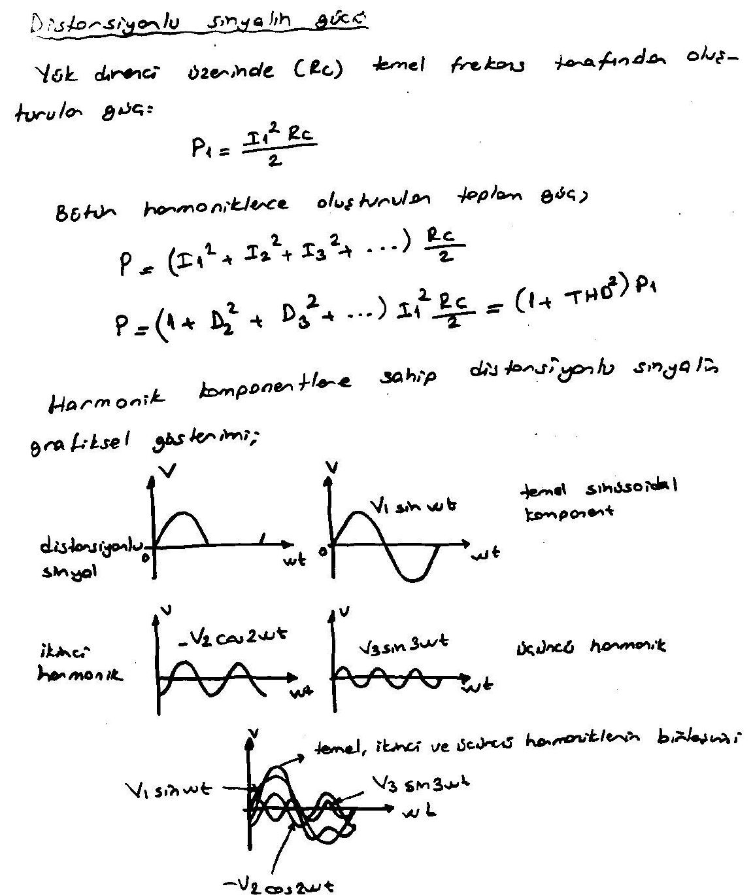

## Güç transistörü ısı etkisi

Transistörün ısısı arttıkça üzerinde harcayacağı güç miktarı düşer. Tipik olarak maksimum birleşim sıcaklığı silisyum için 150–200 °C, germanyum için 100–110 °C'dir. Ortalama güç harcaması **P_D = V_CE · I_C**'dir. Bu güç değeri transistörün oda sıcaklığındaki (25 °C) çalışma ısısında harcayacağı güçtür; sıcaklık arttıkça güç miktarı düşecektir:

**P_D(sıcaklık₁) = P_D(sıcaklık₀) − (sıcaklık₁ − sıcaklık₀) · (azalma faktörü)**

**Örnek:** 25 °C'de maksimum gücü 80 W olarak verilen bir transistörün 25 °C'nin üzerindeki sıcaklıklarda azalma faktörü 0,5 W/°C ise 125 °C'deki gücünü bulunuz.

- P_D(125 °C) = P_D(25 °C) − (125 °C − 25 °C) · (0,5 W/°C) = 80 W − 50 W = **30 W**
