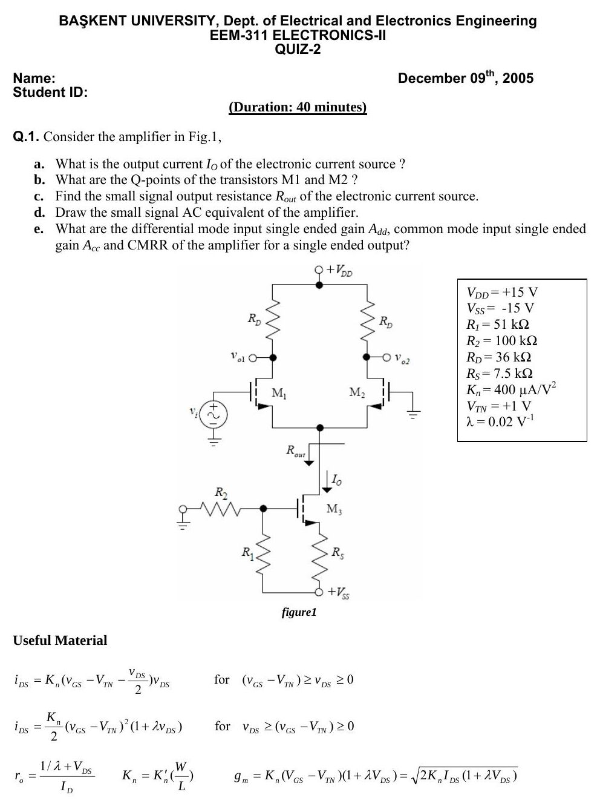
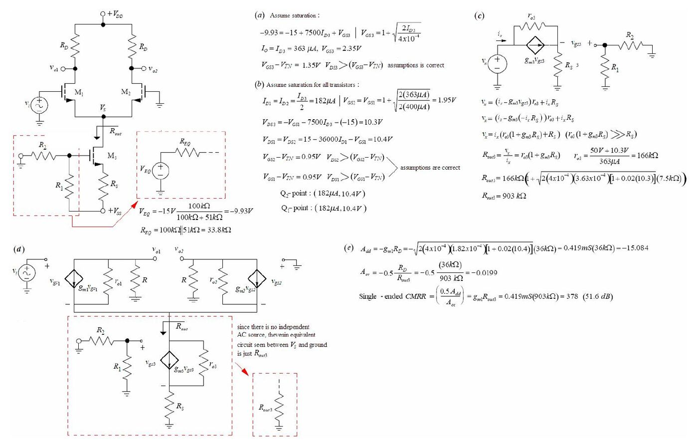
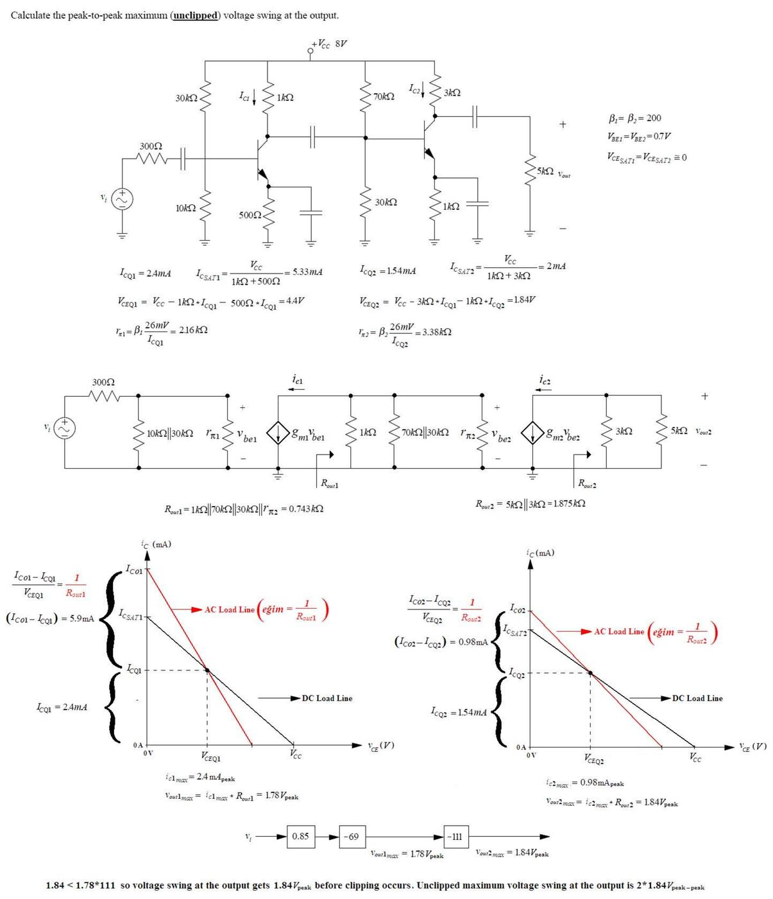

This post contains the **2nd quiz (Quiz-2)** of the Başkent University **EEM-311 Electronics-II** course, dated 9 December 2005, together with the solution prepared by the course's teaching assistant. The same folder also held a 2006 **worked example** (maximum unclipped output swing in a two-stage amplifier) and only the cover page of the 18 November 2005 midterm exam solution. The exam lasted 40 minutes and the paper was in English. The original PDFs with their passwords removed and the cover scan are available at the end of the post as a ZIP download.

## Quiz-2 (9 December 2005)

**Q.1.** Consider the amplifier in Fig.1,

1. What is the output current I_O of the electronic current source?
1. What are the Q-points of the transistors M1 and M2?
1. Find the small signal output resistance R_out of the electronic current source.
1. Draw the small signal AC equivalent of the amplifier.
1. What are the differential mode input single ended gain A_dd, common mode input single ended gain A_cc and CMRR of the amplifier for a single ended output?

Values: V_DD = +15 V, V_SS = −15 V, R₁ = 51 kΩ, R₂ = 100 kΩ, R_D = 36 kΩ, R_S = 7.5 kΩ, K_n = 400 µA/V², V_TN = +1 V, λ = 0.02 V⁻¹.

Circuit: M₁ and M₂ form an NMOS differential pair, with R_D (to V_DD) in their drains, outputs v_o1 and v_o2; v_i is applied to the gate of M₁, and the gate of M₂ is grounded. The common source node is fed by the current source M₃: the gate of M₃ sits on the divider formed by R₂ (to ground) and R₁ (to V_SS), and its source is connected to V_SS through R_S.

Formulas given in the exam ("Useful Material"):

- i_DS = K_n(v_GS − V_TN − v_DS/2)·v_DS, for (v_GS − V_TN) ≥ v_DS ≥ 0
- i_DS = (K_n/2)(v_GS − V_TN)²(1 + λv_DS), for v_DS ≥ (v_GS − V_TN) ≥ 0
- r_o = (1/λ + V_DS)/I_D, K_n = K_n'(W/L), g_m = K_n(V_GS − V_TN)(1 + λV_DS) = √(2K_n·I_DS(1 + λV_DS))

## Solution

### (a) Output current of the current source

- V_EQ = −15 V·100 kΩ/(100 kΩ + 51 kΩ) = **−9.93 V**, R_EQ = 100 kΩ ∥ 51 kΩ = **33.8 kΩ**
- Assuming saturation: −9.93 = −15 + 7500·I_D3 + V_GS3, V_GS3 = 1 + √(2I_D3/4·10⁻⁴)
- **I_O = I_D3 = 363 µA**, V_GS3 = 2.35 V; V_GS3 − V_TN = 1.35 V < V_DS3 → the assumption is correct.

### (b) Q-points of M₁ and M₂

- I_D1 = I_D2 = I_D3/2 = **182 µA**, V_GS1 = V_GS2 = 1 + √(2·182 µA/400 µA/V²) = **1.95 V**
- V_DS3 = −V_GS1 − 7500·I_D3 − (−15) = **10.3 V**
- V_DS1 = V_DS2 = 15 − 36 000·I_D1 − (−V_GS1) = **10.4 V**; V_GS − V_TN = 0.95 V → the saturation assumption is correct.
- **Q-point of Q₁ and Q₂: (182 µA; 10.4 V)**

### (c) Output resistance of the current source

- v_x = i_x(r_o3(1 + g_m3·R_S) + R_S) → R_out3 ≅ r_o3·(1 + g_m3·R_S)
- r_o3 = (50 V + 10.3 V)/363 µA = **166 kΩ**
- R_out3 = 166 kΩ·(1 + √(2·(4·10⁻⁴)·(3.63·10⁻⁴)·[1 + 0.02·10.3])·(7.5 kΩ)) = **903 kΩ**

### (d) AC equivalent circuit

Since there is no independent AC source, the Thévenin equivalent seen between node V_S and ground is simply R_out3; M₁ and M₂ are modeled with g_m·v_gs, r_o and R_D, and their sources are connected to ground through R_out3 at the common node.

### (e) Gains and CMRR

- A_dd = −g_m1·R_D = −√(2·(4·10⁻⁴)·(1.82·10⁻⁴)·[1 + 0.02·10.4])·(36 kΩ) = −0.419 mS·36 kΩ = **−15.084**
- A_cc = −0.5·R_D/R_out3 = −0.5·36 kΩ/903 kΩ = **−0.0199**
- Single-ended **CMRR = 0.5·A_dd/A_cc = g_m1·R_out3 = 0.419 mS·903 kΩ = 378 (51.6 dB)**

*Note: In the solution, A_dd = −g_m·R_D is the gain between the two outputs (differential output); the single-ended output gain that the question asks for is half of this, |A_dd| ≈ 7.54 (the 0.5 factor in the CMRR calculation accounts for this, so the result of 378 is correct). Also, if the r_o1 ≈ 333 kΩ in the AC equivalent circuit is taken into account, the gain magnitude decreases slightly: g_m1·(R_D ∥ r_o1) ≈ 13.6 (single-ended ≈ 6.8).*

## Worked example: Maximum unclipped output swing (2006)

> Calculate the peak-to-peak maximum (unclipped) voltage swing at the output.

Circuit: V_CC = 8 V, two-stage RC-coupled common-emitter amplifier. First stage: base divider 30 kΩ / 10 kΩ, R_C1 = 1 kΩ, R_E1 = 500 Ω (bypassed), source resistance 300 Ω. Second stage: base divider 70 kΩ / 30 kΩ, R_C2 = 3 kΩ, R_E2 = 1 kΩ (bypassed), load 5 kΩ. β₁ = β₂ = 200, V_BE = 0.7 V, V_CE(sat) ≅ 0.

**First stage:**

- I_CQ1 = 2.4 mA, I_C(sat)1 = V_CC/(1 kΩ + 500 Ω) = 5.33 mA
- V_CEQ1 = V_CC − 1 kΩ·I_CQ1 − 500 Ω·I_CQ1 = **4.4 V**
- r_π1 = β₁·26 mV/I_CQ1 = **2.16 kΩ**
- R_out1 = 1 kΩ ∥ 70 kΩ ∥ 30 kΩ ∥ r_π2 = **0.743 kΩ** (the slope of the AC load line is 1/R_out1)
- Since I_Co1 − I_CQ1 = V_CEQ1/R_out1 = 5.9 mA > I_CQ1, clipping occurs first at cutoff: i_c1,max = **2.4 mA peak**, v_out1,max = i_c1,max·R_out1 = **1.78 V peak**

**Second stage:**

- I_CQ2 = 1.54 mA, I_C(sat)2 = V_CC/(1 kΩ + 3 kΩ) = 2 mA
- V_CEQ2 = V_CC − 3 kΩ·I_CQ2 − 1 kΩ·I_CQ2 = **1.84 V**
- r_π2 = β₂·26 mV/I_CQ2 = **3.38 kΩ**
- R_out2 = 5 kΩ ∥ 3 kΩ = **1.875 kΩ**
- Since I_Co2 − I_CQ2 = V_CEQ2/R_out2 = 0.98 mA < I_CQ2, clipping occurs first in saturation: i_c2,max = **0.98 mA peak**, v_out2,max = **1.84 V peak**

**Gain chain:** v_i → 0.85 (input divider) → −69 (1st stage) → −111 (2nd stage).

> 1.84 < 1.78·111 so voltage swing at the output gets 1.84 V_peak before clipping occurs. Unclipped maximum voltage swing at the output is 2·1.84 V_peak-peak.

That is, the output of the second stage clips at 1.84 V peak, long before reaching the first-stage limit (1.78·111 ≈ 198 V): **the maximum unclipped output swing is 2·1.84 = 3.68 V peak-to-peak**.

*Note: In the source, the V_CEQ2 formula is written as "V_CC − 3kΩ·I_CQ1 − 1kΩ·I_CQ2"; the first term should be I_CQ2 (the result of 1.84 V is correct with I_CQ2). Check: I_CQ1 = (2 − 0.7)/(7.5 kΩ + 201·0.5 kΩ)·200 ≈ 2.4 mA, I_CQ2 = (2.4 − 0.7)/(21 kΩ + 201·1 kΩ)·200 ≈ 1.53 mA; the stage gains g_m1·R_out1 ≈ 69 and g_m2·R_out2 ≈ 111 are correct.*

## Midterm exam cover (18 November 2005)

The same folder contained only the cover page of the midterm exam solutions (the other pages of the 11-page solution are missing from the archive): *Başkent University, Department of Electrical and Electronics Engineering, EEM-311 Analog Electronics, Midterm Exam, Nov. 18, 2005, 9:30, 110 minutes*; the name field reads "SOLUTION".

| Question | Required time (min) | Points |
| --- | --- | --- |
| 1 | 10 | 10 |
| 2 | 15 | 20 |
| 3 | 20 | 25 |
| 4 | 20 | 25 |
| 5 | 15 | 20 |
| TOTAL | 80 | 100 |

> IMPORTANT: Please, review all the questions and decide in which order you will attempt to answer them. Write your solution and answers into the space provided for each question. GOOD LUCK.
