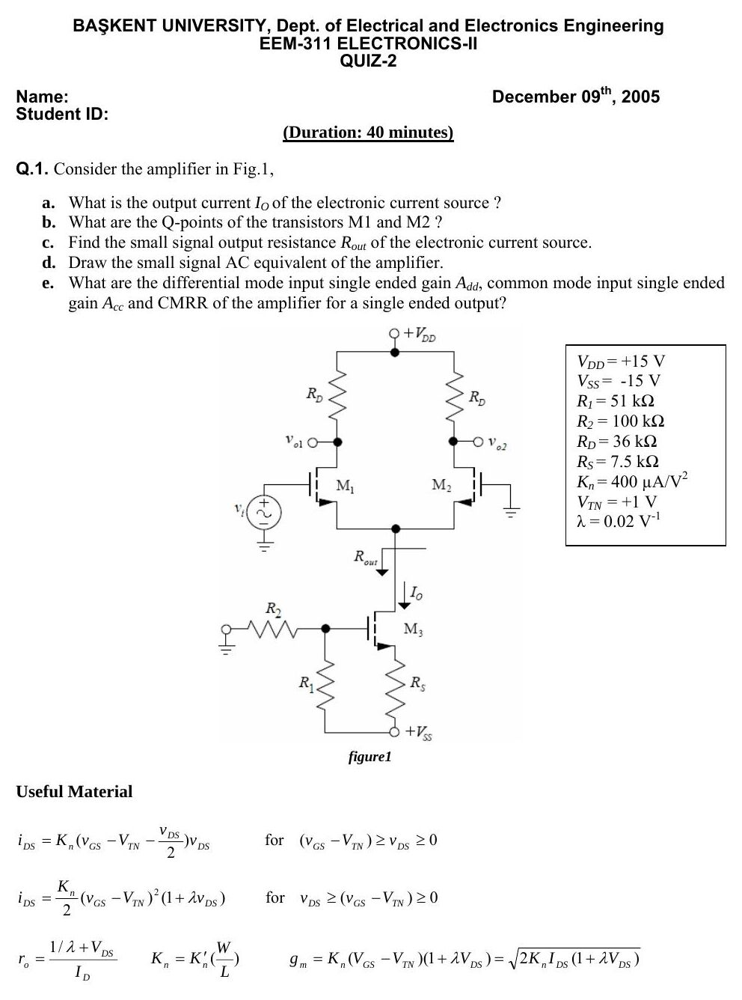
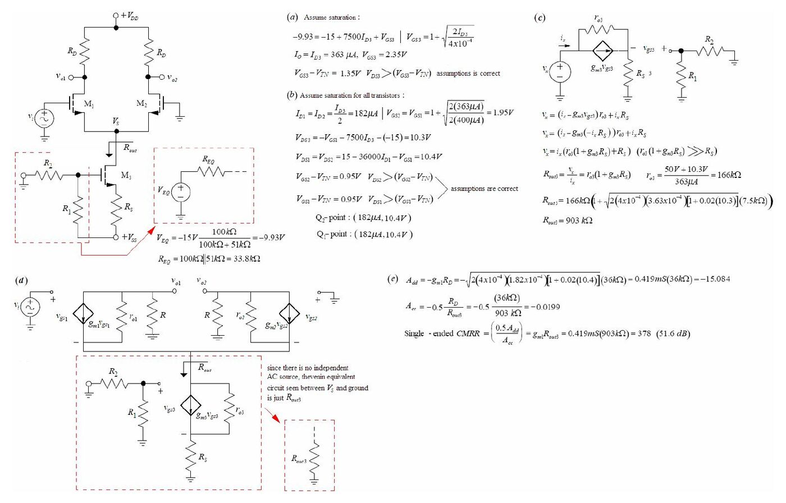
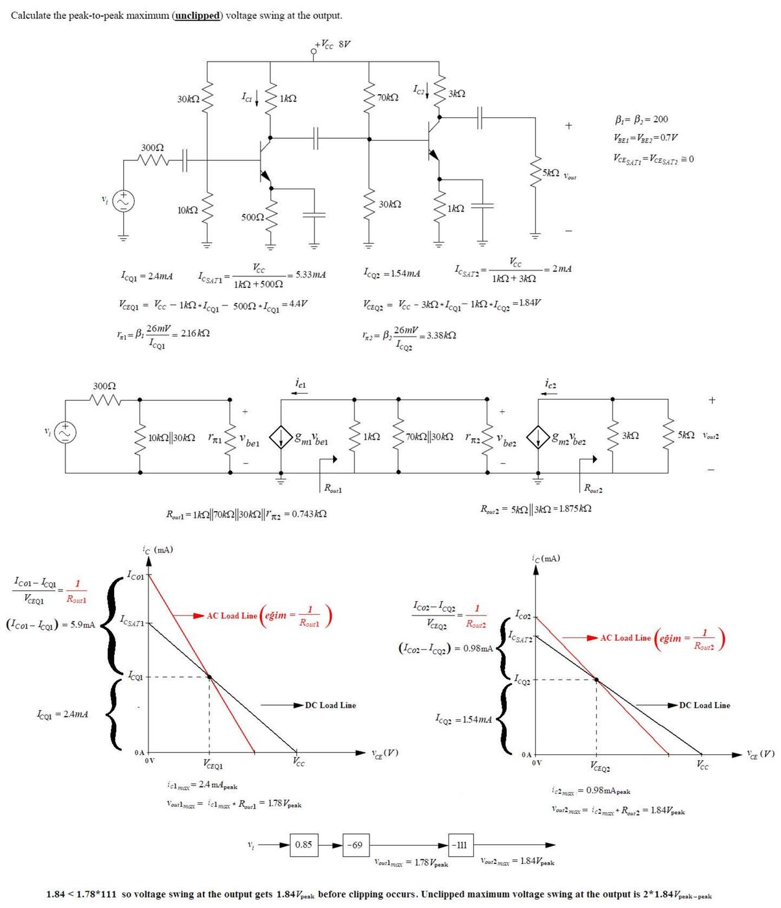

Bu yazı, Başkent Üniversitesi **EEM-311 Electronics-II** dersinin 9 Aralık 2005 tarihli **2. kısa sınavını (Quiz-2)** ve dersin asistanının hazırladığı çözümünü içeriyor. Aynı klasördeki 2006 tarihli bir **çözümlü örnek** (iki katlı yükselteçte maksimum kırpılmasız çıkış salınımı) ve 18 Kasım 2005 ara sınav çözümünün yalnızca kapak sayfası da burada. Sınav 40 dakika, kâğıt İngilizce. Parolası kaldırılmış orijinal PDF'ler ve kapak taraması yazının sonunda ZIP olarak indirilebilir.

## Quiz-2 (9 Aralık 2005)

**Q.1.** Consider the amplifier in Fig.1,

1. What is the output current I_O of the electronic current source?
1. What are the Q-points of the transistors M1 and M2?
1. Find the small signal output resistance R_out of the electronic current source.
1. Draw the small signal AC equivalent of the amplifier.
1. What are the differential mode input single ended gain A_dd, common mode input single ended gain A_cc and CMRR of the amplifier for a single ended output?

Değerler: V_DD = +15 V, V_SS = −15 V, R₁ = 51 kΩ, R₂ = 100 kΩ, R_D = 36 kΩ, R_S = 7,5 kΩ, K_n = 400 µA/V², V_TN = +1 V, λ = 0,02 V⁻¹.

Devre: M₁ ve M₂ NMOS fark çifti, savaklarında R_D (V_DD'ye), çıkışlar v_o1 ve v_o2; v_i M₁'in geçidine, M₂'nin geçidi toprakta. Ortak kaynak düğümünü M₃ akım kaynağı besliyor: M₃'ün geçidi R₂ (toprağa) ve R₁ (V_SS'ye) bölücüsünde, kaynağı R_S ile V_SS'ye bağlı.

Sınavda verilen formüller ("Useful Material"):

- i_DS = K_n(v_GS − V_TN − v_DS/2)·v_DS, (v_GS − V_TN) ≥ v_DS ≥ 0 için
- i_DS = (K_n/2)(v_GS − V_TN)²(1 + λv_DS), v_DS ≥ (v_GS − V_TN) ≥ 0 için
- r_o = (1/λ + V_DS)/I_D, K_n = K_n'(W/L), g_m = K_n(V_GS − V_TN)(1 + λV_DS) = √(2K_n·I_DS(1 + λV_DS))

## Çözüm

### (a) Akım kaynağının çıkış akımı

- V_EQ = −15 V·100 kΩ/(100 kΩ + 51 kΩ) = **−9,93 V**, R_EQ = 100 kΩ ∥ 51 kΩ = **33,8 kΩ**
- Doyma kabulüyle: −9,93 = −15 + 7500·I_D3 + V_GS3, V_GS3 = 1 + √(2I_D3/4·10⁻⁴)
- **I_O = I_D3 = 363 µA**, V_GS3 = 2,35 V; V_GS3 − V_TN = 1,35 V < V_DS3 → kabul doğru.

### (b) M₁ ve M₂'nin Q noktaları

- I_D1 = I_D2 = I_D3/2 = **182 µA**, V_GS1 = V_GS2 = 1 + √(2·182 µA/400 µA/V²) = **1,95 V**
- V_DS3 = −V_GS1 − 7500·I_D3 − (−15) = **10,3 V**
- V_DS1 = V_DS2 = 15 − 36 000·I_D1 − (−V_GS1) = **10,4 V**; V_GS − V_TN = 0,95 V → doyma kabulü doğru.
- **Q₁ ve Q₂ noktası: (182 µA; 10,4 V)**

### (c) Akım kaynağının çıkış direnci

- v_x = i_x(r_o3(1 + g_m3·R_S) + R_S) → R_out3 ≅ r_o3·(1 + g_m3·R_S)
- r_o3 = (50 V + 10,3 V)/363 µA = **166 kΩ**
- R_out3 = 166 kΩ·(1 + √(2·(4·10⁻⁴)·(3,63·10⁻⁴)·[1 + 0,02·10,3])·(7,5 kΩ)) = **903 kΩ**

### (d) AC eşdeğer devre

Bağımsız AC kaynak olmadığından V_S düğümü ile toprak arasında görülen Thévenin eşdeğeri yalnızca R_out3'tür; M₁ ve M₂ g_m·v_gs, r_o ve R_D ile modellenir, kaynakları ortak düğümde R_out3 üzerinden toprağa bağlanır.

### (e) Kazançlar ve CMRR

- A_dd = −g_m1·R_D = −√(2·(4·10⁻⁴)·(1,82·10⁻⁴)·[1 + 0,02·10,4])·(36 kΩ) = −0,419 mS·36 kΩ = **−15,084**
- A_cc = −0,5·R_D/R_out3 = −0,5·36 kΩ/903 kΩ = **−0,0199**
- Tek uçlu **CMRR = 0,5·A_dd/A_cc = g_m1·R_out3 = 0,419 mS·903 kΩ = 378 (51,6 dB)**

*Not: Çözümde A_dd = −g_m·R_D, iki uç arasındaki (diferansiyel çıkışlı) kazançtır; sorunun istediği tek uçlu çıkış kazancı bunun yarısı, |A_dd| ≈ 7,54'tür (CMRR hesabındaki 0,5 çarpanı bunu hesaba katıyor, sonuç 378 doğru). Ayrıca çizilen AC eşdeğerdeki r_o1 ≈ 333 kΩ hesaba katılırsa kazanç büyüklüğü biraz azalır: g_m1·(R_D ∥ r_o1) ≈ 13,6 (tek uçlu ≈ 6,8).*

## Çözümlü örnek: Kırpılmasız maksimum çıkış salınımı (2006)

> Calculate the peak-to-peak maximum (unclipped) voltage swing at the output.

Devre: V_CC = 8 V, iki katlı RC kuplajlı ortak emetörlü yükselteç. Birinci kat: baz bölücüsü 30 kΩ / 10 kΩ, R_C1 = 1 kΩ, R_E1 = 500 Ω (köprülü), kaynak direnci 300 Ω. İkinci kat: baz bölücüsü 70 kΩ / 30 kΩ, R_C2 = 3 kΩ, R_E2 = 1 kΩ (köprülü), yük 5 kΩ. β₁ = β₂ = 200, V_BE = 0,7 V, V_CE(sat) ≅ 0.

**Birinci kat:**

- I_CQ1 = 2,4 mA, I_C(sat)1 = V_CC/(1 kΩ + 500 Ω) = 5,33 mA
- V_CEQ1 = V_CC − 1 kΩ·I_CQ1 − 500 Ω·I_CQ1 = **4,4 V**
- r_π1 = β₁·26 mV/I_CQ1 = **2,16 kΩ**
- R_out1 = 1 kΩ ∥ 70 kΩ ∥ 30 kΩ ∥ r_π2 = **0,743 kΩ** (AC yük doğrusunun eğimi 1/R_out1)
- I_Co1 − I_CQ1 = V_CEQ1/R_out1 = 5,9 mA > I_CQ1 olduğundan kesimde kırpılma önce gelir: i_c1,max = **2,4 mA tepe**, v_out1,max = i_c1,max·R_out1 = **1,78 V tepe**

**İkinci kat:**

- I_CQ2 = 1,54 mA, I_C(sat)2 = V_CC/(1 kΩ + 3 kΩ) = 2 mA
- V_CEQ2 = V_CC − 3 kΩ·I_CQ2 − 1 kΩ·I_CQ2 = **1,84 V**
- r_π2 = β₂·26 mV/I_CQ2 = **3,38 kΩ**
- R_out2 = 5 kΩ ∥ 3 kΩ = **1,875 kΩ**
- I_Co2 − I_CQ2 = V_CEQ2/R_out2 = 0,98 mA < I_CQ2 olduğundan doymada kırpılma önce gelir: i_c2,max = **0,98 mA tepe**, v_out2,max = **1,84 V tepe**

**Kazanç zinciri:** v_i → 0,85 (giriş bölücüsü) → −69 (1. kat) → −111 (2. kat).

> 1.84 < 1.78·111 so voltage swing at the output gets 1.84 V_peak before clipping occurs. Unclipped maximum voltage swing at the output is 2·1.84 V_peak-peak.

Yani ikinci katın çıkışı, birinci kat sınırına (1,78·111 ≈ 198 V) gelmeden çok önce 1,84 V tepede kırpılır: **kırpılmasız maksimum çıkış salınımı 2·1,84 = 3,68 V tepeden tepeye**.

*Not: Kaynakta V_CEQ2 formülü "V_CC − 3kΩ·I_CQ1 − 1kΩ·I_CQ2" diye yazılmış; ilk terim I_CQ2 olmalı (sonuç 1,84 V, I_CQ2 ile doğru). Kontrol: I_CQ1 = (2 − 0,7)/(7,5 kΩ + 201·0,5 kΩ)·200 ≈ 2,4 mA, I_CQ2 = (2,4 − 0,7)/(21 kΩ + 201·1 kΩ)·200 ≈ 1,53 mA; kat kazançları g_m1·R_out1 ≈ 69 ve g_m2·R_out2 ≈ 111 doğru.*

## Ara sınav kapağı (18 Kasım 2005)

Aynı klasörde, ara sınav çözümlerinin yalnızca kapak sayfası bulunuyordu (11 sayfalık çözümün diğer sayfaları arşivde yok): *Başkent University, Department of Electrical and Electronics Engineering, EEM-311 Analog Electronics, Midterm Exam, Nov. 18, 2005, 9:30, 110 minutes*; ad alanında "SOLUTION" yazıyor.

| Question | Required time (min) | Points |
| --- | --- | --- |
| 1 | 10 | 10 |
| 2 | 15 | 20 |
| 3 | 20 | 25 |
| 4 | 20 | 25 |
| 5 | 15 | 20 |
| TOTAL | 80 | 100 |

> IMPORTANT: Please, review all the questions and decide in which order you will attempt to answer them. Write your solution and answers into the space provided for each question. GOOD LUCK.
