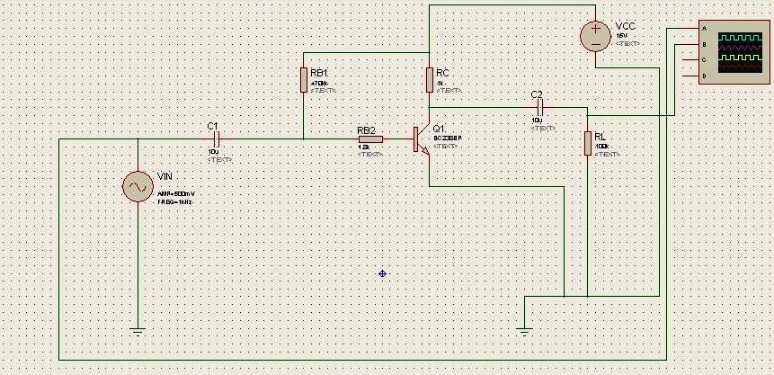

This post contains student reports for the first four experiments of the **fall 2010** laboratory of the **EEM311 Electronics II** course in the Electrical-Electronics Engineering department at Başkent University (October–November 2010). For Experiments 1 and 2 there are reports from two different students; for Experiment 4 there is also a PSpice preliminary study. All of them are **work by friends; personal information has been removed.** The reports are in Turkish; photographs of oscilloscope screens and Proteus drawings are attached to the documents. The experiment handouts are in separate posts in the archive (Experiments 1–2 and Experiments 3–4). Personal-information-free PDF copies and the Proteus drawing for Experiment 1 can be downloaded as a ZIP at the end of the post.

## Experiment 1: Single-stage BJT amplifier

One of the reports describes the purpose of the experiment as putting the theoretical information in the handout into practice: the BJT has four operating regions (saturation, forward active, reverse active, cutoff); DC analysis gives the operating point, and AC analysis gives the gain and the input and output resistances. The circuit was also drawn in Proteus:

### First report

| | I_BQ | I_CQ | V_CEQ |
|---|---|---|---|
| Measurement | 30 µA | 8.9 mA | 6.2 V |

1. β = I_C / I_B = 8.9 mA / 30 µA = **296.7**
1. With a 1 kHz, 40 mV p-p input, v_be = 27 mV p-p (the student noted that there was an error in their lab measurements): rπ = 27 mV / 30 µA = **900 Ω**; from rπ = n·25 mV / 30 µA, **n = 1.08**.
1. With a 20 mV p-p input, v_out = 1.91 V (in the handout's table, v_out p-p = 3.82 V): g_m = 8.9 mA / (1.08 · 25 mV) = 0.33 S; r_o = v_out / (g_m·v_be) = **214.3 Ω** and V_A = r_o·I_CQ = 1.91 V were obtained.
1. The gain from the formula is A_v = I_C·[r_o ∥ R_L ∥ R_C] / [(R_B1 ∥ R_B2 + rπ)·I_B] = **19.4**; the gain measured on the oscilloscope is **A_v = 100** (v_in 10 mV/div, v_out 1 V/div, 500 µs/div).
1. At the point where distortion begins, v_be = 7.3 mV; the largest undistorted output is v_out,undistorted = **12.4 V**.
1. Output waveforms for 20, 140 and 500 mV inputs were observed on the oscilloscope (500 mV/div, 2 V/div, 5 V/div).

*Note: The relation v_out / (g_m·v_be) gives not just r_o but the parallel equivalent r_o ∥ R_L ∥ R_C; the result of 214 Ω shows this (since R_C = 1 kΩ, the parallel equivalent cannot exceed 1 kΩ). Therefore the result V_A = 1.91 V is not realistic either; as in the handout, r_o should be extracted from the equation r_o ∥ R_C ∥ R_L = v_out/(g_m·v_be).*

### Second report

I_BQ = 0.029 mA, I_CQ = 8.84 mA, V_CEQ = 6.2 V; the Q point (8.84 mA, 6.2 V) lies on the 15 mA–15 V load line.

1. β = 8.84 mA / 0.029 mA = **303.95**
1. v_be = 6.74 mV p-p: rπ = v_be / I_BQ = **232.41 Ω**, n = 0.8620 is written.
1. v_out = 3.82 V: g_m = I_CQ / (n·V_T) = 0.410 S; **r_o = 26.7 kΩ**, **V_A = 229.82 V**.
1. The gain expression A_v = [(R_B1 ∥ R_B2 + rπ)·I_B] / [I_C·(r_o ∥ R_L ∥ R_C)] = 3105 is given.
1. v_be = 7.3 mV (onset of distortion), v_out,undistorted = 12.5 V p-p.

*Note: From rπ = n·V_T / I_BQ, n = 232.41 Ω · 0.029 mA / 25 mV ≈ 0.27, not 0.862. In the gain expression, the numerator and denominator have been swapped; the correct form is A_v = I_C·(r_o ∥ R_L ∥ R_C) / [I_B·(R_B2 + rπ)].*

## Experiment 2: Single-stage BJT amplifier design

### First report

In the preliminary study, from the resistors calculated for each β value, the one closest to the β of the transistor obtained in the laboratory was selected: **R1 = 39 kΩ, R2 = 13 kΩ, R_E1 = 100 Ω, R_E2 = 1.2 kΩ, R_C = R_L = 3.3 kΩ**.

1. Q point: I_CQ = 3.4 mA, V_CEQ = 3.10 V. The largest undistorted output was calculated as 15 − V_CEQ = 15 − 6.2 = 8.8 V.
1. With a 5 kHz, 100 mV input, v_out = 1.38 V was measured; A_v = 1.42 / 0.0992 = **14.4** (≈ 23.1 dB).
1. In the oscilloscope X-Y mode, the response is linear for small signals; the output at which linearity breaks down is **7.9 Vp-p**.
1. With a triangular wave, the output at which clipping begins is **v_out,unclipped max = 6.3 V**; the report says this is close to V_CEQ (6.2 V).
1. With a 10 kΩ series resistor at the input, v_in = 100 mV and v_d = 43.5 mV were measured; this is consistent with R_in ≈ 13 kΩ.

*Note: The report uses V_CEQ as 3.10 V in one place and as 6.2 V in the following calculations; also, the gain unit is written as "14.4 V" (gain is dimensionless). R1 = 39 kΩ and R2 = 13 kΩ in the design are the same as the values in the handwritten preliminary study from the 2008 term.*

### Second report

A short report: in the first section I_CQ = 15.72 mA and V_CEQ = 5.76 V were measured, and the transistor's β was taken as approximately 250. A linear region was observed in X-Y mode; the input resistance measurement was calculated as an ordinary voltage divider (if R2 = 2.5 kΩ, then v_d = 2.02 V). The gain and clipping sections are blank; it says that the Proteus drawings and calculations were attached on the back pages (these pages are not in the file).

## Experiment 3: Single-stage MOSFET amplifier

Resistors from the preliminary study: **R1 = 80 kΩ, R2 = 20 kΩ, R_D = 100 kΩ, R_S = 13 kΩ** (CD4007 NMOS).

1. V_G = 2.67 V, V_D = 5.86 V, V_S = 1.70 V; I_DS = V_S / R_S = 1.70 / 13 kΩ ≈ **130 µA**. The values are close to the preliminary study but not identical, because in practice the theoretical resistor values cannot be achieved exactly.
1. a) With a 50 mV, 1 kHz input across R_L = 10 kΩ, A_v = 128 mV / 50 mV ≈ **2.5**; b) with C_d and R_L removed, A_v,open circuit = 1.34 V / 50 mV = **26.7**; c) with C_S removed, A_v,without Cs = 32 mV / 50 mV ≈ **0.6**. It is seen that the gain is very high without a load resistance and very low without the bypass capacitor.
1. Noticeable distortion begins around v_out,max = 0.62 V (1.24 Vp-p).
1. With a 50 kΩ pot at the input, **R_in = 29.7 kΩ** (v_in = 48 mV).
1. With the same pot connected to the output, **R_out = 21.0 kΩ** (v_out = 70 mV).

## Experiment 4: Two-stage JFET–BJT amplifier

### Preliminary study (PSpice)

DC analysis: V_D = 5.865 V, V_G ≈ 0 V, V_S = 2.024 V, V_B = 6.985 V, V_C = 9.158 V, V_E = 6.292 V; I_D = 6.135 mA, I_C = 2.842 mA, I_E = 2.860 mA, I_B = 18.55 µA. In the AC analysis, the input was read as 1.9518 mV p-p; the stage gains are given as −1.0372 k for the first stage, 19.177 for the second stage, and 68.630 m overall.

*Note: The output "99.579 V" and v_b "6.9851 V" values are not signals but DC levels (or the measurement expression is wrong); therefore these gains are not meaningful. The DC values are consistent with the circuit in the handout.*

### Report

The circuit was built with V_CC = 12 V. The report summarizes how the two-stage amplifier works as follows: the first stage is used for high input impedance, the middle stage for voltage gain, and the last stage to prevent loss of gain (low output impedance).

| JFET | V_G | V_D | V_S |
|---|---|---|---|
| Measurement | 0.001 V | 5.97 V | 2.01 V |

| BJT | V_B | V_C | V_E |
|---|---|---|---|
| Measurement | 7.05 V | 9.1 V | 6.4 V |

- I_D = V_S / R_S = 2.01 / 330 = **6.09 mA**, I_C ≈ V_E / R_E = 6.4 / 2.2 kΩ = **2.90 mA**. The reasons for the small differences from theory are the inability to make precise measurements and β not being exactly 100.
- Since the signal generator could not provide 0.1 mV, an 8.2 kΩ–1 kΩ divider was used: v_s = 5 mV peak → v_in = 5 mV · 1 k / 9.2 k ≈ 0.55 mV peak. The measured v_b = 4.57 mV, v_out = 0.374 V.
- A_v,firststage = −(4.57 / 0.55) = **−8.32**, A_v,secondstage = −(0.374 V / 4.57 mV) = **−81.9** (there is phase inversion in both stages), A_v,overall = **681.4**.
- The output at which distortion begins is **v_out,undistorted = 2.48 V**.
- R_in: the 500 kΩ pot provided was found to be insufficient; approximately **R_in = 540 kΩ**. R_out (with a 1 kΩ pot) is **945 Ω**.
- The output resistance is very close to the preliminary study; there is some difference in the input resistance.

## Unpublished files

The 2010 preliminary study for Experiment 1 was not included separately because it is identical to the PSpice preliminary study from the 2008 term (a copy); it appears in the 2008 post.
