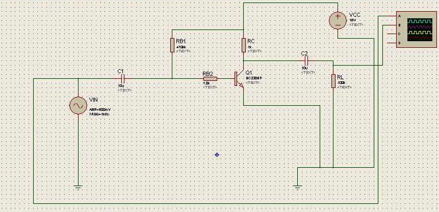

Bu yazı, Başkent Üniversitesi Elektrik-Elektronik Mühendisliği **EEM311 Elektronik II** laboratuvarının **2010 güz dönemi** ilk dört deneyine ait öğrenci raporlarını içeriyor (Ekim–Kasım 2010). Deney 1 ve 2 için iki farklı öğrencinin raporu var; Deney 4 için ayrıca PSpice ön çalışması bulunuyor. Hepsi **arkadaşların çalışmaları; kişisel bilgiler çıkarıldı.** Raporlar Türkçe; osiloskop ekranlarının fotoğrafları ve Proteus çizimleri belgelere eklenmiş. Deney föyleri arşivde ayrı yazılarda (Deney 1–2 ve Deney 3–4) yer alıyor. Kişisel bilgilerden arındırılmış PDF kopyalar ve Deney 1'in Proteus çizimi yazının sonunda ZIP olarak indirilebilir.

## Deney 1: Tek katlı BJT yükselteci

Raporlardan biri deneyin amacını, föydeki teorik bilgileri pratiğe dökmek olarak tanımlıyor: BJT'nin dört çalışma bölgesi (doyum, ileri aktif, ters aktif, kesim) var; DC analizle çalışma noktası, AC analizle kazanç, giriş ve çıkış dirençleri bulunuyor. Devre Proteus'ta da çizilmiş:

### Birinci rapor

| | I_BQ | I_CQ | V_CEQ |
|---|---|---|---|
| Ölçüm | 30 µA | 8.9 mA | 6.2 V |

1. β = I_C / I_B = 8.9 mA / 30 µA = **296.7**
1. 1 kHz, 40 mV p-p girişte v_be = 27 mV p-p (öğrenci lab sırasındaki ölçümlerinde hata olduğunu not etmiş): rπ = 27 mV / 30 µA = **900 Ω**; rπ = n·25 mV / 30 µA'dan **n = 1.08**.
1. 20 mV p-p girişte v_out = 1.91 V (föydeki tabloda v_out p-p = 3.82 V): g_m = 8.9 mA / (1.08 · 25 mV) = 0.33 S; r_o = v_out / (g_m·v_be) = **214.3 Ω** ve V_A = r_o·I_CQ = 1.91 V bulunmuş.
1. Kazanç formülle A_v = I_C·[r_o ∥ R_L ∥ R_C] / [(R_B1 ∥ R_B2 + rπ)·I_B] = **19.4**; osiloskopta ölçülen kazanç ise **A_v = 100** (v_in 10 mV/div, v_out 1 V/div, 500 µs/div).
1. Bozulmanın başladığı noktada v_be = 7.3 mV; kırpılmasız en büyük çıkış v_out,undistorted = **12.4 V**.
1. 20, 140 ve 500 mV girişler için çıkış dalga şekilleri osiloskopta gözlenmiş (500 mV/div, 2 V/div, 5 V/div).

*Not: v_out / (g_m·v_be) bağıntısı yalnız r_o'yu değil r_o ∥ R_L ∥ R_C paralel eşdeğerini verir; 214 Ω bulunması bunu gösteriyor (R_C = 1 kΩ olduğu için paralel eşdeğer 1 kΩ'dan büyük olamaz). Bu yüzden V_A = 1.91 V sonucu da gerçekçi değil; föydeki gibi r_o ∥ R_C ∥ R_L = v_out/(g_m·v_be) eşitliğinden r_o çekilmeli.*

### İkinci rapor

I_BQ = 0.029 mA, I_CQ = 8.84 mA, V_CEQ = 6.2 V; Q noktası (8.84 mA, 6.2 V) 15 mA–15 V yük doğrusu üzerinde.

1. β = 8.84 mA / 0.029 mA = **303.95**
1. v_be = 6.74 mV p-p: rπ = v_be / I_BQ = **232.41 Ω**, n = 0.8620 yazılmış.
1. v_out = 3.82 V: g_m = I_CQ / (n·V_T) = 0.410 S; **r_o = 26.7 kΩ**, **V_A = 229.82 V**.
1. Kazanç ifadesi A_v = [(R_B1 ∥ R_B2 + rπ)·I_B] / [I_C·(r_o ∥ R_L ∥ R_C)] = 3105 olarak verilmiş.
1. v_be = 7.3 mV (bozulma başlangıcı), v_out,undistorted = 12.5 V p-p.

*Not: rπ = n·V_T / I_BQ'dan n = 232.41 Ω · 0.029 mA / 25 mV ≈ 0.27 çıkar, 0.862 değil. Kazanç ifadesinde pay ile payda yer değiştirmiş; doğrusu A_v = I_C·(r_o ∥ R_L ∥ R_C) / [I_B·(R_B2 + rπ)] biçimindedir.*

## Deney 2: Tek katlı BJT yükselteç tasarımı

### Birinci rapor

Ön çalışmada her β değeri için hesaplanan dirençlerden, laboratuvarda alınan transistörün β'sına en yakın olanı seçilmiş: **R1 = 39 kΩ, R2 = 13 kΩ, R_E1 = 100 Ω, R_E2 = 1.2 kΩ, R_C = R_L = 3.3 kΩ**.

1. Q noktası: I_CQ = 3.4 mA, V_CEQ = 3.10 V. En büyük kırpılmasız çıkış 15 − V_CEQ = 15 − 6.2 = 8.8 V olarak hesaplanmış.
1. 5 kHz, 100 mV girişte v_out = 1.38 V ölçülmüş; A_v = 1.42 / 0.0992 = **14.4** (≈ 23.1 dB).
1. Osiloskop X-Y modunda küçük sinyallerde cevap doğrusal; doğrusallığın bozulduğu çıkış **7.9 Vp-p**.
1. Üçgen dalgayla kırpılmanın başladığı çıkış **v_out,unclipped max = 6.3 V**; rapor bunun V_CEQ (6.2 V) değerine yakın olduğunu söylüyor.
1. Girişe seri 10 kΩ ile v_in = 100 mV, v_d = 43.5 mV ölçülmüş; bu, R_in ≈ 13 kΩ ile tutarlı.

*Not: Rapor V_CEQ'yu bir yerde 3.10 V, sonraki hesaplarda 6.2 V olarak kullanıyor; ayrıca kazanç birimi "14.4 V" yazılmış (kazanç birimsizdir). Tasarımdaki R1 = 39 kΩ ve R2 = 13 kΩ, 2008 dönemindeki el yazısı ön çalışmadaki değerlerle aynı.*

### İkinci rapor

Kısa bir rapor: ilk bölümde I_CQ = 15.72 mA ve V_CEQ = 5.76 V ölçülmüş, transistörün β'sı yaklaşık 250 alınmış. X-Y modunda doğrusal bölge gözlenmiş; giriş direnci ölçümü normal gerilim bölücü olarak hesaplanmış (R2 = 2.5 kΩ ise v_d = 2.02 V). Kazanç ve kırpılma bölümleri boş; Proteus çizimlerinin ve hesapların arka sayfalara eklendiği yazıyor (bu sayfalar dosyada yok).

## Deney 3: Tek katlı MOSFET yükselteci

Ön çalışmadan dirençler: **R1 = 80 kΩ, R2 = 20 kΩ, R_D = 100 kΩ, R_S = 13 kΩ** (CD4007 NMOS).

1. V_G = 2.67 V, V_D = 5.86 V, V_S = 1.70 V; I_DS = V_S / R_S = 1.70 / 13 kΩ ≈ **130 µA**. Değerler ön çalışmaya yakın ama aynı değil, çünkü pratikte teorideki direnç değerlerine tam ulaşılamıyor.
1. a) 50 mV, 1 kHz girişte R_L = 10 kΩ üzerinde A_v = 128 mV / 50 mV ≈ **2.5**; b) C_d ve R_L sökülünce A_v,open circuit = 1.34 V / 50 mV = **26.7**; c) C_S sökülünce A_v,without Cs = 32 mV / 50 mV ≈ **0.6**. Yük direnci yokken kazancın çok yüksek, baypas kapasitörü yokken çok düşük olduğu görülüyor.
1. Belirgin bozulma v_out,max = 0.62 V (1.24 Vp-p) civarında başlıyor.
1. Girişe 50 kΩ pot ile **R_in = 29.7 kΩ** (v_in = 48 mV).
1. Aynı pot çıkışa bağlanarak **R_out = 21.0 kΩ** (v_out = 70 mV).

## Deney 4: İki katlı JFET–BJT yükselteç

### Ön çalışma (PSpice)

DC analiz: V_D = 5.865 V, V_G ≈ 0 V, V_S = 2.024 V, V_B = 6.985 V, V_C = 9.158 V, V_E = 6.292 V; I_D = 6.135 mA, I_C = 2.842 mA, I_E = 2.860 mA, I_B = 18.55 µA. AC analizde giriş 1.9518 mV p-p okunmuş; kat kazançları birinci kat −1.0372 k, ikinci kat 19.177, toplam 68.630 m olarak verilmiş.

*Not: Çıkış "99.579 V" ve v_b "6.9851 V" değerleri sinyal değil DC seviyeler (ya da ölçüm ifadesi hatalı); bu yüzden bu kazançlar anlamlı değil. DC değerler föydeki devreyle tutarlı.*

### Rapor

Devre V_CC = 12 V ile kurulmuş. Rapor iki katlı yükseltecin işleyişini şöyle özetliyor: ilk kat yüksek giriş empedansı, orta kat gerilim kazancı, son kat kazanç kaybını önlemek (düşük çıkış empedansı) için kullanılıyor.

| JFET | V_G | V_D | V_S |
|---|---|---|---|
| Ölçüm | 0.001 V | 5.97 V | 2.01 V |

| BJT | V_B | V_C | V_E |
|---|---|---|---|
| Ölçüm | 7.05 V | 9.1 V | 6.4 V |

- I_D = V_S / R_S = 2.01 / 330 = **6.09 mA**, I_C ≈ V_E / R_E = 6.4 / 2.2 kΩ = **2.90 mA**. Teoriyle küçük farkların nedenleri: hassas ölçüm yapılamaması ve β'nın tam 100 olmaması.
- Sinyal üreteci 0.1 mV veremediği için 8.2 kΩ–1 kΩ bölücü kullanılmış: v_s = 5 mV tepe → v_in = 5 mV · 1 k / 9.2 k ≈ 0.55 mV tepe. Ölçülen v_b = 4.57 mV, v_out = 0.374 V.
- A_v,firststage = −(4.57 / 0.55) = **−8.32**, A_v,secondstage = −(0.374 V / 4.57 mV) = **−81.9** (her iki katta faz terslemesi var), A_v,overall = **681.4**.
- Bozulmanın başladığı çıkış **v_out,undistorted = 2.48 V**.
- R_in: verilen 500 kΩ potun yetersiz kaldığı görülmüş; yaklaşık **R_in = 540 kΩ**. R_out (1 kΩ pot ile) **945 Ω**.
- Çıkış direnci ön çalışmaya çok yakın; giriş direncinde bir miktar fark var.

## Yayınlanmayan dosyalar

Deney 1'in 2010 ön çalışması, 2008 dönemindeki PSpice ön çalışmasının aynısı olduğu için (kopya) ayrıca alınmadı; 2008 yazısında yer alıyor.
