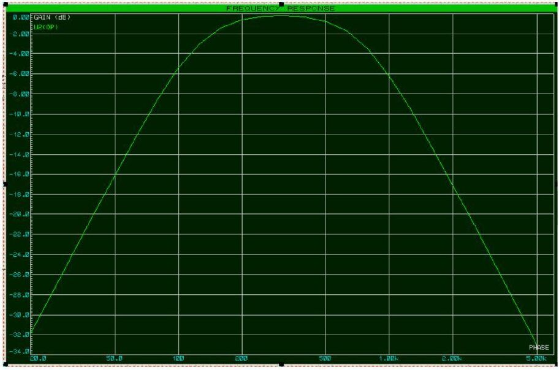
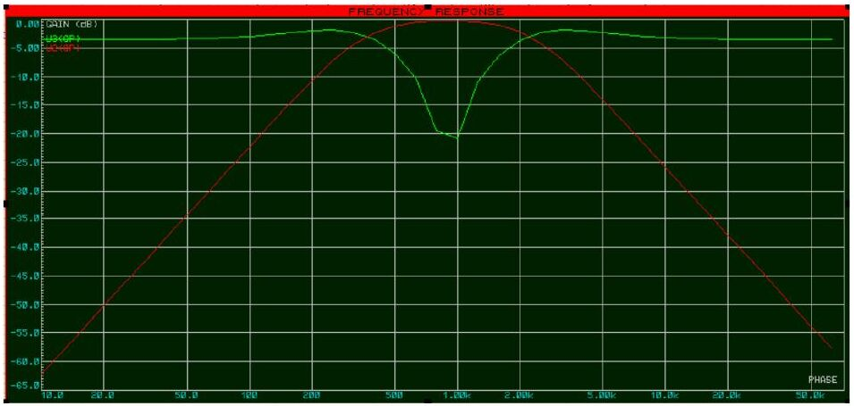
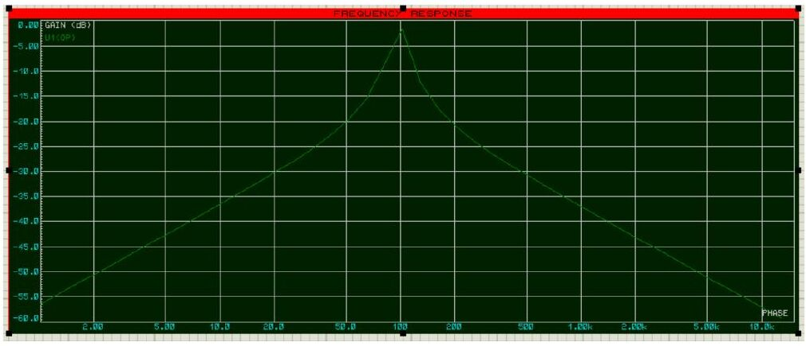
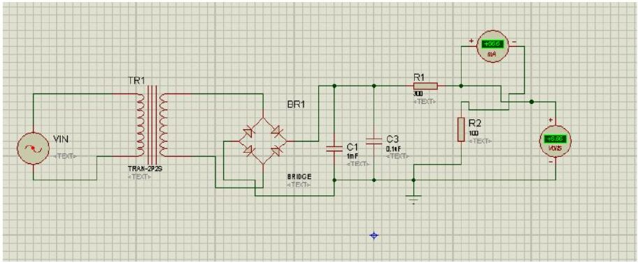
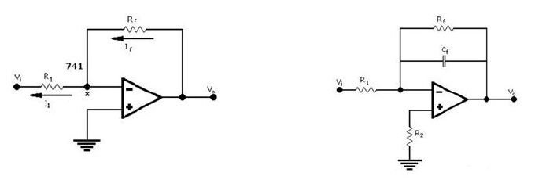

This post contains the **design homework** given in the 2014 fall semester in the **EEM311 Electronics II** course of the Electrical-Electronics Engineering department at Başkent University (due January 2, 2015), together with a **homework report** that a friend prepared for it. In the homework, selected questions out of eight are to be designed in a simulation program, tested, and submitted as a report. Personal information has been removed from the report. The homework text (Word) and the masked report (PDF) can be downloaded as a ZIP at the end of the post.

## Homework text (Homework)

The homework was given in English; the description section reads as follows:

> There is not an obligation to solve all of them. You must prepare your designs in an electronic simulation program, test them, then prepare all the work in a report format. Your works must be unique and you must explain why you chose the components that you use and give your comments on your work: Is it cost effective, is there a better solution, etc. You may use Turkish in explanation. You must e-mail all your designs (*.ewb or other design and schematic files) and the report in a zipped way to the course assistants. Wait for a reply from the teacher whether your work is attached and taken or not; if it is not attached, send it again. Your grade from this homework is evaluated over 100 points. (If there is a surplus in overall grading it may be evaluated in another way or it may be truncated.)

1. **(25 points)** Design an oscillator (of any kind) which must be selectable for frequencies between 0.5 kHz and 5 kHz. (Hint: you may use variable capacitors or variable resistors.)
1. **(20 points)** Design a band-pass filter (of any order) which must filter the human voice from other voices in an electrical signal sample. (Hint: find human voice frequencies.)
1. **(20 points)** Design a notch filter to stop the sound of any musical instrument that you choose.
1. **(20 points)** Design a very narrow band filter which passes only one radio channel selected by you (for example Radyo Başkent) and stops all other FM channels.
1. **(25 points)** Design a voltage regulator (you may use any kind of electronic components, even integrated circuits) that gives 5 V DC and supplies a DC current of at most 300 mA.
1. **(35 points)** Design an amplifier and an electrical noise filter (50 Hz notch filter) in cascaded form for ECG (electrocardiogram) signals. Research conventional considerations such as gain and frequency.
1. **(40 points)** Design an amplifier which amplifies sinusoidal input signals at millivolt level with a gain of 1000. Determine the input and output resistances of the amplifier. Draw the total frequency response of the amplifier after making the required analysis and interpret the results.
1. **(15 points)** Select an electronic circuit (any circuit part you saw in Electronics I or II) used in an electronic device (any field). Explain how this circuit works, what its function in this device is, and whether another circuit could be used instead.

**Deadline:** 02.01.2015

## Sample homework report

The report below is the "EEM 311 – Homework Report" that a friend prepared for this homework using Proteus (January 2015). Questions 2, 3, 4, 5 and 8 are answered in the report. The text was transferred from the report (spelling corrected); since the formula objects in Word were lost in conversion, the cutoff frequency formulas in the report are not visible, only the selected values.

### Question 2: Band-pass filter for the human voice

Band-pass filters are filters formed by connecting a low-pass and a high-pass filter in cascade. They pass the frequencies between the upper cutoff frequency determined by the low-pass filter and the lower cutoff frequency determined by the high-pass filter. The design was made taking the human voice frequency range as **85 Hz – 1050 Hz**.

- **Low-pass filter:** With f_c = 1050 Hz and C1 = 0.1 µF chosen, R1 = R2 = 1.5 kΩ was found; R_ref = 2R1 = 3 kΩ and C2 = 2C1 = 0.2 µF were taken.
- **High-pass filter:** With f_c = 85 Hz and C3 = 1 µF chosen, R4 = 1.8 kΩ was found; R_ref2 = R4 and R5 = R4/2 were taken.

### Question 3: Notch filter (flute sound)

Notch filters are obtained by subtracting the output of a band-pass filter from the input signal. A **flute** was chosen as the instrument and the frequency range was taken as **256 Hz – 2304 Hz**; a 5 V, 1 kHz sine wave was applied as the input.

- Low-pass filter: C1 = 0.1 µF, C2 = 2C1 = 0.2 µF; R1 = R2 = 0.50 kΩ.
- High-pass filter: C3 = C4 = 0.5 µF; R3 = 1.25 kΩ and R4 = R3/2 = 0.625 kΩ.

When the output of the band-pass filter was applied to the input of a second op-amp that is also connected to the input, the frequencies in the desired range were stopped.

### Question 4: Narrow-band filter (Radyo Başkent)

The report explains that narrow-band filters contain only one op-amp, that their quality factor is Q > 0.5, and that the maximum gain is obtained as 1 at the resonance frequency. For a filter that passes only the **Başkent FM (104.2)** channel, C1 = C2 = 0.1 µF was chosen, and for f_c = 104.2 Hz, R1 = R4 = 15.27 kΩ, R2 = R1/19 = 0.80 kΩ and R3 = 19·R1 = 290 kΩ were calculated.

*Note: The frequency of Radyo Başkent is 104.2 MHz; in the report the filter was designed for 104.2 Hz (1/(2π·15.27 kΩ·0.1 µF) ≈ 104.2 Hz). To select a real FM channel, the center frequency would need to be 10⁶ times larger; at this frequency an LC resonant circuit is used instead of an op-amp RC filter.*

### Question 5: 5 V power supply

A circuit was designed that converts the 220 V, 50 Hz mains to an output of 5 V and at most 400 mA. The transformer connected to the input steps the voltage down, the AC voltage at the transformer output is rectified by a bridge diode, and the voltage and current are brought to the desired level with the capacitor and resistors at the output.

*Note: The question asks for at most 300 mA, while the report says 400 mA. Also, the circuit has no regulator element; the output voltage obtained only with the capacitor and resistor divider varies with the load current. For the constant 5 V that the homework asks for, a regulator IC such as the 7805 or a zener/transistor regulator stage is needed.*

### Question 8: Op-amp circuits in the laboratory

The **inverting amplifier** applied in the Electronics II laboratory transfers the signal applied to its negative input to the output with a 180° phase difference and a gain of A_v = −R_f/R_1; the minus sign in the formula indicates the phase difference. R_1 is the input resistance and R_f is the feedback resistance. The **integrator** circuit, also applied in the laboratory, integrates the signal at its input and transfers it to the output. If the conditions f_input ≥ f_c and that the time constant of the circuit equal the period of the input signal are not satisfied in the integrator circuit, the circuit does not work as an integrator; in this case it behaves like an inverting amplifier.

