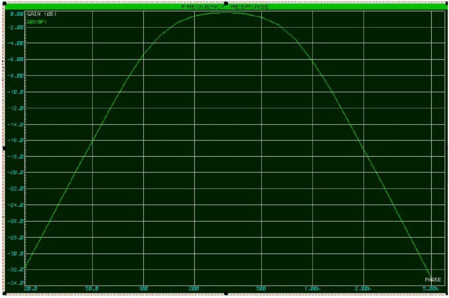
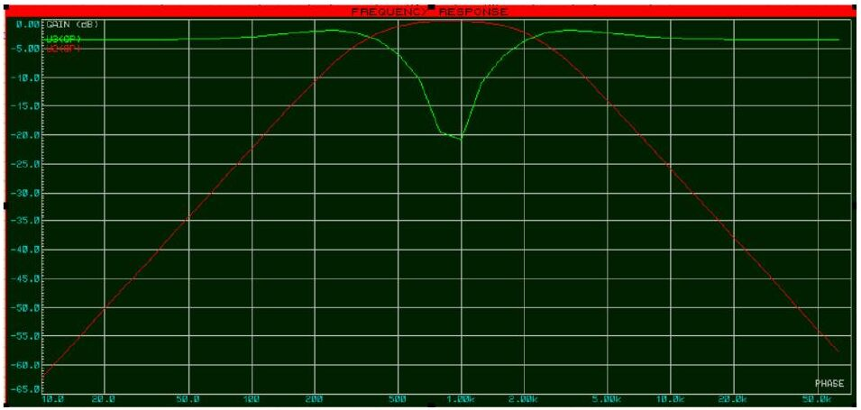
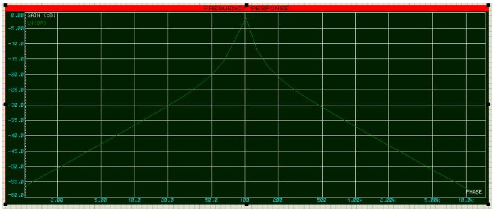
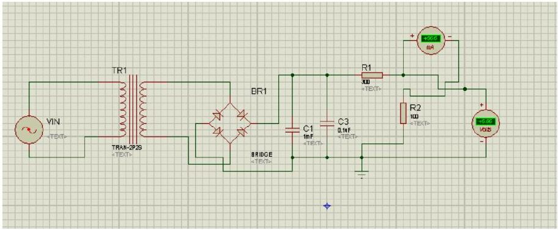
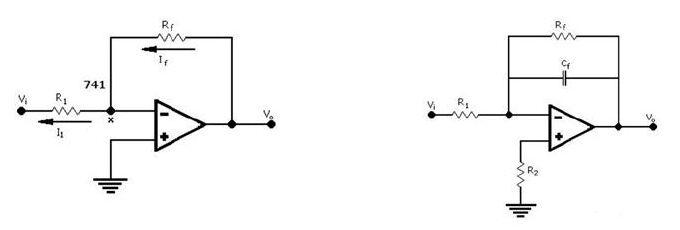

Bu yazı, Başkent Üniversitesi Elektrik-Elektronik Mühendisliği **EEM311 Elektronik II** dersinde 2014 güz döneminde verilen **tasarım ödevini** (son teslim 2 Ocak 2015) ve bu ödev için bir arkadaşın hazırladığı **ödev raporunu** içeriyor. Ödevde sekiz sorudan istenenler seçilip devreler bir simülasyon programında tasarlanıyor, test ediliyor ve rapor halinde teslim ediliyor. Rapordaki kişisel bilgiler çıkarıldı. Ödev metni (Word) ve maskelenmiş rapor (PDF) yazının sonunda ZIP olarak indirilebilir.

## Ödev metni (Homework)

Ödev İngilizce verilmiş; açıklama bölümü şöyle:

> There is not an obligation to solve all of them. You must prepare your designs in an electronic simulation program, test them, then prepare all the work in a report format. Your works must be unique and you must explain why you chose the components that you use and give your comments on your work: Is it cost effective, is there a better solution, etc. You may use Turkish in explanation. You must e-mail all your designs (*.ewb or other design and schematic files) and the report in a zipped way to the course assistants. Wait for a reply from the teacher whether your work is attached and taken or not; if it is not attached, send it again. Your grade from this homework is evaluated over 100 points. (If there is a surplus in overall grading it may be evaluated in another way or it may be truncated.)

1. **(25 points)** Design an oscillator (of any kind) which must be selectable for frequencies between 0.5 kHz and 5 kHz. (Hint: you may use variable capacitors or variable resistors.)
1. **(20 points)** Design a band-pass filter (of any order) which must filter the human voice from other voices in an electrical signal sample. (Hint: find human voice frequencies.)
1. **(20 points)** Design a notch filter to stop the sound of any musical instrument that you choose.
1. **(20 points)** Design a very narrow band filter which passes only one radio channel selected by you (for example Radyo Başkent) and stops all other FM channels.
1. **(25 points)** Design a voltage regulator (you may use any kind of electronic components, even integrated circuits) that gives 5 V DC and supplies a DC current of at most 300 mA.
1. **(35 points)** Design an amplifier and an electrical noise filter (50 Hz notch filter) in cascaded form for ECG (electrocardiogram) signals. Research conventional considerations such as gain and frequency.
1. **(40 points)** Design an amplifier which amplifies sinusoidal input signals at millivolt level with a gain of 1000. Determine the input and output resistances of the amplifier. Draw the total frequency response of the amplifier after making the required analysis and interpret the results.
1. **(15 points)** Select an electronic circuit (any circuit part you saw in Electronics I or II) used in an electronic device (any field). Explain how this circuit works, what its function in this device is, and whether another circuit could be used instead.

**Deadline:** 02.01.2015

## Örnek ödev raporu

Aşağıdaki rapor, bir arkadaşın bu ödev için Proteus ile hazırladığı "EEM 311 – Ödev Raporu"dur (Ocak 2015). Raporda 2, 3, 4, 5 ve 8. sorular cevaplanmış. Metin rapordan aktarıldı (yazım düzeltildi); Word'deki formül nesneleri dönüştürmede kaybolduğu için rapordaki kesim frekansı formülleri görünmüyor, yalnız seçilen değerler var.

### Soru 2: İnsan sesi için bant geçiren filtre

Bant geçiren filtreler, bir alçak geçiren ve bir yüksek geçiren filtrenin ardışık bağlanmasıyla oluşan filtrelerdir. Alçak geçiren filtrenin belirlediği üst kesim frekansı ile yüksek geçiren filtrenin belirlediği alt kesim frekansı arasındaki frekansları geçirirler. İnsan sesi frekansı olarak **85 Hz – 1050 Hz** aralığı alınarak tasarım yapılmıştır.

- **Alçak geçiren filtre:** f_c = 1050 Hz ve C1 = 0.1 µF seçilerek R1 = R2 = 1.5 kΩ bulunmuş; R_ref = 2R1 = 3 kΩ ve C2 = 2C1 = 0.2 µF alınmıştır.
- **Yüksek geçiren filtre:** f_c = 85 Hz ve C3 = 1 µF seçilerek R4 = 1.8 kΩ bulunmuş; R_ref2 = R4 ve R5 = R4/2 alınmıştır.

### Soru 3: Notch filtre (flüt sesi)

Notch filtreler, bir bant geçiren filtrenin çıkışının giriş sinyalinden çıkarılmasıyla elde edilir. Enstrüman olarak **flüt** seçilmiş ve frekans aralığı **256 Hz – 2304 Hz** alınmış; giriş olarak 5 V, 1 kHz sinüs uygulanmıştır.

- Alçak geçiren filtre: C1 = 0.1 µF, C2 = 2C1 = 0.2 µF; R1 = R2 = 0.50 kΩ.
- Yüksek geçiren filtre: C3 = C4 = 0.5 µF; R3 = 1.25 kΩ ve R4 = R3/2 = 0.625 kΩ.

Bant geçiren filtrenin çıkışı, girişe de bağlı olan ikinci bir op-amp'ın girişine uygulandığında istenen aralıktaki frekanslar durdurulmuştur.

### Soru 4: Dar bant filtre (Radyo Başkent)

Raporda dar bant filtrelerin yalnızca bir op-amp içerdiği, kalite faktörünün Q > 0.5 olduğu ve maksimum kazancın rezonans frekansında 1 olarak elde edildiği anlatılıyor. Yalnız **Başkent FM (104.2)** kanalını geçiren bir filtre için C1 = C2 = 0.1 µF seçilmiş, f_c = 104.2 Hz için R1 = R4 = 15.27 kΩ, R2 = R1/19 = 0.80 kΩ ve R3 = 19·R1 = 290 kΩ hesaplanmıştır.

*Not: Radyo Başkent'in frekansı 104.2 MHz'tir; raporda filtre 104.2 Hz'e göre tasarlanmış (1/(2π·15.27 kΩ·0.1 µF) ≈ 104.2 Hz). Gerçek bir FM kanalını seçmek için merkez frekansın 10⁶ kat büyük olması gerekir; bu frekansta op-amp'lı RC filtre yerine LC rezonans devresi kullanılır.*

### Soru 5: 5 V güç kaynağı

220 V, 50 Hz şehir şebekesini çıkışta 5 V ve en fazla 400 mA verecek şekilde dönüştüren bir devre tasarlanmıştır. Girişe bağlanan transformatör gerilimi düşürür, trafo çıkışındaki AC gerilim köprü diyotla doğrultulur, çıkıştaki kondansatör ve dirençlerle gerilim ve akım istenen düzeye getirilir.

*Not: Soruda en fazla 300 mA isteniyor, raporda 400 mA yazıyor. Ayrıca devrede regülatör elemanı yok; yalnız kondansatör ve direnç bölücüyle elde edilen çıkış gerilimi yük akımıyla değişir. Ödevin istediği sabit 5 V için 7805 gibi bir regülatör entegresi ya da zener/transistörlü bir regülatör katı gerekir.*

### Soru 8: Laboratuvardaki op-amp devreleri

Elektronik II laboratuvarında uygulanan **tersleyen (inverting) yükselteç**, eksi girişine uygulanan sinyali 180° faz farkıyla ve A_v = −R_f/R_1 kazancıyla çıkışa aktarır; formüldeki eksi işareti faz farkını gösterir. R_1 giriş direnci, R_f geri besleme direncidir. Yine laboratuvarda uygulanan **integratör (integral alıcı)** devre, girişindeki sinyalin integralini alarak çıkışa aktarır. İntegral alıcı devrede f_giriş ≥ f_c ve devrenin zaman sabitinin giriş sinyalinin periyoduna eşit olması şartı sağlanmazsa devre integral alıcı olarak çalışmaz; bu durumda tersleyici yükselteç gibi davranır.

