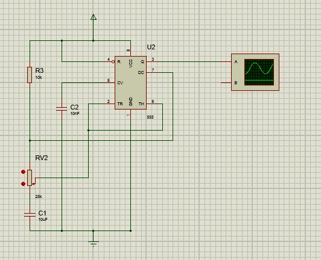
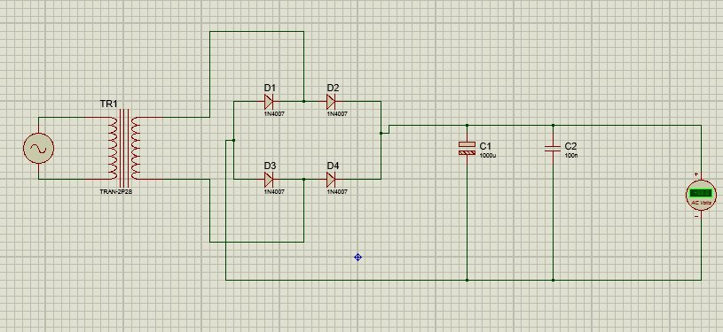
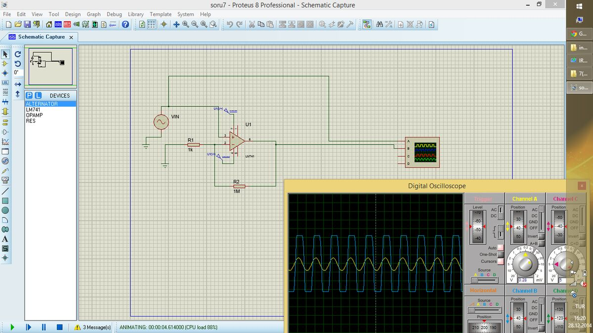

This post collects the circuit files that classmates prepared with **Proteus 8** for the **Fall 2014 design assignment** of the EEM 311 Electronics II course. The assignment questions and a classmate's assignment report were published in a separate post ("2014 Design Assignment and Sample Report"); this post contains only the **design files** and screenshots that are not in that post. There are two separate sets:

- **Design set 1** (27–28 December 2014): a separate folder for each question; the folder names carried the question's points and a "+" mark indicating completion ("1 (25)", "2 (20)+", … "7 (40)").
- **Design set 2** (December 2014 – January 2015): schematics for question1, question2, question3, question5, question6 (two versions) and question7.

Personal information in the files and file names (the user name in the Proteus workspace files) was removed; backup (`Last Loaded …DBK`) and workspace files were not included in the ZIP. The files can be opened with Proteus 8 (`.pdsprj` project, `.DSN` schematic). All files can be downloaded as a ZIP at the end of the post.

## The Assignment Questions (Brief)

| Question | Points | Requirement |
| --- | --- | --- |
| 1 | 25 | Oscillator adjustable between 0.5–5 kHz |
| 2 | 20 | Band-pass filter that isolates the human voice |
| 3 | 20 | Notch filter that suppresses the sound of a musical instrument |
| 4 | 20 | Very narrow band-pass filter that passes only one FM radio channel |
| 5 | 25 | 5 V DC voltage regulator delivering at most 300 mA |
| 6 | 35 | Amplifier for ECG signals and a cascaded 50 Hz notch filter |
| 7 | 40 | Amplifier that boosts a millivolt-level sine signal by a factor of 1000; input/output resistance and frequency response |
| 8 | 15 | Analysis of the electronic circuit in a device |

## Design Set 1

### Question 1: Adjustable Oscillator with a 555

The schematic contains a **555 timer** (U2), R3 = 10 kΩ, an **RV2 = 25 kΩ** potentiometer for frequency adjustment, a timing capacitor C1 = 10 µF, and C2 = 10 nF on the control (CV) pin; the Q output (pin 3) is connected to channel A of the oscilloscope.

*Note: For an astable 555, the relation f ≈ 1.44/((R_A + 2R_B)C) gives a frequency of only a few hertz with the C1 = 10 µF in the schematic and R values in the 10–60 kΩ range. For the required 0.5–5 kHz range, the timing capacitor would need to be about 1000 times smaller (on the order of 10 nF); the value of the timing capacitor in the screenshot may differ from that in the design file.*

### Questions 2 and 3: Human Voice Band-Pass and Notch Filters

The "insan sesi bant geçiren" (human voice band-pass) and "inst notch filter" (instrument notch filter) schematics consist of active filters with op-amps; there are no screenshots in the files.

### Question 4: Narrow-Band Filter

A schematic file named "50 Hz"; the name of the workspace file in the folder ("dar band", i.e. "narrow band") indicates that it was prepared for question 4.

### Question 5: 5 V Power Supply

The screenshot shows a mains source, a **TRAN-2P2S** transformer, a bridge rectifier made of four **1N4007** diodes, a **C1 = 1000 µF** filter capacitor and a **C2 = 100 nF** capacitor, with a voltmeter connected to the output. The schematic file additionally contains a **7805** regulator and a 1N4001 diode.

*Note: The output meter in the screenshot is in "AC Volts" mode; to see the rectified DC output and the ripple, a DC voltmeter (or an oscilloscope) should be used.*

### Question 7: Amplifier with a Gain of 1000

Inverting amplifier with an **LM741**: **R1 = 1 kΩ**, **R2 = 1 MΩ**, i.e. A_v = −R2/R1 = **−1000**. The input source VIN and the output are monitored on a digital oscilloscope; in the screenshot, the blue output corresponds to the yellow input sine but appears as a clipped square wave.

*Note: The output turning into a square wave shows that the op-amp has gone into saturation: with a gain of 1000 and ±15 V supplies, the output clips once the input amplitude exceeds a few tens of millivolts. In addition, since the gain-bandwidth product of the LM741 is about 1 MHz, the bandwidth at a gain of 1000 is only around 1 kHz; this limit is decisive in the frequency response analysis requested in the question.*

## Design Set 2

The second set contains other solutions to the same questions: **question1** (oscillator with a 555 timer), **question2** (band-pass filter with op-amps), **question3** (notch filter with an LM741), **question5** (5 V supply with a 7805 regulator, 1N4001 diodes), **question6** and **question6new** (ECG amplifier; the first version uses an **AD624** instrumentation amplifier, the second uses LM741s) and **question7** (gain-of-1000 amplifier with an LM741). There are no screenshots for this set.
