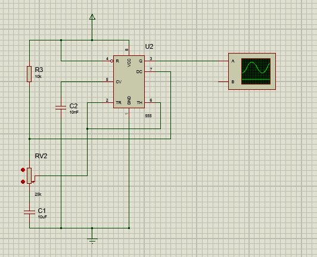
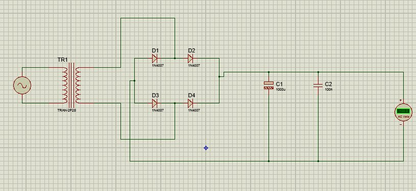
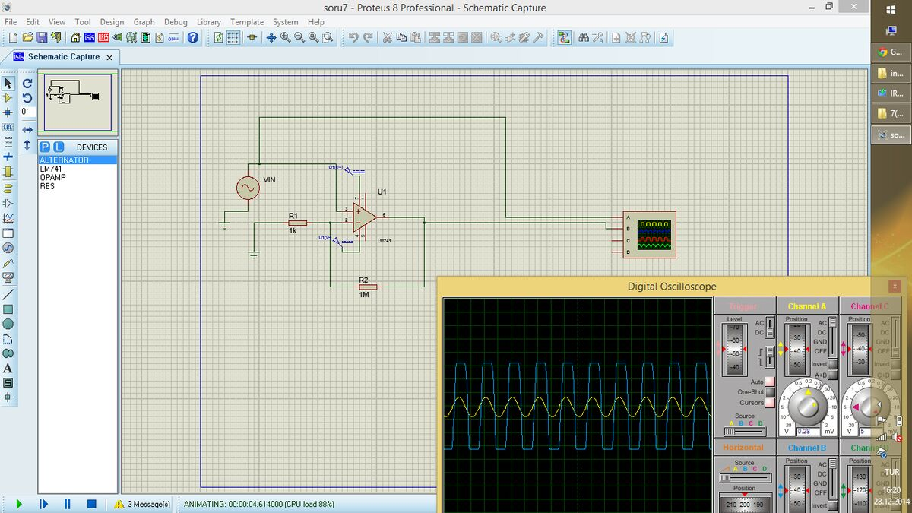

Bu yazı, EEM 311 Elektronik II dersinin **2014 güz dönemi tasarım ödevi** için arkadaşların **Proteus 8** ile hazırladığı devre dosyalarını bir araya getiriyor. Ödevin soruları ve bir arkadaşın ödev raporu ayrı bir yazıda ("2014 Tasarım Ödevi ve Örnek Rapor") aktarıldı; bu yazı yalnızca o yazıda olmayan **tasarım dosyalarını** ve ekran görüntülerini içeriyor. İki ayrı set var:

- **Tasarım seti 1** (27–28 Aralık 2014): her soru için ayrı klasör; klasör adlarında sorunun puanı ve tamamlandığını gösteren "+" işareti vardı ("1 (25)", "2 (20)+", … "7 (40)").
- **Tasarım seti 2** (Aralık 2014 – Ocak 2015): soru1, soru2, soru3, soru5, soru6 (iki sürüm) ve soru7 şemaları.

Dosyalardaki ve dosya adlarındaki kişisel bilgiler (Proteus çalışma alanı dosyalarındaki kullanıcı adı) çıkarıldı; yedek (`Last Loaded …DBK`) ve çalışma alanı dosyaları ZIP'e konmadı. Dosyalar Proteus 8 ile açılabilir (`.pdsprj` proje, `.DSN` şema). Tüm dosyalar yazının sonunda ZIP olarak indirilebilir.

## Ödevin soruları (kısaca)

| Soru | Puan | İstenen |
| --- | --- | --- |
| 1 | 25 | 0,5–5 kHz arasında ayarlanabilen osilatör |
| 2 | 20 | İnsan sesini ayıran bant geçiren filtre |
| 3 | 20 | Bir müzik aletinin sesini durduran notch filtre |
| 4 | 20 | Yalnız bir FM radyo kanalını geçiren çok dar bant filtre |
| 5 | 25 | En çok 300 mA veren 5 V DC gerilim regülatörü |
| 6 | 35 | EKG işaretleri için yükselteç ve kaskat 50 Hz notch filtre |
| 7 | 40 | Milivolt düzeyindeki sinüs işaretini 1000 kat yükselten yükselteç; giriş/çıkış direnci ve frekans cevabı |
| 8 | 15 | Bir cihazdaki elektronik devrenin incelenmesi |

## Tasarım seti 1

### Soru 1: 555 ile ayarlanabilir osilatör

Şemada **555 zamanlayıcı** (U2), R3 = 10 kΩ, frekans ayarı için **RV2 = 25 kΩ** potansiyometre, zamanlama kondansatörü C1 = 10 µF ve kontrol (CV) ucunda C2 = 10 nF var; Q çıkışı (3. uç) osiloskobun A kanalına bağlı.

*Not: Kararsız (astable) 555 için f ≈ 1,44/((R_A + 2R_B)C) bağıntısı, şemadaki C1 = 10 µF ile R değerleri 10–60 kΩ aralığındayken yalnızca birkaç hertzlik frekans verir. İstenen 0,5–5 kHz aralığı için zamanlama kondansatörünün yaklaşık 1000 kat küçük (10 nF mertebesinde) olması gerekir; ekran görüntüsünde zamanlama kondansatörünün değeri tasarım dosyasındakinden farklı olabilir.*

### Soru 2 ve 3: İnsan sesi bant geçiren ve notch filtre

"insan sesi bant geçiren" ve "inst notch filter" (enstrüman notch filtresi) şemaları op-amp'lı aktif filtrelerden oluşuyor; dosyalarda ekran görüntüsü yok.

### Soru 4: Dar bant filtre

"50 Hz" adlı şema dosyası; klasördeki çalışma alanı dosyasının adı ("dar band") bunun 4. soru için hazırlandığını gösteriyor.

### Soru 5: 5 V güç kaynağı

Ekran görüntüsünde şebeke kaynağı, **TRAN-2P2S** transformatör, dört **1N4007** diyottan köprü doğrultucu, **C1 = 1000 µF** filtre ve **C2 = 100 nF** kondansatör ile çıkışa bağlı bir voltmetre görülüyor. Şema dosyasında bunun yanında **7805** regülatör ve 1N4001 diyot da bulunuyor.

*Not: Ekran görüntüsündeki çıkış ölçeri "AC Volts" modunda; doğrultulmuş DC çıkışı ve dalgalanmayı görmek için DC voltmetre (ya da osiloskop) kullanılmalı.*

### Soru 7: 1000 kazançlı yükselteç

**LM741** ile eviren yükselteç: **R1 = 1 kΩ**, **R2 = 1 MΩ**, yani A_v = −R2/R1 = **−1000**. Giriş VIN kaynağı ve çıkış dijital osiloskopta izleniyor; ekran görüntüsünde sarı giriş sinüsüne karşılık mavi çıkış kırpılmış kare dalga biçiminde.

*Not: Çıkışın kare dalgaya dönmesi op-amp'ın doyuma gittiğini gösteriyor: 1000 kazançla ±15 V besleme altında giriş genliği birkaç on milivoltu aşınca çıkış kırpılır. Ayrıca LM741'in kazanç-bant genişliği çarpımı yaklaşık 1 MHz olduğundan 1000 kazançta bant genişliği yalnızca 1 kHz civarındadır; sorudaki frekans cevabı analizinde bu sınır belirleyicidir.*

## Tasarım seti 2

İkinci sette aynı soruların başka çözümleri var: **soru1** (555 zamanlayıcılı osilatör), **soru2** (op-amp'lı bant geçiren filtre), **soru3** (LM741'li notch filtre), **soru5** (7805 regülatörlü 5 V kaynak, 1N4001 diyotlar), **soru6** ve **soru6new** (EKG yükselteci; ilk sürümde **AD624** enstrümantasyon yükselteci, ikincisinde LM741'ler) ve **soru7** (LM741'li 1000 kazançlı yükselteç). Bu set için ekran görüntüsü yok.
