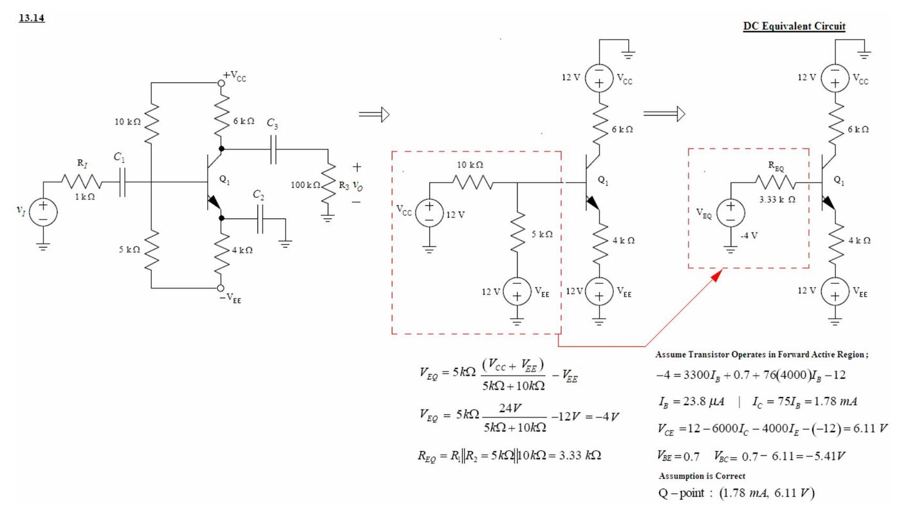
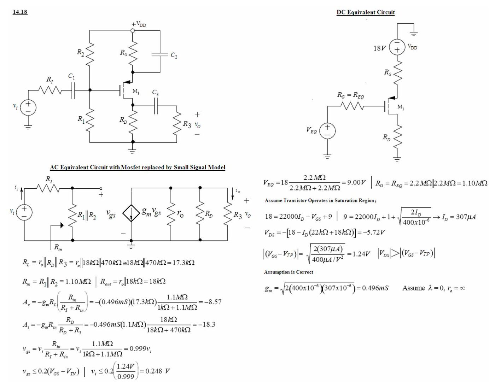
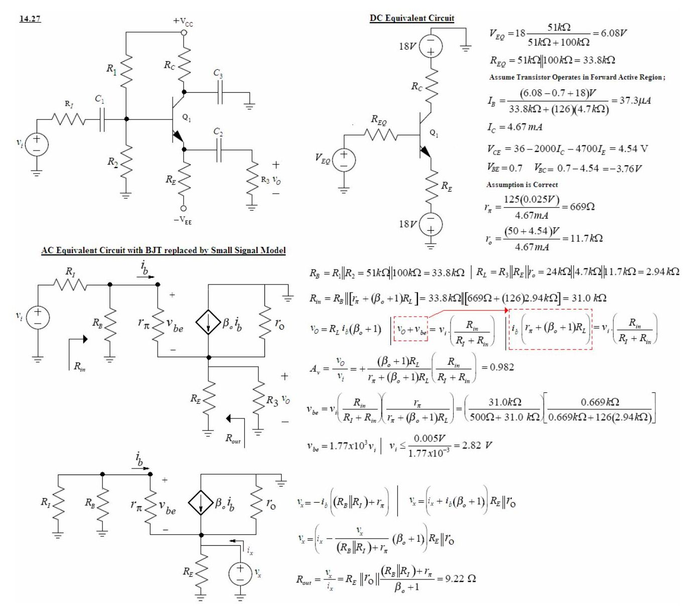
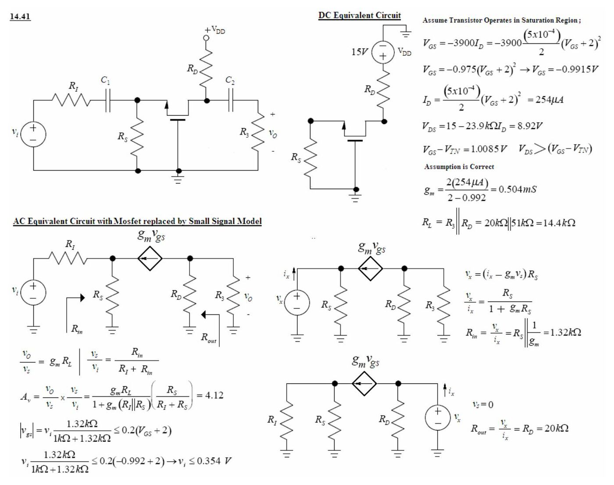

This post contains the solutions to the first three homework assignments of the Başkent University **EEM311 Electronics II** course in the fall 2005 semester (Homework I: 11 October 2005, Homework II: 14 October 2005, Homework III: 24 October 2005). The problems are from the course textbook, Jaeger & Blalock, *Microelectronic Circuit Design*; the solutions were prepared in Word with circuit diagrams by the course's teaching assistant. The original files were password-protected; PDFs with the password removed can be downloaded as a ZIP at the end of the post. Homework IV and V are in a separate post: *EEM311 2005 Homework Solutions IV–V*.

Common assumptions in the solutions: V_BE = 0.7 V, V_T = 25 mV (g_m = 40·I_C), r_o = ∞ unless stated otherwise. In DC analysis, capacitors are treated as open circuits and in AC analysis as short circuits; the base/gate divider is converted to its Thévenin equivalent (V_EQ, R_EQ).

## Homework I

### 13.14: npn common-emitter, ±12 V supply (Q-point)

Circuit: V_CC = +12 V, V_EE = −12 V; base divider 10 kΩ (to V_CC) and 5 kΩ (to −V_EE), R_C = 6 kΩ, R_E = 4 kΩ (bypassed by C₂), R_I = 1 kΩ, load R₃ = 100 kΩ; β_F = 75.

- V_EQ = 5 kΩ·(V_CC + V_EE)/(5 kΩ + 10 kΩ) − V_EE = 5 kΩ·24 V/15 kΩ − 12 V = **−4 V**
- R_EQ = 5 kΩ ∥ 10 kΩ = **3.33 kΩ**
- Assuming forward-active operation: −4 = 3300·I_B + 0.7 + 76·(4000)·I_B − 12
- I_B = 23.8 µA, I_C = 75·I_B = **1.78 mA**
- V_CE = 12 − 6000·I_C − 4000·I_E − (−12) = **6.11 V**; V_BC = 0.7 − 6.11 = −5.41 V → assumption is correct.
- **Q-point: (1.78 mA, 6.11 V)**

### 13.18: pnp common-emitter, single supply (Q-point)

Circuit: V_CC = 9 V; base divider 20 kΩ (to V_CC) and 62 kΩ (to ground); emitter 3.9 kΩ (bypassed by C₂, to V_CC), collector 13 kΩ (to ground); R_I = 1 kΩ, R₃ = 100 kΩ; β_F = 135.

- V_EQ = 9 V·62 kΩ/(62 kΩ + 20 kΩ) = **6.80 V**, R_EQ = 62 kΩ ∥ 20 kΩ = **15.1 kΩ**
- 9 = 3900·(136)·I_B + 0.7 + 15 100·I_B + 6.80
- I_B = 2.75 µA, I_C = 135·I_B = **371 µA**, I_E = 374 µA
- V_EC = 9 − 3900·I_E − 13 000·I_C = **2.72 V**; V_CB = 0.7 − 2.72 = −2.02 V → assumption is correct.
- **Q-point: (371 µA, 2.72 V)**

### 13.20: n-channel MOSFET, common-source (Q-point)

Circuit: V_DD = 15 V; gate divider 2.7 MΩ and 1 MΩ, R_D = 82 kΩ, R_S = 27 kΩ (bypassed by C₂), R_I = 1 kΩ; K_n = 0.25 mA/V², V_TN = 1 V.

- V_EQ = 15 V·1 MΩ/(1 MΩ + 2.7 MΩ) = **4.05 V**, R_EQ = 1 MΩ ∥ 2.7 MΩ = **730 kΩ**
- Assuming saturation: I_D = (0.25 mA/2)·(V_GS − 1)², V_GS = 4.05 − 27 000·I_D
- I_D = 0.125 mA·(3.05 − 27 000·I_D)² → I_D = **82.2 µA**
- V_DS = 15 − 82 000·I_D − 27 000·I_D = **6.04 V**; V_GS − V_TN = 0.84 V < V_DS → assumption is correct.
- **Q-point: (82.2 µA, 6.04 V)**

*Note: The exact solution of the quadratic equation gives I_D ≈ 82.8 µA, V_DS ≈ 5.97 V and V_GS − V_TN ≈ 0.81 V; the difference comes from rounding, and the conclusion (saturation region) does not change.*

### 13.64 (a): npn common-emitter, ±9 V, voltage gain

Circuit: V_CC = +9 V, V_EE = −9 V; base divider 62 kΩ (to V_CC) and 20 kΩ (to −V_EE); R_C = 13 kΩ, R_E = 3.9 kΩ (bypassed by C₂); R_I = 1 kΩ, R₃ = 100 kΩ; β_F = 135.

: AC equivalent circuit with the BJT replaced by its small-signal model")

- V_EQ = −9 + 18·20 kΩ/(62 kΩ + 20 kΩ) = **−4.61 V**, R_EQ = 15.1 kΩ
- I_B = (−4.61 − 0.7 − (−9))/(15.1 kΩ + 136·3.9 kΩ) = **6.76 µA**, I_C = 135·I_B = **913 µA**
- V_CE = 9 − 13 000·I_C − 3900·I_E − (−9) = **2.54 V**; V_BC = −1.84 V → assumption is correct.
- Small signal: g_m = 40·I_C = **0.0365 S**, r_π = 135/g_m = **3.70 kΩ**, r_o = ∞
- v_be/v_i = (r_π ∥ 62 kΩ ∥ 20 kΩ)/(1 kΩ + r_π ∥ 62 kΩ ∥ 20 kΩ), v_o/v_be = −g_m·(13 kΩ ∥ 100 kΩ)
- **A_v = −(2.97 kΩ/(1 kΩ + 2.97 kΩ))·(0.0365)·(11.5 kΩ) = −314**

### 13.64 (b): pnp version of the same circuit (V_CC = 18 V)

Circuit: V_CC = 18 V; base divider 20 kΩ (to V_CC) and 62 kΩ (to ground); emitter 3.9 kΩ (bypassed), collector 13 kΩ.

- V_EQ = 18 V·62 kΩ/(62 kΩ + 20 kΩ) = **13.6 V**, R_EQ = 15.1 kΩ
- 18 = 3900·(136)·I_B + 0.7 + 15 100·I_B + 13.6 → I_B = 6.76 µA, I_C = **913 µA**
- V_EC = 18 − 3900·I_E − 13 000·I_C = **2.54 V**; V_CB = −1.84 V → assumption is correct.
- Since the Q-point is the same as in part (a), the small-signal parameters and the gain are also the same: g_m = 0.0365 S, r_π = 3.70 kΩ, **A_v = −314**.

### 13.102: MOSFET common-source, gain including r_o

Circuit: R_I = 100 kΩ, gate resistor 6.8 MΩ, R_D = 50 kΩ, R₃ = 120 kΩ; I_D = 100 µA, V_DS = 5 V, K_n = 500 µA/V², λ = 0.02 V⁻¹.

- g_m = √(2K_n·I_D·(1 + λV_DS)) = √(2·500 µA/V²·100 µA·(1 + 0.02·5)) = **332 µS**
- r_o = (1/λ + V_DS)/I_D = (50 + 5 V)/100 µA = **550 kΩ**
- v_gs/v_i = 6.8 MΩ/(6.8 MΩ + 0.1 MΩ), v_o/v_gs = −g_m·(r_o ∥ 50 kΩ ∥ 120 kΩ)
- **A_v = −(6.8/6.9)·(332 µS)·(550 kΩ ∥ 50 kΩ ∥ 120 kΩ) = −10.9**

## Homework II

### 14.8: Common-source, R_S bypassed and unbypassed

Circuit: R_I = 75 kΩ, R_G = 1 MΩ, R_S = 200 Ω, R_L = 2 kΩ; g_m = 0.005 S, r_o = 10 kΩ.

**(a) R_S unbypassed, r_o neglected:**

- v_o/v_gs = −g_m·R_L, v_gs/v_i = R_G/((R_I + R_G)(1 + g_m·R_S))
- A_v = −1 MΩ·(0.005 S)·(2000 Ω)/((75 kΩ + 1 MΩ)·(1 + 0.005·200)) = **−4.65**
- i_o = −g_m·v_gs, i_i = (v_gs + g_m·v_gs·R_S)/R_G → A_i = −R_G·g_m/(1 + g_m·R_S) = **−2500**
- Output resistance including r_o: R_out = r_o·(1 + g_m·R_S) = 10 kΩ·(1 + 0.005·200) = **20.0 kΩ**; R_in = R_G = **1 MΩ**

**(b) R_S bypassed:**

- A_v = −g_m·(R_L ∥ r_o)·R_G/(R_I + R_G) = −(0.005)·(2 kΩ ∥ 10 kΩ)·(1 MΩ/1.075 MΩ) = **−7.75**
- R_in = R_G = 1 MΩ, R_out = r_o = 10.0 kΩ
- A_i = −R_G·g_m = **−5000**

### 14.10: Common-emitter with split emitter resistor

Circuit: ±12 V, R_C = 8.2 kΩ, load 47 kΩ, series 330 Ω + 680 Ω in the emitter (to −12 V); r_o neglected. R_L = 8.2 kΩ ∥ 47 kΩ, R_E = R_E1 + R_E2.

- (a) A_v = −β_o·R_L/(r_π + (β_o + 1)R_E); for large β_o, A_v ≅ −R_L/R_E = −(8.2 kΩ ∥ 47 kΩ)/(330 Ω + 680 Ω) = **−6.91**
- (b) Bypass capacitor in parallel with the 330 Ω: A_v ≅ −(8.2 kΩ ∥ 47 kΩ)/680 Ω = **−10.3**
- (c) Bypass capacitor in parallel with the 680 Ω: A_v ≅ −(8.2 kΩ ∥ 47 kΩ)/330 Ω = **−21.2**
- (d) A bypass capacitor is placed from the emitter to ground.
- (e) In this case A_v ≅ −10·(V_CC + V_EE) = **−240** (the rule of thumb from Section 13.6.3 of the textbook).

### 14.11: Design with an input resistance of 500 kΩ and a gain of −10

Source resistance 100 kΩ, β_o = 75; required R_in = 500 kΩ and A_vt = −10.

- R_in = r_π + (β_o + 1)R_E = 500 kΩ
- A_vt = −β_o·R_L/(r_π + (β_o + 1)R_E) = −75·R_L/500 kΩ = −10 → **R_L = 66.7 kΩ**
- Assuming (β_o + 1)R_E ≫ r_π, R_E ≅ 500 kΩ/76 = **6.58 kΩ**

### 14.18: p-channel MOSFET common-source

Circuit: V_DD = 18 V; gate divider R₁ = R₂ = 2.2 MΩ; R_S = 22 kΩ (bypassed), R_D = 18 kΩ, R₃ = 470 kΩ, R_I = 1 kΩ; K_p = 400 µA/V², V_TP = −1 V, λ = 0.

- V_EQ = 18·2.2 MΩ/(2.2 MΩ + 2.2 MΩ) = **9.00 V**, R_G = 2.2 MΩ ∥ 2.2 MΩ = **1.10 MΩ**
- Assuming saturation: 9 = 22 000·I_D + 1 + √(2I_D/400 µA/V²) → I_D = **307 µA**
- V_DS = −[18 − I_D·(22 kΩ + 18 kΩ)] = **−5.72 V**; |V_GS − V_TP| = 1.24 V < |V_DS| → assumption is correct.
- g_m = √(2·400 µA/V²·307 µA) = **0.496 mS**
- R_L = r_o ∥ 18 kΩ ∥ 470 kΩ = **17.3 kΩ**, R_in = R₁ ∥ R₂ = **1.10 MΩ**, R_out = 18 kΩ
- A_v = −g_m·R_L·R_in/(R_I + R_in) = −(0.496 mS)(17.3 kΩ)(1.1 MΩ/1.101 MΩ) = **−8.57**
- A_i = −g_m·R_in·R_D/(R_D + R₃) = −0.496 mS·1.1 MΩ·18 kΩ/(18 kΩ + 470 kΩ) = −18.3 (at the source)
- Small-signal limit: v_gs ≤ 0.2(V_GS − V_TP) → v_i ≤ 0.2·(1.24 V/0.999) = **0.248 V**

*Note: Substituting the numbers into the current-gain expression gives −0.496 mS·1.1 MΩ·(18/488) ≈ **−20.1**; the −18.3 at the source is a calculation error.*

### 14.21: Common-emitter with inductor in the collector

Circuit: V_CC = V_EE = 10 V; collector connected to V_CC through an inductor L, base grounded through R_B = 20 kΩ, R_E = 9.1 kΩ (bypassed, to −V_EE); R_I = 250 Ω, R₃ = 1 MΩ; β_o = 80, V_A = 100 V.

- I_B = (V_EE − V_BE)/(R_B + (β_o + 1)R_E) = (10 − 0.7)/(20 kΩ + 81·9.1 kΩ) = **12.3 µA**
- I_C = **983 µA**, V_CE = (V_CC + V_EE) − R_E·I_E = 20 − 9100·I_E = **11.0 V** → forward active.
- r_π = 80·(0.025 V)/983 µA = **2.04 kΩ**, r_o = (100 + 11.0 V)/983 µA = **113 kΩ**
- R_L = r_o ∥ 1 MΩ = **102 kΩ**, R_in = R_B ∥ r_π = **1.85 kΩ**, R_out = r_o = **113 kΩ**
- A_v = −g_m·R_L·R_in/(R_I + R_in) = −40(983 µA)(102 kΩ)·1.85 kΩ/(250 Ω + 1.85 kΩ) = **−3530**
- A_i = −80·(20 kΩ/(20 kΩ + 2.04 kΩ))·(113 kΩ/(113 kΩ + 1 MΩ)) = **−7.37**
- Small-signal limit (v_be ≤ 5 mV): at the source v_be = v_i·20 kΩ/(250 Ω + 20 kΩ) = 0.988·v_i → v_i ≤ 5.06 mV

*Note: In the v_be/v_i ratio, R_in = R_B ∥ r_π = 1.85 kΩ should have been used (the formula is written that way, but R_B = 20 kΩ was substituted): v_be = 1.85/(0.25 + 1.85)·v_i = 0.881·v_i, so v_i ≤ 5 mV/0.881 ≈ **5.68 mV**.*

## Homework III

### 14.27: Common-collector (emitter follower)

Circuit: ±18 V; R₁ = 100 kΩ, R₂ = 51 kΩ, R_C = 2 kΩ (bypassed), R_E = 4.7 kΩ, load R₃ = 24 kΩ, R_I = 500 Ω; β_F = 125, V_A = 50 V.

- V_EQ = 18·51 kΩ/(51 kΩ + 100 kΩ) = **6.08 V**, R_EQ = 51 kΩ ∥ 100 kΩ = **33.8 kΩ**
- I_B = (6.08 − 0.7 + 18)/(33.8 kΩ + 126·4.7 kΩ) = **37.3 µA**, I_C = **4.67 mA**
- V_CE = 36 − 2000·I_C − 4700·I_E = **4.54 V** → forward active.
- r_π = 125·(0.025)/4.67 mA = **669 Ω**, r_o = (50 + 4.54)/4.67 mA = **11.7 kΩ**
- R_L = R₃ ∥ R_E ∥ r_o = 24 kΩ ∥ 4.7 kΩ ∥ 11.7 kΩ = **2.94 kΩ**
- R_in = R_B ∥ [r_π + (β_o + 1)R_L] = 33.8 kΩ ∥ [669 Ω + 126·2.94 kΩ] = **31.0 kΩ**
- A_v = (β_o + 1)R_L/(r_π + (β_o + 1)R_L) · R_in/(R_I + R_in) = **0.982**
- v_be = v_i·(31.0/31.5)·(0.669/(0.669 + 126·2.94)) = 1.77·10⁻³·v_i → for v_be ≤ 5 mV, **v_i ≤ 2.82 V**
- R_out = R_E ∥ r_o ∥ ((R_B ∥ R_I) + r_π)/(β_o + 1) = **9.22 Ω**

### 14.41: Common-gate (depletion-mode NMOS) amplifier

Circuit: V_DD = 15 V; R_S = 3.9 kΩ, R_D = 20 kΩ, R₃ = 51 kΩ, R_I = 1 kΩ; K_n = 0.5 mA/V², V_TN = −2 V (gate grounded).

- Assuming saturation: V_GS = −3900·I_D = −3900·(5·10⁻⁴/2)(V_GS + 2)² → V_GS = −0.975(V_GS + 2)² → **V_GS = −0.9915 V**
- I_D = (5·10⁻⁴/2)(V_GS + 2)² = **254 µA**, V_DS = 15 − 23.9 kΩ·I_D = **8.92 V**; V_GS − V_TN = 1.0085 V → assumption is correct.
- g_m = 2(254 µA)/(2 − 0.992) = **0.504 mS**
- R_L = R₃ ∥ R_D = 20 kΩ ∥ 51 kΩ = **14.4 kΩ**
- R_in = R_S ∥ (1/g_m) = **1.32 kΩ**, R_out = R_D = **20 kΩ**
- A_v = g_m·R_L/(1 + g_m(R_I ∥ R_S)) · R_S/(R_I + R_S) = **4.12**
- Small-signal limit: v_i·1.32/(1 + 1.32) ≤ 0.2(−0.992 + 2) → **v_i ≤ 0.354 V**

### Question 3: Circuit with input at the emitter and output taken from the base

Circuit: pnp transistor; collector connected to −V_CC through R_C and AC-grounded by C₁; emitter connected to +V_EE through R_E, input v_i applied to the emitter (through R_I and C₂); output taken from the base through C₃ to R₃, base grounded through R_B.

> The voltage gain is approximately 0, because the signal is removed from amplifier at the base terminal which makes the amplifier not useful.

That is, the voltage gain is approximately zero: since the signal is taken from the amplifier's base, the circuit is not useful as an amplifier.
