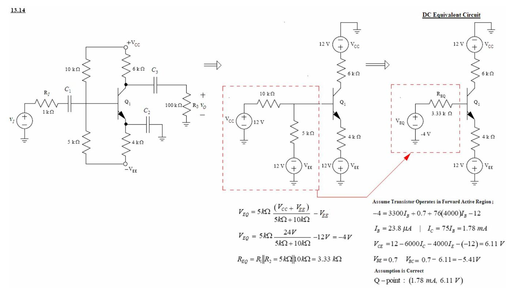
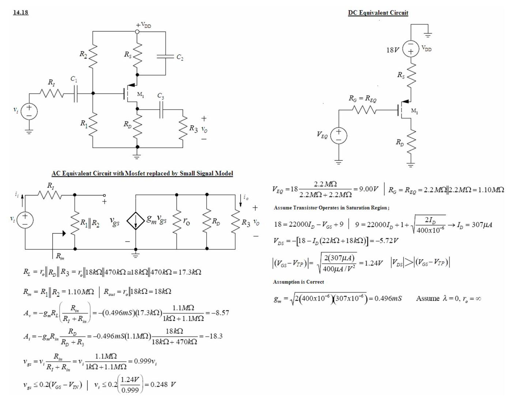
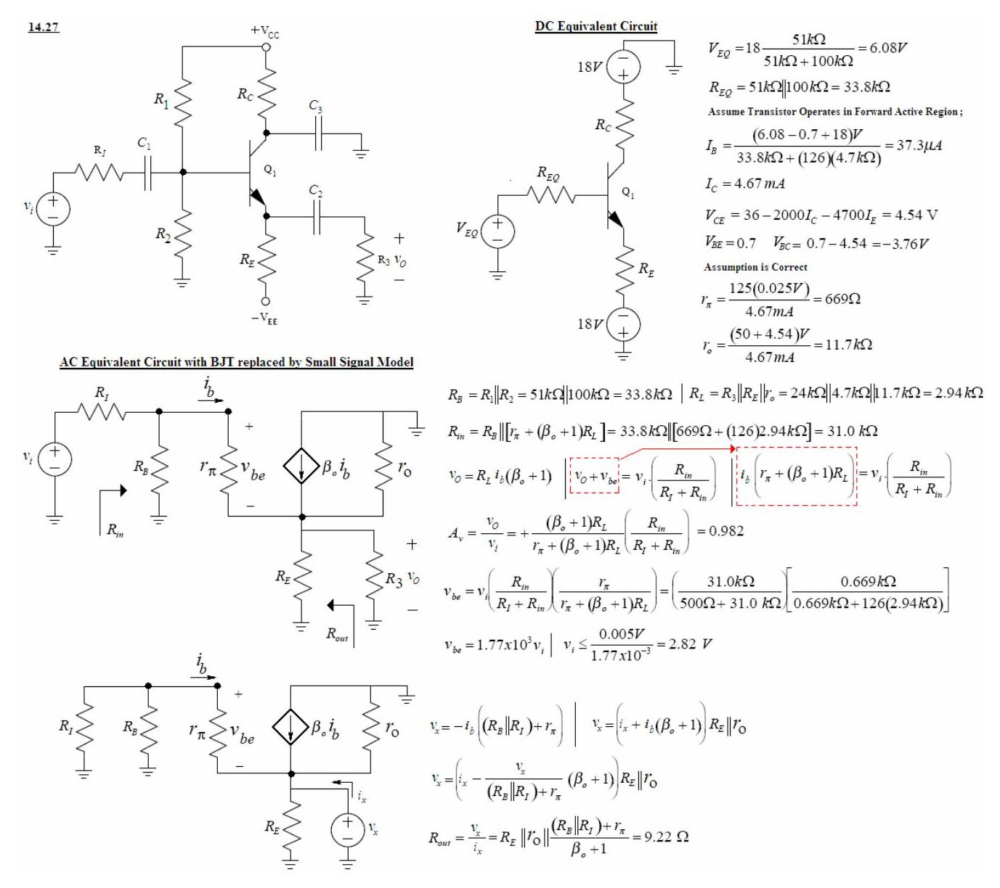
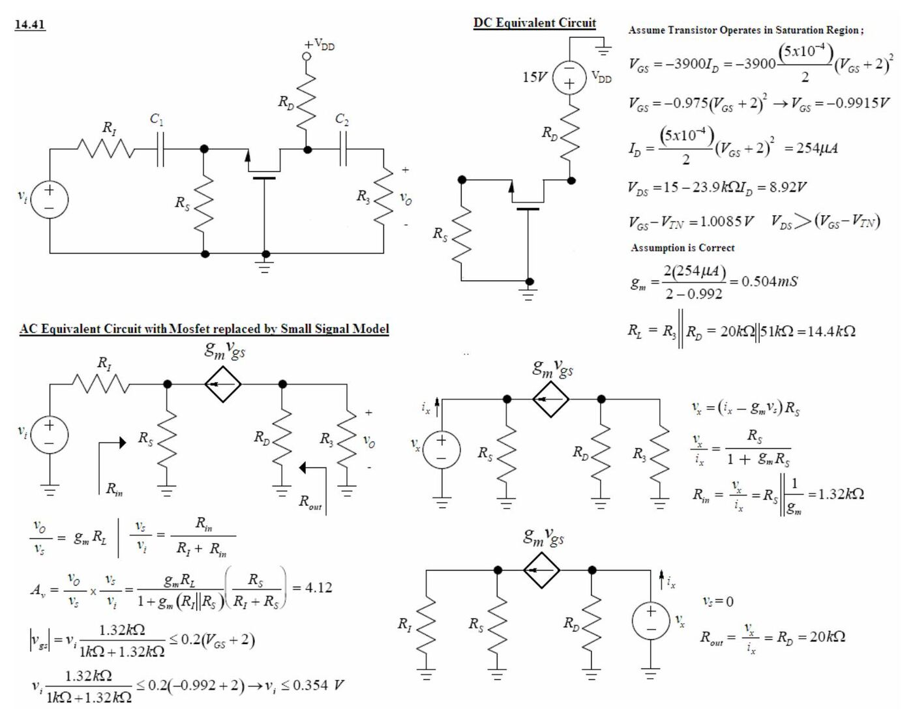

Bu yazı, Başkent Üniversitesi **EEM311 Elektronik II** dersinin 2005 güz dönemindeki ilk üç ödevinin çözümlerini içeriyor (Ödev I: 11 Ekim 2005, Ödev II: 14 Ekim 2005, Ödev III: 24 Ekim 2005). Problemler dersin kitabı Jaeger & Blalock, *Microelectronic Circuit Design*'dan; çözümler dersin asistanı tarafından Word'de devre şemalarıyla hazırlanmış. Orijinal dosyalar parolalıydı; parolası kaldırılmış PDF'ler yazının sonunda ZIP olarak indirilebilir. Ödev IV ve V ayrı bir yazıda: *EEM311 2005 Ödev Çözümleri IV–V*.

Çözümlerde ortak kabuller: V_BE = 0,7 V, V_T = 25 mV (g_m = 40·I_C), aksi belirtilmedikçe r_o = ∞. DC analizde kondansatörler açık devre, AC analizde kısa devre sayılıyor; baz/geçit bölücüsü Thévenin eşdeğerine (V_EQ, R_EQ) çevriliyor.

## Ödev I

### 13.14: npn ortak emetör, ±12 V besleme (Q noktası)

Devre: V_CC = +12 V, V_EE = −12 V; baz bölücüsü 10 kΩ (V_CC'ye) ve 5 kΩ (−V_EE'ye), R_C = 6 kΩ, R_E = 4 kΩ (C₂ ile köprülenmiş), R_I = 1 kΩ, yük R₃ = 100 kΩ; β_F = 75.

- V_EQ = 5 kΩ·(V_CC + V_EE)/(5 kΩ + 10 kΩ) − V_EE = 5 kΩ·24 V/15 kΩ − 12 V = **−4 V**
- R_EQ = 5 kΩ ∥ 10 kΩ = **3,33 kΩ**
- İleri aktif bölge kabulüyle: −4 = 3300·I_B + 0,7 + 76·(4000)·I_B − 12
- I_B = 23,8 µA, I_C = 75·I_B = **1,78 mA**
- V_CE = 12 − 6000·I_C − 4000·I_E − (−12) = **6,11 V**; V_BC = 0,7 − 6,11 = −5,41 V → kabul doğru.
- **Q noktası: (1,78 mA; 6,11 V)**

### 13.18: pnp ortak emetör, tek besleme (Q noktası)

Devre: V_CC = 9 V; baz bölücüsü 20 kΩ (V_CC'ye) ve 62 kΩ (toprağa); emetörde 3,9 kΩ (C₂ ile köprülenmiş, V_CC'ye), kolektörde 13 kΩ (toprağa); R_I = 1 kΩ, R₃ = 100 kΩ; β_F = 135.

- V_EQ = 9 V·62 kΩ/(62 kΩ + 20 kΩ) = **6,80 V**, R_EQ = 62 kΩ ∥ 20 kΩ = **15,1 kΩ**
- 9 = 3900·(136)·I_B + 0,7 + 15 100·I_B + 6,80
- I_B = 2,75 µA, I_C = 135·I_B = **371 µA**, I_E = 374 µA
- V_EC = 9 − 3900·I_E − 13 000·I_C = **2,72 V**; V_CB = 0,7 − 2,72 = −2,02 V → kabul doğru.
- **Q noktası: (371 µA; 2,72 V)**

### 13.20: n kanallı MOSFET, ortak kaynak (Q noktası)

Devre: V_DD = 15 V; geçit bölücüsü 2,7 MΩ ve 1 MΩ, R_D = 82 kΩ, R_S = 27 kΩ (C₂ ile köprülenmiş), R_I = 1 kΩ; K_n = 0,25 mA/V², V_TN = 1 V.

- V_EQ = 15 V·1 MΩ/(1 MΩ + 2,7 MΩ) = **4,05 V**, R_EQ = 1 MΩ ∥ 2,7 MΩ = **730 kΩ**
- Doyma kabulüyle: I_D = (0,25 mA/2)·(V_GS − 1)², V_GS = 4,05 − 27 000·I_D
- I_D = 0,125 mA·(3,05 − 27 000·I_D)² → I_D = **82,2 µA**
- V_DS = 15 − 82 000·I_D − 27 000·I_D = **6,04 V**; V_GS − V_TN = 0,84 V < V_DS → kabul doğru.
- **Q noktası: (82,2 µA; 6,04 V)**

*Not: İkinci dereceden denklemin tam çözümü I_D ≈ 82,8 µA, V_DS ≈ 5,97 V ve V_GS − V_TN ≈ 0,81 V verir; farkı yuvarlamadan geliyor, sonuç (doyma bölgesi) değişmez.*

### 13.64 (a): npn ortak emetör, ±9 V, gerilim kazancı

Devre: V_CC = +9 V, V_EE = −9 V; baz bölücüsü 62 kΩ (V_CC'ye) ve 20 kΩ (−V_EE'ye); R_C = 13 kΩ, R_E = 3,9 kΩ (C₂ ile köprülenmiş); R_I = 1 kΩ, R₃ = 100 kΩ; β_F = 135.

: BJT'nin küçük sinyal modeliyle değiştirildiği AC eşdeğer devre")

- V_EQ = −9 + 18·20 kΩ/(62 kΩ + 20 kΩ) = **−4,61 V**, R_EQ = 15,1 kΩ
- I_B = (−4,61 − 0,7 − (−9))/(15,1 kΩ + 136·3,9 kΩ) = **6,76 µA**, I_C = 135·I_B = **913 µA**
- V_CE = 9 − 13 000·I_C − 3900·I_E − (−9) = **2,54 V**; V_BC = −1,84 V → kabul doğru.
- Küçük sinyal: g_m = 40·I_C = **0,0365 S**, r_π = 135/g_m = **3,70 kΩ**, r_o = ∞
- v_be/v_i = (r_π ∥ 62 kΩ ∥ 20 kΩ)/(1 kΩ + r_π ∥ 62 kΩ ∥ 20 kΩ), v_o/v_be = −g_m·(13 kΩ ∥ 100 kΩ)
- **A_v = −(2,97 kΩ/(1 kΩ + 2,97 kΩ))·(0,0365)·(11,5 kΩ) = −314**

### 13.64 (b): Aynı devrenin pnp sürümü (V_CC = 18 V)

Devre: V_CC = 18 V; baz bölücüsü 20 kΩ (V_CC'ye) ve 62 kΩ (toprağa); emetörde 3,9 kΩ (köprülenmiş), kolektörde 13 kΩ.

- V_EQ = 18 V·62 kΩ/(62 kΩ + 20 kΩ) = **13,6 V**, R_EQ = 15,1 kΩ
- 18 = 3900·(136)·I_B + 0,7 + 15 100·I_B + 13,6 → I_B = 6,76 µA, I_C = **913 µA**
- V_EC = 18 − 3900·I_E − 13 000·I_C = **2,54 V**; V_CB = −1,84 V → kabul doğru.
- Q noktası (a) şıkkıyla aynı olduğundan küçük sinyal parametreleri ve kazanç da aynı: g_m = 0,0365 S, r_π = 3,70 kΩ, **A_v = −314**.

### 13.102: MOSFET ortak kaynak, r_o dahil kazanç

Devre: R_I = 100 kΩ, geçit direnci 6,8 MΩ, R_D = 50 kΩ, R₃ = 120 kΩ; I_D = 100 µA, V_DS = 5 V, K_n = 500 µA/V², λ = 0,02 V⁻¹.

- g_m = √(2K_n·I_D·(1 + λV_DS)) = √(2·500 µA/V²·100 µA·(1 + 0,02·5)) = **332 µS**
- r_o = (1/λ + V_DS)/I_D = (50 + 5 V)/100 µA = **550 kΩ**
- v_gs/v_i = 6,8 MΩ/(6,8 MΩ + 0,1 MΩ), v_o/v_gs = −g_m·(r_o ∥ 50 kΩ ∥ 120 kΩ)
- **A_v = −(6,8/6,9)·(332 µS)·(550 kΩ ∥ 50 kΩ ∥ 120 kΩ) = −10,9**

## Ödev II

### 14.8: Ortak kaynak, R_S köprülü ve köprüsüz

Devre: R_I = 75 kΩ, R_G = 1 MΩ, R_S = 200 Ω, R_L = 2 kΩ; g_m = 0,005 S, r_o = 10 kΩ.

**(a) R_S köprülenmemiş, r_o ihmal:**

- v_o/v_gs = −g_m·R_L, v_gs/v_i = R_G/((R_I + R_G)(1 + g_m·R_S))
- A_v = −1 MΩ·(0,005 S)·(2000 Ω)/((75 kΩ + 1 MΩ)·(1 + 0,005·200)) = **−4,65**
- i_o = −g_m·v_gs, i_i = (v_gs + g_m·v_gs·R_S)/R_G → A_i = −R_G·g_m/(1 + g_m·R_S) = **−2500**
- r_o dahil çıkış direnci: R_out = r_o·(1 + g_m·R_S) = 10 kΩ·(1 + 0,005·200) = **20,0 kΩ**; R_in = R_G = **1 MΩ**

**(b) R_S köprülü:**

- A_v = −g_m·(R_L ∥ r_o)·R_G/(R_I + R_G) = −(0,005)·(2 kΩ ∥ 10 kΩ)·(1 MΩ/1,075 MΩ) = **−7,75**
- R_in = R_G = 1 MΩ, R_out = r_o = 10,0 kΩ
- A_i = −R_G·g_m = **−5000**

### 14.10: Emetör direnci bölünmüş ortak emetör

Devre: ±12 V, R_C = 8,2 kΩ, yük 47 kΩ, emetörde seri 330 Ω + 680 Ω (−12 V'a); r_o ihmal. R_L = 8,2 kΩ ∥ 47 kΩ, R_E = R_E1 + R_E2.

- (a) A_v = −β_o·R_L/(r_π + (β_o + 1)R_E); β_o büyükse A_v ≅ −R_L/R_E = −(8,2 kΩ ∥ 47 kΩ)/(330 Ω + 680 Ω) = **−6,91**
- (b) 330 Ω'a paralel köprüleme kondansatörü: A_v ≅ −(8,2 kΩ ∥ 47 kΩ)/680 Ω = **−10,3**
- (c) 680 Ω'a paralel köprüleme kondansatörü: A_v ≅ −(8,2 kΩ ∥ 47 kΩ)/330 Ω = **−21,2**
- (d) Emetörden toprağa köprüleme kondansatörü konur.
- (e) Bu durumda A_v ≅ −10·(V_CC + V_EE) = **−240** (kitabın 13.6.3 bölümündeki kaba kural).

### 14.11: Giriş direnci 500 kΩ ve kazancı −10 olan tasarım

Kaynak direnci 100 kΩ, β_o = 75; istenen R_in = 500 kΩ ve A_vt = −10.

- R_in = r_π + (β_o + 1)R_E = 500 kΩ
- A_vt = −β_o·R_L/(r_π + (β_o + 1)R_E) = −75·R_L/500 kΩ = −10 → **R_L = 66,7 kΩ**
- (β_o + 1)R_E ≫ r_π kabulüyle R_E ≅ 500 kΩ/76 = **6,58 kΩ**

### 14.18: p kanallı MOSFET ortak kaynak

Devre: V_DD = 18 V; geçit bölücüsü R₁ = R₂ = 2,2 MΩ; R_S = 22 kΩ (köprülü), R_D = 18 kΩ, R₃ = 470 kΩ, R_I = 1 kΩ; K_p = 400 µA/V², V_TP = −1 V, λ = 0.

- V_EQ = 18·2,2 MΩ/(2,2 MΩ + 2,2 MΩ) = **9,00 V**, R_G = 2,2 MΩ ∥ 2,2 MΩ = **1,10 MΩ**
- Doyma kabulü: 9 = 22 000·I_D + 1 + √(2I_D/400 µA/V²) → I_D = **307 µA**
- V_DS = −[18 − I_D·(22 kΩ + 18 kΩ)] = **−5,72 V**; |V_GS − V_TP| = 1,24 V < |V_DS| → kabul doğru.
- g_m = √(2·400 µA/V²·307 µA) = **0,496 mS**
- R_L = r_o ∥ 18 kΩ ∥ 470 kΩ = **17,3 kΩ**, R_in = R₁ ∥ R₂ = **1,10 MΩ**, R_out = 18 kΩ
- A_v = −g_m·R_L·R_in/(R_I + R_in) = −(0,496 mS)(17,3 kΩ)(1,1 MΩ/1,101 MΩ) = **−8,57**
- A_i = −g_m·R_in·R_D/(R_D + R₃) = −0,496 mS·1,1 MΩ·18 kΩ/(18 kΩ + 470 kΩ) = −18,3 (kaynakta)
- Küçük sinyal sınırı: v_gs ≤ 0,2(V_GS − V_TP) → v_i ≤ 0,2·(1,24 V/0,999) = **0,248 V**

*Not: Akım kazancı ifadesine sayılar konunca −0,496 mS·1,1 MΩ·(18/488) ≈ **−20,1** çıkıyor; kaynaktaki −18,3 hesap hatası.*

### 14.21: Endüktanslı kolektörlü ortak emetör

Devre: V_CC = V_EE = 10 V; kolektör V_CC'ye L bobiniyle bağlı, baz R_B = 20 kΩ ile toprakta, R_E = 9,1 kΩ (köprülü, −V_EE'ye); R_I = 250 Ω, R₃ = 1 MΩ; β_o = 80, V_A = 100 V.

- I_B = (V_EE − V_BE)/(R_B + (β_o + 1)R_E) = (10 − 0,7)/(20 kΩ + 81·9,1 kΩ) = **12,3 µA**
- I_C = **983 µA**, V_CE = (V_CC + V_EE) − R_E·I_E = 20 − 9100·I_E = **11,0 V** → ileri aktif.
- r_π = 80·(0,025 V)/983 µA = **2,04 kΩ**, r_o = (100 + 11,0 V)/983 µA = **113 kΩ**
- R_L = r_o ∥ 1 MΩ = **102 kΩ**, R_in = R_B ∥ r_π = **1,85 kΩ**, R_out = r_o = **113 kΩ**
- A_v = −g_m·R_L·R_in/(R_I + R_in) = −40(983 µA)(102 kΩ)·1,85 kΩ/(250 Ω + 1,85 kΩ) = **−3530**
- A_i = −80·(20 kΩ/(20 kΩ + 2,04 kΩ))·(113 kΩ/(113 kΩ + 1 MΩ)) = **−7,37**
- Küçük sinyal sınırı (v_be ≤ 5 mV): kaynakta v_be = v_i·20 kΩ/(250 Ω + 20 kΩ) = 0,988·v_i → v_i ≤ 5,06 mV

*Not: v_be/v_i oranında R_in = R_B ∥ r_π = 1,85 kΩ kullanılmalıydı (formül de öyle yazılmış ama yerine R_B = 20 kΩ konmuş): v_be = 1,85/(0,25 + 1,85)·v_i = 0,881·v_i, dolayısıyla v_i ≤ 5 mV/0,881 ≈ **5,68 mV**.*

## Ödev III

### 14.27: Ortak kolektör (emetör izleyici)

Devre: ±18 V; R₁ = 100 kΩ, R₂ = 51 kΩ, R_C = 2 kΩ (köprülü), R_E = 4,7 kΩ, yük R₃ = 24 kΩ, R_I = 500 Ω; β_F = 125, V_A = 50 V.

- V_EQ = 18·51 kΩ/(51 kΩ + 100 kΩ) = **6,08 V**, R_EQ = 51 kΩ ∥ 100 kΩ = **33,8 kΩ**
- I_B = (6,08 − 0,7 + 18)/(33,8 kΩ + 126·4,7 kΩ) = **37,3 µA**, I_C = **4,67 mA**
- V_CE = 36 − 2000·I_C − 4700·I_E = **4,54 V** → ileri aktif.
- r_π = 125·(0,025)/4,67 mA = **669 Ω**, r_o = (50 + 4,54)/4,67 mA = **11,7 kΩ**
- R_L = R₃ ∥ R_E ∥ r_o = 24 kΩ ∥ 4,7 kΩ ∥ 11,7 kΩ = **2,94 kΩ**
- R_in = R_B ∥ [r_π + (β_o + 1)R_L] = 33,8 kΩ ∥ [669 Ω + 126·2,94 kΩ] = **31,0 kΩ**
- A_v = (β_o + 1)R_L/(r_π + (β_o + 1)R_L) · R_in/(R_I + R_in) = **0,982**
- v_be = v_i·(31,0/31,5)·(0,669/(0,669 + 126·2,94)) = 1,77·10⁻³·v_i → v_be ≤ 5 mV için **v_i ≤ 2,82 V**
- R_out = R_E ∥ r_o ∥ ((R_B ∥ R_I) + r_π)/(β_o + 1) = **9,22 Ω**

### 14.41: Ortak geçitli (fakirleştirmeli NMOS) yükselteç

Devre: V_DD = 15 V; R_S = 3,9 kΩ, R_D = 20 kΩ, R₃ = 51 kΩ, R_I = 1 kΩ; K_n = 0,5 mA/V², V_TN = −2 V (geçit toprakta).

- Doyma kabulü: V_GS = −3900·I_D = −3900·(5·10⁻⁴/2)(V_GS + 2)² → V_GS = −0,975(V_GS + 2)² → **V_GS = −0,9915 V**
- I_D = (5·10⁻⁴/2)(V_GS + 2)² = **254 µA**, V_DS = 15 − 23,9 kΩ·I_D = **8,92 V**; V_GS − V_TN = 1,0085 V → kabul doğru.
- g_m = 2(254 µA)/(2 − 0,992) = **0,504 mS**
- R_L = R₃ ∥ R_D = 20 kΩ ∥ 51 kΩ = **14,4 kΩ**
- R_in = R_S ∥ (1/g_m) = **1,32 kΩ**, R_out = R_D = **20 kΩ**
- A_v = g_m·R_L/(1 + g_m(R_I ∥ R_S)) · R_S/(R_I + R_S) = **4,12**
- Küçük sinyal sınırı: v_i·1,32/(1 + 1,32) ≤ 0,2(−0,992 + 2) → **v_i ≤ 0,354 V**

### Soru 3: Girişin emetörden, çıkışın bazdan alındığı devre

Devre: pnp transistör; kolektör R_C ile −V_CC'ye bağlı ve C₁ ile AC topraklanmış; emetör R_E ile +V_EE'ye bağlı, giriş v_i (R_I ve C₂ üzerinden) emetöre uygulanıyor; çıkış bazdan C₃ ile R₃'e alınıyor, baz R_B ile toprakta.

> The voltage gain is approximately 0, because the signal is removed from amplifier at the base terminal which makes the amplifier not useful.

Yani gerilim kazancı yaklaşık sıfırdır: sinyal yükseltecin bazından alındığı için devre yükselteç olarak işe yaramaz.
