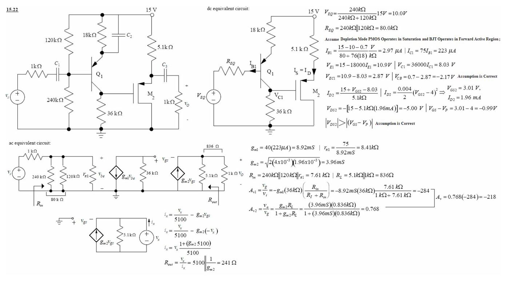
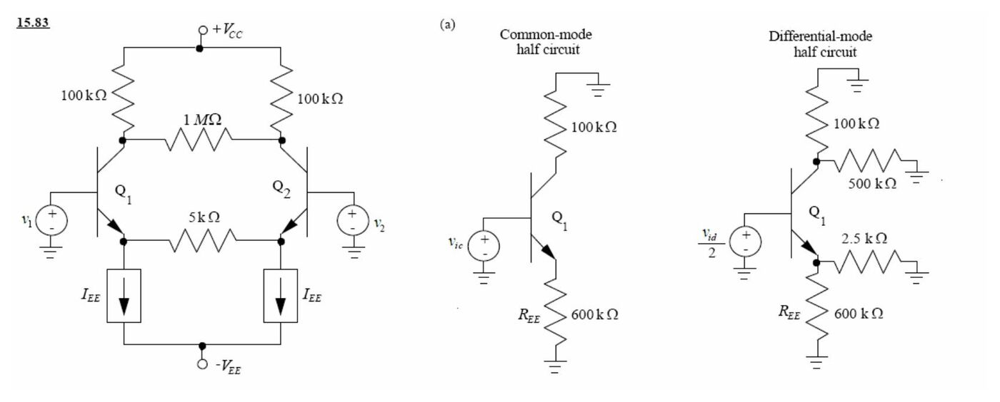
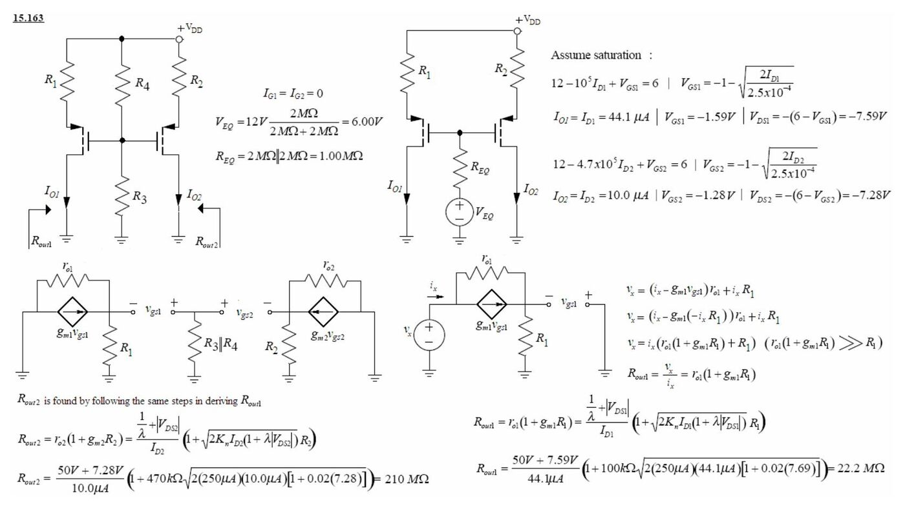
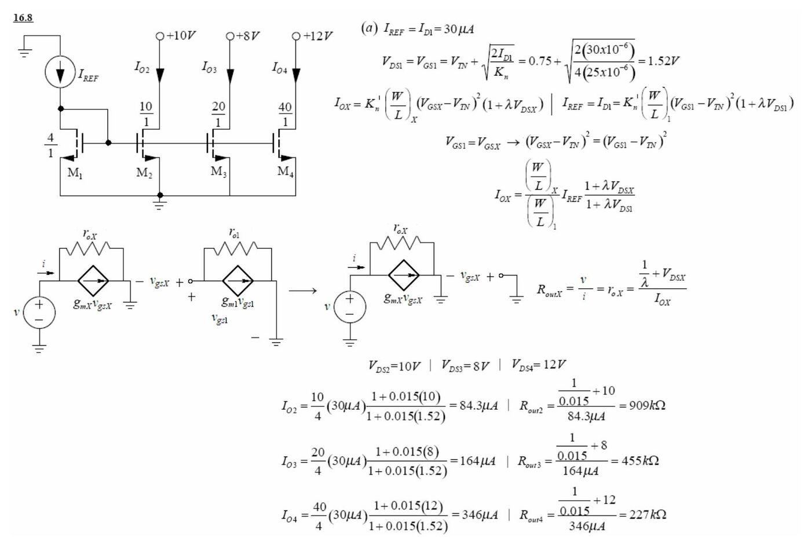
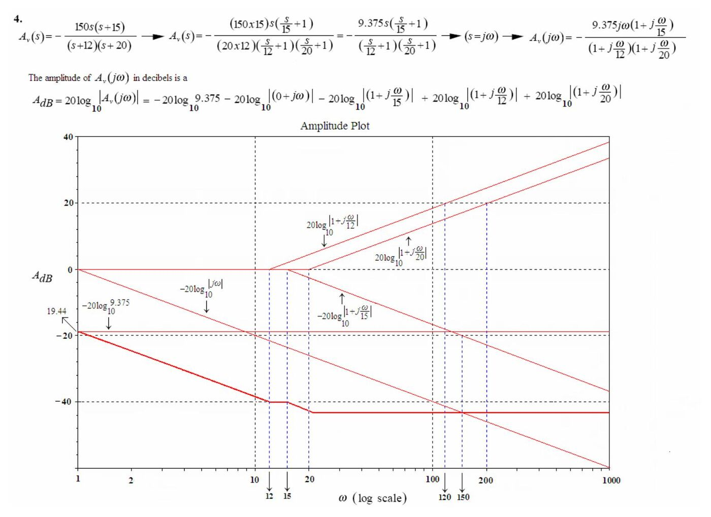

This post contains the solutions to Homework 4 and Homework 5 of the **EEM311 Electronics II** course at Başkent University, fall semester 2005 (Homework IV: November 10, 2005; Homework V: December 11, 2005). The problems are from the textbook Jaeger & Blalock, *Microelectronic Circuit Design*; the solutions were prepared in Word with circuit schematics by the course teaching assistant. The original PDFs, with their password protection removed, can be downloaded as a ZIP at the end of the post. The first three homeworks are in a separate post: *EEM311 2005 Homework Solutions I–III*.

## Homework IV

### 15.22: BJT common-emitter + PMOS source follower (two-stage amplifier)

Circuit: 15 V single supply. The first stage is a pnp transistor Q₁: the base divider is 120 kΩ (to 15 V) and 240 kΩ (to ground), the emitter has 18 kΩ (bypassed by C₂), the collector has 36 kΩ (to ground); the source resistance is 1 kΩ. The second stage is a depletion-mode PMOS M₂: its gate is connected to the collector of Q₁, its source is tied to 15 V through 5.1 kΩ, and its drain is grounded; the output is taken from the source through C₃ to a 1 kΩ load. β_F = 75, K_p = 4 mA/V², V_P = 4 V.

**DC analysis:**

- V_EQ = 15 V·240 kΩ/(240 kΩ + 120 kΩ) = **10.0 V**, R_EQ = 240 kΩ ∥ 120 kΩ = **80.0 kΩ**
- I_B1 = (15 − 10 − 0.7 V)/(80 + 76·18 kΩ) = **2.97 µA**, I_C1 = 75·I_B1 = **223 µA**
- V_E1 = 15 − 18 000·I_E1 = 10.9 V, V_C1 = 36 000·I_C1 = **8.03 V**, V_EC1 = **2.87 V** → forward active.
- M₂: I_D2 = (15 + V_GS2 − 8.03)/5.1 kΩ and I_D2 = (0.004/2)(V_GS2 − 4)² → **V_GS2 = 3.01 V, I_D2 = 1.96 mA**
- V_DS2 = −[15 − 5.1 kΩ·(1.96 mA)] = **−5.00 V**; V_GS − V_P = −0.99 V → |V_DS2| > |V_GS − V_P|, so the saturation assumption is correct.

**(a) AC analysis:**

- g_m1 = 40(223 µA) = **8.92 mS**, r_π1 = 75/8.92 mS = **8.41 kΩ**
- g_m2 = √(2·(4·10⁻³)·(1.96·10⁻³)) = **3.96 mS**
- R_in = 240 kΩ ∥ 120 kΩ ∥ r_π1 = **7.61 kΩ**, R_L = 5.1 kΩ ∥ 1 kΩ = **836 Ω**
- A_v1 = −g_m1·(36 kΩ)·R_in/(R_I + R_in) = −8.92 mS·36 kΩ·7.61/(1 + 7.61) = **−284**
- A_v2 = g_m2·R_L/(1 + g_m2·R_L) = (3.96 mS)(0.836 kΩ)/(1 + 3.31) = **0.768**
- **A_v = 0.768·(−284) = −218**
- R_out = 5100 ∥ (1/g_m2) = **241 Ω**

**(b) If the bypass capacitor across the 18 kΩ is removed:**

- R_in = 80 kΩ ∥ [r_π1 + (β_o1 + 1)·18 kΩ] = **75.6 kΩ**
- A_v1 = (R_in/(1 kΩ + R_in))·(−β_o1·36 kΩ/(r_π1 + (β_o1 + 1)·18 kΩ)) = (75.6/76.6)·(−75·36 kΩ/138 kΩ) = **−1.93**
- **A_v = 0.768·(−1.93) = −1.48**

*Note: The source writes "138 kΩ" in the denominator; r_π1 + 76·18 kΩ = 8.41 kΩ + 1368 kΩ ≈ **1376 kΩ (1.38 MΩ)** would be correct (the result −1.93 is right with this value: the exact calculation gives −1.94). Also, the β_o1·R_I in the A_v1 formula refers to the 36 kΩ collector resistor.*

### 15.53: Single-ended-output differential amplifier (ideal current source)

Circuit: The emitters of Q₁ and Q₂ are connected to an ideal I_EE = 20 µA current source; the collector of Q₁ is connected directly to +V_CC, the collector of Q₂ to +V_CC = 10 V through R_C = 910 kΩ; the output is taken from the collector of Q₂; v_s is applied to the base of Q₁, and the base of Q₂ is grounded. β_F = 100.

- I_C1 = I_C2 = α_F·I_EE/2 = (100/101)·(20 µA/2) = **9.90 µA**
- V_C2 = 10 − 9.1·10⁵·I_C = **0.991 V**
- g_m = 40·I_C = **0.396 mS**, r_π = β_o/g_m = 100/0.396 mS = **252.5 kΩ**
- (a) For v_s = 0: V_O = V_C2 = **0.991 V**
- For v_s = 2 mV: the differential input is v_id = 2 mV and the common-mode input is v_ic = 1 mV.
- In differential mode the emitters are at virtual ground: single-ended gain **A_dd = g_m·R_C/2 = 180**
- In common mode, since R_EE = ∞, no current flows: **A_cc = 0**
- v_o = 180·(0.002 V) + 0·(0.001 V) = 0.36 V → **V_O = 0.36 + 0.991 = 1.35 V**

### 15.64: CMRR of a mismatched differential amplifier (different g_m)

Circuit: Equal R loads on the collectors of Q₁ and Q₂, emitters connected through a common R_EE to −V_EE; the output is taken between the two collectors (v_OD). The transconductances of the transistors differ: g_m1 = g_m + Δg_m/2, g_m2 = g_m − Δg_m/2. Because the circuit is mismatched, the emitter node is not a virtual ground.

**Differential mode:** v_be1 = v_id/2 − v_e, v_be2 = −v_id/2 − v_e.

- v_od = −g_m·R·(v_id + (Δg_m/g_m)·v_e)
- From KCL at the emitter node, v_e = (1/2)(Δg_m/g_m)·β_o·R_EE/(r_π + (β_o + 1)2R_EE)·v_id ≅ (1/4)(Δg_m/g_m)·v_id
- v_od ≅ −g_m·R·v_id·(1 + (1/4)(Δg_m/g_m)²); the (Δg_m/g_m)² term is negligibly small → **A_dd ≅ −g_m·R = −300**

**Common mode:** v_be = v_ic − v_e (in both transistors).

- v_od = −Δg_m·R·(v_ic − v_e) = −(Δg_m/g_m)·g_m·R·(v_ic − v_e)
- v_ic − v_e = r_π/(r_π + (β_o + 1)2R_EE)·v_ic
- A_cd = −(Δg_m/g_m)·β_o·R/(r_π + (β_o + 1)2R_EE) ≅ −(Δg_m/g_m)·g_m·R/(1 + 2g_m·R_EE) = **−0.00499**
- **CMRR = A_dd/A_cd = (1 + 2g_m·R_EE)·(Δg_m/g_m)⁻¹ = 60 000, i.e. 95.6 dB**

### 15.83: Differential amplifier with resistors between the emitters and between the collectors

Circuit: Collector resistors of 100 kΩ (to V_CC = 20 V), 1 MΩ between the two collectors, 5 kΩ between the two emitters; each emitter has its own I_EE = 100 µA current source (output resistance R_EE = 600 kΩ). β_o = 100.

**(a) Half-circuits:** In common mode no current crosses the axis of symmetry, so the 1 MΩ and 5 kΩ resistors drop out of the circuit (Q₁, 100 kΩ collector, R_EE = 600 kΩ). In differential mode the midpoint of the resistors is a virtual ground: 1 MΩ/2 = 500 kΩ at the collector and 5 kΩ/2 = 2.5 kΩ at the emitter are connected to ground.

**(b) DC half-circuit:**

- I_C = α_F·I_EE = (100/101)(100 µA) = **99.0 µA**
- V_CE = 20 − 10⁵·I_C − (−0.7) = **10.8 V**, V_BC = −10.1 V → forward active. **Q-point: (99.0 µA; 10.8 V)**
- r_π = 100(0.025 V)/99.0 µA = **25.3 kΩ**, g_m = 40·I_C = **3.96 mS**

**Differential mode:**

- A_dd = −β_o·(100 kΩ ∥ 500 kΩ)/(r_π + (β_o + 1)(600 kΩ ∥ 2.5 kΩ)) = −100(83.3 kΩ)/(25.3 kΩ + 101·2.49 kΩ) = **−30.1**
- R_id = 2[r_π + (β_o + 1)(2.49 kΩ)] = 2[25.3 kΩ + 101·2.49 kΩ] = **554 kΩ**

**Common mode:**

- A_cc = −β_o·(100 kΩ)/(r_π + (β_o + 1)(600 kΩ)) = −100(100 kΩ)/(25.3 kΩ + 101·600 kΩ) = **−0.165**
- For a single-ended output, **CMRR = 0.5·A_dd/A_cc = 15.05/0.165 = 91.2**

## Homework V

### 15.130: npn–pnp transistor stack

Circuit: The emitters of npn Q₁ (collector at +10 V) and pnp Q₂ (collector at −10 V) are connected together; a 1.3 V source is connected between the base of Q₁ and the base of Q₂ (ground). I_S1 = 5·10⁻¹⁵ A, I_S2 = 10⁻¹⁵ A.

- Since I_E1 = I_E2, I_C1 = (α_F1/α_F2)·I_C2 ≅ I_C2 = I_C
- 1.3 = V_BE1 + V_EB2 = V_T·ln(I_C1/I_S1) + V_T·ln(I_C2/I_S2) = V_T·ln(I_C²/(I_S1·I_S2))
- **I_C = √((5·10⁻¹⁵)(10⁻¹⁵)·exp(1.3/0.025)) = 438 µA**

### 15.163: Output resistance of PMOS current sources

Circuit: V_DD = 12 V; two PMOS transistors with a common gate, biased from an R₃ = R₄ = 2 MΩ divider; R₁ = 100 kΩ at the source of M₁, R₂ = 470 kΩ at the source of M₂; I_O1 and I_O2 flow from the drains to ground. K_p = 250 µA/V², V_TP = −1 V, λ = 0.02 V⁻¹.

- V_EQ = 12 V·2 MΩ/(2 MΩ + 2 MΩ) = **6.00 V**, R_EQ = **1.00 MΩ** (zero gate current)
- M₁: 12 − 10⁵·I_D1 + V_GS1 = 6, V_GS1 = −1 − √(2I_D1/2.5·10⁻⁴) → **I_O1 = 44.1 µA**, V_GS1 = −1.59 V, V_DS1 = −(6 − V_GS1) = **−7.59 V**
- M₂: 12 − 4.7·10⁵·I_D2 + V_GS2 = 6 → **I_O2 = 10.0 µA**, V_GS2 = −1.28 V, V_DS2 = **−7.28 V**
- In small-signal terms, v_x = i_x(r_o1(1 + g_m1·R₁) + R₁) → **R_out1 = r_o1·(1 + g_m1·R₁)**
- R_out1 = (50 V + 7.59 V)/44.1 µA · (1 + 100 kΩ·√(2·250 µA·44.1 µA·[1 + 0.02·7.59])) = **22.2 MΩ**
- R_out2 = (50 V + 7.28 V)/10.0 µA · (1 + 470 kΩ·√(2·250 µA·10.0 µA·[1 + 0.02·7.28])) = **210 MΩ**

### 16.8: NMOS current mirror, multiple outputs

Circuit: I_REF flows into the diode-connected M₁ (W/L = 4/1); M₂ (10/1), M₃ (20/1) and M₄ (40/1) are driven with the same V_GS and their drains are connected to +10 V, +8 V and +12 V, respectively. K_n' = 25 µA/V², V_TN = 0.75 V, λ = 0.015 V⁻¹.

General expressions: I_OX = ((W/L)_X/(W/L)₁)·I_REF·(1 + λV_DSX)/(1 + λV_DS1), R_outX = r_oX = (1/λ + V_DSX)/I_OX.

| Case | V_DS1 = V_GS1 | I_O2 / R_out2 | I_O3 / R_out3 | I_O4 / R_out4 |
| --- | --- | --- | --- | --- |
| (a) I_REF = 30 µA, λ = 0.015 | 1.52 V | 84.3 µA / 909 kΩ | 164 µA / 455 kΩ | 346 µA / 227 kΩ |
| (b) I_REF = 50 µA, λ = 0.015 | 1.75 V | 140 µA / 548 kΩ | 273 µA / 274 kΩ | 575 µA / 137 kΩ |
| (c) I_REF = 30 µA, λ = 0 | — | 75 µA / ∞ | 150 µA / ∞ | 300 µA / ∞ |

Example: V_GS1 = V_TN + √(2I_D1/K_n) = 0.75 + √(2·30·10⁻⁶/(4·25·10⁻⁶)) = 1.52 V; I_O2 = (10/4)(30 µA)·(1 + 0.015·10)/(1 + 0.015·1.52) = 84.3 µA.

### Question 4: Bode plot

Transfer function:

A_v(s) = −150·s·(s + 15)/((s + 12)(s + 20)) = −9.375·s·(s/15 + 1)/((s/12 + 1)(s/20 + 1))

(150·15/(20·12) = 9.375; 20·log₁₀ 9.375 = 19.44 dB). Substituting s = jω:

A_v(jω) = −9.375·jω·(1 + jω/15)/((1 + jω/12)(1 + jω/20))

The source writes the magnitude as

A_dB = −20 log 9.375 − 20 log|jω| − 20 log|1 + jω/15| + 20 log|1 + jω/12| + 20 log|1 + jω/20|

and the asymptotes are drawn according to this expression (−19.44 dB at ω = 1, a 20 dB/decade decline, about −43.5 dB at high frequency); the phase is likewise plotted as −90° − tan⁻¹(ω/15) + tan⁻¹(ω/12) + tan⁻¹(ω/20).

*Note: In the source's magnitude and phase expressions the signs of the terms are reversed; the plot is the mirror image of the correct curve. The correct form is: A_dB = +20 log 9.375 + 20 log ω + 20 log|1 + jω/15| − 20 log|1 + jω/12| − 20 log|1 + jω/20|. That is, at ω = 1 rad/s it is about +19.4 dB, it rises at +20 dB/decade up to ω ≈ 12, and at high frequency |A_v| → 150, i.e. it flattens out at **+43.5 dB**. Phase: φ = −90° + tan⁻¹(ω/15) − tan⁻¹(ω/12) − tan⁻¹(ω/20); it is −90° at low frequency and −180° at high frequency (about −123° at ω = 10).*
