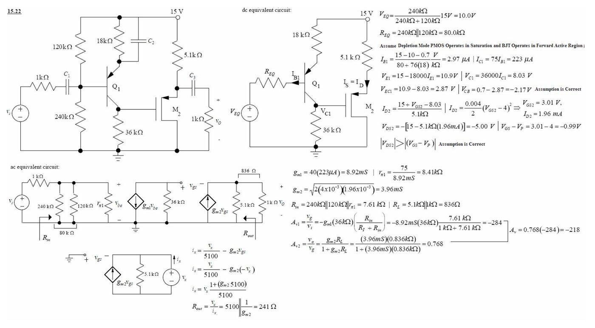
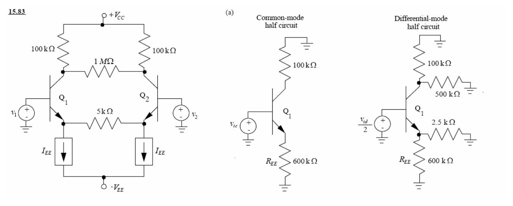
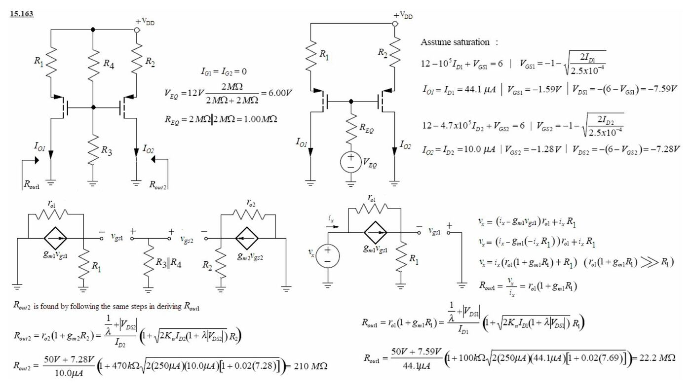
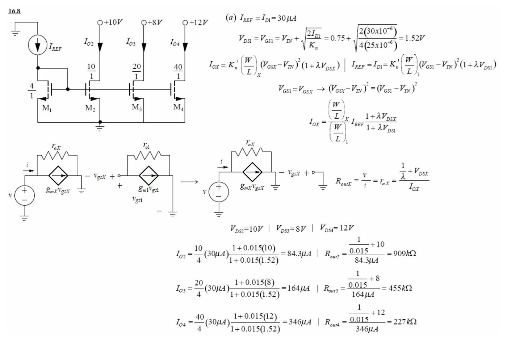
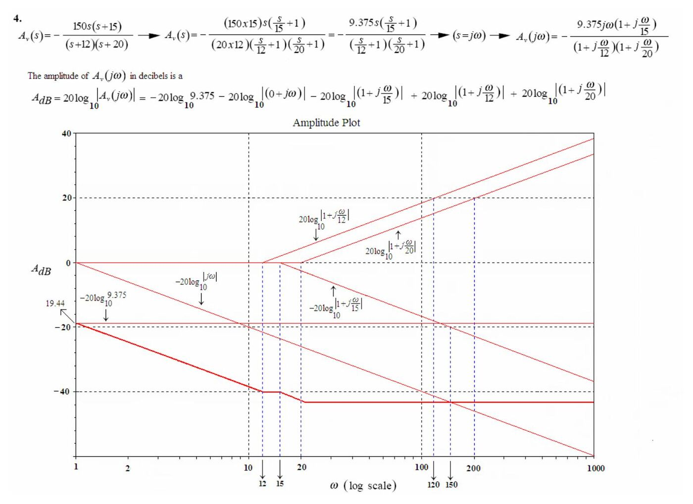

Bu yazı, Başkent Üniversitesi **EEM311 Elektronik II** dersinin 2005 güz dönemindeki 4. ve 5. ödevlerinin çözümlerini içeriyor (Ödev IV: 10 Kasım 2005, Ödev V: 11 Aralık 2005). Problemler ders kitabı Jaeger & Blalock, *Microelectronic Circuit Design*'dan; çözümler dersin asistanı tarafından Word'de devre şemalarıyla hazırlanmış. Parolası kaldırılmış orijinal PDF'ler yazının sonunda ZIP olarak indirilebilir. İlk üç ödev ayrı bir yazıda: *EEM311 2005 Ödev Çözümleri I–III*.

## Ödev IV

### 15.22: BJT ortak emetör + PMOS kaynak izleyici (iki katlı yükselteç)

Devre: 15 V tek besleme. Birinci kat pnp Q₁: baz bölücüsü 120 kΩ (15 V'a) ve 240 kΩ (toprağa), emetörde 18 kΩ (C₂ ile köprülü), kolektörde 36 kΩ (toprağa); kaynak direnci 1 kΩ. İkinci kat fakirleştirmeli PMOS M₂: geçidi Q₁'in kolektörüne bağlı, kaynağı 5,1 kΩ ile 15 V'a, savağı toprakta; çıkış kaynaktan C₃ ile 1 kΩ yüke alınıyor. β_F = 75, K_p = 4 mA/V², V_P = 4 V.

**DC analiz:**

- V_EQ = 15 V·240 kΩ/(240 kΩ + 120 kΩ) = **10,0 V**, R_EQ = 240 kΩ ∥ 120 kΩ = **80,0 kΩ**
- I_B1 = (15 − 10 − 0,7 V)/(80 + 76·18 kΩ) = **2,97 µA**, I_C1 = 75·I_B1 = **223 µA**
- V_E1 = 15 − 18 000·I_E1 = 10,9 V, V_C1 = 36 000·I_C1 = **8,03 V**, V_EC1 = **2,87 V** → ileri aktif.
- M₂: I_D2 = (15 + V_GS2 − 8,03)/5,1 kΩ ve I_D2 = (0,004/2)(V_GS2 − 4)² → **V_GS2 = 3,01 V, I_D2 = 1,96 mA**
- V_DS2 = −[15 − 5,1 kΩ·(1,96 mA)] = **−5,00 V**; V_GS − V_P = −0,99 V → |V_DS2| > |V_GS − V_P|, doyma kabulü doğru.

**(a) AC analiz:**

- g_m1 = 40(223 µA) = **8,92 mS**, r_π1 = 75/8,92 mS = **8,41 kΩ**
- g_m2 = √(2·(4·10⁻³)·(1,96·10⁻³)) = **3,96 mS**
- R_in = 240 kΩ ∥ 120 kΩ ∥ r_π1 = **7,61 kΩ**, R_L = 5,1 kΩ ∥ 1 kΩ = **836 Ω**
- A_v1 = −g_m1·(36 kΩ)·R_in/(R_I + R_in) = −8,92 mS·36 kΩ·7,61/(1 + 7,61) = **−284**
- A_v2 = g_m2·R_L/(1 + g_m2·R_L) = (3,96 mS)(0,836 kΩ)/(1 + 3,31) = **0,768**
- **A_v = 0,768·(−284) = −218**
- R_out = 5100 ∥ (1/g_m2) = **241 Ω**

**(b) 18 kΩ'un köprüleme kondansatörü çıkarılırsa:**

- R_in = 80 kΩ ∥ [r_π1 + (β_o1 + 1)·18 kΩ] = **75,6 kΩ**
- A_v1 = (R_in/(1 kΩ + R_in))·(−β_o1·36 kΩ/(r_π1 + (β_o1 + 1)·18 kΩ)) = (75,6/76,6)·(−75·36 kΩ/138 kΩ) = **−1,93**
- **A_v = 0,768·(−1,93) = −1,48**

*Not: Kaynakta paydaki ifade "138 kΩ" yazılmış; r_π1 + 76·18 kΩ = 8,41 kΩ + 1368 kΩ ≈ **1376 kΩ (1,38 MΩ)** olmalı (sonuç −1,93 bu değerle doğru: tam hesapla −1,94). Ayrıca A_v1 formülündeki β_o1·R_I, kolektör direnci 36 kΩ'u kastediyor.*

### 15.53: Tek çıkışlı fark yükselteci (akım kaynağı ideal)

Devre: Q₁ ve Q₂ emetörleri I_EE = 20 µA'lik ideal akım kaynağına bağlı; Q₁'in kolektörü doğrudan +V_CC'ye, Q₂'nin kolektörü R_C = 910 kΩ ile +V_CC = 10 V'a; çıkış Q₂'nin kolektöründen; v_s Q₁'in bazına, Q₂'nin bazı toprakta. β_F = 100.

- I_C1 = I_C2 = α_F·I_EE/2 = (100/101)·(20 µA/2) = **9,90 µA**
- V_C2 = 10 − 9,1·10⁵·I_C = **0,991 V**
- g_m = 40·I_C = **0,396 mS**, r_π = β_o/g_m = 100/0,396 mS = **252,5 kΩ**
- (a) v_s = 0 için: V_O = V_C2 = **0,991 V**
- v_s = 2 mV için: diferansiyel giriş v_id = 2 mV, ortak mod giriş v_ic = 1 mV.
- Fark modunda emetörler sanal toprak: tek uçlu kazanç **A_dd = g_m·R_C/2 = 180**
- Ortak modda R_EE = ∞ olduğundan akım yok: **A_cc = 0**
- v_o = 180·(0,002 V) + 0·(0,001 V) = 0,36 V → **V_O = 0,36 + 0,991 = 1,35 V**

### 15.64: Uyumsuz (g_m farklı) fark yükseltecinde CMRR

Devre: Q₁ ve Q₂ kolektörlerinde eşit R yükleri, emetörler ortak R_EE ile −V_EE'ye; çıkış iki kolektör arasından (v_OD). Transistörlerin geçiş iletkenlikleri farklı: g_m1 = g_m + Δg_m/2, g_m2 = g_m − Δg_m/2. Devre uyumsuz olduğundan emetör düğümü sanal toprak değildir.

**Fark modu:** v_be1 = v_id/2 − v_e, v_be2 = −v_id/2 − v_e.

- v_od = −g_m·R·(v_id + (Δg_m/g_m)·v_e)
- Emetör düğümünde KCL'den v_e = (1/2)(Δg_m/g_m)·β_o·R_EE/(r_π + (β_o + 1)2R_EE)·v_id ≅ (1/4)(Δg_m/g_m)·v_id
- v_od ≅ −g_m·R·v_id·(1 + (1/4)(Δg_m/g_m)²); (Δg_m/g_m)² terimi ihmal edilecek kadar küçük → **A_dd ≅ −g_m·R = −300**

**Ortak mod:** v_be = v_ic − v_e (iki transistörde de).

- v_od = −Δg_m·R·(v_ic − v_e) = −(Δg_m/g_m)·g_m·R·(v_ic − v_e)
- v_ic − v_e = r_π/(r_π + (β_o + 1)2R_EE)·v_ic
- A_cd = −(Δg_m/g_m)·β_o·R/(r_π + (β_o + 1)2R_EE) ≅ −(Δg_m/g_m)·g_m·R/(1 + 2g_m·R_EE) = **−0,00499**
- **CMRR = A_dd/A_cd = (1 + 2g_m·R_EE)·(Δg_m/g_m)⁻¹ = 60 000, yani 95,6 dB**

### 15.83: Emetörler ve kolektörler arasında direnç bulunan fark yükselteci

Devre: Kolektör dirençleri 100 kΩ (V_CC = 20 V'a), iki kolektör arasında 1 MΩ, iki emetör arasında 5 kΩ; her emetörde ayrı I_EE = 100 µA akım kaynağı (çıkış direnci R_EE = 600 kΩ). β_o = 100.

**(a) Yarım devreler:** Ortak modda simetri ekseninden akım geçmez, 1 MΩ ve 5 kΩ'luk dirençler devreden çıkar (Q₁, 100 kΩ kolektör, R_EE = 600 kΩ). Fark modunda dirençlerin orta noktası sanal toprak olur: kolektörde 1 MΩ/2 = 500 kΩ, emetörde 5 kΩ/2 = 2,5 kΩ toprağa bağlanır.

**(b) DC yarım devre:**

- I_C = α_F·I_EE = (100/101)(100 µA) = **99,0 µA**
- V_CE = 20 − 10⁵·I_C − (−0,7) = **10,8 V**, V_BC = −10,1 V → ileri aktif. **Q noktası: (99,0 µA; 10,8 V)**
- r_π = 100(0,025 V)/99,0 µA = **25,3 kΩ**, g_m = 40·I_C = **3,96 mS**

**Fark modu:**

- A_dd = −β_o·(100 kΩ ∥ 500 kΩ)/(r_π + (β_o + 1)(600 kΩ ∥ 2,5 kΩ)) = −100(83,3 kΩ)/(25,3 kΩ + 101·2,49 kΩ) = **−30,1**
- R_id = 2[r_π + (β_o + 1)(2,49 kΩ)] = 2[25,3 kΩ + 101·2,49 kΩ] = **554 kΩ**

**Ortak mod:**

- A_cc = −β_o·(100 kΩ)/(r_π + (β_o + 1)(600 kΩ)) = −100(100 kΩ)/(25,3 kΩ + 101·600 kΩ) = **−0,165**
- Tek uçlu çıkış için **CMRR = 0,5·A_dd/A_cc = 15,05/0,165 = 91,2**

## Ödev V

### 15.130: npn–pnp transistör yığını

Devre: npn Q₁ (kolektörü +10 V'ta) ile pnp Q₂ (kolektörü −10 V'ta) emetörlerinden birbirine bağlı; 1,3 V'luk kaynak Q₁'in bazı ile Q₂'nin bazı (toprak) arasında. I_S1 = 5·10⁻¹⁵ A, I_S2 = 10⁻¹⁵ A.

- I_E1 = I_E2 olduğundan I_C1 = (α_F1/α_F2)·I_C2 ≅ I_C2 = I_C
- 1,3 = V_BE1 + V_EB2 = V_T·ln(I_C1/I_S1) + V_T·ln(I_C2/I_S2) = V_T·ln(I_C²/(I_S1·I_S2))
- **I_C = √((5·10⁻¹⁵)(10⁻¹⁵)·exp(1,3/0,025)) = 438 µA**

### 15.163: PMOS akım kaynaklarının çıkış direnci

Devre: V_DD = 12 V; iki PMOS geçitleri ortak, R₃ = R₄ = 2 MΩ bölücüsünden besleniyor; M₁'in kaynağında R₁ = 100 kΩ, M₂'nin kaynağında R₂ = 470 kΩ; I_O1 ve I_O2 savaklardan toprağa akıyor. K_p = 250 µA/V², V_TP = −1 V, λ = 0,02 V⁻¹.

- V_EQ = 12 V·2 MΩ/(2 MΩ + 2 MΩ) = **6,00 V**, R_EQ = **1,00 MΩ** (geçit akımı sıfır)
- M₁: 12 − 10⁵·I_D1 + V_GS1 = 6, V_GS1 = −1 − √(2I_D1/2,5·10⁻⁴) → **I_O1 = 44,1 µA**, V_GS1 = −1,59 V, V_DS1 = −(6 − V_GS1) = **−7,59 V**
- M₂: 12 − 4,7·10⁵·I_D2 + V_GS2 = 6 → **I_O2 = 10,0 µA**, V_GS2 = −1,28 V, V_DS2 = **−7,28 V**
- Küçük sinyalde v_x = i_x(r_o1(1 + g_m1·R₁) + R₁) → **R_out1 = r_o1·(1 + g_m1·R₁)**
- R_out1 = (50 V + 7,59 V)/44,1 µA · (1 + 100 kΩ·√(2·250 µA·44,1 µA·[1 + 0,02·7,59])) = **22,2 MΩ**
- R_out2 = (50 V + 7,28 V)/10,0 µA · (1 + 470 kΩ·√(2·250 µA·10,0 µA·[1 + 0,02·7,28])) = **210 MΩ**

### 16.8: NMOS akım aynası, çok çıkışlı

Devre: I_REF, diyot bağlı M₁'e (W/L = 4/1) giriyor; M₂ (10/1), M₃ (20/1), M₄ (40/1) aynı V_GS ile sürülüyor ve savakları sırasıyla +10 V, +8 V, +12 V'a bağlı. K_n' = 25 µA/V², V_TN = 0,75 V, λ = 0,015 V⁻¹.

Genel ifadeler: I_OX = ((W/L)_X/(W/L)₁)·I_REF·(1 + λV_DSX)/(1 + λV_DS1), R_outX = r_oX = (1/λ + V_DSX)/I_OX.

| Durum | V_DS1 = V_GS1 | I_O2 / R_out2 | I_O3 / R_out3 | I_O4 / R_out4 |
| --- | --- | --- | --- | --- |
| (a) I_REF = 30 µA, λ = 0,015 | 1,52 V | 84,3 µA / 909 kΩ | 164 µA / 455 kΩ | 346 µA / 227 kΩ |
| (b) I_REF = 50 µA, λ = 0,015 | 1,75 V | 140 µA / 548 kΩ | 273 µA / 274 kΩ | 575 µA / 137 kΩ |
| (c) I_REF = 30 µA, λ = 0 | — | 75 µA / ∞ | 150 µA / ∞ | 300 µA / ∞ |

Örnek: V_GS1 = V_TN + √(2I_D1/K_n) = 0,75 + √(2·30·10⁻⁶/(4·25·10⁻⁶)) = 1,52 V; I_O2 = (10/4)(30 µA)·(1 + 0,015·10)/(1 + 0,015·1,52) = 84,3 µA.

### Soru 4: Bode diyagramı

Transfer fonksiyonu:

A_v(s) = −150·s·(s + 15)/((s + 12)(s + 20)) = −9,375·s·(s/15 + 1)/((s/12 + 1)(s/20 + 1))

(150·15/(20·12) = 9,375; 20·log₁₀ 9,375 = 19,44 dB). s = jω yazılarak:

A_v(jω) = −9,375·jω·(1 + jω/15)/((1 + jω/12)(1 + jω/20))

Kaynakta genlik

A_dB = −20 log 9,375 − 20 log|jω| − 20 log|1 + jω/15| + 20 log|1 + jω/12| + 20 log|1 + jω/20|

olarak yazılmış ve asimptotlar bu ifadeye göre çizilmiş (ω = 1'de −19,44 dB, 20 dB/dekad düşüş, yüksek frekansta yaklaşık −43,5 dB); faz da −90° − tan⁻¹(ω/15) + tan⁻¹(ω/12) + tan⁻¹(ω/20) olarak çizilmiş.

*Not: Kaynaktaki genlik ve faz ifadelerinde terimlerin işaretleri ters alınmış; çizim doğru eğrinin ayna görüntüsü. Doğrusu: A_dB = +20 log 9,375 + 20 log ω + 20 log|1 + jω/15| − 20 log|1 + jω/12| − 20 log|1 + jω/20|. Yani ω = 1 rad/s'de yaklaşık +19,4 dB, ω ≈ 12'ye kadar +20 dB/dekad yükselir, yüksek frekansta |A_v| → 150, yani **+43,5 dB**'de düzleşir. Faz: φ = −90° + tan⁻¹(ω/15) − tan⁻¹(ω/12) − tan⁻¹(ω/20); alçak frekansta −90°, yüksek frekansta −180° (ω = 10'da yaklaşık −123°).*
