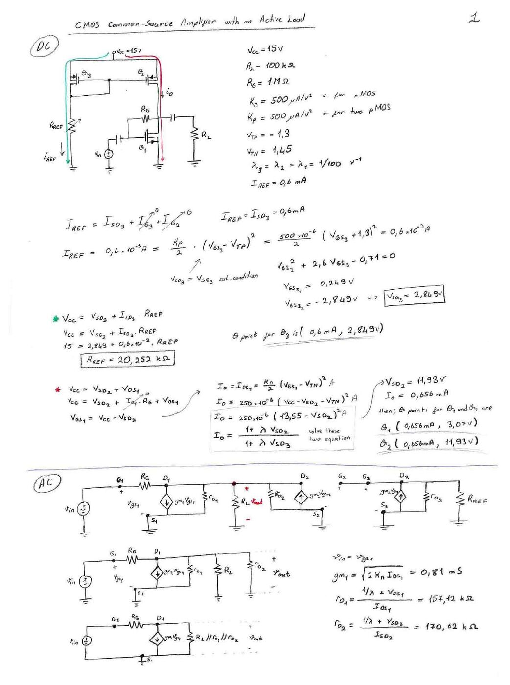
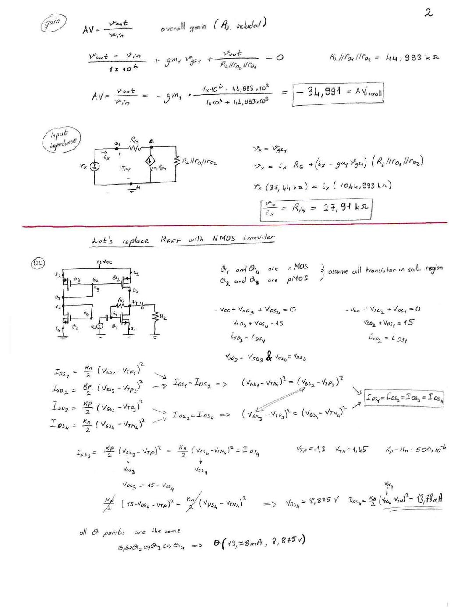
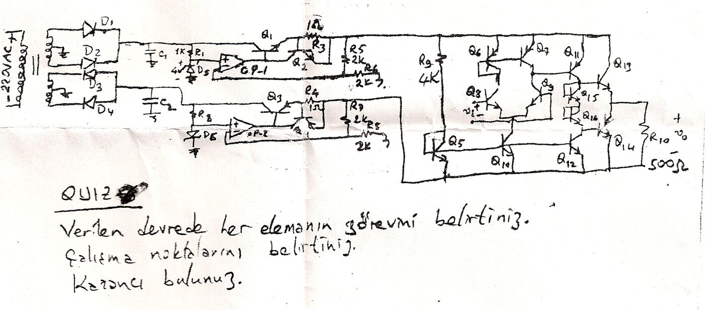

This post contains two documents from the fall 2006 semester of the **EEM311 Electronics II** course at Başkent University: a three-page handwritten homework solution on a **CMOS common-source amplifier with an active load** (December 2006, scanned; the author's name does not appear in the document) and an **"Electronics homework / Quiz"** page with a question posed over a hand-drawn circuit (scan dated 21 December 2006). The original scans can be downloaded as a ZIP at the end of the post.

## CMOS Common-Source Amplifier with an Active Load

### Circuit and values

M₁ (NMOS) is a common-source amplifier; its load is a current mirror (active load) formed by the PMOS transistors M₂ and M₃. The reference current flows from M₃ through R_REF to ground. A feedback resistor R_G connects the gate and the drain of M₁ (at DC, gate = drain); the input v_in is applied to the gate through a coupling capacitor, and the output is taken from the drain through a capacitor to R_L.

- V_CC = 15 V, R_L = 100 kΩ, R_G = 1 MΩ
- K_n = 500 µA/V² (NMOS), K_p = 500 µA/V² (both PMOS)
- V_TP = −1.3 V, V_TN = 1.45 V, λ₁ = λ₂ = λ₃ = 1/100 V⁻¹
- I_REF = 0.6 mA

### DC analysis

- I_REF = I_SD3 = (K_p/2)(V_GS3 − V_TP)² = 250·10⁻⁶·(V_GS3 + 1.3)² = 0.6·10⁻³ A (V_SD3 = V_SG3, saturation condition)
- V_GS3² + 2.6·V_GS3 − 0.71 = 0 → V_GS3 = −2.849 V, i.e. **V_SG3 = 2.849 V**; the Q point of M₃ is **(0.6 mA; 2.849 V)**
- V_CC = V_SG3 + I_SD3·R_REF → 15 = 2.849 + 0.6·10⁻³·R_REF → **R_REF = 20.252 kΩ**
- V_CC = V_SD2 + V_DS1, V_GS1 = V_DS1 = V_CC − V_SD2 (no DC current flows through R_G)
- I_O = (K_n/2)(V_GS1 − V_TN)² = 250·10⁻⁶·(13.55 − V_SD2)² and I_O = I_REF·(1 + λV_SD2)/(1 + λV_SD3), solved together: **V_SD2 = 11.93 V, I_O = 0.656 mA**
- Q points: **M₁ (0.656 mA; 3.07 V)**, **M₂ (0.656 mA; 11.93 V)**

### AC analysis

- v_in = v_gs1, g_m1 = √(2K_n·I_DS1) = **0.81 mS**
- r_o1 = (1/λ + V_DS1)/I_DS1 = **157.12 kΩ**, r_o2 = (1/λ + V_SD2)/I_SD2 = **170.62 kΩ**
- R_L ∥ r_o1 ∥ r_o2 = **44.993 kΩ**
- At the output node: (v_out − v_in)/R_G + g_m1·v_gs1 + v_out/(R_L ∥ r_o2 ∥ r_o1) = 0
- A_v = v_out/v_in = −g_m1·(1·10⁶·44.993·10³)/(1·10⁶ + 44.993·10³) = **−34.991** (total gain including R_L)
- Input resistance: v_x = i_x·R_G + (i_x − g_m1·v_gs1)(R_L ∥ r_o1 ∥ r_o2) → v_x·(37.44) = i_x·(1044.993 kΩ) → **R_in = 27.91 kΩ**

*Note: The exact solution of the node equation is A_v = −(g_m1 − 1/R_G)·(R_G ∥ 44.993 kΩ) ≈ −(0.81 mS − 1 µS)·43.06 kΩ ≈ **−34.8**; the −34.991 in the source is a small calculation slip (R_in = 27.91 kΩ is correct).*

### Replacing R_REF with an NMOS Transistor (Let's replace R_REF with NMOS transistor)

A diode-connected NMOS (M₄) replaces R_REF. M₁ and M₄ are NMOS, M₂ and M₃ are PMOS; all are assumed to be in saturation.

- −V_CC + V_SD3 + V_DS4 = 0 → V_SD3 + V_DS4 = 15, i_SD3 = i_DS4; V_SD3 = V_SG3, V_GS4 = V_DS4
- Similarly V_SD2 + V_DS1 = 15, i_SD2 = i_DS1
- (V_GS1 − V_TN1)² = (V_GS2 − V_TP2)² and (V_GS3 − V_TP3)² = (V_GS4 − V_TN4)² → I_DS1 = I_SD2 = I_SD3 = I_DS4
- (K_p/2)(15 − V_DS4 − V_TP)² = (K_n/2)(V_DS4 − V_TN4)² → in the source **V_DS4 = 8.875 V**, I_DS4 = (K_n/2)(V_GS4 − V_TN)² = **13.78 mA**
- All Q points are the same: **Q(13.78 mA; 8.875 V)**

AC (third page):

- g_m1 = √(2K_n·I_DS1) = **3.71 mS**, r_o1 = r_o2 = (1/λ + V_DS)/I_DS = **7.9 kΩ**
- R_L ∥ r_o2 ∥ r_o1 = **3.8 kΩ**
- A_v = −g_m1·R_G·(R_L ∥ r_o2 ∥ r_o1)/(R_G + R_L ∥ r_o2 ∥ r_o1) = −3.71·10⁻³·(1·10⁶·3800)/(1·10⁶ + 3800) = **−14.05**
- **R_in = 66.48 kΩ**

*Note: The sign of V_TP is mixed up in this section. The correct form is V_SG3 − |V_TP| = 15 − V_DS4 − 1.3 = V_DS4 − 1.45, i.e. **V_DS4 = 7.575 V** and I = 250 µA/V²·(6.125 V)² ≈ **9.38 mA** (8.875 V results from taking V_TP = +1.3 V). With these values, g_m1 ≈ 3.06 mS, r_o ≈ 11.5 kΩ, R_L ∥ r_o1 ∥ r_o2 ≈ 5.42 kΩ, A_v ≈ **−16.5** and R_in ≈ **57.1 kΩ**.*

## Electronics Homework: Power Supply and Multi-Stage Amplifier (Quiz)

The question given over a hand-drawn circuit:

> State the function of each component in the given circuit.
> State the operating points.
> Find the gain.

What can be seen in the circuit (as far as it can be read from the drawing):

- **Power supply:** a transformer connected to the 220 V AC mains, a two-branch rectifier with diodes D₁–D₄, and filter capacitors C₁, C₂ (positive and negative supply).
- **Regulators:** in each branch, a Zener reference (D₅ at the top, about 4 V, with R₁ = 1 kΩ; D₆ and R₈ at the bottom), OP-1 / OP-2 as the error amplifier, Darlington-connected transistors as the series pass element (Q₁–Q₂ at the top, Q₃ and a second transistor at the bottom), 1 Ω resistors R₃ and R₄ (current limiting), and 2 kΩ resistors (R₅, R₆, R₉ and one 2 kΩ) that feed the output voltage back to the op-amp.
- **Amplifier:** a current source built with Q₅ and R₉ = 4 kΩ, an input stage consisting of Q₈ (to which v_i is applied) and Q₉, a Q₆–Q₇ current mirror (active load), Q₁₀ and Q₁₂ current sources, and an output stage made up of Q₁₅–Q₁₆ biasing elements together with Q₁₁, Q₁₃ and Q₁₄; load R₁₀ = 500 Ω, output v_o. (Labels are given as far as they can be read from the hand drawing; determining the functions of the components is the question itself.)

The document does not include a solution to this question.
