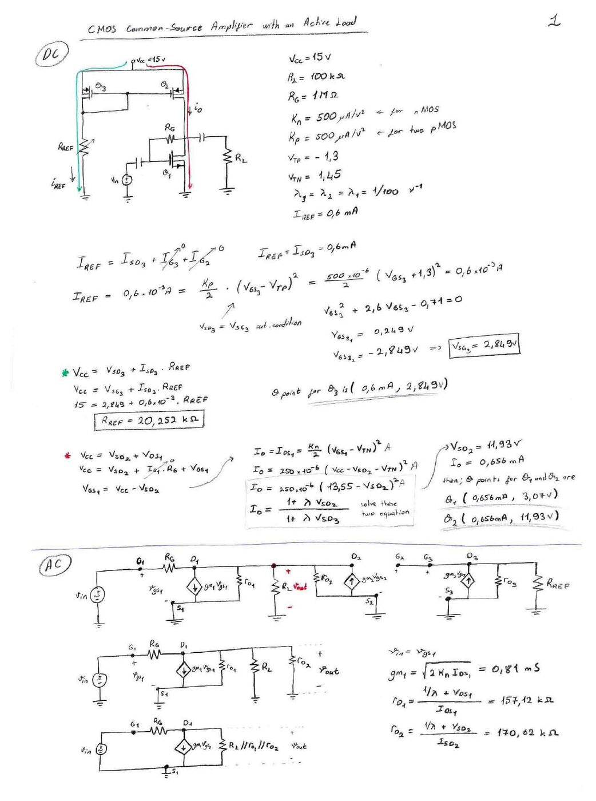
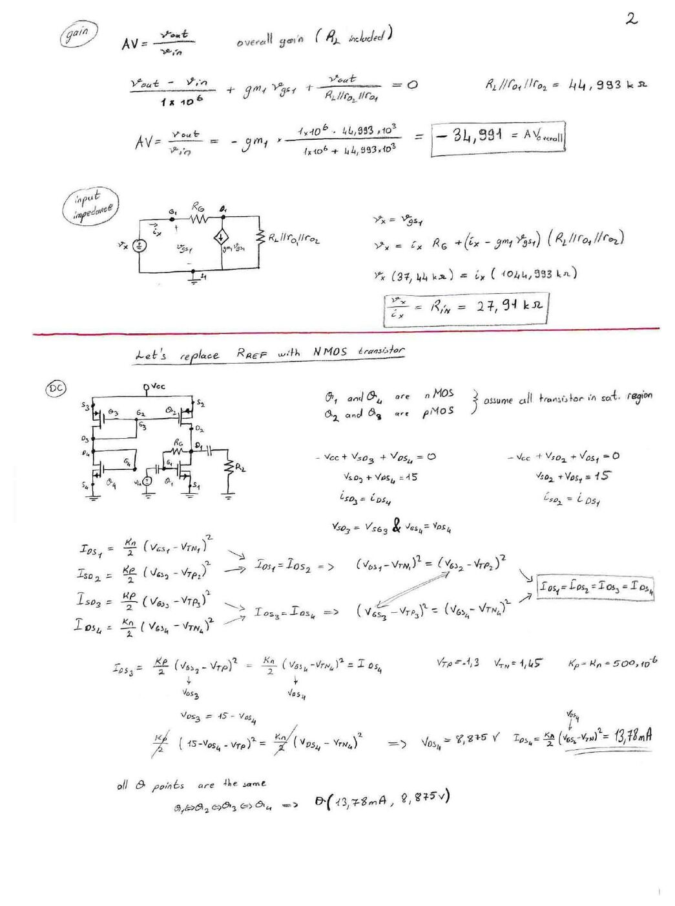
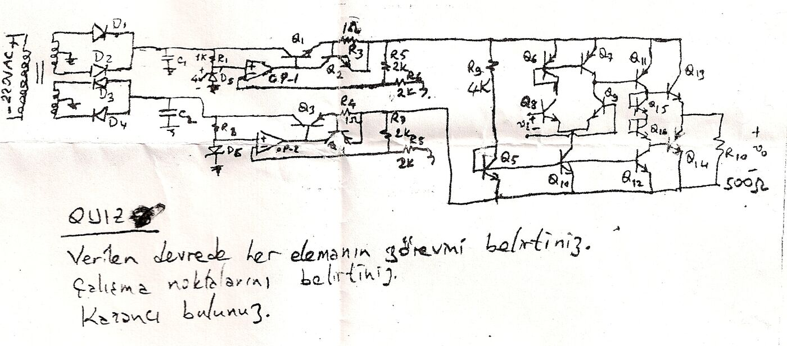

Bu yazı, Başkent Üniversitesi **EEM311 Elektronik II** dersinin 2006 güz dönemine ait iki belgeyi içeriyor: **aktif yüklü CMOS ortak kaynaklı yükselteç** üzerine üç sayfalık el yazısı bir ödev çözümü (Aralık 2006, taranmış; hazırlayanın adı belgede yok) ve el çizimi bir devre üzerinden sorulan **"Elektronik ödevi / Quiz"** sayfası (21 Aralık 2006 taraması). Orijinal taramalar yazının sonunda ZIP olarak indirilebilir.

## Aktif yüklü CMOS ortak kaynaklı yükselteç (CMOS Common-Source Amplifier with an Active Load)

### Devre ve değerler

M₁ (NMOS) ortak kaynaklı yükselteç; yükü M₂ ve M₃ PMOS transistörlerinden oluşan akım aynası (aktif yük). Referans akımı M₃'ten R_REF üzerinden toprağa akıyor. M₁'in geçidi ile savağı arasında R_G geri besleme direnci var (DC'de geçit = savak); giriş v_in kuplaj kondansatörüyle geçide, çıkış savaktan kondansatörle R_L'ye alınıyor.

- V_CC = 15 V, R_L = 100 kΩ, R_G = 1 MΩ
- K_n = 500 µA/V² (NMOS), K_p = 500 µA/V² (iki PMOS)
- V_TP = −1,3 V, V_TN = 1,45 V, λ₁ = λ₂ = λ₃ = 1/100 V⁻¹
- I_REF = 0,6 mA

### DC analiz

- I_REF = I_SD3 = (K_p/2)(V_GS3 − V_TP)² = 250·10⁻⁶·(V_GS3 + 1,3)² = 0,6·10⁻³ A (V_SD3 = V_SG3, doyma koşulu)
- V_GS3² + 2,6·V_GS3 − 0,71 = 0 → V_GS3 = −2,849 V, yani **V_SG3 = 2,849 V**; M₃'ün Q noktası **(0,6 mA; 2,849 V)**
- V_CC = V_SG3 + I_SD3·R_REF → 15 = 2,849 + 0,6·10⁻³·R_REF → **R_REF = 20,252 kΩ**
- V_CC = V_SD2 + V_DS1, V_GS1 = V_DS1 = V_CC − V_SD2 (R_G'den DC akım geçmez)
- I_O = (K_n/2)(V_GS1 − V_TN)² = 250·10⁻⁶·(13,55 − V_SD2)² ve I_O = I_REF·(1 + λV_SD2)/(1 + λV_SD3) birlikte çözülerek: **V_SD2 = 11,93 V, I_O = 0,656 mA**
- Q noktaları: **M₁ (0,656 mA; 3,07 V)**, **M₂ (0,656 mA; 11,93 V)**

### AC analiz

- v_in = v_gs1, g_m1 = √(2K_n·I_DS1) = **0,81 mS**
- r_o1 = (1/λ + V_DS1)/I_DS1 = **157,12 kΩ**, r_o2 = (1/λ + V_SD2)/I_SD2 = **170,62 kΩ**
- R_L ∥ r_o1 ∥ r_o2 = **44,993 kΩ**
- Çıkış düğümünde: (v_out − v_in)/R_G + g_m1·v_gs1 + v_out/(R_L ∥ r_o2 ∥ r_o1) = 0
- A_v = v_out/v_in = −g_m1·(1·10⁶·44,993·10³)/(1·10⁶ + 44,993·10³) = **−34,991** (R_L dahil toplam kazanç)
- Giriş direnci: v_x = i_x·R_G + (i_x − g_m1·v_gs1)(R_L ∥ r_o1 ∥ r_o2) → v_x·(37,44) = i_x·(1044,993 kΩ) → **R_in = 27,91 kΩ**

*Not: Düğüm denkleminin tam çözümü A_v = −(g_m1 − 1/R_G)·(R_G ∥ 44,993 kΩ) ≈ −(0,81 mS − 1 µS)·43,06 kΩ ≈ **−34,8**; kaynaktaki −34,991 küçük bir hesap kayması (R_in = 27,91 kΩ doğru).*

### R_REF yerine NMOS transistör (Let's replace R_REF with NMOS transistor)

R_REF yerine diyot bağlı bir NMOS (M₄) konuyor. M₁ ve M₄ NMOS, M₂ ve M₃ PMOS; hepsi doymada kabul ediliyor.

- −V_CC + V_SD3 + V_DS4 = 0 → V_SD3 + V_DS4 = 15, i_SD3 = i_DS4; V_SD3 = V_SG3, V_GS4 = V_DS4
- Aynı şekilde V_SD2 + V_DS1 = 15, i_SD2 = i_DS1
- (V_GS1 − V_TN1)² = (V_GS2 − V_TP2)² ve (V_GS3 − V_TP3)² = (V_GS4 − V_TN4)² → I_DS1 = I_SD2 = I_SD3 = I_DS4
- (K_p/2)(15 − V_DS4 − V_TP)² = (K_n/2)(V_DS4 − V_TN4)² → kaynakta **V_DS4 = 8,875 V**, I_DS4 = (K_n/2)(V_GS4 − V_TN)² = **13,78 mA**
- Bütün Q noktaları aynı: **Q(13,78 mA; 8,875 V)**

AC (üçüncü sayfa):

- g_m1 = √(2K_n·I_DS1) = **3,71 mS**, r_o1 = r_o2 = (1/λ + V_DS)/I_DS = **7,9 kΩ**
- R_L ∥ r_o2 ∥ r_o1 = **3,8 kΩ**
- A_v = −g_m1·R_G·(R_L ∥ r_o2 ∥ r_o1)/(R_G + R_L ∥ r_o2 ∥ r_o1) = −3,71·10⁻³·(1·10⁶·3800)/(1·10⁶ + 3800) = **−14,05**
- **R_in = 66,48 kΩ**

*Not: Bu bölümde V_TP'nin işareti karıştırılmış. Doğrusu V_SG3 − |V_TP| = 15 − V_DS4 − 1,3 = V_DS4 − 1,45, yani **V_DS4 = 7,575 V** ve I = 250 µA/V²·(6,125 V)² ≈ **9,38 mA**'dir (8,875 V, V_TP = +1,3 V alınınca çıkıyor). Bu değerlerle g_m1 ≈ 3,06 mS, r_o ≈ 11,5 kΩ, R_L ∥ r_o1 ∥ r_o2 ≈ 5,42 kΩ, A_v ≈ **−16,5** ve R_in ≈ **57,1 kΩ** bulunur.*

## Elektronik ödevi: Güç kaynağı ve çok katlı yükselteç (Quiz)

El ile çizilmiş bir devre üzerinden verilen soru:

> Verilen devrede her elemanın görevini belirtiniz.
> Çalışma noktalarını belirtiniz.
> Kazancı bulunuz.

Devrede görülenler (çizimden okunduğu kadarıyla):

- **Güç kaynağı:** 220 V AC şebekeye bağlı transformatör, D₁–D₄ diyotlarıyla iki kollu doğrultucu ve C₁, C₂ filtre kondansatörleri (pozitif ve negatif besleme).
- **Regülatörler:** Her kolda zener referansı (üstte D₅, yaklaşık 4 V, R₁ = 1 kΩ ile; altta D₆ ve R₈), hata yükselteci olarak OP-1 / OP-2, seri geçiş elemanı olarak Darlington bağlı transistörler (üstte Q₁–Q₂, altta Q₃ ve ikinci bir transistör), 1 Ω'luk R₃ ve R₄ dirençleri (akım sınırlama) ve çıkış gerilimini op-amp'a geri besleyen 2 kΩ'luk dirençler (R₅, R₆, R₉ ve bir 2 kΩ).
- **Yükselteç:** Q₅ ve R₉ = 4 kΩ ile kurulan akım kaynağı, v_i'nin uygulandığı Q₈ ile Q₉'dan oluşan giriş katı, Q₆–Q₇ akım aynası (aktif yük), Q₁₀ ve Q₁₂ akım kaynakları, Q₁₅–Q₁₆ ön gerilimleme elemanları ile Q₁₁, Q₁₃ ve Q₁₄'ten oluşan çıkış katı; yük R₁₀ = 500 Ω, çıkış v_o. (Etiketler el çiziminden okunduğu kadarıyla verildi; elemanların görevlerini belirlemek sorunun kendisi.)

Belgede bu sorunun çözümü yok.
