This post was prepared from scanned pages of 36 pages of handwritten lecture notes covering **operational amplifiers (op-amps)** and **active filters** in the **EEM311 Electronics II** course at Başkent University. The notes carry no author name or date. Definitions, formulas, design steps, and worked examples have been transcribed into text; the relevant page images are included for circuit schematics and graphs. All of the scanned pages can be downloaded as a PDF at the end of the post.

## Introduction to operational amplifiers

Circuits whose input stage is a differential amplifier and whose output stage contains a high-gain amplifier are called **op-amps**. An op-amp has two inputs, called inverting and non-inverting, denoted by (−) and (+) respectively: the **non-inverting input (+)** and the **inverting input (−)**. A signal can be applied to a single input or to both inputs; the op-amp operates in two modes, differential and common mode.

### Differential and common-mode operation

- Differential input signal: **V_d = V_i1 − V_i2**, differential output V_od = A_d · V_d (A_d: differential gain)
- Common-mode input signal: **V_c = ½ (V_i1 + V_i2)**, common-mode output V_oc = A_c · V_c (A_c: common-mode gain)
- Total output: **V_o = V_od + V_oc = A_d V_d + A_c V_c**

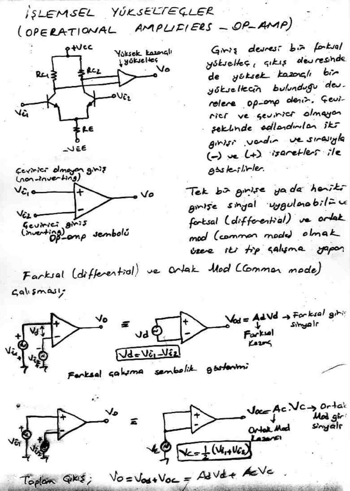

- For opposite-polarity inputs (V_i1 = V_s, V_i2 = −V_s): V_d = 2V_s, V_c = 0 → **V_o = 2A_d V_s**
- For same-polarity inputs (V_i1 = V_i2 = V_s): V_d = 0, V_c = V_s → **V_o = A_c V_s**

### Common-mode rejection ratio (CMRR)

- **CMRR = A_d / A_c**, **CMRR (log) = 20 log₁₀ (A_d/A_c)**
- V_o = A_d V_d (1 + A_c V_c / (A_d V_d)) = **A_d V_d (1 + (1/CMRR) · (V_c/V_d))**

An ideal op-amp is assumed not to amplify common-mode signals at all, amplifying only differential signals. In reality, an op-amp also amplifies common-mode signals. However, the lower the common-mode gain (relative to the differential gain), the better the op-amp; that is, the higher its CMRR, the closer the op-amp is to the ideal.

**Example:** If V_i1 = 150 µV and V_i2 = 140 µV, find the output voltage for CMRR values of 100 and 10⁵ (A_d = 4000).

- V_d = V_i1 − V_i2 = 10 µV, V_c = ½ (V_i1 + V_i2) = 145 µV
- CMRR = 100 → V_o = A_d V_d (1 + (1/CMRR)(V_c/V_d)) = **45.8 mV**
- CMRR = 10⁵ → V_o = **40.006 mV**
- As CMRR increases, the output voltage approaches A_d V_d.

## Op-amp fundamentals

Ideal op-amp equivalent: a dependent voltage source A_v(V₁ − V₂) controlled by the voltage between the inputs. The ac equivalent of a real op-amp contains an input resistance R_i, an output resistance R_o, and an A_d V_d source; for an ideal op-amp, **R_i = ∞, R_o = 0, A_d → ∞**.

Op-amps are operated in two ways: **open-loop** and **closed-loop**. In open-loop gain operation there is no feedback from the op-amp output to the inputs, i.e., no closed loop is formed. In this mode the voltage gain of the op-amp is infinite; this type of op-amp is used only as a comparator. If feedback is applied from the output to the inputs, i.e., a closed loop is formed, the gain of the circuit can be set to a desired value. Such closed-loop circuits can be built in many different forms: inverting, integrator, summing, subtracting, etc.

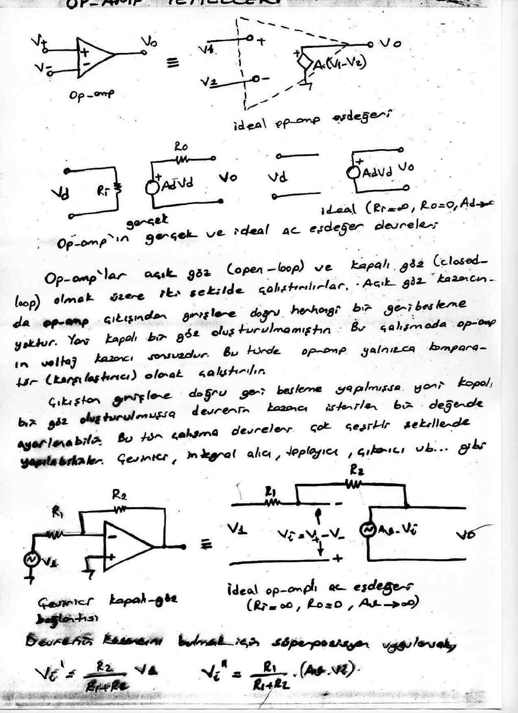

### Gain of the inverting amplifier (by superposition)

- V_i' = R₂/(R₁ + R₂) · V₁, V_i'' = R₁/(R₁ + R₂) · (A_v · V_i), V_i = V_+ − V_−, V_+ = 0 V
- R₂V₁ = V_i (A_v R₁ − (R₁ + R₂)) → V_i = R₂V₁ / (R₁(A_v − 1) − R₂)
- If A_v ≫ 1, (A_v − 1) ≅ A_v, and A_v R₁ ≫ R₂, then **V_i = R₂V₁ / (A_v R₁)**
- V_o = −A_v V_i → **V_o = −R₂V₁/R₁**
- **Inverting amplifier gain: V_o/V₁ ≅ V_o/V_i = −R₂/R₁ = A_v**

### Virtual ground

V_+ = V_− ⇒ V_i = V_+ − V_− = 0 ⇒ I_i = 0. Since I_i = 0, I₁ = I₂:

- I₁ = (V₁ − V_i)/R₁ = V₁/R₁, I₂ = (V_i − V_o)/R₂ = −V_o/R₂
- **V_o/V₁ = −R₂/R₁**

Or, since V_+ = V_−: V_+ = 0 V, V_− = V₁R₂/(R₁ + R₂) + V_oR₁/(R₁ + R₂) = 0 ⇒ V₁R₂ = −V_oR₁ ⇒ V_o/V₁ = −R₂/R₁.

According to this principle, since the gain A of the op-amp is very large (ideally infinite), if a finite output voltage is obtained while the circuit operates, the voltage between the op-amp input terminals is negligibly small: **V_+ − V_− = V_o/A ≅ 0**.

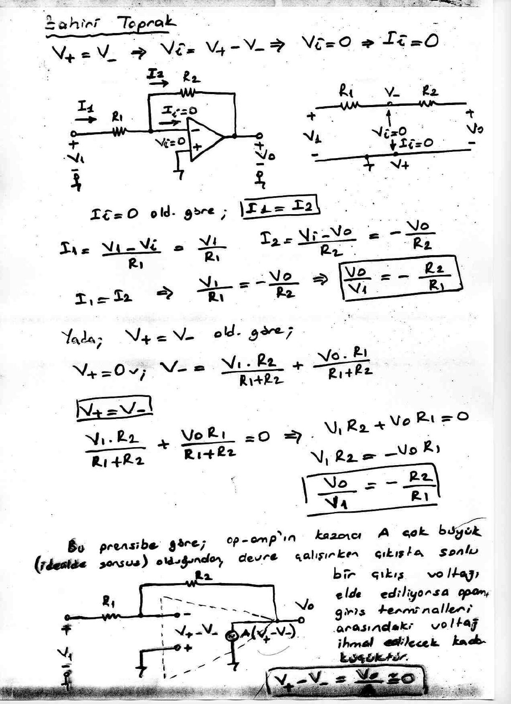

### Other inverting-configuration applications

Closed-loop gain, or closed-loop transfer function, of the circuit: **V_o/V_i = −Z₂/Z₁**

**Integrator circuit:** Z₁ = R, Z₂ = 1/(sC) → V_o/V_i = −1/(sCR); for physical frequency s = jω, **V_o/V_i = −1/(jωCR)**.

- i₁ = V₁(t)/R, i_C = C dV_C/dt, V_C = −V_o → V₁(t)/R = −C dV_o/dt
- **V_o = −(1/RC) ∫₀ᵗ V₁(t) dt**
- If at t = 0 there is a voltage V_Ci across the capacitor opposite in direction to the V_C shown: V_o(t) = V_Ci − (1/C) ∫₀ᵗ i₁(t) dt = **V_Ci − (1/RC) ∫₀ᵗ V₁(t) dt**

**Differentiator circuit:** Z₁ = 1/(sC), Z₂ = R → **V_o/V_i = −sCR = −jωCR**; i_C = i_R, C dV₁(t)/dt = −V_o(t)/R → **V_o(t) = −RC dV₁(t)/dt**

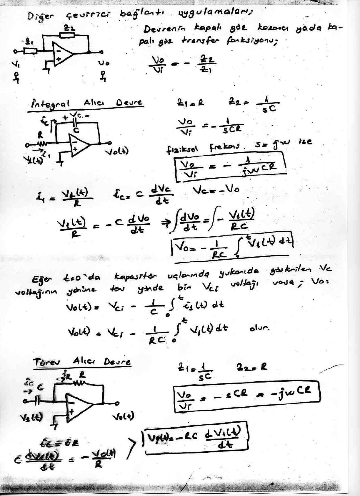

### Non-inverting amplifier and buffer

According to the virtual ground principle, V_+ = V_−: V_+ = V₁, V_− = V_oR₁/(R₁ + R₂) ⇒

- **V_o/V₁ = (R₁ + R₂)/R₁ = 1 + R₂/R₁**

**Buffer amplifier (unity follower):** the output is connected directly to the (−) input; **V_o = V_i**.

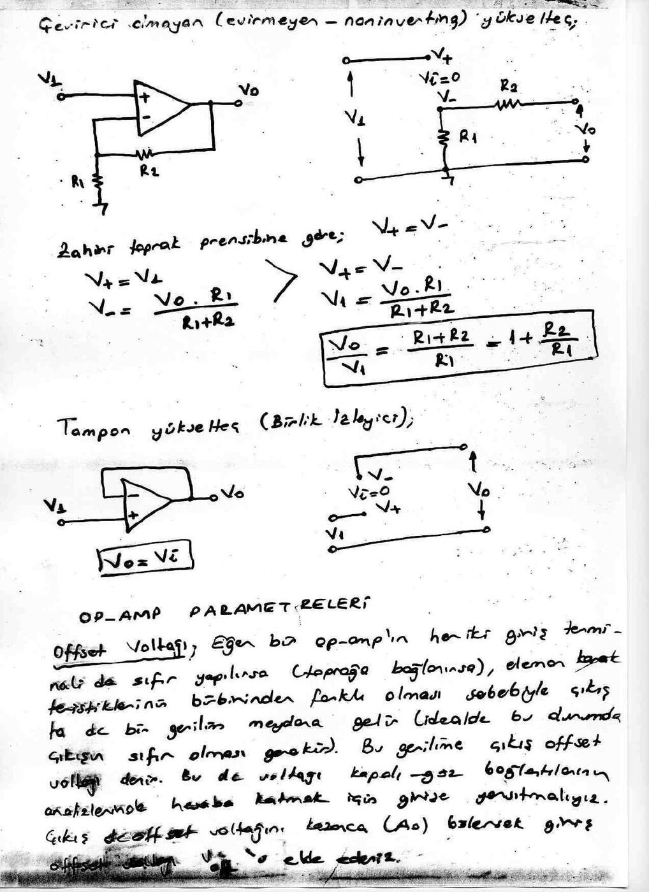

## Op-amp parameters

### Offset voltage

If both input terminals of an op-amp are set to zero (connected to ground), a dc voltage appears at the output because the device characteristics differ from one another (ideally the output should be zero in this case). This voltage is called the **output offset voltage**. To account for this dc voltage in the analysis of closed-loop connections, we must refer it to the input. Dividing the output offset voltage by the gain (A_o) gives the input offset voltage: **V_off = V_o/A_o**.

Offset voltage appearing at the output of the closed-loop connection due to the input offset voltage: V_− = V_+ ⇒ V_out · R₁/(R₁ + R₂) = V_off ⇒ **V_out = V_off (1 + R₂/R₁)**

If the closed-loop gain is large, the output dc offset voltage will be large; this reduces the maximum possible output signal swing. One way to avoid this problem is **capacitive coupling** (a series C at the input). The capacitor makes the dc gain zero. However, at the frequency ω₀ = 1/(CR₁) a −3 dB high-frequency effect appears, and the gain becomes −R₂/R₁ for ω ≫ ω₀. The advantage of this connection is that V_off appears at the output as V_off rather than V_off(1 + R₂/R₁); that is, it is not amplified.

### Input bias currents

For the op-amp to operate, dc currents must be supplied to both input terminals; these are called **input bias currents**. The bias currents are independent of the input resistance of the op-amp.

- The input bias current is the average of the two currents: **I_B = (I_B1 + I_B2)/2**
- The difference of the two currents is the input offset current: **I_off = |I_B1 − I_B2|**
- Accordingly: **I_B1 = I_B + I_off/2**, **I_B2 = I_B − I_off/2**

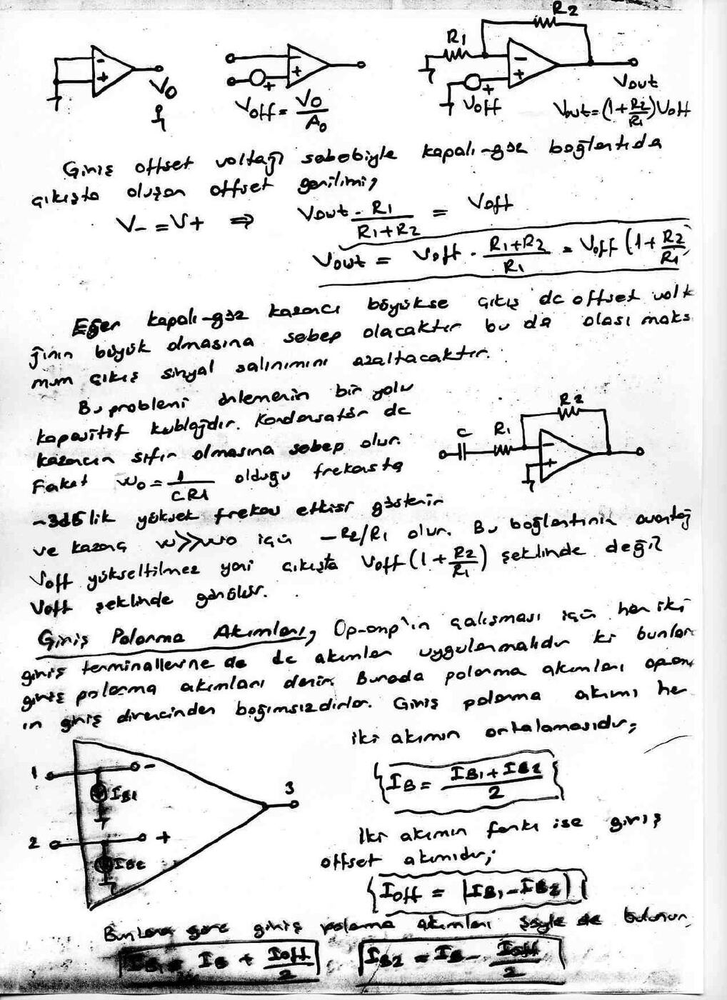

In an inverting configuration with grounded inputs, no current flows through R₁ and V_o = I_B1 · R₂ ≅ I_B · R₂. Total offset voltage at the output due to the offset voltage and the input bias currents:

- **V_o,offset = V_off (1 + R₂/R₁) + I_B R₂**

The offset voltage produced by the input bias currents (I_B R₂) is directly proportional to the resistance R₂. To reduce it, a series resistor R₃ is connected to the (+) input terminal of the op-amp:

- V_+ = V_− = −I_B2 R₃; V_o = −I_B2 R₃ + R₂(I_B1 − I_B2 R₃/R₁)
- Assuming I_B1 = I_B2 = I_B, V_o = I_B [R₂ − R₃(1 + R₂/R₁)] → for this to be zero, **R₃ = R₂/(1 + R₂/R₁) = R₁R₂/(R₁ + R₂) = R₁ // R₂**
- With I_B1 = I_B + I_off/2 and I_B2 = I_B − I_off/2, **V_o = I_off · R₂**

Offset adjustment is made by connecting the op-amp as shown below, i.e., a voltage of opposite polarity is applied to the input so that the output becomes zero. The input voltage that makes the output offset voltage zero is called the input offset voltage. If the op-amp operates with feedback, the offset adjustment should also be made in that configuration. When the temperature changes, the offset adjustment is disturbed (the input currents of the transistors change); for example, for the LM741 the offset drift with temperature is about 15 µV/°C. (The figure shows offset adjustment of the LM741 with a 10 kΩ potentiometer connected to its offset pins.)

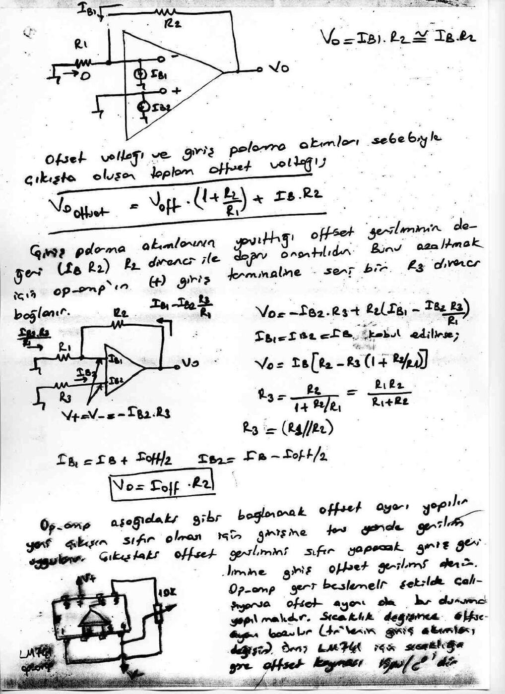

### Common-mode rejection ratio (CMRR)

Even after the offset of the op-amp has been adjusted, when the inputs are tied together and a common-mode signal is applied (V₁ = V₂), the output is not zero (ideally V_o = 0 in this case). This shows that the common-mode gain of the op-amp is not zero. The ratio called CMRR is the voltage measured at the amplifier output divided by the common-mode voltage applied to its input. Since this ratio would come out negative in dB, the voltage ratio is usually inverted. However, in amplifiers with feedback (op-amps), it is calculated as the ratio of the differential gain to the common-mode gain: **CMRR = A_d/A_c**, **CMRR (log) = 20 log CMRR**. The larger the CMRR, the better the op-amp.

### Gain-bandwidth

The open-loop gain falls at −20 dB/decade beyond f_c and reaches 0 dB at f_t. f_t is the gain-bandwidth product (unity-gain frequency):

- **f_t = A · f_c** (A: open-loop gain)
- Gain at any frequency: **|A(jω)| ≅ ω_t/ω = f_t/f**

### Slew rate (SR)

When a large-amplitude signal is applied to the op-amp input, the output voltage is clipped for values beyond +V_max and −V_max. While the transition of the signal between −V_max and +V_max should ideally occur instantaneously at t = 0, in reality a time T_SR elapses. The slew rate, defined as the slope of this transition, is the amount of output change per unit time:

- **SR = 2V_max / T_SR** (V/µs)

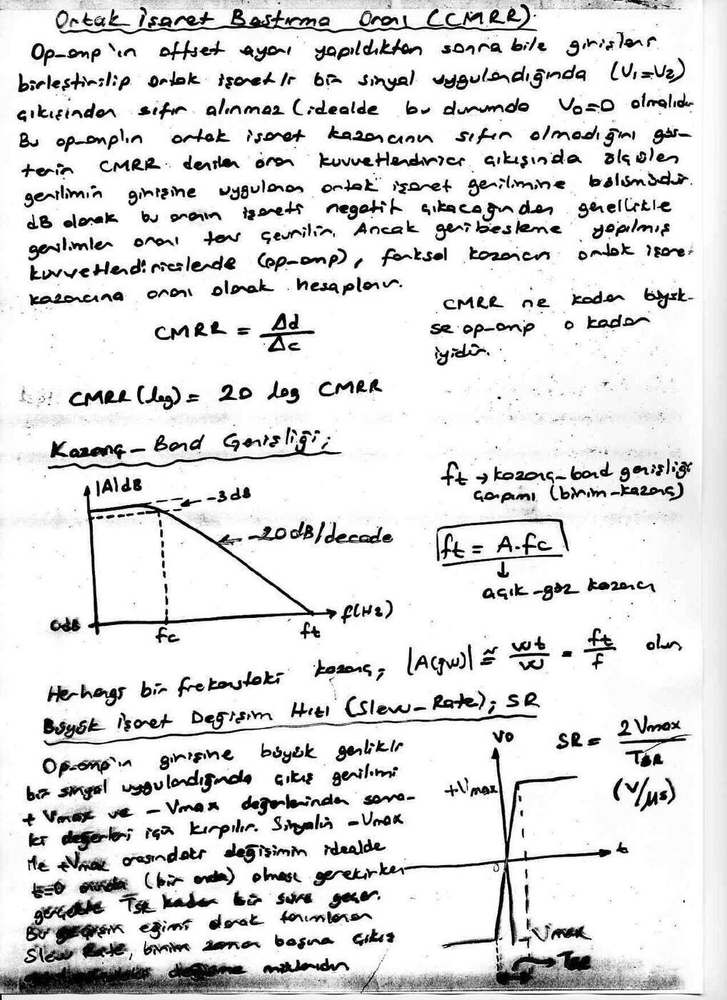

## Op-amp applications

### Voltage summer

- V_o = −i · R_f, i = i₁ + i₂ + i₃ = V₁/R₁ + V₂/R₂ + V₃/R₃
- **V_o = −R_f (V₁/R₁ + V₂/R₂ + V₃/R₃)**

The fact that op-amps amplify the ac and dc components at their inputs together creates a problem when the dc component of the signal to be amplified is large; the op-amp saturates because of this dc component. To prevent this, the summing property is used: a dc voltage opposite in polarity to the dc component in the main signal is applied to the input. This method can be extended and also used for offset adjustment. (In the example circuit, V_i is connected through 10 kΩ, and the wiper V_b of a 5 kΩ potentiometer connected between +15 V/−15 V is connected through 20 kΩ to the summing node; the feedback resistor is 100 kΩ.)

### Voltage subtractor

It consists of two inverting stages (V₁ is inverted in the first stage by R₁/R_f1, and in the second stage is summed with V₂ through R₂ and R₃):

- V_o = −[(R_f2/R₂)(−R_f1 V₁/R₁) + (R_f2/R₃) V₂]
- **V_o = −((R_f2/R₃) V₂ − (R_f2/R₂)(R_f1/R₁) V₁)**

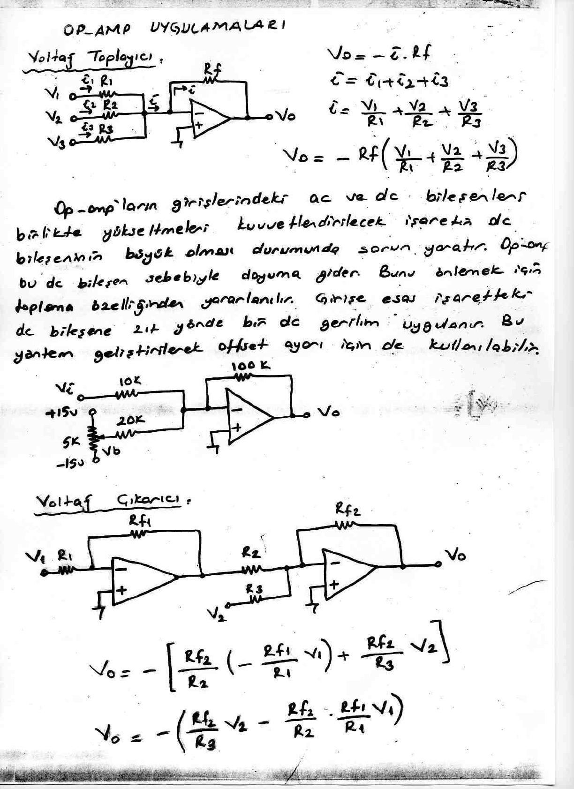

### Differential amplifier (voltage subtractor)

- V_− = V_+, V_− = R₃V₁/(R₁ + R₃) + R₁V_o/(R₁ + R₃), V_+ = R₄V₂/(R₂ + R₄)
- V_o = (R₄/(R₂ + R₄)) · ((R₁ + R₃)/R₁) V₂ − (R₃/R₁) V₁
- If R₁ = R₂ = R_a and R₃ = R₄ = R_b, **V_o = (R_b/R_a)(V₂ − V₁)**

*Note: In the notes, the last term of the general expression is written as "(R₃/R₁)V₂"; the correct term is (R₃/R₁)V₁.*

**Summer-subtractor:** V₁ (R₁) and V₂ (R₃) are connected to the inverting input, V₃ (R₁) and V₄ (R₃) to the non-inverting input; R₂ in the feedback and from the (+) input to ground:

- **V_o = (R₂/R₁)[V₃ − V₁] + (R₂/R₃)[V₄ − V₂]**

**Differential integrator:** R at both inputs, C in the feedback and from the (+) input to ground:

- **V_o = (1/RC) ∫ (V₂ − V₁) dt**

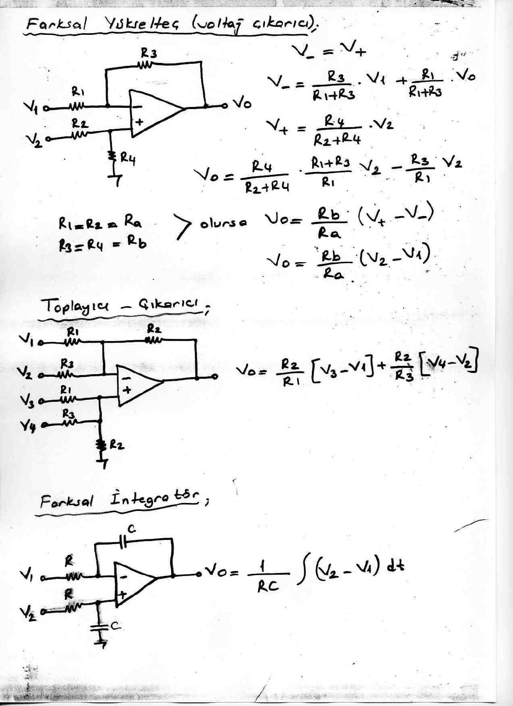

### Input resistance

- The input resistance of the closed-loop inverting amplifier equals R₁: R_in ≡ V₁/i₁ = V₁/(V₁/R₁) = **R₁**
- The input impedance of the voltage follower amplifier is ideally infinite, since no current is assumed to flow into the positive input terminal of the op-amp, and in practice it is very high. This non-inverting buffer amplifier is used to transfer the output of a high-impedance circuit to a low-impedance load (as an impedance matcher).
- In the differential amplifier (with R₁, R₂), V_o = (R₂/R₁)(V_+ − V_−) = (R₂/R₁)(V₂ − V₁). If the input resistance is defined as R_in = (V₂ − V₁)/i, then V₂ − V₁ = R₁·i + 0 + R₁·i ⇒ **R_in = 2R₁**

The input resistances of the differential amplifier and the inverting amplifier can be chosen as large as desired, but it should be noted that their gains will then decrease. Where these circuits are used, a high input impedance can be provided by placing voltage followers at the inputs.

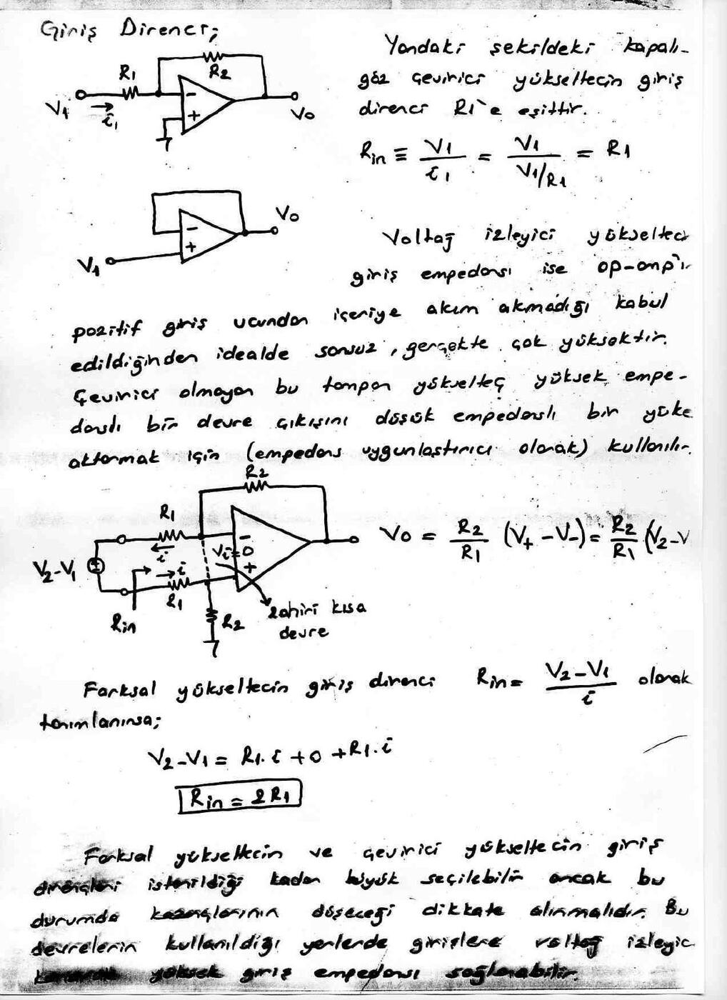

## Controlled sources

| Source | Definition | Realization with op-amp |
|---|---|---|
| Voltage-controlled voltage source | V_o = kV₁ | Inverting: V_o = −(R_f/R₁)V₁ = kV₁; non-inverting: V_o = (1 + R_f/R₁)V₁ = kV₁ |
| Voltage-controlled current source | I_o = kV₁ | Load R_L in the feedback path: I_o = V₁/R₁ = kV₁ |
| Current-controlled voltage source | V_o = kI₁ | I₁ directly into the inverting input, R_L in the feedback: V_o = −I₁R_L = kI₁ |
| Current-controlled current source | I_o = kI₁ | I_o = I₁ + I₂ = I₁ + I₁R₁/R₂ = (1 + R₁/R₂)I₁ = kI₁ |

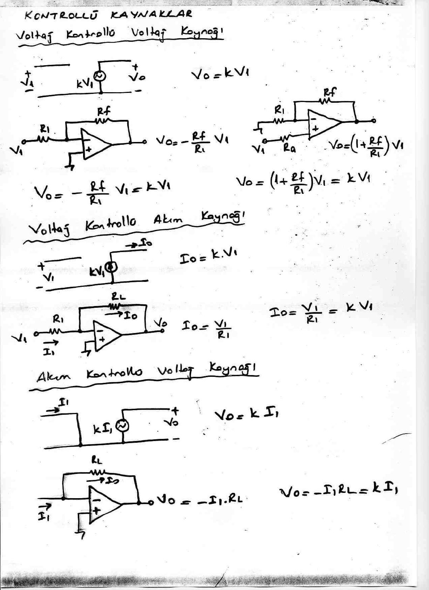

**Current-to-voltage converter:** I_i = I_f, **V_o = −I_f R_f**; for multiple current inputs, V_o = −(I₁ + I₂ + I₃)R.

**Current-difference-to-voltage converter:** I₁ into the inverting input (feedback R), I₂ into the non-inverting input (R to ground): **V_o = (I₂ − I₁)R**

**Voltage-to-current converter:** The load R_L is in the feedback path; in both the inverting connection (V_i through R₁) and the non-inverting connection (V_i to the (+) input, R₁ from the (−) input to ground), **I_L = V_i/R₁**.

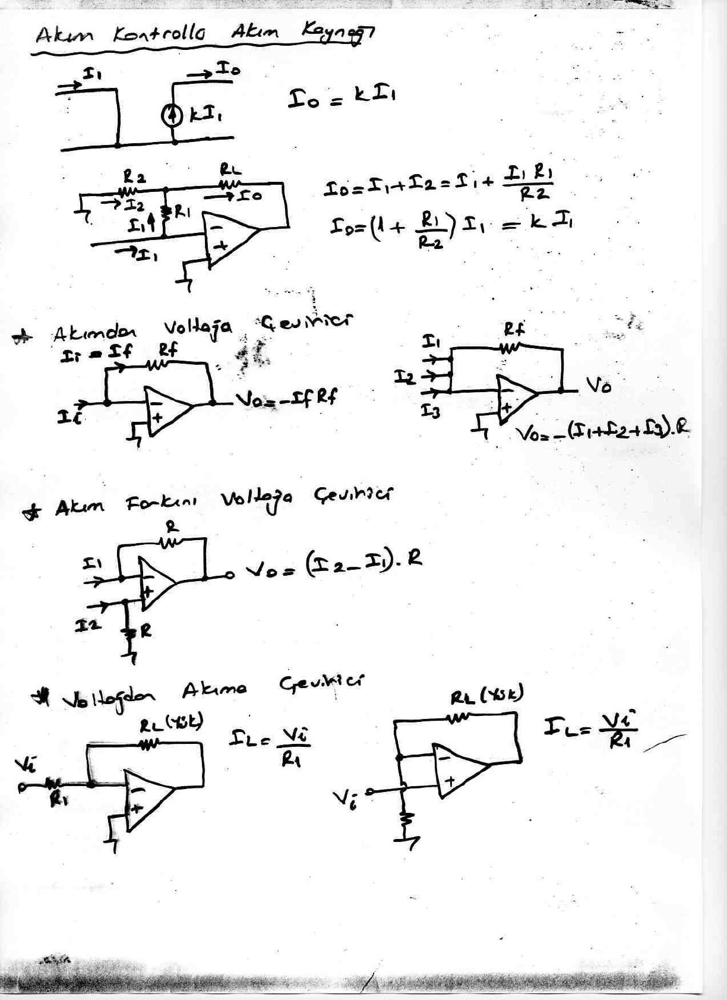

## Instrumentation amplifier

A differential amplifier with followers placed at its inputs is called an **instrumentation amplifier**. In addition to high input resistances and a high CMRR, another advantage is that the differential gain can be adjusted with a single resistor (R₁). Because of these properties, it is used in measuring biopotential signals.

- I = (V₃ − V₄)/(2R₂ + R₁) = (V₁ − V₂)/R₁
- V₃ − V₄ = ((2R₂ + R₁)/R₁)(V₁ − V₂)
- **V_o = (R₄/R₃)(2R₂/R₁ + 1)(V₁ − V₂)**

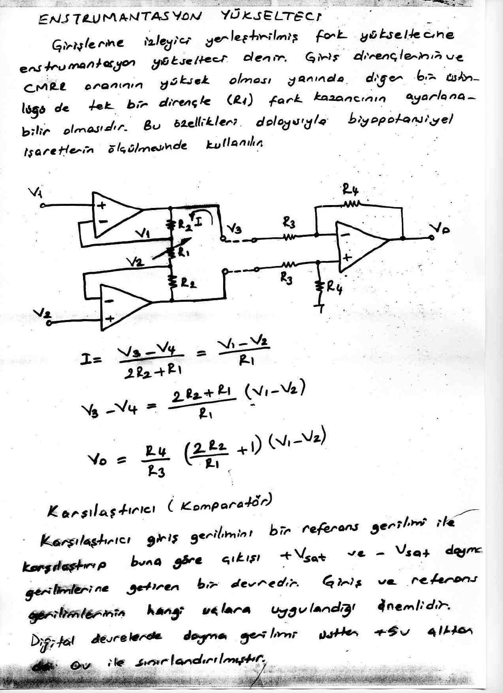

## Comparator

A comparator is a circuit that compares the input voltage with a reference voltage and drives the output to the saturation voltages +V_sat and −V_sat accordingly. Which terminals the input and reference voltages are applied to is important. In digital circuits, the saturation voltage is limited to +5 V at the top and 0 V at the bottom.

- **Input (V_i) at the + terminal, reference (V_ref) at the − terminal:** V_i > V_ref ⇒ V_o = +V_sat; V_i < V_ref ⇒ V_o = −V_sat
- **Input (V_i) at the − terminal, reference (V_ref) at the + terminal:** V_i > V_ref ⇒ V_o = −V_sat; V_i < V_ref ⇒ V_o = +V_sat

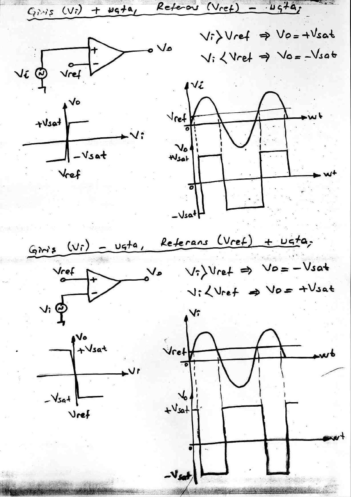

### Comparator with hysteresis (Schmitt trigger)

V_i and V_ref are connected to the inverting input through equal resistors R₁, and positive feedback is provided from the output to the (+) input through an R₂–R₃ voltage divider:

- V_− = (V_i + V_r)/2, V_+ = R₃V_o/(R₂ + R₃) → V_o = ((R₂ + R₃)/(2R₃))(V_i + V_r)
- If R₂ ≫ R₃, or if R₃ = 0 is taken (in the limit), the output is: a) V_i + V_r > 0 (V_i > −V_r) ⇒ V_o = −V_sat; b) V_i + V_r < 0 (V_i < −V_r) ⇒ V_o = +V_sat

In this form the circuit operates as a **Schmitt trigger**. By making R₃ ≠ 0, a hysteresis is created around −V_r, so that very small variations of the input signal around −V_r are prevented from causing unstable changes at the output. Depending on the noise level on the V_i signal, the hysteresis band can be widened by adjusting the resistors R₂ and R₃. The hysteresis band around the reference voltage:

- **2ΔV = 4 · V_sat · R₃/(R₂ + R₃)**

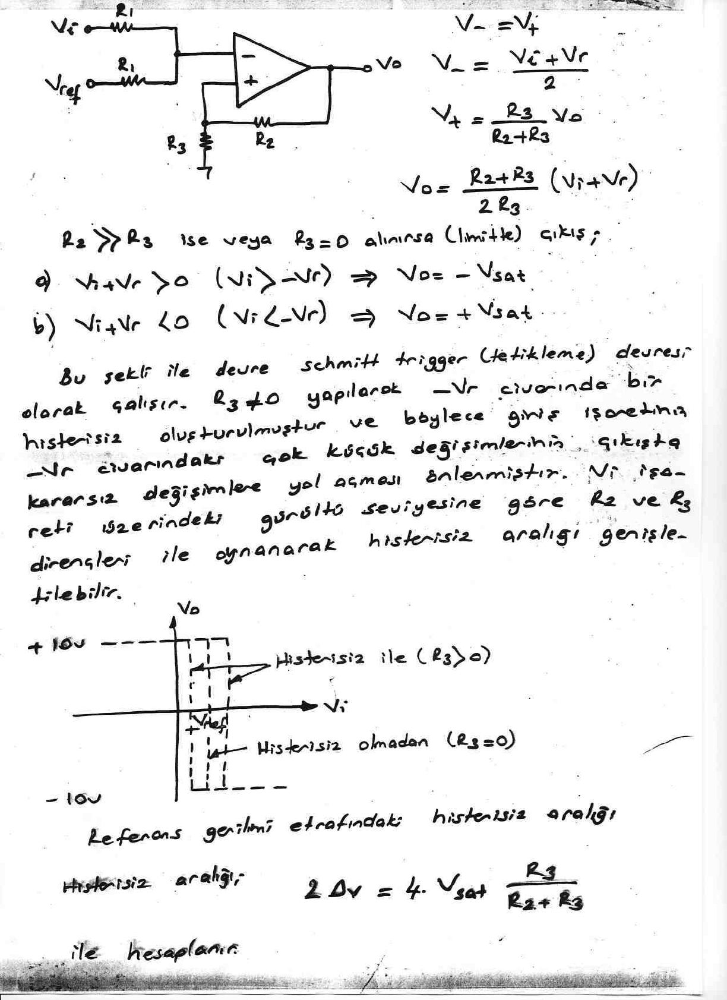

## Rectifiers, clippers, and detectors

### Rectifier

Diode-resistor type rectifiers cannot rectify signals with amplitudes smaller than about 0.7 V. Therefore, by using diodes together with op-amps, it is possible to rectify small-amplitude signals as well. The circuit below passes the negative portions of the input signal but not the positive portions:

- For V_i < 0, D₁ is off and D₂ is on. The circuit becomes an inverting amplifier and V_o = −V_i (slope −R_f/R_i).
- For V_i > 0, D₁ is on and D₂ is off; V_o = 0.

### Clipper

- If V_i < V_r, D is on and the amplifier is a follower: V_o = V_r.
- If V_i > V_r, D is off, no current flows through R; the output follows the input: V_o = V_i.

The clipper does not pass the part of the input signal that lies below a certain reference level V_r, i.e., it clips the input from below. If the direction of the diode is reversed, the input is clipped from above at the level V_r.

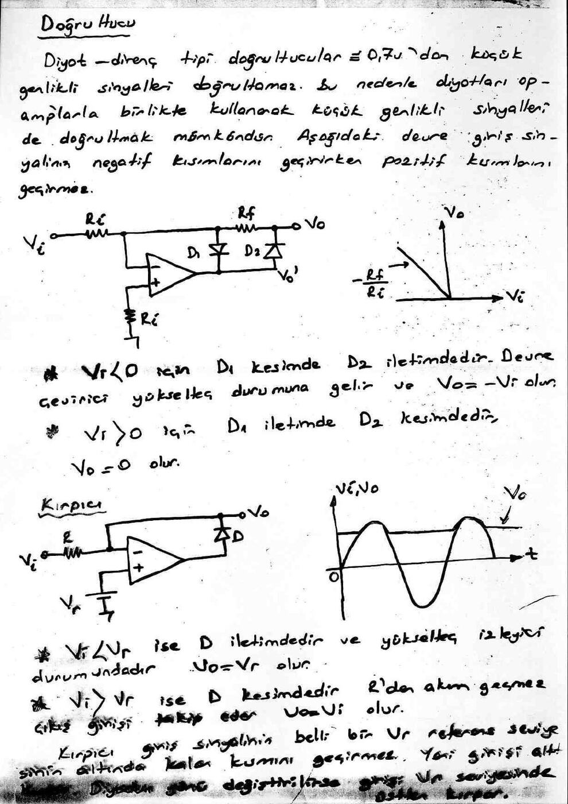

### Active peak detector

- For V_i > V_o, D is on and the amplifier is a follower; the output follows the input.
- For V_i < V_o, D is off and the output equals the voltage across the capacitor; if no current is drawn from the output, it retains the value it had at the moment the diode went off.

In this way, the maximum value reached by the input signal is obtained at the output.

### Threshold detector

A comparator with positive feedback (R₁, R₂) whose threshold is set by a potentiometer R_p connected between ±V_B (α R_p, (1 − α) R_p):

- (V_R − V_o)/R₂ + (V_R − V₁)/R₁ = 0 ①
- (V₁ − V_R)/R₁ + (V₁ + V_B)/(α R_p) + (V₁ − V_B)/((1 − α) R_p) = 0 ②
- V_R = [R₁V_o/(R₁ + R₂) − R₁R₂V_B(1 − 2α) / ([α(1 − α)R_p + R₁](R₁ + R₂))] / [1 − R₂R_p α(1 − α) / ([α(1 − α)R_p + R₁](R₁ + R₂))]

With this equation, substituting +V_sat for V_o gives V_R1, and substituting −V_sat gives V_R2. The threshold voltage is the average of these two values: **V_th = (V_R1 + V_R2)/2**

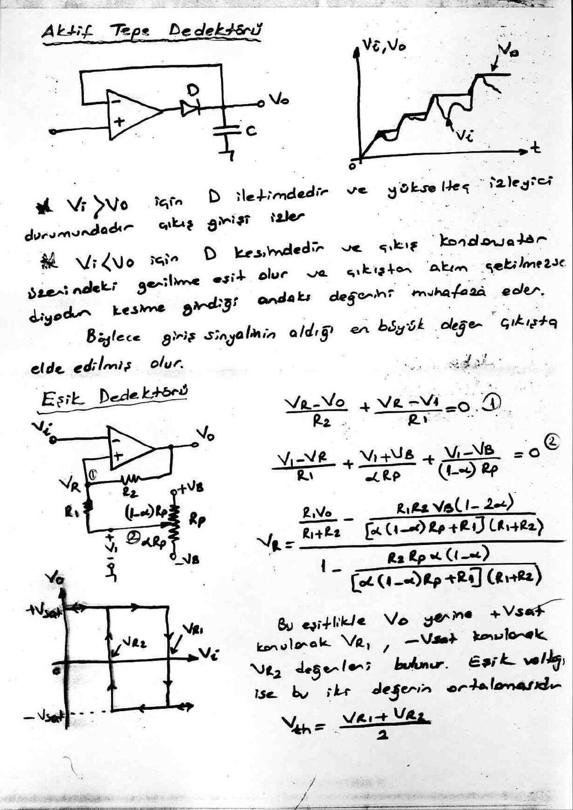

## Op-amp power amplifiers

**Push-pull power amplifier with crossover distortion compensation:** A push-pull amplifier in which crossover distortion has been eliminated using an op-amp. This circuit can be used, for example, in the output unit of an ECG monitor, to drive a paper recorder motor, or to drive a display.

- V_in/R_i + (V_in − V_L)/R_f = 0 → **V_L = V_in (1 + R_f/R_i)**, **A_v = 1 + R_f/R_i**

**Power amplifier with offset control:** An offset control unit has been added to the power amplifier above. Such a circuit is very useful, for example, for driving an ECG chart recorder. The gain is adjusted with R_o.

- α₁V₁/R_i + (α₁V₁ − (−V_BB))/(α₂R₂ + R₁) + (α₁V₁ − V_BB)/(R₁ + (1 − α₂)R₂) + (α₁V₁ − V_out)/R_f = 0
- V_out = (R_f/R_i)(α₁V₁) + R_f (α₁V₁ + V_BB)/(α₂R₂ + R₁) + R_f (α₁V₁ − V_BB)/((1 − α₂)R₂ + R₁) + α₁V₁

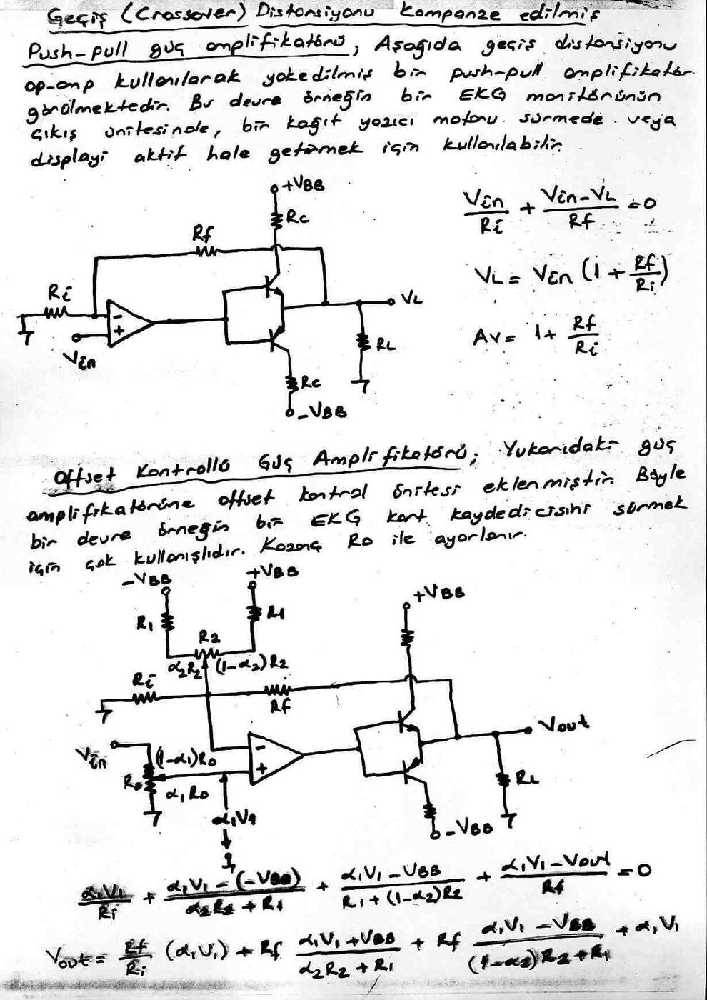

## Active filters

A filter is a circuit designed to pass signals within a certain band (range) and attenuate all signals outside this band. Filters can be active or passive. Passive filter circuits are designed using only resistors, capacitors and inductors, while active filters additionally use transistors or op-amps. Because inductors can be large, expensive and have very large internal resistive elements, they are generally not used in active filter circuits.

There are four types of filters: **low-pass**, **high-pass**, **band-pass** and **band-reject (or notch)**.

A low-pass filter has a constant output voltage from dc up to the cutoff frequency f_c. If the frequency is increased above f_c, the output voltage is attenuated. The range of frequencies that are passed is called the **passband**, and the range of frequencies that are attenuated is called the **stopband**. The cutoff frequency f_c is also called the 0.707 frequency, the −3 dB frequency, the corner frequency or the resonant frequency.

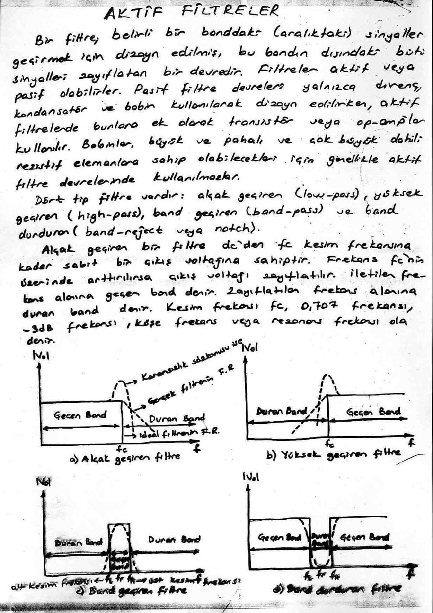

### Basic low-pass filter

The filtering is done with RC elements, and a unity-gain (voltage follower) op-amp is used. The resistor R_f is equal to R and is connected for dc offset (at dc the reactance of the capacitor is infinite, and the dc resistance to ground must be equal for both input terminals). Since the voltage between the + and − input terminals of the op-amp is 0 V, the voltage across C is equal to V_o, because the op-amp is a voltage follower.

- V_o = (1/(jωC)) / (R + 1/(jωC)) · V₁ (ω = 2πf, j = √−1)
- Closed-loop gain: **A_CL = V_o/V₁ = 1/(1 + jωRC)**

The gain depends on frequency: as ω → 0 (very low frequencies), |A_CL| = 1; as ω → ∞ (very high frequencies), |A_CL| = 0. That is, when the frequency exceeds f_c, |A_CL| decreases at a rate of 20 dB/decade. Because this circuit consists of a single RC, it is called a **first-order** or **single-pole** filter.

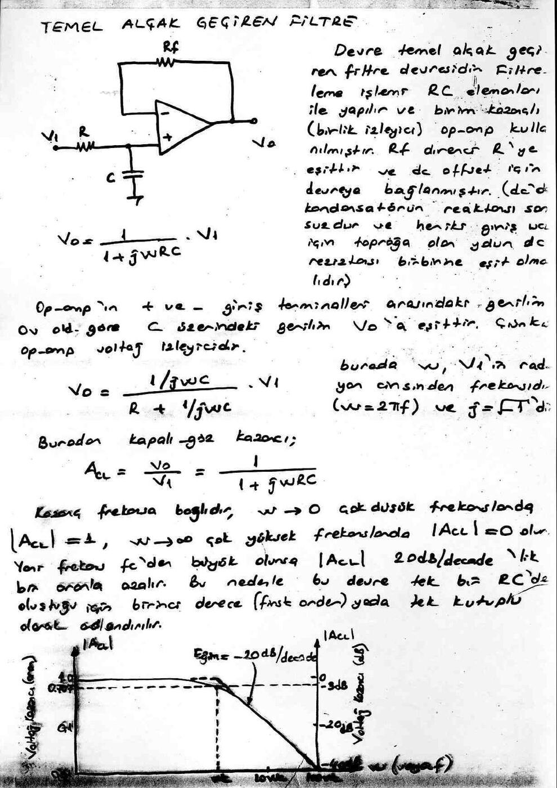

**Filter design:**

- Cutoff frequency: ω_c = 1/(RC) = 2πf_c; rearranging this equality for R gives **R = 1/(ω_c C) = 1/(2πf_c C)**
- The cutoff frequency (ω_c, f_c) is specified; the capacitance C is chosen (generally between 0.001 and 0.1 µF); R is found from the equation.

**Filter response:** The value of A_CL at ω_c is found by setting ωRC = 1: A_CL = 1/(1 + j1) = 1/(√2 ∠45°) = 0.707 ∠−45°. |A_CL| = 1/√2 = 0.707, |A_CL|_dB = 20 log |A_CL| = −3 dB; the phase angle is −45°.

| ω | Gain magnitude A_CL | Phase angle |
|---|---|---|
| 0.1 ω_c | 1.0 | −6° |
| 0.25 ω_c | 0.97 | −14° |
| 0.5 ω_c | 0.89 | −27° |
| ω_c | 0.707 | −45° |
| 2 ω_c | 0.445 | −63° |
| 4 ω_c | 0.25 | −76° |
| 10 ω_c | 0.1 | −84° |

### Butterworth filters

In many low-pass filter applications, the closed-loop gain must be close to 1 in the passband. The Butterworth filter fulfills such applications best; for this reason these filters are called **maximally flat** filters. The filter above is also of this type.

Butterworth filters are not designed to have a constant phase angle at the cutoff frequency. The basic low-pass filter has a phase angle of −45° at ω_c (−20 dB/decade); a −40 dB/decade Butterworth filter has a phase angle of −90° at ω_c, and a −60 dB/decade Butterworth filter has a phase angle of −135° at ω_c. That is, for every additional −20 dB/decade, the phase angle at ω_c increases by −45°.

### −40 dB/decade (second-order, two-pole) low-pass Butterworth filter

R₁ = R₂ = R, R_f = 2R; C₁ from the (+) input to ground, C₂ from the output to the R₁–R₂ junction. The voltage across C₁ is the output voltage.

**Design:** the cutoff frequency (ω_c, f_c) is specified; C₁ is chosen (100 pF ~ 0.1 µF); **C₂ = 2C₁** is chosen; **R = 0.707/(ω_c C)** (R₁ = R₂ = R); **R_f = 2R** is chosen.

- **f_c = 1/(2π√(R₁R₂C₁C₂))**
- Filter response: beyond the cutoff frequency, the gain drops by −40 dB for every tenfold increase in frequency.

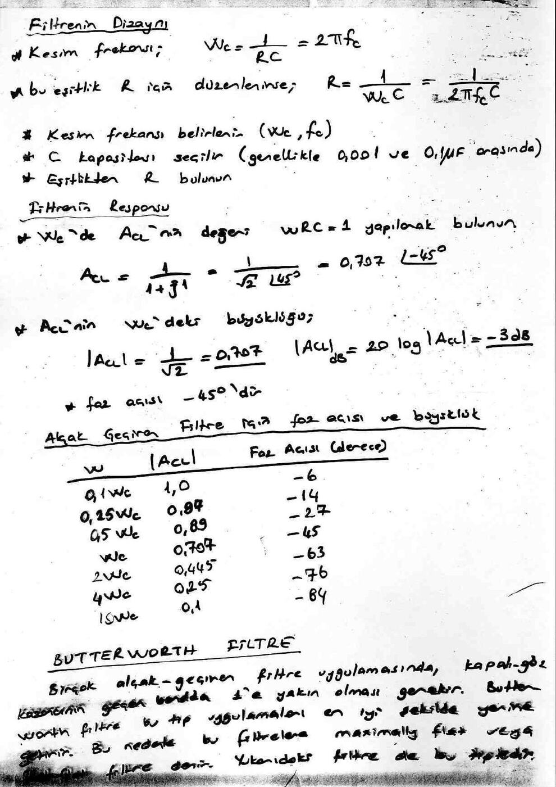

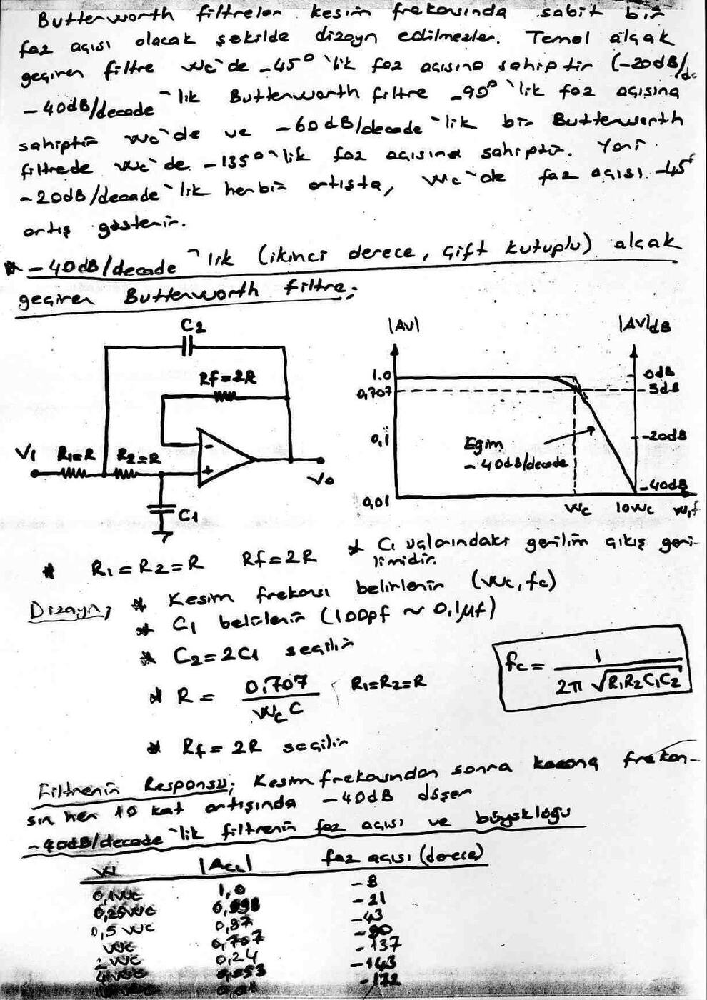

### −60 dB/decade (third-order, three-pole) low-pass Butterworth filter

It is obtained by cascading a −40 dB/decade stage (R₁ = R₂ = R, R_f1 = 2R, C₁, C₂) with a −20 dB/decade stage (R₃ = R, C₃, R_f2 = R).

- A_CL = V_o/V₁ = (V_o1/V₁) · (V_o/V_o1); at ω_c, A_CL must equal 0.707.
- **f_c = 1/(2π ∛(R₁R₂R₃C₁C₂C₃))**

**Design:** the cutoff frequency (ω_c, f_c) is specified; C₃ is chosen (0.001 ~ 0.1 µF); **C₁ = ½ C₃**, **C₂ = 2C₃**; **R = 1/(ω_c C₃)** is calculated; R = R₁ = R₂ = R₃; **R_f1 = 2R**, **R_f2 = R**. For best results, R should be between 10 and 100 kΩ. If R is chosen outside this range, go back to the start and choose a new value of C₃.

**Filter response:** the gain decreases by −3 dB at the cutoff frequency, and drops by −60 dB for every tenfold increase in frequency.

| ω | Gain magnitude A_CL | Phase angle |
|---|---|---|
| 0.1 ω_c | 1.0 | −12° |
| 0.25 ω_c | 0.999 | −29° |
| 0.5 ω_c | 0.992 | −60° |
| ω_c | 0.707 | −135° |
| 2 ω_c | 0.124 | −210° |
| 4 ω_c | 0.022 | −226° |
| 10 ω_c | 0.001 | −256° |

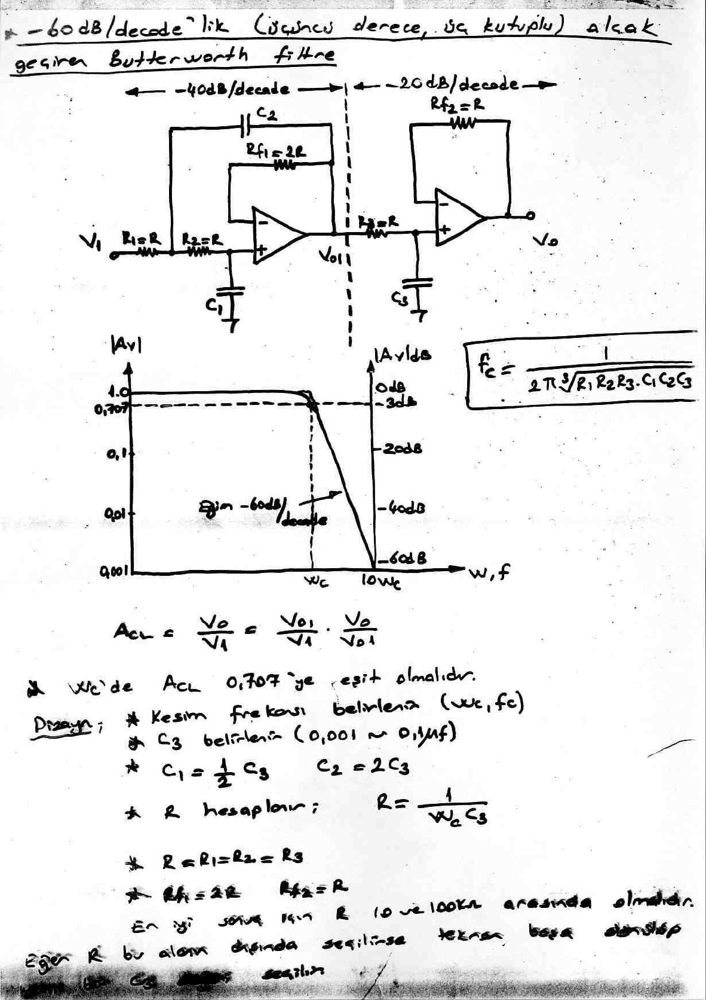

### High-pass Butterworth filters

A high-pass filter attenuates all signals below a certain cutoff frequency (ω_c, f_c) while passing signals at frequencies above it. Such filter circuits have the inverse function of low-pass filters, and only the positions of the capacitor and the resistor in the circuit are swapped. The phase angle is +45° at ω_c for −20 dB/decade, and increases by +45° for each additional −20 dB/decade of attenuation.

**−20 dB/decade (first-order, single-pole) high-pass Butterworth filter:** series C at the input, R from the (+) input to ground, R_f = R.

- **V_o = V₁ / (1 − j(1/(ωRC)))**; ω → 0 rad/s ⇒ V_o → 0 V; ω → ∞ ⇒ V_o = V₁
- When ωRC = 1, the magnitude of the closed-loop gain is 0.707. Therefore the cutoff frequency is **ω_c = 1/(RC) = 2πf_c**, **R = 1/(ω_c C) = 1/(2πf_c C)**
- **Design:** the cutoff frequency is specified; C is chosen (0.001 ~ 0.1 µF); R is calculated; R_f = R is set (R_f minimizes the dc offset).

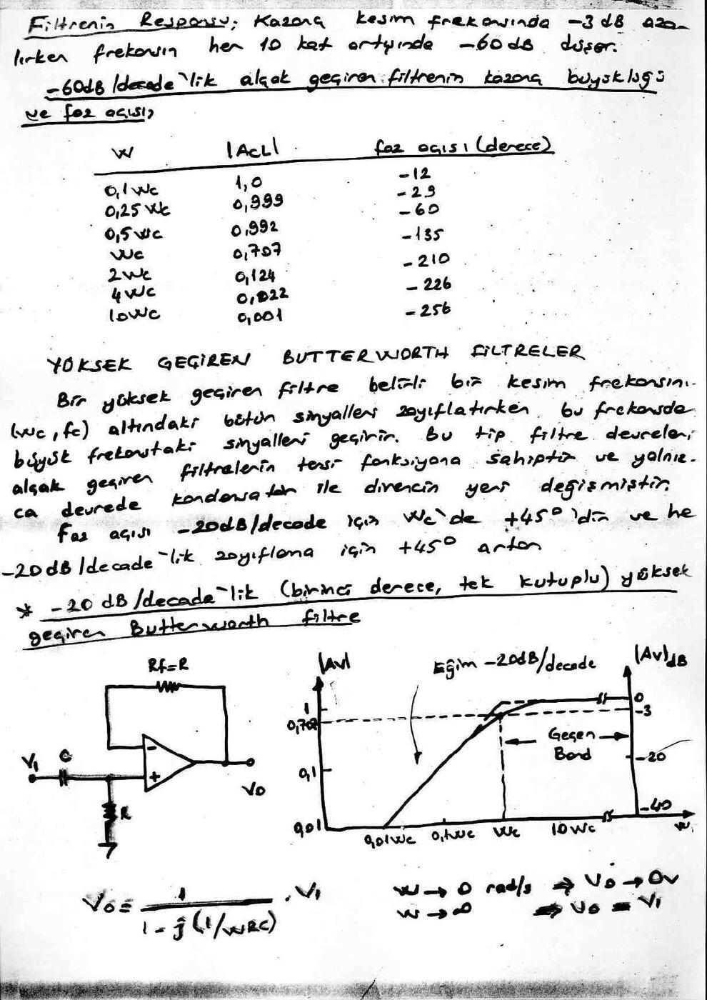

**−40 dB/decade (second-order, two-pole) high-pass filter:** Starting from the cutoff frequency, the gain decreases by −40 dB for every tenfold decrease in frequency. The gain is 0.707 at the cutoff frequency and 0 dB in the passband.

- **Design:** the cutoff frequency (ω_c, f_c) is specified; **C₁ = C₂ = C** is chosen; **R₁ = 1.414/(ω_c C)** is calculated; **R₂ = ½ R₁** is chosen; **R_f = R₁** is set.
- **f_c = 1/(2π√(R₁R₂C₁C₂))**

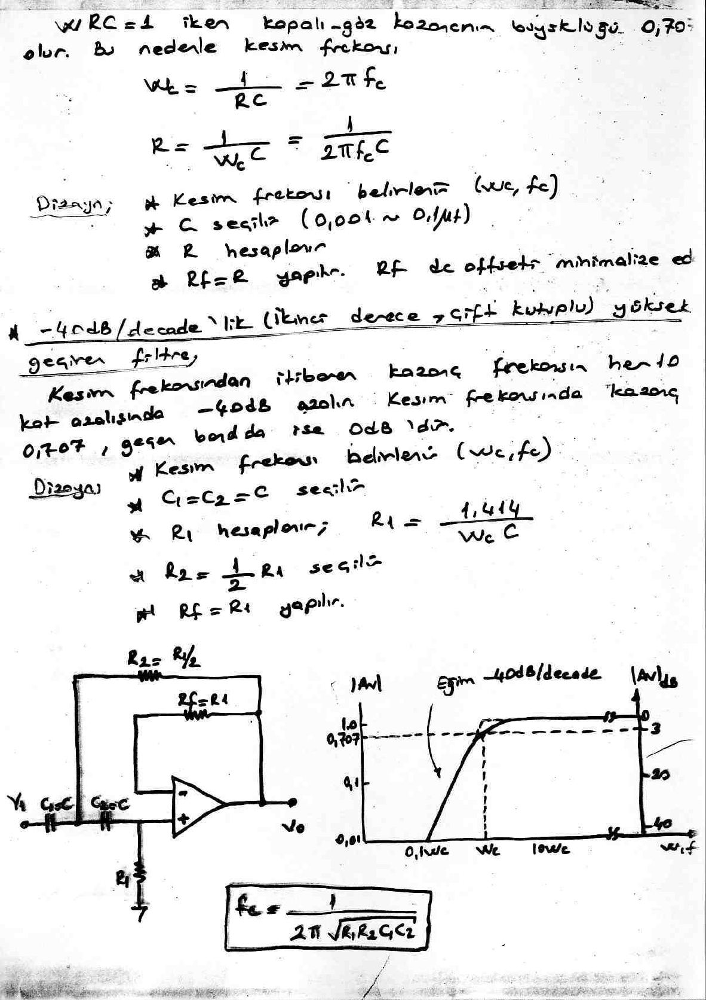

**−60 dB/decade (third-order, three-pole) high-pass Butterworth filter:** It is obtained by cascading a −40 dB/decade stage (C₁ = C₂ = C, R₁, R₂, R_f1 = R₁) with a −20 dB/decade stage (C₃, R₃, R_f2 = R₃).

- **f_c = 1/(2π ∛(R₁R₂R₃C₁C₂C₃))**
- **Design:** the cutoff frequency (ω_c, f_c) is specified; C₁ = C₂ = C₃ = C is chosen (100 pF ~ 0.1 µF); **R₃ = 1/(ω_c C)** is calculated; **R₁ = 2R₃**; **R₂ = ½ R₃**; **R_f1 = R₁**, **R_f2 = R₃** are chosen.

Comparison of gain magnitudes and phase angles of the high-pass filters (as far as can be read from the notes):

| ω | Magnitude −20 dB/dec | Magnitude −40 dB/dec | Magnitude −60 dB/dec | Phase −20 dB/dec | Phase −40 dB/dec | Phase −60 dB/dec |
|---|---|---|---|---|---|---|
| 0.1 ω_c | 0.1 | 0.001 | 0.001 | 84° | 172° | 256° |
| 0.25 ω_c | 0.25 | 0.053 | 0.022 | 76° | 143° | 226° |
| 0.5 ω_c | 0.445 | 0.24 | 0.124 | 63° | 137° | 210° |
| ω_c | 0.707 | 0.707 | 0.707 | 45° | 90° | 135° |
| 2 ω_c | 0.89 | 0.97 | 0.992 | 27° | 45° | 69° |
| 4 ω_c | 0.97 | 0.998 | 0.999 | 14° | 21° | 29° |
| 10 ω_c | 1.0 | 1.0 | 1.0 | 6° | 8° | 12° |

*Note: For a second-order Butterworth filter, the theoretical values are |A| ≈ 0.01 at 0.1 ω_c; ≈ 0.062 at 0.25 ω_c, and the phase over the range 0.25–4 ω_c is approximately 152°, 127°, 90°, 53°, 28°, respectively. Some values in the table are written differently in the notes or are hard to read; the second-order table of the low-pass filter (s-25) is likewise partly illegible.*

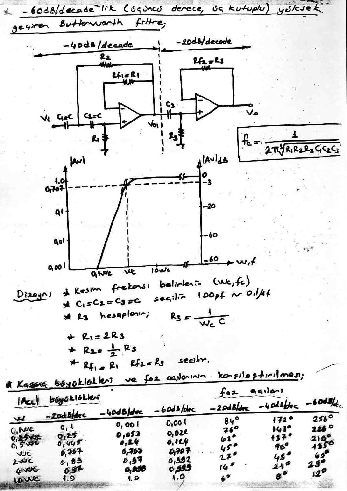

### Band-pass filters

A band-pass filter is a frequency selector; it selects or passes only a certain frequency band. Such a filter has maximum gain at the resonant frequency (f_r). Of the two frequency points where the gain drops by 0.707 (or 3 dB), one is the lower cutoff frequency and the other is the upper cutoff frequency (f_L, f_H).

- Bandwidth: **BW = f_H − f_L**
- If f_L and f_H are known, the resonant (center) frequency can be found: **f_r = √(f_L · f_H)**
- If f_r and BW are known: **f_L = √(BW²/4 + f_r²) − BW/2**, **f_H = f_L + BW**

**Example:** If f_L = 300 Hz and f_H = 3000 Hz, find BW and f_r.

- BW = f_H − f_L = 2700 Hz; f_r = √(f_H · f_L) = √(300 · 3000) = **948.7 Hz**
- Note that f_r is always below the arithmetic center frequency: (300 + 3000)/2 = 1650 Hz.

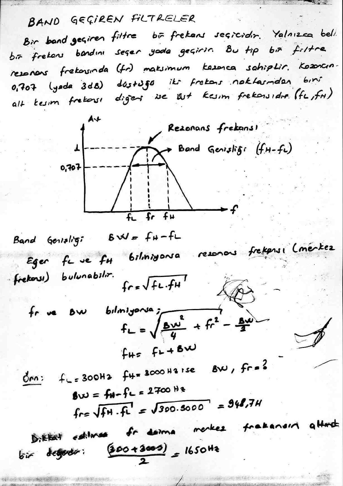

**Example:** Find the lower and upper cutoff frequencies of a filter with a resonant frequency of 950 Hz and a bandwidth of 2700 Hz.

- f_L = √(2700²/4 + 950²) − 2700/2 = 1650 − 1350 = **300 Hz**; f_H = 300 + 2700 = **3000 Hz**

**Quality factor Q:** The quality factor is the ratio of the resonant frequency to the bandwidth; it is a measure of the selectivity of a band-pass filter: **Q = f_r / BW**. A high Q value indicates that the filter selects (passes) a very narrow band.

**Narrowband and wideband filters:** A wideband filter has a bandwidth two or more times the resonant frequency; it is wideband if Q ≤ 0.5. Wideband filters are generally built by cascading a low-pass and a high-pass filter. Narrowband filters (Q > 0.5) are generally built as a single stage.

**Example:** Find the quality factor of a filter with BW = 2700 Hz and f_r = 950 Hz. Q = f_r/BW = 950/2700 = 0.35 < 0.5 → it is a wideband filter.

### Wideband filters

They are formed by connecting a low-pass filter and a high-pass filter in series (cascade, one after the other); it does not matter which comes first. Example circuit: a 3000 Hz low-pass filter (7.5 kΩ, 7.5 kΩ, 10 nF, 5 nF) and a 300 Hz high-pass filter (50 nF, 50 nF, 7.5 kΩ, 15 kΩ); bandwidth 2700 Hz, f_r = 948 Hz, −40 dB/decade on both sides.

The cutoff frequencies of the low-pass and high-pass filters must not overlap, and both must have the same gain in their passbands. The cutoff frequency of the low-pass filter must be 10 times or more greater than that of the high-pass filter. A wideband band-pass filter built from cascaded low-pass and high-pass filters has the following characteristics:

1. The lower cutoff frequency f_L is determined only by the high-pass filter.
1. The upper cutoff frequency f_H is determined only by the low-pass filter.
1. The gain is maximum at the resonant frequency (f_r) and equals the passband gain of each filter.

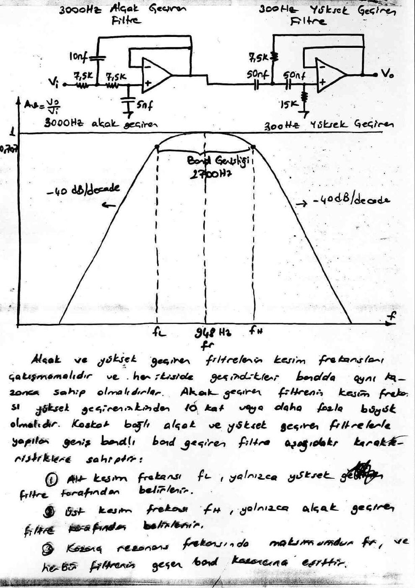

### Narrowband band-pass filters

A narrowband filter circuit contains only a single op-amp. The input resistance of the filter is equal to the resistor R. If the feedback resistor (2R) is made twice the input resistance, the maximum gain of the filter at the resonant frequency will be 1, or 0 dB. By adjusting R_r, the resonant frequency can be changed (the bandwidth and gain do not change).

**Performance:** The performance of a unity-gain narrowband filter can be calculated with a few simple equations:

- **BW = 0.1591/(RC)**, BW = f_r/Q
- **R_r = R/(2Q² − 1)**
- **f_r = (0.1125/(RC)) √(1 + R/R_r)**

**Example:** What are the resonant frequency and bandwidth of a band-pass filter with R = 21.21 kΩ, 2R = 42.42 kΩ, C = 15 nF, R_r = 3.03 kΩ?

- f_r = 0.1125/(21.21·10³ · 15·10⁻⁹) · √(1 + 21.21k/3.03k) = 353.6 Hz · √(1 + 7) ≅ **1000 Hz**
- BW = 0.1591/(21.21·10³ · 15·10⁻⁹) = **500 Hz**

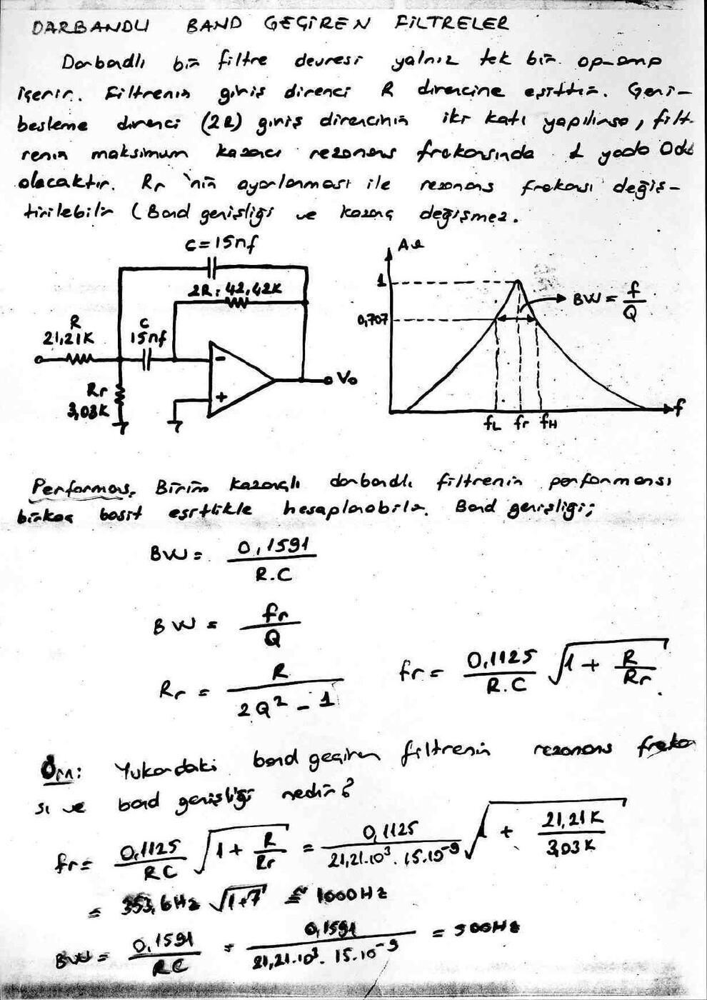

**Example (equalizer):** Design the 6th unity-gain narrowband filter of an equalizer with resonant frequencies of 32, 64, 128, 250, 500, 1000, 2000, 4000, 8000 and 16 000 Hz, for Q = 2.

*Explanation:* A stereo equalizer has 10 band-pass filters in each channel. This circuit divides the audio spectrum (30 Hz – 16 kHz) into 10 different frequency regions.

- The resonant frequency of the 6th filter is f_r = 1000 Hz; BW = f_r/Q = 1000/2 = 500 Hz
- f_L = √(500²/4 + 1000²) − 500/2 = **780 Hz**; f_H = f_L + BW = **1280 Hz**
- If we choose C = 0.015 µF = 15 nF, R = 0.1591/(BW · C) = 0.1591/(500 · 15·10⁻⁹) = **21.21 kΩ**
- Feedback resistor 2R = **42.42 kΩ**; R_r = R/(2Q² − 1) = 21.21k/(2·2² − 1) = **3.03 kΩ**

### Band-reject (notch) filters

Unwanted frequencies are attenuated in the stopband, and the desired (selected) frequencies are transmitted in the passband. Notch filters have unity gain in the passband. The expressions for Q, BW, f_L, f_H and f_r are the same as for the band-pass filter.

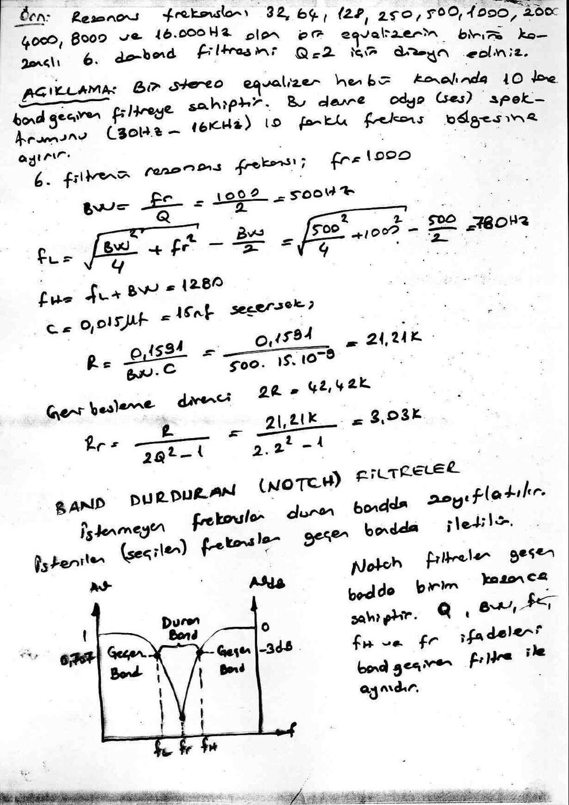

**Notch filter theory:** A notch filter is made by subtracting the output of a band-pass filter from the original signal. For frequencies in the passband of the notch filter, the output of the band-pass filter approaches zero. The input signal V₁ is transferred to V_o as −V₁ through the summer input resistor R₂. Therefore V_o = −V₁ in both the lower and upper passbands.

Suppose that the frequency of the input signal V₁ is tuned to the resonant frequency of the notch filter (the f_r of the band-pass filter is the f_r of the notch filter). V₁ comes out of the band-pass filter's output as −V₁ and is inverted again through R₁ and R, appearing as +V₁ at the output. Since V₁ at this moment also arrives at the output through R₂ as −V₁, V_o = 0 V (V_o = V₁ − V₁ = 0 V) at f_r.

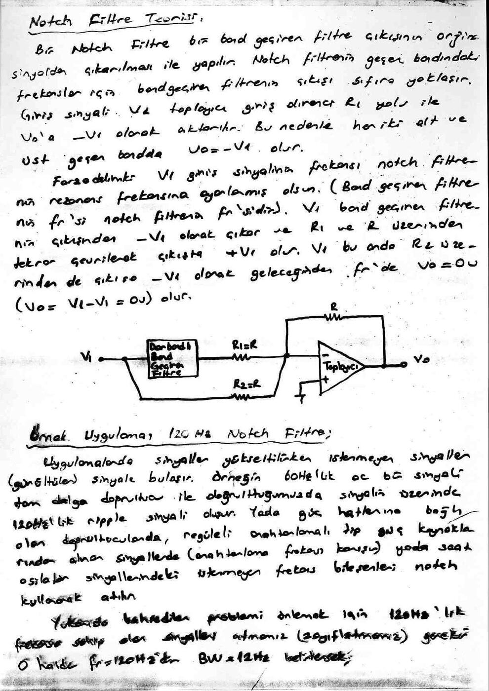

### Example application: 120 Hz notch filter

In applications, unwanted signals (noise) contaminate the signal while signals are being amplified. For example, when we rectify a 60 Hz ac signal with a full-wave rectifier, a 120 Hz ripple signal appears on top of the signal. Likewise, unwanted frequency components in rectifiers connected to power lines, in signals taken from regulated switching-type power supplies (switching-frequency interference), or in clock oscillator signals are removed using a notch filter.

To prevent the problem mentioned above, you need to reject (attenuate) the signals at 120 Hz. Then f_r = 120 Hz; if we specify BW = 12 Hz:

- Q = f_r/BW = 120/12 = 10 → narrowband filter
- The passband gain of the filter to be built is unity. Since BW = 12 Hz, f_L = 120 − BW/2 = 114 Hz and f_H = 120 + BW/2 = 126 Hz.

**Steps for building the notch filter:**

1. A band-pass filter is built with the specified f_r, Q and BW values.
1. The output of the band-pass filter and the original signal are applied to the inverting summer op-amp through equal R values.

- Let us choose C = 0.33 µF: R = 0.1591/(BW · C) = 0.1591/(12 · 0.33·10⁻⁶) = **40.2 kΩ**
- Feedback resistor 2R = **80.4 kΩ**
- R_r = R/(2Q² − 1) = 40.2k/(2·10² − 1) = **201 Ω** (in the summer R₁ = R₂ = 10 kΩ, feedback 10 kΩ)

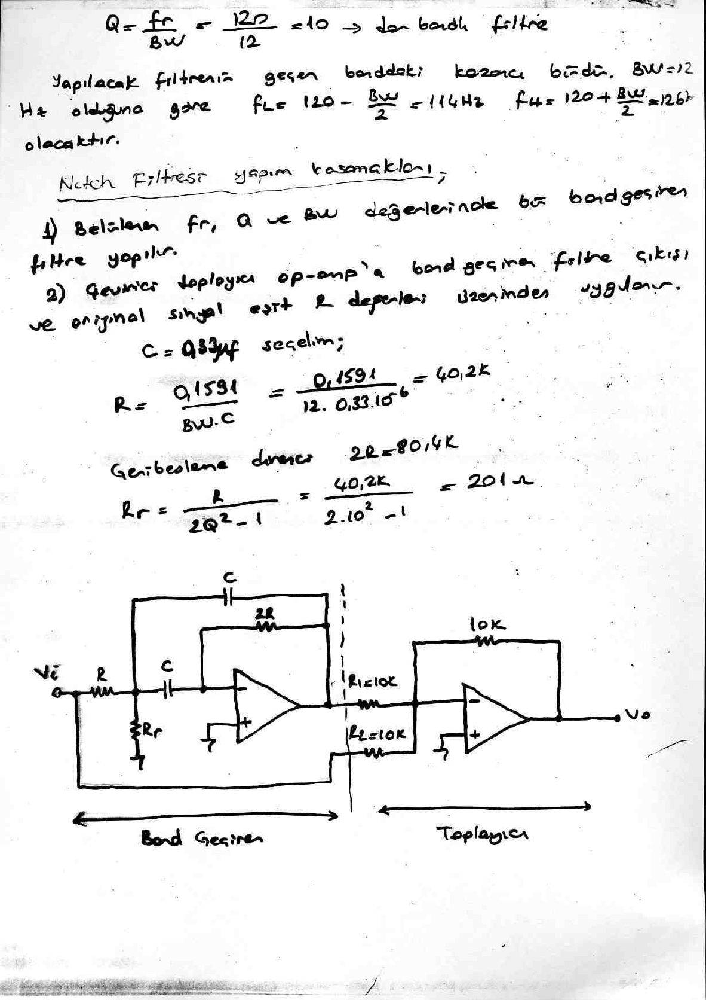
