Bu yazı, Başkent Üniversitesi **EEM311 Elektronik II** dersinin **işlemsel yükselteçler (operational amplifiers, op-amp)** ve **aktif filtreler** konularını anlatan 36 sayfalık el yazısı ders notlarının taranmış sayfalarından hazırlandı. Notlarda yazar adı ve tarih yok. Tanımlar, formüller, tasarım adımları ve çözümlü örnekler metne aktarıldı; devre şemaları ve grafikler için ilgili sayfa görselleri eklendi. Taranmış sayfaların tamamı PDF olarak yazının sonunda indirilebilir.

## İşlemsel yükselteçlere giriş

Giriş devresi bir farksal yükselteç, çıkış devresinde de yüksek kazançlı bir yükseltecin bulunduğu devrelere **op-amp** denir. Çevirici ve çevirici olmayan şeklinde adlandırılan iki girişi vardır ve sırasıyla (−) ve (+) işaretleri ile gösterilirler: **çevirmeyen giriş (non-inverting, +)** ve **çevirici giriş (inverting, −)**. Tek bir girişe ya da her iki girişe sinyal uygulanabilir; farksal (differential) ve ortak mod (common mode) olmak üzere iki tip çalışma yapar.

### Farksal ve ortak mod çalışması

- Farksal giriş sinyali: **V_d = V_i1 − V_i2**, farksal çıkış V_od = A_d · V_d (A_d: farksal kazanç)
- Ortak mod giriş sinyali: **V_c = ½ (V_i1 + V_i2)**, ortak mod çıkışı V_oc = A_c · V_c (A_c: ortak mod kazancı)
- Toplam çıkış: **V_o = V_od + V_oc = A_d V_d + A_c V_c**

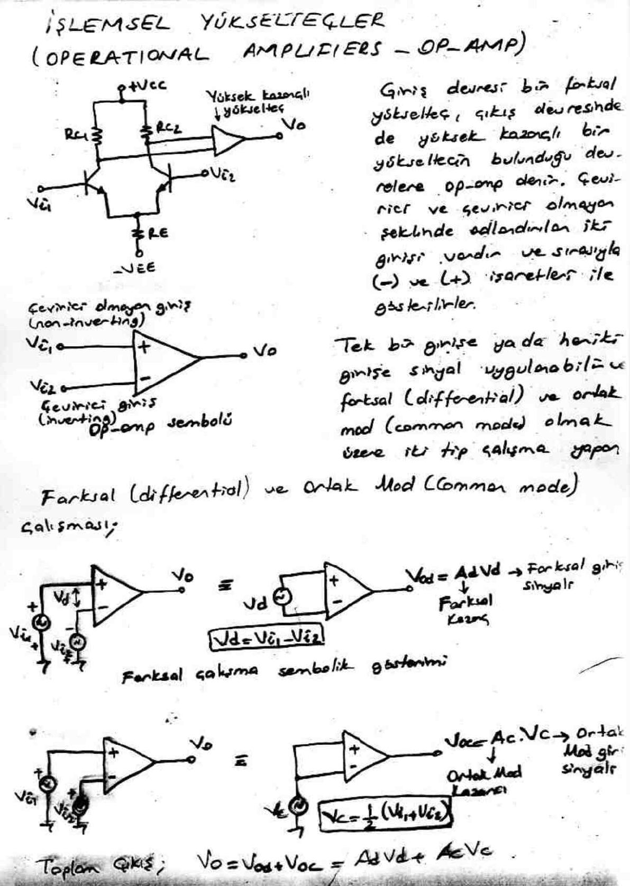

- Ters polariteli girişler için (V_i1 = V_s, V_i2 = −V_s): V_d = 2V_s, V_c = 0 → **V_o = 2A_d V_s**
- Aynı polariteli girişler için (V_i1 = V_i2 = V_s): V_d = 0, V_c = V_s → **V_o = A_c V_s**

### Ortak mod atma oranı (CMRR)

- **CMRR = A_d / A_c**, **CMRR (log) = 20 log₁₀ (A_d/A_c)**
- V_o = A_d V_d (1 + A_c V_c / (A_d V_d)) = **A_d V_d (1 + (1/CMRR) · (V_c/V_d))**

İdeal bir op-amp'ın ortak modda sinyalleri hiç yükseltmediği, yalnızca farksal sinyalleri yükselttiği kabul edilir. Gerçekte ise op-amp ortak modlu sinyalleri de yükseltir. Ancak ortak mod kazancı (farksal kazanca göre) ne kadar düşükse op-amp o kadar iyidir; yani CMRR'si ne kadar yüksekse op-amp ideale o kadar yakındır.

**Örnek:** V_i1 = 150 µV, V_i2 = 140 µV ise CMRR'nin 100 ve 10⁵ olduğu değerler için çıkış voltajını bulunuz (A_d = 4000).

- V_d = V_i1 − V_i2 = 10 µV, V_c = ½ (V_i1 + V_i2) = 145 µV
- CMRR = 100 → V_o = A_d V_d (1 + (1/CMRR)(V_c/V_d)) = **45,8 mV**
- CMRR = 10⁵ → V_o = **40,006 mV**
- CMRR büyüdükçe çıkış voltajı A_d V_d'ye yaklaşır.

## Op-amp temelleri

İdeal op-amp eşdeğeri: girişler arasındaki gerilime bağlı A_v(V₁ − V₂) bağımlı gerilim kaynağı. Gerçek op-amp ac eşdeğerinde giriş direnci R_i, çıkış direnci R_o ve A_d V_d kaynağı bulunur; ideal op-amp'ta **R_i = ∞, R_o = 0, A_d → ∞**'dur.

Op-amp'lar **açık göz (open-loop)** ve **kapalı göz (closed-loop)** olmak üzere iki şekilde çalıştırılırlar. Açık göz kazancında op-amp çıkışından girişlere doğru herhangi bir geri besleme yoktur, yani kapalı bir göz oluşturulmamıştır. Bu çalışmada op-amp'ın voltaj kazancı sonsuzdur; bu türde op-amp yalnızca komparatör (karşılaştırıcı) olarak çalıştırılır. Çıkıştan girişlere doğru geri besleme yapılmışsa, yani kapalı bir göz oluşturulmuşsa devrenin kazancı istenilen bir değerde ayarlanabilir. Bu tür çalışma devreleri çok çeşitli şekillerde yapılabilirler: çevirici, integral alıcı, toplayıcı, çıkarıcı vb.

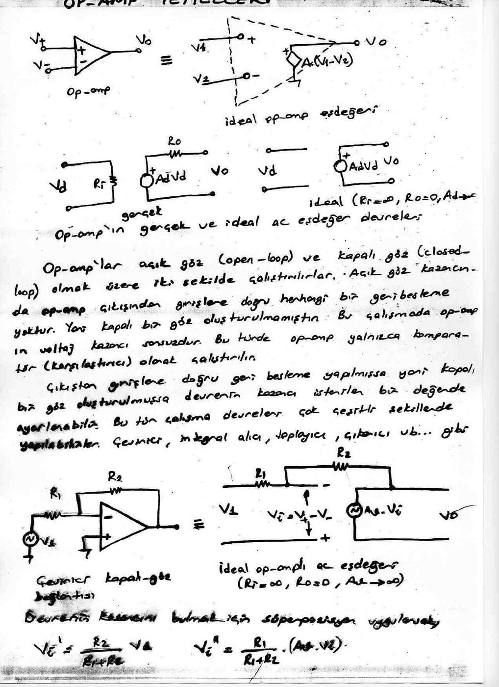

### Çevirici yükseltecin kazancı (süperpozisyon ile)

- V_i' = R₂/(R₁ + R₂) · V₁, V_i'' = R₁/(R₁ + R₂) · (A_v · V_i), V_i = V_+ − V_−, V_+ = 0 V
- R₂V₁ = V_i (A_v R₁ − (R₁ + R₂)) → V_i = R₂V₁ / (R₁(A_v − 1) − R₂)
- A_v ≫ 1, (A_v − 1) ≅ A_v, A_v R₁ ≫ R₂ ise **V_i = R₂V₁ / (A_v R₁)**
- V_o = −A_v V_i → **V_o = −R₂V₁/R₁**
- **Çevirici amplifikatör kazancı: V_o/V₁ ≅ V_o/V_i = −R₂/R₁ = A_v**

### Zahiri toprak

V_+ = V_− ⇒ V_i = V_+ − V_− = 0 ⇒ I_i = 0. I_i = 0 olduğuna göre I₁ = I₂:

- I₁ = (V₁ − V_i)/R₁ = V₁/R₁, I₂ = (V_i − V_o)/R₂ = −V_o/R₂
- **V_o/V₁ = −R₂/R₁**

Ya da V_+ = V_− olduğuna göre: V_+ = 0 V, V_− = V₁R₂/(R₁ + R₂) + V_oR₁/(R₁ + R₂) = 0 ⇒ V₁R₂ = −V_oR₁ ⇒ V_o/V₁ = −R₂/R₁.

Bu prensibe göre, op-amp'ın kazancı A çok büyük (idealde sonsuz) olduğundan, devre çalışırken çıkışta sonlu bir çıkış voltajı elde ediliyorsa op-amp giriş terminalleri arasındaki voltaj ihmal edilecek kadar küçüktür: **V_+ − V_− = V_o/A ≅ 0**.

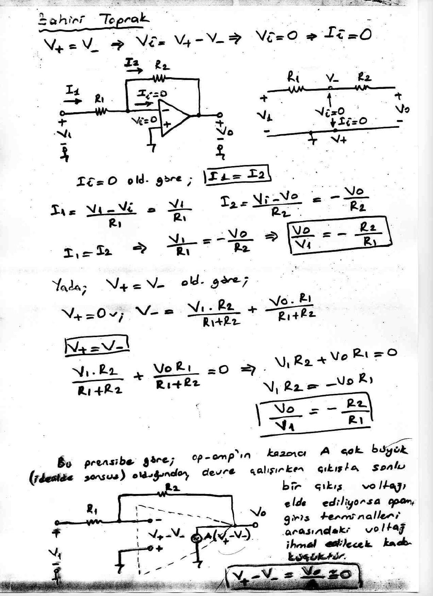

### Diğer çevirici bağlantı uygulamaları

Devrenin kapalı göz kazancı ya da kapalı göz transfer fonksiyonu: **V_o/V_i = −Z₂/Z₁**

**İntegral alıcı devre:** Z₁ = R, Z₂ = 1/(sC) → V_o/V_i = −1/(sCR); fiziksel frekans s = jω ise **V_o/V_i = −1/(jωCR)**.

- i₁ = V₁(t)/R, i_C = C dV_C/dt, V_C = −V_o → V₁(t)/R = −C dV_o/dt
- **V_o = −(1/RC) ∫₀ᵗ V₁(t) dt**
- Eğer t = 0'da kapasitör uçlarında gösterilen V_C voltajının yönüne ters yönde bir V_Ci voltajı varsa: V_o(t) = V_Ci − (1/C) ∫₀ᵗ i₁(t) dt = **V_Ci − (1/RC) ∫₀ᵗ V₁(t) dt** olur.

**Türev alıcı devre:** Z₁ = 1/(sC), Z₂ = R → **V_o/V_i = −sCR = −jωCR**; i_C = i_R, C dV₁(t)/dt = −V_o(t)/R → **V_o(t) = −RC dV₁(t)/dt**

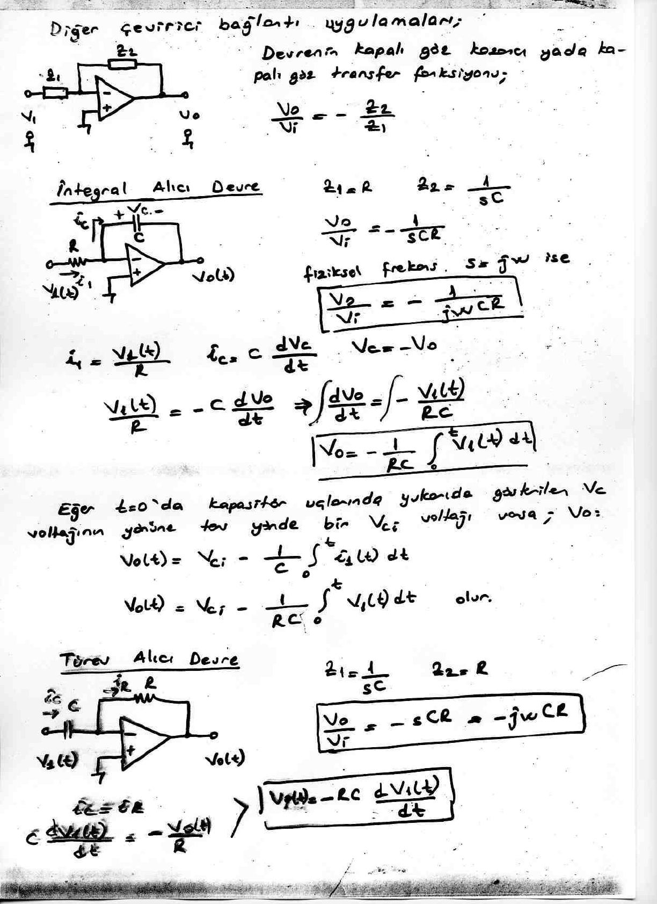

### Çevirmeyen (non-inverting) yükselteç ve tampon

Zahiri toprak prensibine göre V_+ = V_−: V_+ = V₁, V_− = V_oR₁/(R₁ + R₂) ⇒

- **V_o/V₁ = (R₁ + R₂)/R₁ = 1 + R₂/R₁**

**Tampon yükselteç (birlik izleyici):** çıkış doğrudan (−) girişe bağlanır; **V_o = V_i**.

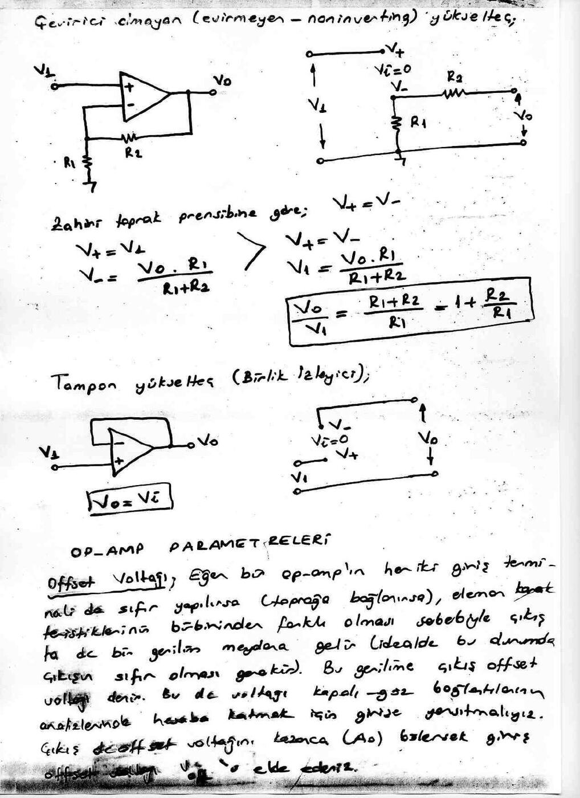

## Op-amp parametreleri

### Offset voltajı

Eğer bir op-amp'ın her iki giriş terminali de sıfır yapılırsa (toprağa bağlanırsa), eleman karakteristiklerinin birbirinden farklı olması sebebiyle çıkışta dc bir gerilim meydana gelir (idealde bu durumda çıkışın sıfır olması gerekir). Bu gerilime **çıkış offset voltajı** denir. Bu dc voltajı kapalı-göz bağlantıların analizlerinde hesaba katmak için girişe yansıtmalıyız. Çıkış offset voltajını kazanca (A_o) bölersek giriş offset voltajını elde ederiz: **V_off = V_o/A_o**.

Giriş offset voltajı sebebiyle kapalı-göz bağlantıda çıkışta oluşan offset gerilimi: V_− = V_+ ⇒ V_out · R₁/(R₁ + R₂) = V_off ⇒ **V_out = V_off (1 + R₂/R₁)**

Eğer kapalı-göz kazancı büyükse çıkış dc offset voltajının büyük olmasına sebep olacaktır; bu da olası maksimum çıkış sinyal salınımını azaltacaktır. Bu problemi önlemenin bir yolu **kapasitif kuplajdır** (girişe seri C). Kondansatör dc kazancın sıfır olmasına sebep olur. Fakat ω₀ = 1/(CR₁) olduğu frekansta −3 dB'lik yüksek frekans etkisi gösterir ve kazanç ω ≫ ω₀ için −R₂/R₁ olur. Bu bağlantının avantajı, V_off çıkışta V_off(1 + R₂/R₁) şeklinde değil V_off şeklinde görülür, yani yükseltilmez.

### Giriş polarma akımları

Op-amp'ın çalışması için her iki giriş terminaline de dc akımlar uygulanmalıdır ki bunlara **giriş polarma akımları** denir. Burada polarma akımları op-amp'ın giriş direncinden bağımsızdırlar.

- Giriş polarma akımı iki akımın ortalamasıdır: **I_B = (I_B1 + I_B2)/2**
- İki akımın farkı ise giriş offset akımıdır: **I_off = |I_B1 − I_B2|**
- Buna göre: **I_B1 = I_B + I_off/2**, **I_B2 = I_B − I_off/2**

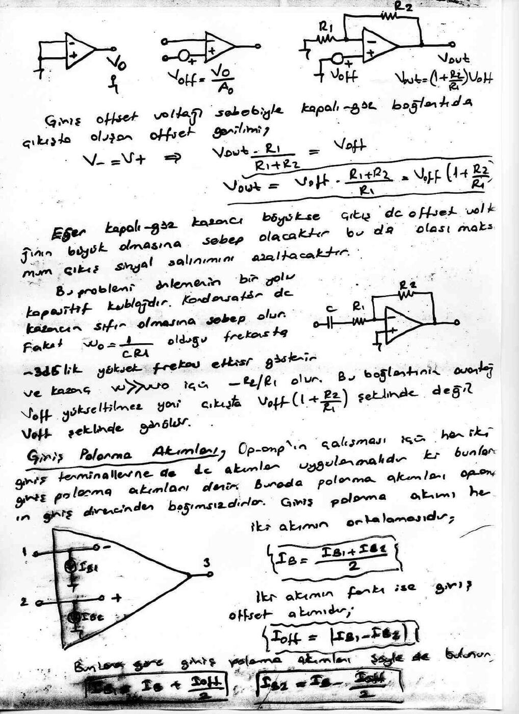

Girişler topraklı çevirici yapıda R₁'den akım akmaz ve V_o = I_B1 · R₂ ≅ I_B · R₂ olur. Offset voltajı ve giriş polarma akımları sebebiyle çıkışta oluşan toplam offset voltajı:

- **V_o,offset = V_off (1 + R₂/R₁) + I_B R₂**

Giriş polarma akımlarının yarattığı offset geriliminin değeri (I_B R₂) R₂ direnci ile doğru orantılıdır. Bunu azaltmak için op-amp'ın (+) giriş terminaline seri bir R₃ direnci bağlanır:

- V_+ = V_− = −I_B2 R₃; V_o = −I_B2 R₃ + R₂(I_B1 − I_B2 R₃/R₁)
- I_B1 = I_B2 = I_B kabul edilirse V_o = I_B [R₂ − R₃(1 + R₂/R₁)] → sıfır olması için **R₃ = R₂/(1 + R₂/R₁) = R₁R₂/(R₁ + R₂) = R₁ // R₂**
- I_B1 = I_B + I_off/2, I_B2 = I_B − I_off/2 ile **V_o = I_off · R₂**

Op-amp aşağıdaki gibi bağlanarak offset ayarı yapılır, yani çıkışın sıfır olması için girişine ters yönde gerilim uygulanır. Çıkıştaki offset gerilimini sıfır yapacak giriş gerilimine giriş offset gerilimi denir. Op-amp geri beslemeli şekilde çalışıyorsa offset ayarı da bu durumda yapılmalıdır. Sıcaklık değişince offset ayarı bozulur (transistörlerin giriş akımları değişir); örneğin LM741 için sıcaklığa göre offset kayması yaklaşık 15 µV/°C'dir. (Şekilde LM741'in offset uçlarına bağlı 10 kΩ'luk potansiyometre ile offset ayarı gösteriliyor.)

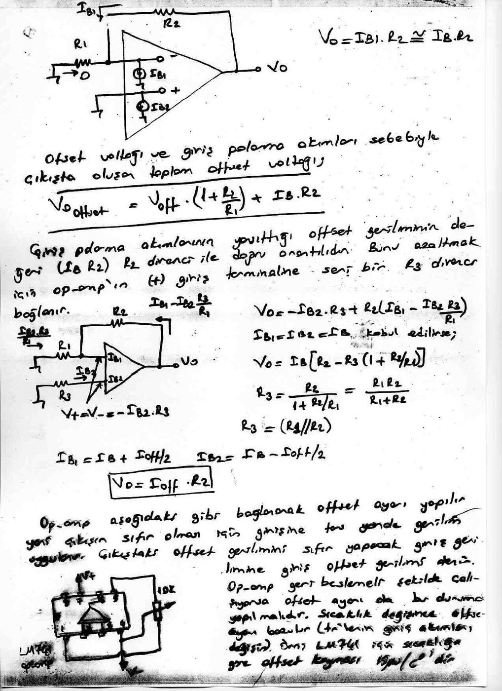

### Ortak işaret bastırma oranı (CMRR)

Op-amp'ın offset ayarı yapıldıktan sonra bile girişler birleştirilip ortak işaretli bir sinyal uygulandığında (V₁ = V₂) çıkışından sıfır alınmaz (idealde bu durumda V_o = 0 olmalıdır). Bu, op-amp'ın ortak işaret kazancının sıfır olmadığını gösterir. CMRR denilen oran, kuvvetlendirici çıkışında ölçülen gerilimin girişine uygulanan ortak işaret gerilimine bölümüdür. dB olarak bu oranın işareti negatif çıkacağından genellikle gerilimler oranı ters çevrilir. Ancak geri besleme yapılmış kuvvetlendiricilerde (op-amp), farksal kazancın ortak işaret kazancına oranı olarak hesaplanır: **CMRR = A_d/A_c**, **CMRR (log) = 20 log CMRR**. CMRR ne kadar büyükse op-amp o kadar iyidir.

### Kazanç-band genişliği

Açık-göz kazancı f_c'den sonra −20 dB/decade ile düşer ve f_t'de 0 dB olur. f_t kazanç-band genişliği çarpımıdır (birim kazanç frekansı):

- **f_t = A · f_c** (A: açık-göz kazancı)
- Herhangi bir frekanstaki kazanç: **|A(jω)| ≅ ω_t/ω = f_t/f**

### Büyük işaret değişim hızı (slew rate, SR)

Op-amp'ın girişine büyük genlikli bir sinyal uygulandığında çıkış gerilimi +V_max ve −V_max değerlerinden sonraki değerleri için kırpılır. Sinyalin −V_max ile +V_max arasındaki değişiminin idealde t = 0 anında (bir anda) olması gerekirken gerçekte T_SR kadar bir süre geçer. Bu geçişin eğimi olarak tanımlanan slew rate, birim zaman başına çıkış değişme miktarıdır:

- **SR = 2V_max / T_SR** (V/µs)

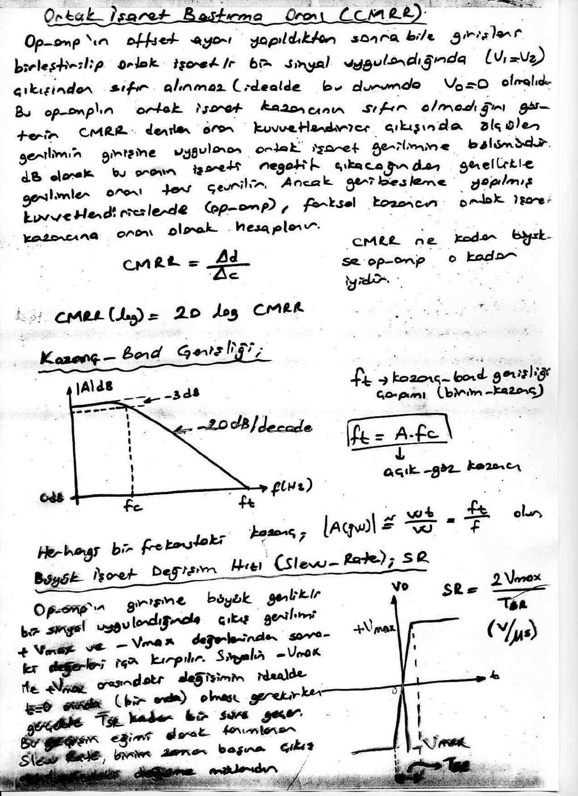

## Op-amp uygulamaları

### Voltaj toplayıcı

- V_o = −i · R_f, i = i₁ + i₂ + i₃ = V₁/R₁ + V₂/R₂ + V₃/R₃
- **V_o = −R_f (V₁/R₁ + V₂/R₂ + V₃/R₃)**

Op-amp'ların girişlerindeki ac ve dc bileşenleri birlikte yükseltmeleri, kuvvetlendirilecek işaretin dc bileşeninin büyük olması durumunda sorun yaratır; op-amp bu dc bileşen sebebiyle doyuma gider. Bunu önlemek için toplama özelliğinden yararlanılır: girişe, esas işaretteki dc bileşene zıt yönde bir dc gerilim uygulanır. Bu yöntem geliştirilerek offset ayarı için de kullanılabilir. (Örnek devrede V_i 10 kΩ üzerinden, +15 V/−15 V arasına bağlı 5 kΩ potansiyometrenin orta ucu V_b ise 20 kΩ üzerinden toplama noktasına bağlı; geri besleme direnci 100 kΩ.)

### Voltaj çıkarıcı

İki çevirici kattan oluşur (V₁ birinci katta R₁/R_f1 ile çevrilir, ikinci katta R₂ ve R₃ üzerinden V₂ ile toplanır):

- V_o = −[(R_f2/R₂)(−R_f1 V₁/R₁) + (R_f2/R₃) V₂]
- **V_o = −((R_f2/R₃) V₂ − (R_f2/R₂)(R_f1/R₁) V₁)**

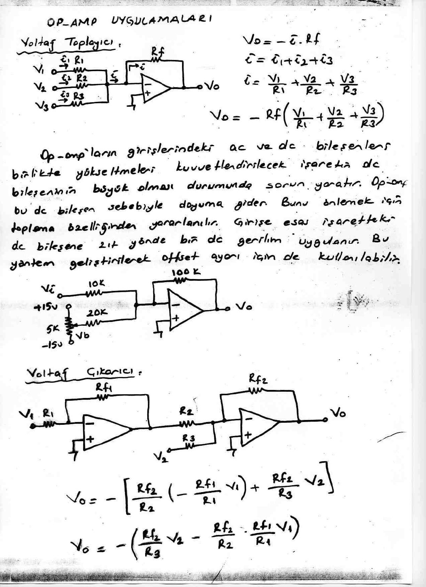

### Farksal yükselteç (voltaj çıkarıcı)

- V_− = V_+, V_− = R₃V₁/(R₁ + R₃) + R₁V_o/(R₁ + R₃), V_+ = R₄V₂/(R₂ + R₄)
- V_o = (R₄/(R₂ + R₄)) · ((R₁ + R₃)/R₁) V₂ − (R₃/R₁) V₁
- R₁ = R₂ = R_a ve R₃ = R₄ = R_b olursa **V_o = (R_b/R_a)(V₂ − V₁)**

*Not: Notta genel ifadenin son terimi "(R₃/R₁)V₂" olarak yazılmış; doğrusu (R₃/R₁)V₁'dir.*

**Toplayıcı-çıkarıcı:** V₁ (R₁) ve V₂ (R₃) çevirici girişe, V₃ (R₁) ve V₄ (R₃) çevirmeyen girişe bağlı; geri besleme ve (+) girişten toprağa R₂:

- **V_o = (R₂/R₁)[V₃ − V₁] + (R₂/R₃)[V₄ − V₂]**

**Farksal integratör:** iki girişe de R, geri beslemede ve (+) girişten toprağa C:

- **V_o = (1/RC) ∫ (V₂ − V₁) dt**

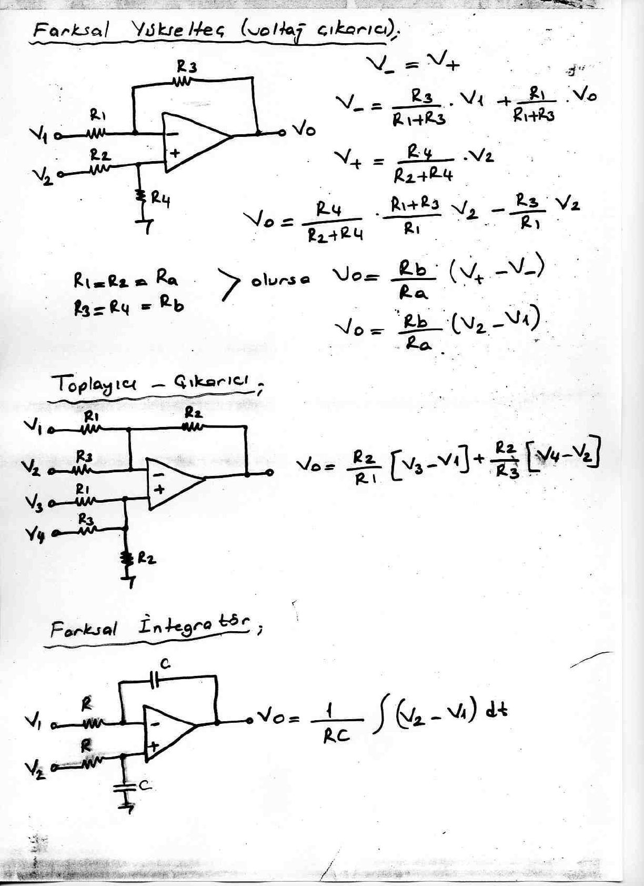

### Giriş direnci

- Kapalı-göz çevirici yükseltecin giriş direnci R₁'e eşittir: R_in ≡ V₁/i₁ = V₁/(V₁/R₁) = **R₁**
- Voltaj izleyici yükseltecin giriş empedansı ise op-amp'ın pozitif giriş ucundan içeriye akım akmadığı kabul edildiğinden idealde sonsuz, gerçekte çok yüksektir. Çevirici olmayan bu tampon yükselteç, yüksek empedanslı bir devre çıkışını düşük empedanslı bir yüke aktarmak için (empedans uygunlaştırıcı olarak) kullanılır.
- Farksal yükselteçte (R₁, R₂ ile) V_o = (R₂/R₁)(V_+ − V_−) = (R₂/R₁)(V₂ − V₁). Giriş direnci R_in = (V₂ − V₁)/i olarak tanımlanırsa V₂ − V₁ = R₁·i + 0 + R₁·i ⇒ **R_in = 2R₁**

Farksal yükseltecin ve çevirici yükseltecin giriş dirençleri istenildiği kadar büyük seçilebilir, ancak bu durumda kazançlarının düşeceği dikkate alınmalıdır. Bu devrelerin kullanıldığı yerlerde girişlere voltaj izleyici konarak yüksek giriş empedansı sağlanabilir.

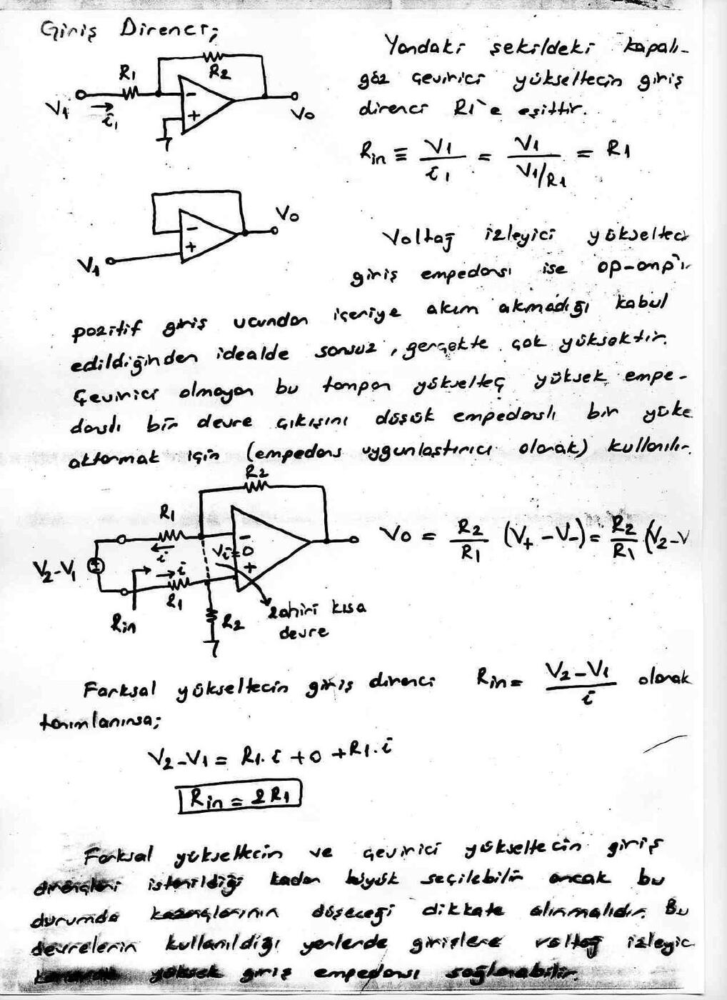

## Kontrollü kaynaklar

| Kaynak | Tanım | Op-amp ile gerçekleme |
|---|---|---|
| Voltaj kontrollü voltaj kaynağı | V_o = kV₁ | Çevirici: V_o = −(R_f/R₁)V₁ = kV₁; çevirmeyen: V_o = (1 + R_f/R₁)V₁ = kV₁ |
| Voltaj kontrollü akım kaynağı | I_o = kV₁ | Yük R_L geri besleme yolunda: I_o = V₁/R₁ = kV₁ |
| Akım kontrollü voltaj kaynağı | V_o = kI₁ | I₁ doğrudan çevirici girişe, R_L geri beslemede: V_o = −I₁R_L = kI₁ |
| Akım kontrollü akım kaynağı | I_o = kI₁ | I_o = I₁ + I₂ = I₁ + I₁R₁/R₂ = (1 + R₁/R₂)I₁ = kI₁ |

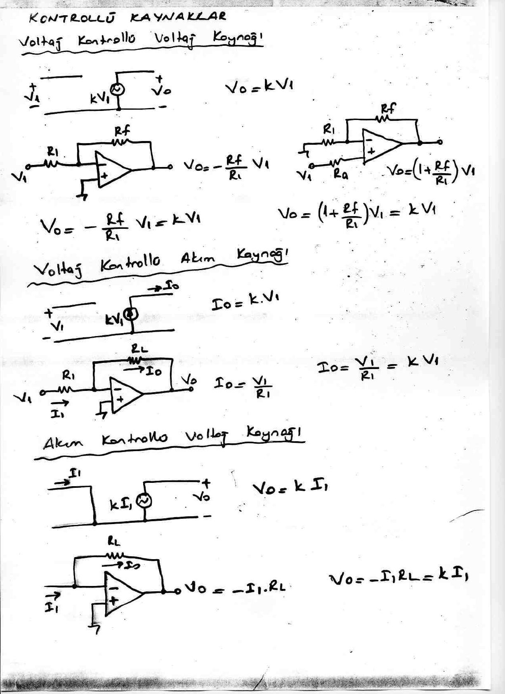

**Akımdan voltaja çevirici:** I_i = I_f, **V_o = −I_f R_f**; birden çok akım girişi için V_o = −(I₁ + I₂ + I₃)R.

**Akım farkını voltaja çevirici:** I₁ çevirici girişe (geri besleme R), I₂ çevirmeyen girişe (toprağa R): **V_o = (I₂ − I₁)R**

**Voltajdan akıma çevirici:** Yük R_L geri besleme yolunda; çevirici bağlantıda (V_i, R₁ üzerinden) ve çevirmeyen bağlantıda (V_i (+) girişe, (−) girişten toprağa R₁) **I_L = V_i/R₁**.

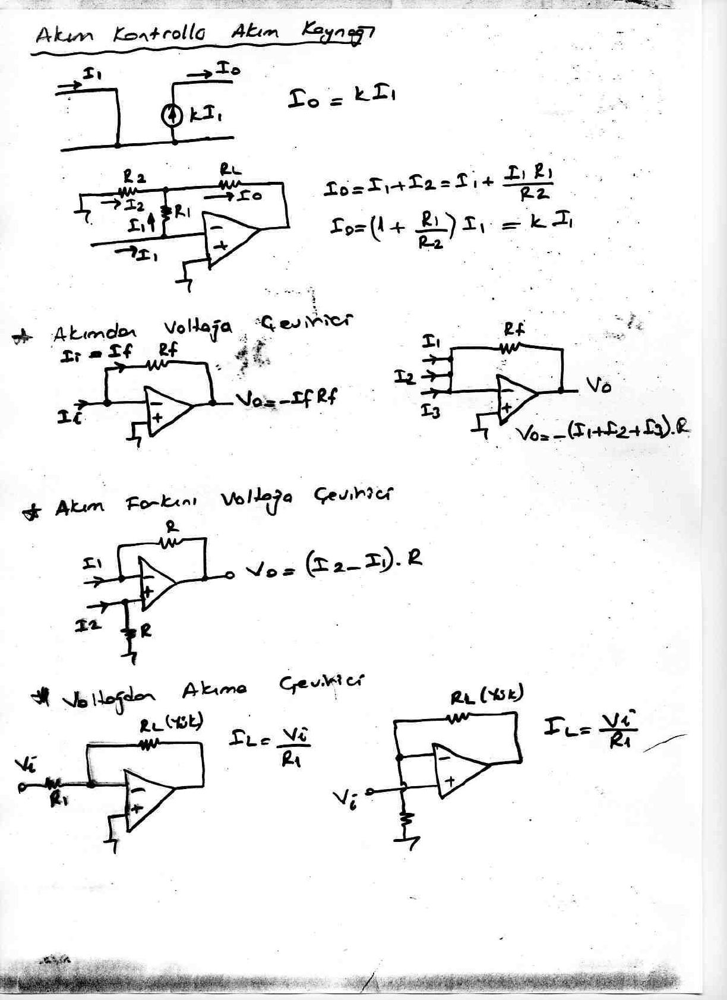

## Enstrümantasyon yükselteci

Girişlerine izleyici yerleştirilmiş fark yükseltecine **enstrümantasyon yükselteci** denir. Giriş dirençlerinin ve CMRR oranının yüksek olması yanında diğer bir üstünlüğü de tek bir dirençle (R₁) fark kazancının ayarlanabilir olmasıdır. Bu özellikleri dolayısıyla biyopotansiyel işaretlerin ölçülmesinde kullanılır.

- I = (V₃ − V₄)/(2R₂ + R₁) = (V₁ − V₂)/R₁
- V₃ − V₄ = ((2R₂ + R₁)/R₁)(V₁ − V₂)
- **V_o = (R₄/R₃)(2R₂/R₁ + 1)(V₁ − V₂)**

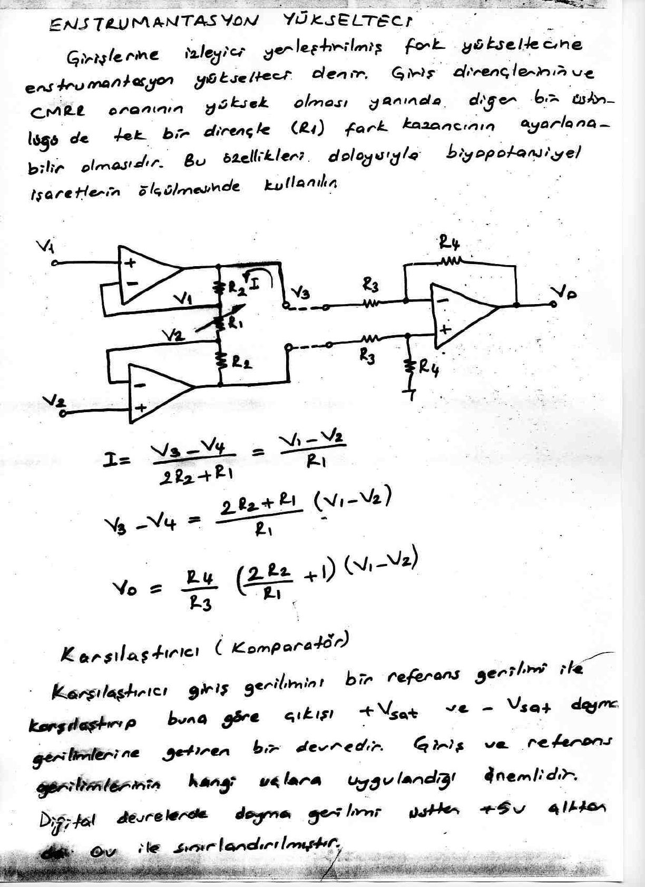

## Karşılaştırıcı (komparatör)

Karşılaştırıcı, giriş gerilimini bir referans gerilimi ile karşılaştırıp buna göre çıkışı +V_sat ve −V_sat doyma gerilimlerine getiren bir devredir. Giriş ve referans gerilimlerinin hangi uçlara uygulandığı önemlidir. Dijital devrelerde doyma gerilimi üstten +5 V, alttan 0 V ile sınırlandırılmıştır.

- **Giriş (V_i) + uçta, referans (V_ref) − uçta:** V_i > V_ref ⇒ V_o = +V_sat; V_i < V_ref ⇒ V_o = −V_sat
- **Giriş (V_i) − uçta, referans (V_ref) + uçta:** V_i > V_ref ⇒ V_o = −V_sat; V_i < V_ref ⇒ V_o = +V_sat

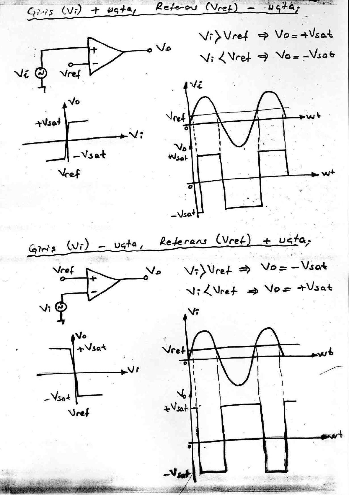

### Histerisizli karşılaştırıcı (Schmitt tetikleyici)

V_i ve V_ref eşit R₁ dirençleri üzerinden çevirici girişe bağlı, çıkıştan (+) girişe R₂–R₃ gerilim bölücüsü ile pozitif geri besleme var:

- V_− = (V_i + V_r)/2, V_+ = R₃V_o/(R₂ + R₃) → V_o = ((R₂ + R₃)/(2R₃))(V_i + V_r)
- R₂ ≫ R₃ ise veya R₃ = 0 alınırsa (limitte) çıkış: a) V_i + V_r > 0 (V_i > −V_r) ⇒ V_o = −V_sat; b) V_i + V_r < 0 (V_i < −V_r) ⇒ V_o = +V_sat

Bu şekli ile devre **Schmitt trigger (tetikleme)** devresi olarak çalışır. R₃ ≠ 0 yapılarak −V_r civarında bir histerisiz oluşturulmuştur ve böylece giriş işaretinin −V_r civarındaki çok küçük değişimlerinin çıkışta kararsız değişimlere yol açması önlenmiştir. V_i işareti üzerindeki gürültü seviyesine göre R₂ ve R₃ dirençleri ile oynanarak histerisiz aralığı genişletilebilir. Referans gerilimi etrafındaki histerisiz aralığı:

- **2ΔV = 4 · V_sat · R₃/(R₂ + R₃)**

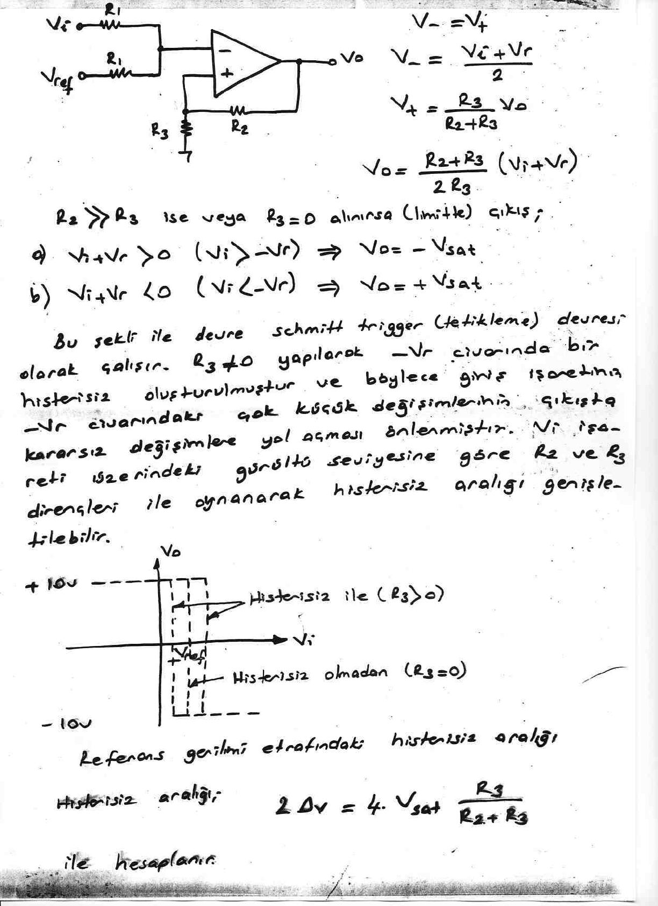

## Doğrultucu, kırpıcı ve dedektörler

### Doğrultucu

Diyot-direnç tipi doğrultucular yaklaşık 0,7 V'tan küçük genlikli sinyalleri doğrultamaz. Bu nedenle diyotları op-amp'larla birlikte kullanarak küçük genlikli sinyalleri de doğrultmak mümkündür. Aşağıdaki devre giriş sinyalinin negatif kısımlarını geçirirken pozitif kısımlarını geçirmez:

- V_i < 0 için D₁ kesimde, D₂ iletimdedir. Devre çevirici yükselteç durumuna gelir ve V_o = −V_i olur (eğim −R_f/R_i).
- V_i > 0 için D₁ iletimde, D₂ kesimdedir; V_o = 0 olur.

### Kırpıcı

- V_i < V_r ise D iletimdedir ve yükselteç izleyici durumundadır: V_o = V_r olur.
- V_i > V_r ise D kesimdedir, R'den akım geçmez; çıkış girişi takip eder: V_o = V_i olur.

Kırpıcı, giriş sinyalinin belli bir V_r referans seviyesinin altında kalan kısmını geçirmez, yani girişi alttan kırpar. Diyotun yönü değiştirilirse giriş V_r seviyesinde üstten kırpılır.

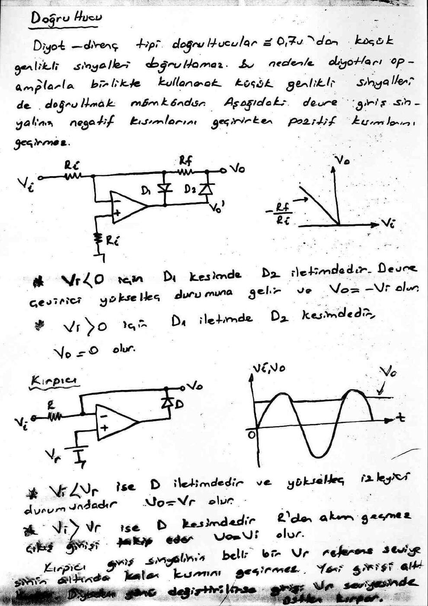

### Aktif tepe dedektörü

- V_i > V_o için D iletimdedir ve yükselteç izleyici durumundadır; çıkış girişi izler.
- V_i < V_o için D kesimdedir ve çıkış kondansatör üzerindeki gerilime eşit olur; çıkıştan akım çekilmezse diyotun kesime girdiği andaki değerini muhafaza eder.

Böylece giriş sinyalinin aldığı en büyük değer çıkışta elde edilmiş olur.

### Eşik dedektörü

Pozitif geri beslemeli (R₁, R₂) ve ±V_B arasına bağlı R_p potansiyometresi (α R_p, (1 − α) R_p) ile eşiği ayarlanan karşılaştırıcı:

- (V_R − V_o)/R₂ + (V_R − V₁)/R₁ = 0 ①
- (V₁ − V_R)/R₁ + (V₁ + V_B)/(α R_p) + (V₁ − V_B)/((1 − α) R_p) = 0 ②
- V_R = [R₁V_o/(R₁ + R₂) − R₁R₂V_B(1 − 2α) / ([α(1 − α)R_p + R₁](R₁ + R₂))] / [1 − R₂R_p α(1 − α) / ([α(1 − α)R_p + R₁](R₁ + R₂))]

Bu eşitlikle V_o yerine +V_sat konularak V_R1, −V_sat konularak V_R2 değerleri bulunur. Eşik voltajı ise bu iki değerin ortalamasıdır: **V_th = (V_R1 + V_R2)/2**

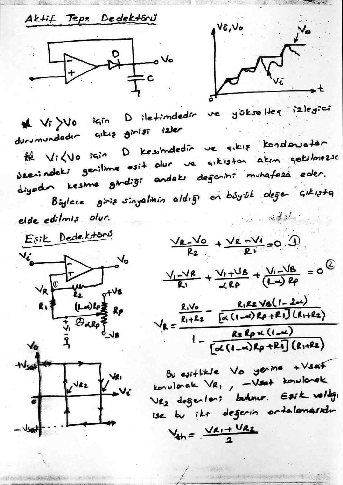

## Op-amp'lı güç amplifikatörleri

**Geçiş (crossover) distorsiyonu kompanze edilmiş push-pull güç amplifikatörü:** Geçiş distorsiyonu op-amp kullanılarak yok edilmiş bir push-pull amplifikatör. Bu devre örneğin bir EKG monitörünün çıkış ünitesinde, bir kâğıt yazıcı motorunu sürmede veya displayi aktif hâle getirmek için kullanılabilir.

- V_in/R_i + (V_in − V_L)/R_f = 0 → **V_L = V_in (1 + R_f/R_i)**, **A_v = 1 + R_f/R_i**

**Offset kontrollü güç amplifikatörü:** Yukarıdaki güç amplifikatörüne offset kontrol ünitesi eklenmiştir. Böyle bir devre örneğin bir EKG kart kaydedicisini sürmek için çok kullanışlıdır. Kazanç R_o ile ayarlanır.

- α₁V₁/R_i + (α₁V₁ − (−V_BB))/(α₂R₂ + R₁) + (α₁V₁ − V_BB)/(R₁ + (1 − α₂)R₂) + (α₁V₁ − V_out)/R_f = 0
- V_out = (R_f/R_i)(α₁V₁) + R_f (α₁V₁ + V_BB)/(α₂R₂ + R₁) + R_f (α₁V₁ − V_BB)/((1 − α₂)R₂ + R₁) + α₁V₁

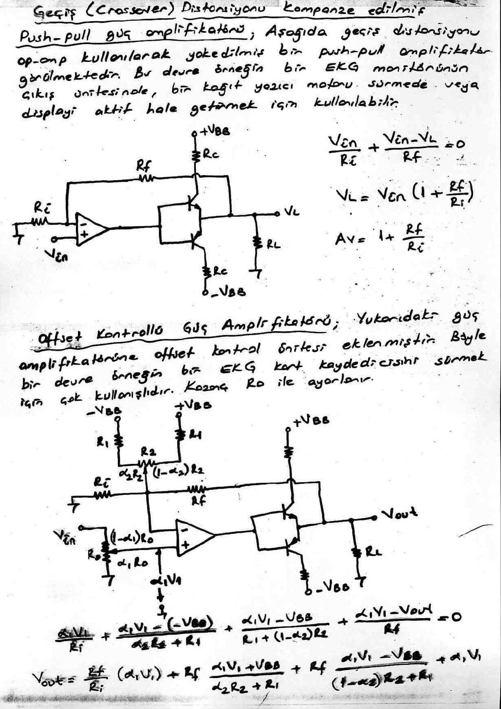

## Aktif filtreler

Bir filtre, belirli bir banddaki (aralıktaki) sinyalleri geçirmek için dizayn edilmiş, bu bandın dışındaki bütün sinyalleri zayıflatan bir devredir. Filtreler aktif veya pasif olabilirler. Pasif filtre devreleri yalnızca direnç, kondansatör ve bobin kullanılarak dizayn edilirken, aktif filtrelerde bunlara ek olarak transistör veya op-amp'lar kullanılır. Bobinler büyük, pahalı ve çok büyük dahili rezistif elemanlara sahip olabilecekleri için genellikle aktif filtre devrelerinde kullanılmazlar.

Dört tip filtre vardır: **alçak geçiren (low-pass)**, **yüksek geçiren (high-pass)**, **band geçiren (band-pass)** ve **band durduran (band-reject veya notch)**.

Alçak geçiren bir filtre dc'den f_c kesim frekansına kadar sabit bir çıkış voltajına sahiptir. Frekans f_c'nin üzerinde arttırılırsa çıkış voltajı zayıflatılır. İletilen frekans alanına **geçen band**, zayıflatılan frekans alanına **duran band** denir. Kesim frekansı f_c'ye 0,707 frekansı, −3 dB frekansı, köşe frekansı veya rezonans frekansı da denir.

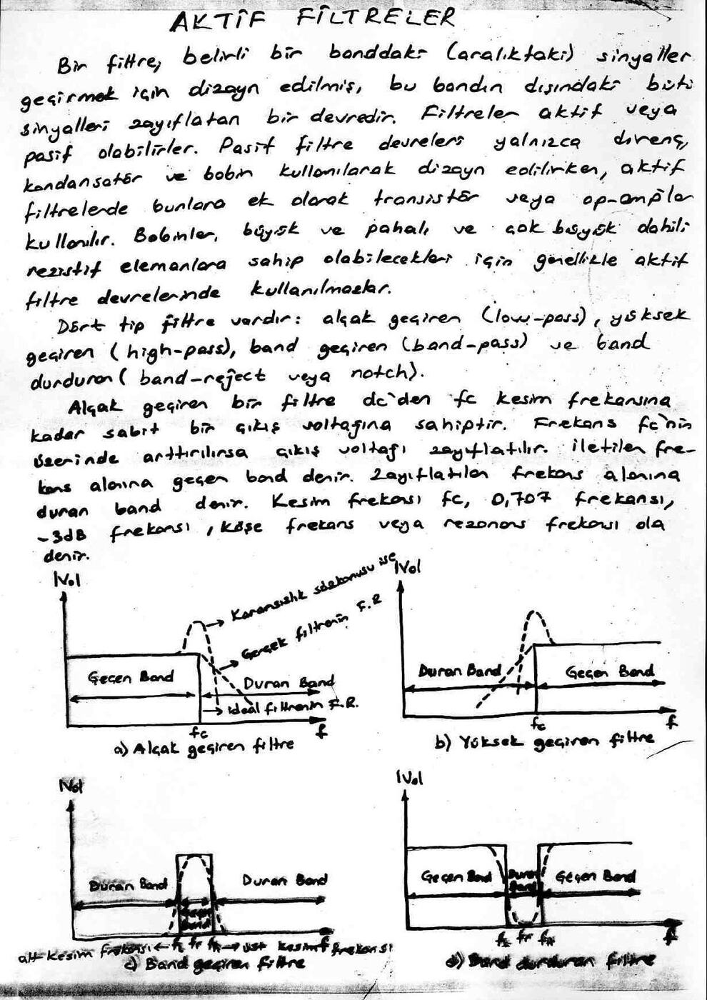

### Temel alçak geçiren filtre

Filtreleme işlemi RC elemanları ile yapılır ve birim kazançlı (birlik izleyici) op-amp kullanılmıştır. R_f direnci R'ye eşittir ve dc offset için devreye bağlanmıştır (dc'de kondansatörün reaktansı sonsuzdur ve her iki giriş ucu için toprağa olan yolun dc rezistansı birbirine eşit olmalıdır). Op-amp'ın + ve − giriş terminalleri arasındaki gerilim 0 V olduğuna göre C üzerindeki gerilim V_o'a eşittir, çünkü op-amp voltaj izleyicidir.

- V_o = (1/(jωC)) / (R + 1/(jωC)) · V₁ (ω = 2πf, j = √−1)
- Kapalı-göz kazancı: **A_CL = V_o/V₁ = 1/(1 + jωRC)**

Kazanç frekansa bağlıdır: ω → 0 çok düşük frekanslarda |A_CL| = 1, ω → ∞ çok yüksek frekanslarda |A_CL| = 0 olur. Yani frekans f_c'den büyük olunca |A_CL| 20 dB/decade'lik bir oranla azalır. Bu nedenle bu devre tek bir RC'den oluştuğu için **birinci derece (first order)** ya da **tek kutuplu** olarak adlandırılır.

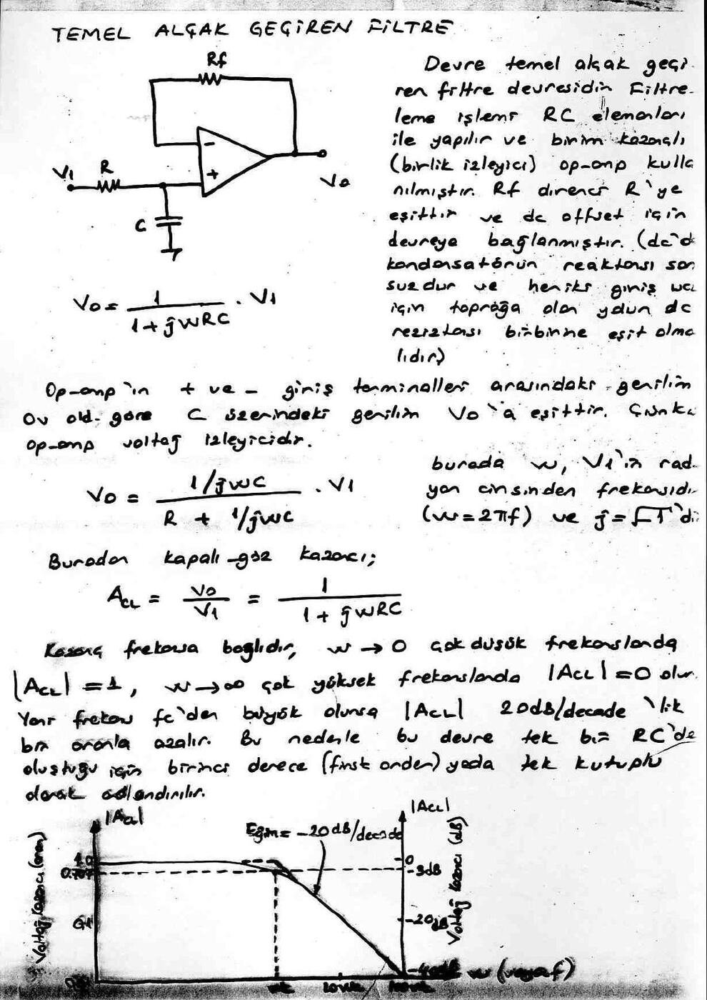

**Filtrenin dizaynı:**

- Kesim frekansı: ω_c = 1/(RC) = 2πf_c; bu eşitlik R için düzenlenirse **R = 1/(ω_c C) = 1/(2πf_c C)**
- Kesim frekansı belirlenir (ω_c, f_c); C kapasitansı seçilir (genellikle 0,001 ile 0,1 µF arasında); eşitlikten R bulunur.

**Filtrenin cevabı:** ω_c'de A_CL'nin değeri ωRC = 1 yapılarak bulunur: A_CL = 1/(1 + j1) = 1/(√2 ∠45°) = 0,707 ∠−45°. |A_CL| = 1/√2 = 0,707, |A_CL|_dB = 20 log |A_CL| = −3 dB; faz açısı −45°'dir.

| ω | Kazanç büyüklüğü A_CL | Faz açısı |
|---|---|---|
| 0,1 ω_c | 1,0 | −6° |
| 0,25 ω_c | 0,97 | −14° |
| 0,5 ω_c | 0,89 | −27° |
| ω_c | 0,707 | −45° |
| 2 ω_c | 0,445 | −63° |
| 4 ω_c | 0,25 | −76° |
| 10 ω_c | 0,1 | −84° |

### Butterworth filtreler

Birçok alçak-geçiren filtre uygulamasında kapalı-göz kazancının geçen bandda 1'e yakın olması gerekir. Butterworth filtre bu tip uygulamaları en iyi şekilde yerine getirir; bu nedenle bu filtrelere **maximally flat** veya düz filtre denir. Yukarıdaki filtre de bu tiptedir.

Butterworth filtreler kesim frekansında sabit bir faz açısı olacak şekilde dizayn edilmezler. Temel alçak geçiren filtre ω_c'de −45°'lik faz açısına sahiptir (−20 dB/decade); −40 dB/decade'lik Butterworth filtre ω_c'de −90°'lik, −60 dB/decade'lik bir Butterworth filtre ise ω_c'de −135°'lik faz açısına sahiptir. Yani −20 dB/decade'lik her bir artışta ω_c'de faz açısı −45° artış gösterir.

### −40 dB/decade'lik (ikinci derece, çift kutuplu) alçak geçiren Butterworth filtre

R₁ = R₂ = R, R_f = 2R; C₁ (+) girişten toprağa, C₂ çıkıştan R₁–R₂ birleşimine. C₁ uçlarındaki gerilim çıkış gerilimidir.

**Dizayn:** kesim frekansı belirlenir (ω_c, f_c); C₁ belirlenir (100 pF ~ 0,1 µF); **C₂ = 2C₁** seçilir; **R = 0,707/(ω_c C)** (R₁ = R₂ = R); **R_f = 2R** seçilir.

- **f_c = 1/(2π√(R₁R₂C₁C₂))**
- Filtrenin cevabı: kesim frekansından sonra kazanç frekansın her 10 kat artışında −40 dB düşer.

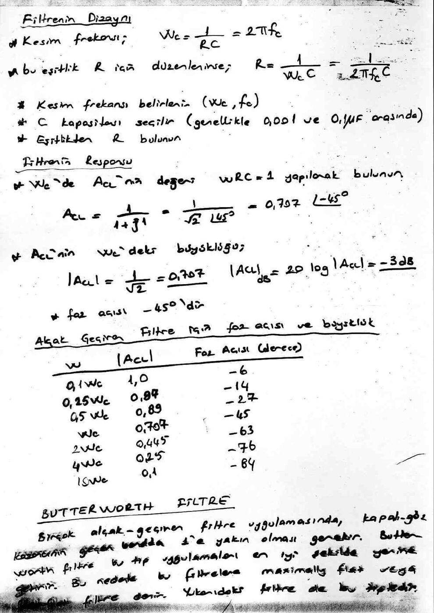

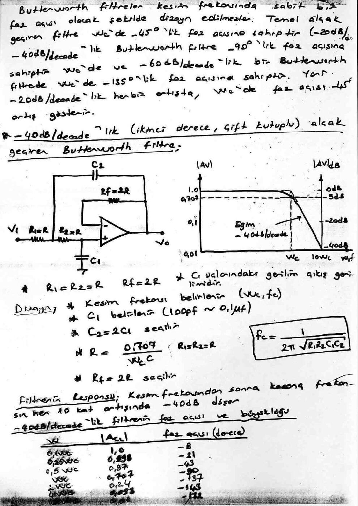

### −60 dB/decade'lik (üçüncü derece, üç kutuplu) alçak geçiren Butterworth filtre

Bir −40 dB/decade'lik kat (R₁ = R₂ = R, R_f1 = 2R, C₁, C₂) ile bir −20 dB/decade'lik katın (R₃ = R, C₃, R_f2 = R) kaskat bağlanmasıyla elde edilir.

- A_CL = V_o/V₁ = (V_o1/V₁) · (V_o/V_o1); ω_c'de A_CL 0,707'ye eşit olmalıdır.
- **f_c = 1/(2π ∛(R₁R₂R₃C₁C₂C₃))**

**Dizayn:** kesim frekansı belirlenir (ω_c, f_c); C₃ belirlenir (0,001 ~ 0,1 µF); **C₁ = ½ C₃**, **C₂ = 2C₃**; **R = 1/(ω_c C₃)** hesaplanır; R = R₁ = R₂ = R₃; **R_f1 = 2R**, **R_f2 = R**. En iyi sonuç için R 10 ile 100 kΩ arasında olmalıdır. Eğer R bu alanın dışında seçilirse tekrar başa dönülüp yeni bir C₃ değeri seçilir.

**Filtrenin cevabı:** kazanç kesim frekansında −3 dB azalırken frekansın her 10 kat artışında −60 dB düşer.

| ω | Kazanç büyüklüğü A_CL | Faz açısı |
|---|---|---|
| 0,1 ω_c | 1,0 | −12° |
| 0,25 ω_c | 0,999 | −29° |
| 0,5 ω_c | 0,992 | −60° |
| ω_c | 0,707 | −135° |
| 2 ω_c | 0,124 | −210° |
| 4 ω_c | 0,022 | −226° |
| 10 ω_c | 0,001 | −256° |

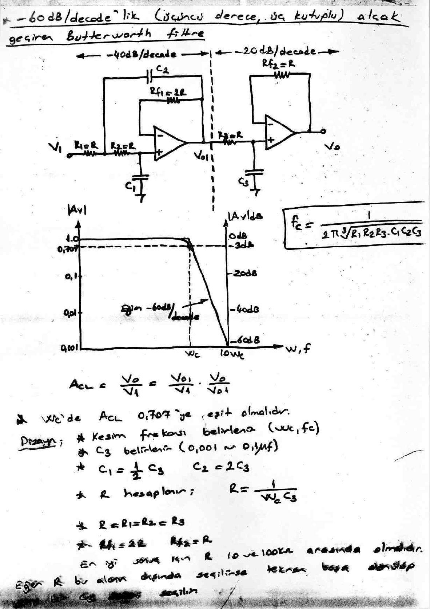

### Yüksek geçiren Butterworth filtreler

Bir yüksek geçiren filtre belirli bir kesim frekansının (ω_c, f_c) altındaki bütün sinyalleri zayıflatırken bu frekanstan büyük frekanstaki sinyalleri geçirir. Bu tip filtre devreleri alçak geçiren filtrelerin ters fonksiyonuna sahiptir ve yalnızca devrede kondansatör ile direncin yeri değişmiştir. Faz açısı −20 dB/decade için ω_c'de +45°'dir ve her −20 dB/decade'lik zayıflama için +45° artar.

**−20 dB/decade'lik (birinci derece, tek kutuplu) yüksek geçiren Butterworth filtre:** girişte seri C, (+) girişten toprağa R, R_f = R.

- **V_o = V₁ / (1 − j(1/(ωRC)))**; ω → 0 rad/s ⇒ V_o → 0 V; ω → ∞ ⇒ V_o = V₁
- ωRC = 1 iken kapalı-göz kazancının büyüklüğü 0,707 olur. Bu nedenle kesim frekansı **ω_c = 1/(RC) = 2πf_c**, **R = 1/(ω_c C) = 1/(2πf_c C)**
- **Dizayn:** kesim frekansı belirlenir; C seçilir (0,001 ~ 0,1 µF); R hesaplanır; R_f = R yapılır (R_f dc offseti minimize eder).

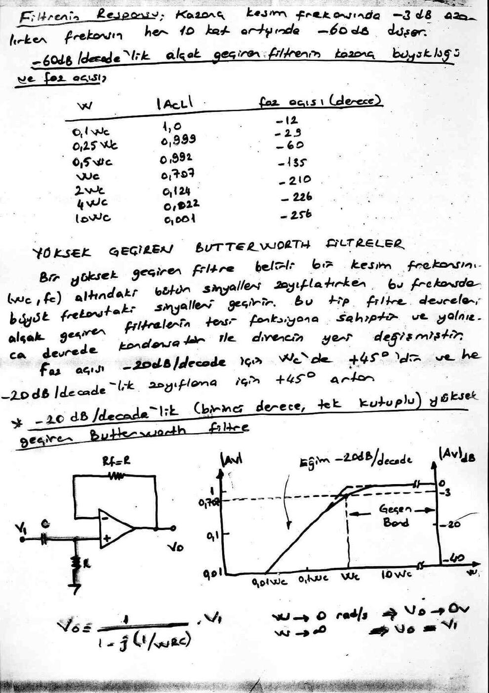

**−40 dB/decade'lik (ikinci derece, çift kutuplu) yüksek geçiren filtre:** Kesim frekansından itibaren kazanç frekansın her 10 kat azalışında −40 dB azalır. Kesim frekansında kazanç 0,707, geçen bandda ise 0 dB'dir.

- **Dizayn:** kesim frekansı belirlenir (ω_c, f_c); **C₁ = C₂ = C** seçilir; **R₁ = 1,414/(ω_c C)** hesaplanır; **R₂ = ½ R₁** seçilir; **R_f = R₁** yapılır.
- **f_c = 1/(2π√(R₁R₂C₁C₂))**

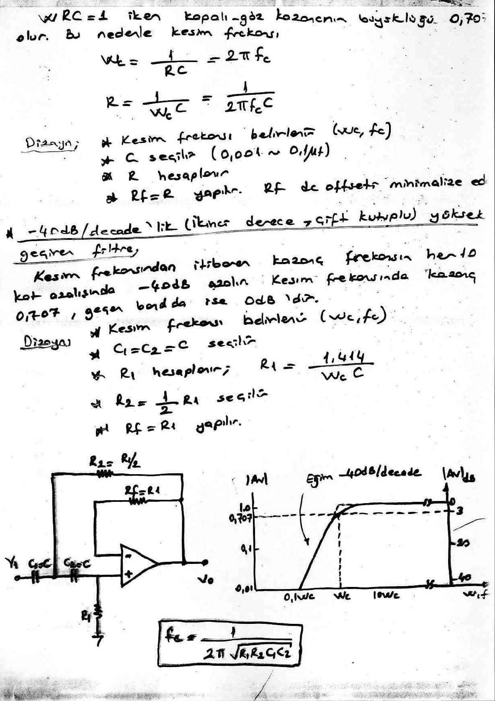

**−60 dB/decade'lik (üçüncü derece, üç kutuplu) yüksek geçiren Butterworth filtre:** −40 dB/decade'lik kat (C₁ = C₂ = C, R₁, R₂, R_f1 = R₁) ile −20 dB/decade'lik katın (C₃, R₃, R_f2 = R₃) kaskat bağlanmasıyla elde edilir.

- **f_c = 1/(2π ∛(R₁R₂R₃C₁C₂C₃))**
- **Dizayn:** kesim frekansı belirlenir (ω_c, f_c); C₁ = C₂ = C₃ = C seçilir (100 pF ~ 0,1 µF); **R₃ = 1/(ω_c C)** hesaplanır; **R₁ = 2R₃**; **R₂ = ½ R₃**; **R_f1 = R₁**, **R_f2 = R₃** seçilir.

Yüksek geçiren filtrelerin kazanç büyüklükleri ve faz açılarının karşılaştırılması (notta okunduğu kadarıyla):

| ω | Büyüklük −20 dB/dec | Büyüklük −40 dB/dec | Büyüklük −60 dB/dec | Faz −20 dB/dec | Faz −40 dB/dec | Faz −60 dB/dec |
|---|---|---|---|---|---|---|
| 0,1 ω_c | 0,1 | 0,001 | 0,001 | 84° | 172° | 256° |
| 0,25 ω_c | 0,25 | 0,053 | 0,022 | 76° | 143° | 226° |
| 0,5 ω_c | 0,445 | 0,24 | 0,124 | 63° | 137° | 210° |
| ω_c | 0,707 | 0,707 | 0,707 | 45° | 90° | 135° |
| 2 ω_c | 0,89 | 0,97 | 0,992 | 27° | 45° | 69° |
| 4 ω_c | 0,97 | 0,998 | 0,999 | 14° | 21° | 29° |
| 10 ω_c | 1,0 | 1,0 | 1,0 | 6° | 8° | 12° |

*Not: İkinci derece Butterworth için kuramsal değerler 0,1 ω_c'de |A| ≈ 0,01; 0,25 ω_c'de ≈ 0,062 ve faz 0,25–4 ω_c aralığında sırasıyla yaklaşık 152°, 127°, 90°, 53°, 28°'dir. Tablodaki bazı değerler notta bunlardan farklı yazılmış ya da güç okunuyor; alçak geçiren filtrenin ikinci derece tablosu (s-25) da benzer şekilde kısmen okunaksız.*

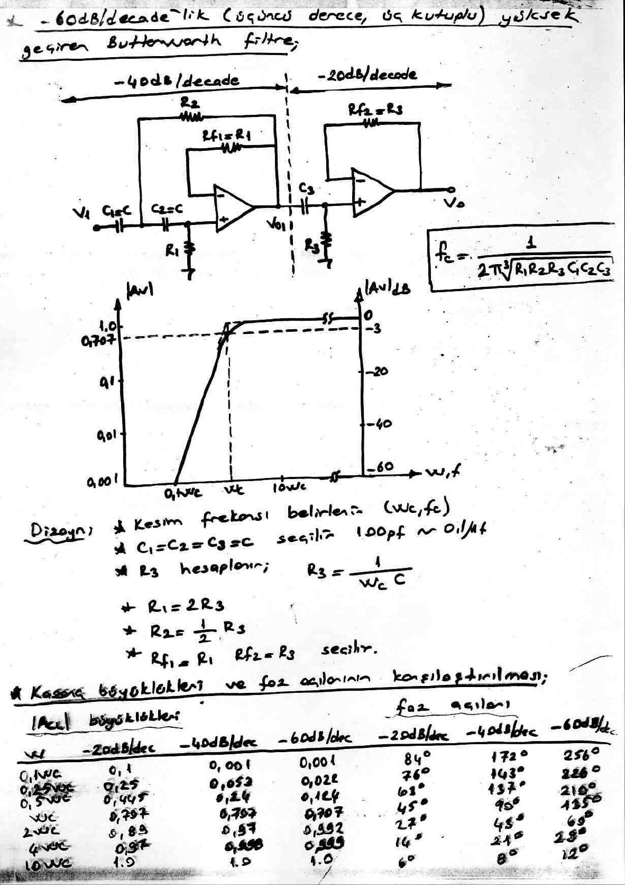

### Band geçiren filtreler

Bir band geçiren filtre bir frekans seçicidir; yalnızca belli bir frekans bandını seçer ya da geçirir. Bu tip bir filtre rezonans frekansında (f_r) maksimum kazanca sahiptir. Kazancın 0,707 (ya da 3 dB) düştüğü iki frekans noktasından biri alt kesim frekansı, diğeri ise üst kesim frekansıdır (f_L, f_H).

- Band genişliği: **BW = f_H − f_L**
- Eğer f_L ve f_H biliniyorsa rezonans frekansı (merkez frekansı) bulunabilir: **f_r = √(f_L · f_H)**
- f_r ve BW biliniyorsa: **f_L = √(BW²/4 + f_r²) − BW/2**, **f_H = f_L + BW**

**Örnek:** f_L = 300 Hz, f_H = 3000 Hz ise BW ve f_r = ?

- BW = f_H − f_L = 2700 Hz; f_r = √(f_H · f_L) = √(300 · 3000) = **948,7 Hz**
- Dikkat edilirse f_r daima merkez frekansın altında bir değerdedir: (300 + 3000)/2 = 1650 Hz.

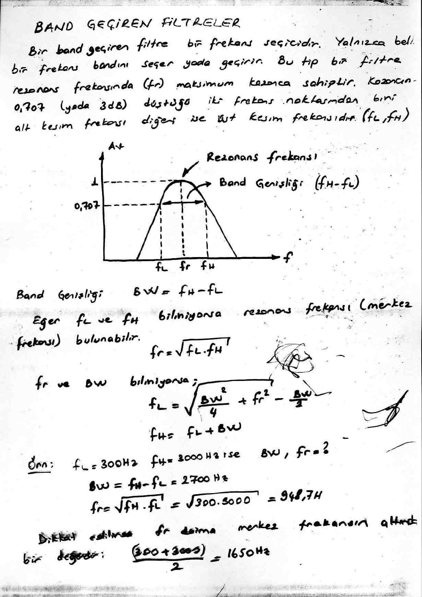

**Örnek:** Rezonans frekansı 950 Hz, band genişliği 2700 Hz olan filtrenin alt ve üst kesim frekanslarını bulunuz.

- f_L = √(2700²/4 + 950²) − 2700/2 = 1650 − 1350 = **300 Hz**; f_H = 300 + 2700 = **3000 Hz**

**Kalite faktörü Q:** Kalite faktörü rezonans frekansının band genişliğine oranıdır; band geçiren filtrenin seçiciliğinin bir ölçüsüdür: **Q = f_r / BW**. Yüksek Q değeri filtrenin çok küçük bir bandı seçtiğini (geçirdiğini) gösterir.

**Darband ve genişband filtreler:** Geniş bandlı bir filtre rezonans frekansının iki ya da daha çok katı büyüklüğünde bir band genişliğine sahiptir; Q ≤ 0,5 ise genişbandlıdır. Genellikle genişbandlı filtreler bir alçak ve bir yüksek geçiren filtrenin kaskat bağlanması ile oluşturulurlar. Darbandlı filtreler (Q > 0,5) genellikle tek bir kat şeklinde yapılırlar.

**Örnek:** BW = 2700 Hz, f_r = 950 Hz olan filtrenin kalite faktörünü bulunuz. Q = f_r/BW = 950/2700 = 0,35 < 0,5 → genişbandlı bir filtredir.

### Genişbandlı filtreler

Bir alçak geçiren filtre ile bir yüksek geçiren filtrenin seri olarak bağlanması (kaskat, ardarda) ile oluşturulurlar; hangisinin önce yer alacağı önemli değildir. Örnek devre: 3000 Hz alçak geçiren filtre (7,5 kΩ, 7,5 kΩ, 10 nF, 5 nF) ve 300 Hz yüksek geçiren filtre (50 nF, 50 nF, 7,5 kΩ, 15 kΩ); band genişliği 2700 Hz, f_r = 948 Hz, her iki yanda −40 dB/decade.

Alçak ve yüksek geçiren filtrelerin kesim frekansları çakışmamalıdır ve her ikisi de geçirdikleri bandda aynı kazanca sahip olmalıdırlar. Alçak geçiren filtrenin kesim frekansı yüksek geçireninkinden 10 kat veya daha fazla büyük olmalıdır. Kaskat bağlı alçak ve yüksek geçiren filtrelerle yapılan geniş bandlı band geçiren filtre şu karakteristiklere sahiptir:

1. Alt kesim frekansı f_L yalnızca yüksek geçiren filtre tarafından belirlenir.
1. Üst kesim frekansı f_H yalnızca alçak geçiren filtre tarafından belirlenir.
1. Kazanç rezonans frekansında (f_r) maksimumdur ve her bir filtrenin geçen band kazancına eşittir.

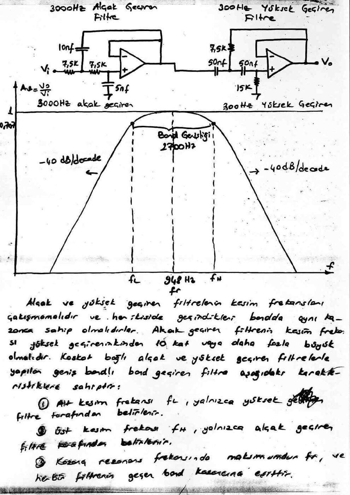

### Darbandlı band geçiren filtreler

Darbandlı bir filtre devresi yalnız tek bir op-amp içerir. Filtrenin giriş direnci R direncine eşittir. Geri besleme direnci (2R) giriş direncinin iki katı yapılırsa filtrenin maksimum kazancı rezonans frekansında 1 ya da 0 dB olacaktır. R_r'nin ayarlanması ile rezonans frekansı değiştirilebilir (band genişliği ve kazanç değişmez).

**Performans:** Birim kazançlı darbandlı filtrenin performansı birkaç basit eşitlikle hesaplanabilir:

- **BW = 0,1591/(RC)**, BW = f_r/Q
- **R_r = R/(2Q² − 1)**
- **f_r = (0,1125/(RC)) √(1 + R/R_r)**

**Örnek:** R = 21,21 kΩ, 2R = 42,42 kΩ, C = 15 nF, R_r = 3,03 kΩ olan band geçiren filtrenin rezonans frekansı ve band genişliği nedir?

- f_r = 0,1125/(21,21·10³ · 15·10⁻⁹) · √(1 + 21,21k/3,03k) = 353,6 Hz · √(1 + 7) ≅ **1000 Hz**
- BW = 0,1591/(21,21·10³ · 15·10⁻⁹) = **500 Hz**

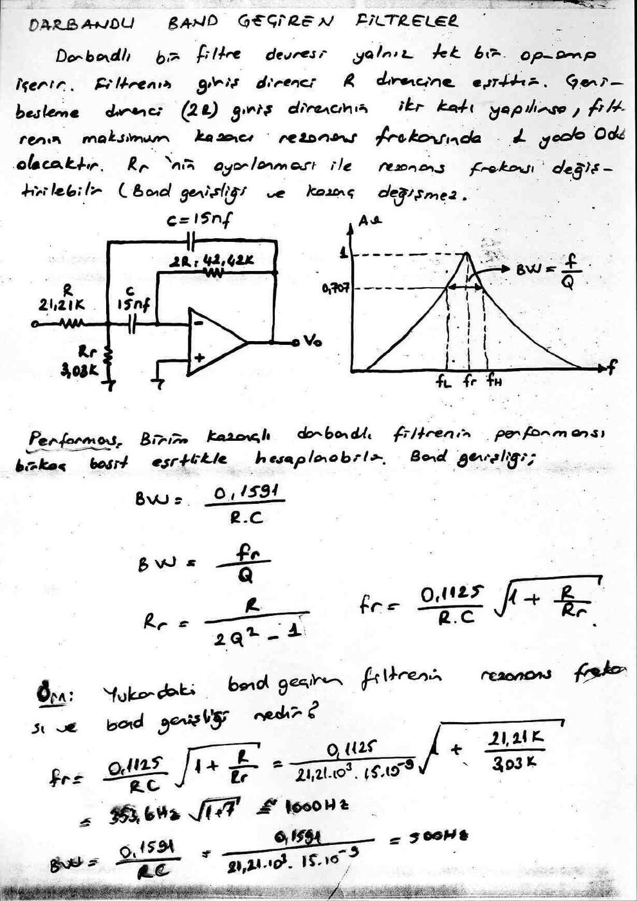

**Örnek (equalizer):** Rezonans frekansları 32, 64, 128, 250, 500, 1000, 2000, 4000, 8000 ve 16 000 Hz olan bir equalizerin birim kazançlı 6. darband filtresini Q = 2 için dizayn ediniz.

*Açıklama:* Bir stereo equalizer her bir kanalında 10 tane band geçiren filtreye sahiptir. Bu devre odyo (ses) spektrumunu (30 Hz – 16 kHz) 10 farklı frekans bölgesine ayırır.

- 6. filtrenin rezonans frekansı f_r = 1000 Hz; BW = f_r/Q = 1000/2 = 500 Hz
- f_L = √(500²/4 + 1000²) − 500/2 = **780 Hz**; f_H = f_L + BW = **1280 Hz**
- C = 0,015 µF = 15 nF seçersek R = 0,1591/(BW · C) = 0,1591/(500 · 15·10⁻⁹) = **21,21 kΩ**
- Geri besleme direnci 2R = **42,42 kΩ**; R_r = R/(2Q² − 1) = 21,21k/(2·2² − 1) = **3,03 kΩ**

### Band durduran (notch) filtreler

İstenmeyen frekanslar duran bandda zayıflatılır, istenilen (seçilen) frekanslar geçen bandda iletilir. Notch filtreler geçen bandda birim kazanca sahiptir. Q, BW, f_L, f_H ve f_r ifadeleri band geçiren filtre ile aynıdır.

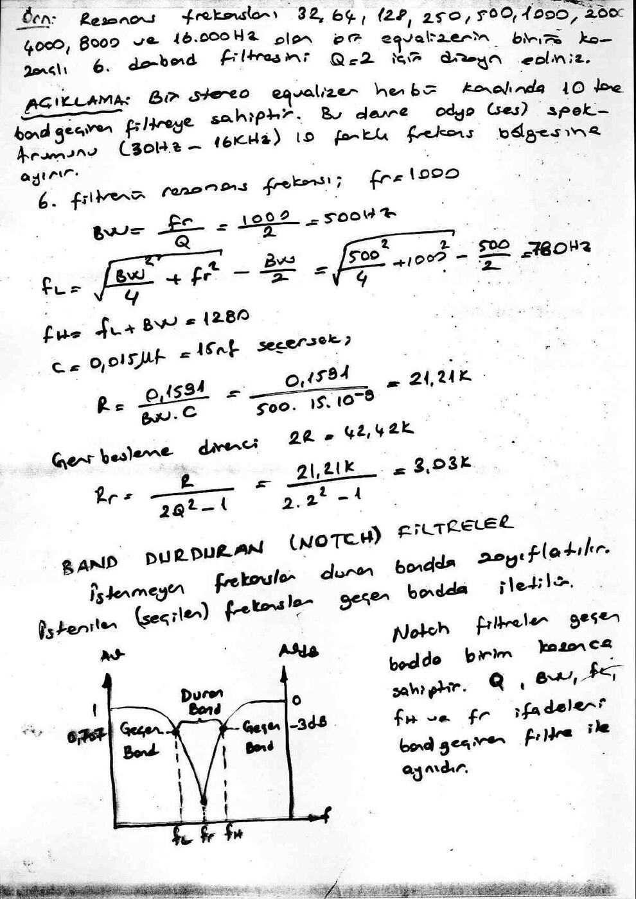

**Notch filtre teorisi:** Bir notch filtre, bir band geçiren filtre çıkışının orijinal sinyalden çıkarılması ile yapılır. Notch filtrenin geçen bandındaki frekanslar için band geçiren filtrenin çıkışı sıfıra yaklaşır. Giriş sinyali V₁ toplayıcı giriş direnci R₂ yolu ile V_o'a −V₁ olarak aktarılır. Bu nedenle her iki alt ve üst geçen bandda V_o = −V₁ olur.

Farz edelim ki V₁ giriş sinyalinin frekansı notch filtrenin rezonans frekansına ayarlanmış olsun (band geçiren filtrenin f_r'si notch filtrenin f_r'sidir). V₁ band geçiren filtrenin çıkışından −V₁ olarak çıkar ve R₁ ve R üzerinden tekrar çevrilerek çıkışta +V₁ olur. V₁ bu anda R₂ üzerinden de çıkışa −V₁ olarak geleceğinden f_r'de V_o = 0 V (V_o = V₁ − V₁ = 0 V) olur.

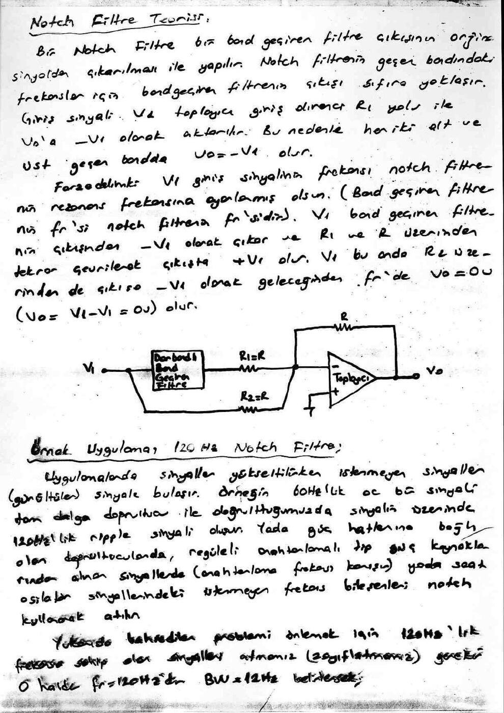

### Örnek uygulama: 120 Hz notch filtre

Uygulamalarda sinyaller yükseltilirken istenmeyen sinyaller (gürültüler) sinyale bulaşır. Örneğin 60 Hz'lik ac bir sinyali tam dalga doğrultucu ile doğrulttuğumuzda sinyalin üzerinde 120 Hz'lik ripple sinyali oluşur. Ya da güç hatlarına bağlı olan doğrultucularda, regüleli anahtarlamalı tip güç kaynaklarından alınan sinyallerde (anahtarlama frekansı karışığı) ya da saat osilatör sinyallerindeki istenmeyen frekans bileşenleri notch kullanılarak atılır.

Yukarıda bahsedilen problemi önlemek için 120 Hz'lik frekansa sahip olan sinyalleri atmanız (zayıflatmanız) gerekir. O hâlde f_r = 120 Hz'dir; BW = 12 Hz belirlersek:

- Q = f_r/BW = 120/12 = 10 → darbandlı filtre
- Yapılacak filtrenin geçen banddaki kazancı birdir. BW = 12 Hz olduğuna göre f_L = 120 − BW/2 = 114 Hz, f_H = 120 + BW/2 = 126 Hz olacaktır.

**Notch filtresi yapım basamakları:**

1. Belirlenen f_r, Q ve BW değerlerinde bir band geçiren filtre yapılır.
1. Çevirici toplayıcı op-amp'a band geçiren filtre çıkışı ve orijinal sinyal eşit R değerleri üzerinden uygulanır.

- C = 0,33 µF seçelim: R = 0,1591/(BW · C) = 0,1591/(12 · 0,33·10⁻⁶) = **40,2 kΩ**
- Geri besleme direnci 2R = **80,4 kΩ**
- R_r = R/(2Q² − 1) = 40,2k/(2·10² − 1) = **201 Ω** (toplayıcıda R₁ = R₂ = 10 kΩ, geri besleme 10 kΩ)

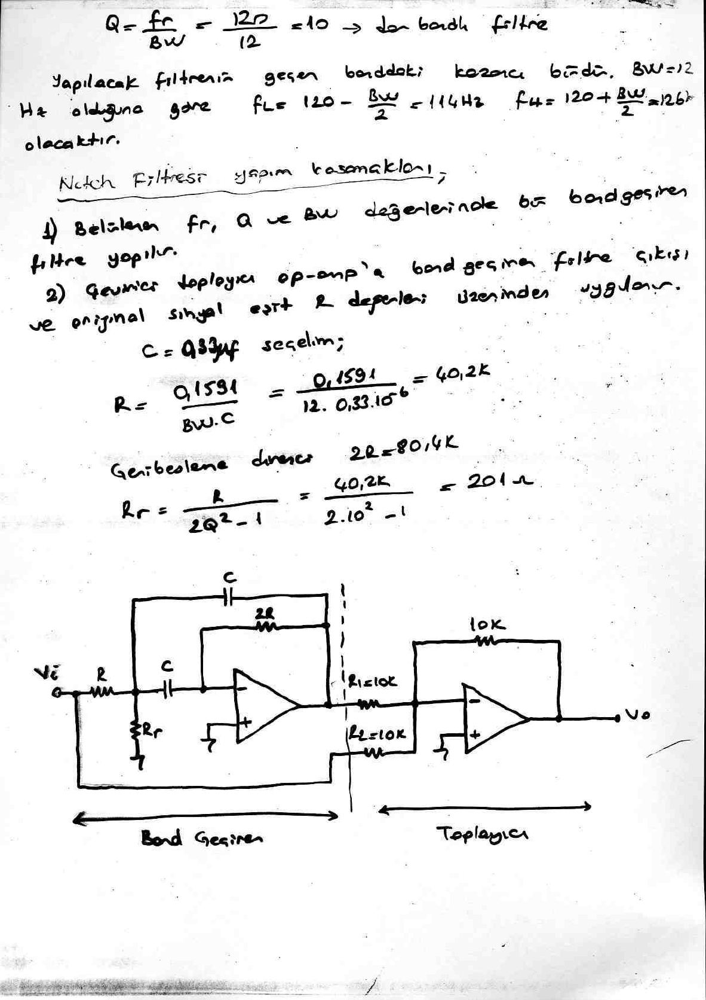
