This post was prepared from the scanned pages of 15 pages of handwritten lecture notes on the **oscillators** topic of the **EEM311 Electronics II** course at Başkent University. The notes carry no author name or date. Definitions, formulas, and worked examples have been transcribed into text; the relevant page images are included for circuit schematics and waveforms. All of the scanned pages can be downloaded as a PDF at the end of the post.

## Feedback and the oscillation condition

In a system consisting of an amplifier with gain A and a feedback network β (A → G, β → H), the feedback is negative if the feedback signal e_f is subtracted, and positive if it is added.

**Closed-loop gain with negative feedback:**

- e_o = e · A, e_f = β · e_o, e = e_i − β · e_o
- e_o = (e_i − β e_o) · A ⇒ e_o + Aβ e_o = e_i · A ⇒ e_o (1 + Aβ) = e_i · A
- **A_v = e_o/e_i = A / (1 + Aβ)**

**Closed-loop gain with positive feedback:** **A_v = A / (1 − Aβ)**

An oscillator circuit consists of an L-C or R-C network that determines the frequency and an amplifier circuit that compensates for the energy these elements lose. For an oscillator to oscillate, it must have positive feedback and satisfy the **Barkhausen criteria**:

1. The loop gain must be equal to or greater than one: **β · A ≥ 1** or **H · G ≥ 1**
1. The loop phase angle must be 360° or a multiple of it: **θ_loop = n · θ** (θ = 360°)

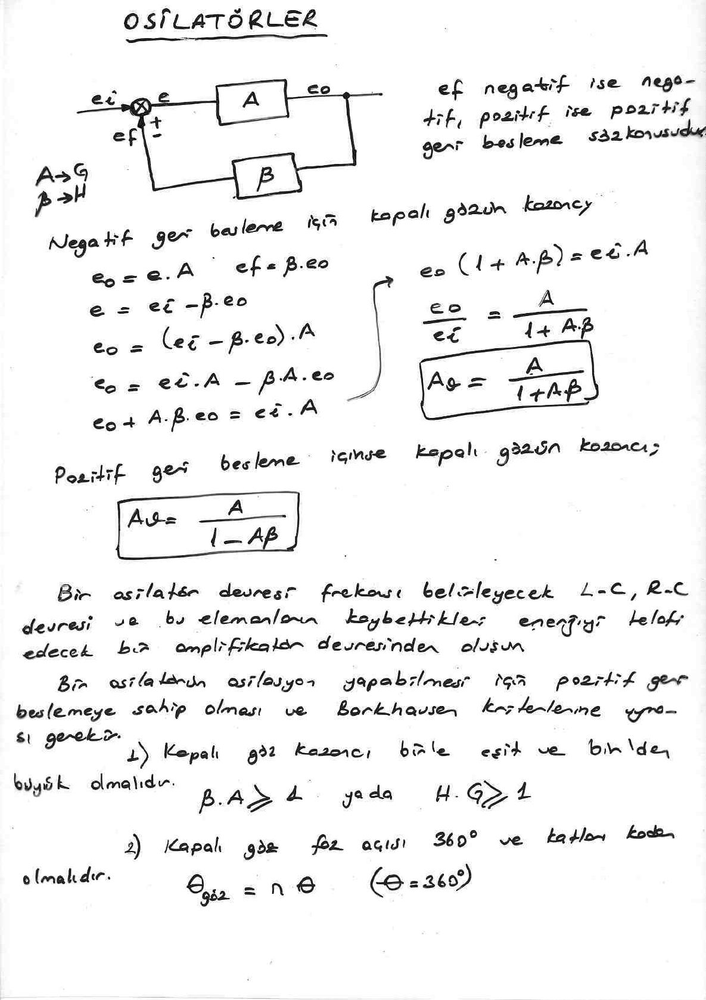

## General oscillator analysis

Oscillators are named according to the elements in the tuned (tank) circuit. When the loop is open, the input voltage is V_i; when the loop is closed, it is V_i'. The amplifier in an ideal oscillator must have infinite input impedance and zero output impedance. Z_i should be chosen large; choosing R_o small ensures that the entire output voltage drops across the tank circuit.

- Gain of the feedback network: β = V_i'/V_o
- Amplifier gain: V_o/V_i = A_o
- Loop gain: **A_v = β · A_o = V_i'/V_i**

If the current I₃ in the third mesh is taken as zero because Z_i ≫ 0, the first and second mesh equations are:

- A_o · V_i = I₁(R_o + Z₁) − I₂ · Z₁
- 0 = −I₁Z₁ + I₂(Z₁ + Z₂ + Z₃)

Since V_i' = I₂ · Z₂, solving the equations above for I₂ (by Cramer's rule) gives:

- I₂ = A_o V_i Z₁ / (−Z₁² + (R_o + Z₁)(Z₁ + Z₂ + Z₃))
- V_i' = I₂ · Z₂ = A_o V_i Z₁ Z₂ / (−Z₁² + (R_o + Z₁)(Z₁ + Z₂ + Z₃))
- **A_v = V_i'/V_i = A_o Z₁ Z₂ / (−Z₁² + (R_o + Z₁)(Z₁ + Z₂ + Z₃))** (the loop gain away from resonance)

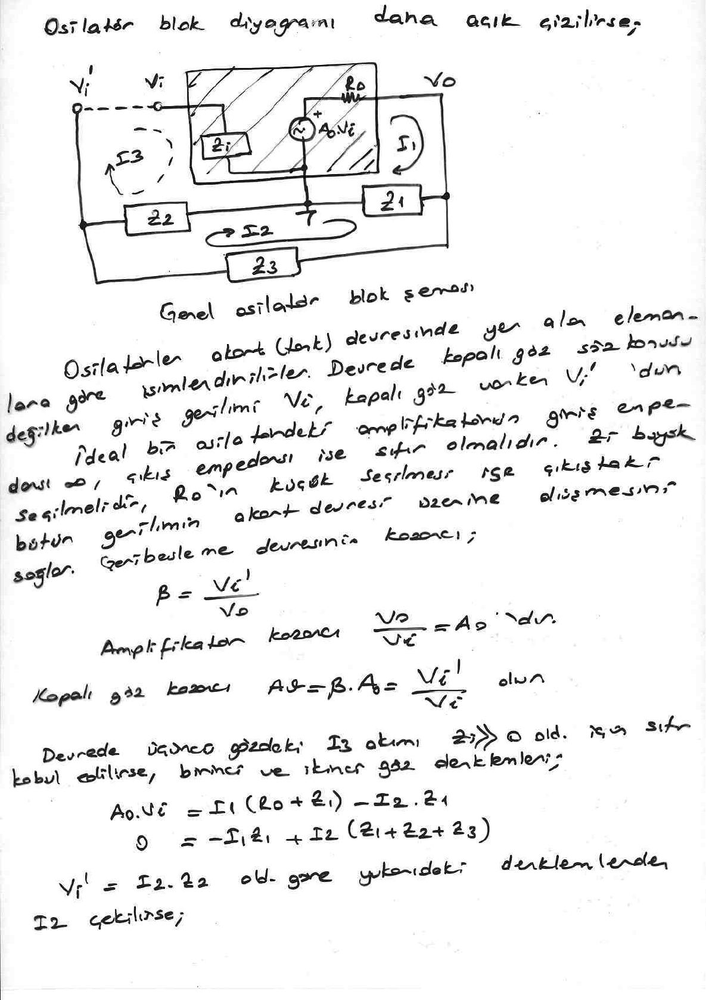

At resonance, Z₁ + Z₂ + Z₃ = 0, so:

- A_v = A_o Z₁ Z₂ / (−Z₁²) ⇒ **A_v = −A_o · Z₂/Z₁** (A_o: open-circuit voltage gain, Z₂/Z₁: feedback ratio)
- For oscillation, A_v = −A_o · (Z₂/Z₁) ≥ 1 is required (A ↔ G, β ↔ H).
- The gain of the feedback network is Z₂/Z₁ = β; the oscillation condition is −Z₁/Z₂ ≥ A_o.

*Note: The oscillation condition is written in the notes as "−Z₁/Z₂ ≥ A_o"; from the expression −A_o·Z₂/Z₁ ≥ 1, the resulting condition is |A_o| ≥ |Z₁/Z₂| (the amplifier gain must be greater than the inverse of the feedback ratio).*

Z₁, Z₂, and Z₃ change with the type of oscillator:

| Oscillator | Z₁ | Z₂ | Z₃ | Amplifier |
|---|---|---|---|---|
| Hartley | L | L | C | Inverting |
| Hartley | L | C | L | Follower |
| Colpitts | C | C | L | Inverting |
| Colpitts | L | C | C | Follower |
| Clapp | C | C | LC (series) | Inverting |
| Crystal | C | C | X_TAL | Inverting |

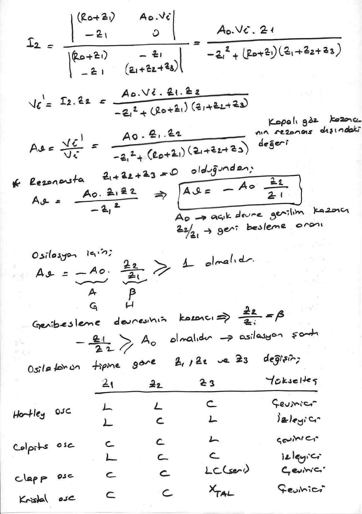

## RC phase-shift oscillator

R_F and R_C are bias resistors. C₁, C₂, C₃ and R₁, R₂, R₃ form the phase-shift and feedback network. When the supply voltage is applied, the charging and discharging of the RC networks start and sustain the oscillations. A change in base current appears in the collector current shifted by 180° and amplified. By shifting the phase of the signal fed back to the base by a further 180°, positive feedback is obtained. The output is sinusoidal. Each RC section shifts the phase by 60°. The resistors and capacitors in the phase-shift network shift the phase by 180° at only one frequency. At other frequencies, the capacitive reactances increase or decrease, so the phase shift changes as well and the feedback is no longer in phase; therefore oscillation does not continue. The oscillator frequency depends on the transistor and the elements that sustain oscillation, on the feedback elements, and on the amplifier parameters. Other amplifier circuits (op-amp, JFET) can also be used as the amplifier.

- RC phase-shift oscillator with BJT: **f = 1 / (2π √(6R² + 4R R_C) · C)**
- RC phase-shift oscillator with JFET: **f = 1 / (2π √6 · RC)**

*Note: In the notes, the BJT formula is written without the square-root sign as "1/(2π(6R² + 4RR_C)C²)"; the correct form is the one given above (R_C also appears as R_L in the notes).*

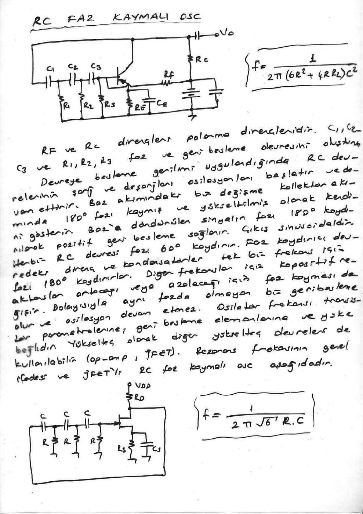

## Wien bridge oscillator

The circuit has two types of feedback: feedback is applied to both inputs of the op-amp. The signal is applied to the + input across the RC (parallel) terminals. The voltage coming through R₁ and R₂ is applied to the inverting input. To ensure amplifier stability, negative feedback is provided in addition to positive feedback. V_a is the positive feedback voltage, and V_b is the negative feedback voltage (bridge-type equivalent circuit).

- **f = 1 / (2πRC)**
- β = V_a/V_out, K = V_out/V_b, V_b = R₂ · V_out/(R₁ + R₂)
- V_a = (R/(jωC)) V_out / [(R + 1/(jωC))² + R/(jωC)] = (R/(jωC)) V_out / [R² − (1/(ωC))² + 3R/(jωC)]
- Since the oscillation condition is K · β = 1, ωC = 1/R; hence **V_a/V_out = 1/3**.
- Since V_a = V_b, **R₂/(R₁ + R₂) = 1/3**

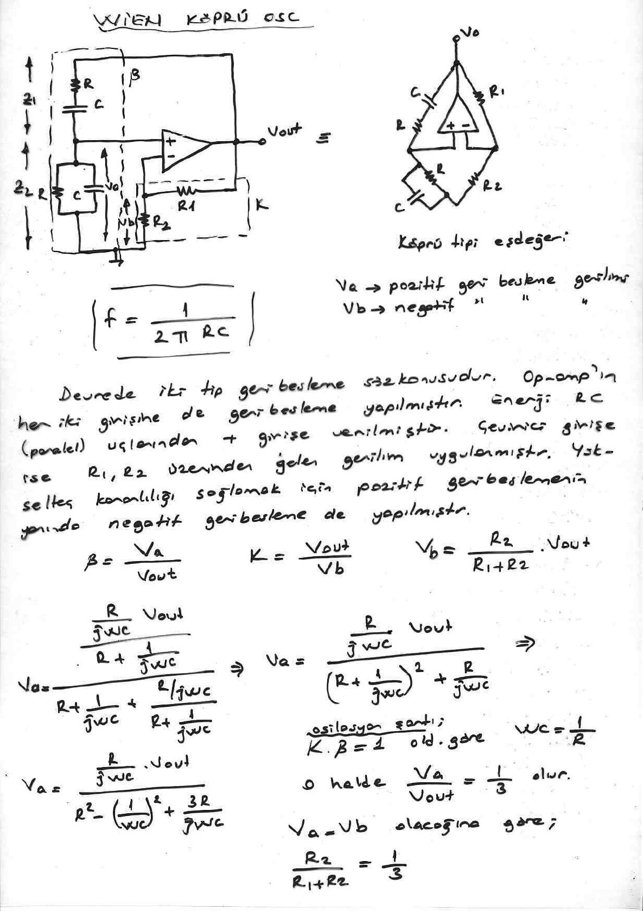

## Series and parallel Hartley oscillators

The transistor takes its collector bias through R₁, its base bias through R₁–R₂, and its emitter bias through L₁. If the supply voltage is applied while C₂ is absent, a magnetic field builds up in L₁ until the base and collector currents reach the values set by R₁ and R₂. When this magnetic field cuts L₂, a voltage is also induced across L₂. C₁ charges to the voltage across L₁ and L₂. Since C₂ is not in the circuit, after the emitter current reaches its normal value, C₁ begins to be discharged by the coil. This charging and discharging continues until the energy stored in the capacitor is exhausted. Consequently, after some time this oscillation dies out, so a damped oscillation is obtained. If capacitor C₂ is connected to the circuit, the changes in the tank circuit are applied to the amplifier, so the energy the tank circuit loses during energy exchange is fed back, preventing the variation in emitter current and the damping. The frequency of the circuit is determined by L₁, L₂, and C₁. Capacitor C₃ holds the transistor at ground potential in ac terms. Therefore, the variation at the base is effective in the transistor. Because part of the supply current passes through the coil that determines the frequency, this is called a **series Hartley oscillator**. After the coil that determines the frequency is calculated, a tap is taken at 1/3 of it and connected to the emitter, and the other part is connected to ground.

- **f = 1 / (2π √((L₁ + L₂) · C₁))**

In the **parallel Hartley oscillator**, the dc current path does not pass through the resonant circuit (the tank circuit is coupled through C₄).

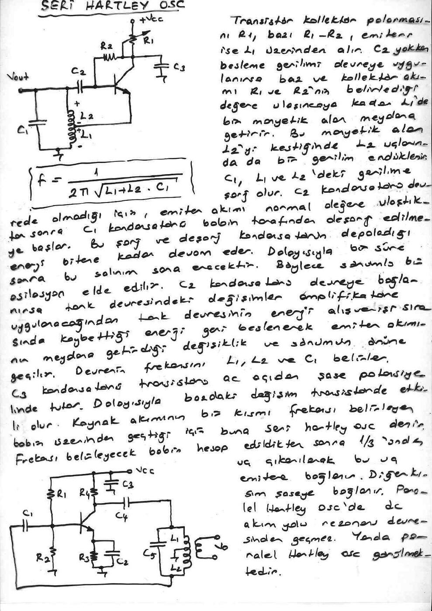

## Colpitts and Clapp oscillators

The transistor takes its collector bias from V_CC, its base bias through P₁ and L₁, and its emitter bias through P₂. C₁ holds the lower end of L₁ at ground potential in ac terms. For a good result, C₂ should be at least 10 times larger than C₃. When voltage is applied to the circuit, the base current passing through P₁ and L₁ results in an emitter current through P₂. The voltages across P₂ and V_BE charge capacitors C₂ and C₃. When the change in current stops, C₂ and C₃ are discharged by L₁. With the energy it receives, L₁ charges C₂ and C₃ in the opposite direction to the previous one. The base and emitter currents vary depending on L₁, C₂, and C₃. A current begins to flow at the frequency produced by L₁, C₂, and C₃. Since the magnetic field in L₁ cuts L₂, a sinusoidal voltage at the same frequency is obtained across L₂.

- Colpitts with BJT: **C_T = C₂ // C₃** (series connected), **f = 1 / (2π √(L₁ C_T))**
- Colpitts with JFET: **C_T = C₁ // C₂**, **f = 1 / (2π √(L₃ C_T))**
- Clapp oscillator (C₃ in series with L₃): **C_eq = C₁ // C₂ // C₃**, **f = 1 / (2π √(L₃ C_eq))**

*Note: In the notes, the "//" symbol is used to mean capacitors connected in series; the equivalent capacitance is calculated as 1/C_T = 1/C₁ + 1/C₂ (+ 1/C₃).*

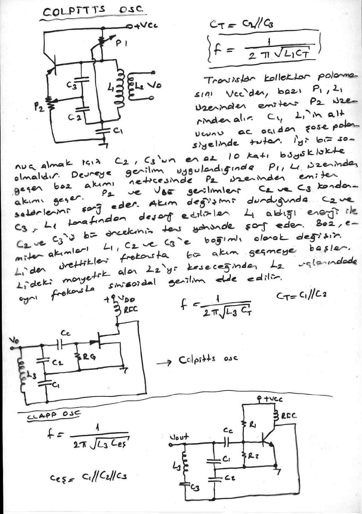

## Voltage-controlled oscillator (VCO)

A PUT (programmable unijunction transistor) is connected in parallel with the feedback capacitor of an op-amp integrator; the −V_IN input charges the capacitor linearly and the output rises as a ramp. The PUT turns on the moment the anode (A) voltage exceeds the gate (G) voltage and discharges the capacitor; thus a sawtooth wave is obtained. Therefore, the value of the V_CONT voltage determines the amplitude the output voltage can reach before the PUT turns on to discharge the capacitor, and this variation sets the frequency.

### Integrator-type VCO circuit (566)

The 566 is an example of an integrator-type VCO circuit. As seen in the block diagram, it produces square and triangular waves at a frequency set by R₁, C₁, and V_c. Block diagram: V_c (5) → current source (R₁ → 6, C₁ → 7) → Schmitt trigger → buffer amp → square wave (3); capacitor voltage → buffer amp → triangular wave (4). Pin connections: 1 GND, 2 NC, 3 square wave, 4 triangular wave, 5 V_c, 6 R₁, 7 C₁ (timing), 8 V+.

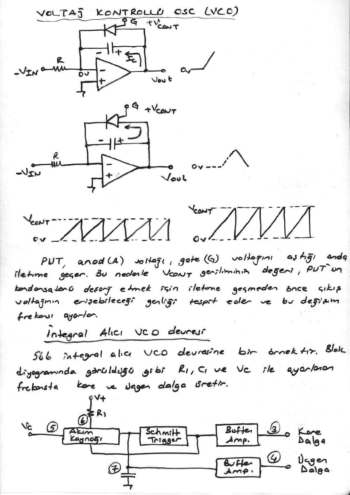

**Typical 566 connection:** The voltage divider formed by R₂ (1.5 kΩ) and R₃ (10 kΩ) sets the free-running (or center) frequency. The voltage V_c at pin 5 must lie within the following range (V+ is the dc supply voltage):

- **0.75 V+ ≤ V_c ≤ V+** ①

The variable control voltage V_CONT is combined, through C₂, with the voltage variation at pin 5; the generated frequency is then found with the following formula:

- **f_o = 2 [(V+) − V_c] / (R₁ C₁ V+)** ②

Another application is to apply a dc voltage directly to control input 5, within the limits given by equation ①. Every change in the dc voltage causes a change in frequency; if V_c increases, f_o decreases.

**Example:** In a 566 circuit with a +12 V supply, R₁ = 10 kΩ, and C₁ = 1 nF, V_c is varied from 10 V to 11 V. Calculate the change in output frequency.

- V_c = 10 V ⇒ f_o = 2(12 V − 10 V) / (10k · 1·10⁻⁹ · 12 V) = **33.33 kHz**
- V_c = 11 V ⇒ f_o = 2(12 V − 11 V) / (10k · 1·10⁻⁹ · 12) = **16.67 kHz**
- Change in output frequency: Δf_o = 33.33 kHz − 16.67 kHz = **16.66 kHz**

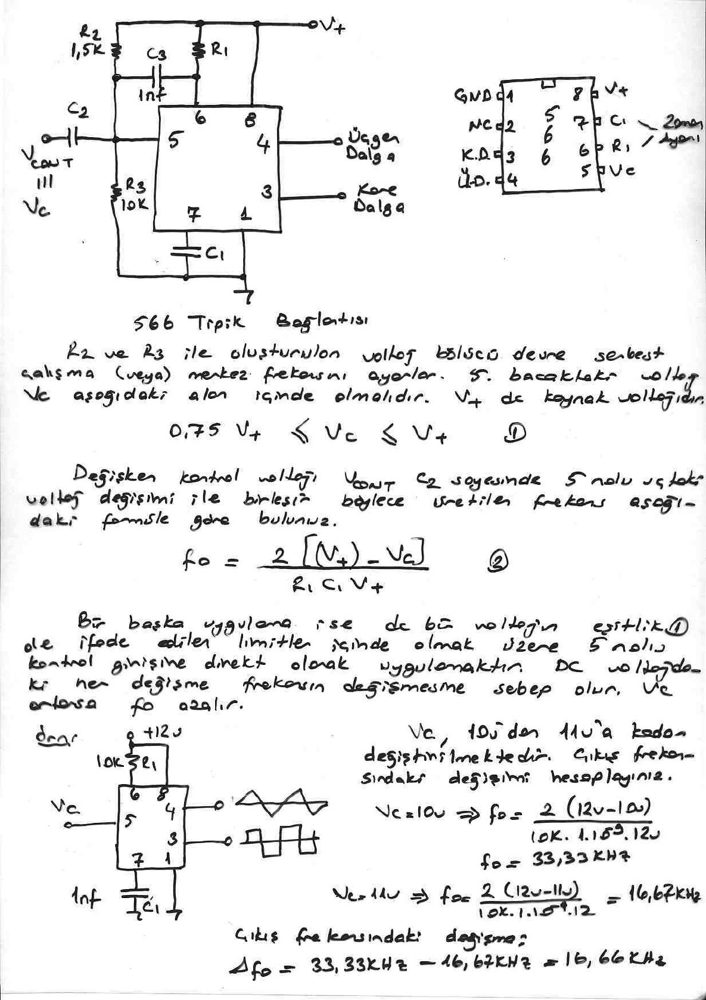

## Phase-locked loop (PLL)

A PLL is a feedback circuit consisting of a phase detector, a low-pass filter, and a voltage-controlled oscillator (VCO). It is widely used in communication systems, receivers (TV), demodulators (FM), modems, and decoders. Block diagram: V_i (f_i) → phase detector (V_e: f_i − f_o, f_i + f_o) → low-pass filter (V_d) → amplifier → VCO (V_c) → f_o returns to the phase detector.

When there is no input signal, the error voltage (V_e) is 0 and the frequency is the fundamental frequency f_o produced by the VCO; this is called the **free-running** or **center frequency**. When an input signal is applied, the phase detector compares the phase and frequency of the input signal with the VCO frequency and produces the error voltage. This error voltage is proportional to the phase and frequency difference between the input frequency and the VCO frequency. The error voltage contains the difference and sum components of the two frequencies being compared: f_i − f_o, f_i + f_o. The low-pass filter passes only the difference frequency (V_d), which is the lower of the two components. This signal is amplified and fed back to the VCO as the control voltage V_c. The VCO frequency is expected to track the frequency f_i. By changing the VCO frequency with V_c, frequencies approaching f_i are produced. This loop continues until f_i = f_o; when f_i = f_o, V_e = 0.

- The range of lower and upper frequency signals within which the VCO begins to be able to track f_i is called the **capture range**.
- The range of lower and upper frequencies within which the VCO can track signal variations after f_i = f_o is reached is called the **lock range**.

")

### Sum and difference frequencies

The phase detector, like a multiplier, produces the sum and difference of the input frequency f_i and the VCO frequency f_o. If V = V_p sin 2πft represents a sine wave, the input signal and the VCO voltage are:

- V_i = V_ip sin 2πf_i t, V_o = V_op sin 2πf_o t

When these two signals are multiplied in the phase detector (sin A · sin B = ½ [cos(A − B) − cos(A + B)]):

- V_out = V_ip V_op (sin 2πf_i t)(sin 2πf_o t)
- **V_out = (V_ip V_op/2) cos 2π(f_i − f_o)t − (V_ip V_op/2) cos 2π(f_i + f_o)t**

As can be seen, the output of the phase detector contains the difference frequency component (f_i − f_o) and the sum frequency component (f_i + f_o) (the spectrum shows lines at f_o, f_i − f_o, f_i, and f_i + f_o).

### Two sine waves of equal frequency

When two sine waves (of equal frequency) are applied as inputs to a phase detector, the output has a dc component proportional to the difference of the signals' phase angles and an ac component at twice the input frequency.

- V₁ = V_p1 sin 2πft, V₂ = V_p2 sin(2πft + φ) (φ: phase difference)
- V_out = V_p1 V_p2 sin(2πft) sin(2πft + φ) = (V_p1 V_p2/2)[cos φ − cos(2π·2f·t + φ)]
- **V_out = (V_p1 V_p2/2) cos φ − (V_p1 V_p2/2) cos(2π·2f·t + φ)**

The first term in this equation is the term whose value depends on the phase angle φ:

- **V_out(dc) = V_p1 V_p2 cos φ / 2**, **cos φ = 2 V_out(dc) / (V_p1 V_p2)**

Of these two components at the phase detector output, the ac component is filtered out (by the low-pass filter), and the dc component is fed back to the VCO.

## 555 timer IC

Internal structure: three equal 5 kΩ resistors between V_CC (8) and ground (1); comparator K₁ compares the threshold (6) pin with 2/3 V_CC (control voltage, 5), and comparator K₂ compares the trigger (2) pin with 1/3 V_CC; their outputs drive the RS flip-flop. The Q̄ output goes through the output power stage (inverter) to the output (3) and to the discharge transistor (7); the reset pin (4) resets the flip-flop through transistor T₂, which is tied to V_ref = 2V_be.

| R | S | Q | Q̄ |
|---|---|---|---|
| 0 | 0 | Q | Q̄ |
| 0 | 1 | 1 | 0 |
| 1 | 0 | 0 | 1 |
| 1 | 1 | Indeterminate | |

The IC can be supplied with 4.5–16 V. Up to 200 mA of current can be drawn from its output. When used as a timer circuit, timing from µs to minutes can be achieved with the help of an R-C network. The V_CC voltage is divided across three equal resistors. K₁ and K₂ are comparators. Since transistor T₂ operates either in cutoff or saturation depending on the RS F/F output (0–1), the output will be either 0 or 1. The inverter both inverts and provides current gain. In applications, pins 2 and 6 are usually tied together and an RC network is connected to them. Consequently, the voltage across C becomes one of the comparison voltages for the comparators.

The reset pin (4) resets the timer. T₂ is a PNP transistor. To turn it on, a voltage more negative than 2V_be must be applied to pin 4. When T₂ turns on, T₁ also turns on, so the capacitor connected to pin 7 discharges and the circuit state is reset. If reset is not needed, this pin is connected to V_CC (8) so that T₂ is always kept in cutoff. The voltage values at the inputs can be changed with pin 5. If this pin is not used, it is grounded through a capacitor.

*Note: At the start of the paragraph, the notes give "pin 6" for the reset pin; according to the schematic and the rest of the text, the reset pin is pin 4.*

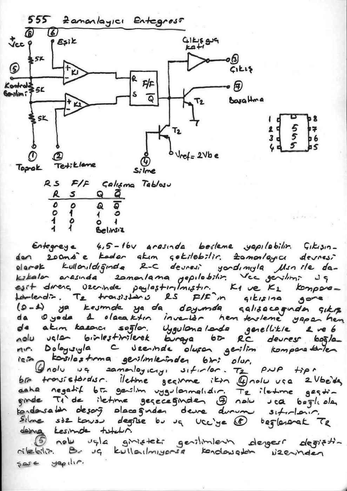

### Operation of the 555 in astable multivibrator mode

In the circuit built with R_A, R_B, and C, the capacitor charges and discharges between 1/3 V_CC and 2/3 V_CC; the output is a square wave.

- **T_charge = 0.693 (R_A + R_B) · C**
- **T_discharge = 0.693 R_B · C**
- T = T_charge + T_discharge
- **f = 1/T = 1 / ((R_A + 2R_B) · C · 0.693) = 1.44 / ((R_A + 2R_B) C)**
- R_A ≫ V_CC/0.2 must hold, that is, the current through R_A must not exceed 200 mA.

### Operation of the 555 in monostable multivibrator mode

The trigger signal (2) is negative. While the multivibrator is stable, it gives an output of 0. When a negative trigger arrives, the output becomes 1; after some time it returns to the stable state by itself.

- **T_A = 1.1 · R_A · C** (capacitor charging time)

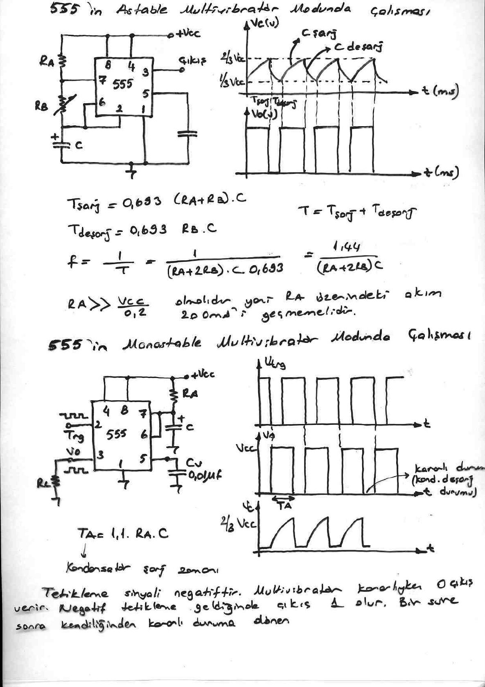

### Pulse-width modulator circuit with the 555

The modulating signal V_m is applied to control pin 5 of the monostable-connected 555, and the trigger pulses arrive at pin 2. In the stable state the output is 0. When a pulse is applied, the output goes to 1. It stays there for a duration of (1.1 · R_A · C) and then returns to the stable state. (1.1 R_A C) is the time for the capacitor to reach the reference voltage of 2/3 V_CC; as V_CC (that is, the voltage at pin 5) changes, the coefficient 1.1 here changes. Thus the width of the output pulses varies with V_m.

### Square-wave generator using an op-amp

Positive feedback is applied from the output to the (+) input through the R₁–R₂ divider, and negative feedback is applied to the (−) input through R to C.

- α = R₂/(R₁ + R₂), V_R = α · V_out
- V_C = V_F + (V_i − V_F) e^(−t/RC)
- 0 < t ≤ T/2: V_F = V_out = +|V_sat|, V_i = −α|V_sat| → V_C = |V_sat| + (−α|V_sat| − |V_sat|) e^(−t/RC)
- T/2 < t < T: V_F = V_out = −|V_sat|, V_i = +α|V_sat| → V_C = −|V_sat| + (α|V_sat| + |V_sat|) e^(−(t − T/2)/RC)
- Eliminating the V_sat terms: (1 − α)/(1 + α) = e^(−T/2RC)
- **Square-wave period: T = −2RC ln((1 − α)/(1 + α))**

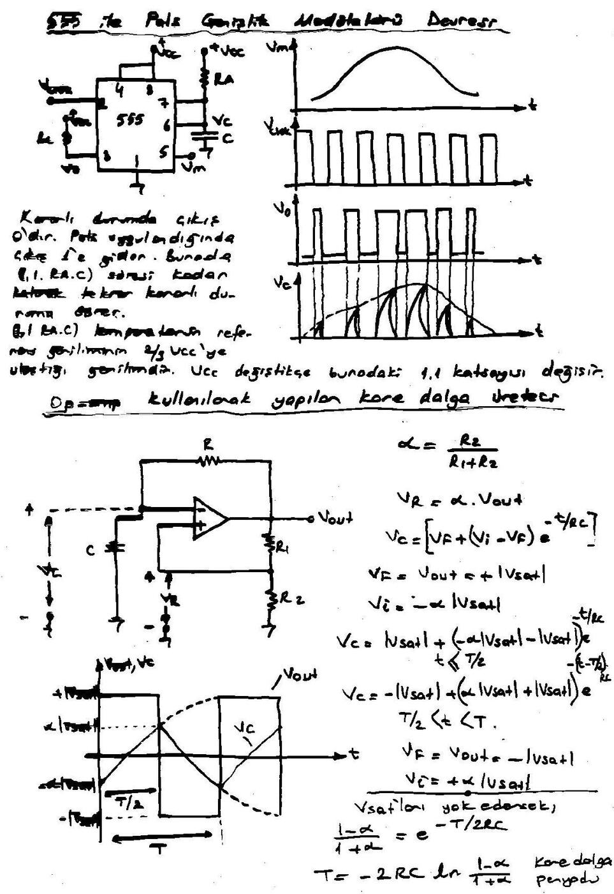
