Bu yazı, Başkent Üniversitesi **EEM311 Elektronik II** dersinin **osilatörler** konusunu anlatan 15 sayfalık el yazısı ders notlarının taranmış sayfalarından hazırlandı. Notlarda yazar adı ve tarih yok. Tanımlar, formüller ve çözümlü örnekler metne aktarıldı; devre şemaları ve dalga şekilleri için ilgili sayfa görselleri eklendi. Taranmış sayfaların tamamı PDF olarak yazının sonunda indirilebilir.

## Geri besleme ve osilasyon şartı

Kazancı A olan yükselteç ve β geri besleme devresinden oluşan sistemde (A → G, β → H), geri besleme sinyali e_f negatif ise negatif, pozitif ise pozitif geri besleme söz konusudur.

**Negatif geri besleme için kapalı gözün kazancı:**

- e_o = e · A, e_f = β · e_o, e = e_i − β · e_o
- e_o = (e_i − β e_o) · A ⇒ e_o + Aβ e_o = e_i · A ⇒ e_o (1 + Aβ) = e_i · A
- **A_v = e_o/e_i = A / (1 + Aβ)**

**Pozitif geri besleme için kapalı gözün kazancı:** **A_v = A / (1 − Aβ)**

Bir osilatör devresi, frekansı belirleyecek L-C, R-C devresi ve bu elemanların kaybettikleri enerjiyi telafi edecek bir amplifikatör devresinden oluşur. Bir osilatörün osilasyon yapabilmesi için pozitif geri beslemeye sahip olması ve **Barkhausen kriterlerine** uyması gerekir:

1. Kapalı göz kazancı bire eşit ve birden büyük olmalıdır: **β · A ≥ 1** ya da **H · G ≥ 1**
1. Kapalı göz faz açısı 360° ve katları kadar olmalıdır: **θ_göz = n · θ** (θ = 360°)

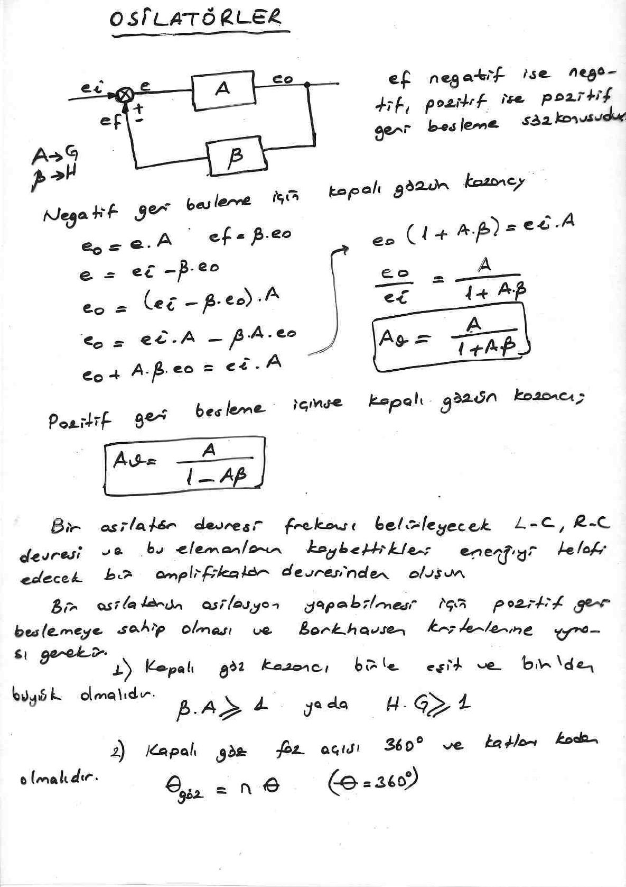

## Genel osilatör analizi

Osilatörler akort (tank) devresinde yer alan elemanlara göre isimlendirilirler. Devrede kapalı göz söz konusu değilken giriş gerilimi V_i, kapalı göz varken V_i''dür. İdeal bir osilatördeki amplifikatörün giriş empedansı ∞, çıkış empedansı ise sıfır olmalıdır. Z_i büyük seçilmelidir; R_o'ın küçük seçilmesi ise çıkıştaki bütün gerilimin akort devresi üzerine düşmesini sağlar.

- Geri besleme devresinin kazancı: β = V_i'/V_o
- Amplifikatör kazancı: V_o/V_i = A_o
- Kapalı göz kazancı: **A_v = β · A_o = V_i'/V_i**

Devrede üçüncü gözdeki I₃ akımı Z_i ≫ 0 olduğu için sıfır kabul edilirse, birinci ve ikinci göz denklemleri:

- A_o · V_i = I₁(R_o + Z₁) − I₂ · Z₁
- 0 = −I₁Z₁ + I₂(Z₁ + Z₂ + Z₃)

V_i' = I₂ · Z₂ olduğuna göre yukarıdaki denklemlerden I₂ çekilirse (Cramer kuralı ile):

- I₂ = A_o V_i Z₁ / (−Z₁² + (R_o + Z₁)(Z₁ + Z₂ + Z₃))
- V_i' = I₂ · Z₂ = A_o V_i Z₁ Z₂ / (−Z₁² + (R_o + Z₁)(Z₁ + Z₂ + Z₃))
- **A_v = V_i'/V_i = A_o Z₁ Z₂ / (−Z₁² + (R_o + Z₁)(Z₁ + Z₂ + Z₃))** (kapalı göz kazancının rezonans dışındaki değeri)

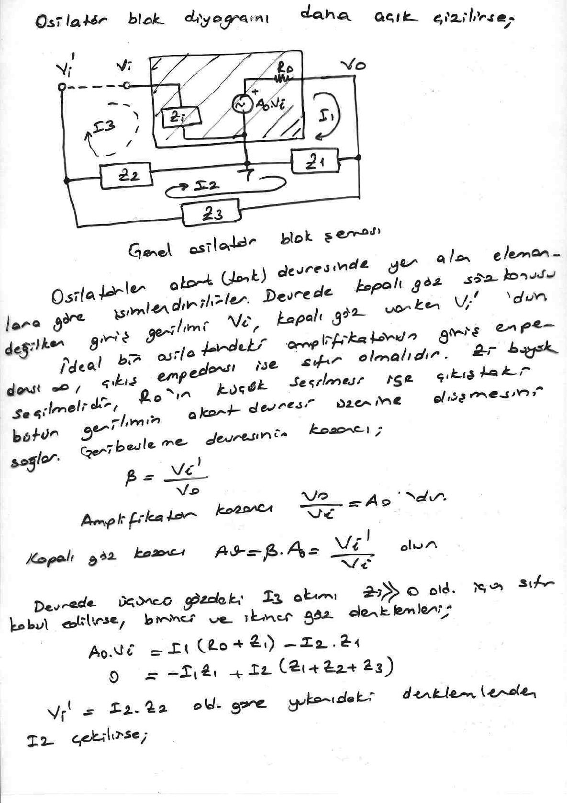

Rezonansta Z₁ + Z₂ + Z₃ = 0 olduğundan:

- A_v = A_o Z₁ Z₂ / (−Z₁²) ⇒ **A_v = −A_o · Z₂/Z₁** (A_o: açık devre gerilim kazancı, Z₂/Z₁: geri besleme oranı)
- Osilasyon için A_v = −A_o · (Z₂/Z₁) ≥ 1 olmalıdır (A ↔ G, β ↔ H).
- Geri besleme devresinin kazancı Z₂/Z₁ = β; osilasyon şartı: −Z₁/Z₂ ≥ A_o olmalıdır.

*Not: Notta osilasyon şartı "−Z₁/Z₂ ≥ A_o" olarak yazılmış; −A_o·Z₂/Z₁ ≥ 1 ifadesinden çıkan şart |A_o| ≥ |Z₁/Z₂|'dir (yükseltecin kazancı geri besleme oranının tersinden büyük olmalı).*

Osilatörün tipine göre Z₁, Z₂ ve Z₃ değişir:

| Osilatör | Z₁ | Z₂ | Z₃ | Yükselteç |
|---|---|---|---|---|
| Hartley | L | L | C | Çevirici |
| Hartley | L | C | L | İzleyici |
| Colpitts | C | C | L | Çevirici |
| Colpitts | L | C | C | İzleyici |
| Clapp | C | C | LC (seri) | Çevirici |
| Kristal | C | C | X_TAL | Çevirici |

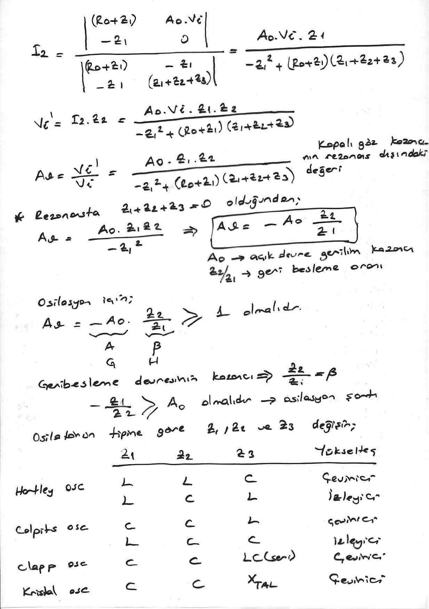

## RC faz kaymalı osilatör

R_F ve R_C dirençleri polarma dirençleridir. C₁, C₂, C₃ ve R₁, R₂, R₃ faz ve geri besleme devresini oluşturur. Devreye besleme gerilimi uygulandığında RC devrelerinin şarj ve deşarjları osilasyonları başlatır ve devam ettirir. Baz akımındaki bir değişme kollektör akımında 180° fazı kaymış ve yükseltilmiş olarak kendini gösterir. Baz'a döndürülen sinyalin fazı 180° kaydırılarak pozitif geri besleme sağlanır. Çıkış sinüsoidaldir. Her bir RC devresi fazı 60° kaydırır. Faz kaydırıcı devredeki direnç ve kondansatörler tek bir frekans için fazı 180° kaydırırlar. Diğer frekanslar için kapasitif reaktanslar artacağı veya azalacağı için faz kayması da aynı fazda olmayan bir geri besleme gerçekleşir; dolayısıyla osilasyon devam etmez. Osilatör frekansı transistör ve osilasyon devam etme elemanlarına, geri besleme elemanlarına ve yükselteç parametrelerine bağlıdır. Yükselteç olarak diğer yükselteç devreleri de (op-amp, JFET) kullanılabilir.

- BJT'li RC faz kaymalı osilatör: **f = 1 / (2π √(6R² + 4R R_C) · C)**
- JFET'li RC faz kaymalı osilatör: **f = 1 / (2π √6 · RC)**

*Not: BJT'li devrenin formülü notta karekök işareti olmadan "1/(2π(6R² + 4RR_C)C²)" biçiminde yazılmış; doğrusu yukarıdaki gibidir (R_C notta R_L olarak da geçiyor).*

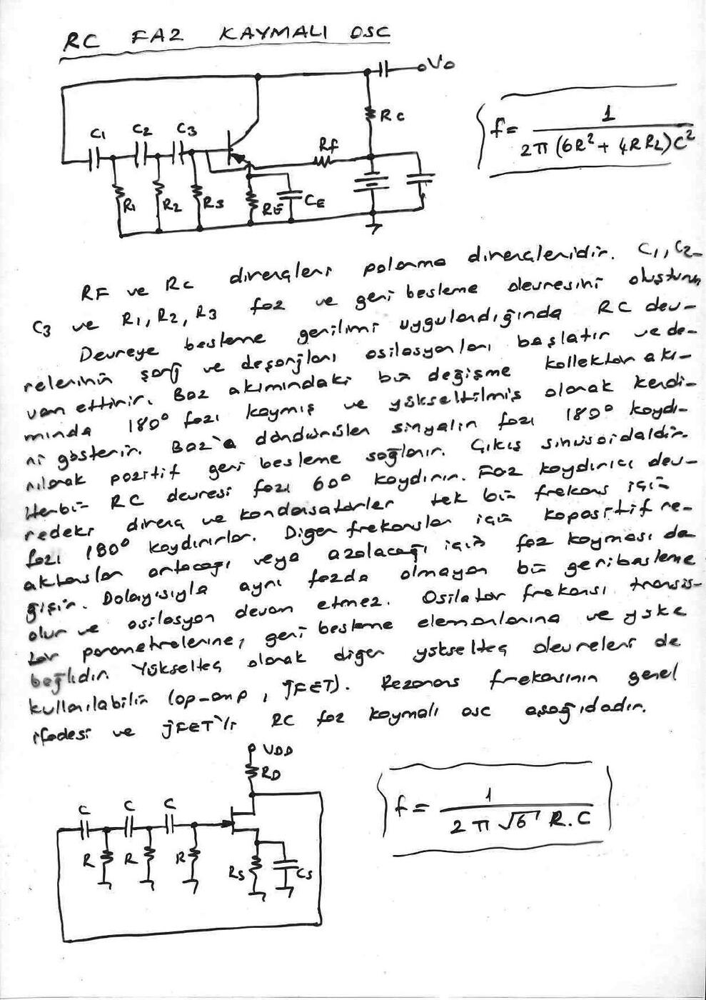

## Wien köprü osilatörü

Devrede iki tip geri besleme söz konusudur: op-amp'ın her iki girişine de geri besleme yapılmıştır. Enerji RC (paralel) uçlarından + girişe verilmiştir. Çevirici girişe ise R₁, R₂ üzerinden gelen gerilim uygulanmıştır. Yükselteç kararlılığı sağlamak için pozitif geri beslemenin yanında negatif geri besleme de yapılmıştır. V_a pozitif geri besleme gerilimi, V_b negatif geri besleme gerilimidir (köprü tipi eşdeğer devre).

- **f = 1 / (2πRC)**
- β = V_a/V_out, K = V_out/V_b, V_b = R₂ · V_out/(R₁ + R₂)
- V_a = (R/(jωC)) V_out / [(R + 1/(jωC))² + R/(jωC)] = (R/(jωC)) V_out / [R² − (1/(ωC))² + 3R/(jωC)]
- Osilasyon şartı K · β = 1 olduğuna göre ωC = 1/R; o hâlde **V_a/V_out = 1/3** olur.
- V_a = V_b olacağına göre **R₂/(R₁ + R₂) = 1/3**

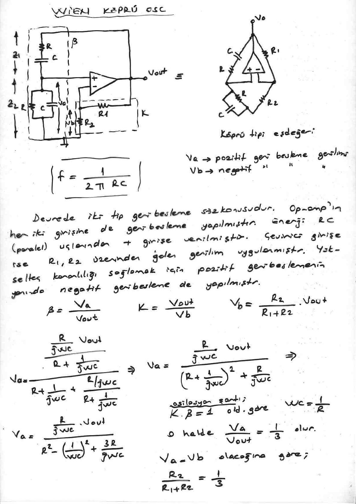

## Seri ve paralel Hartley osilatörü

Transistör kollektör polarmasını R₁, bazı R₁–R₂, emiteri ise L₁ üzerinden alır. C₂ yokken besleme gerilimi devreye uygulanırsa baz ve kollektör akımı R₁ ve R₂'nin belirlediği değere ulaşıncaya kadar L₁'de bir manyetik alan meydana getirir. Bu manyetik alan L₂'yi kestiğinde L₂ uçlarında da bir gerilim endüklenir. C₁, L₁ ve L₂'deki gerilime şarj olur. C₂ kondansatörü devrede olmadığı için, emiter akımı normal değere ulaştıktan sonra C₁ kondansatörü bobin tarafından deşarj edilmeye başlar. Bu şarj ve deşarj kondansatörün depoladığı enerji bitene kadar devam eder. Dolayısıyla bir süre sonra bu salınım sona erecektir; böylece sönümlü bir osilasyon elde edilir. C₂ kondansatörü devreye bağlanırsa tank devresindeki değişimler amplifikatöre uygulanacağından, tank devresinin enerji alışverişi sırasında kaybettiği enerji geri beslenerek emiter akımının meydana getirdiği değişiklik ve sönümün önüne geçilir. Devrenin frekansını L₁, L₂ ve C₁ belirler. C₃ kondansatörü transistörü ac açıdan şase potansiyelinde tutar. Dolayısıyla bazdaki değişim transistörde etkili olur. Kaynak akımının bir kısmı frekansı belirleyen bobin üzerinden geçtiği için buna **seri Hartley osilatörü** denir. Frekansı belirleyecek bobin hesap edildikten sonra 1/3'ünde uç çıkarılarak bu uç emitere bağlanır, diğer kısım şaseye bağlanır.

- **f = 1 / (2π √((L₁ + L₂) · C₁))**

**Paralel Hartley osilatörde** dc akım yolu rezonans devresinden geçmez (tank devresi C₄ ile kuplajlıdır).

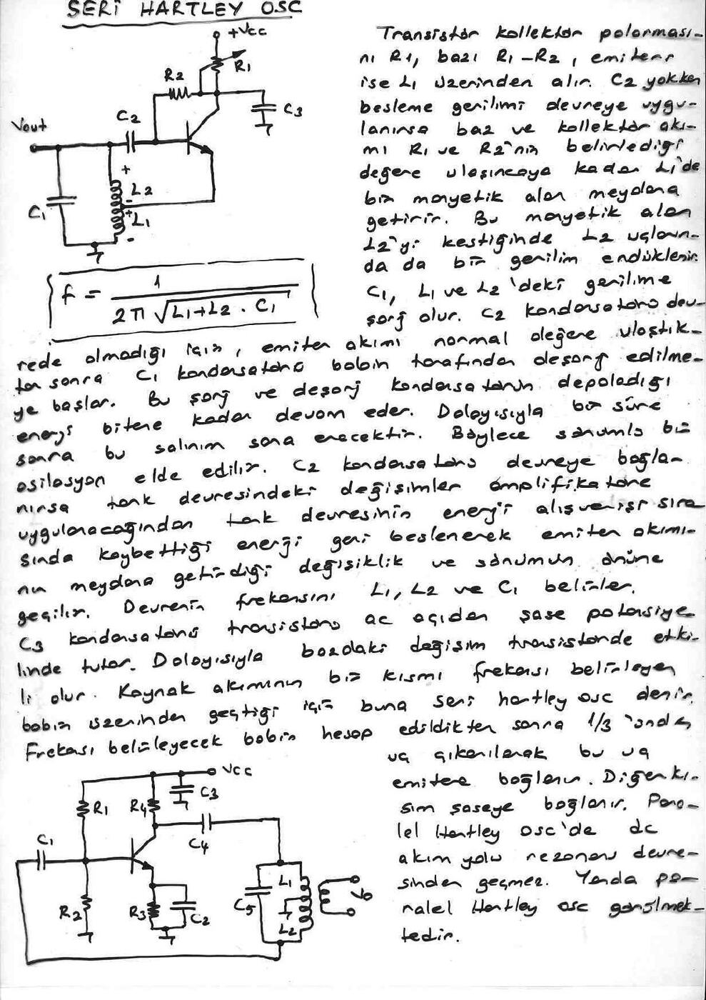

## Colpitts ve Clapp osilatörleri

Transistör kollektör polarmasını V_CC'den, bazı P₁, L₁ üzerinden, emiteri P₂ üzerinden alır. C₁, L₁'in alt ucunu ac açıdan şase potansiyelinde tutar. İyi bir sonuç almak için C₂, C₃'ün en az 10 katı büyüklükte olmalıdır. Devreye gerilim uygulandığında P₁, L₁ üzerinden geçen baz akımı neticesinde P₂ üzerinden emiter akımı geçer. P₂ ve V_BE gerilimleri C₂ ve C₃ kondansatörlerini şarj eder. Akım değişimi durduğunda C₂ ve C₃, L₁ tarafından deşarj edilirler. L₁ aldığı enerji ile C₂ ve C₃'ü bir öncekinin ters yönünde şarj eder. Baz, emiter akımları L₁, C₂ ve C₃'e bağımlı olarak değişir. L₁, C₂ ve C₃'ün ürettikleri frekansta bir akım geçmeye başlar. L₁'deki manyetik alan L₂'yi keseceğinden L₂ uçlarında da aynı frekansta sinüsoidal gerilim elde edilir.

- BJT'li Colpitts: **C_T = C₂ // C₃** (seri bağlı), **f = 1 / (2π √(L₁ C_T))**
- JFET'li Colpitts: **C_T = C₁ // C₂**, **f = 1 / (2π √(L₃ C_T))**
- Clapp osilatörü (L₃ ile seri C₃): **C_eş = C₁ // C₂ // C₃**, **f = 1 / (2π √(L₃ C_eş))**

*Not: Notta "//" işareti kondansatörlerin seri bağlanması anlamında kullanılmış; eşdeğer kapasitans 1/C_T = 1/C₁ + 1/C₂ (+ 1/C₃) ile hesaplanır.*

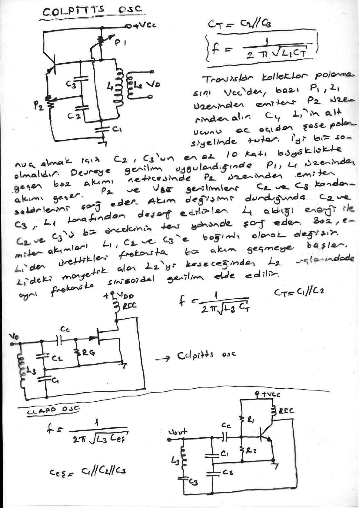

## Voltaj kontrollü osilatör (VCO)

Op-amp integratörün geri besleme kondansatörüne paralel bir PUT (programlanabilir tek eklemli transistör) bağlanır; −V_IN girişi kondansatörü doğrusal olarak şarj eder ve çıkış rampa şeklinde yükselir. PUT, anod (A) voltajı gate (G) voltajını aştığı anda iletime geçer ve kondansatörü deşarj eder; böylece testere dişi dalga elde edilir. Bu nedenle V_CONT geriliminin değeri, PUT'un kondansatörü deşarj etmek için iletime geçmeden önce çıkış voltajının erişebileceği genliği tespit eder ve bu değişim frekansı ayarlar.

### İntegral alıcı VCO devresi (566)

566, integral alıcı VCO devresine bir örnektir. Blok diyagramında görüldüğü gibi R₁, C₁ ve V_c ile ayarlanan frekansta kare ve üçgen dalga üretir. Blok diyagramı: V_c (5) → akım kaynağı (R₁ → 6, C₁ → 7) → Schmitt trigger → buffer amp → kare dalga (3); kondansatör gerilimi → buffer amp → üçgen dalga (4). Bacak bağlantıları: 1 GND, 2 NC, 3 kare dalga, 4 üçgen dalga, 5 V_c, 6 R₁, 7 C₁ (zaman ayarı), 8 V+.

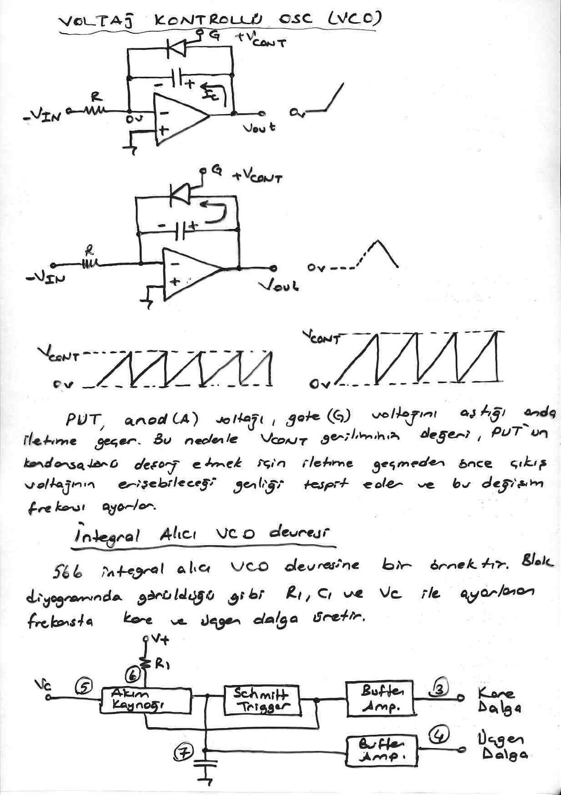

**566 tipik bağlantısı:** R₂ (1,5 kΩ) ve R₃ (10 kΩ) ile oluşturulan voltaj bölücü devre serbest çalışma (veya merkez) frekansını ayarlar. 5. bacaktaki voltaj V_c aşağıdaki alan içinde olmalıdır (V+ dc kaynak voltajıdır):

- **0,75 V+ ≤ V_c ≤ V+** ①

Değişken kontrol voltajı V_CONT, C₂ sayesinde 5 nolu uçtaki voltaj değişimi ile birleşir; böylece üretilen frekans aşağıdaki formülle bulunur:

- **f_o = 2 [(V+) − V_c] / (R₁ C₁ V+)** ②

Bir başka uygulama ise dc bir voltajın eşitlik ① ile ifade edilen limitler içinde olmak üzere 5 nolu kontrol girişine direkt olarak uygulanmasıdır. DC voltajdaki her değişme frekansın değişmesine sebep olur; V_c artarsa f_o azalır.

**Örnek:** +12 V beslemeli, R₁ = 10 kΩ, C₁ = 1 nF'lık 566 devresinde V_c 10 V'tan 11 V'a kadar değiştirilmektedir. Çıkış frekansındaki değişimi hesaplayınız.

- V_c = 10 V ⇒ f_o = 2(12 V − 10 V) / (10k · 1·10⁻⁹ · 12 V) = **33,33 kHz**
- V_c = 11 V ⇒ f_o = 2(12 V − 11 V) / (10k · 1·10⁻⁹ · 12) = **16,67 kHz**
- Çıkış frekansındaki değişme: Δf_o = 33,33 kHz − 16,67 kHz = **16,66 kHz**

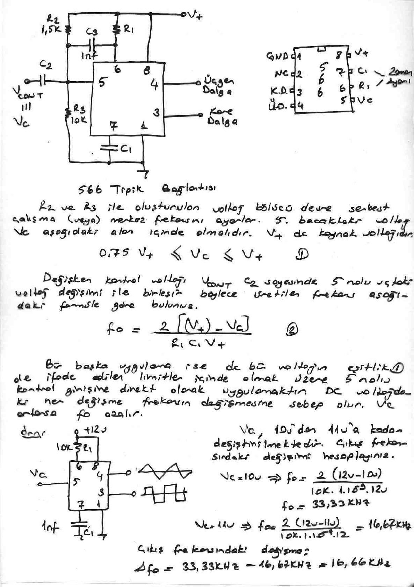

## Faz kilitli döngü (PLL)

PLL; bir faz dedektörü, bir alçak geçiren filtre ve bir voltaj kontrollü osilatörden (VCO) oluşan geri beslemeli bir devredir. Komünikasyon sistemlerinde, alıcılarda (TV), demodülatörlerde (FM), modemlerde ve dekoderlerde yaygın olarak kullanılır. Blok şeması: V_i (f_i) → faz dedektörü (V_e: f_i − f_o, f_i + f_o) → alçak geçiren filtre (V_d) → amplifikatör → VCO (V_c) → f_o faz dedektörüne geri döner.

Giriş sinyali olmadığında hata voltajı (V_e) 0'dır ve frekans VCO'nun ürettiği f_o temel frekansıdır; buna **serbest çalışma** veya **merkez frekansı** denir. Bir giriş sinyali uygulandığı zaman faz dedektörü giriş sinyalinin fazını ve frekansını VCO frekansı ile karşılaştırır ve hata voltajını üretir. Bu hata voltajı giren frekans ve VCO frekansının arasındaki faz ve frekans farkıyla orantılıdır. Hata voltajı karşılaştırılan iki frekansın fark ve toplam bileşenlerini kapsar: f_i − f_o, f_i + f_o. Alçak geçiren filtre yalnızca fark frekansını (V_d) geçirir ki bu iki bileşenden düşük olanıdır. Bu sinyal yükseltilerek VCO'ya V_c kontrol voltajı olarak geri beslenir. VCO frekansının f_i frekansını izlemesi beklenir. V_c ile VCO frekansını değiştirerek f_i'ye yaklaşan frekanslar üretir. Bu döngü f_i = f_o olana kadar devam eder; f_i = f_o olduğunda V_e = 0 olur.

- VCO'nun f_i'yi izleyebilmeye başladığı alt ve üst frekans sinyalleri aralığına **yakalama sahası** denir.
- VCO'nun f_i = f_o olduktan sonra oluşan sinyal değişimlerini izleyebildiği alt ve üst frekans aralığına **kilitleme sahası** denir.

")

### Toplam ve fark frekansları

Faz dedektörü bir çarpıcı gibi giriş frekansı f_i ve VCO frekansı f_o'nun toplam ve farkını üretir. V = V_p sin 2πft bir sinüsü ifade ederse giriş sinyali ve VCO voltajı:

- V_i = V_ip sin 2πf_i t, V_o = V_op sin 2πf_o t

Bu iki sinyal faz dedektöründe çarpıldığında (sin A · sin B = ½ [cos(A − B) − cos(A + B)]):

- V_out = V_ip V_op (sin 2πf_i t)(sin 2πf_o t)
- **V_out = (V_ip V_op/2) cos 2π(f_i − f_o)t − (V_ip V_op/2) cos 2π(f_i + f_o)t**

Görüldüğü gibi faz dedektörünün çıkışı fark frekansı bileşenini (f_i − f_o) ve toplam frekans bileşenini (f_i + f_o) içerir (spektrumda f_o, f_i − f_o, f_i ve f_i + f_o çizgileri).

### Eşit frekanslı iki sinüs

İki sinüs dalgası (eşit frekanslı) bir faz dedektörüne giriş olarak uygulandığında çıkış, sinyallerin faz açılarının farkıyla orantılı dc bir bileşene ve giriş frekansının iki katı ac bir bileşene sahiptir.

- V₁ = V_p1 sin 2πft, V₂ = V_p2 sin(2πft + φ) (φ: faz farkı)
- V_out = V_p1 V_p2 sin(2πft) sin(2πft + φ) = (V_p1 V_p2/2)[cos φ − cos(2π·2f·t + φ)]
- **V_out = (V_p1 V_p2/2) cos φ − (V_p1 V_p2/2) cos(2π·2f·t + φ)**

Bu eşitlikteki ilk terim, değeri faz açısı φ'ye bağlı olan terimdir:

- **V_out(dc) = V_p1 V_p2 cos φ / 2**, **cos φ = 2 V_out(dc) / (V_p1 V_p2)**

Faz dedektörü çıkışındaki bu iki bileşenden ac olan bileşen filtrelenir (A.G.F.), dc bileşen ise VCO'ya geri beslenir.

## 555 zamanlayıcı entegresi

İç yapı: V_CC (8) ile toprak (1) arasında üç eşit 5 kΩ direnç; K₁ karşılaştırıcısı eşik (6) ucunu 2/3 V_CC ile (kontrol gerilimi, 5), K₂ karşılaştırıcısı tetikleme (2) ucunu 1/3 V_CC ile karşılaştırır; çıkışları RS flip-flop'u sürer. Q̄ çıkışı çıkış güç katı (inverter) üzerinden çıkışa (3) ve boşaltma (deşarj) transistörüne (7) gider; silme (reset) ucu (4), V_ref = 2V_be'ye bağlı T₂ transistörü üzerinden flip-flop'u sıfırlar.

| R | S | Q | Q̄ |
|---|---|---|---|
| 0 | 0 | Q | Q̄ |
| 0 | 1 | 1 | 0 |
| 1 | 0 | 0 | 1 |
| 1 | 1 | Belirsiz | |

Entegreye 4,5–16 V arasında besleme yapılabilir. Çıkışından 200 mA'e kadar akım çekilebilir. Zamanlayıcı devresi olarak kullanıldığında R-C devresi yardımıyla µs ile dakikalar arasında zamanlama yapılabilir. V_CC gerilimi üç eşit direnç üzerinde paylaştırılmıştır. K₁ ve K₂ komparatörlerdir. T₂ transistörü RS F/F'in çıkışına göre (0–1) ya kesimde ya da doyumda çalışacağından çıkışta 0 ya da 1 olacaktır. İnverter hem tersleme yapar hem de akım kazancı sağlar. Uygulamalarda genellikle 2 ve 6 nolu uçlar birleştirilerek buraya bir RC devresi bağlanır. Dolayısıyla C üzerinde oluşan gerilim komparatörler için karşılaştırma gerilimlerinden biri olur.

Silme (4) nolu uç zamanlayıcıyı sıfırlar. T₂ PNP tipi bir transistördür. İletime geçirme için 4 nolu uca 2V_be'den daha negatif bir gerilim uygulanmalıdır. T₂ iletime geçtiğinde T₁'de iletime geçeceğinden 7 nolu uca bağlı olan kondansatör deşarj olacağından devre durumu sıfırlanır. Silme söz konusu değilse bu uç V_CC'ye (8) bağlanarak T₂ daima kesimde tutulur. 5 nolu uçla girişteki gerilimlerin değeri değiştirilebilir. Bu uç kullanılmıyorsa kondansatör üzerinden şase yapılır.

*Not: Notta sıfırlama ucu için paragraf başında "6 nolu uç" yazılmış; şemaya ve devamına göre silme (reset) ucu 4 numaradır.*

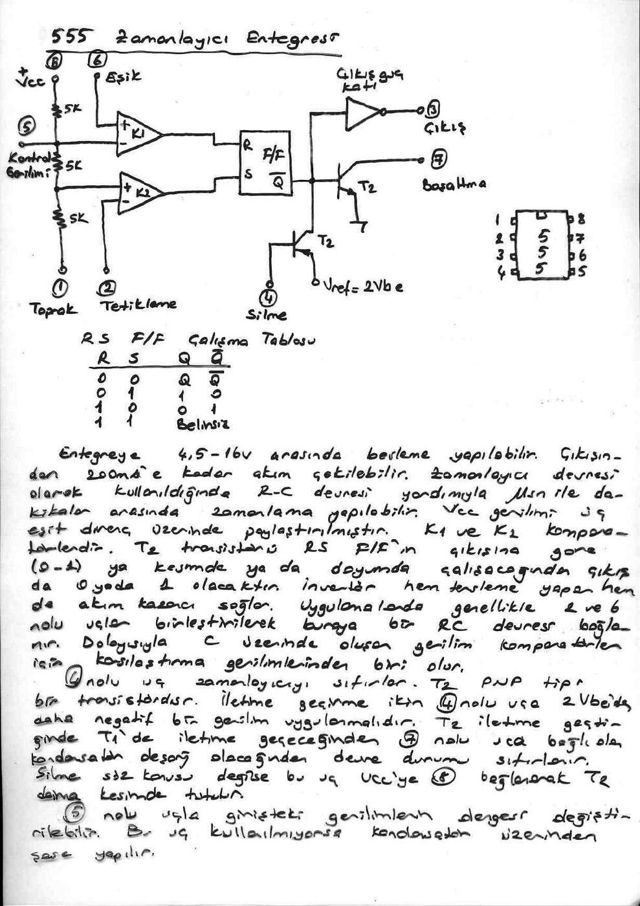

### 555'in astable multivibratör modunda çalışması

R_A, R_B ve C ile kurulan devrede kondansatör 1/3 V_CC ile 2/3 V_CC arasında şarj ve deşarj olur; çıkış kare dalgadır.

- **T_şarj = 0,693 (R_A + R_B) · C**
- **T_deşarj = 0,693 R_B · C**
- T = T_şarj + T_deşarj
- **f = 1/T = 1 / ((R_A + 2R_B) · C · 0,693) = 1,44 / ((R_A + 2R_B) C)**
- R_A ≫ V_CC/0,2 olmalıdır, yani R_A üzerindeki akım 200 mA'i geçmemelidir.

### 555'in monostable multivibratör modunda çalışması

Tetikleme sinyali (2) negatiftir. Multivibratör kararlıyken 0 çıkış verir. Negatif tetikleme geldiğinde çıkış 1 olur; bir süre sonra kendiliğinden kararlı duruma döner.

- **T_A = 1,1 · R_A · C** (kondansatör şarj zamanı)

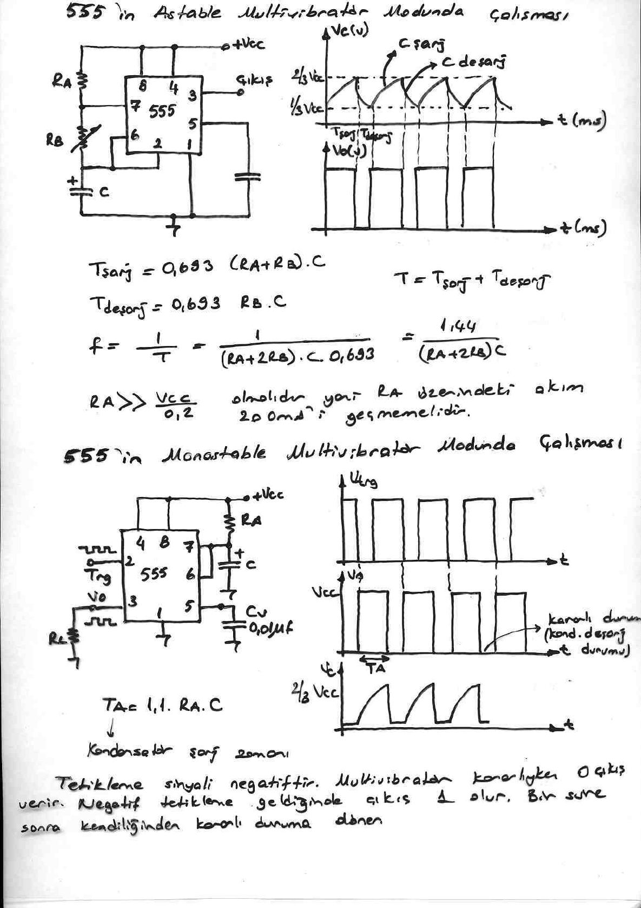

### 555 ile pals genişlik modülatörü devresi

Monostable bağlı 555'in 5 nolu kontrol ucuna modüle edici sinyal V_m uygulanır, 2 nolu uca ise tetikleme palsleri gelir. Kararlı durumda çıkış 0'dır. Pals uygulandığında çıkış 1'e gider. Burada (1,1 · R_A · C) süresi kadar kalarak tekrar kararlı duruma döner. (1,1 R_A C), kondansatörün referans gerilimin 2/3 V_CC'ye ulaştığı gerilimdir; V_CC (yani 5 nolu uçtaki gerilim) değiştikçe buradaki 1,1 katsayısı değişir. Böylece çıkış palslerinin genişliği V_m'ye göre değişir.

### Op-amp kullanılarak yapılan kare dalga üreteci

Çıkıştan (+) girişe R₁–R₂ bölücüsü ile pozitif, (−) girişe R üzerinden C'ye negatif geri besleme yapılır.

- α = R₂/(R₁ + R₂), V_R = α · V_out
- V_C = V_F + (V_i − V_F) e^(−t/RC)
- 0 < t ≤ T/2: V_F = V_out = +|V_sat|, V_i = −α|V_sat| → V_C = |V_sat| + (−α|V_sat| − |V_sat|) e^(−t/RC)
- T/2 < t < T: V_F = V_out = −|V_sat|, V_i = +α|V_sat| → V_C = −|V_sat| + (α|V_sat| + |V_sat|) e^(−(t − T/2)/RC)
- V_sat'ları yok edersek: (1 − α)/(1 + α) = e^(−T/2RC)
- **Kare dalga periyodu: T = −2RC ln((1 − α)/(1 + α))**

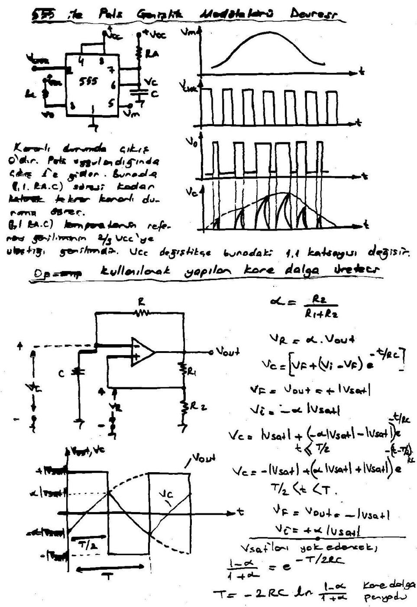
