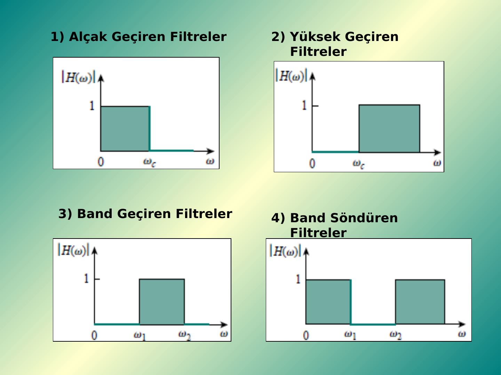
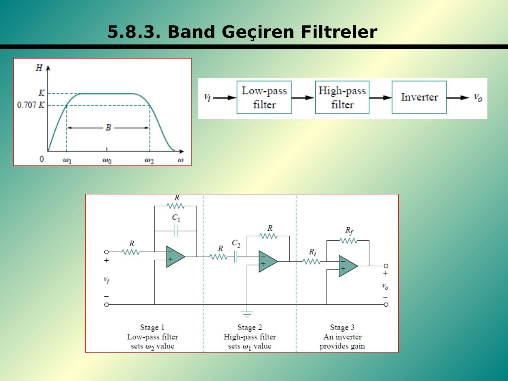
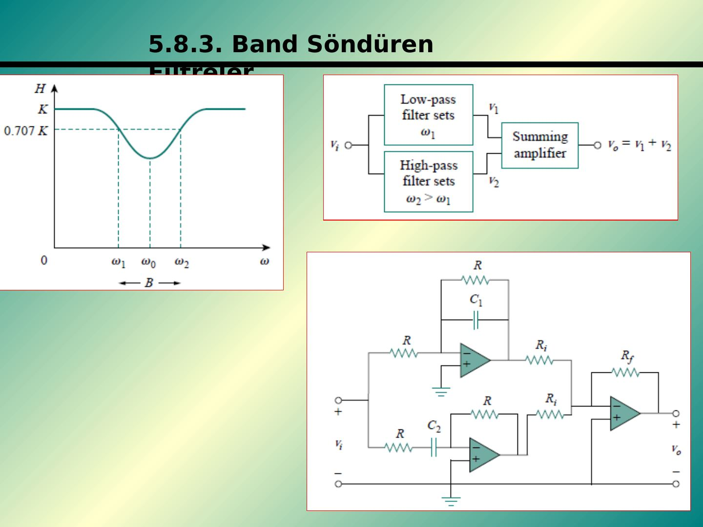

This post presents a 19-slide Turkish presentation on **passive and active filters**, kept together with the fall 2014 homework files in the EEM 311 Electronics II folder. The slides are numbered "5.7 Passive Filters" and "5.8 Active Filters", so they appear to be taken from the fifth chapter of a set of lecture notes. The author's name and institution are not given in the slides (only the name "Sibel" appears in the file properties); the figures and formulas appear to come from the frequency response chapter of Alexander & Sadiku's *Fundamentals of Electric Circuits*. The presentation was probably downloaded as a reference for the filter problems in the 2014 design assignment. The original PowerPoint file can be downloaded at the end of the post.

*This content belongs to a third-party source; it is shared for archival and nostalgic purposes with attribution. It will be removed at the request of the rights holder.*

## Passive filters

Filter circuits are circuits designed to pass a certain range of frequencies while rejecting or attenuating other frequency ranges. If a filter consists only of **R, L, C** elements, it is called a **passive filter**; if it contains **active elements** such as transistors and op-amps, it is called an **active filter**. There are four basic filter types: low-pass, high-pass, band-pass, and band-stop.

### Low-pass filter (series R, output across C)

H(ω) = V_o/V_i = (1/jωC) / (R + 1/jωC) = 1 / (1 + jωRC)

H(0) = 1, H(∞) = 0. The point where the power drops to half is the **cutoff frequency** ω_c: |H(ω_c)| = 1/√(1 + ω_c²R²C²) = 1/√2, which gives **ω_c = 1/RC**.

### High-pass filter (series C, output across R)

H(ω) = R / (R + 1/jωC) = jωRC / (1 + jωRC); H(0) = 0, H(∞) = 1, **ω_c = 1/RC**.

### Band-pass filter (series L–C, output across R)

H(ω) = R / (R + j(ωL − 1/ωC)). A band-pass filter can also be obtained by cascading a low-pass filter and a high-pass filter. The center frequency is **ω₀ = 1/√(LC)**.

### Band-stop filter (series R, output across L–C)

H(ω) = j(ωL − 1/ωC) / (R + j(ωL − 1/ωC)), with the center frequency again **ω₀ = 1/√(LC)**.

### Example 1: Filter type and cutoff frequency

R = 2 kΩ, L = 2 H, C = 2 μF; in the circuit L is in series, and R and C are in parallel at the output. a) What type of filter is this circuit? b) Calculate the corner (cutoff) frequency.

Since R ∥ (1/sC) = R/(1 + sRC),

H(s) = [R/(1 + sRC)] / [sL + R/(1 + sRC)] = R / (s²RLC + sL + R)

H(ω) = R / (R − ω²RLC + jωL)

At ω = 0, H = 1, and as ω → ∞, H = 0: the circuit operates as a **low-pass filter** (LPF). The magnitude is

|H| = R / √((R − ω²RLC)² + ω²L²)

and at the cutoff frequency |H| = 1/√2, i.e., 1/2 = R² / ((R − ω_c²RLC)² + ω_c²L²). Substituting the values gives **ω_c = 0.742 krad/s**.

### Example 2: Band-stop filter design

If a band-stop circuit consisting of a series R and a series L–C at the output provides attenuation at a center frequency of 200 Hz, what should L and C be? (R = 150 Ω, B = 100 Hz)

The circuit is a series resonant circuit: from B = 2π(100) rad/s and B = R/L, **L = 0.2387 H**; from ω₀ = 2π(200) = 400π and ω₀ = 1/√(LC), **C = 2.66 μF**.

*Note: We checked the results of the two examples; they are correct (in Example 1, ω_c ≈ 742 rad/s).*

## Active filters

### First-order low-pass filter

In an inverting op-amp configuration with Z_i = R_i and Z_f = R_f ∥ (1/jωC_f):

H(ω) = −Z_f/Z_i = −(R_f/R_i) · 1/(1 + jωC_f R_f), **ω_c = 1/(R_f C_f)**

At ω = 0 the function takes the value −R_f/R_i (the passband gain).

### First-order high-pass filter

Z_i = R_i + 1/jωC_i, Z_f = R_f:

H(ω) = −R_f/(R_i + 1/jωC_i) = −jωC_i R_f / (1 + jωC_i R_i), **ω_c = 1/(R_i C_i)**

### Band-pass filter: cascaded structure

A low-pass stage (determines ω₂), a high-pass stage (determines ω₁), and an inverting stage providing the gain are connected in cascade:

H(ω) = (−1/(1 + jωC₁R)) · (−jωC₂R/(1 + jωC₂R)) · (−R_f/R_i)

ω₂ = 1/(RC₁) (LPF), ω₁ = 1/(RC₂) (HPF), ω₀ = √(ω₁ω₂), B = ω₂ − ω₁, Q = ω₀/B

### Band-stop filter: summing structure

The outputs of the low-pass (ω₁) and high-pass (ω₂ > ω₁) stages are combined in a summer: v_o = v₁ + v₂.

H(ω) = −(R_f/R_i) (−1/(1 + jωC₁R) − jωC₂R/(1 + jωC₂R))

### Example 3: Active low-pass filter design

Design an active low-pass filter with a gain of 4 and a cutoff frequency of 500 Hz.

ω_c = 2πf_c = 2π·500 = 1/(R_f C_f); gain H(0) = −R_f/R_i = −4. If C_f = 0.2 μF is chosen, **R_f = 1/(2π·500·0.2·10⁻⁶) = 1.59 kΩ** and **R_i = R_f/4 = 397.5 Ω**.

*Note: Taking R_f = 1591.5 Ω gives R_i = 397.9 Ω; the 397.5 Ω on the slide comes from rounding.*

### Example 4: Active band-pass filter design

Design a band-pass filter with K = 10, R = 20 kΩ, and corner frequencies of 250 Hz and 3000 Hz.

If ω₁ = 1/(RC₂), then **C₂ = 1/(Rω₁) = 31.83 nF**; similarly, if ω₂ = 1/(RC₁), then **C₁ = 1/(Rω₂) = 2.65 nF**. With the relation on the slide, R_f/R_i = Kω₂/(ω₁ + ω₂) = 9.223; if R_i = 10 kΩ is chosen, R_f = 92 kΩ.

*Note: The gain relation is written inverted. At the center frequency ω₀ = √(ω₁ω₂), the product of the magnitudes of the two RC stages is ω₂/(ω₁ + ω₂), so the passband gain is K = (R_f/R_i)·ω₂/(ω₁ + ω₂); that is, R_f/R_i = K(ω₁ + ω₂)/ω₂ = 10·(1570.8 + 18850)/18850 ≈ 10.83. For R_i = 10 kΩ, R_f ≈ 108 kΩ is required; with 92 kΩ the center gain is only about 8.5.*
