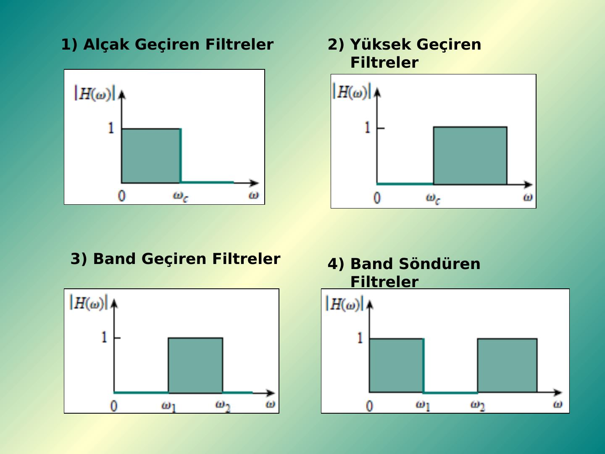
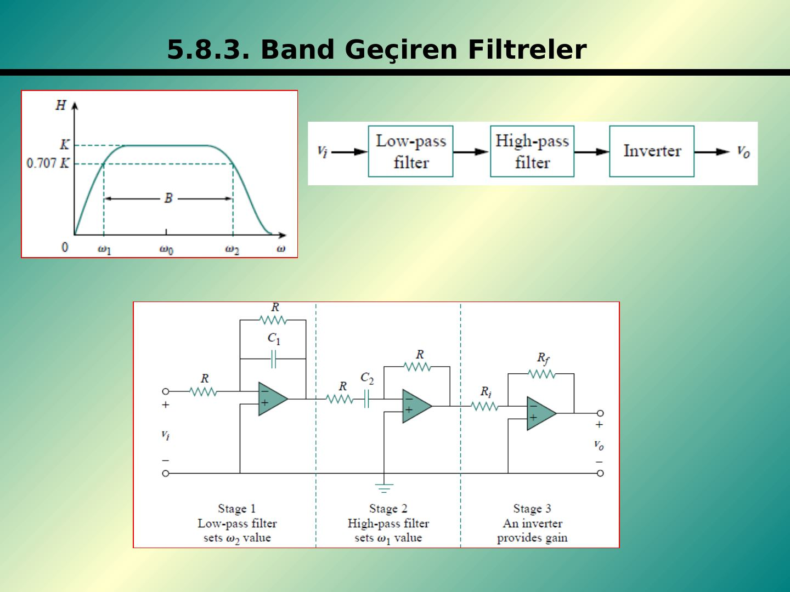
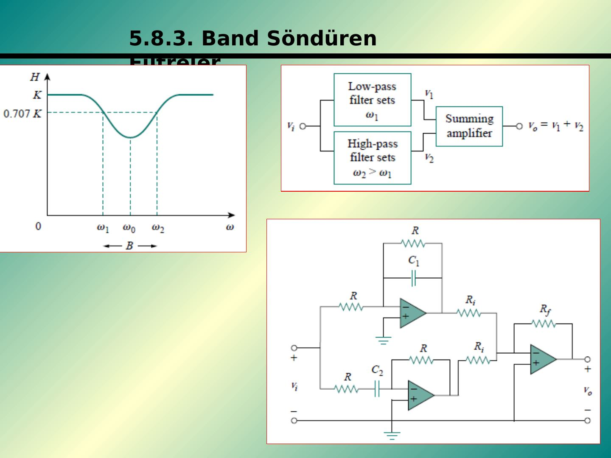

Bu yazı, EEM 311 Elektronik II klasöründe 2014 güz dönemi ödev dosyalarıyla birlikte saklanan, **pasif ve aktif filtreleri** anlatan 19 slaytlık Türkçe bir sunumu aktarıyor. Slaytlar "5.7 Pasif Filtreler" ve "5.8 Aktif Filtreler" diye numaralandığı için bir ders notunun beşinci bölümünden alınmış görünüyor. Hazırlayanın adı ve kurumu slaytlarda yazmıyor (dosya özelliklerinde yalnızca "Sibel" adı var); şekiller ve formüllerin Alexander & Sadiku'nun *Fundamentals of Electric Circuits* kitabının frekans cevabı bölümünden alındığı anlaşılıyor. Sunum muhtemelen 2014 tasarım ödevindeki filtre soruları için kaynak olarak indirilmiş. Orijinal PowerPoint dosyası yazının sonunda indirilebilir.

*Bu içerik üçüncü taraf bir kaynağa aittir; arşiv ve nostalji amacıyla kaynak belirtilerek paylaşılmıştır. Hak sahibinin talebi hâlinde kaldırılır.*

## Pasif filtreler

Filtre devreleri, belirli bir frekans aralığını geçirmek, diğer frekans aralıklarını ise söndürmek ya da zayıflatmak için tasarlanan devrelerdir. Filtre yalnızca **R, L, C** elemanlarından oluşuyorsa **pasif filtre**, transistör ve op-amp gibi **aktif elemanlar** içeriyorsa **aktif filtre** adını alır. Dört temel filtre türü vardır: alçak geçiren, yüksek geçiren, bant geçiren ve bant söndüren.

### Alçak geçiren filtre (seri R, çıkış C üzerinde)

H(ω) = V_o/V_i = (1/jωC) / (R + 1/jωC) = 1 / (1 + jωRC)

H(0) = 1, H(∞) = 0. Gücün yarıya düştüğü nokta **kesim frekansı** ω_c'dir: |H(ω_c)| = 1/√(1 + ω_c²R²C²) = 1/√2, buradan **ω_c = 1/RC**.

### Yüksek geçiren filtre (seri C, çıkış R üzerinde)

H(ω) = R / (R + 1/jωC) = jωRC / (1 + jωRC); H(0) = 0, H(∞) = 1, **ω_c = 1/RC**.

### Bant geçiren filtre (seri L–C, çıkış R üzerinde)

H(ω) = R / (R + j(ωL − 1/ωC)). Bant geçiren filtre, bir alçak geçiren ile bir yüksek geçiren filtrenin art arda bağlanmasıyla da elde edilebilir. Merkez frekansı **ω₀ = 1/√(LC)**.

### Bant söndüren filtre (seri R, çıkış L–C üzerinde)

H(ω) = j(ωL − 1/ωC) / (R + j(ωL − 1/ωC)), merkez frekansı yine **ω₀ = 1/√(LC)**.

### Örnek 1: Filtrenin türü ve kesim frekansı

R = 2 kΩ, L = 2 H, C = 2 μF; devrede L seri, R ve C çıkışta paralel. a) Devre ne tür bir filtredir? b) Köşe (kesim) frekansını hesaplayınız.

R ∥ (1/sC) = R/(1 + sRC) olduğundan

H(s) = [R/(1 + sRC)] / [sL + R/(1 + sRC)] = R / (s²RLC + sL + R)

H(ω) = R / (R − ω²RLC + jωL)

ω = 0'da H = 1, ω → ∞'da H = 0: devre **alçak geçiren filtre** (AGF) olarak çalışır. Genlik

|H| = R / √((R − ω²RLC)² + ω²L²)

ve kesim frekansında |H| = 1/√2, yani 1/2 = R² / ((R − ω_c²RLC)² + ω_c²L²). Değerler yerine yazılırsa **ω_c = 0,742 krad/s**.

### Örnek 2: Bant söndüren filtre tasarımı

Seri R ve çıkışta seri L–C'den oluşan bant söndüren devre 200 Hz merkez frekansında sönümleme yapıyorsa L ve C ne olmalıdır? (R = 150 Ω, B = 100 Hz)

Devre bir seri rezonans devresidir: B = 2π(100) rad/s ve B = R/L'den **L = 0,2387 H**; ω₀ = 2π(200) = 400π ve ω₀ = 1/√(LC)'den **C = 2,66 μF**.

*Not: İki örneğin sonuçlarını kontrol ettik; doğru (Örnek 1'de ω_c ≈ 742 rad/s).*

## Aktif filtreler

### Birinci dereceden alçak geçiren filtre

Eviren op-amp yapısında Z_i = R_i ve Z_f = R_f ∥ (1/jωC_f):

H(ω) = −Z_f/Z_i = −(R_f/R_i) · 1/(1 + jωC_f R_f), **ω_c = 1/(R_f C_f)**

ω = 0'da fonksiyon −R_f/R_i değerini alır (geçirme bandı kazancı).

### Birinci dereceden yüksek geçiren filtre

Z_i = R_i + 1/jωC_i, Z_f = R_f:

H(ω) = −R_f/(R_i + 1/jωC_i) = −jωC_i R_f / (1 + jωC_i R_i), **ω_c = 1/(R_i C_i)**

### Bant geçiren filtre: kaskat yapı

Alçak geçiren kat (ω₂'yi belirler), yüksek geçiren kat (ω₁'i belirler) ve kazancı sağlayan bir eviren kat art arda bağlanır:

H(ω) = (−1/(1 + jωC₁R)) · (−jωC₂R/(1 + jωC₂R)) · (−R_f/R_i)

ω₂ = 1/(RC₁) (AGF), ω₁ = 1/(RC₂) (YGF), ω₀ = √(ω₁ω₂), B = ω₂ − ω₁, Q = ω₀/B

### Bant söndüren filtre: toplayıcılı yapı

Alçak geçiren (ω₁) ve yüksek geçiren (ω₂ > ω₁) katların çıkışları bir toplayıcıda birleştirilir: v_o = v₁ + v₂.

H(ω) = −(R_f/R_i) (−1/(1 + jωC₁R) − jωC₂R/(1 + jωC₂R))

### Örnek 3: Alçak geçiren aktif filtre tasarımı

Kazancı 4, kesim frekansı 500 Hz olan alçak geçiren aktif filtre tasarlayınız.

ω_c = 2πf_c = 2π·500 = 1/(R_f C_f); kazanç H(0) = −R_f/R_i = −4. C_f = 0,2 μF seçilirse **R_f = 1/(2π·500·0,2·10⁻⁶) = 1,59 kΩ** ve **R_i = R_f/4 = 397,5 Ω**.

*Not: R_f = 1591,5 Ω alındığında R_i = 397,9 Ω çıkar; slayttaki 397,5 Ω yuvarlamadan kaynaklanıyor.*

### Örnek 4: Bant geçiren aktif filtre tasarımı

K = 10, R = 20 kΩ olan, geçiş frekansları 250 Hz ile 3000 Hz olan bant geçiren filtreyi tasarlayınız.

ω₁ = 1/(RC₂) ise **C₂ = 1/(Rω₁) = 31,83 nF**; benzer şekilde ω₂ = 1/(RC₁) ise **C₁ = 1/(Rω₂) = 2,65 nF**. Slayttaki bağıntıyla R_f/R_i = Kω₂/(ω₁ + ω₂) = 9,223; R_i = 10 kΩ seçilirse R_f = 92 kΩ olur.

*Not: Kazanç bağıntısı ters yazılmış. Merkez frekansı ω₀ = √(ω₁ω₂)'de iki RC katının genlik çarpımı ω₂/(ω₁ + ω₂) olduğundan geçirme bandı kazancı K = (R_f/R_i)·ω₂/(ω₁ + ω₂)'dir; yani R_f/R_i = K(ω₁ + ω₂)/ω₂ = 10·(1570,8 + 18850)/18850 ≈ 10,83. R_i = 10 kΩ için R_f ≈ 108 kΩ olmalıdır; 92 kΩ ile merkez kazancı yaklaşık 8,5 kalır.*
