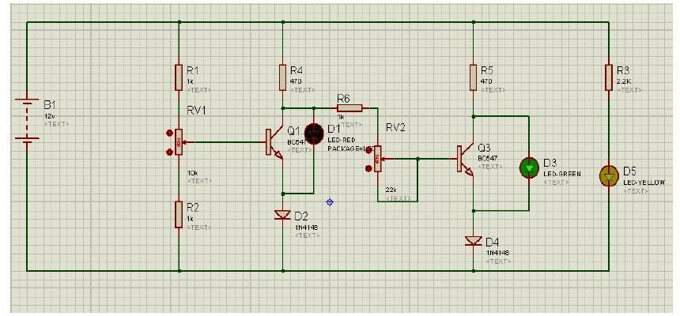
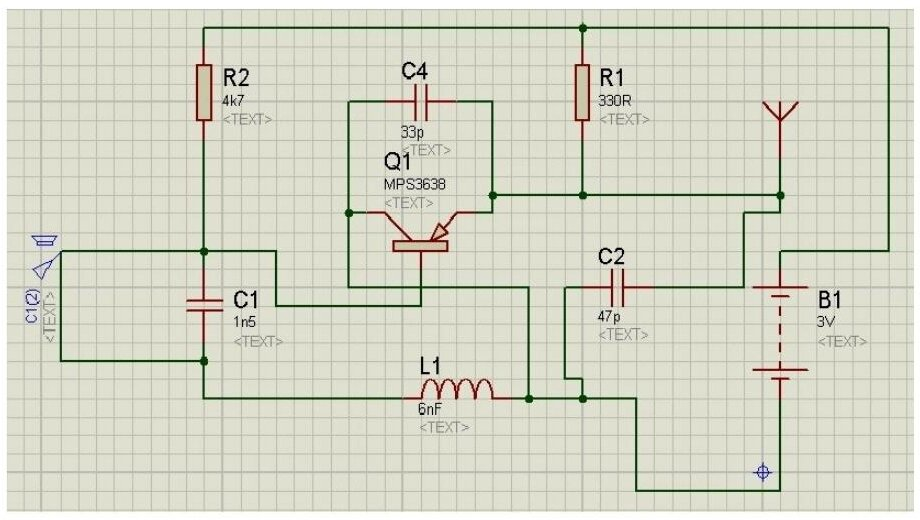

This post brings together **three reports** prepared by classmates for the **project assignment** of the EEM 311 Electronics II course (an assignment in which each student designs their own circuit, builds it on a board, and writes a report; see the 2013 fall course content form and the project assignment post for the rules):

- **A circuit that shows battery status with LEDs** (2013-2014 fall semester project),
- **An FM transmitter circuit** (January 2014),
- **Transistor control with an LDR** (August 8, 2016, a report and preliminary work prepared as the "10 – Final" experiment of the summer school laboratory).

Names and student numbers in the reports have been masked, and the datasheet pages attached to the reports (BC546–BC550 and the VT900 series LDR) have been removed. Photos of the boards and the datasheet PDFs in the folder have not been published. The three masked reports can be downloaded as a ZIP at the end of the post.

## Project 1: Battery status indicator circuit with LED lamps

The circuit is a battery status indicator that lights a **green** LED when the battery is fully charged, a **yellow** LED when it is normal, and a **red** LED when it is low.

**Operating principle.** When the battery is connected, the yellow LED indicates that the battery is attached. The first transistor turns on depending on the battery voltage: when it is conducting, the red LED is off; when it is not conducting (battery weak), the red LED is on. The second transistor is used as an **inverter** (NOT gate) of the first one's output; when the red LED goes off, the green LED turns on. The adjustable resistor **RV2 (22 kΩ)** is important here: as its value increases, the gap between the red LED turning off and the green LED turning on closes, and the two states even overlap; when its value decreases, a gap appears between the two LEDs. This results from changing the turn-on threshold of the second transistor with RV2. In short, **RV1** sets the battery voltage threshold, and **RV2** sets the LED transition threshold (the base resistance of the second transistor).

**Construction.** The circuit was drawn in Proteus and converted into a PCB layout in Ares; the printout was transferred to a copper board with an iron, the board was left in acid so that only the conductive tracks remained, the holes were drilled, and the components were soldered.

**Components:** R1 = R2 = R4 = 1 kΩ, R3 = R5 = 470 Ω, R6 = 2.2 kΩ, RV1 = 10 kΩ potentiometer, RV2 = 22 kΩ potentiometer, Q1 = Q2 = BC547, D1 = D2 = 1N4148.

**Takeaways and difficulties.** According to the report, this project taught the student how to turn circuits drawn in Proteus into a real board for the first time. The circuit did not work on the first attempt: the red LED and one of the transistors turned out to be faulty, so they were replaced and the solder joints were corrected one by one; afterwards, it was noticed that one LED had been connected backwards. After the fix, the brightness of the green LED varied with the applied voltage; at low voltage, adjusting RV1 made the green LED go off and the red LED come on.

*Note: In the text and component list of the report the transistors are called Q1 and Q2, whereas they are labeled Q1 and Q3 in the Proteus schematic; the R values in the schematic also do not fully match the component list (the schematic shows R3 = 2.2 kΩ and R6 = 1 kΩ).*

## Project 2: FM transmitter circuit

A circuit that broadcasts sound taken from a microphone or an audio input on a radio frequency. The report author's goal was to connect the songs on their phone to the circuit with an aux cable and listen to them through a car radio that has no audio input.

**Operating principle.** The report does not explain the operation of the circuit in detail; based on knowledge gained from other circuits, it states that the volume of the transmitted sound increases as the value of C1 is increased. The coil was made by winding 0.8 mm wire 6 times; the transmission frequency can be adjusted by changing the spacing between the turns.

**Components:** R1 = 330 Ω, R2 = 4.7 kΩ, C1 = 1.5 nF, C2 = 47 pF, C4 = 33 pF, L1 = 6 turns of 0.8 mm wire, Q1 = BF606 (as given in the report), 3 V battery.

**Construction.** The circuit drawn in Proteus was converted into a PCB layout in Ares; the printout was stuck onto the copper board with an iron, the copper outside the conductive tracks was etched away in acid, the toner was wiped off with thinner, the holes were drilled, and the components were soldered.

**What the project contributed.** The most striking part of the report is the student's candid assessment: they initially regarded the project as an unnecessary assignment and only started after seeing their classmates do it with enthusiasm; while searching the internet for projects, they realized that they had not been able to put what they had learned over three years into practice, and understood that a grade point average alone means nothing. Since the components were not available at school, they went to Konya Street in Ankara, and because of poor-quality solder wire they had to solder the circuit all over again. Despite searching for the frequency on the radio for two hours, they could not find the broadcast, but a check with an oscilloscope showed that the circuit was working. The report ends with thanks to the instructor for giving such a project assignment.

*Note: In the Proteus schematic the transistor appears as MPS3638, while the component list says BF606; the L1 label in the schematic also reads "6nF" (it should be nH for an inductance). The component mounted on the board is most likely the one in the list.*

## Project 3: Transistor control with an LDR (2016)

The report was prepared as the report and preliminary work of the **"10 – Final"** experiment performed in laboratory A-407 on August 8, 2016.

**Purpose of the experiment:** To understand how the LDR, which is frequently used in industrial lighting, control systems, digital counters, and some medical devices, is used.

**Background (summary from the report).** The LDR (Light Dependent Resistor, photoresistor) is the simplest optical sensor, whose resistance changes inversely and nonlinearly with the intensity of the light falling on it: in full light its resistance can drop to a few ohms (5–10 Ω), and in complete darkness it can rise to the order of 200 MΩ; it behaves the same way with AC and DC. It is made by placing materials such as cadmium sulfide and cadmium selenide on an insulating substrate and running thin spiral conductive tracks over it, and its surface is covered with transparent plastic. Its light sensitivity depends on the surface area and the lens type; it degrades at excessive temperatures (above about 60 °C). It is most often used in the lighting industry and in light-controlled robot/automation projects.

**Preliminary work:** To draw the circuit in the figure in Proteus and examine it; to obtain the voltage and current values across all the resistors in the circuit.

**Component list:** 1 × 10 kΩ and 2 × 330 Ω resistors, 1 × BC237 transistor, 1 × LED, 1 × LDR.

**Circuit (Figure 1.0):** A voltage divider formed by R1 = 10 kΩ and the LDR from the supply rail drives the base of the transistor (base resistor R2 = 330 Ω); the collector has a 330 Ω resistor and an LED. Depending on the lighting condition, the transistor turns on and lights the LED, or turns off and extinguishes it.

**Procedure:** To build the circuit and examine its operation; for the "On" state of the LDR, to measure the voltages and currents on resistors R1, R2, and R3, compare them with the theoretical solution from the preliminary work, and enter them in the table; to comment on the purpose of the circuit, the result, and the possible margin of error.

*Note: The measurement table and the commentary section in this report were left blank; the document consists mostly of the lab handout and the background text. In the background section the LDR is at times called a "photodiode"; an LDR is a photoresistor. Also, the material used in its construction is not "calcium sulfate" but cadmium sulfide (CdS).*
