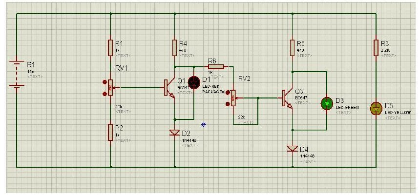
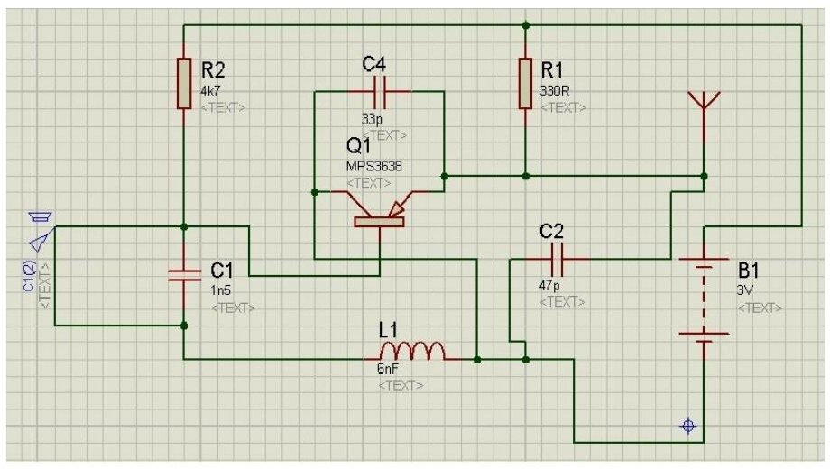

Bu yazı, EEM 311 Elektronik II dersinin **proje ödevi** kapsamında (her öğrencinin kendi devresini tasarlayıp plakete kurduğu ve raporladığı ödev; kuralları için 2013 güz ders içerik formu ve proje ödevi yazısına bakılabilir) arkadaşların hazırladığı **üç raporu** bir araya getiriyor:

- **LED'lerle pil durumunu gösteren devre** (2013-2014 güz dönemi projesi),
- **FM verici devre** (Ocak 2014),
- **LDR ile transistör kontrolü** (8 Ağustos 2016, yaz okulu laboratuvarının "10 – Final" deneyi olarak hazırlanmış rapor ve ön çalışma).

Raporlardaki ad ve öğrenci numaraları kapatıldı; raporlara eklenmiş datasheet sayfaları (BC546–BC550 ve VT900 serisi LDR) çıkarıldı. Plaketlerin fotoğrafları ve klasördeki datasheet PDF'leri yayınlanmadı. Maskelenmiş üç rapor yazının sonunda ZIP olarak indirilebilir.

## Proje 1: LED lambalarla pil durumunu gösteren devre

Devre, pil tam dolu olduğunda **yeşil**, normal olduğunda **sarı**, azaldığında **kırmızı** LED'in yanmasını sağlayan bir pil durum göstergesi.

**Çalışma mantığı.** Pil takıldığında sarı LED pilin takılı olduğunu gösterir. Birinci transistör pilin gerilimine göre iletime geçer: iletimdeyken kırmızı LED söner, iletime geçmediğinde (pil zayıfken) kırmızı LED yanar. İkinci transistör birincinin çıkışını tersleyen bir **değilleyici** olarak kullanılır; kırmızı LED söndüğünde yeşil LED yanar. Burada **RV2 (22 kΩ)** ayarlı direnci önemli: değeri büyüdükçe kırmızı LED'in sönmesi ile yeşil LED'in yanması arasındaki boşluk kapanır, hatta iki durum üst üste biner; değeri küçüldüğünde ise iki LED arasında boşluk oluşur. Bu, ikinci transistörün iletime geçme eşiğinin RV2 ile değiştirilmesinden kaynaklanır. Kısacası **RV1** pil geriliminin eşiğini, **RV2** LED'lerin geçiş eşiğini (ikinci transistörün baz direncini) ayarlar.

**Yapım.** Devre Proteus'ta çizildi, Ares'te baskı devreye dönüştürüldü; çıktı ütüyle bakır plakaya aktarıldı, plaka asitte bekletilerek yalnız iletim yolları bırakıldı, delikler delinip elemanlar lehimlendi.

**Malzemeler:** R1 = R2 = R4 = 1 kΩ, R3 = R5 = 470 Ω, R6 = 2,2 kΩ, RV1 = 10 kΩ potansiyometre, RV2 = 22 kΩ potansiyometre, Q1 = Q2 = BC547, D1 = D2 = 1N4148.

**Kazanımlar ve zorluklar.** Rapora göre bu proje, Proteus'ta çizilen devrelerin ilk kez gerçek bir plakete dönüştürülmesini öğretti. İlk denemede devre çalışmadı: kırmızı LED ve transistörlerden biri bozuk çıktı, bunlar değiştirilip lehimler tek tek düzeltildi; sonra bir LED'in ters bağlandığı fark edildi. Düzeltmeden sonra yeşil LED'in parlaklığı verilen gerilimle değişti; düşük gerilimde RV1 ayarlanınca yeşil LED sönüp kırmızı LED yandı.

*Not: Raporun metninde ve malzeme listesinde transistörler Q1 ve Q2 diye geçiyor, Proteus şemasında ise Q1 ve Q3 olarak etiketlenmiş; şemadaki R değerleri ile malzeme listesi de tam örtüşmüyor (şemada R3 = 2,2 kΩ, R6 = 1 kΩ görünüyor).*

## Proje 2: FM verici devre

Mikrofondan ya da ses girişinden alınan sesi bir radyo frekansında yayınlayan devre. Rapor sahibinin amacı, ses girişi olmayan araba radyosunda telefondaki şarkıları aux kablosuyla devreye bağlayıp radyodan dinlemekti.

**Çalışma prensibi.** Raporda devrenin çalışması ayrıntılı açıklanmıyor; başka devrelerden edinilen bilgiye göre C1'in değeri artırıldıkça verilen sesin arttığı belirtiliyor. Bobin 0,8 mm'lik telin 6 kez sarılmasıyla yapıldı; sarımlar arası açıklık değiştirilerek yayın frekansı ayarlanabiliyor.

**Elemanlar:** R1 = 330 Ω, R2 = 4,7 kΩ, C1 = 1,5 nF, C2 = 47 pF, C4 = 33 pF, L1 = 0,8 mm telden 6 sarım, Q1 = BF606 (raporda böyle), 3 V pil.

**Yapım.** Proteus'ta çizilen devre Ares'te baskı devreye çevrildi; çıktı ütüyle bakır plakaya yapıştırıldı, asitte iletim yolları dışındaki bakır eritildi, tinerle boya silindi, delikler delinip elemanlar lehimlendi.

**Projenin kattıkları.** Raporun en dikkat çekici kısmı öğrencinin içtenlikle yazdığı değerlendirme: projeyi başta gereksiz bir ödev olarak görmüş, arkadaşlarının keyifle yaptığını görünce başlamış; internette proje araştırırken üç yılda öğrendiklerini pratiğe dökemediğini fark etmiş ve not ortalamasının tek başına bir şey ifade etmediğini anlamış. Malzemeler okulda bulunmadığı için Ankara'daki Konya Sokağı'na gitmiş, kalitesiz lehim teli yüzünden devreyi baştan lehimlemek zorunda kalmış. Radyoda iki saat frekans aramasına rağmen yayını bulamamış, ancak osiloskopla yapılan kontrolde devrenin çalıştığı görülmüş. Rapor, böyle bir proje ödevi verdiği için hocaya teşekkürle bitiyor.

*Not: Proteus şemasında transistör MPS3638 olarak görünüyor, malzeme listesinde BF606 yazıyor; şemadaki L1 etiketi de "6nF" (endüktans için nH olmalı). Plakete takılan eleman büyük olasılıkla listedeki.*

## Proje 3: LDR ile transistör kontrolü (2016)

Rapor, 8 Ağustos 2016'da A-407 laboratuvarında yapılan **"10 – Final"** deneyinin rapor ve ön çalışması olarak hazırlanmış.

**Deneyin amacı:** Endüstriyel aydınlatmada, kumanda sistemlerinde, dijital sayıcılarda ve bazı tıbbi cihazlarda sıkça kullanılan LDR'nin nasıl kullanıldığını kavramak.

**Ön bilgi (rapordan özet).** LDR (Light Dependent Resistor, foto direnç), üzerine düşen ışık şiddetiyle direnci ters orantılı ve doğrusal olmayan biçimde değişen en basit optik sensördür: tam aydınlıkta direnci birkaç ohm'a (5–10 Ω) kadar düşebilir, tam karanlıkta 200 MΩ mertebesine çıkabilir; AC ve DC'de aynı davranışı gösterir. Kadmiyum sülfür ve kadmiyum selenür gibi maddeler yalıtkan bir taban üzerine yerleştirilip üzerinden ince sarmal iletken yollar geçirilerek yapılır, yüzeyi saydam plastikle kaplanır. Işığa duyarlılığı yüzey büyüklüğüne ve lens tipine bağlıdır; aşırı sıcaklıkta (yaklaşık 60 °C üzerinde) bozulur. En sık aydınlatma sektöründe ve ışıkla kontrol edilen robot/otomasyon projelerinde kullanılır.

**Ön çalışma:** Şekildeki devrenin Proteus çizimini yapıp incelemek; devredeki tüm dirençlerin üzerindeki gerilim ve akım değerlerini elde etmek.

**Malzeme listesi:** 1 × 10 kΩ ve 2 × 330 Ω direnç, 1 × BC237 transistör, 1 × LED, 1 × LDR.

**Devre (Şekil 1.0):** Besleme hattından R1 = 10 kΩ ve LDR'den oluşan gerilim bölücü transistörün bazını sürüyor (baz direnci R2 = 330 Ω); kolektörde 330 Ω'luk direnç ve LED var. Işık durumuna göre transistör iletime geçip LED'i yakıyor ya da söndürüyor.

**İşlem basamakları:** Devreyi kurup çalışmasını incelemek; LDR'nin "On" durumu için R1, R2 ve R3 dirençlerindeki gerilim ve akımları ölçüp ön çalışmadaki teorik çözümle karşılaştırarak tabloya yazmak; devrenin amacını, sonucunu ve olası hata payını yorumlamak.

*Not: Bu rapordaki ölçüm tablosu ve yorum kısmı boş bırakılmış; belge daha çok föy ve ön bilgi metninden oluşuyor. Ön bilgi kısmında LDR yer yer "foto diyot" diye anılıyor; LDR bir foto dirençtir. Ayrıca yapımında kullanılan madde "kalsiyum sülfat" değil kadmiyum sülfürdür (CdS).*
