This post brings together five midterm exams from 2003–2006 of the Başkent University course **EEM312 Digital Electronics** (Prof. Dr. Emin Akata), together with their solutions: the 1st midterm of 2003, the 1st and 2nd midterms of 2004, the 1st midterm of 2005, and the 2006 midterm. The questions and the instructor's solutions have been typed up; the circuit figures are included as images. The original Word files can be downloaded as a ZIP at the end of the post.

The basic MOSFET relations used in the solutions (long channel, k = ½ µC_ox W/L):

- Saturation: I_D = k (V_GS − V_T)²  or  I_D = (k′/2)(W/L)(V_GS − V_T)² (1 + λV_DS)
- Linear (triode/resistive): I_D = k′(W/L) [(V_GS − V_T) V_DS − V_DS²/2]
- Body effect: V_T = V_T0 + γ (√(|−2φ_F| + V_SB) − √|−2φ_F|)
- Unified model: I_D = k′(W/L) [(V_GS − V_T) V_min − V_min²/2] (1 + λV_DS), V_min = min(V_GS − V_T, V_DS, V_DSAT)

## 2003 – 1st midterm (12.04.2003)

### Question 1 (20 pts)

- **a)** In a pn junction where the n region is doped 10 times more heavily than the p region, on which side is the depletion region wider, and by what ratio? **Answer:** On the more lightly doped p side; the width on the p side is 10 times that on the n side.
- **b)** Show the levels V_OH, V_IH, V_OL and V_IL on the figure (NM_H lies between V_OH and V_IH; NM_L lies between V_IL and V_OL).
- **c)** In the production of the Intel P4, are variable or fixed costs more important? **Answer:** IC cost = variable cost + fixed cost / number of units produced. For an IC produced in very high volume, variable costs are the determining factor.
- **d)** The four most important reasons for the widespread adoption of CMOS: (1) a wide V_sw, approximately from 0 to V_DD; (2) in steady state there is always a finite-resistance path between the output and either V_DD or ground, hence low output impedance (on the order of kΩ) and low sensitivity to noise; (3) very high input impedance thanks to the perfectly insulated gate, and theoretically infinite fan-out; (4) in steady state there is no direct path between V_DD and ground, i.e., no static power consumption.

### Question 2 (24 pts): MOSFET circuits

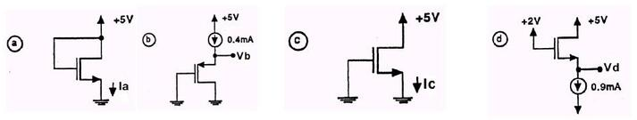

For all transistors |V_T| = 2 V, µ_nC_ox = 20 µA/V², W = 20 µm, L = 2 µm. In saturation K = ½ × 20 × 10⁻⁶ × (20/2) = 100 µA/V² = 0.1 mA/V².

- **a)** V_DS = V_GS = 5 V, in saturation: I_D = 0.1 (5 − 2)² = **0.9 mA**.
- **b)** V_DS = V_GS, in saturation (for the PMOS V_T = −2 V): 0.4 = 0.1 (V_GS + 2)² ⇒ V_GS + 2 = ±2 ⇒ V_GS = 0 or −4 V. Since V_GS = 0 is not possible, V_GS = −4 V and **V_b = 4 V**.
- **c)** V_GS = 0, in cutoff: **I_c = 0**.
- **d)** Since V_DG = 5 − 2 = 3 V, V_DS ≥ V_GS − V_T, so the transistor is in saturation: 0.9 = 0.1 (V_GS − 2)² ⇒ V_GS = 5 V; **V_d = V_G − V_GS = 2 − 5 = −3 V**.

### Question 3 (32 pts): Operating region table

Fill in the blank cells for transistors a–g in the table (the bold entries are the answers):

| # | Channel | V_T (V) | v_S (V) | v_G (V) | v_D (V) | Region |
|---|---|---|---|---|---|---|
| a | **N** | 1 | 0 | 3 | 2.1 | **saturation** |
| b | **N** | 2 | −2 | 2 | −0.1 | **triode** |
| c | **P** | −2 | 0 | −1 | −3 | **cutoff** |
| d | **P** | −1 | 2 | 0 | −1 | **saturation** |
| e | **N** | 2 | −3 | 0 | **≥ −2** | saturation |
| f | **P** | −2 | 3 | 0 | −1 | **saturation** |
| g | **P** | −2 | 3 | **≥ 1** | −3 | cutoff |

- a) V_DS = 2.1 V, V_GS = 3 V, V_GS − V_T = 2 V < V_DS ⇒ saturation; V_T > 0 ⇒ NMOS.
- b) V_DS = 1.9 V, V_GS = 4 V, V_GS − V_T = 2 V > V_DS ⇒ triode.
- c) V_GS = −1 V > V_T ⇒ cutoff; V_T < 0 ⇒ PMOS.
- d) V_DS = −3 V, V_GS = −2 V, V_GS − V_T = −1 V > V_DS ⇒ saturation.
- e) V_GS = 3 V, V_GS − V_T = 1 V; for saturation V_DS ≥ 1 ⇒ V_D ≥ 1 + V_S = −2 V.
- f) V_DS = −4 V, V_GS = −3 V, V_GS − V_T = −1 V > V_DS ⇒ saturation.
- g) For cutoff V_GS ≥ V_T: V_G − 3 ≥ −2 ⇒ V_G ≥ 1 V.

### Question 4 (24 pts): PMOS and load line

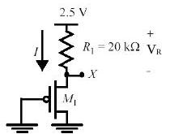

a) The equation for the voltage at X; b) the |I_D|–|V_DS| curves and the R1 load line; c) the W required for V_X = 1.5 V with L = 0.25 µm; d) how does V_X change if velocity saturation occurs?

- **a)** X is the source of the PMOS, and since V_DS = V_GS the transistor is in saturation: I_D = −V_R / R = (k′_p/2)(W/L)(−V_X − V_Tp)².
- **b)** The load line intersects the axes at V_DS = 2.5 V for I_D = 0, and at I_D = 2.5 / 20 kΩ = 125 µA for V_DS = 0.

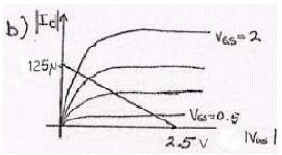

- **c)** V_R = 2.5 − 1.5 = 1 V; −1/(20 × 10³) = (−30 × 10⁻⁶ / 2)(W/0.25)(−1.5 + 0.4)² ⇒ **W = 0.69 µm**.
- **d)** With velocity saturation the transistor's current-driving capability decreases; less voltage drops across R1, and **V_X rises**.

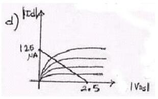

## 2004 – 1st midterm (17.04.2004)

### Question 1

- **a)** Separating the linear, saturation, and velocity-saturation regions of an NMOS in the I_D–V_DS plot: the boundaries are the curves V_DS = V_GS − V_T and V_DS = V_DSAT; velocity saturation begins beyond the point V_DSAT = V_GS − V_T.

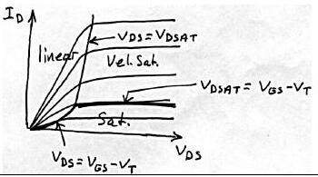

- **b)** Regenerative gate: even if the input is below the nominal value (as long as it stays in the valid region), the output approaches the nominal value; after a few stages the signal reaches its nominal value. For this, the gain in the transition region must be greater than 1, i.e., the VTC slope must be steeper than 45°.
- **c)** Channel-length modulation: as V_DS exceeds V_GS − V_T, the effective channel length shortens slightly and I_D increases slightly. This can be seen in the I_D–V_DS curves, where the lines in the saturation region slope slightly upward instead of being horizontal.
- **d)** A temperature change affects a reverse-biased diode more: the terminal current (I = I_S − I_D) is smaller than the saturation current (minority carriers), which is temperature sensitive; in forward bias, I_S is negligible next to the large diffusion current.
- **e)** For an IC expected to have a high market share, which of the die, mask, design, and packaging costs should be minimized? **Answer:** The share of fixed costs decreases with production volume; the variable costs determine the cost. Therefore, **die cost** and **packaging cost** should be minimized.

### Question 2: MOSFET circuits

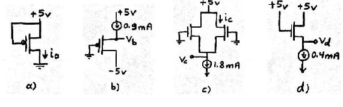

Again |V_T| = 2 V, µ_nC_ox = 20 µA/V², W/L = 20/2; K = 0.1 mA/V², I_D = 0.1 (V_GS − V_T)².

- **a)** V_GS = 0, cutoff: **I_a = 0**.
- **b)** PMOS in saturation: 0.9 = 0.1 (V_GS + 2)² ⇒ V_GS + 2 = ±3. For +3, V_GS = 1 V (impossible for a PMOS), therefore **V_GS = −5 V = V_b**.
- **c)** With identical transistors the circuit is symmetric: I_D = 1.8/2 = **0.9 mA**. 0.9 = 0.1 (V_GS − 2)² ⇒ V_GS = 5 V, **V_c = −5 V**.
- **d)** V_DS = V_GS, saturation: 0.4 = 0.1 (V_GS − 2)² ⇒ V_GS = 4 V, **V_d = 5 − 4 = 1 V**.
- **e)** Cases in which MOS gate capacitances are zero: in cutoff, C_GCS and C_GCD; in the linear region, C_GCB; in saturation, C_GCB and C_GCD are zero.

### Question 3: R_D and R_S

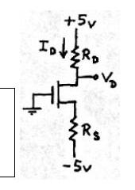

I_D = 0.4 mA and V_D = 1 V are required (V_T = 2 V, µ_nC_ox = 20 µA/V², L = 10 µm, W = 400 µm). Since V_DS = 1 + V_GS > V_GS − 2, the transistor is in saturation: 0.4 × 10⁻³ = ½ × 20 × 10⁻⁶ × 40 × (V_GS − 2)² ⇒ (V_GS − 2)² = 1 ⇒ V_GS = 3 V (V_GS = 1 < V_T is meaningless). V_S = −3 V; **R_S = (−3 + 5)/0.4 = 5 kΩ**, **R_D = (5 − 1)/0.4 = 10 kΩ**.

### Question 4: R_x and R_DS

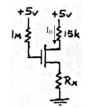

V_T = 1 V, k′(W/L) = 1 mA/V², V_D = 2 V is required. I_G = 0 ⇒ V_G = 5 V; V_DG = −3 V ⇒ V_DS = V_GS − 3 < V_GS − 1, so the transistor is in the linear region. I_D = 3 V / 15 kΩ = 0.2 mA. 0.2 = 1 × [(V_GS − 1)V_DS − V_DS²/2] and with V_GS = V_DS + 3, V_DS² + 4V_DS − 0.4 = 0 ⇒ V_DS = 0.0976 V (the other root, −4.1 V, is invalid). V_S = 2 − 0.0976 = 1.9024 V ⇒ **R_x = 1.9024 / 0.2 mA = 9.512 kΩ**.

R_DS = [∂I_D/∂V_DS]⁻¹ = 1 / [k′(W/L)(V_GS − V_T − V_DS)] = 1 / [10⁻³ × (3.0976 − 1 − 0.0976)] ≈ **500 Ω**.

## 2004 – 2nd midterm (18.05.2004)

### Question 1

- **a)** In an inverter driving an identical inverter as its load, as β = (W/L)_p/(W/L)_n increases, the PMOS resistance decreases, the pull-up current increases, and t_pLH decreases; the opposite holds for t_pHL. The minimum of t_p occurs at a β smaller than the point where t_pHL = t_pLH; that is, slightly breaking the symmetry can yield higher performance.

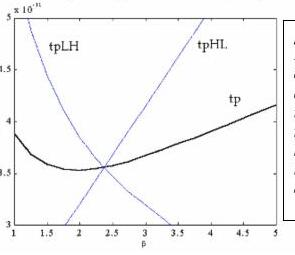

- **b)** If NMOS transistors were used in the PUN, then with V_in = V_DD the output could rise only up to V_DD − V_Tn (the NMOS enters cutoff when V_GS = V_Tn); if PMOS transistors were used in the PDN, the output could fall only down to |V_Tp|. For this reason, for rail-to-rail swing the PUN consists of PMOS transistors and the PDN of NMOS transistors.
- **c)** In a long-channel transistor the saturation current varies with the square of V_GS (quadratic), whereas in a short-channel transistor in velocity saturation it varies linearly with V_GS; the spacings between the I_D–V_DS curves show this.
- **d)** Lowering the supply: energy falls quadratically and the gain increases up to a certain level; however, from about 4kT/q (~100 mV) the gate characteristic degrades and the gain drops to 1. Performance degrades (especially at low V_DD; the effect disappears when V_DD ≫ V_T + V_DSAT/2). Internal noise (e.g., crosstalk) scales down, but since external noise does not scale, the gate becomes more sensitive to external noise and to parameter variations such as V_T.
- **e)** P_dyn = C_L V_DD² P₀→₁ f. To reduce it: reduce C_L (transistor size, fan-out, wire length), lower V_DD, reduce P₀→₁ (the switching activity) at the logic and architecture level; lowering the clock frequency also reduces power but is not preferred because it degrades performance unacceptably.
- **f)** The RC model of a 2-input NOR and three input transitions producing a 0→1 at the output:

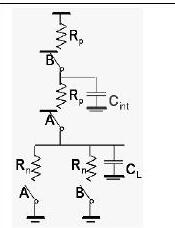

1. A = 0, B = 1→0: both C_int and C_L were discharged beforehand; both must be charged for the output to rise (slowest).
1. A = 1→0, B = 0: C_L was discharged and C_int was charged beforehand; only C_L is charged (fastest).
1. A = 1→0, B = 1→0: C_L is discharged, and the state of C_int depends on earlier inputs; depending on the case it behaves like (1) or (2).

### Question 2 (20 pts): W_n/W_p for V_M = 2 V

V_DD = 5 V, V_Tn = −V_Tp = 1 V, C_ox = 5 fF/µm², L = 2.5 µm, λ = 0, µ_n = 50,000 mm²/Vs, µ_p = 25,000 mm²/Vs. At V_M both transistors are in saturation and I_Dn = −I_Dp: 50 × 10⁻⁶ W_n = 100 × 10⁻⁶ W_p ⇒ **W_n/W_p = 2**.

### Question 3 (20 pts): Delay and fan-out

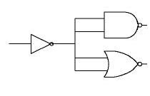

V_DD = 5 V, V_Tn = −V_Tp = 1 V, C_ox = 5 fF/µm², W = 2 µm, L = 1 µm, λ = 0, k′_n = 250 µA/V², k′_p = 125 µA/V², C_DB = 10 fF.

- **a)** I_DSATn = ½ × 250 × 10⁻⁶ × 2 × (5 − 1)² = 4 mA ⇒ R_eqn = (3/4)(V_DD/I_DSATn) = 0.75 × 5/4 kΩ = 937.5 Ω. The output is connected to 4 gate inputs (8 transistors): C_G = W L C_ox = 10 fF, C_ext = 80 fF; C_int = 2C_DB = 20 fF; C_L = 100 fF. **t_pHL = 0.69 × 937.5 × 100 fF = 64.7 ps**. I_DSATp = 2 mA ⇒ R_eqp = 1.875 kΩ ⇒ **t_pLH = 129.4 ps**.
- **b)** For a delay of at most 2 ns, what is the maximum number of NAND/NOR gates that can be connected? Each gate adds 4C_G: 0.69 × 1.875 × 10³ × (20 + 40N) × 10⁻¹⁵ ≤ 2 × 10⁻⁹ ⇒ **N = 38**.

### Question 4 (15 pts): Complex CMOS gate

Draw the CMOS circuit that realizes the function F = [(A′ + B′)(C′ + D′ + E′) + F′]·G′; size the pull-up and pull-down resistances to equal those of an inverter with (W/L)_n = 2, (W/L)_p = 6.

By De Morgan, the expression is written as [F(AB + CDE) + G]′, and the PUN and PDN are built as duals of each other.

")

The NMOS of input G is at the same scale as in the inverter (W/L = 2), while its PMOS is doubled (W/L = 12). Half of the values shown in the figure were also accepted as correct. (Points: 1a–e 7 pts, 1f 10 pts; Questions 2 and 3 20 pts; Question 4 15 pts; duration 120 min.)

## 2005 – 1st midterm (11.04.2005)

### Question 1

- **a)** Moore's law: in the 1960s Gordon Moore predicted that the number of transistors that can be integrated on a die would double every 14–18 months.
- **b)** Die yield is the fraction of good chips obtained from a wafer: Die yield = [1 + (defects per unit area × die area)/α]^(−α). Die cost = wafer cost / (dies per wafer × die yield); dies per wafer ≈ π (wafer diameter/2)² / die area.
- **c)** and **d)** Identical to the channel-length modulation and diode–temperature questions of the 2004 midterm.
- **e)** At V_M both transistors are in saturation: since V_in = V_out, both have V_DS = V_GS and the saturation conditions are satisfied.

### Question 2 (25 pts): Model parameters from measurements

The unified model is valid for a deep-submicron transistor; V_DSAT = −1 V, −2φ_F = −0.6 V.

| Measurement | V_GS (V) | V_DS (V) | V_SB (V) | I_D (µA) | Region (answer) |
|---|---|---|---|---|---|
| 1 | −2.5 | −2.5 | 0 | −84.375 | velocity saturation |
| 2 | 1 | 1 | 0 | 0 | cutoff |
| 3 | −0.7 | −0.8 | 0 | −1.04 | saturation |
| 4 | −2 | −2.5 | 0 | −56.25 | velocity saturation |
| 5 | −2.5 | −2.5 | −1 | −72 | velocity saturation |
| 6 | −2.5 | −1.5 | 0 | −80.625 | velocity saturation |
| 7 | −2.5 | −0.8 | 0 | −66.56 | linear |

- **a)** Since a negative I_D flows with negative V_GS and V_DS, the transistor is a **PMOS** (the min operator becomes max for a PMOS).
- **b)** Taking the ratio of measurements 1 and 4 (V_SB = 0, both in velocity saturation): 1.5 = (2 + V_T0)/(1.5 + V_T0) ⇒ **V_T0 = −0.5 V**.
- **c)** From measurements 1 and 5, −72(2 + V_T0) = −84.375(2 + V_T) ⇒ V_T = −0.72 V; −0.72 = −0.5 + γ(√1.6 − √0.6) ⇒ **γ = −0.45**.
- **d)** From measurements 1 and 6, −84.375(1 − 2.5λ) = −80.625(1 − 1.5λ) ⇒ **λ = −0.05 V⁻¹**.

### Question 3 (25 pts): Body effect

 and (b)")

k_n = 25 µA/V², γ = 0.5 V^½. In circuit (a), I_D = 100 µA is measured. Assuming saturation, V_GS = 6 − 22000 I_D = 3.8 V; 100 = 25/2 (3.8 − V_T0)² ⇒ **V_T0 = 1 V**; V_DS = 10 − 40000 × 100 µA = 6 V > V_GS − V_T0, so the assumption is correct. In (b), since V_SB ≠ 0, V_GS = 6 − 22000 I_D, V_SB = 22000 I_D, V_T = V_T0 + γ(√(|2φ_F| + V_SB) − √|2φ_F|), and I_D = k_n/2 (V_GS − V_T)²; these equations are solved iteratively, giving approximately **I_D = 88 µA, V_T = 1.409 V, V_DS = 6.48 V**.

### Question 4 (25 pts)

- **a)** Lateral diffusion: C_GCD = 0.25 fF, C_G = 0.7 fF, L = 0.25 µm ⇒ C_oxWL = 0.5 fF, C_oW = 0.1 fF, C_oxW = 2 fF/µm ⇒ **x_d = 0.05 µm**.
- **b)** In the circuit below (k_n = 250 µA/V², V_T = 1 V), find I_D and V_DS:

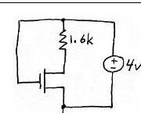

V_GS = V_DD = 4 V. The saturation assumption gives I_D = 1.13 mA, V_DS = 2.19 V; but since V_GS − V_T = 3 V > V_DS, it is invalid. In the linear region, 4 − V_DS = 1600 × 250 × 10⁻⁶ (3 − V_DS/2) V_DS ⇒ V_DS² − 11V_DS + 20 = 0 ⇒ **V_DS = 2.3 V** (8.7 V > V_DD is invalid), **I_D = 1.06 mA**.
- **c)** A ring oscillator with 7 identical inverters oscillates at 2.38 GHz: T = 1/f = 2 t_p N ⇒ t_p = 1/(2 × 2.38 × 10⁹ × 7) = **30 ps**.

(Points: Question 1 25 pts, Question 2 25 pts, Question 3 25 pts, Question 4 25 pts; duration 100 min.)

## 2006 – Midterm (10.04.2006)

### Question 1

- **a)** NMOS, which dominated in the 1970s and early 1980s, was replaced by **CMOS**. In NMOS logic, current is continuously drawn from the supply when the output is low, and the heat problem limited integration density. In CMOS, since there is no path between the supply and ground in steady state, no static power is consumed; much larger circuits could be fitted into the same area.
- **b)** If the drain and source pins of a PMOS in a socket are swapped, nothing changes in the operation of the circuit; the two regions are physically identical and act as drain or source depending on the applied voltage.
- **c)** Costs to be minimized at high market share: die and packaging (same as the 2004 question).
- **d)** A MOS transistor in saturation behaves like an ideal current source (I_D is independent of V_DS). In practice, because of channel-length modulation, I_D = I_D′ (1 + λV_DS); long-channel transistors are closer to an ideal current source.
- **e)** Body effect: in integrated circuits the body is common and is tied to the most negative (NMOS) or most positive (PMOS) point. When V_SB is reverse-biased, the depletion region around the channel widens and the channel depth decreases; a larger V_GS is needed to compensate, i.e., V_T increases.

### Question 2: W/L and current

Transistor parameters: V_T0 = 0.4 V, γ = 0.48 V^½, k′ = 430 µA/V², λ = 0.01 V⁻¹, 2φ_F = −0.74 V, V_DSAT = 4.5 V. Measurement: V_G = 2.8 V, V_D = 5 V, V_S = 1 V, V_B = 0 V, I_D = 0.623 mA.

- **a)** V_SB = 1 V ⇒ V_T = 0.4 + 0.48 (1.32 − 0.86) = 0.62 V. V_GS = 1.8 V, V_GS − V_T = 1.18 V; V_DS = 4 V > 1.18 V ⇒ saturation. 0.623 × 10⁻³ = (430 × 10⁻⁶/2)(W/L)(1.18)²(1 + 0.01 × 4) ⇒ **W/L = 2**.
- **b)** V_G = 5, V_D = 4, V_S = 2, V_B = 1 V: V_SB = 1 V ⇒ V_T = 0.62 V; V_GS − V_T = 2.38 V > V_DS = 2 V ⇒ linear: I_D = 430 × 10⁻⁶ × 2 × [2.38 × 2 − 4/2] = **2.37 mA**.

### Question 3: Resistor-loaded inverter

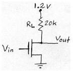

The same transistor (W/L = 2) is used in this circuit; V_in is rail-to-rail. With V_in = 0, I_D = 0, **V_OH = V_DD = 1.2 V**. At V_in = 1.2 V, assuming the linear region, (1.2 − V_out)/20 kΩ = 860 × 10⁻⁶ [(1.2 − 0.4) V_out − V_out²/2] ⇒ 8.6 V_out² − 14.76 V_out + 1.2 = 0 ⇒ V_out = 1.6 V (meaningless, > V_DD) or **V_OL = 0.08 V**. Check: since 0.08 < 1.2 − 0.4, the linear-region assumption is correct.

### Question 4: Equivalent resistance

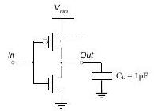

After V_in has been 0 V for a long time, it suddenly becomes V_DD = 5 V; the NMOS has I_Dsat = 5 mA, and V_Dsat = 4 V at the instant it enters saturation.

- **a)** C_L has first been charged to V_DD; when V_in = 5 V, V_DS = V_GS = 5 V and the NMOS is in saturation. At the saturation boundary V_DS = V_GS − V_T ⇒ 4 = 5 − V_T ⇒ **V_T0n = 1 V**; k_n = 2I_Dsat/(V_GS − V_T0n)² = 2 × 5 × 10⁻³ / 16 = **0.625 × 10⁻³ A/V²**.
- **b)** t_pHL = 0.69 R_eqn C_L = 1.725 ns ⇒ **R_eqn = 2.5 kΩ**.
