Bu yazı, Başkent Üniversitesi **EEM312 Sayısal Elektronik** dersinin (Prof. Dr. Emin Akata) 2003–2006 yıllarına ait beş ara sınavını çözümleriyle bir araya getiriyor: 1. ara sınav 2003, 1. ve 2. ara sınav 2004, 1. ara sınav 2005 ve 2006 ara sınavı. Sorular ve hocanın çözümleri yazıya döküldü; devre şekilleri görsel olarak eklendi. Orijinal Word dosyaları yazının sonunda ZIP olarak indirilebilir.

Çözümlerde kullanılan temel MOSFET bağıntıları (uzun kanal, k = ½ µC_ox W/L):

- Doyum: I_D = k (V_GS − V_T)²  ya da  I_D = (k′/2)(W/L)(V_GS − V_T)² (1 + λV_DS)
- Doğrusal (triode/resistive): I_D = k′(W/L) [(V_GS − V_T) V_DS − V_DS²/2]
- Gövde etkisi: V_T = V_T0 + γ (√(|−2φ_F| + V_SB) − √|−2φ_F|)
- Birleşik (unified) model: I_D = k′(W/L) [(V_GS − V_T) V_min − V_min²/2] (1 + λV_DS), V_min = min(V_GS − V_T, V_DS, V_DSAT)

## 2003 – 1. ara sınav (12.04.2003)

### Soru 1 (20p)

- **a)** n bölgesi p'ye göre 10 kat fazla katkılı bir pn ekleminde kıtlık bölgesi hangi tarafta, hangi oranda geniştir? **Yanıt:** Daha az katkılı p tarafında; p tarafındaki genişlik n tarafının 10 katıdır.
- **b)** Şekil üzerinde V_OH, V_IH, V_OL ve V_IL seviyelerini gösteriniz (NM_H, V_OH ile V_IH arasında; NM_L, V_IL ile V_OL arasında).
- **c)** Intel P4 üretiminde değişken mi sabit maliyetler mi daha önemlidir? **Yanıt:** IC maliyeti = değişken maliyet + sabit maliyet / üretilen adet. Çok yüksek adette üretilen bir IC'de değişken maliyetler belirleyicidir.
- **d)** CMOS'un yaygınlaşmasının en öncelikli dört nedeni: (1) yaklaşık 0–V_DD arasında geniş V_sw; (2) kararlı durumda çıkış ile V_DD ya da toprak arasında her zaman sınırlı dirençli bir yol bulunması, dolayısıyla düşük çıkış empedansı (kΩ mertebesi) ve gürültüye az duyarlılık; (3) mükemmel yalıtılmış gate sayesinde çok büyük giriş empedansı ve kuramsal olarak sonsuz fan-out; (4) kararlı durumda V_DD ile toprak arasında doğrudan yol olmaması, yani statik güç tüketiminin olmaması.

### Soru 2 (24p): MOSFET devreleri

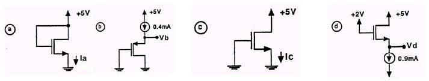

Tüm transistörler için |V_T| = 2 V, µ_nC_ox = 20 µA/V², W = 20 µm, L = 2 µm. Doyumda K = ½ × 20 × 10⁻⁶ × (20/2) = 100 µA/V² = 0,1 mA/V².

- **a)** V_DS = V_GS = 5 V, doyumda: I_D = 0,1 (5 − 2)² = **0,9 mA**.
- **b)** V_DS = V_GS, doyumda (PMOS için V_T = −2 V): 0,4 = 0,1 (V_GS + 2)² ⇒ V_GS + 2 = ±2 ⇒ V_GS = 0 ya da −4 V. V_GS = 0 olamayacağından V_GS = −4 V ve **V_b = 4 V**.
- **c)** V_GS = 0, kesimde: **I_c = 0**.
- **d)** V_DG = 5 − 2 = 3 V olduğundan V_DS ≥ V_GS − V_T, doyumda: 0,9 = 0,1 (V_GS − 2)² ⇒ V_GS = 5 V; **V_d = V_G − V_GS = 2 − 5 = −3 V**.

### Soru 3 (32p): Çalışma bölgesi tablosu

Tablodaki a–g transistörleri için boş gözleri doldurunuz (koyu olanlar yanıtlar):

| # | Kanal | V_T (V) | v_S (V) | v_G (V) | v_D (V) | Bölge |
|---|---|---|---|---|---|---|
| a | **N** | 1 | 0 | 3 | 2,1 | **doyum** |
| b | **N** | 2 | −2 | 2 | −0,1 | **triode** |
| c | **P** | −2 | 0 | −1 | −3 | **kesim** |
| d | **P** | −1 | 2 | 0 | −1 | **doyum** |
| e | **N** | 2 | −3 | 0 | **≥ −2** | doyum |
| f | **P** | −2 | 3 | 0 | −1 | **doyum** |
| g | **P** | −2 | 3 | **≥ 1** | −3 | kesim |

- a) V_DS = 2,1 V, V_GS = 3 V, V_GS − V_T = 2 V < V_DS ⇒ doyum; V_T > 0 ⇒ NMOS.
- b) V_DS = 1,9 V, V_GS = 4 V, V_GS − V_T = 2 V > V_DS ⇒ triode.
- c) V_GS = −1 V > V_T ⇒ kesim; V_T < 0 ⇒ PMOS.
- d) V_DS = −3 V, V_GS = −2 V, V_GS − V_T = −1 V > V_DS ⇒ doyum.
- e) V_GS = 3 V, V_GS − V_T = 1 V; doyum için V_DS ≥ 1 ⇒ V_D ≥ 1 + V_S = −2 V.
- f) V_DS = −4 V, V_GS = −3 V, V_GS − V_T = −1 V > V_DS ⇒ doyum.
- g) Kesim için V_GS ≥ V_T: V_G − 3 ≥ −2 ⇒ V_G ≥ 1 V.

### Soru 4 (24p): PMOS ve yük doğrusu

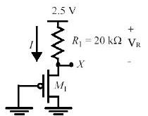

a) X geriliminin denklemi; b) |I_D|–|V_DS| eğrileri ve R1 yük doğrusu; c) L = 0,25 µm iken V_X = 1,5 V için W; d) hız doyumu olursa V_X nasıl değişir?

- **a)** X, PMOS'un source'udur ve V_DS = V_GS olduğundan transistör doyumdadır: I_D = −V_R / R = (k′_p/2)(W/L)(−V_X − V_Tp)².
- **b)** Yük doğrusu eksenleri I_D = 0 için V_DS = 2,5 V'ta, V_DS = 0 için I_D = 2,5 / 20 kΩ = 125 µA'de keser.

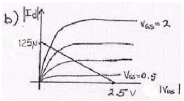

- **c)** V_R = 2,5 − 1,5 = 1 V; −1/(20 × 10³) = (−30 × 10⁻⁶ / 2)(W/0,25)(−1,5 + 0,4)² ⇒ **W = 0,69 µm**.
- **d)** Hız doyumunda transistörün akım sürme yeteneği azalır; R1 üzerinde daha az gerilim düşer ve **V_X yükselir**.

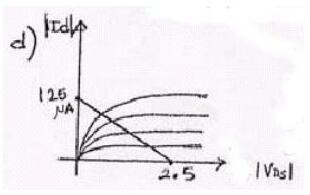

## 2004 – 1. ara sınav (17.04.2004)

### Soru 1

- **a)** NMOS'ta doğrusal, doyum ve hız doyumu bölgelerinin I_D–V_DS grafiğinde ayrılması: sınırlar V_DS = V_GS − V_T ve V_DS = V_DSAT eğrileridir; V_DSAT = V_GS − V_T noktasından sonra hız doyumu başlar.

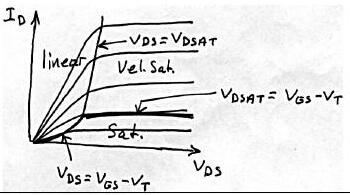

- **b)** Rejeneratif kapı: giriş nominal değerden düşük olsa da (geçerli bölgede kaldıkça) çıkış nominal değere yaklaşır; birkaç kademe sonra sinyal nominal değerine ulaşır. Bunun için geçiş bölgesindeki kazancın 1'den büyük, yani VTC eğiminin 45°'den dik olması gerekir.
- **c)** Kanal boyu modülasyonu: V_DS, V_GS − V_T'yi aştıkça kanalın etkin boyu biraz kısalır ve I_D biraz artar. I_D–V_DS eğrilerinde doyum bölgesindeki çizgilerin yatay yerine hafif yukarı eğimli olmasından anlaşılır.
- **d)** Sıcaklık değişimi ters kutuplanmış diyotu daha çok etkiler: terminal akımı (I = I_S − I_D) sıcaklığa duyarlı doyma akımından (azınlık taşıyıcıları) küçüktür; ileri kutuplamada ise büyük difüzyon akımı yanında I_S ihmal edilebilir.
- **e)** Yüksek pazar payı beklenen bir IC'de die, maske, tasarım ve paketleme maliyetlerinden hangileri en aza indirilmeli? **Yanıt:** Sabit giderlerin payı üretim hacmiyle azalır; maliyeti değişken giderler belirler. Bu nedenle **die maliyeti** ve **paketleme maliyeti** en aza indirilmelidir.

### Soru 2: MOSFET devreleri

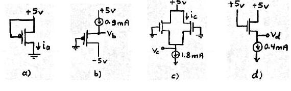

Yine |V_T| = 2 V, µ_nC_ox = 20 µA/V², W/L = 20/2; K = 0,1 mA/V², I_D = 0,1 (V_GS − V_T)².

- **a)** V_GS = 0, kesim: **I_a = 0**.
- **b)** PMOS doyumda: 0,9 = 0,1 (V_GS + 2)² ⇒ V_GS + 2 = ±3. +3 için V_GS = 1 V (PMOS'ta olanaksız), dolayısıyla **V_GS = −5 V = V_b**.
- **c)** Özdeş transistörlerle devre simetrik: I_D = 1,8/2 = **0,9 mA**. 0,9 = 0,1 (V_GS − 2)² ⇒ V_GS = 5 V, **V_c = −5 V**.
- **d)** V_DS = V_GS, doyum: 0,4 = 0,1 (V_GS − 2)² ⇒ V_GS = 4 V, **V_d = 5 − 4 = 1 V**.
- **e)** MOS kapı sığalarının sıfır olduğu durumlar: kesimde C_GCS ve C_GCD; doğrusal bölgede C_GCB; doyumda C_GCB ve C_GCD sıfırdır.

### Soru 3: R_D ve R_S

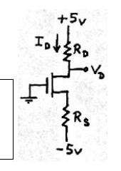

I_D = 0,4 mA ve V_D = 1 V isteniyor (V_T = 2 V, µ_nC_ox = 20 µA/V², L = 10 µm, W = 400 µm). V_DS = 1 + V_GS > V_GS − 2 olduğundan doyum: 0,4 × 10⁻³ = ½ × 20 × 10⁻⁶ × 40 × (V_GS − 2)² ⇒ (V_GS − 2)² = 1 ⇒ V_GS = 3 V (V_GS = 1 < V_T anlamsız). V_S = −3 V; **R_S = (−3 + 5)/0,4 = 5 kΩ**, **R_D = (5 − 1)/0,4 = 10 kΩ**.

### Soru 4: R_x ve R_DS

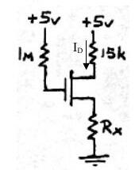

V_T = 1 V, k′(W/L) = 1 mA/V², V_D = 2 V isteniyor. I_G = 0 ⇒ V_G = 5 V; V_DG = −3 V ⇒ V_DS = V_GS − 3 < V_GS − 1, transistör doğrusal bölgede. I_D = 3 V / 15 kΩ = 0,2 mA. 0,2 = 1 × [(V_GS − 1)V_DS − V_DS²/2] ve V_GS = V_DS + 3'ten V_DS² + 4V_DS − 0,4 = 0 ⇒ V_DS = 0,0976 V (öteki kök −4,1 V geçersiz). V_S = 2 − 0,0976 = 1,9024 V ⇒ **R_x = 1,9024 / 0,2 mA = 9,512 kΩ**.

R_DS = [∂I_D/∂V_DS]⁻¹ = 1 / [k′(W/L)(V_GS − V_T − V_DS)] = 1 / [10⁻³ × (3,0976 − 1 − 0,0976)] ≈ **500 Ω**.

## 2004 – 2. ara sınav (18.05.2004)

### Soru 1

- **a)** Kendisiyle aynı yükü süren tersleyicide β = (W/L)_p/(W/L)_n büyüdükçe PMOS direnci azalır, pull-up akımı artar ve t_pLH azalır; t_pHL için tersi geçerlidir. t_p'nin en küçük değeri t_pHL = t_pLH noktasından daha küçük bir β'da oluşur; yani simetriyi biraz bozarak daha yüksek performans elde edilebilir.

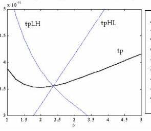

- **b)** PUN'da NMOS kullanılsaydı V_in = V_DD iken çıkış ancak V_DD − V_Tn'ye kadar yükselir (V_GS = V_Tn olunca NMOS kesime girer); PDN'de PMOS kullanılsaydı çıkış ancak |V_Tp|'ye kadar düşerdi. Bu nedenle rail-to-rail salınım için PUN PMOS'lardan, PDN NMOS'lardan oluşur.
- **c)** Uzun kanallı transistörde doyum akımı V_GS'nin karesiyle (quadratic), hız doyumundaki kısa kanallı transistörde ise V_GS ile doğrusal değişir; I_D–V_DS eğrileri arasındaki aralıklar bunu gösterir.
- **d)** Düşük besleme: enerji karesel olarak düşer ve belirli bir seviyeye kadar kazanç artar; ancak yaklaşık 4kT/q (~100 mV) seviyelerinden itibaren kapı karakteristiği bozulur ve kazanç 1'e iner. Performans düşer (özellikle düşük V_DD'de; V_DD ≫ V_T + V_DSAT/2 iken etki kaybolur). İç gürültü (örneğin crosstalk) ölçeklenip azalır ama dış gürültü ölçeklenmediğinden kapı dış gürültüye ve V_T gibi parametre değişimlerine daha duyarlı olur.
- **e)** P_dyn = C_L V_DD² P₀→₁ f. Azaltmak için: C_L'yi küçültmek (transistör boyutu, fan-out, kablo uzunluğu), V_DD'yi düşürmek, P₀→₁'i (anahtarlama aktivitesini) mantık ve mimari düzeyde azaltmak; saat frekansını düşürmek de gücü azaltır ama performansı kabul edilemez biçimde düşürdüğünden tercih edilmez.
- **f)** 2 girişli NOR'un RC modeli ve çıkışta 0→1 yaratan üç giriş değişimi:

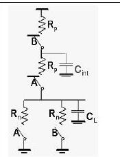

1. A = 0, B = 1→0: önceden hem C_int hem C_L boşalmıştır; çıkış için ikisinin de dolması gerekir (en yavaş).
1. A = 1→0, B = 0: önceden C_L boş, C_int doludur; yalnızca C_L dolar (en hızlı).
1. A = 1→0, B = 1→0: C_L boştur, C_int'in durumu daha önceki girişlere bağlıdır; duruma göre (1) ya da (2) gibi davranır.

### Soru 2 (20p): V_M = 2 V için W_n/W_p

V_DD = 5 V, V_Tn = −V_Tp = 1 V, C_ox = 5 fF/µm², L = 2,5 µm, λ = 0, µ_n = 50.000 mm²/Vs, µ_p = 25.000 mm²/Vs. V_M'de iki transistör de doyumdadır ve I_Dn = −I_Dp: 50 × 10⁻⁶ W_n = 100 × 10⁻⁶ W_p ⇒ **W_n/W_p = 2**.

### Soru 3 (20p): Gecikme ve fan-out

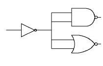

V_DD = 5 V, V_Tn = −V_Tp = 1 V, C_ox = 5 fF/µm², W = 2 µm, L = 1 µm, λ = 0, k′_n = 250 µA/V², k′_p = 125 µA/V², C_DB = 10 fF.

- **a)** I_DSATn = ½ × 250 × 10⁻⁶ × 2 × (5 − 1)² = 4 mA ⇒ R_eqn = (3/4)(V_DD/I_DSATn) = 0,75 × 5/4 kΩ = 937,5 Ω. Çıkış 4 kapı girişine (8 transistör) bağlı: C_G = W L C_ox = 10 fF, C_ext = 80 fF; C_int = 2C_DB = 20 fF; C_L = 100 fF. **t_pHL = 0,69 × 937,5 × 100 fF = 64,7 ps**. I_DSATp = 2 mA ⇒ R_eqp = 1,875 kΩ ⇒ **t_pLH = 129,4 ps**.
- **b)** En fazla 2 ns gecikme için en fazla kaç NAND/NOR bağlanabilir? Her kapı 4C_G ekler: 0,69 × 1,875 × 10³ × (20 + 40N) × 10⁻¹⁵ ≤ 2 × 10⁻⁹ ⇒ **N = 38**.

### Soru 4 (15p): Karmaşık CMOS kapı

F = [(A′ + B′)(C′ + D′ + E′) + F′]·G′ işlevini gerçekleştiren CMOS devreyi çiziniz; pull-up ve pull-down dirençleri (W/L)_n = 2, (W/L)_p = 6 olan bir tersleyicininkine eşit olacak biçimde boyutlandırınız.

De Morgan ile ifade [F(AB + CDE) + G]′ olarak yazılır ve PUN ile PDN birbirinin çiftdeşi (dual) olarak kurulur.

")

G girişinin NMOS'u tersleyicidekiyle aynı ölçekte (W/L = 2), PMOS'u ise iki kat büyütülmüştür (W/L = 12). Şekildeki değerlerin yarısı da doğru kabul ediliyordu. (Puanlar: 1a–e 7p, 1f 10p; 2. ve 3. soru 20p; 4. soru 15p; süre 120 dk.)

## 2005 – 1. ara sınav (11.04.2005)

### Soru 1

- **a)** Moore yasası: Gordon Moore 1960'larda bir die üzerine tümleştirilebilecek transistör sayısının her 14–18 ayda ikiye katlanacağını öngördü.
- **b)** Die yield, bir wafer'dan çıkan sağlam yonga oranıdır: Die yield = [1 + (birim alandaki kusur × die alanı)/α]^(−α). Die maliyeti = wafer maliyeti / (wafer başına die × die yield); wafer başına die ≈ π (wafer çapı/2)² / die alanı.
- **c)** ve **d)** 2004 ara sınavındaki kanal boyu modülasyonu ve diyot–sıcaklık sorularının aynısı.
- **e)** V_M'de iki transistör de doyumdadır: V_in = V_out olduğundan her ikisinde V_DS = V_GS ve doyum koşulları sağlanır.

### Soru 2 (25p): Ölçümlerden model parametreleri

Deep-submicron bir transistörde unified model geçerli; V_DSAT = −1 V, −2φ_F = −0,6 V.

| Ölçüm | V_GS (V) | V_DS (V) | V_SB (V) | I_D (µA) | Bölge (yanıt) |
|---|---|---|---|---|---|
| 1 | −2,5 | −2,5 | 0 | −84,375 | hız doyumu |
| 2 | 1 | 1 | 0 | 0 | kesim |
| 3 | −0,7 | −0,8 | 0 | −1,04 | doyum |
| 4 | −2 | −2,5 | 0 | −56,25 | hız doyumu |
| 5 | −2,5 | −2,5 | −1 | −72 | hız doyumu |
| 6 | −2,5 | −1,5 | 0 | −80,625 | hız doyumu |
| 7 | −2,5 | −0,8 | 0 | −66,56 | doğrusal |

- **a)** Negatif V_GS, V_DS ile negatif I_D aktığından transistör **PMOS**'tur (min operatörü PMOS için max olur).
- **b)** 1. ve 4. ölçümler (V_SB = 0, ikisi de hız doyumunda) oranlanırsa: 1,5 = (2 + V_T0)/(1,5 + V_T0) ⇒ **V_T0 = −0,5 V**.
- **c)** 1. ve 5. ölçümlerden −72(2 + V_T0) = −84,375(2 + V_T) ⇒ V_T = −0,72 V; −0,72 = −0,5 + γ(√1,6 − √0,6) ⇒ **γ = −0,45**.
- **d)** 1. ve 6. ölçümlerden −84,375(1 − 2,5λ) = −80,625(1 − 1,5λ) ⇒ **λ = −0,05 V⁻¹**.

### Soru 3 (25p): Gövde etkisi

 ve (b) devreleri")

k_n = 25 µA/V², γ = 0,5 V^½. (a) devresinde I_D = 100 µA ölçülüyor. Doyum varsayımıyla V_GS = 6 − 22000 I_D = 3,8 V; 100 = 25/2 (3,8 − V_T0)² ⇒ **V_T0 = 1 V**; V_DS = 10 − 40000 × 100 µA = 6 V > V_GS − V_T0, varsayım doğru. (b)'de V_SB ≠ 0 olduğundan V_GS = 6 − 22000 I_D, V_SB = 22000 I_D, V_T = V_T0 + γ(√(|2φ_F| + V_SB) − √|2φ_F|), I_D = k_n/2 (V_GS − V_T)² denklemleri iterasyonla çözülür; sonuçlar yaklaşık **I_D = 88 µA, V_T = 1,409 V, V_DS = 6,48 V**.

### Soru 4 (25p)

- **a)** Lateral diffusion: C_GCD = 0,25 fF, C_G = 0,7 fF, L = 0,25 µm ⇒ C_oxWL = 0,5 fF, C_oW = 0,1 fF, C_oxW = 2 fF/µm ⇒ **x_d = 0,05 µm**.
- **b)** Aşağıdaki devrede (k_n = 250 µA/V², V_T = 1 V) I_D ve V_DS:

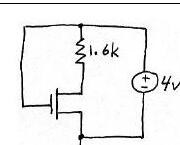

V_GS = V_DD = 4 V. Doyum varsayımı I_D = 1,13 mA, V_DS = 2,19 V verir; ama V_GS − V_T = 3 V > V_DS olduğundan geçersizdir. Doğrusal bölgede 4 − V_DS = 1600 × 250 × 10⁻⁶ (3 − V_DS/2) V_DS ⇒ V_DS² − 11V_DS + 20 = 0 ⇒ **V_DS = 2,3 V** (8,7 V > V_DD geçersiz), **I_D = 1,06 mA**.
- **c)** 7 özdeş tersleyicili halka osilatörü 2,38 GHz'de salınıyor: T = 1/f = 2 t_p N ⇒ t_p = 1/(2 × 2,38 × 10⁹ × 7) = **30 ps**.

(Puanlar: 1. soru 25p, 2. soru 25p, 3. soru 25p, 4. soru 25p; süre 100 dk.)

## 2006 – Ara sınav (10.04.2006)

### Soru 1

- **a)** 1970'ler ve 1980'lerin başında egemen olan NMOS, yerini **CMOS**'a bıraktı. NMOS mantıkta çıkış düşükken kaynaktan sürekli akım çekiliyor, ısı sorunu tümleştirme yoğunluğunu sınırlıyordu. CMOS'ta kararlı durumda besleme ile toprak arasında yol olmadığından statik güç tüketilmez; aynı alana çok daha büyük devreler sığdırılabildi.
- **b)** Soketteki bir PMOS'un drain ve source bacakları ters takılırsa devrenin işleyişinde hiçbir şey değişmez; iki bölge fiziksel olarak aynıdır ve uygulanan gerilime göre drain ya da source işlevi görür.
- **c)** Yüksek pazar payında en aza indirilecek maliyetler: die ve paketleme (2004 sorusunun aynısı).
- **d)** MOS transistör doyumda ideal akım kaynağı gibidir (I_D, V_DS'den bağımsız). Pratikte kanal boyu modülasyonu nedeniyle I_D = I_D′ (1 + λV_DS) olur; uzun kanallı transistörler ideal akım kaynağına daha yakındır.
- **e)** Body effect: tümleşik devrelerde gövde ortaktır ve en negatif (NMOS) ya da en pozitif (PMOS) noktaya bağlanır. V_SB ters kutuplandığında kanal çevresindeki kıtlık bölgesi genişler, kanal derinliği azalır; bunu karşılamak için daha büyük V_GS gerekir, yani V_T artar.

### Soru 2: W/L ve akım

Transistör parametreleri: V_T0 = 0,4 V, γ = 0,48 V^½, k′ = 430 µA/V², λ = 0,01 V⁻¹, 2φ_F = −0,74 V, V_DSAT = 4,5 V. Ölçüm: V_G = 2,8 V, V_D = 5 V, V_S = 1 V, V_B = 0 V, I_D = 0,623 mA.

- **a)** V_SB = 1 V ⇒ V_T = 0,4 + 0,48 (1,32 − 0,86) = 0,62 V. V_GS = 1,8 V, V_GS − V_T = 1,18 V; V_DS = 4 V > 1,18 V ⇒ doyum. 0,623 × 10⁻³ = (430 × 10⁻⁶/2)(W/L)(1,18)²(1 + 0,01 × 4) ⇒ **W/L = 2**.
- **b)** V_G = 5, V_D = 4, V_S = 2, V_B = 1 V: V_SB = 1 V ⇒ V_T = 0,62 V; V_GS − V_T = 2,38 V > V_DS = 2 V ⇒ doğrusal: I_D = 430 × 10⁻⁶ × 2 × [2,38 × 2 − 4/2] = **2,37 mA**.

### Soru 3: Direnç yüklü tersleyici

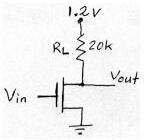

Aynı transistör (W/L = 2) bu devrede; V_in rail-to-rail. V_in = 0 iken I_D = 0, **V_OH = V_DD = 1,2 V**. V_in = 1,2 V'ta doğrusal bölge varsayımıyla (1,2 − V_out)/20 kΩ = 860 × 10⁻⁶ [(1,2 − 0,4) V_out − V_out²/2] ⇒ 8,6 V_out² − 14,76 V_out + 1,2 = 0 ⇒ V_out = 1,6 V (anlamsız, > V_DD) ya da **V_OL = 0,08 V**. Kontrol: 0,08 < 1,2 − 0,4 olduğundan doğrusal bölge varsayımı doğrudur.

### Soru 4: Eşdeğer direnç

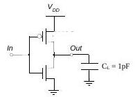

V_in uzun süre 0 V'tan sonra aniden V_DD = 5 V oluyor; NMOS'un I_Dsat = 5 mA ve doyuma girdiği anda V_Dsat = 4 V.

- **a)** C_L önce V_DD'ye dolmuştur; V_in = 5 V olunca V_DS = V_GS = 5 V, NMOS doyumda. Doyum sınırında V_DS = V_GS − V_T ⇒ 4 = 5 − V_T ⇒ **V_T0n = 1 V**; k_n = 2I_Dsat/(V_GS − V_T0n)² = 2 × 5 × 10⁻³ / 16 = **0,625 × 10⁻³ A/V²**.
- **b)** t_pHL = 0,69 R_eqn C_L = 1,725 ns ⇒ **R_eqn = 2,5 kΩ**.
