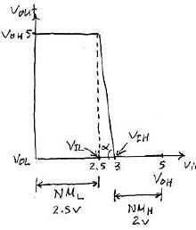
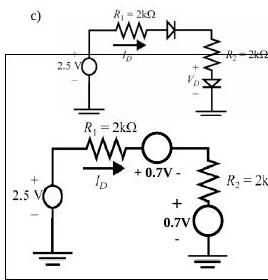
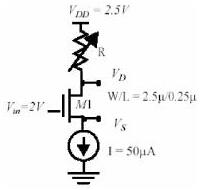
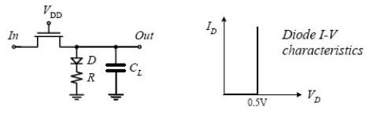
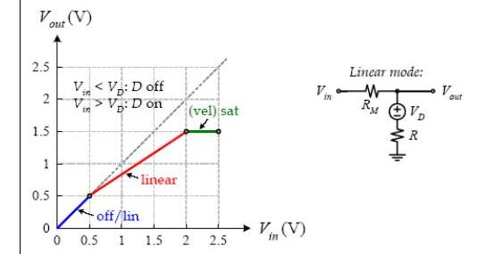

This post collects the 2007, 2008, 2009 and 2010 midterm exams of the Başkent University course **EEM312 Digital Electronics** (Prof. Dr. Emin Akata), together with their solutions. Questions identical to those of earlier years are only briefly noted; the 2003–2006 midterms are in a separate archive post. The original Word files can be downloaded as a ZIP at the end of the post.

## 2007 – Midterm 1 (09.04.2007)

### Question 1 (30 pts)

- **a)** In a junction where the n region is doped 10 times more heavily than the p region, the depletion region is 10 times wider on the more lightly doped **p** side.
- **b)** Regenerative gate: if the gain in the transition region is greater than 1 (VTC slope steeper than 45°), a signal that deviates from the nominal value returns to the nominal value after a few stages.
- **c)** Die yield = [1 + (defects per unit area × die area)/α]^(−α); die cost = wafer cost / (dies per wafer × die yield).
- **d)** Channel length modulation: in saturation, as V_DS increases the effective channel gets shorter and I_D increases slightly; this can be seen from the slight slope of the curves in saturation.
- **e)** Variation of t_pLH, t_pHL and t_p with β = (W/L)_p/(W/L)_n: as β increases, t_pLH decreases and t_pHL increases; the minimum of t_p occurs at a β slightly smaller than the point where t_pHL = t_pLH.
- **f)** Pros and cons of a low supply voltage: energy decreases quadratically and gain increases up to a certain level; as the supply approaches ~4kT/q the gate breaks down, performance degrades, and sensitivity to external noise and V_T variations increases.

### Question 2 (24 pts): Load capacitances

An inverter drives 10 identical inverters:

| | W/L | AD (µm²) | AS (µm²) | PD (µm) | PS (µm) | CJ (fF/µm²) | CJSW (fF/µm) | Cgdo (fF/µm) | Cgso (fF/µm) | Cox (fF/µm²) | Keq |
|---|---|---|---|---|---|---|---|---|---|---|---|
| NMOS | 1.2/0.25 | 1.2 | 1.2 | 3.2 | 3.2 | 2 | 0.2 | 0.4 | 0.4 | 5 | 0.6 |
| PMOS | 3.2/0.25 | 3.2 | 3.2 | 5.2 | 5.2 | 1.5 | 0.25 | 0.3 | 0.3 | 5 | 0.5 |

| Capacitance | Expression | Value |
|---|---|---|
| C_pmos,drain | K_eqp AD_p CJ_p + K_eqp PD_p CJSW_p | 3.05 fF |
| C_pmos,gate | 10 × [(Cgdo_p + Cgso_p) W_p + C_ox W_p L_p] | 59.2 fF |
| C_pmos,gate-drain | 2 × Cgdo_p W_p | 1.92 fF |
| C_nmos,drain | K_eqn AD_n CJ_n + K_eqn PD_n CJSW_n | 1.82 fF |
| C_nmos,gate | 10 × [(Cgdo_n + Cgso_n) W_n + C_ox W_n L_n] | 24.6 fF |
| C_nmos,gate-drain | 2 × Cgdo_n W_n | 0.96 fF |

### Question 3 (23 pts)

**a)** An inverter with V_DD = 5 V, V_OH = 5 V, V_OL = 0 V and transition-region gain g = 10 can receive at most 2.5 V of noise on its ground line. What are the most suitable NM_L and NM_H?

**Answer:** Since there is 2.5 V of noise on the ground, V_IL must not be below 2.5 V. g = 10 = (V_OH − V_OL)/(V_IH − V_IL) = 5/0.5 ⇒ V_IH − V_IL = 0.5 V, V_IH = 3 V. Thus **NM_H = V_OH − V_IH = 2 V**, **NM_L = V_IL − V_OL = 2.5 V**; these are the values at which NM_L and NM_H can be closest to each other.

**b)** Identical to the 1.6 kΩ NMOS circuit in the 2005 midterm (answer: linear region, V_DS = 2.3 V, I_D = 1.06 mA).

### Question 4 (23 pts): Which transistor is which type?

Measurements for two long-channel MOSFETs (W/L = 2.4 µm/1.2 µm, V_SB = 0):

| Condition | MOSFET-A current (magnitude) | MOSFET-B current (magnitude) |
|---|---|---|
| V_GS = 0, V_DS = 0 | 0 | 0 |
| V_GS = −1 V, V_DS = −2 V | 20 µA | 0 |
| V_GS = 1 V, V_DS = 1 V | 0 | 45 µA |
| V_GS = 1 V, V_DS = 0.02 V | 0 | 4 µA |
| V_GS = −2 V, V_DS = −2 V | 200 µA | 0 |

**Answer:** A, which conducts at negative V_GS and V_DS, is a **PMOS**; B, which conducts at positive voltages, is an **NMOS**.

- PMOS (A): measurements 2 and 5 are in saturation; I_D = ½ k_p (V_GS − V_T)². Ratio: 10 = (−2 − V_T)²/(−1 − V_T)² ⇒ (−2 − V_T)/(−1 − V_T) = 3.16 ⇒ **V_Tp = −0.537 V**. −20 × 10⁻⁶ = ½ k_p (−0.463)² ⇒ k_p = −187 × 10⁻⁶ ⇒ **k′_p = k_p/(W/L) = −93.5 × 10⁻⁶ A/V²**.
- NMOS (B): measurement 3 is in saturation (45 µA = ½ k_n (1 − V_T)²), measurement 4 (V_DS = 0.02 V) is in the linear region (4 µA ≈ 0.02 k_n (1 − V_T)). Ratio: 45/4 = 25 (1 − V_T) ⇒ **V_Tn = 0.55 V**; k_n = 444.4 × 10⁻⁶ ⇒ **k′_n = 222.2 × 10⁻⁶ A/V²**.

*Note: In the solution, W/L is written as "(2.4)/(1.4)" when computing k′; the given W/L = 2.4/1.2 = 2, and the results (−93.5 and 222.2 µA/V²) were also obtained with W/L = 2.*

(Points: Question 1 30 pts, Question 2 24 pts, Question 3 23 pts, Question 4 23 pts.)

## 2008 – Midterm (09.04.2008)

### Question 1 (30 pts)

- **a)** If the drain and source pins of the PMOS in the socket are inserted the wrong way round, nothing changes; the two regions are physically identical.
- **b)** A MOS transistor in saturation behaves like an ideal current source; in practice, because of channel length modulation, I_D = I_D′(1 + λV_DS).
- **c)** **DIBL (Drain Induced Barrier Lowering):** Increasing V_DS widens the depletion region of the drain junction and assists the depletion region expected to form under the gate. Strong inversion forms at a smaller voltage, that is, V_T decreases. This V_DS-dependent threshold voltage is a kind of voltage-dependent noise; for example, it can cause problems in memory chips, where the data pattern (and therefore the voltage) changes.
- **d)** A 7-inverter ring oscillator at 2.38 GHz: t_p = 1/(2fN) = **30 ps**.
- **e)** NM_H, NM_L, V_OL, V_OH, V_IL, V_IH, V_sw and the undefined region are shown on a line between V_DD and GND: between V_OH and V_IH is NM_H, between V_IL and V_OL is NM_L, between V_IH and V_IL is the undefined region, and between V_OH and V_OL is V_sw.
- **f)** In the I_D–V_DS plot, under velocity saturation the V_GS curves are equally spaced (I_D is linear in V_GS); in saturation the spacing grows quadratically with V_GS.

### Question 2 (20 pts)

- **a)** In a reverse-biased junction, the terminal current is 10 nA and the drift current is 15 nA ⇒ diffusion current I_D = I_S − I = **5 nA**; if the temperature increases, I_S and the terminal current increase.
- **b)** Minority-carrier distribution in a forward-biased junction: the bias lowers the barrier; holes diffuse into n and electrons into p, where they become minority carriers and travel until they recombine. The density is highest right at the edge of the depletion region (p_n(W₂), n_p(−W₁)) and decays exponentially from there to the thermal-equilibrium value (p_n0, n_p0).
- **c)** Find I_D using the simple diode model; write the equation for an accurate solution (V_D-on = 0.7 V).

**Answer:** I_D = (V_in − 2V_D-on)/(R1 + R2) = (2.5 − 2 × 0.7)/(2k + 2k) = **275 µA**. For the accurate solution, the ideal diode equation: I_D = (V_in − 2V_D)/(R1 + R2) = I_S (e^(V_D/nφ_T) − 1); it is solved iteratively starting from V_D = 0.7 V (I_S, φ_T and n must be known).

### Question 3 (20 pts): Parameter extraction from a short-channel NMOS

| | V_GS (V) | V_DS (V) | V_BS (V) | I_D (µA) |
|---|---|---|---|---|
| 1 | 2.5 | 1.8 | 0 | 1812 |
| 2 | 2 | 1.8 | 0 | 1297 |
| 3 | 2 | 2.5 | 0 | 1361 |
| 4 | 2 | 1.8 | −1 | 1146 |
| 5 | 2 | 1.8 | −2 | 1039 |

V_DSAT = 0.6 V, k′ = 100 µA/V². What are V_T0, λ, γ, 2|φ_F| and W/L?

**Answer:** For (normal) saturation in any of the measurements, 2 − V_T < 0.6, i.e. V_T > 1.4 V, would be required; since this is too large, all measurements are assumed to be in **velocity saturation**: I_D = k′(W/L) V_DSAT (V_GS − V_T − V_DSAT/2)(1 + λV_DS).

- Ratio 1/2: 1812/1297 = (2.5 − V_T0 − 0.3)/(2 − V_T0 − 0.3) ⇒ **V_T0 = 0.44 V** (< 1.4 V, the assumption is consistent).
- Ratio 2/3: 1297/1361 = (1 + 1.8λ)/(1 + 2.5λ) ⇒ **λ = 0.08 V⁻¹**.
- From the 2/4 and 2/5 ratios, V_T4 = 0.587 V, V_T5 = 0.691 V. 0.587 = 0.44 + γ(√(|2φ_F| + 1) − √|2φ_F|) and 0.691 = 0.44 + γ(√(|2φ_F| + 2) − √|2φ_F|); their ratio is 1.7 ⇒ by iteration **|2φ_F| = 0.6 V**, **γ = 0.29 V^½**.
- From measurement 2: 1297 = 100 (W/L) 0.6 (2 − 0.44 − 0.3)(1 + 0.08 × 1.8) ⇒ **W/L = 15**.

### Question 4 (14 pts): Test circuit

k′ = 110 µA/V², V_T = 0.4 V, V_DSAT = 0.6 V.

- **a) R = 10 kΩ:** V_D = 2.5 − 10k × 50 µA = **2 V**. Assuming saturation, 50 × 10⁻⁶ = (110 × 10⁻⁶/2)(2.5/0.25)(2 − V_S − 0.4)² ⇒ **V_S = 1.3 V**. V_GS − V_T = 0.3 V < V_DSAT < V_DS = 0.7 V ⇒ **saturation**, the assumption is correct.
- **b) R = 30 kΩ:** V_D = 2.5 − 1.5 = **1 V**. The saturation assumption gives V_DS = 1 − 1.3 = −0.3 V, which is impossible. Assuming the linear region, 50 × 10⁻⁶ = 110 × 10⁻⁶ × 10 × (1 − V_S)[(2 − V_S − 0.4) − (1 − V_S)/2] ⇒ **V_S = 0.93 V**; V_GS − V_T = 0.67 V, V_DS = 0.07 V ⇒ V_DS < V_DSAT, V_GS − V_T: **linear region**.

### Question 5 (16 pts): V_M = V_DD/2

V_DD = 5 V, k′_n = 40 µA/V², k′_p = 20 µA/V², L_n = L_p = 0.5 µm, W_n = 2 µm, V_T0n = −V_T0p = 1 V; no velocity saturation.

- **a)** At V_M both transistors are in saturation: (k_n/2)(V_M − V_T0n)² = (k_p/2)(V_M − V_DD − V_T0p)². Substituting V_M = V_DD/2 and V_T0p = −V_T0n gives **k_p/k_n = 1**.
- **b)** k_p/k_n = (µ_p W_p)/(µ_n W_n) = 1 ⇒ W_p = (µ_n/µ_p) W_n = (40/20) × 2 µm = **4 µm**.

(Points: Question 1 30 pts, Question 2 20 pts, Question 3 20 pts, Question 4 14 pts, Question 5 16 pts; duration 100 min.)

## 2009 – Midterm (10.04.2009)

### Question 1

- **a)** The four main reasons for preferring CMOS (identical to the answer in the 2003 exam): large V_sw, low output impedance, very high input impedance, and no static power consumption.
- **b)** A temperature change affects a reverse-biased diode more.
- **c)** In a p-n junction there is an excess of electrons on the n side and an excess of holes on the p side; the density difference gives rise to a **diffusion current** from p to n. The accumulated charges create an electric field directed from n to p, and this field produces an opposing **drift current**. Forward bias favors the diffusion current (I_D), and reverse bias favors the drift current (I_S).
- **d)** Variation of the gate-channel capacitance with V_GS (V_DS = 0): when there is no channel, the entire capacitance (WLC_ox) is between gate and body; as V_GS approaches V_T, a depletion region forms and the capacitance drops. At V_GS = V_T the channel forms, C_GCB goes to zero, and the capacitance is shared equally between gate–drain and gate–source (C_GCS = C_GCD = WLC_ox/2). As saturation is approached, the channel pinches off at the drain end, C_GCD drops to zero, and the capacitance appears entirely between gate and source as C_GC = C_GCS = (2/3)WLC_ox.
- **e)** Transistor regions along the VTC of a CMOS inverter: at V_in = 0 the NMOS is in cutoff and the PMOS is conducting, and since V_DSp ≈ 0 it is in the linear region. As V_in increases and the NMOS turns on, V_DSn ≈ V_DD, so the NMOS is in saturation. At V_M (V_in = V_out) both transistors are in saturation; on the other half of the curve the roles are reversed.

*Note: In the answer to 1d, the saturation capacitance is written as "C_GC = C_GCS = 2WLC_ox/2"; the known result is (2/3)WLC_ox.*

### Question 2: Process selection and cost

| | 65 nm CMOS | 90 nm CMOS |
|---|---|---|
| Mask set cost | $3,000,000 | $800,000 |
| Die size | 1.5 cm² | 2 cm² |
| Wafer size | 30 cm | 20 cm |
| Die yield | 78% | 85% |
| Wafer cost | $2,000 | $1,200 |
| Test cost | $0.68/die | $0.68/die |
| Packaging | $0.40/chip | $0.40/chip |
| Final test yield | 95% | 95% |

500,000 units are expected to be sold; which process is more economical?

**Answer:** Dies per wafer = π (diameter/2)² / die area − π × diameter / √(2 × die area).

- **65 nm:** 3.14 × 15² / 1.5 − 3.14 × 30 / √3 ≈ 416 dies; die cost = 2000 / (416 × 0.78) = $6.16; variable cost = (6.16 + 0.68 + 0.40) / 0.95 = $7.62; cost per IC = 7.62 + 3,000,000/500,000 = **$13.62**.
- **90 nm:** 125 dies; die cost $11.29; variable cost $13.02; cost per IC = 13.02 + 1.6 = **$14.62**.

For 500,000 units, the **65 nm process** is more suitable.

### Question 3: V_T0, λ, k′ and V_DSAT from measurements

| Experiment | V_GS | V_DS | V_BS | I_D | Region |
|---|---|---|---|---|---|
| 1 | 1 V | 0.6 V | 0 | 69.99 µA | velocity saturation |
| 2 | 1 V | 0.2 V | 0 | 40.64 µA | linear |
| 3 | 0.4 V | 0.8 V | 0 | 12.93 µA | saturation |
| 4 | 0.4 V | 0.6 V | 0 | 10.51 µA | saturation |
| 5 | 0.2 V | 0.6 V | 0 | 0.71 µA | saturation |

W/L = 0.12 µm / 0.1 µm.

- Ratio 4/5: 14.8 = (0.4 − V_T)²/(0.2 − V_T)² ⇒ 3.85 = (0.4 − V_T)/(0.2 − V_T) ⇒ **V_T0 = 0.13 V**.
- Ratio 3/4: 1.23 = (1 + 0.8λ)/(1 + 0.6λ) ⇒ **λ = 3.71 V⁻¹**.
- From experiment 4: 10.51 = k′ (0.12/(2 × 0.1)) (0.4 − 0.13)² (1 + 3.71 × 0.6) ⇒ **k′ = 74.5 µA/V²**.
- From experiment 1 (velocity saturation): 69.99 = 74.5 × 1.2 × [(1 − 0.13) V_DSAT − V_DSAT²/2] (1 + 3.71 × 0.6) ⇒ **V_DSAT = 0.35 V**.

### Question 4

**a)** The question from the 2006 midterm (V_T0n = 1 V, k_n = 0.625 × 10⁻³ A/V², R_eqn = 2.5 kΩ).

**b)** Sketch the piecewise-linear VTC versus a 0–2.5 V input for a circuit consisting of a short-channel transistor (k′ = 100 µA/V², V_T0 = 0.5 V, V_DSAT = 0.5 V, λ = 0, γ = 0, W/L = 0.5/0.25, V_DD = 2.5 V, R = 40 kΩ) and an ideal diode that turns on at 0.5 V.

**Answer:**

- **0 < V_in < 0.5 V:** The diode is off, the transistor is in the linear region, no current flows: **V_out = V_in**.
- **V_in = 2.5 V:** Assuming velocity saturation, V_out = V_D + R k′(W/L)[(V_DD − V_T0 − V_out) V_DSAT − V_DSAT²/2] = 0.5 + 40 × 10³ × 100 × 10⁻⁶ × 2 × [(2.5 − 0.5 − V_out) 0.5 − 0.125] ⇒ **V_out = 1.5 V**. Check: V_DS = 2.5 − 1.5 = 1 V > V_DSAT, the assumption is valid.
- Input at which velocity saturation begins: V_DSAT = V_in,sat − V_out,sat ⇒ 0.5 = V_in,sat − 1.5 ⇒ **V_in,sat = 2 V**; beyond this V_out stays constant at 1.5 V. This current is I_Dsat = (1.5 − 0.5)/40k = 25 µA; the equivalent resistance of the transistor is R_M = V_DSAT / I_Dsat = 0.5 V / 25 µA = 20 kΩ.
- **0.5 V < V_in < 2 V:** The transistor behaves like a resistor R_M; V_out rises linearly from 0.5 V to 1.5 V through the voltage divider formed by R and R_M.

*Note: In the solution, the 0.5 V < V_in < 2 V range is written as V_out = V_D + V_in · R/(R + R_M) = 0.5 + V_in/1.5; this expression gives 1.83 V at V_in = 2 V and contradicts the graph. The correct form is V_out = V_D + (V_in − V_D) · R/(R + R_M) = 0.5 + (V_in − 0.5)/1.5, which gives 0.5 V at V_in = 0.5 V and 1.5 V at V_in = 2 V, matching the line in the graph.*

(All questions are weighted equally; duration 100 min.)

## 2010 – Midterm (13.04.2010)

The 2010 exam was largely compiled from questions of previous years:

- **Question 1 (25 pts):** a) regenerative property; b) linear, saturation and velocity-saturation regions of an NMOS; c) die yield and die cost; d) formation of drift and diffusion currents; e) in a junction where the p region is doped **2 times** more heavily than the n region, the depletion region is 2 times wider on the more lightly doped **n** side.
- In addition to the answer to Question 1d: when no external source is connected, the two opposing currents are equal and the net current is zero; the threshold voltage (φ₀) that maintains this equilibrium is called the "cut-in" voltage. Since the drift current consists of minority carriers, this current, which dominates under reverse bias, increases significantly with temperature.
- **Question 2 (20 pts):** The four MOSFET circuits from the 2003 exam (I_a = 0.9 mA, V_b = 4 V, I_c = 0, V_d = −3 V).
- **Question 3 (20 pts):** The a–g operating-region table from the 2003 exam (voltages requested as "≤" or "≥").
- **Question 4:** a) 7-inverter ring oscillator, 2.38 GHz ⇒ t_p = 30 ps (5 pts); b) lateral diffusion, x_d = 0.05 µm (10 pts).
- **Question 5 (20 pts):** The NMOS inverter with a 20 kΩ load from the 2006 exam (W/L = 2, V_T0 = 0.4 V, k′ = 430 µA/V², V_DSAT = 1 V): V_OH = 1.2 V, V_OL = 0.08 V.

(Duration 100 min.)
