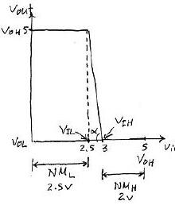
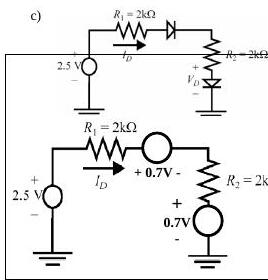
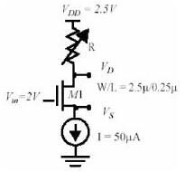
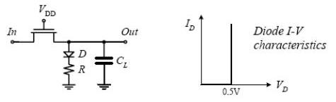
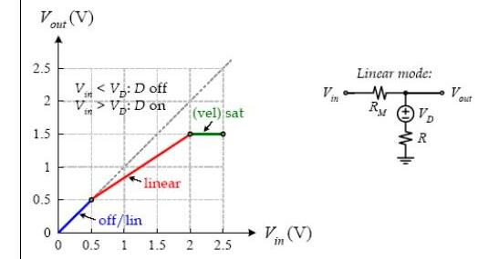

Bu yazı, Başkent Üniversitesi **EEM312 Sayısal Elektronik** dersinin (Prof. Dr. Emin Akata) 2007, 2008, 2009 ve 2010 ara sınavlarını çözümleriyle bir araya getiriyor. Önceki yılların sorularıyla aynı olanlar kısaca belirtildi; 2003–2006 ara sınavları ayrı bir arşiv yazısında. Orijinal Word dosyaları yazının sonunda ZIP olarak indirilebilir.

## 2007 – 1. ara sınav (09.04.2007)

### Soru 1 (30p)

- **a)** n bölgesi p'ye göre 10 kat fazla katkılı eklemde kıtlık bölgesi daha az katkılı **p** tarafında, 10 kat geniştir.
- **b)** Rejeneratif kapı: geçiş bölgesindeki kazanç 1'den büyükse (VTC eğimi 45°'den dik) nominalden sapmış bir sinyal birkaç kademede nominal değerine döner.
- **c)** Die yield = [1 + (birim alandaki kusur × die alanı)/α]^(−α); die maliyeti = wafer maliyeti / (wafer başına die × die yield).
- **d)** Kanal boyu modülasyonu: doyumda V_DS arttıkça etkin kanal kısalır, I_D hafifçe artar; eğrilerin doyumda hafif eğimli olmasından görülür.
- **e)** t_pLH, t_pHL ve t_p'nin β = (W/L)_p/(W/L)_n ile değişimi: β büyüdükçe t_pLH azalır, t_pHL artar; t_p'nin minimumu t_pHL = t_pLH noktasından biraz daha küçük β'dadır.
- **f)** Düşük besleme geriliminin olumlu ve olumsuz yönleri: enerji karesel olarak azalır, kazanç belirli bir seviyeye kadar artar; ~4kT/q'ya yaklaşınca kapı bozulur, performans düşer, dış gürültüye ve V_T değişimlerine duyarlılık artar.

### Soru 2 (24p): Yük sığaları

Bir tersleyici aynı özellikteki 10 tersleyiciyi sürüyor:

| | W/L | AD (µm²) | AS (µm²) | PD (µm) | PS (µm) | CJ (fF/µm²) | CJSW (fF/µm) | Cgdo (fF/µm) | Cgso (fF/µm) | Cox (fF/µm²) | Keq |
|---|---|---|---|---|---|---|---|---|---|---|---|
| NMOS | 1,2/0,25 | 1,2 | 1,2 | 3,2 | 3,2 | 2 | 0,2 | 0,4 | 0,4 | 5 | 0,6 |
| PMOS | 3,2/0,25 | 3,2 | 3,2 | 5,2 | 5,2 | 1,5 | 0,25 | 0,3 | 0,3 | 5 | 0,5 |

| Sığa | İfade | Değer |
|---|---|---|
| C_pmos,drain | K_eqp AD_p CJ_p + K_eqp PD_p CJSW_p | 3,05 fF |
| C_pmos,gate | 10 × [(Cgdo_p + Cgso_p) W_p + C_ox W_p L_p] | 59,2 fF |
| C_pmos,gate-drain | 2 × Cgdo_p W_p | 1,92 fF |
| C_nmos,drain | K_eqn AD_n CJ_n + K_eqn PD_n CJSW_n | 1,82 fF |
| C_nmos,gate | 10 × [(Cgdo_n + Cgso_n) W_n + C_ox W_n L_n] | 24,6 fF |
| C_nmos,gate-drain | 2 × Cgdo_n W_n | 0,96 fF |

### Soru 3 (23p)

**a)** V_DD = 5 V, V_OH = 5 V, V_OL = 0 V ve geçiş bölgesi kazancı g = 10 olan tersleyiciye toprak hattından en çok 2,5 V gürültü gelebiliyor. En uygun NM_L ve NM_H nedir?

**Yanıt:** Toprakta 2,5 V gürültü olduğundan V_IL 2,5 V'un altında olmamalı. g = 10 = (V_OH − V_OL)/(V_IH − V_IL) = 5/0,5 ⇒ V_IH − V_IL = 0,5 V, V_IH = 3 V. Böylece **NM_H = V_OH − V_IH = 2 V**, **NM_L = V_IL − V_OL = 2,5 V**; bunlar NM_L ile NM_H'nin birbirine en yakın olabildiği değerlerdir.

**b)** 2005 ara sınavındaki 1,6 kΩ'luk NMOS devresinin aynısı (yanıt: doğrusal bölge, V_DS = 2,3 V, I_D = 1,06 mA).

### Soru 4 (23p): Hangi transistör hangi tür?

Uzun kanallı iki MOSFET (W/L = 2,4 µm/1,2 µm, V_SB = 0) için ölçümler:

| Durum | MOSFET-A akımı (mutlak) | MOSFET-B akımı (mutlak) |
|---|---|---|
| V_GS = 0, V_DS = 0 | 0 | 0 |
| V_GS = −1 V, V_DS = −2 V | 20 µA | 0 |
| V_GS = 1 V, V_DS = 1 V | 0 | 45 µA |
| V_GS = 1 V, V_DS = 0,02 V | 0 | 4 µA |
| V_GS = −2 V, V_DS = −2 V | 200 µA | 0 |

**Yanıt:** Negatif V_GS ve V_DS'de akım akan A **PMOS**, pozitif gerilimlerde akım akan B **NMOS**'tur.

- PMOS (A): 2. ve 5. ölçümler doyumda; I_D = ½ k_p (V_GS − V_T)². Oran: 10 = (−2 − V_T)²/(−1 − V_T)² ⇒ (−2 − V_T)/(−1 − V_T) = 3,16 ⇒ **V_Tp = −0,537 V**. −20 × 10⁻⁶ = ½ k_p (−0,463)² ⇒ k_p = −187 × 10⁻⁶ ⇒ **k′_p = k_p/(W/L) = −93,5 × 10⁻⁶ A/V²**.
- NMOS (B): 3. ölçüm doyumda (45 µA = ½ k_n (1 − V_T)²), 4. ölçüm (V_DS = 0,02 V) doğrusal bölgede (4 µA ≈ 0,02 k_n (1 − V_T)). Oran: 45/4 = 25 (1 − V_T) ⇒ **V_Tn = 0,55 V**; k_n = 444,4 × 10⁻⁶ ⇒ **k′_n = 222,2 × 10⁻⁶ A/V²**.

*Not: Çözümde k′ hesaplanırken W/L "(2,4)/(1,4)" diye yazılmış; verilen W/L = 2,4/1,2 = 2'dir ve sonuçlar (−93,5 ve 222,2 µA/V²) da W/L = 2 ile bulunmuş.*

(Puanlar: 1. soru 30p, 2. soru 24p, 3. soru 23p, 4. soru 23p.)

## 2008 – Ara sınav (09.04.2008)

### Soru 1 (30p)

- **a)** Soketteki PMOS'un drain ve source bacakları ters takılırsa hiçbir şey değişmez; iki bölge fiziksel olarak aynıdır.
- **b)** MOS transistör doyumda ideal akım kaynağı gibidir; kanal boyu modülasyonu nedeniyle pratikte I_D = I_D′(1 + λV_DS) olur.
- **c)** **DIBL (Drain Induced Barrier Lowering):** Artan V_DS, drain ekleminin kıtlık bölgesini genişletir ve gate altında oluşması beklenen kıtlık bölgesine yardım eder. Güçlü evirtim (strong inversion) daha küçük gerilimde oluşur, yani V_T küçülür. V_DS'ye bağlı bu eşik gerilimi bir tür gerilime bağlı gürültüdür; örneğin veri örüntüsünün (dolayısıyla gerilimin) değiştiği bellek yongalarında sorun yaratabilir.
- **d)** 7 tersleyicili halka osilatörü 2,38 GHz'de: t_p = 1/(2fN) = **30 ps**.
- **e)** NM_H, NM_L, V_OL, V_OH, V_IL, V_IH, V_sw ve belirsiz bölge, V_DD ile GND arasındaki bir çizgi üzerinde gösterilir: V_OH ile V_IH arası NM_H, V_IL ile V_OL arası NM_L, V_IH ile V_IL arası belirsiz bölge, V_OH ile V_OL arası V_sw'dir.
- **f)** I_D–V_DS grafiğinde hız doyumunda V_GS eğrileri eşit aralıklıdır (I_D, V_GS ile doğrusal); doyumda aralıklar V_GS ile karesel artar.

### Soru 2 (20p)

- **a)** Ters kutuplanmış eklemde terminal akımı 10 nA, drift akımı 15 nA ⇒ difüzyon akımı I_D = I_S − I = **5 nA**; sıcaklık artarsa I_S ve terminal akımı artar.
- **b)** İleri kutuplanmış eklemde azınlık taşıyıcı dağılımı: kutuplama bariyeri alçaltır; delikler n'ye, elektronlar p'ye difüzlenip orada azınlık taşıyıcısı olur ve yeniden birleşene kadar ilerler. Yoğunluk kıtlık bölgesinin hemen kenarında en büyüktür (p_n(W₂), n_p(−W₁)) ve oradan ısıl denge değerine (p_n0, n_p0) üstel olarak düşer.
- **c)** Basit diyot modeliyle I_D'yi bulunuz; duyarlı çözüm için denklemi yazınız (V_D-on = 0,7 V).

**Yanıt:** I_D = (V_in − 2V_D-on)/(R1 + R2) = (2,5 − 2 × 0,7)/(2k + 2k) = **275 µA**. Duyarlı çözüm için ideal diyot denklemi: I_D = (V_in − 2V_D)/(R1 + R2) = I_S (e^(V_D/nφ_T) − 1); başlangıçta V_D = 0,7 V alınarak iterasyonla çözülür (I_S, φ_T ve n bilinmeli).

### Soru 3 (20p): Kısa kanallı NMOS'tan parametre çıkarımı

| | V_GS (V) | V_DS (V) | V_BS (V) | I_D (µA) |
|---|---|---|---|---|
| 1 | 2,5 | 1,8 | 0 | 1812 |
| 2 | 2 | 1,8 | 0 | 1297 |
| 3 | 2 | 2,5 | 0 | 1361 |
| 4 | 2 | 1,8 | −1 | 1146 |
| 5 | 2 | 1,8 | −2 | 1039 |

V_DSAT = 0,6 V, k′ = 100 µA/V². V_T0, λ, γ, 2|φ_F| ve W/L nedir?

**Yanıt:** Herhangi bir ölçümde (normal) doyum için 2 − V_T < 0,6, yani V_T > 1,4 V gerekirdi; bu çok büyük olduğundan tüm ölçümler **hız doyumunda** kabul edilir: I_D = k′(W/L) V_DSAT (V_GS − V_T − V_DSAT/2)(1 + λV_DS).

- 1/2 oranı: 1812/1297 = (2,5 − V_T0 − 0,3)/(2 − V_T0 − 0,3) ⇒ **V_T0 = 0,44 V** (< 1,4 V, varsayım tutarlı).
- 2/3 oranı: 1297/1361 = (1 + 1,8λ)/(1 + 2,5λ) ⇒ **λ = 0,08 V⁻¹**.
- 2/4 ve 2/5 oranlarından V_T4 = 0,587 V, V_T5 = 0,691 V. 0,587 = 0,44 + γ(√(|2φ_F| + 1) − √|2φ_F|) ve 0,691 = 0,44 + γ(√(|2φ_F| + 2) − √|2φ_F|) oranı 1,7 ⇒ iterasyonla **|2φ_F| = 0,6 V**, **γ = 0,29 V^½**.
- 2. ölçümden: 1297 = 100 (W/L) 0,6 (2 − 0,44 − 0,3)(1 + 0,08 × 1,8) ⇒ **W/L = 15**.

### Soru 4 (14p): Test devresi

k′ = 110 µA/V², V_T = 0,4 V, V_DSAT = 0,6 V.

- **a) R = 10 kΩ:** V_D = 2,5 − 10k × 50 µA = **2 V**. Doyum varsayımıyla 50 × 10⁻⁶ = (110 × 10⁻⁶/2)(2,5/0,25)(2 − V_S − 0,4)² ⇒ **V_S = 1,3 V**. V_GS − V_T = 0,3 V < V_DSAT < V_DS = 0,7 V ⇒ **doyum**, varsayım doğru.
- **b) R = 30 kΩ:** V_D = 2,5 − 1,5 = **1 V**. Doyum varsayımı V_DS = 1 − 1,3 = −0,3 V verir, olanaksız. Doğrusal bölge varsayımıyla 50 × 10⁻⁶ = 110 × 10⁻⁶ × 10 × (1 − V_S)[(2 − V_S − 0,4) − (1 − V_S)/2] ⇒ **V_S = 0,93 V**; V_GS − V_T = 0,67 V, V_DS = 0,07 V ⇒ V_DS < V_DSAT, V_GS − V_T: **doğrusal bölge**.

### Soru 5 (16p): V_M = V_DD/2

V_DD = 5 V, k′_n = 40 µA/V², k′_p = 20 µA/V², L_n = L_p = 0,5 µm, W_n = 2 µm, V_T0n = −V_T0p = 1 V; hız doyumu yok.

- **a)** V_M'de iki transistör de doyumda: (k_n/2)(V_M − V_T0n)² = (k_p/2)(V_M − V_DD − V_T0p)². V_M = V_DD/2 ve V_T0p = −V_T0n konursa **k_p/k_n = 1**.
- **b)** k_p/k_n = (µ_p W_p)/(µ_n W_n) = 1 ⇒ W_p = (µ_n/µ_p) W_n = (40/20) × 2 µm = **4 µm**.

(Puanlar: 1. soru 30p, 2. soru 20p, 3. soru 20p, 4. soru 14p, 5. soru 16p; süre 100 dk.)

## 2009 – Ara sınav (10.04.2009)

### Soru 1

- **a)** CMOS'un tercih edilmesinin dört temel nedeni (2003 sınavındaki yanıtın aynısı): geniş V_sw, düşük çıkış empedansı, çok yüksek giriş empedansı ve statik güç tüketiminin olmaması.
- **b)** Sıcaklık değişimi ters kutuplanmış diyotu daha çok etkiler.
- **c)** p-n ekleminde n tarafında elektron, p tarafında delik fazlalığı vardır; yoğunluk farkı p'den n'ye bir **difüzyon akımı** doğurur. Biriken yükler n'den p'ye doğru bir elektrik alanı yaratır ve bu alan ters yönde bir **drift akımı** oluşturur. İleri kutuplama difüzyon akımını (I_D), ters kutuplama drift akımını (I_S) öne çıkarır.
- **d)** Gate-channel sığasının V_GS ile değişimi (V_DS = 0): kanal yokken tüm sığa (WLC_ox) gate–body arasındadır; V_GS, V_T'ye yaklaştıkça kıtlık bölgesi oluşur ve sığa düşer. V_GS = V_T'de kanal oluşur, C_GCB sıfırlanır ve sığa gate–drain ile gate–source arasında eşit paylaşılır (C_GCS = C_GCD = WLC_ox/2). Doyuma yaklaşıldıkça drain ucunda kanal kısılır, C_GCD sıfıra düşer ve sığa C_GC = C_GCS = (2/3)WLC_ox olarak gate–source arasında görülür.
- **e)** CMOS tersleyicinin VTC'si boyunca transistör bölgeleri: V_in = 0'da NMOS kesimde, PMOS iletimde ve V_DSp ≈ 0 olduğundan doğrusal bölgededir. V_in artıp NMOS açılınca V_DSn ≈ V_DD olduğundan NMOS doyumdadır. V_M'de (V_in = V_out) iki transistör de doyumdadır; eğrinin öbür yarısında roller değişir.

*Not: 1d yanıtında doyumdaki sığa "C_GC = C_GCS = 2WLC_ox/2" diye yazılmış; bilinen sonuç (2/3)WLC_ox'tur.*

### Soru 2: Süreç seçimi ve maliyet

| | 65 nm CMOS | 90 nm CMOS |
|---|---|---|
| Maske seti maliyeti | 3.000.000 $ | 800.000 $ |
| Die boyutu | 1,5 cm² | 2 cm² |
| Wafer boyutu | 30 cm | 20 cm |
| Die yield | %78 | %85 |
| Wafer maliyeti | 2.000 $ | 1.200 $ |
| Test maliyeti | 0,68 $/die | 0,68 $/die |
| Paketleme | 0,40 $/yonga | 0,40 $/yonga |
| Son test verimi | %95 | %95 |

500.000 adet satış bekleniyor; hangi süreç daha ekonomik?

**Yanıt:** Wafer başına die = π (çap/2)² / die alanı − π × çap / √(2 × die alanı).

- **65 nm:** 3,14 × 15² / 1,5 − 3,14 × 30 / √3 ≈ 416 die; die maliyeti = 2000 / (416 × 0,78) = 6,16 $; değişken maliyet = (6,16 + 0,68 + 0,40) / 0,95 = 7,62 $; IC başına maliyet = 7,62 + 3.000.000/500.000 = **13,62 $**.
- **90 nm:** 125 die; die maliyeti 11,29 $; değişken maliyet 13,02 $; IC başına maliyet = 13,02 + 1,6 = **14,62 $**.

500.000 adet için **65 nm süreç** daha uygundur.

### Soru 3: Ölçümlerden V_T0, λ, k′ ve V_DSAT

| Deney | V_GS | V_DS | V_BS | I_D | Bölge |
|---|---|---|---|---|---|
| 1 | 1 V | 0,6 V | 0 | 69,99 µA | hız doyumu |
| 2 | 1 V | 0,2 V | 0 | 40,64 µA | doğrusal |
| 3 | 0,4 V | 0,8 V | 0 | 12,93 µA | doyum |
| 4 | 0,4 V | 0,6 V | 0 | 10,51 µA | doyum |
| 5 | 0,2 V | 0,6 V | 0 | 0,71 µA | doyum |

W/L = 0,12 µm / 0,1 µm.

- 4/5 oranı: 14,8 = (0,4 − V_T)²/(0,2 − V_T)² ⇒ 3,85 = (0,4 − V_T)/(0,2 − V_T) ⇒ **V_T0 = 0,13 V**.
- 3/4 oranı: 1,23 = (1 + 0,8λ)/(1 + 0,6λ) ⇒ **λ = 3,71 V⁻¹**.
- 4. deneyden: 10,51 = k′ (0,12/(2 × 0,1)) (0,4 − 0,13)² (1 + 3,71 × 0,6) ⇒ **k′ = 74,5 µA/V²**.
- 1. deneyden (hız doyumu): 69,99 = 74,5 × 1,2 × [(1 − 0,13) V_DSAT − V_DSAT²/2] (1 + 3,71 × 0,6) ⇒ **V_DSAT = 0,35 V**.

### Soru 4

**a)** 2006 ara sınavındaki soru (V_T0n = 1 V, k_n = 0,625 × 10⁻³ A/V², R_eqn = 2,5 kΩ).

**b)** Kısa kanallı transistör (k′ = 100 µA/V², V_T0 = 0,5 V, V_DSAT = 0,5 V, λ = 0, γ = 0, W/L = 0,5/0,25, V_DD = 2,5 V, R = 40 kΩ) ve 0,5 V'ta iletime geçen ideal diyottan oluşan devrenin 0–2,5 V girişe karşı parçalı doğrusal VTC'sini çiziniz.

**Yanıt:**

- **0 < V_in < 0,5 V:** Diyot kesimde, transistör doğrusal bölgede, akım yok: **V_out = V_in**.
- **V_in = 2,5 V:** Hız doyumu varsayımıyla V_out = V_D + R k′(W/L)[(V_DD − V_T0 − V_out) V_DSAT − V_DSAT²/2] = 0,5 + 40 × 10³ × 100 × 10⁻⁶ × 2 × [(2,5 − 0,5 − V_out) 0,5 − 0,125] ⇒ **V_out = 1,5 V**. Kontrol: V_DS = 2,5 − 1,5 = 1 V > V_DSAT, varsayım geçerli.
- Hız doyumunun başladığı giriş: V_DSAT = V_in,sat − V_out,sat ⇒ 0,5 = V_in,sat − 1,5 ⇒ **V_in,sat = 2 V**; bundan sonra V_out = 1,5 V'ta sabit kalır. Bu akım I_Dsat = (1,5 − 0,5)/40k = 25 µA; transistörün eşdeğer direnci R_M = V_DSAT / I_Dsat = 0,5 V / 25 µA = 20 kΩ.
- **0,5 V < V_in < 2 V:** Transistör R_M direnci gibi davranır; V_out, R ile R_M arasındaki gerilim bölmesiyle 0,5 V'tan 1,5 V'a doğrusal yükselir.

*Not: Çözümde 0,5 V < V_in < 2 V aralığı için V_out = V_D + V_in · R/(R + R_M) = 0,5 + V_in/1,5 yazılmış; bu ifade V_in = 2 V'ta 1,83 V verir ve grafikle çelişir. Doğrusu V_out = V_D + (V_in − V_D) · R/(R + R_M) = 0,5 + (V_in − 0,5)/1,5'tir; bu, V_in = 0,5 V'ta 0,5 V, V_in = 2 V'ta 1,5 V vererek grafikteki doğruyla örtüşür.*

(Soruların ağırlıkları eşit; süre 100 dk.)

## 2010 – Ara sınav (13.04.2010)

2010 sınavı büyük ölçüde önceki yılların sorularından derlenmişti:

- **Soru 1 (25p):** a) rejeneratif özellik; b) NMOS'ta doğrusal, doyum ve hız doyumu bölgeleri; c) die yield ve die maliyeti; d) drift ve difüzyon akımlarının oluşumu; e) p bölgesi n'ye göre **2 kat** fazla katkılı bir eklemde kıtlık bölgesi daha az katkılı **n** tarafında, 2 kat geniştir.
- Soru 1d yanıtına ek olarak: dışarıdan kaynak bağlı değilken iki zıt akım eşitlenir ve net akım sıfırdır; dengeyi sağlayan eşik gerilimine (φ₀) "cut-in" gerilimi denir. Drift akımı azınlık taşıyıcılarından oluştuğu için ters kutuplamada etkin olan bu akım sıcaklıkla önemli ölçüde artar.
- **Soru 2 (20p):** 2003 sınavının dört MOSFET devresi (I_a = 0,9 mA, V_b = 4 V, I_c = 0, V_d = −3 V).
- **Soru 3 (20p):** 2003 sınavının a–g çalışma bölgesi tablosu (gerilimler "≤" ya da "≥" biçiminde istenmiş).
- **Soru 4:** a) 7 tersleyicili halka osilatörü, 2,38 GHz ⇒ t_p = 30 ps (5p); b) lateral diffusion, x_d = 0,05 µm (10p).
- **Soru 5 (20p):** 2006 sınavındaki 20 kΩ yüklü NMOS tersleyici (W/L = 2, V_T0 = 0,4 V, k′ = 430 µA/V², V_DSAT = 1 V): V_OH = 1,2 V, V_OL = 0,08 V.

(Süre 100 dk.)
