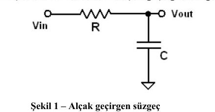
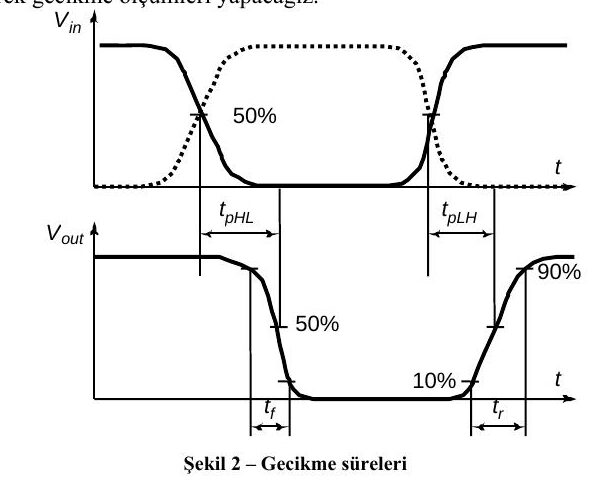
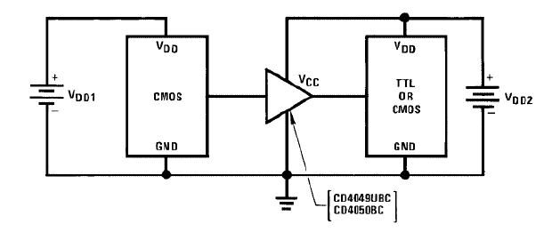
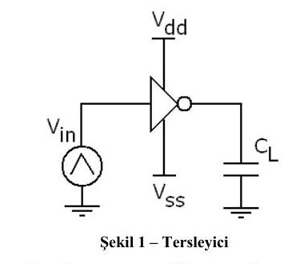
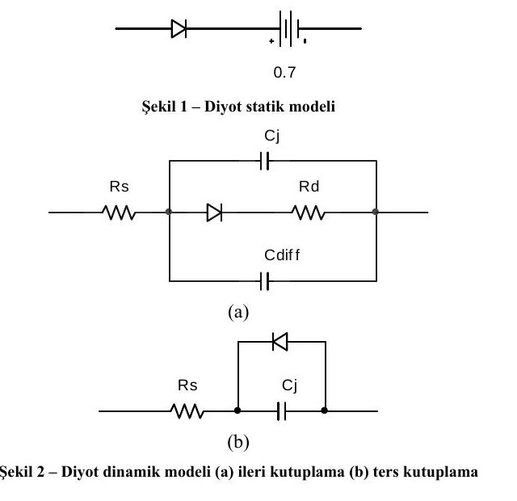
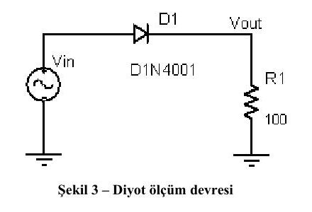
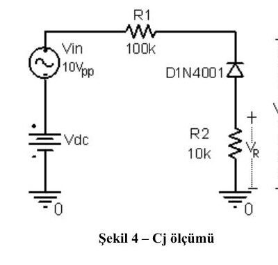

This post contains the experiment sheets for the **hardware laboratory** of the Başkent University Electrical-Electronics Engineering course **EEM 312 – Digital Electronics**, spring semester 2010-2011: **D1** (use of basic laboratory equipment), **D2** (integrated circuit inverter measurements), and **D3** (diode characteristics and models). The sheets are dated March 2011; the lab supervisors were Research Assistants Numan Yavuz and Evren Emekdaş. At the end of each sheet there is a page where the measurement tables are filled in and submitted at the end of the experiment. The original PDFs of the three sheets can be downloaded as a ZIP at the end of the post.

## D1: Use of basic laboratory equipment

### Part I: Finding the value of C with an RC filter

Measure the R value provided in the laboratory with a digital multimeter. Then build the RC low-pass filter circuit in Figure 1 using R and C.

The value of C can be calculated from this circuit using Equation 1:

ω_c = 1 / (RC)   (Equation 1)

ω_c in Equation 1 is valid at the cutoff frequency of the circuit. Apply a sine wave with 2 V_pp amplitude to the input; connect one probe of the oscilloscope to the input and the other to the output. The frequency at which the output power drops to half, that is, the ratio of the output amplitude to the input amplitude is approximately **0.7071**, is the cutoff frequency. To find it, you need to sweep the frequency of the signal generator.

> **Important note:** As the frequency changes, the impedance of the circuit, and therefore the current it draws, also changes. When the current increases, a voltage drop occurs across the internal resistance of the signal source, and the output voltage falls below the set value. Therefore, the input amplitude must be rechecked at every frequency change; otherwise the calculated results will be wrong.

**Table 1:** Measured R value, measured f_c frequency, calculated C value.

**Question 1:** How is Equation 1 derived? Prove it. What drawbacks might this method have if it is used to measure and model the internal capacitance of an electronic component?

### Part II: Variation of gain and phase with frequency

Sine waves at the frequencies below are applied to the same circuit, and the gain (V_out/V_in) and the phase difference in degrees are measured; the results are plotted using Excel, MATLAB, etc.

| Measurement no. | Frequency | Measured gain (V_out/V_in) | Phase difference (degrees) |
|---|---|---|---|
| 1 | 10 kHz | | |
| 2 | 50 kHz | | |
| 3 | 100 kHz | | |
| 4 | 150 kHz | | |
| 5 | 200 kHz | | |
| 6 | 250 kHz | | |
| 7 | 300 kHz | | |
| 8 | 400 kHz | | |
| 9 | 500 kHz | | |
| 10 | 1 MHz | | |

**Question 3:** How does the measured gain vary with frequency? **Question 4:** How does the calculated phase vary with frequency?

*Note: In the sheet, the question numbers jump from 1 to 3; there is no "Question 2".*

### Part III: Delay measurements

In this part, a pulse is applied to the input and the delays are measured. Figure 2 shows the pulse applied to the input of a buffer and an inverter, and the pulse at the output.

- **t_r (rise time):** the time for the signal to rise from its 10% value to its 90% value.
- **t_f (fall time):** the time for the signal to fall from its 90% value to its 10% value.
- **t_pHL:** the time between the instant the output reaches its 50% value while going from high to low and the 50% point of the input that caused this change.
- **t_pLH:** the time between the instant the output reaches its 50% value while going from low to high and the 50% point of the input.
- **t_d:** propagation delay, t_d = (t_pHL + t_pLH) / 2.

**Table 3:** For two waves at 60 kHz with pulse widths of 50% and 30%, t_r, t_f, t_pHL, t_pLH, and t_d are measured.

- **Question 5:** Are there differences between the values in Table 3? What is the reason?
- **Question 6:** How does a change in pulse width affect the measured values?
- **Question 7:** What is the effect of t_r of the input signal on t_r at the output? What is the similar effect for t_f?

### Part IV

Can second-order effects be observed in the circuit whose input is driven with a pulse? Explain why. Under what conditions do such effects appear?

## D2: Integrated circuit inverter measurements

### Preliminary work

Examine the two datasheets given on the laboratory web page and answer the following questions:

1. Which logic family do the ICs belong to?
1. Which features of each IC are highlighted in the datasheet?
1. Which IC can operate at a 5 V supply voltage?
1. Which IC has lower t_r and t_f values for its output at a 5 V supply?
1. Is it possible to make a non-inverting buffer by connecting the two ICs directly to each other? If so, which one should be used at the input; does the order matter?
1. What is the purpose of using the CD4049 / CD4050 in the example application in the datasheet?

It was mandatory to bring a copy of each datasheet to the experiment.

### Laboratory work

1. Write in your report which logic family the given IC belongs to, its exact part number, and its features.
1. Set the signal generator to give a 1 kHz triangle wave between 0–5 V. Connect one inverter inside the IC as in Figure 1 (C_L = 10 pF, 5 V DC between V_dd and V_ss). Set both channels of the oscilloscope to DC and to the correct probe multiplier; connect the first channel to V_in and the second to C_L, and observe the voltage transfer curve in **X-Y mode**. Can V_OH, V_OL, V_IL, V_IH be measured from this graph? Measure the DC parameters in Table 1 (V_OL, V_OH, V_IL, V_IH, NM_H, NM_L) and compare them with the datasheet.
1. Set the signal generator to a 100 kHz, 0–5 V square wave; using the oscilloscope's measurement menu, measure t_r, t_f, t_pHL, t_pLH, and t_d (Table 2) and compare them with the datasheet.

The noise margins are found from the measured values as NM_H = V_OH − V_IH and NM_L = V_IL − V_OL.

## D3: Diode characteristics and models

### Background: static and dynamic behavior of the diode

In digital or switching systems, the voltage applied to semiconductors is in the form of pulses, and since these systems can operate at high frequencies, dynamic effects become important in design. The diode holds an important place both for its undesired effects and for protection purposes; it should be examined in terms of its static and dynamic characteristics. At low frequency only static effects are seen: the static model is the system's response only to its present input. In a dynamic system, however, the output also depends on previous inputs, and these effects appear as frequency increases.

In the dynamic model, C_j, C_diff, and R_d are important; C_j and R_d depend on the diode voltage. Under forward bias C_j can be neglected, while under reverse bias it becomes more important, because the leakage current is very small and the current flowing through this capacitor becomes decisive. Since the depletion region widens with reverse voltage, C_j depends on voltage:

C_j(V_R) = C_j0 / (1 + V_R / V_j)^m   (Equation 1)

Here V_R is the reverse bias voltage, C_j0 is the junction capacitance at V_R = 0, V_j is the junction potential, and m is a value such as 0.5 or 0.333 depending on the diffusion type of the p-n junction.

The capacitance in the diffusion region becomes significant depending on the rate of change of the bias. The charge stored in the diffusion region is proportional to the forward current and the transit time of the minority carriers τ_T:

Q = τ_T · I_F = τ_T · I_S · (e^(qV_F / nkT) − 1)   (Equation 2)

(I_S: saturation current, ~1E-14 A; q: electron charge, 1.6E-19 C; T: junction temperature (kelvin); k: Boltzmann constant, 1.38E-23 J/K; n: emission coefficient; V_F: diode voltage.)

When the diode switches from conduction to cutoff, the minority carriers first cross to the other side; this time is called **t_s** (storage time). Then the time needed for the depletion region to form and stabilize under reverse voltage is **t_t** (transition time). The total time **t_rr = t_s + t_t** is the reverse recovery time; it is of great importance with regard to the operating frequency and the energy loss in the diode.

### Laboratory work

1. Build the circuit in Figure 3 (D1N4001, R1 = 100 Ω). Set the signal generator to a 1 kHz triangle wave between −10 V and +10 V and find the forward voltage of the diode by observing V_out.
1. In the same circuit, using a DC source, measure the diode current for diode voltages of −5 V, 0.5 V, 0.55 V, 0.6 V, 0.65 V, 0.7 V, 0.75 V, and 0.8 V (Table 1) and plot the I-V curve.
1. Apply a 0–5 V square wave to the input to measure the reverse recovery time and plot it against frequency (5k, 10k, 20k, 40k, 100k, 200k, 500k, and 1 MHz; Table 2). What is the effect of R1 on the values and for what purpose is it used? Compare the results with the datasheet.
1. Build the circuit in Figure 4 (V_in = 10 V_pp, R1 = 100 kΩ, D1N4001 in the reverse direction, R2 = 10 kΩ, V_dc offset). Find the diode current from the voltage across R2; for V_dc offsets of 2, 3, 5, 8, and 10 V (with frequencies of 10k, 20k, 40k, 100k, and 200k respectively), measure V_D, V_R, I_D and calculate C_j (Table 3), and plot it against V_dc. What should be considered in choosing R2, and what is its role in the circuit?

*Note: Item 3 of the sheet says "a square wave instead of a sine signal at the input", whereas in item 1 a triangle wave was applied to Figure 3.*
