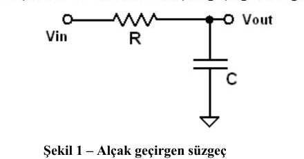
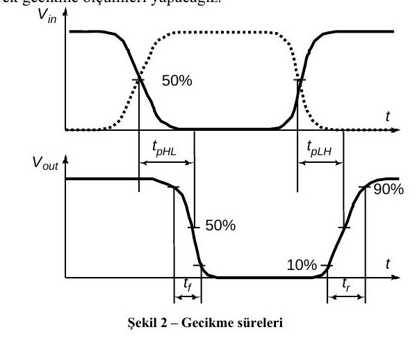
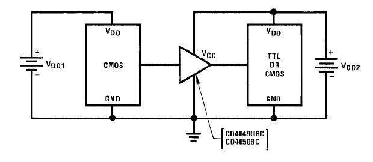
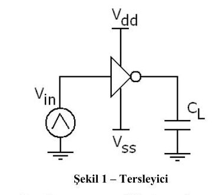
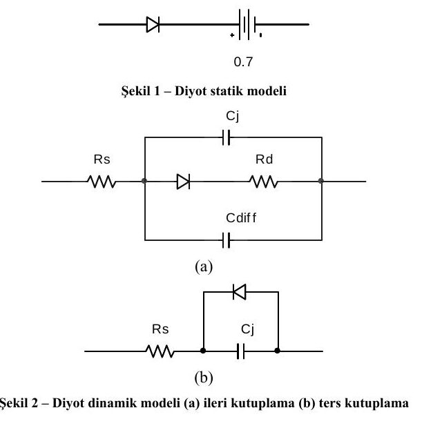
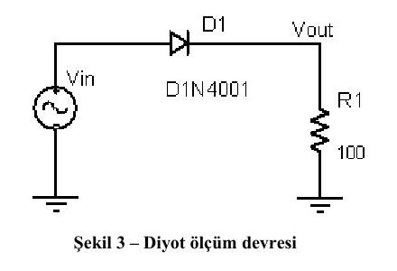
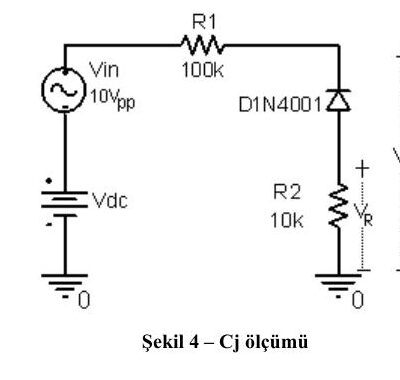

Bu yazı, Başkent Üniversitesi Elektrik-Elektronik Mühendisliği **EEM 312 – Sayısal Elektronik** dersinin 2010-2011 bahar yarıyılı **donanım laboratuvarı** deney föylerini içeriyor: **D1** (temel laboratuvar donanımlarının kullanımı), **D2** (entegre devre tersleyici ölçümleri) ve **D3** (diyot karakteristiği ve modelleri). Föyler Mart 2011 tarihli; laboratuvar sorumluları Arş. Gör. Numan Yavuz ve Arş. Gör. Evren Emekdaş'tı. Her föyün sonunda, ölçüm tablolarının deney sonunda doldurulup teslim edildiği bir sayfa var. Üç föyün orijinal PDF'leri yazının sonunda ZIP olarak indirilebilir.

## D1: Temel laboratuvar donanımlarının kullanımı

### Bölüm I: RC süzgeçle C değerinin bulunması

Laboratuvarda verilen R değerini sayısal ölçü aletiyle ölçün. Ardından R ve C ile Şekil 1'deki RC alçak geçiren süzgeç devresini kurun.

C değeri bu devreden Denklem 1 ile hesaplanabilir:

ω_c = 1 / (RC)   (Denklem 1)

Denklem 1'deki ω_c devrenin kesme frekansında geçerlidir. Girişe 2 V_pp genlikli sinüs dalgası uygulayın; osiloskobun bir probunu girişe, diğerini çıkışa bağlayın. Çıkış gücünün yarıya düştüğü, yani çıkış genliğinin giriş genliğine oranının yaklaşık **0,7071** olduğu frekans kesme frekansıdır. Bunu bulmak için sinyal üretecinin frekansını değiştirerek tarama yapmak gerekir.

> **Önemli not:** Frekans değiştikçe devrenin empedansı, dolayısıyla çektiği akım da değişir. Akım arttığında sinyal kaynağının iç direncinde gerilim düşer ve çıkış gerilimi ayarlanan değerin altına iner. Bu yüzden her frekans değişikliğinde giriş genliği yeniden kontrol edilmelidir; aksi halde hesaplanan sonuçlar yanlış olur.

**Tablo 1:** Ölçülen R değeri, ölçülen f_c frekansı, hesaplanan C değeri.

**Soru 1:** Denklem 1 nasıl elde edilmiştir? İspatlayın. Bu yöntem bir elektronik elemanın iç kapasitansını ölçmede ve modellemede kullanılırsa ne gibi sakıncaları olabilir?

### Bölüm II: Kazanç ve fazın frekansla değişimi

Aynı devreye aşağıdaki frekanslarda sinüs dalgası uygulanarak kazanç (V_out/V_in) ve derece cinsinden faz farkı ölçülür; sonuçlar Excel, MATLAB vb. ile grafiğe dökülür.

| Ölçüm no | Frekans | Ölçülen kazanç (V_out/V_in) | Faz farkı (derece) |
|---|---|---|---|
| 1 | 10 kHz | | |
| 2 | 50 kHz | | |
| 3 | 100 kHz | | |
| 4 | 150 kHz | | |
| 5 | 200 kHz | | |
| 6 | 250 kHz | | |
| 7 | 300 kHz | | |
| 8 | 400 kHz | | |
| 9 | 500 kHz | | |
| 10 | 1 MHz | | |

**Soru 3:** Ölçülen kazancın frekansa bağlı değişimi nasıldır? **Soru 4:** Hesaplanan fazın frekansa bağlı değişimi nasıldır?

*Not: Föyde soru numaraları 1'den 3'e atlıyor; "Soru 2" yok.*

### Bölüm III: Gecikme ölçümleri

Bu bölümde girişe darbe uygulanarak gecikmeler ölçülür. Şekil 2'de bir tampon ve tersleyicinin girişine uygulanan darbe ile çıkıştaki darbe görülüyor.

- **t_r (yükselme süresi):** işaretin %10'luk değerinden %90'lık değerine yükselme süresi.
- **t_f (düşme süresi):** işaretin %90'lık değerinden %10'luk değerine düşme süresi.
- **t_pHL:** çıkışın yüksekten düşüğe geçerken %50 değerine ulaştığı an ile bu değişime neden olan girişin %50 değeri arasındaki süre.
- **t_pLH:** çıkışın düşükten yükseğe geçerken %50 değerine ulaştığı an ile girişin %50 değeri arasındaki süre.
- **t_d:** yayılım gecikmesi, t_d = (t_pHL + t_pLH) / 2.

**Tablo 3:** 60 kHz'de darbe genişliği %50 ve %30 olan iki dalga için t_r, t_f, t_pHL, t_pLH ve t_d ölçülür.

- **Soru 5:** Tablo 3'teki değerlerde farklılık var mı? Nedeni nedir?
- **Soru 6:** Darbe genişliğinin değişimi ölçülen değerleri nasıl etkiler?
- **Soru 7:** Giriş işaretindeki t_r'nin çıkıştaki t_r'ye etkisi nedir? t_f için benzer etki nedir?

### Bölüm IV

Girişine darbe uygulanan devrede ikinci dereceden etkiler gözlenebiliyor mu? Nedenini açıklayın. Bu tür etkiler hangi koşullarda ortaya çıkar?

## D2: Entegre devre tersleyici ölçümleri

### Ön çalışma

Laboratuvar internet sayfasında verilen iki veri kitabını (datasheet) inceleyip şu soruları cevaplayın:

1. Entegreler hangi mantık ailesinin (logic family) elemanıdır?
1. Veri kitabında her entegrenin hangi özellikleri ön plana çıkarılmıştır?
1. Hangi entegre 5 V besleme geriliminde çalışabilir?
1. Hangi entegre 5 V beslemede çıkışı için daha düşük t_r, t_f değerine sahiptir?
1. İki entegreyi doğrudan birbirine bağlayarak evirmeyen bir tampon (non-inverting buffer) yapmak mümkün müdür? Mümkünse hangisi girişte kullanılmalıdır, sıralama gerekir mi?
1. Veri kitabındaki örnek uygulamada CD4049 / CD4050'nin kullanılış amacı nedir?

Veri kitaplarının birer nüshasının deneye getirilmesi zorunluydu.

### Laboratuvar çalışması

1. Verilen entegrenin hangi mantık ailesine girdiğini, tam parça numarasını ve özelliklerini raporunuza yazın.
1. Sinyal üretecini 0–5 V arasında 1 kHz üçgen dalga verecek şekilde ayarlayın. Entegre içindeki bir tersleyiciyi Şekil 1'deki gibi bağlayın (C_L = 10 pF, V_dd–V_ss arası 5 V DC). Osiloskobun iki kanalını da DC'de ve doğru prob çarpanında ayarlayın; birinci kanalı V_in'e, ikinciyi C_L'ye bağlayıp **X-Y modunda** gerilim geçiş eğrisini gözleyin. Bu grafikten V_OH, V_OL, V_IL, V_IH ölçülebilir mi? Tablo 1'deki DC parametreleri (V_OL, V_OH, V_IL, V_IH, NM_H, NM_L) ölçüp veri kitabıyla karşılaştırın.
1. Sinyal üretecini 100 kHz, 0–5 V kare dalgaya ayarlayın; osiloskobun ölçüm menüsüyle t_r, t_f, t_pHL, t_pLH ve t_d'yi ölçüp (Tablo 2) veri kitabıyla karşılaştırın.

Gürültü payları, ölçülen değerlerden NM_H = V_OH − V_IH ve NM_L = V_IL − V_OL olarak bulunur.

## D3: Diyot karakteristiği ve modelleri

### Ön bilgi: diyotun statik ve dinamik yapısı

Sayısal ya da anahtarlamalı sistemlerde yarı iletkenlere uygulanan gerilim darbeler biçimindedir ve bu sistemler yüksek frekanslarda çalışabildiğinden dinamik etkiler tasarımda önem kazanır. Diyot, gerek istenmeyen etkiler gerekse koruma amacıyla önemli bir yer tutar; statik ve dinamik özellikleriyle incelenmelidir. Düşük frekansta yalnızca statik etkiler görülür: statik model, sistemin yalnızca o anki girişine verdiği tepkidir. Dinamik sistemde ise çıkış önceki girişlere de bağlıdır ve bu etkiler frekans arttıkça ortaya çıkar.

Dinamik modelde C_j, C_diff ve R_d önemlidir; C_j ve R_d diyot gerilimine bağlıdır. İleri kutuplamada C_j ihmal edilebilir, ters kutuplamada ise önemi artar; çünkü kaçak akım çok küçük olduğundan bu sığaç üzerinden akan akım belirleyici olur. Kıtlık (depletion) bölgesi ters gerilimle genişlediği için C_j gerilime bağlıdır:

C_j(V_R) = C_j0 / (1 + V_R / V_j)^m   (Denklem 1)

Burada V_R ters kutuplama gerilimi, C_j0 V_R = 0'daki kesim (junction) sığası, V_j kesim potansiyeli, m ise p-n ekleminin difüzyon tipine bağlı 0,5 veya 0,333 gibi bir değerdir.

Difüzyon bölgesindeki sığa, kutuplamanın değişim hızına bağlı olarak önem kazanır. Difüzyon bölgesinde biriken yük, ileri yön akımı ve azınlık taşıyıcılarının geçiş süresi τ_T ile orantılıdır:

Q = τ_T · I_F = τ_T · I_S · (e^(qV_F / nkT) − 1)   (Denklem 2)

(I_S: doyma akımı, ~1E-14 A; q: elektron yükü, 1,6E-19 C; T: eklem sıcaklığı (kelvin); k: Boltzmann sabiti, 1,38E-23 J/K; n: emisyon katsayısı; V_F: diyot gerilimi.)

Diyot iletimden kesime geçerken azınlık taşıyıcıları önce karşı tarafa geçer; bu süre **t_s** (depolama süresi) olarak adlandırılır. Ardından ters gerilimle kıtlık bölgesinin oluşup kararlı hale gelmesi için geçen süre **t_t** (geçiş süresi) olur. Toplam süre **t_rr = t_s + t_t** geri toparlama süresidir (reverse recovery time); çalışma frekansı ve diyottaki enerji kaybı açısından büyük önem taşır.

### Laboratuvar çalışması

1. Şekil 3'teki devreyi kurun (D1N4001, R1 = 100 Ω). İşaret üretecini −10 V ile +10 V arasında 1 kHz üçgen dalgaya ayarlayın ve V_out'u gözleyerek diyotun ileri gerilimini bulun.
1. Aynı devrede DC kaynakla diyot gerilimi −5 V, 0,5 V, 0,55 V, 0,6 V, 0,65 V, 0,7 V, 0,75 V ve 0,8 V için diyot akımını ölçün (Tablo 1) ve I-V eğrisini çizin.
1. Girişe 0–5 V kare dalga uygulayarak geri toparlama süresini ölçün ve frekansa karşı çizin (5k, 10k, 20k, 40k, 100k, 200k, 500k ve 1 MHz; Tablo 2). R1'in değerlere etkisi nedir ve hangi amaçla kullanılmıştır? Sonuçları veri kitabıyla karşılaştırın.
1. Şekil 4'teki devreyi kurun (V_in = 10 V_pp, R1 = 100 kΩ, ters yönde D1N4001, R2 = 10 kΩ, V_dc ofset). Diyot akımını R2 üzerindeki gerilimden bulun; V_dc ofseti 2, 3, 5, 8 ve 10 V (frekans sırasıyla 10k, 20k, 40k, 100k, 200k) için V_D, V_R, I_D ölçüp C_j'yi hesaplayın (Tablo 3) ve V_dc'ye karşı çizin. R2 seçiminde nelere dikkat edilmeli, devredeki görevi nedir?

*Not: Föyün 3. maddesi "girişe sinüs sinyali yerine kare dalga" diyor; oysa 1. maddede Şekil 3'e üçgen dalga uygulanıyordu.*
