This post brings together four **end-of-semester (final) exams** from 2003–2006 for the Başkent University course **EEM312 Digital Electronics** (Prof. Dr. Emin Akata): 09.06.2003, 09.06.2004, 03.06.2005 and 06.06.2006. The 2003 exam consists of questions only; the 2004–2006 exams also include the instructor's solutions. The questions and solutions have been transcribed, and the circuit figures have been added as images. Copies of the same exams in other folders (e.g. `FINAL_EEM312_05_S.doc`, `2004.pdf`) were eliminated. The original Word files can be downloaded as a ZIP at the end of the post. For the midterms of the same course: [Midterm Exams 2003–2006](/arsiv/eem312-ara-sinavlar-2003-2006/), [Midterm Exams 2007–2010](/arsiv/eem312-ara-sinavlar-2007-2010/); for the later finals: [Final Exams 2007–2011](/arsiv/eem312-final-sinavlari-2007-2011/).

Reminder formulas attached to the exams (2003 and 2006):

- I_D = k′(W/L)[(V_GS − V_T)V_min − V_min²/2](1 + λV_DS), V_min = min[(V_GS − V_T), V_DS, V_DSAT]
- V_T = V_T0 + γ(√(|2φ_F| + |V_SB|) − √|2φ_F|)
- t_p = t_p0(p + gf/γ), assuming g_inv = 1, p_inv = 1, γ = 1
- G = ∏g_i, F = C_L/C_g1, H = GFB, h = H^(1/N), h = gf
- s_i = (g₁s₁/g_i) ∏(j=1…i−1)(f_j/b_j), P₀→₁ = P₀ × P₁

## 2003 – Final exam (09.06.2003)

### Question 1 (20 pts, 4 pts each part)

1. What does it mean for a gate to have the "regenerative" property? How can we tell from the VTC whether it has this property?
1. In your opinion, what are the relative "die" costs of the 486DX2 and Pentium microprocessors? State your reasoning.
1. What is "velocity saturation" and how does it occur? Why is this effect more prominent in short-channel transistors?
1. Draw the structure that implements the function F = A·B with PT (pass transistor) logic and explain why the second transistor is needed in this structure.
1. Why do the PUN and PDN sections of CMOS structures consist of PMOS and NMOS transistors, respectively?

### Question 2 (30 pts)

- **a)** Draw 3-input CMOS NAND and NOR gates; for a minimum-size inverter with a PMOS/NMOS ratio of 2, find the sizing that gives these gates the same equivalent resistance as the inverter, and find their logical efforts.
- **b)** In the circuit below, find the scaling values a, b and c for minimum delay (size-1 inverter → 3-input NOR (a) → 3-input NAND (b) → inverter (c) → load 10).
- **c)** Assuming the inputs are uncorrelated and uniformly distributed and there are no glitches, find the probability of the output signal making a 0-to-1 transition.
- **d)** Under non-ideal physical conditions, which signal would be critical for the NAND gate? What kind of connection measure (reordering) would you take to make the circuit run faster?

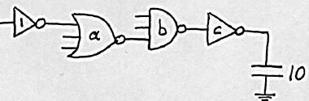

### Question 3 (25 pts)

The 5 measurements in the table belong to a short-channel NMOS transistor. Given V_DSAT = 0.6 V and k′ = 100 µA/V², find V_T0, λ and W/L. Can the body-effect coefficient (γ) be found from the same data? How? (Consider the state of the transistor for each measurement — velocity sat., sat., cut-off, linear.)

| Measurement | V_GS (V) | V_DS (V) | V_BS (V) | I_D (µA) |
|---|---|---|---|---|
| 1 | 2.5 | 1.8 | 0 | 1812 |
| 2 | 2 | 1.8 | 0 | 1297 |
| 3 | 2 | 2.5 | 0 | 1361 |
| 4 | 2 | 1.8 | −1 | 1146 |
| 5 | 2 | 1.8 | −2 | 1039 |

### Question 4 (25 pts)

Draw the output function of the AND-OR-INVERT circuit below (inputs A, S, B, S′; complemented forms of all inputs are also available) separately in a) static CMOS, b) differential pass transistor (CPL), c) transmission gate, d) DCVSL structures.

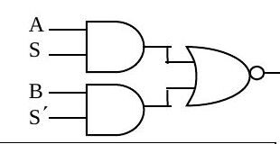

## 2004 – End-of-semester exam (09.06.2004)

### Question 1 (30 pts, 5 pts each part)

**a)** Implement the function F = A·B with pass transistor logic; why is the second transistor necessary?

> When B = 1, F = AB = A is taken from the output; depending on whether A is 1 or 0, the output is connected through a small resistance to V_DD or to ground. When B = 0, the upper transistor is "off", so without the second (lower) transistor the output would be connected neither to V_DD nor to ground, but would be "floating"; this would break the static-gate property. The second transistor (with its gate at B′) connects the output to ground when B = 0.

**b)** Components of power and energy consumption in a gate:

- E = C_L V_DD² P₀→₁ + t_sc V_DD I_peak P₀→₁ + V_DD I_leakage
- P = C_L V_DD² f₀→₁ + t_sc V_DD I_peak f₀→₁ + V_DD I_leakage, f₀→₁ = P₀→₁ × f_clock

The first terms are the dynamic components, the second are the short-circuit (direct path) components, and the third are the leakage components. Dynamic consumption is related to the total load capacitance C_L, the supply voltage V_DD and the energy-consuming switching activity (probability P₀→₁); short-circuit consumption is related to the time t_sc during which both transistors conduct together and the peak current during that time; leakage consumption is directly related to the leakage current.

**c)** In a p-n junction, is the depletion region charge larger in forward or reverse bias? When does it become zero?

> Q_j = A_D √(2ε_si q (N_A N_D/(N_A + N_D)) (φ₀ − V_D)). Here A_D is the cross-sectional area, ε_si is the permittivity of silicon, N_A and N_D are the doping concentrations, φ₀ is the built-in potential, and V_D is the junction voltage (negative in reverse bias, positive in forward bias). Since (φ₀ − V_D) is larger in reverse bias, Q_j is also larger. When the forward bias voltage is V_D = φ₀, Q_j = 0.

**d)** Under what condition does a MOS transistor behave like an ideal current source?

> In saturation: I_D′ = (k′_n/2)(W/L)(V_GS − V_T)², independent of V_DS (if channel length modulation is neglected). In practice, as V_DS increases, the pinch-off point moves inward from the drain, the effective channel shortens, and I_D = I_D′(1 + λV_DS); the current cannot be independent of V_DS. This effect is smaller in long-channel transistors; in saturation they are closer to an ideal current source.

**e)** VTC of the CMOS inverter and the transistor states:

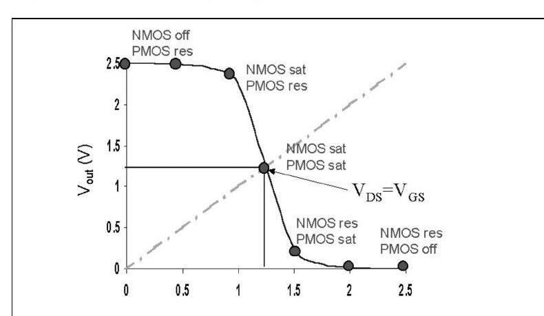

**f)** Relationship between short-circuit power loss and C_L:

> For large C_L (figure a), the discharge of the capacitor is slow relative to the rise time of the input, so as the input rises, the V_GS of the PMOS drops quickly and the transistor goes into cut-off; I_sc ≈ 0. If C_L is small (figure b), the capacitor discharges quickly, the PMOS remains conducting for most of the long rise time of the input, and the largest I_sc flows. To reduce short-circuit loss, it is **beneficial for C_L to be large**.

### Question 2 (20 pts): Body effect

Enhancement MOS transistor: V_T0 = 0.8 V, γ = 0.2 V^½, λ = 0.05 V⁻¹, |2φ_F| = 0.58 V, k′ = 20 µA/V².

**a)** At V_G = 2.8 V, V_D = 5 V, V_S = 1 V, V_B = 0 V, I_D = 0.24 mA is measured; find W/L.

- V_SB = 1 V ⇒ V_T = 0.8 + 0.2(√1.58 − √0.58) = 0.899 V
- V_DS = 4 V, V_GS = 1.8 V, V_GS − V_T = 0.901 V < V_DS ⇒ saturation
- W/L = 2I_D / [k′(V_GS − V_T)²(1 + λV_DS)] = 2 × 0.24×10⁻³ / [20×10⁻⁶ × 0.901² × 1.2] = **24.64**

**b)** Find I_D for V_G = 5 V, V_D = 4 V, V_S = 2 V, V_B = 0 V:

- V_SB = 2 V ⇒ V_T = 0.8 + 0.2(√2.58 − √0.58) = 0.969 V
- V_DS = 2 V, V_GS = 3 V, V_GS − V_T = 2.031 V > V_DS ⇒ linear region
- I_D = (k′/2)(W/L)[2(V_GS − V_T)V_DS − V_DS²](1 + λV_DS) = 10×10⁻⁶ × 24.64 × [8.124 − 4] × 1.1 = **1.12 mA**

**c)** Find W and L for µ = 500 cm²/Vs, C_g = 1×10⁻¹⁵ F:

- C_ox = k′/µ_n = 20×10⁻⁶/500 = 4×10⁻⁸ F/cm²; C_g = WLC_ox ⇒ WL = 10⁻¹⁵/(4×10⁻⁸) = 2.5×10⁻⁸ cm² (2.5 µm²)
- With W/L = 24.64: **W = 7.85 µm, L = 0.32 µm**

### Question 3 (8 pts): Waveforms in a pass transistor circuit

In the circuit below, the signals repeat at 1 MHz between 0–2 V; for all transistors V_T = 0.5 V, γ = 0, R_on = 10 kΩ, R_off = ∞. Plot the signals at nodes X and Y for one period.

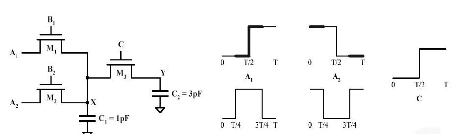

> The voltages X and Y can rise at most to V_DD − V_T = 1.5 V because of the threshold drop in the pass transistors. τ_x = R_on C₁ = 10 ns, τ_y = R_on C₁ + (R_on + R_on)C₂ = 70 ns; T = 1 µs, T/4 = 250 ns. The transistors conducting in the successive quarter periods are M2, M1, M1–M3 and M3–M2, respectively.

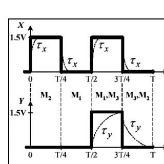

### Question 4 (23 pts): Complex CMOS gate

")

- **a)** Y = ((A + B)·C·D)′
- **b)** Worst-case t_pHL: when C₂ and C₃ are charged (they must also discharge while the output goes 1→0). The preceding inputs that charge them are ABCD = 1010, 1110, 0110; the subsequent inputs that cause the 1→0 transition are ABCD = 1011, 0111, 1111. Worst-case t_pLH: when C₁ is discharged and the rise is not driven by the parallel transistors, e.g. ABCD = 0111 → 0011.
- **c)** The "critical signal" is the signal that completes its change last among a group of inputs. If D changes last, it blocks the discharge path of C_L, C₂ and C₃; placing D's transistor at the top of the PDN (closest to the output) lets C₂ and C₃ discharge while waiting for D.
- **d)** For P_A=1 = 0.5, P_B=1 = 0.2, P_C=1 = 0.3, P_D=1 = 1: since D is always 1, Y = ((A + B)C)′. P(A+B=0) = 0.5 × 0.8 = 0.4, P(A+B=1) = 0.6; P_Y=0 = 0.6 × 0.3 = 0.18, P_Y=1 = 0.82; **P₀→₁ = 0.18 × 0.82 = 0.1476**.
- **e)** C_L = 30 fF, V_DD = 2.5 V, f_clock = 250 MHz: P_dyn = C_L V_DD² P₀→₁ f_clock = 30×10⁻¹⁵ × 6.25 × 0.1476 × 250×10⁶ = **6.92 µW**.

### Question 5 (19 pts)

**a)** DCVSL form of the gate in Question 4:

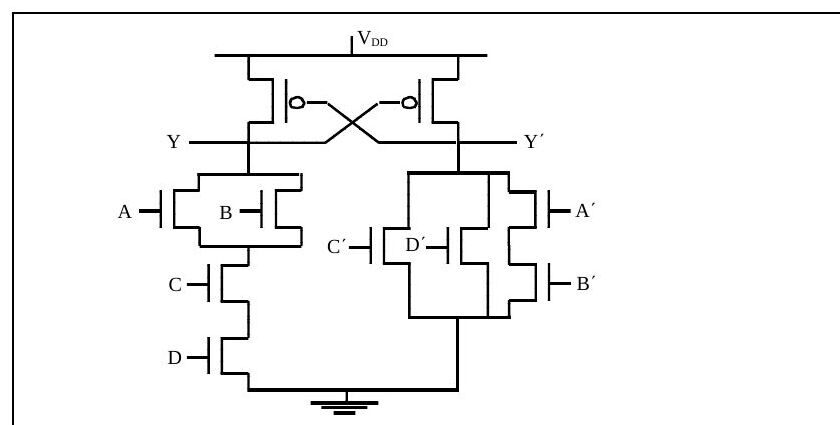

**b)** Sizes for the same resistance as an inverter with (W/L)n = 1, (W/L)p = 2 are as in the Question 4 figure: PMOS D = 2, C = 2, A = B = 4; NMOS all 3.

**c)** Logical effort: in the reference inverter each input sees 2 + 1 = 3 C_unit. g_A,B = (4 + 3)/3 = **7/3**, g_C,D = (2 + 3)/3 = **5/3**.

**d)** The gate has size a between a size-1 inverter (8 fF input) and a size-b inverter (320 fF load); find a and b for minimum delay (the first inverter is connected to input B of the gate):

- F = 320/8 = 40, G = 1 × 7/3 × 1 = 7/3, H = GF = 280/3, h = ∛(280/3) = 4.536
- f₁ = 4.536, f₂ = 4.536 × 3/7 = 1.944, f₃ = 4.536
- a = s₂ = f₁g₁/g₂ = 4.536/(7/3) = **1.944**, b = s₃ = f₁f₂g₁/g₃ = 4.536 × 1.944 = **8.818**
- If g₂ = 5/3 is used, a = 2.433, b = 9.865 (this is also accepted as correct)

Points: Q1 30 pts, Q2 20 pts, Q3 8 pts, Q4 23 pts, Q5 19 pts; duration 135 minutes.

## 2005 – End-of-semester exam (03.06.2005)

### Question 1 (30 pts, 5 pts each part)

**a)** Relationship between short-circuit loss and C_L — the answer is the same as 2004 Question 1f: a large C_L is beneficial for reducing the loss.

**b)** The "regenerative" property:

> Even if the input of a regenerative gate is lower than its nominal value (provided it stays within the valid high/low region), its output approaches the nominal value; thus a degraded signal reaches its nominal value after 2–3 stages. For this, the gain of the inverter in the transition region must be greater than 1 (the VTC slope must be steeper than 45°). The note gives a drawing of the waveforms v₀…v₆ in an inverter chain and of the curves f(v) and finv(v), with the signal bouncing between them toward the nominal value.

**c)** Depletion region charge — the answer is the same as 2004 Question 1c.

**d)** Critical signal and transistor ordering:

> The signal that reaches its stable state last among the inputs is the "critical signal". Connecting the critical signal to the transistor closest to the output improves performance. If the critical signal goes to M1, which is farthest from the output, M1 stays in cut-off until the 0→1 change completes and no capacitor can discharge. If the critical signal is connected to M3, since In₂ and In₃ = 1, C₂ and C₁ are discharged beforehand and only the discharge of C_L must be waited for to bring the output to 0.

**e)** Variation of t_pHL, t_pLH and t_p with fan-in for a CMOS NAND:

> The NMOS transistors are connected in series in the PDN: t_pHL = 0.69[R₁C₁ + (R₁ + R₂)C₂ + (R₁ + R₂ + R₃)C₃ + (R₁ + R₂ + R₃ + R₄)C_L], i.e. it increases **quadratically** with fan-in. Since the transistors in the PUN are in parallel, the pull-up resistance does not change and the capacitance increases linearly; t_pLH increases **linearly** with fan-in. For fan-out, each new load increases C_L by 2C_g; t_p increases linearly with fan-out. (The note has a graph in which, for fan-in 2–16, t_pHL rises to about 1050 ps and t_pLH to about 180 ps.)

**f)** Pros and cons of a low supply voltage:

> Reducing V_DD lowers energy consumption quadratically and, up to a certain level, increases gain; but below about 4kT/q (~100 mV) the gate characteristic degrades and the gain falls to 1. Performance is adversely affected; this effect is very serious at low V_DD and negligible for V_DD ≫ V_T + V_DSAT/2. Internal noise (e.g. crosstalk) also scales down, but since external noise does not scale, the gate becomes more sensitive to external noise; the DC characteristic is also more sensitive to parameter variations such as V_T.

### Question 2 (25 pts): Sizing, logical effort and probability

 and (b)")

- **a)** To make the pull-up and pull-down currents at Z the same as for the 2:1 unit inverter: **M1 = 2, M2 = M3 = 4, M4 = M5 = M6 = 2**.
- **b)** Let the input capacitances of A, B, C also be equal: the PUN is the same (M1 = 2, M2 = M3 = 4); M4 = x, M5 = M6 = y. Resistance condition 1/x + 1/y = 1, capacitance condition 4 + y = 2 + x ⇒ **x = 2 + √2, y = √2**.
- **c)** g = C_in(gate)/C_in(inverter) = **(4 + √2)/3**.
- **d)** For p(A=0) = 0.2, p(B=0) = 0.5, p(C=0) = 0.4, in the truth table Z = 0 only for ABC = 101, 110, 111. P(Z=0) = 0.8·0.5·0.6 + 0.8·0.5·0.4 + 0.8·0.5·0.6 = 0.64; **p(Z: 0→1) = 0.64 × 0.36 = 0.2304**.
- **e)** Delay d = h + p, h = gf. From figure (b), for f = 3 the gate effort is **h = 4**, the intrinsic delay is **p = 2**, and the slope is **g = h/f = 4/3**.

### Question 3 (20 pts): XOR with pass transistors

The function F = A XOR B is to be implemented with a pass transistor network and an output inverter.

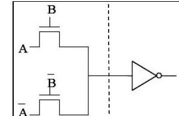

- **a)** The NMOS pass transistor network is as in the figure.
- **b)** Minimum V_DD (V_T0 = 0.5 V, γ = 0.4 V^½, |2φ_F| = 0.6 V, V_M = V_DD/2): when A = 1, the inverter input can rise at most to V_DD − V_T and body effect is present (V_SB = V_DD/2). For the inverter to switch, V_DD − V_T = V_DD/2, i.e. V_DD = 2V_T: V_DD = 2[V_T0 + γ(√(|2φ_F| + V_DD/2) − √|2φ_F|)]. By iteration, **V_DD ≈ 1.27 V**.
- **c)** DCVSL and transmission gate implementations of the same function:

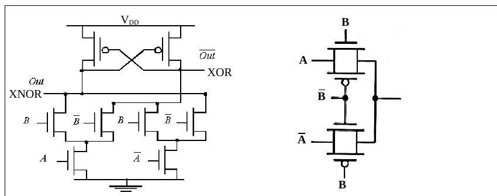

### Question 4 (25 pts): Buffer chain

- **a)** If an inverter with input capacitance C_unit, equivalent resistance R_unit and intrinsic capacitance C_unit drives an inverter f times larger: τ_p = 0.69 R_unit C_unit (1 + f); for f → 0, τ_p = 0.69 R_unit C_unit = t_p0.
- **b)** Energy drawn from the source for the L→H and H→L input transitions: E = C_unit(1 + f)V_DD².
- **c)** Driving a load C_L = 60 C_unit from C_in = C_unit with three inverters: F = 60, f = ∛60 = **3.915**; the second inverter has size f, the third f². t_p = Nt_p0(1 + F^(1/N)/γ) = 3t_p0(1 + 3.915) = **14.745 t_p0** (γ = 1).
- **d)** Energy-delay product for P₀→₁ = 0.5: total capacitance 2C_unit(1 + f + f²) + C_L; E = [2C_unit × 20.24 + 60C_unit]V_DD² × 0.5 = **50.24 C_unit V_DD²**; EDP = E × 14.74 t_p0 = **740.53 C_unit V_DD² t_p0**.

Points: Q1 30 pts, Q2 25 pts, Q3 20 pts, Q4 25 pts; duration 120 minutes.

## 2006 – End-of-semester exam (06.06.2006)

### Question 1 (24 pts, 4 pts each part)

**a)** Separation of the linear, saturated and velocity saturated regions of an NMOS on the I_D–V_DS plane: the boundaries are the curves V_DS = V_GS − V_T and V_DS = V_DSAT.

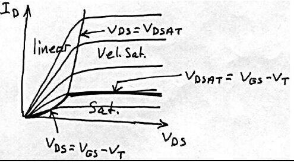

**b)** Effect of β = (W/L)p/(W/L)n in an inverter driving an identical inverter:

> As β increases, (W/L)p increases; the PMOS resistance decreases, the pull-up current increases and t_pLH decreases. The opposite holds for t_pHL (the PMOS capacitance increases the load). The minimum value of t_p occurs at a β value smaller than the t_pHL = t_pLH point (β ≈ 2.4 in the graph) (≈ 2 in the graph); that is, higher performance can be obtained by slightly breaking the symmetry.

**c)** To reduce the dynamic power P_dyn = C_L V_DD² P₀→₁ f: reduce C_L (reduce transistor size, fan-out and wire lengths); lower V_DD (energy decreases quadratically but performance and noise are adversely affected; below ~4kT/q the gain falls to 1); reduce P₀→₁ (lower the switching activity through logic and architectural design); lower the clock frequency (not applied since it reduces performance unacceptably; on the contrary, one always tries to raise the frequency).

**d)** Truth table and function of the circuit below:

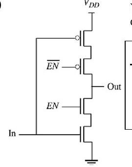

| In | EN | Out |
|---|---|---|
| 0 | 0 | Z |
| 0 | 1 | 1 |
| 1 | 0 | Z |
| 1 | 1 | 0 |

When EN = 0, the output is isolated from both ground and V_DD (Z, high impedance); the circuit is a **tri-state inverter**.

**e)** Capacitances A, B, C in the graph:

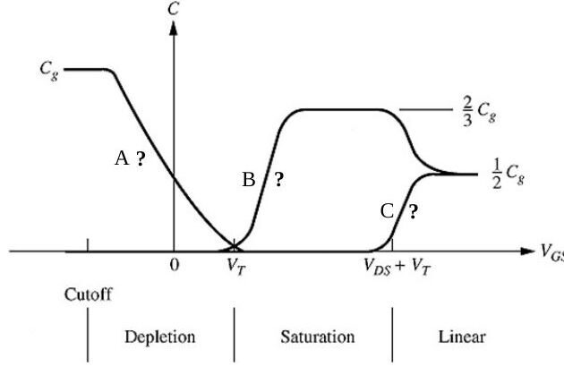

> In cut-off only C_GCB exists; since no channel is formed, all the capacitance is between the gate and the body, and it drops to zero once the channel forms (**A = C_GCB**). In saturation, C_GCD is zero because of pinch-off, and C_GCS = (2/3)C_g (**B = C_GCS**). In the linear region, C_g is shared equally between drain and source (1/2 C_g); **C = C_GCD**.

**f)** "Ratioed logic" and "ratioless logic":

> Ratioed logic aims to reduce the number of transistors: the PUN consists of a single resistor or a single transistor held permanently in saturation. There is "contention" between the PUN, which continuously pulls the output to V_DD, and the PDN, which pulls it to ground, and V_OL can never be 0 V; the output voltage depends on the ratio of the PUN and PDN resistances. The advantage is the reduced transistor count; the disadvantages are reduced noise margin (because of V_OL), static power consumption (the PUN path is never cut off) and increased delay.

### Question 2 (20 pts): V_T0, k, γ, λ from measurements

Taking 2φ_F = −0.6 V:

| V_GS (V) | V_DS (V) | V_BS (V) | I_D (µA) |
|---|---|---|---|
| 2 | 5 | 0 | 10 |
| 5 | 5 | 0 | 400 |
| 5 | 5 | −3 | 280 |
| 5 | 8 | 0 | 480 |

Since V_DS ≥ V_GS, all are in saturation: I_DSAT = (k/2)(V_GS − V_T)²(1 + λV_DS).

- **λ:** row 4 / row 2: (1 + 8λ)/(1 + 5λ) = 480/400 ⇒ **λ = 0.1 V⁻¹**
- **V_T0:** row 2 / row 1: (5 − V_T0)²/(2 − V_T0)² = 40 ⇒ V_T0 = 1.44 V or 2.41 V; the second is impossible ⇒ **V_T0 = 1.44 V**
- **k:** 400 = (k/2)(5 − 1.44)²(1 + 0.1×5) ⇒ **k = 42 µA/V²**
- **γ:** row 3: 280 = (42/2)(5 − V_T)²(1.5) ⇒ V_T = 2.02 V; 2.02 = 1.44 + γ(√(0.6 + 3) − √0.6) ⇒ **γ = 0.52 V^½**

### Question 3 (27 pts): Logical effort and power

**a)** A chain of 4 inverters driving 1200 C_inv from C_inv: F = 1200, f = ⁴√1200 = 5.89; sizes 1, f = 5.89, f² = 34.64, f³ = 203.89; t_p = 4t_p0(1 + 5.89) = **27.54 t_p0** (γ = 1). To find the best number of stages, increasing N: at N = 5, 25.64 t_p0; **at N = 6, 25.56 t_p0** (smallest); at N = 7, 26.27 t_p0. For N = 6 the sizes are 1; 3.26; 10.63; 34.6; 112.9; 368.2.

**b)** Sizing of the chain NAND (2 fF input) → inverter → NOR → 200 fF load (PMOS/NMOS = 2 in the minimum inverter):

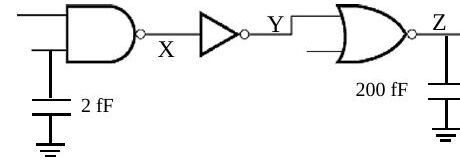

- g_NAND = 4/3, g_inv = 1, g_NOR = 5/3; F = 200/2 = 100, G = 20/9, H = 2000/9, h = ∛H ≈ 6
- f₁ = 6/(4/3) = 4.5, f₂ = 6, f₃ = 6/(5/3) = 3.6
- C_in = g₁s₁C_ref ⇒ 2 = (4/3)s₁ ⇒ s₁ = 1.5; s₂ = f₁g₁s₁/g₂ = **9**; s₃ = f₁f₂g₁s₁/g₃ = **32.4**

**c)** The probability of all open inputs being 1 is 0.4; V_DD = 2.5 V, f_clock = 250 MHz:

- P_X=0 = 0.4 × 0.4 = 0.16 (NAND), P_Y=0 = P_X=1 = 0.84
- P_Z=1 = P_Y=0 × (1 − 0.4) = 0.504, P_Z=0 = 0.496; **P₀→₁ = 0.496 × 0.504 ≈ 0.25**
- P_dyn = 200×10⁻¹⁵ × 2.5² × 0.25 × 250×10⁶ = **78.125 µW**

### Question 4 (29 pts): F(A, B, C) = AB + AB′C + A′C′

Design with the fewest transistors in a) CMOS, b) transmission gates only, c) DCVSL (complemented inputs are available). Truth table: AB = 00 → C′, 01 → C′, 10 → C, 11 → 1. From the Karnaugh map, F′ = AB′C′ + A′C, so the CMOS gate is built in a single stage as F = (AB′C′ + A′C)′.

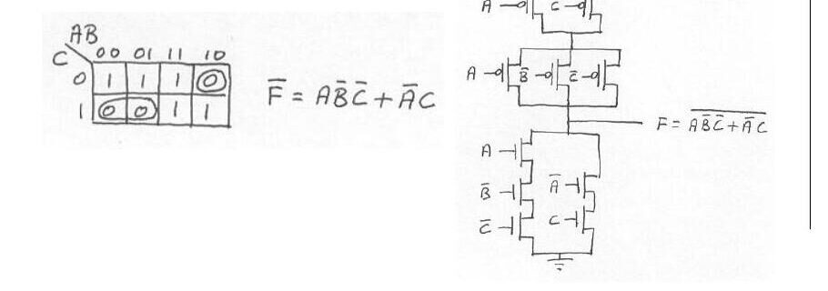

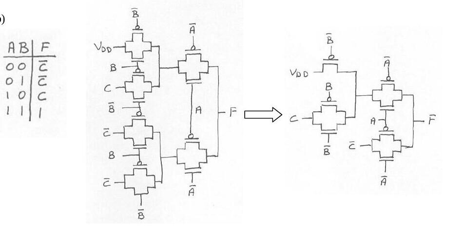

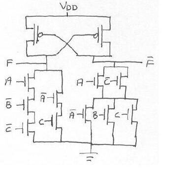

**d)** With the capacitor initially charged to V_DD, the steady-state voltages A, B, C:

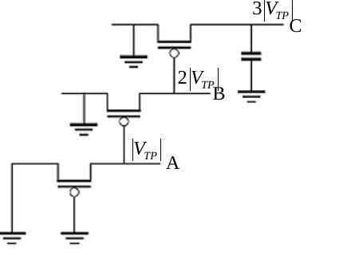

> In PMOS transistors, V_GS cannot fall below V_TP. Starting from the bottom transistor and going upward, one finds **A = |V_TP|, B = 2|V_TP|, C = 3|V_TP|**.

Points: Q1 24 pts, Q2 20 pts, Q3 27 pts, Q4 29 pts; duration 120 minutes.
