Bu yazı, Başkent Üniversitesi **EEM312 Sayısal Elektronik** dersinin (Prof. Dr. Emin Akata) 2003–2006 yıllarına ait dört **yarıyıl sonu (final) sınavını** bir araya getiriyor: 09.06.2003, 09.06.2004, 03.06.2005 ve 06.06.2006. 2003 sınavı yalnız sorulardan oluşuyor; 2004–2006 sınavlarında hocanın çözümleri de var. Sorular ve çözümler yazıya döküldü, devre şekilleri görsel olarak eklendi. Aynı sınavların başka klasörlerdeki kopyaları (ör. `FINAL_EEM312_05_S.doc`, `2004.pdf`) elendi. Orijinal Word dosyaları yazının sonunda ZIP olarak indirilebilir. Aynı dersin ara sınavları için: [Ara Sınavlar 2003–2006](/arsiv/eem312-ara-sinavlar-2003-2006/), [Ara Sınavlar 2007–2010](/arsiv/eem312-ara-sinavlar-2007-2010/); sonraki finaller: [Final Sınavları 2007–2011](/arsiv/eem312-final-sinavlari-2007-2011/).

Sınavlara eklenen hatırlatma formülleri (2003 ve 2006):

- I_D = k′(W/L)[(V_GS − V_T)V_min − V_min²/2](1 + λV_DS), V_min = min[(V_GS − V_T), V_DS, V_DSAT]
- V_T = V_T0 + γ(√(|2φ_F| + |V_SB|) − √|2φ_F|)
- t_p = t_p0(p + gf/γ), g_inv = 1, p_inv = 1, γ = 1 varsayımı
- G = ∏g_i, F = C_L/C_g1, H = GFB, h = H^(1/N), h = gf
- s_i = (g₁s₁/g_i) ∏(j=1…i−1)(f_j/b_j), P₀→₁ = P₀ × P₁

## 2003 – Final sınavı (09.06.2003)

### Soru 1 (20p, her şık 4p)

1. Bir geçitin (gate) "regenerative" özellik taşıması ne anlama gelir? Bu özelliğin olup olmadığını VTC'ye bakarak nasıl anlayabiliriz?
1. Sizce 486DX2 ve Pentium mikroişlemcilerinin "die" maliyetleri göreli olarak nasıldır? Gerekçenizi belirtiniz.
1. "Velocity saturation" nedir ve nasıl oluşur? Bu oluşum kısa kanallı transistörlerde niçin daha etkindir?
1. F = A·B işlevini PT (pass transistor) mantığı ile gerçekleştiren yapıyı çiziniz ve bu yapıda ikinci transistöre niçin gerek duyulduğunu açıklayınız.
1. CMOS yapılarda PUN ve PDN bölümleri niçin sırasıyla PMOS ve NMOS transistörlerden oluşur?

### Soru 2 (30p)

- **a)** 3 girişli CMOS NAND ve NOR geçitlerini çiziniz; minimum büyüklükteki inverter için PMOS/NMOS oranı 2 iken bu geçitlerin inverter ile aynı eşdeğer dirence sahip olmasını sağlayacak boyutlandırmayı ve mantıksal eforlarını (logical effort) bulunuz.
- **b)** Aşağıdaki devrede minimum gecikme için a, b ve c ölçekleme değerlerini bulunuz (1 boyutlu inverter → 3 girişli NOR (a) → 3 girişli NAND (b) → inverter (c) → yük 10).
- **c)** Girdiler ilintisiz ve düzgün dağılımlı, glitch yok varsayılarak çıkış sinyalinin 0'dan 1'e geçiş olasılığını bulunuz.
- **d)** İdeal olmayan fiziksel koşullarda NAND geçidi için kritik sinyal hangisi olurdu? Devrenin daha hızlı çalışması için nasıl bir bağlantı önlemi (reordering) alırdınız?

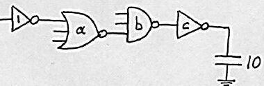

### Soru 3 (25p)

Tablodaki 5 ölçüm kısa kanallı bir NMOS transistöre aittir. V_DSAT = 0,6 V, k′ = 100 µA/V² olduğuna göre V_T0, λ ve W/L değerlerini bulunuz. Aynı veriden body-effect katsayısı (γ) bulunabilir mi? Nasıl? (Her ölçüm için transistörün durumunu — velocity sat., sat., cut-off, linear — göz önünde bulundurunuz.)

| Ölçüm | V_GS (V) | V_DS (V) | V_BS (V) | I_D (µA) |
|---|---|---|---|---|
| 1 | 2,5 | 1,8 | 0 | 1812 |
| 2 | 2 | 1,8 | 0 | 1297 |
| 3 | 2 | 2,5 | 0 | 1361 |
| 4 | 2 | 1,8 | −1 | 1146 |
| 5 | 2 | 1,8 | −2 | 1039 |

### Soru 4 (25p)

Aşağıdaki AND-OR-INVERT devresinin çıktı işlevini (A, S, B, S′ girişleri; tüm girdilerin değillenmiş biçimleri de var) a) statik CMOS, b) differential pass transistor (CPL), c) transmission gate, d) DCVSL yapılarında ayrı ayrı çiziniz.

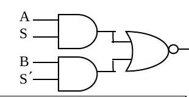

## 2004 – Yarıyıl sonu sınavı (09.06.2004)

### Soru 1 (30p, her şık 5p)

**a)** F = A·B işlevini pass transistor mantığıyla gerçekleştirin; ikinci transistör niçin gerekli?

> B = 1 iken çıkıştan F = AB = A alınır; A'nın 1 ya da 0 olmasına göre çıkış küçük bir dirençle V_DD'ye ya da toprağa bağlanır. B = 0 olduğunda üstteki transistör "off" olacağından, ikinci (alttaki) transistör olmasaydı çıkış ne V_DD'ye ne toprağa bağlı kalır, "floating" olurdu; bu da statik geçit olma özelliğini bozar. İkinci transistör (gate'i B′'de) B = 0 iken çıkışı toprağa bağlar.

**b)** Bir geçitte güç ve enerji tüketiminin bileşenleri:

- E = C_L V_DD² P₀→₁ + t_sc V_DD I_peak P₀→₁ + V_DD I_leakage
- P = C_L V_DD² f₀→₁ + t_sc V_DD I_peak f₀→₁ + V_DD I_leakage, f₀→₁ = P₀→₁ × f_clock

Birinci terimler dinamik, ikinciler kısa devre (direct path), üçüncüler sızıntı (leakage) bileşenidir. Dinamik tüketim toplam yük sığası C_L, besleme gerilimi V_DD ve enerji tüketen anahtarlama etkinliği (olasılığı P₀→₁) ile; kısa devre tüketimi her iki transistörün birlikte ilettiği süre t_sc ve bu süredeki tepe akım ile; sızıntı tüketimi doğrudan sızıntı akımı ile ilgilidir.

**c)** p-n ekleminde boşaltılmış bölge yükü ileri mi ters eğilimlemede mi büyüktür? Ne zaman sıfır olur?

> Q_j = A_D √(2ε_si q (N_A N_D/(N_A + N_D)) (φ₀ − V_D)). Burada A_D kesit alanı, ε_si silisyumun geçirgenliği, N_A ve N_D katkı yoğunlukları, φ₀ "built-in" potansiyel, V_D eklem gerilimidir (ters eğilimlemede negatif, ileri eğilimlemede pozitif). (φ₀ − V_D) ters eğilimlemede daha büyük olduğundan Q_j de daha büyüktür. İleri eğilimleme gerilimi V_D = φ₀ olduğunda Q_j = 0 olur.

**d)** MOS transistör hangi koşulda ideal akım kaynağı gibi davranır?

> Doyumda: I_D′ = (k′_n/2)(W/L)(V_GS − V_T)², V_DS'den bağımsız (kanal boyu modülasyonu yok sayılırsa). Pratikte V_DS arttıkça pinch-off noktası drain'den içeri çekilir, etkin kanal kısalır ve I_D = I_D′(1 + λV_DS) olur; akım V_DS'den bağımsız olamaz. Uzun kanallı transistörlerde bu etki daha azdır; doyumdayken ideal akım kaynağına daha yakındırlar.

**e)** CMOS inverterin VTC'si ve transistör durumları:

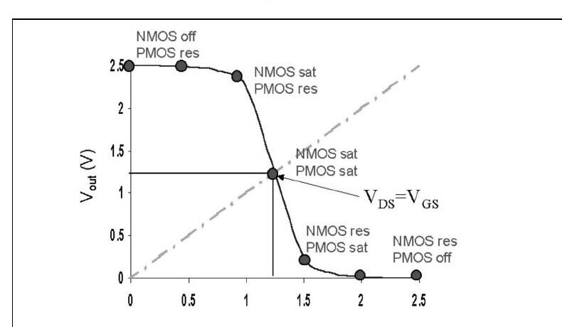

**f)** Kısa devre güç kaybı ile C_L ilişkisi:

> Büyük C_L'de (şekil a) sığacın boşalması girdinin yükselme süresine göre yavaş olduğundan, girdi yükselirken PMOS'un V_GS'si hızla düşer ve transistör kesime gider; I_sc ≈ 0 olur. C_L küçükse (şekil b) sığaç hızla boşalır, girdinin uzun yükseliş süresinin büyük kısmında PMOS iletimde kalır ve en büyük I_sc akar. Kısa devre kaybını azaltmak için **C_L'nin büyük olmasında** yarar vardır.

### Soru 2 (20p): Body effect

Enhancement MOS transistör: V_T0 = 0,8 V, γ = 0,2 V^½, λ = 0,05 V⁻¹, |2φ_F| = 0,58 V, k′ = 20 µA/V².

**a)** V_G = 2,8 V, V_D = 5 V, V_S = 1 V, V_B = 0 V'ta I_D = 0,24 mA ölçülüyor; W/L?

- V_SB = 1 V ⇒ V_T = 0,8 + 0,2(√1,58 − √0,58) = 0,899 V
- V_DS = 4 V, V_GS = 1,8 V, V_GS − V_T = 0,901 V < V_DS ⇒ doyum
- W/L = 2I_D / [k′(V_GS − V_T)²(1 + λV_DS)] = 2 × 0,24×10⁻³ / [20×10⁻⁶ × 0,901² × 1,2] = **24,64**

**b)** V_G = 5 V, V_D = 4 V, V_S = 2 V, V_B = 0 V için I_D:

- V_SB = 2 V ⇒ V_T = 0,8 + 0,2(√2,58 − √0,58) = 0,969 V
- V_DS = 2 V, V_GS = 3 V, V_GS − V_T = 2,031 V > V_DS ⇒ doğrusal bölge
- I_D = (k′/2)(W/L)[2(V_GS − V_T)V_DS − V_DS²](1 + λV_DS) = 10×10⁻⁶ × 24,64 × [8,124 − 4] × 1,1 = **1,12 mA**

**c)** µ = 500 cm²/Vs, C_g = 1×10⁻¹⁵ F için W ve L:

- C_ox = k′/µ_n = 20×10⁻⁶/500 = 4×10⁻⁸ F/cm²; C_g = WLC_ox ⇒ WL = 10⁻¹⁵/(4×10⁻⁸) = 2,5×10⁻⁸ cm² (2,5 µm²)
- W/L = 24,64 ile: **W = 7,85 µm, L = 0,32 µm**

### Soru 3 (8p): Pass transistör devresinde dalga biçimleri

Aşağıdaki devrede sinyaller 1 MHz ile 0–2 V arasında yineleniyor; tüm transistörler için V_T = 0,5 V, γ = 0, R_on = 10 kΩ, R_off = ∞. X ve Y noktalarındaki sinyalleri bir periyot için çiziniz.

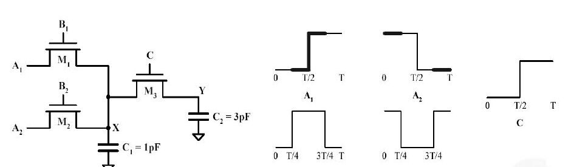

> X ve Y gerilimleri, pass transistörlerdeki eşik düşümü nedeniyle en çok V_DD − V_T = 1,5 V'a çıkabilir. τ_x = R_on C₁ = 10 ns, τ_y = R_on C₁ + (R_on + R_on)C₂ = 70 ns; T = 1 µs, T/4 = 250 ns. Çeyrek periyotlarda iletimde olan transistörler sırasıyla M2, M1, M1–M3 ve M3–M2'dir.

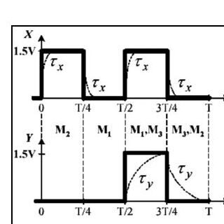

### Soru 4 (23p): Karmaşık CMOS geçit

")

- **a)** Y = ((A + B)·C·D)′
- **b)** En kötü t_pHL: C₂ ve C₃ dolu iken (çıkış 1→0 olurken bunlar da boşalmalı). Bunları dolduran önceki girdiler ABCD = 1010, 1110, 0110; 1→0 geçişini sağlayan sonraki girdiler ABCD = 1011, 0111, 1111. En kötü t_pLH: C₁ boşken ve yükseliş paralel transistörlerce sürülmezken, örneğin ABCD = 0111 → 0011.
- **c)** "Kritik sinyal", bir grup girdi arasında değişimini en son tamamlayan sinyaldir. D en son değişirse C_L, C₂ ve C₃'ün boşalma yolunu tıkar; D'nin transistörünü PDN'nin en üstüne (çıkışa en yakın yere) koymak, D beklenirken C₂ ve C₃'ün boşalmasını sağlar.
- **d)** P_A=1 = 0,5, P_B=1 = 0,2, P_C=1 = 0,3, P_D=1 = 1 için D hep 1 olduğundan Y = ((A + B)C)′. P(A+B=0) = 0,5 × 0,8 = 0,4, P(A+B=1) = 0,6; P_Y=0 = 0,6 × 0,3 = 0,18, P_Y=1 = 0,82; **P₀→₁ = 0,18 × 0,82 = 0,1476**.
- **e)** C_L = 30 fF, V_DD = 2,5 V, f_clock = 250 MHz: P_dyn = C_L V_DD² P₀→₁ f_clock = 30×10⁻¹⁵ × 6,25 × 0,1476 × 250×10⁶ = **6,92 µW**.

### Soru 5 (19p)

**a)** Soru 4'teki geçidin DCVSL biçimi:

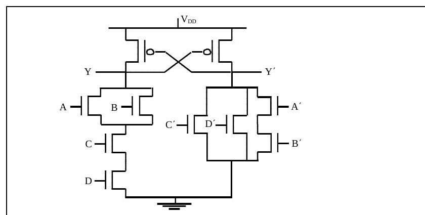

**b)** (W/L)n = 1, (W/L)p = 2 inverterle aynı direnç için boyutlar Soru 4 şeklinde: PMOS D = 2, C = 2, A = B = 4; NMOS tümü 3.

**c)** Mantıksal efor: referans inverterde her giriş 2 + 1 = 3 C_unit görür. g_A,B = (4 + 3)/3 = **7/3**, g_C,D = (2 + 3)/3 = **5/3**.

**d)** Geçit, 1 boyutlu inverter (8 fF giriş) ile b boyutlu inverter (320 fF yük) arasında a boyutunda; minimum gecikme için a ve b (ilk inverter geçidin B girişine bağlı):

- F = 320/8 = 40, G = 1 × 7/3 × 1 = 7/3, H = GF = 280/3, h = ∛(280/3) = 4,536
- f₁ = 4,536, f₂ = 4,536 × 3/7 = 1,944, f₃ = 4,536
- a = s₂ = f₁g₁/g₂ = 4,536/(7/3) = **1,944**, b = s₃ = f₁f₂g₁/g₃ = 4,536 × 1,944 = **8,818**
- g₂ = 5/3 alınırsa a = 2,433, b = 9,865 (o da doğru kabul ediliyor)

Puanlar: S1 30p, S2 20p, S3 8p, S4 23p, S5 19p; süre 135 dakika.

## 2005 – Yarıyıl sonu sınavı (03.06.2005)

### Soru 1 (30p, her şık 5p)

**a)** Kısa devre kaybı ile C_L ilişkisi — yanıt 2004 Soru 1f ile aynı: kaybı azaltmak için C_L'nin büyük olması yararlıdır.

**b)** "Regenerative" özellik:

> Regenerative bir geçidin girdisi nominal değerinden düşük olsa da (geçerli high/low bölgesinde kalmak koşuluyla) çıkışı nominal değere yaklaşır; böylece bozulmuş bir sinyal 2–3 kademeden sonra nominal değerine ulaşır. Bunun için inverterin geçiş bölgesindeki kazancı 1'den büyük olmalıdır (VTC eğiminin 45°'den dik olması). Notta inverter zincirinde v₀…v₆ dalga biçimleri ve f(v) ile finv(v) eğrileri arasında sekerek nominal değere yaklaşan çizim veriliyor.

**c)** Boşaltılmış bölge yükü — yanıt 2004 Soru 1c ile aynı.

**d)** Kritik sinyal ve transistör sıralaması:

> Girdiler arasında kararlı duruma en son geçen sinyal "kritik sinyal"dir. Kritik sinyalin çıkışa en yakın transistöre girmesi başarımı artırır. Kritik sinyal çıkışa en uzak M1'e girerse 0→1 değişimini tamamlayana dek M1 kesimde kalır ve hiçbir sığaç boşalamaz. Kritik sinyal M3'e bağlanırsa, In₂ ve In₃ = 1 olduğundan C₂ ve C₁ önceden boşalır ve çıkışın 0 olması için yalnız C_L'nin boşalması beklenir.

**e)** CMOS NAND için t_pHL, t_pLH ve t_p'nin fan-in ile değişimi:

> NMOS'lar PDN'de seri bağlıdır: t_pHL = 0,69[R₁C₁ + (R₁ + R₂)C₂ + (R₁ + R₂ + R₃)C₃ + (R₁ + R₂ + R₃ + R₄)C_L], yani fan-in ile **karesel** artar. PUN'da transistörler paralel olduğundan pull-up direnci değişmez, sığa doğrusal artar; t_pLH fan-in ile **doğrusal** artar. Fan-out'ta her yeni yük C_L'yi 2C_g kadar artırır; t_p fan-out ile doğrusal artar. (Notta fan-in 2–16 için t_pHL ≈ 1050 ps'ye, t_pLH ≈ 180 ps'ye çıkan grafik var.)

**f)** Düşük besleme geriliminin artı ve eksileri:

> V_DD'nin azaltılması enerji tüketimini karesel olarak düşürür ve belli bir seviyeye kadar kazancı artırır; ama yaklaşık 4kT/q (~100 mV) seviyesinden sonra geçit karakteristiği bozulur ve kazanç 1'e düşer. Başarım olumsuz etkilenir; bu etki düşük V_DD'de çok ciddi, V_DD ≫ V_T + V_DSAT/2'de ihmal edilebilirdir. İç gürültü (ör. crosstalk) de ölçeklenip azalır, fakat dış gürültü ölçeklenmediğinden geçit dış gürültüye daha duyarlı olur; DC karakteristik de V_T gibi parametre değişimlerine daha duyarlıdır.

### Soru 2 (25p): Boyutlandırma, logical effort ve olasılık

 ve (b)")

- **a)** Z'deki pull-up ve pull-down akımları 2:1 birim inverterle aynı: **M1 = 2, M2 = M3 = 4, M4 = M5 = M6 = 2**.
- **b)** A, B, C giriş sığaları da eşit olsun: PUN aynı (M1 = 2, M2 = M3 = 4); M4 = x, M5 = M6 = y. Direnç koşulu 1/x + 1/y = 1, sığa koşulu 4 + y = 2 + x ⇒ **x = 2 + √2, y = √2**.
- **c)** g = C_in(gate)/C_in(inverter) = **(4 + √2)/3**.
- **d)** p(A=0) = 0,2, p(B=0) = 0,5, p(C=0) = 0,4 için doğruluk çizelgesinde Z = 0 yalnız ABC = 101, 110, 111'de. P(Z=0) = 0,8·0,5·0,6 + 0,8·0,5·0,4 + 0,8·0,5·0,6 = 0,64; **p(Z: 0→1) = 0,64 × 0,36 = 0,2304**.
- **e)** Gecikme d = h + p, h = gf. Şekil (b)'den f = 3 için gate effort **h = 4**, intrinsic delay **p = 2**, eğim **g = h/f = 4/3**.

### Soru 3 (20p): Pass transistörlü XOR

F = A XOR B işlevi bir pass transistör ağı ve çıkış inverteriyle gerçekleştirilecek.

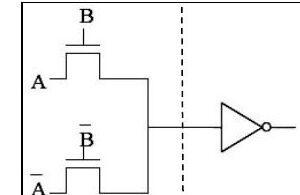

- **a)** NMOS pass transistör ağı şekildeki gibidir.
- **b)** Minimum V_DD (V_T0 = 0,5 V, γ = 0,4 V^½, |2φ_F| = 0,6 V, V_M = V_DD/2): A = 1 iken inverter girişi en çok V_DD − V_T'ye çıkar ve body effect vardır (V_SB = V_DD/2). İnverterin çevirebilmesi için V_DD − V_T = V_DD/2, yani V_DD = 2V_T: V_DD = 2[V_T0 + γ(√(|2φ_F| + V_DD/2) − √|2φ_F|)]. İterasyonla **V_DD ≈ 1,27 V**.
- **c)** Aynı işlevin DCVSL ve transmission gate gerçekleştirmeleri:

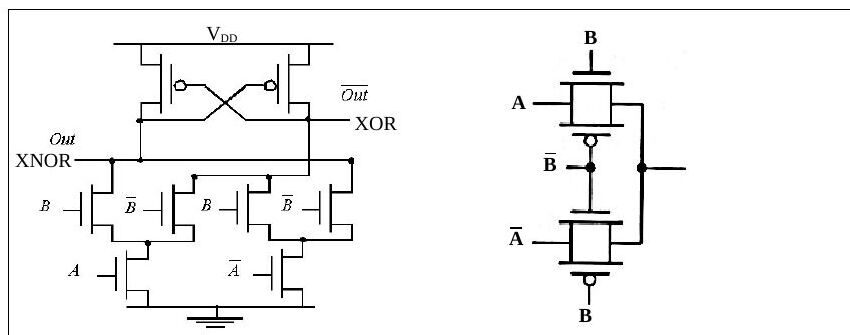

### Soru 4 (25p): Buffer zinciri

- **a)** Giriş sığası C_unit, eşdeğer direnci R_unit, intrinsic sığası C_unit olan inverter, f katı büyük bir inverteri sürerse: τ_p = 0,69 R_unit C_unit (1 + f); f → 0 için τ_p = 0,69 R_unit C_unit = t_p0.
- **b)** Girişte L→H, H→L değişimlerinde kaynaktan çekilen enerji: E = C_unit(1 + f)V_DD².
- **c)** C_in = C_unit'ten C_L = 60 C_unit yükü üç inverterle sürmek: F = 60, f = ∛60 = **3,915**; ikinci inverter f, üçüncü f² boyutunda. t_p = Nt_p0(1 + F^(1/N)/γ) = 3t_p0(1 + 3,915) = **14,745 t_p0** (γ = 1).
- **d)** P₀→₁ = 0,5 için energy-delay product: toplam sığa 2C_unit(1 + f + f²) + C_L; E = [2C_unit × 20,24 + 60C_unit]V_DD² × 0,5 = **50,24 C_unit V_DD²**; EDP = E × 14,74 t_p0 = **740,53 C_unit V_DD² t_p0**.

Puanlar: S1 30p, S2 25p, S3 20p, S4 25p; süre 120 dakika.

## 2006 – Yarıyıl sonu sınavı (06.06.2006)

### Soru 1 (24p, her şık 4p)

**a)** NMOS'ta linear, saturated ve velocity saturated bölgelerin I_D–V_DS üzerinde ayrılması: sınırlar V_DS = V_GS − V_T ve V_DS = V_DSAT eğrileridir.

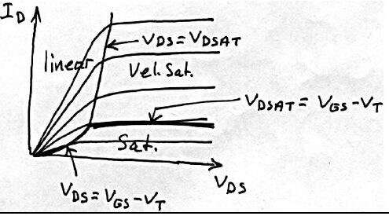

**b)** Kendisiyle aynı yükü süren inverterde β = (W/L)p/(W/L)n'nin etkisi:

> β büyüdükçe (W/L)p büyür; PMOS direnci azalır, pull-up akımı artar ve t_pLH azalır. t_pHL için tersi geçerlidir (PMOS sığası yükü artırır). t_p'nin en küçük değeri, t_pHL = t_pLH noktasından (grafikte β ≈ 2,4) daha küçük bir β değerinde (grafikte ≈ 2) oluşur; yani simetri biraz bozularak daha yüksek başarım elde edilebilir.

**c)** Dinamik güç P_dyn = C_L V_DD² P₀→₁ f'yi azaltmak için: C_L'yi küçültmek (transistör boyutu, fan-out ve kablo boylarını azaltmak); V_DD'yi düşürmek (enerji karesel azalır ama başarım ve gürültü olumsuz etkilenir, ~4kT/q altında kazanç 1'e düşer); P₀→₁'i azaltmak (mantıksal ve mimari tasarımla anahtarlama etkinliğini düşürmek); saat frekansını düşürmek (başarımı kabul edilemez biçimde düşürdüğünden uygulanmaz, tersine frekans hep artırılmaya çalışılır).

**d)** Aşağıdaki devrenin doğruluk çizelgesi ve işlevi:

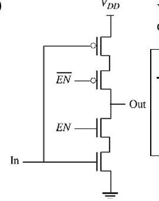

| In | EN | Out |
|---|---|---|
| 0 | 0 | Z |
| 0 | 1 | 1 |
| 1 | 0 | Z |
| 1 | 1 | 0 |

EN = 0 iken çıkış hem topraktan hem V_DD'den yalıtılır (Z, yüksek empedans); devre bir **tri-state inverter**dır.

**e)** Grafikteki A, B, C sığaları:

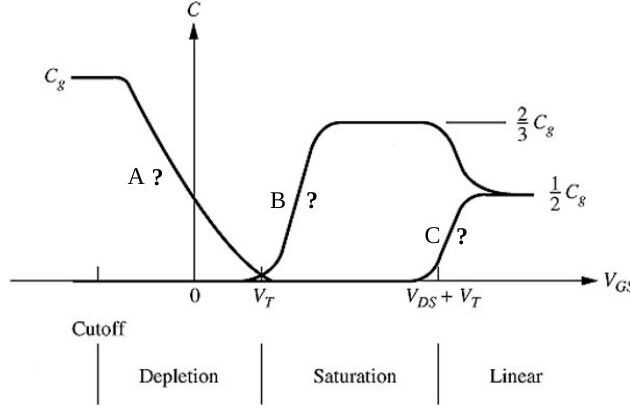

> Kesimde yalnız C_GCB vardır; kanal oluşmadığından tüm sığa gate ile body arasındadır ve kanal oluşunca sıfıra düşer (**A = C_GCB**). Doyumda pinch-off nedeniyle C_GCD sıfırdır, C_GCS = (2/3)C_g (**B = C_GCS**). Doğrusal bölgede C_g drain ve source arasında eşit paylaşılır (1/2 C_g); **C = C_GCD**.

**f)** "Ratioed logic" ve "ratioless logic":

> Ratioed logic, transistör sayısını azaltmayı amaçlar: PUN tek bir direnç ya da sürekli doyumda tutulan tek transistörden oluşur. Çıkışı sürekli V_DD'ye çeken PUN ile çıkışı toprağa çeken PDN arasında "contention" olur ve V_OL hiçbir zaman 0 V olamaz; çıkış gerilimi PUN ve PDN dirençlerinin oranına bağlıdır. Artısı azalan transistör sayısı; eksileri azalan gürültü payı (V_OL yüzünden), statik güç tüketimi (PUN yolu hiç kesilmez) ve artan gecikmedir.

### Soru 2 (20p): Ölçümlerden V_T0, k, γ, λ

2φ_F = −0,6 V alınarak:

| V_GS (V) | V_DS (V) | V_BS (V) | I_D (µA) |
|---|---|---|---|
| 2 | 5 | 0 | 10 |
| 5 | 5 | 0 | 400 |
| 5 | 5 | −3 | 280 |
| 5 | 8 | 0 | 480 |

V_DS ≥ V_GS olduğundan tümü doyumda: I_DSAT = (k/2)(V_GS − V_T)²(1 + λV_DS).

- **λ:** satır 4 / satır 2: (1 + 8λ)/(1 + 5λ) = 480/400 ⇒ **λ = 0,1 V⁻¹**
- **V_T0:** satır 2 / satır 1: (5 − V_T0)²/(2 − V_T0)² = 40 ⇒ V_T0 = 1,44 V ya da 2,41 V; ikincisi olanaksız ⇒ **V_T0 = 1,44 V**
- **k:** 400 = (k/2)(5 − 1,44)²(1 + 0,1×5) ⇒ **k = 42 µA/V²**
- **γ:** satır 3: 280 = (42/2)(5 − V_T)²(1,5) ⇒ V_T = 2,02 V; 2,02 = 1,44 + γ(√(0,6 + 3) − √0,6) ⇒ **γ = 0,52 V^½**

### Soru 3 (27p): Logical effort ve güç

**a)** C_inv'den 1200 C_inv yükü süren 4 inverterli zincir: F = 1200, f = ⁴√1200 = 5,89; boyutlar 1, f = 5,89, f² = 34,64, f³ = 203,89; t_p = 4t_p0(1 + 5,89) = **27,54 t_p0** (γ = 1). En iyi kademe sayısı için N artırılırsa: N = 5'te 25,64 t_p0, **N = 6'da 25,56 t_p0** (en küçük), N = 7'de 26,27 t_p0. N = 6 için boyutlar 1; 3,26; 10,63; 34,6; 112,9; 368,2.

**b)** NAND (2 fF giriş) → inverter → NOR → 200 fF yük zincirinin boyutlandırılması (minimum inverterde PMOS/NMOS = 2):

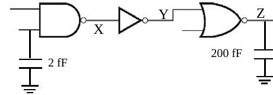

- g_NAND = 4/3, g_inv = 1, g_NOR = 5/3; F = 200/2 = 100, G = 20/9, H = 2000/9, h = ∛H ≈ 6
- f₁ = 6/(4/3) = 4,5, f₂ = 6, f₃ = 6/(5/3) = 3,6
- C_in = g₁s₁C_ref ⇒ 2 = (4/3)s₁ ⇒ s₁ = 1,5; s₂ = f₁g₁s₁/g₂ = **9**; s₃ = f₁f₂g₁s₁/g₃ = **32,4**

**c)** Tüm açık girdilerin 1 olma olasılığı 0,4; V_DD = 2,5 V, f_clock = 250 MHz:

- P_X=0 = 0,4 × 0,4 = 0,16 (NAND), P_Y=0 = P_X=1 = 0,84
- P_Z=1 = P_Y=0 × (1 − 0,4) = 0,504, P_Z=0 = 0,496; **P₀→₁ = 0,496 × 0,504 ≈ 0,25**
- P_dyn = 200×10⁻¹⁵ × 2,5² × 0,25 × 250×10⁶ = **78,125 µW**

### Soru 4 (29p): F(A, B, C) = AB + AB′C + A′C′

En az transistörle a) CMOS, b) yalnız transmission gate, c) DCVSL tasarımı (değillenmiş girişler mevcut). Doğruluk çizelgesi: AB = 00 → C′, 01 → C′, 10 → C, 11 → 1. Karnaugh haritasından F′ = AB′C′ + A′C, dolayısıyla CMOS geçit F = (AB′C′ + A′C)′ olarak tek kademede kurulur.

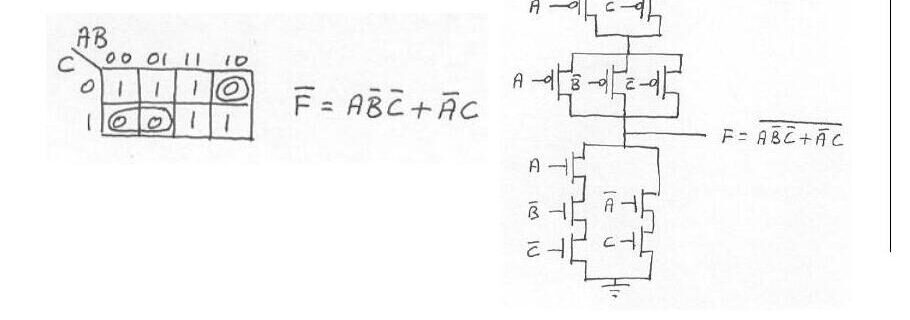

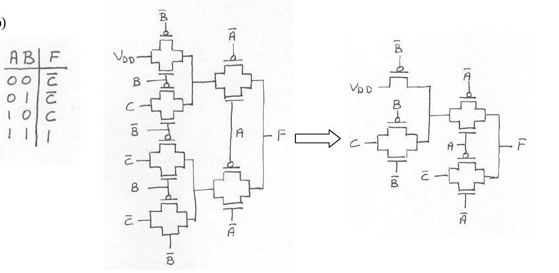

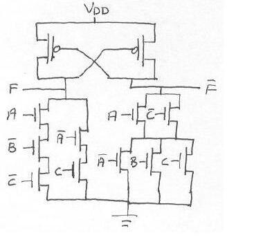

**d)** Başlangıçta sığaç V_DD'ye doluyken, kararlı durumda A, B, C gerilimleri:

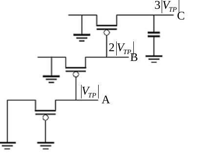

> PMOS'larda V_GS, V_TP'nin altına düşemez. En alttaki transistörden başlayarak yukarı doğru gidildiğinde **A = |V_TP|, B = 2|V_TP|, C = 3|V_TP|** bulunur.

Puanlar: S1 24p, S2 20p, S3 27p, S4 29p; süre 120 dakika.
