This post brings together the five **end-of-semester (final) exams** of the Başkent University **EEM312 Digital Electronics** course (Prof. Dr. Emin Akata) from 2007–2011, along with their solutions: 04.06.2007, 02.06.2008, 01.06.2009, 03.06.2010 and 03.06.2011 (general exam). The questions and the instructor's solutions have been transcribed, the circuit figures have been added as images, and the calculations have been checked. Copies of the same exams in other folders (`eem312_07_final.doc`, `FINAL_EEM312_08_S.doc`, `2007.pdf`, `2008.pdf`) were eliminated. The original Word files can be downloaded as a ZIP at the end of the post. Earlier finals: [Final Exams 2003–2006](/arsiv/eem312-final-sinavlari-2003-2006/); midterms: [2003–2006](/arsiv/eem312-ara-sinavlar-2003-2006/), [2007–2010](/arsiv/eem312-ara-sinavlar-2007-2010/).

## 2007 – End-of-semester exam (04.06.2007)

### Question 1 (25 pts, 5 pts each part)

**a)** Relationship between short-circuit (direct path) loss and C_L: with a large C_L the output changes slowly, so as the input rises the PMOS quickly goes into cut-off and I_sc ≈ 0; with a small C_L the PMOS remains conducting for most of the input rise time and the largest I_sc flows. To reduce the loss, **a large C_L** is beneficial.

**b)** Fill in the blanks (answers in bold):

- According to Moore's law, the number of MOSFETs in an IC doubles every **14–18 months**.
- The "hot-carrier" effect causes an **increase** in the magnitude of the threshold voltage.
- Reducing the threshold voltage **increases** performance and static power consumption.
- In a CMOS inverter, if the **PMOS** width is increased, the transition region in the VTC shifts to the right.
- In the CMOS fabrication process, if the die area increases, **yield** decreases.

**c)** Why do the PUN and PDN consist of PMOS and NMOS, respectively?

> If the PUN had NMOS, then with V_in = V_DD, while C_L charges through the NMOS the NMOS source is V_out; when V_out reaches V_DD − V_Tn, V_GS = V_Tn and the NMOS goes into cut-off. Similarly, if the PDN had PMOS, then with V_in = 0, while C_L discharges, the PMOS goes into cut-off when V_out drops to |V_Tp| and the output cannot fall to ground. Thus a "rail-to-rail" swing cannot be obtained. When PMOS is used in the PUN and NMOS in the PDN, a rail-to-rail swing is achieved.

**d)** In what state are the transistors at the V_M point of a CMOS inverter?

> By definition, V_M is the point where V_in = V_out. Since I_DSp = −I_DSn; V_GSn = V_in, V_GSp = V_in − V_DD; V_DSn = V_out, V_DSp = V_out − V_DD, we can write V_DS = V_GS for both transistors. This shows that the saturation conditions V_DSn ≥ V_GSn − V_Tn and V_DSp ≤ V_GSp − V_Tp are satisfied: at V_M **both transistors are in saturation**.

**e)** Logical effort of a 2-input CMOS NOR with PMOS/NMOS = 2: the two series PMOS must be made 4 times larger; each input sees 1 + 4 = 5 C_unit. Since an inverter input sees 1 + 2 = 3 C_unit, **g = 5/3**.

### Question 2 (10 pts): Operating regions

V_T = 0.4 V, V_DSAT = 1 V:

| V_GS | V_DS | State |
|---|---|---|
| 0.3 V | 3 V | V_GS < V_T, no channel forms: **OFF** |
| 0.8 V | 2 V | V_DS > V_DSAT > V_GS − V_T = 0.4 V: **SAT** |
| 1 V | 0.8 V | V_DSAT > V_DS > V_GS − V_T = 0.6 V: **SAT** |
| 2 V | 0.5 V | V_GS − V_T = 1.6 V > V_DSAT > V_DS: **LIN** |

### Question 3 (20 pts): Complementary CMOS gate

L_n = L_p; R_n = 10 kΩ for W_n = 1 µm, R_p = 30 kΩ for W_p = 1 µm, C_L = 1 pF.

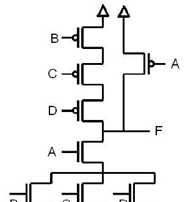

- **a)** F = [A(B + C + D)]′
- **b)** The worst delay comes from the path with the largest equivalent resistance: D–C–B for the PUN, A–B (or C or D) for the PDN. t_pLH,max = 0.69(3R_p)C_L = **62.1 ns**, t_pHL,max = 0.69(2R_n)C_L = **13.8 ns**.
- **c)** For t_pLH = t_pHL we need R_PUN = R_PDN: if the B, C, D PMOS multiplier is X and the NMOS multiplier is Y, then 3R_p/X = 90/X and 2R_n/Y = 20/Y ⇒ X = 9Y/2. If W_n (A, B, C, D) = 2 µm is chosen, then W_p (B, C, D) = **9 µm**. It suffices for the A PMOS alone to give R_pA = R_PDN = 10 kΩ: W_pA = (1 µm)(30 kΩ/10 kΩ) = **3 µm**.
- **d)** For the longest t_pLH: the highest-resistance PUN path (B, C, D) must be used, and the internal node capacitances that must be charged must be empty. A = 1 is required; for the nodes between D–C and C–B to be empty, D = 0 and C = 0 while the output is 0. **The 1→0 transition of B with A = 1, C = 0, D = 0** gives the worst delay.

### Question 4 (15 pts): Probability and power in a NOR gate

- **a)** With equiprobable inputs, for a 3-input NOR, P(F = 1) = 1/2³ = **0.125**.
- **b)** If the probability of each input being 0 is 0.1, then P(F = 1) = 0.1³ = 0.001; P(F: 0→1) = (1 − 0.001)(0.001) = 0.999×10⁻³ ≈ **0.001**.
- **c)** V_DD = 2 V, C_L = 1 nF, f = 1 GHz: P_d = V_DD² C_L f P₀→₁ = 4 × 10⁻⁹ × 10⁹ × 10⁻³ = **4 mW**.

### Question 5 (10 pts): 3-input AND with pass transistor logic

- **a)** With four NMOS (inverted inputs may be used): input A is passed to F through two series transistors whose gates are B and C; two transistors with gates C′ and B′ tie F to 0.
- **b)** V_Tn = 0.6 V, V_DD = 3 V: due to the threshold drop, V_OH = V_DD − V_Tn = **2.4 V**, V_OL = **0 V**, V_swing = **2.4 V**.

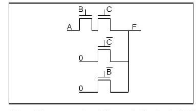

### Question 6 (20 pts): Inverter chain

A load C_L = 10⁵ C_g will be driven with f = 5; in the first inverter W_p = 4 µm, W_n = 2 µm, t_p0 = 0.2 ns, γ = 1.

- **a)** f = F^(1/N) = 10^(5/N) = 5 ⇒ N = 5/log 5 = 7.15 ⇒ **N = 7**.
- **b)** t_p = Nt_p0(1 + f/γ) = 7 × 0.2 ns × 6 = **8.4 ns**.
- **c)** The 5th inverter is f⁴ = 625 times larger than the first: W_n5 = **1250 µm**, W_p5 = **2500 µm**.

Points: Q1 25, Q2 10, Q3 20, Q4 15, Q5 10, Q6 20.

## 2008 – End-of-semester exam (02.06.2008)

### Question 1 (25 pts, 5 pts each part)

**a)** How does V_M change if W_p is increased? As W_p increases, the PMOS resistance decreases; the output of the voltage divider formed by R_p and R_n approaches V_DD and the drive strength of the PMOS increases: **V_M approaches V_DD**.

**b)** Why is the I_D–V_GS relation quadratic ("exponential") in saturation but linear in velocity saturation? In the linear region, I_D = k′(W/L)[(V_GS − V_T)V_DS − V_DS²/2](1 + λV_DS). When V_DS reaches V_DSAT, velocity saturation begins and the current at that moment stays constant as V_DS increases; when V_DS = V_DSAT is substituted into this expression, I_D varies **linearly** with V_GS. Saturation, on the other hand, begins at V_DS = V_GS − V_T and I_D = (k′/2)(W/L)(V_GS − V_T)²(1 + λV_DS); here the relation is **quadratic**.

**c)** The fundamental problem of pass transistor logic and the transmission gate solution:

> In an NMOS pass transistor, when V_GS reaches V_DD − V_T the transistor goes into cut-off; the output cannot rise to V_DD and a "weak 1" is passed. Since V_BS also grows, the body effect increases V_T and the output remains even lower. The transmission gate adds a PMOS in parallel with the NMOS: with C = 1 both conduct. When passing a "1", the NMOS goes into cut-off at V_DD − V_T but the PMOS continues to charge the capacitor up to V_DD; when passing a "0", the PMOS goes into cut-off at V_T but the NMOS discharges the capacitor down to 0.

**d)** Power–performance optimization with V_DD, V_T and W/L:

- V_T ↓ → performance ↑, static power ↑
- V_DD ↓ → performance ↓, dynamic power ↓↓ (quadratic)
- W/L ↑ → performance ↑, dynamic power ↑

Reducing V_DD lowers dynamic power quadratically but performance falls as well; when V_DD is lowered to about 2V_T the drop becomes unacceptable. For this reason V_T is also reduced, but then static power increases. One way to regain the lost performance is to increase W/L; since this increases C_L, beyond a certain point it becomes "self loading" and the area is wasted.

**e)** Logical effort of a 2-input NAND with PMOS/NMOS = 3: in the inverter the input sees 3 + 1 = 4 C_unit (g = 1). In the NAND, since the PMOS are sized 3 and the series NMOS are sized 2, each input sees 5 C_unit: **g = 5/4**.

### Question 2 (20 pts): Body effect

V_T0 = 0.5 V, k′ = 8.5×10⁻⁵ A/V², 2φ_F = −0.74 V, γ = 0.48 V^½, λ = 0.01 V⁻¹.

**a)** V_G = 2.8 V, V_D = 5 V, V_S = 1 V, V_B = 0 V, and I_D = 0.425 A is measured; what is W/L?

- V_SB = 1 V: V_T = 0.5 + 0.48(√1.74 − √0.74) = 0.72 V
- V_GS = 1.8 V, V_DS = 4 V > V_GS − V_T = 1.08 V ⇒ saturation
- W/L = 2I_D / [k′(V_GS − V_T)²(1 + λV_DS)] = 2 × 0.425 / (8.5×10⁻⁵ × 1.17 × 1.04) = **8218**

**b)** V_G = 5 V, V_D = 4 V, V_S = 2 V, V_B = 1 V: V_SB is again 1 V, V_T = 0.72 V. V_GS = 3 V, V_DS = 2 V < V_GS − V_T = 2.28 V ⇒ linear region.

- I_D = k′(W/L)[(V_GS − V_T)V_DS − V_DS²/2](1 + λV_DS) = 8.5×10⁻⁵ × 8218 × [2.28×2 − 4/2] × 1.02 = **1.82 A**

### Question 3 (15 pts): Logical effort

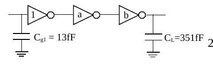

- **a)** F = C_L/C_g1 = 351/13 = 27. Delay without buffers is t_p0(1 + F/γ) = 28 t_p0. For N = 3, t_p = 3t_p0(1 + ∛27) = **12 t_p0**, f = 3; **a = f = 3, b = f² = 9**.
- **b)** With a 2-input NAND (PMOS/NMOS = 2) in place of the middle inverter: g₁ = g₃ = 1, g₂ = 4/3; G = 4/3, H = 27 × 4/3 = 36, h = ∛36 = 3.3. f₁ = 3.3, f₂ = 2.475, f₃ = 3.3; **a = s₂ = f₁g₁/g₂ = 2.475**, **b = s₃ = f₁f₂g₁/g₃ = 8.17**.

### Question 4 (20 pts)

**a)** Design the function X = [(A′ + B′)(C′ + D′ + E′) + F′]G′ = [(AB + CDE)F + G]′ with an inverter having (W/L)_NMOS = 2, (W/L)_PMOS = 6, so that it supplies the same current in the worst case.

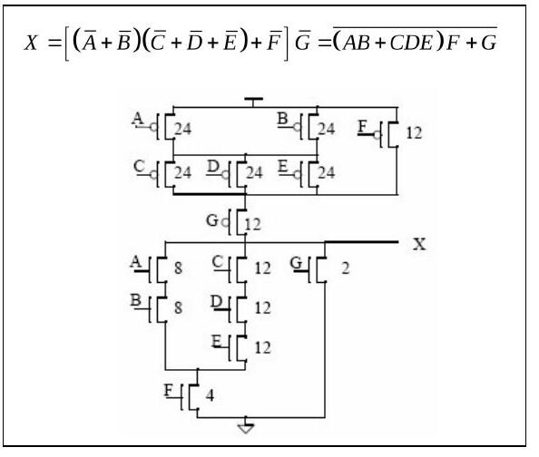

NMOS paths: 1/8 + 1/8 + 1/4 = 1/2 and 3/12 + 1/4 = 1/2 (1/2 of the inverter); G alone is 2. PMOS paths: 1/24 + 1/24 + 1/12 = 1/6 and 1/12 + 1/12 = 1/6.

**b)** Pass transistor circuit for Y = AB + C and the CPL (differential) addition (without using more transistors than necessary, with complemented inputs):

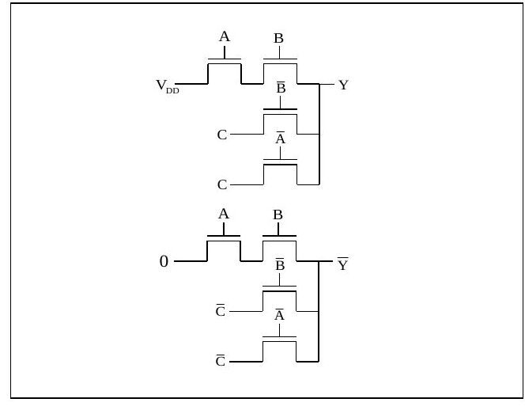

### Question 5 (20 pts): Reconvergent fanout and energy

P_A = P_S = P_B = 0.5; C = 1 fF, V_DD = 3 V, f = 2 GHz (power at the inverter output connected to S is neglected).

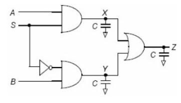

- P_X = P_A P_S = 0.25; P_X,0→1 = (1 − 0.25)(0.25) = 0.1875. Since P_S′ is also 0.5, P_Y and P_X are the same.
- S and S′ create "reconvergent fanout"; from the truth table for Z, P_Z = 0.5, P_Z,0→1 = 0.25.

| A | S | B | S′ | Z |
|---|---|---|---|---|
| 0 | 0 | 0 | 1 | 0 |
| 0 | 0 | 1 | 1 | 1 |
| 0 | 1 | 0 | 0 | 0 |
| 0 | 1 | 1 | 0 | 0 |
| 1 | 0 | 0 | 1 | 0 |
| 1 | 0 | 1 | 1 | 1 |
| 1 | 1 | 0 | 0 | 1 |
| 1 | 1 | 1 | 0 | 1 |

- Node X (and Y): CV_DD²P_X,0→1 f = 10⁻¹⁵ × 9 × 0.1875 × 2×10⁹ = **3.375 µW**
- Node Z: 10⁻¹⁵ × 9 × 0.25 × 2×10⁹ = **4.5 µW**
- Total power 3.375 + 3.375 + 4.5 = 11.25 µW; energy = power/f = **5.6 fJ**

Points: Q1 25, Q2 20, Q3 15, Q4 20, Q5 20; duration 100 minutes.

## 2009 – End-of-semester exam (01.06.2009)

### Question 1 (30 pts, 5 pts each part)

**a)** How should W_p/W_n change to bring V_M closer to ground? At V_M both transistors are in saturation; R_p and R_n form a voltage divider, with the PMOS pulling V_M up and the NMOS pulling it to ground. For the NMOS to pull the output toward ground, R_n must decrease, i.e. **the W_p/W_n ratio must decrease**.

**b)** Ratioed and ratioless logic: in CMOS the output swings between V_DD and ground independently of R_n and R_p; this is why it is called "ratioless". In a ratioed structure with a resistive load (R_L), V_OH can reach V_DD but since V_OL = [R_PDN/(R_PDN + R_L)]V_DD it can never be 0 V and depends on the ratio of the resistances. This causes an asymmetric response and static power consumption; on the other hand, the number of transistors is halved.

**c)** Short-circuit loss and C_L: V_out is the drain of the PMOS. With a large C_L, while the input rises (V_GS = V_DD) the V_DS of the PMOS is about 0 V, so I_sc ≈ 0; with a small C_L the capacitor discharges quickly, the V_DS of the PMOS is about V_DD throughout the long input rise and I_sc flows. To reduce the loss, **a large C_L** is beneficial.

**d)** What does measuring C_GCS = 0 in a channel capacitance measurement indicate? When the transistor is in cut-off no channel forms, so the entire capacitance (WLC_ox) appears between gate and body. Once the channel forms it acts as a shield; the gate-body capacitance goes to zero and the capacitance appears as gate-drain and gate-source. The only case in which C_GCS is zero is the **cut-off** state.

**e)** "Glitching": if not all inputs of a gate arrive at the same time, the output may sit at a level different from what it should be until the inputs settle, and may make temporary oscillations. For example, in an F₁ → F₂ → F₃ chain, one signal reaches F₃ directly while the other arrives delayed. Glitching increases delay and power loss; logic changes that make the signals reach the gates at the same time without changing the function (e.g. converting the chain into a balanced tree) are beneficial.

**f)** Contribution of the transmission gate to the pass transistor: the most important problem of the pass transistor is the **threshold drop** loss when passing a "1", which arises from its being made of NMOS. In a transmission gate an NMOS and a PMOS are connected in parallel; the PMOS passes the "1" and the NMOS passes the "0" (the capacitor charges through the PMOS and discharges through the NMOS), and the threshold drop is prevented.

### Question 2 (20 pts): Operating regions

NMOS: V_T = 0.3 V, V_DSAT = 0.3 V, k′ = 100 µA/V²; PMOS: V_T = −0.3 V, V_DSAT = −0.5 V, k′ = −50 µA/V² (λ = 0, γ = 0).

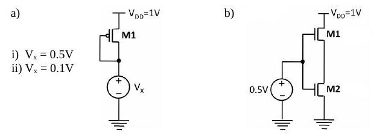

- **a)** V_x = 0.5 V: |V_GS| = 0.5 V, |V_GS| − |V_T| = 0.2 V < |V_DSAT|, |V_DS| = 0.5 V > 0.2 V ⇒ **saturation**. V_x = 0.1 V: |V_GS| = 0.9 V, |V_GS| − |V_T| = 0.6 V > |V_DSAT|, |V_DS| = 0.9 V > |V_DSAT| ⇒ **velocity saturation**.
- **b)** Let the source of M1 (the drain of M2) be V_y; V_y must be < 0.2 V (otherwise M1 would be in cut-off). M2: V_GS − V_T = 0.2 V < V_DSAT and V_DS = V_y < 0.2 V ⇒ **M2 is in the linear region**. M1: V_DS = 1 − V_y > 0.8 V, 0 < V_GS − V_T < 0.2 V < V_DSAT ⇒ **M1 is in saturation**.

### Question 3 (20 pts)

**a–b)** Design the function X = (E′ + F′)[A′ + (B′ + C′)D′] (no complemented inputs) as CMOS and size it to supply the same current as the smallest inverter with W_n/W_p = 1/2. By De Morgan, X′ = EF + A(BC + D), so V_out = X is obtained in a single stage.

![PUN: E ∥ F (4) in series with A (4) ∥ [D (8) – (B ∥ C) (8)]; PDN: E–F series (2) ∥ A (2) – [(B–C series 4) ∥ D (2)]](f09-s3a.jpg "2009, Question 3a–b")

**c)** The output function of the circuit below:

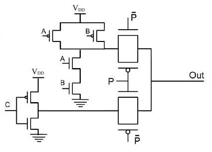

> There is an inverter at input C, a NAND at A and B, and two transmission gates connected to the output; when P = 1, C′ is passed to the output, and when P = 0, (AB)′ is passed: **Out = C′P + (AB)′P′**.

### Question 4 (30 pts): Logical effort and power

The inverters at the inputs are minimum size (input capacitance 1 fF), C_L = 25 fF.

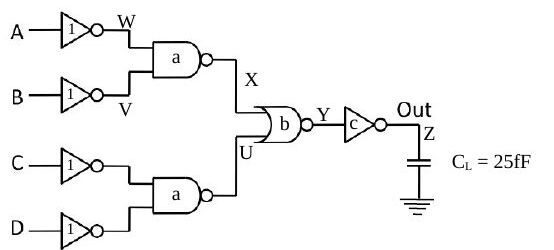

**a)** g₁ = g₄ = 1, g₂ = 4/3 (NAND2), g₃ = 5/3 (NOR2); G = 20/9, B = 1, F = 25, H = 55.56, h = ⁴√H = 2.73.

- f₁ = 2.73, f₂ = 2.05 ≈ 2, f₃ = 1.64 ≈ 1.6, f₄ = 2.73
- **a = f₁g₁/g₂ = 2**, **b = f₁f₂g₁/g₃ = 3.3**, **c = f₁f₂f₃g₁/g₄ = 8.7**
- In the solution, the minimum delay D = t_p0[Σp_j + N·H^(1/N)/γ] = t_p0[(1×2×1×2) + 4×2.73] = **14.9 t_p0** is found.

*Note: In the solution, the parasitic delays were multiplied when they should have been summed. For p_inv = 1, p_NAND2 = p_NOR2 = 2, Σp = 1 + 2 + 2 + 1 = 6; the correct result is D = (6 + 4 × 2.73)t_p0 ≈ 16.9 t_p0.*

**b)** Dynamic power at Out for P_A = P_C = 0.5, P_B = P_D = 0.2, V_DD = 2.5 V, f = 1 GHz:

- P_W = 0.5, P_V = 0.8, P_X = 1 − P_W P_V = 0.6, P_U = P_X
- P_Y = (1 − P_X)(1 − P_U) = 0.16, P_Z = 0.84; P_Z,0→1 = 0.16 × 0.84 = 0.1344
- P_dyn = 25×10⁻¹⁵ × 6.25 × 0.1344 × 10⁹ = **21 µW**

Points: Q1 30, Q2 20, Q3 20, Q4 30; duration 100 minutes.

## 2010 – End-of-semester exam (03.06.2010)

### Question 1 (25 pts)

- **a)** Power–performance optimization with V_DD, V_T and W/L — the answer is the same as 2008 Question 1d.
- **b)** Short-circuit loss and C_L — the answer is the same as 2009 Question 1c: a large C_L is beneficial.
- **c)** PUN/PDN being PMOS/NMOS — the answer is the same as 2007 Question 1c (rail-to-rail swing).
- **d)** Critical signal and transistor ordering: among the inputs, the signal that settles last is the critical signal; connecting it to the transistor closest to the output improves performance (while it is awaited, the lower internal node capacitances can discharge).

**e)** NMOS pass transistor with gate at V_DD, V_DD = 1.2 V, V_T = 0.4 V, no body effect:

1. V_in = 0 V: the input terminal is the source, V_GS = V_DD; the transistor passes a "strong 0": **V_out = 0 V**.
1. V_in = 0.6 V: V_DD − V_in = 0.6 V > V_T, the transistor conducts and the input is passed unchanged: **V_out = 0.6 V**.
1. V_in = 0.9 V: V_DD − V_in = 0.3 V < V_T; the input becomes the drain and the output the source, a "weak 1" is passed and the output rises only up to V_DD − V_T: **V_out = 0.8 V**.
1. V_in = 1.2 V: by the same reasoning **V_out = 0.8 V**.

### Question 2 (15 pts): f(a, b, c) = c(ab + a′b′)

A CMOS circuit that presents the same resistance as an inverter with NMOS/PMOS ratio 1/2 (complemented inputs may be used). The PDN realizes f′ = c′ + [(a′ + b′)(a + b)]′, and the PUN is its dual. Taking W = 1, the c′ NMOS is not upsized; the others are sized as in the figure (series NMOS pairs 2W, three series PMOS 6W).

![PUN: c′ (6W) in series with (a ∥ a′) – (b ∥ b′) network (6W); PDN: c′ (W) ∥ [(a, b parallel 2W) – (a′, b′ parallel 2W)]](f10-s2.jpg "2010, Question 2")

### Question 3 (15 pts): V_out in a PMOS circuit

K_p = 1 mA/V², λ_p = 0, V_Tp = −1 V; the source is at 5 V, the gate at 1 V, and the drain is connected to ground through 2 kΩ.

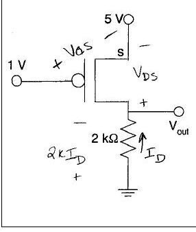

> V_GS = −4 V, the circuit is not in cut-off. If saturation is assumed, I_D = −½K(V_GS − V_T)² = −4.5 mA and from 2000I_D + V_DS + 5 = 0 we get V_DS = +4 V; V_DS cannot be positive for a PMOS, so the transistor is in the linear region. Solving I_D = (3 + V_DS/2)V_DS and I_D = −(5 + V_DS)/2000 together gives V_DS = −6.19 V (impossible) or **V_DS = −0.81 V**; **V_out = 5 − 0.81 = 4.19 V**.

### Question 4 (15 pts): Total dynamic power

V_DD = 2.5 V, f = 1 GHz, P_A=1 = 0.5, P_B=1 = 0.4, P_C=1 = 0.7.

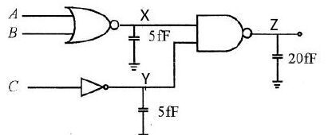

- P_X = (1 − P_A)(1 − P_B) = 0.3, P_X,0→1 = 0.7 × 0.3 = 0.21; P_dyn,X = 0.21 × 10⁹ × 5×10⁻¹⁵ × 2.5² = **6.6 µW**
- P_Y = 1 − P_C = 0.3, P_Y,0→1 = 0.21 ⇒ P_dyn,Y = **6.6 µW**
- P_Z = 1 − P_X P_Y = 0.91, P_Z,0→1 = 0.09 × 0.91 = 0.0819; P_dyn,Z = 0.0819 × 10⁹ × 20×10⁻¹⁵ × 2.5² = **10.2 µW**
- Total **23.4 µW**

### Question 5 (30 pts)

Identical to questions 3a and 3b of the 2006 final: in a chain driving a load of 1200 C_inv from C_inv, with 4 inverters t_p = 27.54 t_p0, and the best, N = 6, gives 25.56 t_p0 (sizes 1; 3.26; 10.63; 34.6; 112.9; 368.2); in the NAND (2 fF) – inverter – NOR (200 fF) chain, h ≈ 6, s₁ = 1.5, s₂ = 9, s₃ = 32.4. For the detailed solution see the [2006 final](/arsiv/eem312-final-sinavlari-2003-2006/).

Points: Q1 25, Q2 15, Q3 15, Q4 15, Q5a 15, Q5b 15; duration 100 minutes.

## 2011 – Midterm Exam (03.06.2011)

### Question 1 (30 pts)

**a)** In the CPL structure, a 2-input XOR/XNOR has two separate pass-transistor networks; one produces F and the other produces F′. For example, the topmost transistor passes A to the output when B = 0 (B′ = 1), forming the AB′ term of the XOR.

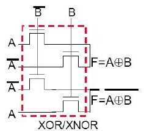

**b)** DCVSL: both the function and its complement are obtained at the output (differential); all variables and their complements are present at the inputs. The pull-down network consists of two blocks (PDN1, PDN2), one producing Out and the other Out′, and the pull-up network consists of two cross-coupled PMOS transistors, each connected to one output. When the relevant PDN block is "on", the opposite PMOS is "off", and when it is "off", the PMOS is "on"; this provides pull-up/pull-down operation similar to CMOS.

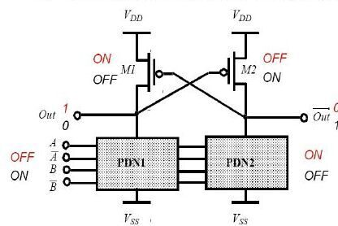

**c)** The probability of every input being 1 is 50%; propose a solution with lower dynamic power and prove it numerically (no glitches).

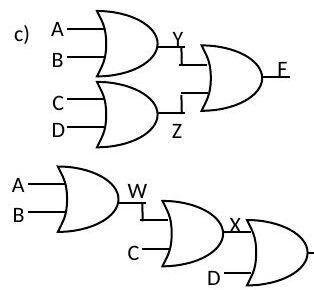

- Tree structure: P_Y=0 = 0.5 × 0.5 = 0.25, P_Y=1 = 0.75, P_Y,0→1 = 0.1875; the same for Z. Total: 0.375 + P_F,0→1.
- Chain structure: for W, 0.1875; P_X=0 = (1 − 0.75)(1 − 0.5) = 0.125, P_X,0→1 = 0.125 × 0.875 = 0.109. Total: 0.297 + P_F,0→1 (P_F is the same in both structures).
- Since 0.297 < 0.375, the **proposed chain structure** has lower dynamic power consumption.

**d)** In a 2-input NAND (transistor A is closer to the output), three input patterns:

1. A = 1, B = 0→1: single pull-up transistor; C_int and C_L must be discharged.
1. A = 0→1, B = 1: single pull-up transistor; C_int is already discharged, only C_L must be discharged — **best delay**.
1. A = B = 0→1: both transistors in the pull-up must be turned "off"; C_int and C_L must be discharged — **worst delay**.

**e)** "Threshold drop": for rail-to-rail swing, C_L must discharge down to ground and charge up to V_DD. An NMOS can charge C_L only up to V_DD − V_Tn (b), while a PMOS can discharge it only down to |V_Tp| (d). When the terminal of the transistor connected to C_L is the source, V_GS, which changes as the capacitor charges and discharges, falls below the critical V_T, the transistor goes into cutoff and blocks the path.

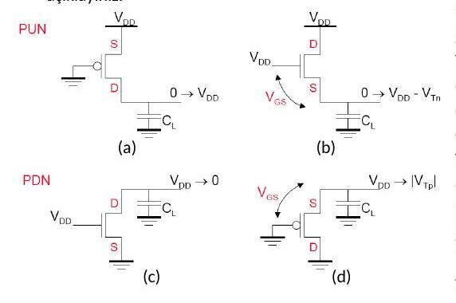

**f)** A PMOS pass transistor with its gate at 0 V, V_DD = 1.8 V, |V_T| = 0.5 V, with the output capacitance initially charged to 0.9 V each time:

1. V_in = 1.8 V: the input is the source, V_GS = 1.8 V is constant: **V_out = 1.8 V**.
1. V_in = 0.6 V > |V_T|: by the same reasoning, **V_out = 0.6 V**.
1. V_in = 0.4 V < |V_T|: the input becomes the drain; due to the threshold drop, **V_out = 0.5 V**.
1. V_in = 0 V: for the same reason, **V_out = 0.5 V**.

### Question 2a (10 pts): Delay–fan-out graph

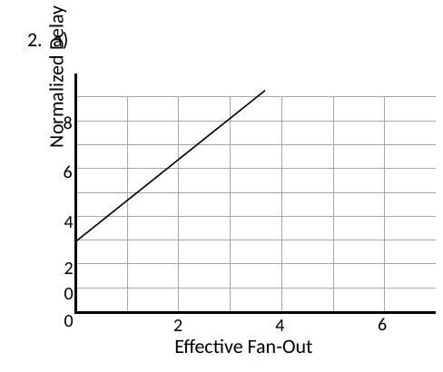

d = h + p, h = gf; the line is d = gf + p. The point where the line crosses the vertical axis is **p = 3** (intrinsic delay). Since d = 8, **h = 8 − 3 = 5** (effort delay); the slope is **g = 5/3** (logical effort); the horizontal position corresponding to d = 8 is **f = 3** (effective fan-out). Since p = n for an n-input NAND, the gate has **3 inputs**.

### Question 2b (15 pts): Total dynamic power

V_DD = 2 V, f = 1 GHz, P_A=1 = 0.3, P_B=1 = 0.6, P_C=1 = 0.4; C_L1 = 10 fF, C_L2 = 5 fF, C_L3 = 20 fF.

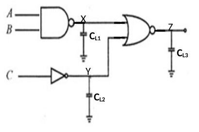

- P_X=0 = P_A P_B = 0.18, P_X=1 = 0.82, P_X,0→1 = 0.148
- P_Y=0 = P_C=1 = 0.4, P_Y=1 = 0.6, P_Y,0→1 = 0.24
- P_Z=1 = P_X=0 P_Y=0 = 0.072, P_Z=0 = 0.928, P_Z,0→1 = 0.067
- P_dyn = (10×10⁻¹⁵ × 4 × 0.148 × 10⁹) + (5×10⁻¹⁵ × 4 × 0.24 × 10⁹) + (20×10⁻¹⁵ × 4 × 0.067 × 10⁹) = **16.08 µW**

### Question 3 (25 pts): Ring oscillator

Find the delay of each inverter and the oscillation frequency; only the gate capacitances (WLC_ox) and the 5 pF at the output are to be considered; assume the transistors are velocity-saturated and rail-to-rail swing.

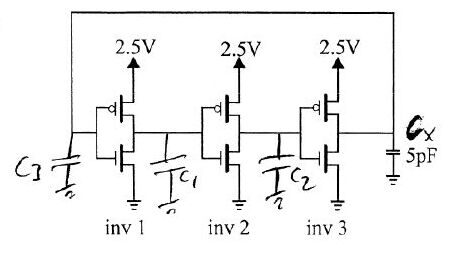

| | V_T (V) | k′ (µA/V²) | C_ox (fF/µm²) | V_DSAT (V) | W (µm) | L (µm) |
|---|---|---|---|---|---|---|
| NMOS | 0.4 | 120 | 6 | 0.6 | 0.5 | 0.25 |
| PMOS | −0.4 | −30 | 6 | −1 | 1.5 | 0.25 |

- I_DSATp = k′_p(W_p/L)[(V_DD − |V_Tp|)|V_DSATp| − V_DSATp²/2] = −30 × 6 × [2.1 × 1 − 0.5] = **−288 µA**; R_eqp = (3/4)V_DD/|I_DSATp| = 0.75 × 2.5/288 µA = **6.5 kΩ**
- I_DSATn = 120 × 2 × [2.1 × 0.6 − 0.18] = **259 µA**; R_eqn = 0.75 × 2.5/259 µA = **7.2 kΩ**
- C₁ = C₂ = C₃ = W_nLC_ox + W_pLC_ox = 0.75 + 2.25 = **3 fF**
- t_p1 = t_p2 = 0.69 C₁ (R_eqp + R_eqn)/2 = 0.69 × 3 fF × 6.85 kΩ = **14.18 ps**
- t_p3 = 0.69 (C₃ + C_x)(R_eqp + R_eqn)/2 = 0.69 × 5003 fF × 6.85 kΩ = **23.647 ns**
- f_osc = 1/[2(t_p1 + t_p2 + t_p3)] = 1/(2 × 23.675 ns) = **21.12 MHz**

### Question 4 (20 pts): CMOS with the fewest transistors

Design the function F(A, B, C) = (A′ + B′)(C′ + A′B′) (no complemented inputs available) with the fewest transistors, and size it so that it delivers the same current as an inverter with NMOS/PMOS = 1/3.

> F = [AB + C(A + B)]′ = (A′ + B′)C′ + A′B′. PDN: A–B in series ∥ C–(A ∥ B), NMOS size 2; PUN is the dual structure, PMOS size 6.

![CMOS gate with output Y = [AB + C(A + B)]′, with the PUN built from size-6 PMOS transistors and the PDN from size-2 NMOS transistors](f11-s4.jpg "2011, Question 4")

Points: Q1 30 pts, Q2a 10 pts, Q2b 15 pts, Q3 25 pts, Q4 20 pts; duration 100 minutes.
